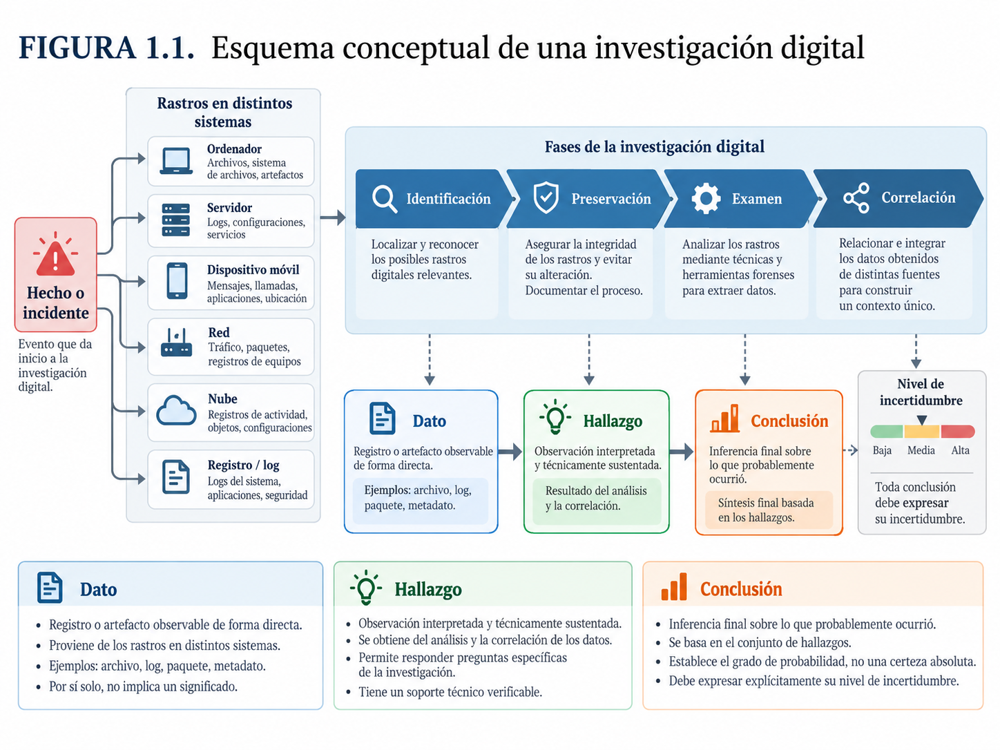
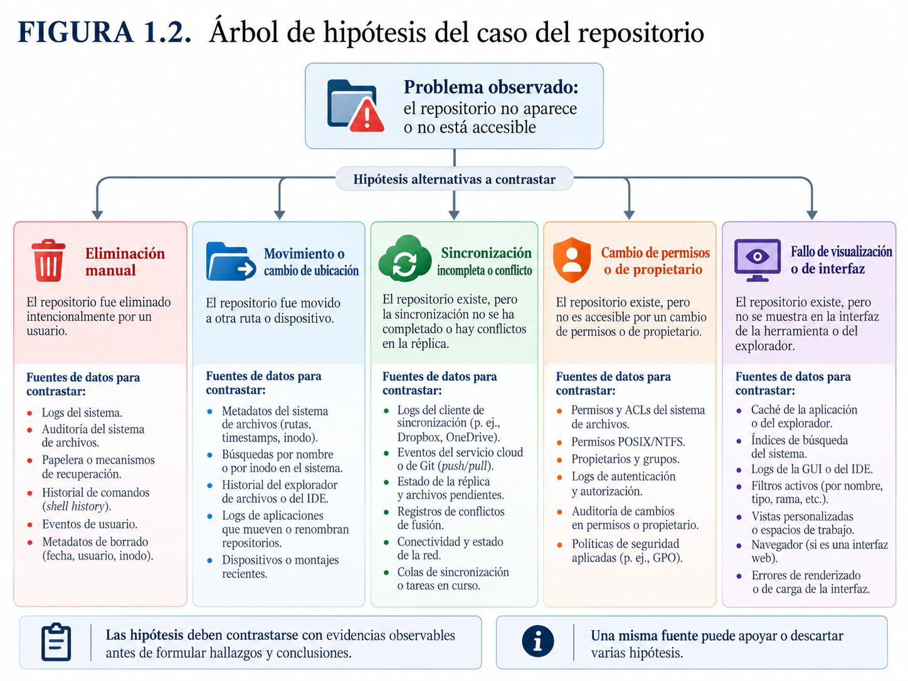
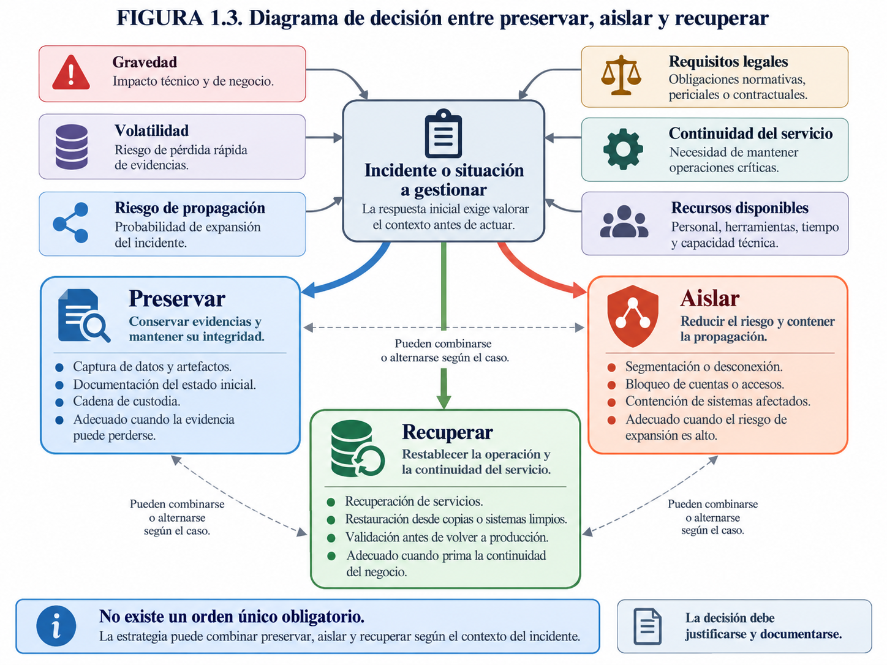
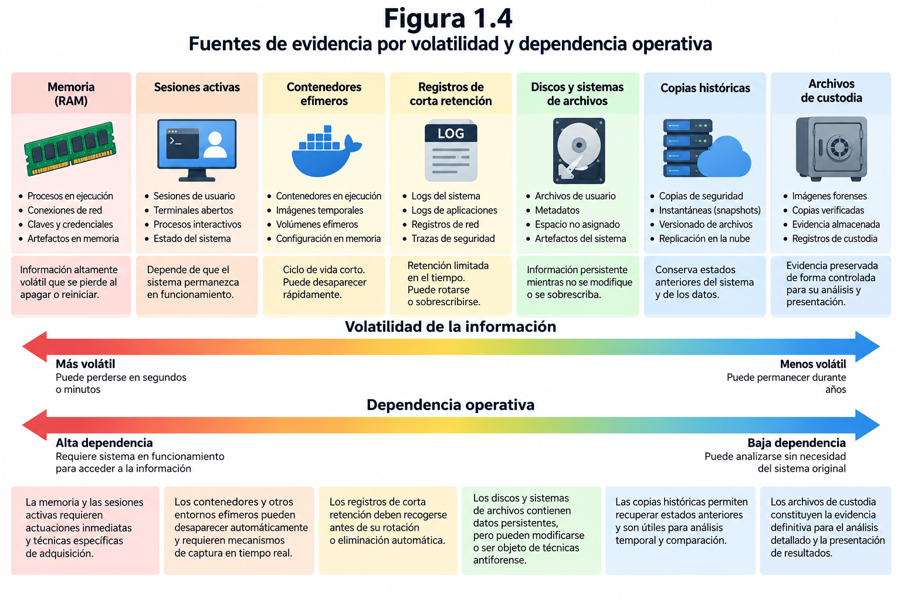
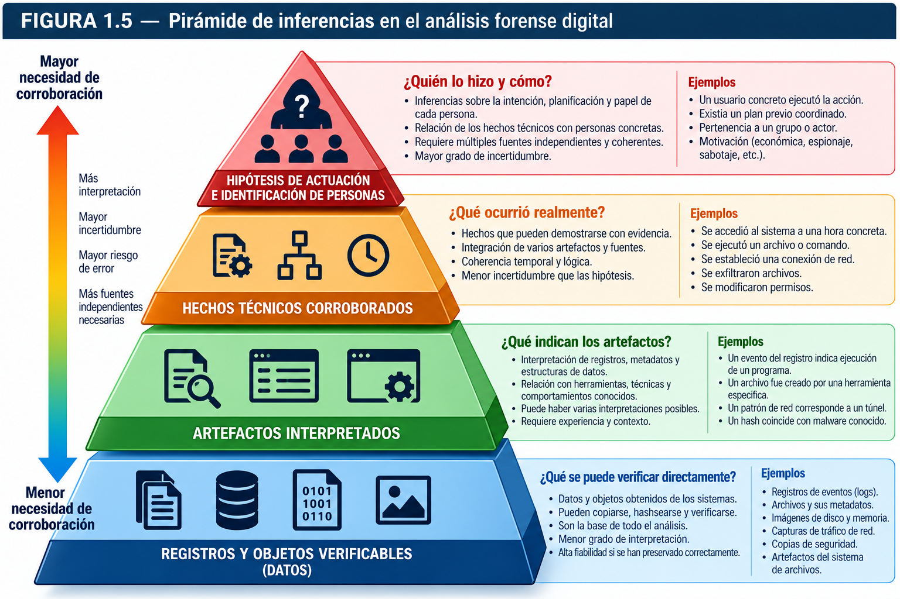
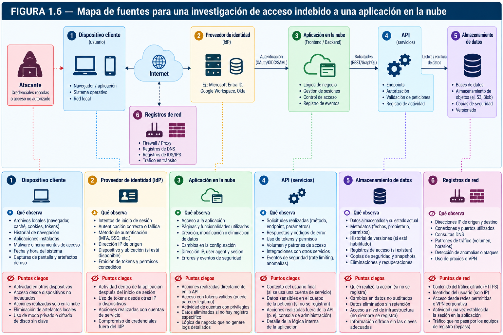

\newpage
\thispagestyle{empty}

\vspace*{\fill}

\begin{center}

{\Large\itshape “PARTE I. FUNDAMENTOS, METODOLOGÍA Y ADQUISICIÓN DE EVIDENCIAS”}

\vspace{1.2cm}

{\large Análisis Forense Informático}\\
{\itshape JG Gutierrez} 

\end{center}

\vspace*{\fill}

\newpage

# Introducción al análisis forense digital

> "No señor, la verdad científica está más allá de la lealtad o de la deslealtad."
> 
> ("No Sir, scientific truth is beyond loyalty and disloyalty.")
>
> 
> — Isaac Asimov, Fundación (Hari Seldon ante la Comisión de Seguridad Imperial). 
> 
> Fundación (1951). Parte I: Los Psicohistoriadores

Una investigación informática suele comenzar con una anomalía aparentemente sencilla: un documento que desaparece, un acceso realizado fuera del horario habitual, una transferencia de archivos que nadie reconoce o un mensaje de correo que parece proceder de una persona conocida. Lo que a primera vista es un problema técnico puede terminar convirtiéndose en un incidente de seguridad, un conflicto laboral, una reclamación contractual o una investigación judicial. En todos esos escenarios surge una pregunta común: **¿qué ocurrió realmente y qué datos permiten sostener una explicación verificable?**

Los sistemas informáticos registran una parte considerable de su actividad. Almacenan archivos, metadatos, historiales, identificadores, registros de autenticación, comunicaciones y numerosas estructuras internas que no suelen resultar visibles para el usuario. Esas huellas pueden ayudar a reconstruir acontecimientos pasados, pero no hablan por sí solas. Hay que encontrarlas, preservarlas, comprender cómo se originaron y determinar qué interpretaciones admiten. También hay que reconocer lo que no permiten afirmar.

El análisis forense digital aborda ese problema mediante procedimientos técnicos controlados y documentados. Su propósito no consiste en obtener la mayor cantidad posible de información ni en encontrar a toda costa un culpable, sino en examinar evidencias digitales y producir conclusiones cuya base pueda ser revisada por otras personas competentes. Una investigación rigurosa exige tanto conocimientos tecnológicos como disciplina metodológica, sentido crítico y respeto por los límites jurídicos y profesionales de la actuación.

Este primer capítulo establece el marco conceptual del libro. Presenta la disciplina, sus objetivos y sus principales aplicaciones; distingue los requisitos propios de las investigaciones judiciales, corporativas y de respuesta a incidentes; analiza las propiedades y las limitaciones de la evidencia digital; y describe las fuentes de información y las responsabilidades de quienes participan en una investigación. Las técnicas concretas de adquisición y análisis se desarrollarán en los capítulos posteriores. Aquí interesa comprender **por qué** se aplican, **qué problema resuelven** y **cuándo** sus resultados merecen confianza.

> Una conclusión forense debe ser tan firme como lo permita la evidencia, pero nunca más firme que ella.

## Concepto, objetivos y aplicaciones de la informática forense

### De resolver averías a investigar hechos

La administración de sistemas y el análisis forense comparten herramientas y conocimientos, pero no persiguen exactamente el mismo fin. Cuando un servidor deja de prestar servicio, el administrador procura identificar la causa, recuperar la operatividad y reducir el tiempo de interrupción. Si sospecha que el fallo se debe a una intrusión, tal vez deba investigar además qué usuario inició sesión, qué procesos se ejecutaron, qué archivos cambiaron y si existió una extracción de información.

La primera tarea se orienta al restablecimiento del servicio; la segunda, a la reconstrucción de acontecimientos. Esta diferencia altera las decisiones prácticas. Reiniciar una máquina puede resolver una avería y, al mismo tiempo, hacer desaparecer conexiones activas, procesos maliciosos residentes en memoria y claves de cifrado que solo estaban disponibles durante la ejecución. Actualizar un sistema comprometido puede cerrar una vulnerabilidad, pero también modificar cientos de archivos, registros y marcas de tiempo. La medida más conveniente desde la perspectiva operativa no siempre es la más conveniente desde la perspectiva probatoria.

En una situación real, ambas necesidades pueden coexistir. El responsable de seguridad quiere detener un ataque antes de que afecte a más equipos; el investigador necesita conservar información suficiente para comprenderlo. La solución no es elegir de manera automática una prioridad absoluta, sino tomar decisiones conscientes, proporcionadas y documentadas. Cuando la continuidad del negocio o la seguridad de las personas exige intervenir de inmediato, se interviene; cuando existe margen para preservar primero los datos más frágiles, se aprovecha ese margen. En ambos casos se registra lo sucedido.

El análisis forense digital —también denominado informática forense o *digital forensics*— puede definirse como el conjunto de métodos técnicos y científicos utilizados para identificar, obtener, preservar, examinar, analizar e interpretar información digital potencialmente relevante para una investigación, con el fin de comunicar resultados verificables. El término *forense* alude a su relación histórica con la presentación y evaluación de pruebas ante órganos judiciales, pero su aplicación actual va mucho más allá de los tribunales.

Es importante distinguir el **objeto de la investigación** de sus **herramientas**. Analizar una imagen de disco con una aplicación especializada no convierte por sí solo una actuación en una investigación forense. Si se desconoce la procedencia de la imagen, no se documentaron las operaciones y los resultados se interpretan sin contrastarlos, se habrá realizado un análisis técnico de utilidad limitada. Por el contrario, una investigación basada en registros de autenticación correctamente conservados y correlacionados puede ofrecer conclusiones sólidas aunque emplee herramientas relativamente sencillas.

La informática forense no se define por una marca comercial, por el empleo de programas costosos o por el tamaño del laboratorio. Se define, ante todo, por el método y por la calidad de las inferencias que permite formular.

### Una disciplina técnica con exigencias científicas

Una investigación forense aspira a describir hechos observables y a evaluar explicaciones alternativas. Para hacerlo necesita conocimientos de sistemas operativos, estructuras de almacenamiento, redes, aplicaciones, seguridad, programación y arquitectura de servicios. También requiere comprender cómo se crean los artefactos que se examinan y qué operaciones pueden alterarlos.

No basta, por ejemplo, con saber que Windows almacena información sobre programas ejecutados. Es necesario distinguir los artefactos que reflejan una instalación, una referencia al programa, su carga o una ejecución efectiva, y conocer qué versiones del sistema generan cada rastro. Tampoco basta con encontrar una dirección IP en un registro: hay que determinar si representa el origen de una conexión, un intermediario, una asignación temporal o un valor incorporado por una aplicación. La interpretación depende siempre del mecanismo técnico que produjo el dato.

Este enfoque exige formular preguntas susceptibles de comprobación. Ante una sospecha de extracción de información, una pregunta útil sería: «¿Se observan operaciones de lectura, empaquetado o transferencia de los documentos investigados durante el intervalo indicado?». Es bastante menos útil comenzar con una afirmación como «el empleado robó los documentos» e intentar seleccionar después los indicios que parezcan confirmarla.

El proceso debe dejar abierta la posibilidad de refutar la hipótesis inicial. Si una cuenta de usuario aparece vinculada con una acción, habrá que valorar la autenticación utilizada, la posibilidad de sesiones compartidas, la automatización, el acceso remoto o el compromiso de credenciales. El investigador no debe confundir la explicación más cómoda con la única explicación plausible.

La serie de normas ISO/IEC 27037, 27041 y 27042 constituye una referencia para comprender este enfoque: la primera se ocupa de la identificación, recogida, adquisición y preservación de evidencia digital; la segunda trata la adecuación de los métodos de investigación; y la tercera se centra en el análisis y la interpretación, con atención a la continuidad, validez y posibilidad de revisión de los resultados [1]–[3]. Estas normas no sustituyen a la legislación aplicable ni garantizan automáticamente que una prueba sea admitida en un procedimiento concreto, pero proporcionan un marco de buenas prácticas.

### Los objetivos de una investigación forense

La investigación forense no tiene un único objetivo universal. Este depende del encargo, de la naturaleza del incidente y de la autoridad que lo promueve. Sin embargo, es posible reconocer varias finalidades recurrentes.

**Establecer qué sucedió.** Es el objetivo central. El investigador trata de describir una secuencia de acontecimientos apoyada en datos observables: accesos, modificaciones, ejecuciones, comunicaciones o cambios de configuración. No todas las preguntas tendrán respuesta, pero las que se respondan deben vincularse a evidencias identificables.

**Determinar cuándo ocurrió.** La cronología permite distinguir actividades legítimas de acciones potencialmente relacionadas con un hecho investigado. Puede ser necesario resolver diferencias entre zonas horarias, relojes desajustados, marcas de tiempo procedentes de sistemas distintos y periodos en los que no se conservaron registros.

**Identificar los recursos afectados.** Un incidente puede comenzar en una estación de trabajo y extenderse a un servidor, una cuenta de identidad, un servicio en la nube y un dispositivo personal. Delimitar los activos involucrados ayuda a comprender el alcance del hecho y a evitar conclusiones basadas en una observación aislada.

**Explicar cómo pudo producirse.** En algunos casos habrá que investigar una vulnerabilidad explotada, una credencial comprometida, un abuso de privilegios o un error operativo. La relación entre mecanismo y resultado debe comprobarse; una vulnerabilidad presente en un sistema no demuestra por sí misma que haya sido utilizada.

**Evaluar las consecuencias.** Puede ser necesario establecer qué archivos se modificaron, qué información resultó accesible, qué sistemas quedaron afectados y cuáles son las limitaciones para cuantificar el daño. En una fuga de datos, «el atacante pudo acceder» y «el atacante descargó» expresan afirmaciones distintas y exigen diferentes apoyos probatorios.

**Conservar información para futuras actuaciones.** La investigación puede servir a un proceso judicial, una reclamación, una auditoría, una investigación interna o una revisión técnica posterior. La capacidad de explicar de dónde proceden los datos y cómo se trataron condiciona su utilidad futura.

**Orientar decisiones.** Las conclusiones pueden apoyar medidas de contención, recuperación, mejora de controles, comunicación a personas afectadas o presentación de una denuncia. El analista aporta elementos técnicos; la decisión jurídica, disciplinaria o empresarial corresponde a quien tenga competencia para adoptarla.

Una investigación bien delimitada no pretende responder todas las preguntas imaginables. Define cuáles son pertinentes, qué recursos están disponibles y qué grado de certeza es razonable alcanzar. Ampliar indiscriminadamente el alcance incrementa el coste, la exposición de información personal y el riesgo de introducir datos irrelevantes.

### Del dato al conocimiento: observación, hallazgo e inferencia

Uno de los errores más frecuentes en los informes técnicos consiste en presentar una interpretación como si fuera una observación directa. Conviene separar tres niveles.

El **dato observado** es el contenido verificable de una fuente: una entrada de registro, un archivo, una marca temporal o una conexión capturada. El **hallazgo** relaciona ese dato con un hecho técnicamente significativo: una cuenta autenticó correctamente, un archivo fue escrito en un volumen o una aplicación estableció una conexión con determinado destino. La **inferencia** propone una explicación más amplia: la cuenta pudo utilizarse para acceder sin autorización o la conexión pudo formar parte de una transferencia de información.

Consideremos un servidor que registra un inicio de sesión correcto a las 02:17 desde una dirección externa. El dato observado es el registro correspondiente. El hallazgo puede ser que se produjo una autenticación satisfactoria de la cuenta indicada desde la dirección registrada, siempre que se haya comprendido correctamente el formato del log y la configuración del servicio. La conclusión «el titular de la cuenta accedió desde su domicilio» no se desprende automáticamente de ello. Sería necesario verificar a quién estaba asignada la dirección IP en ese momento, si existía una VPN, si las credenciales pudieron verse comprometidas y si otras evidencias confirman la identidad de la persona.

En el trabajo forense, **cuenta, equipo, sesión y persona no son sinónimos**. Un nombre de usuario identifica habitualmente un principal lógico dentro de un sistema, no necesariamente a quien estaba físicamente utilizando el teclado. Incluso una autenticación multifactor satisfactoria reduce determinadas incertidumbres, pero no elimina todas las posibilidades de acceso delegado, secuestro de sesión, ingeniería social o compromiso del dispositivo.

Este principio debe acompañar al analista desde la primera inspección hasta la redacción final. Cuanto mayor sea la distancia entre la observación y la afirmación, más corroboración necesita la conclusión.

### Reproducibilidad, repetibilidad y trazabilidad

La solidez de una investigación no depende únicamente de que sus conclusiones parezcan razonables. Otro profesional debe poder examinar las evidencias y evaluar cómo se obtuvo cada resultado. Para ello son esenciales la documentación y el control de los procedimientos.

La **repetibilidad** se refiere, en términos generales, a la capacidad de obtener resultados consistentes al repetir una operación bajo condiciones equivalentes. La **reproducibilidad** se relaciona con la obtención de resultados concordantes cuando intervienen condiciones o examinadores diferentes, dentro de los límites establecidos por el método utilizado. Estas nociones requieren matices según el procedimiento, pero ambas recuerdan que un resultado forense no debería depender de operaciones inexplicables o de decisiones que únicamente conoce su autor.

La **trazabilidad** permite seguir el recorrido de un dato desde su origen hasta su incorporación a un informe. Es necesario identificar la evidencia, la operación realizada, la herramienta y su versión cuando sea relevante, los parámetros empleados, los resultados intermedios y las decisiones adoptadas. Si una herramienta genera un listado de archivos borrados, el informe debe permitir localizar el origen de ese listado y conocer los criterios utilizados para clasificar los archivos como eliminados.

No siempre es posible repetir literalmente una adquisición. Un servidor en producción cambia de estado de forma constante y una captura de memoria recoge una situación irrepetible en sentido estricto. Precisamente por eso cobran importancia la documentación de la adquisición, la integridad del material obtenido y la capacidad de reproducir el análisis sobre esa captura. Se distingue así entre volver a observar el mismo sistema vivo —que quizá ya no existe en el mismo estado— y repetir un examen sobre los datos que se conservaron.

También hay que reconocer que las herramientas pueden cometer errores. Un resultado coherente con la hipótesis del investigador no constituye una validación del software. Siempre que el hallazgo sea importante, conviene contrastar métodos, revisar los datos subyacentes y entender las limitaciones de la herramienta. La confianza no nace de un botón que muestre «análisis completado», sino de la concordancia entre evidencias, método y explicación técnica.

### Diferencias entre informática forense, ciberseguridad y análisis de malware

La ciberseguridad reúne medidas para prevenir, detectar y responder frente a amenazas que afectan a sistemas e información. El análisis forense digital tiene una finalidad más específica: reconstruir hechos a partir de evidencias. Ambas disciplinas se solapan ampliamente, pero sus objetivos inmediatos pueden diferir.

Un equipo de monitorización puede detectar cientos de conexiones sospechosas y bloquearlas automáticamente. La investigación forense intentará establecer cuáles se produjeron realmente, qué sistemas participaron, qué procesos las originaron y qué significado tienen en el contexto del incidente. Las alertas de un sistema de detección constituyen pistas valiosas, aunque no sustituyen la comprobación de los eventos subyacentes.

El análisis de malware estudia el comportamiento, la estructura y las capacidades de programas potencialmente maliciosos. Puede formar parte de una investigación forense, pero identificar una familia de código dañino no basta para reconstruir un incidente concreto. Se necesita relacionar la muestra con su presencia o ejecución en los equipos investigados, las comunicaciones observadas y los efectos registrados.

La auditoría de seguridad busca habitualmente valorar controles, configuraciones o cumplimiento respecto de un criterio establecido. Una auditoría puede encontrar que un sistema permite autenticaciones sin segundo factor; una investigación forense necesita establecer si se produjo un acceso concreto y qué evidencia existe. La primera puede demostrar exposición al riesgo; la segunda trata de esclarecer acontecimientos.

Tampoco debe confundirse el análisis forense con una prueba de penetración. La prueba de penetración simula o ejecuta acciones autorizadas para evaluar la seguridad de un entorno. Una investigación forense examina rastros de hechos pasados. En ocasiones los resultados de una prueba de penetración ayudan a entender la plausibilidad técnica de una hipótesis, pero **demostrar que un ataque sería posible no equivale a demostrar que ocurrió**.

### Aplicaciones más allá de la ciberdelincuencia

La informática forense adquirió notoriedad por su empleo en investigaciones relacionadas con intrusiones, fraudes y delitos cometidos mediante sistemas informáticos. Sin embargo, su campo de aplicación es mucho más amplio.

En una controversia empresarial puede servir para analizar modificaciones de documentos, accesos a repositorios o transferencias realizadas antes de la salida de un trabajador. En una investigación de fraude interno ayuda a correlacionar operaciones de una aplicación de negocio con autenticaciones, aprobaciones y comunicaciones. En una reclamación contractual puede esclarecer cuándo se recibió un archivo, qué versión se utilizó o si un cambio de configuración precedió a una interrupción de servicio.

En el ámbito de la propiedad intelectual, una investigación puede examinar la creación, copia, modificación y circulación de determinados materiales, siempre dentro de las autorizaciones legales aplicables. En un entorno industrial, puede reconstruirse una modificación no prevista de parámetros o la secuencia de acceso a un dispositivo de supervisión. En un servicio en la nube, pueden estudiarse cambios de permisos, accesos mediante API y operaciones sobre almacenamiento remoto. Los teléfonos móviles, sistemas domésticos conectados y vehículos incorporan además fuentes de datos que pueden resultar relevantes en investigaciones de otra naturaleza.

El denominador común no es la existencia de un delito. Es la necesidad de responder a preguntas sobre hechos digitales mediante un procedimiento verificable. La dimensión técnica debe adecuarse siempre al objeto de la investigación: no sería proporcionado extraer todo el contenido de un teléfono personal para comprobar un único evento empresarial si existen alternativas menos intrusivas y suficientes.

### Un primer caso: el documento que desapareció

Imaginemos una empresa de ingeniería que descubre la desaparición de varios planos de un repositorio compartido. Un responsable sostiene que un exempleado los eliminó antes de abandonar la organización. La sospecha se basa en dos observaciones: el empleado tuvo acceso a la carpeta durante su última semana y los archivos dejaron de aparecer poco después.

La conclusión parece intuitiva, pero la información inicial admite diversas explicaciones. Tal vez existió una eliminación deliberada. También es posible que una sincronización defectuosa desplazara los archivos, que otro usuario los reorganizara, que cambiase la política de permisos o que el repositorio mostrara una vista incompleta por un error de indexación. La ausencia de los documentos en la interfaz no prueba, por sí sola, su eliminación física ni identifica al responsable.

Una investigación razonable comenzaría delimitando el hecho: qué documentos faltan, cuándo se comprobó por última vez su presencia, qué sistema los almacenaba y qué registros conserva. Se examinarían, conforme al alcance autorizado, los eventos del repositorio, el historial de versiones, las operaciones de borrado o movimiento, los permisos efectivos y las cuentas que intervinieron. Podría ser útil correlacionar los registros con la configuración de sincronización y las actividades de otros usuarios.

Supongamos que los datos revelan una operación de traslado ejecutada mediante una cuenta de servicio durante una tarea programada. El resultado desmentiría la hipótesis inicial sin necesidad de encontrar un culpable alternativo. Esa es precisamente una de las virtudes de la disciplina: una investigación forense debe estar preparada para demostrar que la sospecha que la originó no estaba justificada.

En otro escenario, los registros podrían indicar un borrado realizado por la cuenta del exempleado. Aun así, habría que estudiar el origen de la operación, la configuración de autenticación, posibles herramientas automatizadas y la correspondencia entre la actividad lógica y la persona investigada. La calidad del trabajo estaría determinada tanto por lo que pudiera afirmarse como por la claridad con la que se describiesen las incertidumbres restantes.

### El ciclo de una investigación: visión de conjunto

Aunque existen diversos modelos metodológicos, una investigación suele desarrollarse mediante actividades reconocibles. Primero se define el encargo, la autoridad de actuación y el problema. Después se identifican las posibles fuentes y se toman medidas para que los datos relevantes no desaparezcan. A continuación se realiza la adquisición adecuada, se examinan las evidencias, se correlacionan los hallazgos y se formulan conclusiones. Finalmente, se documentan los resultados, se custodia el material y se comunica lo que pueda sostenerse técnicamente.

Este recorrido no siempre es lineal. Un registro encontrado durante el examen puede revelar la existencia de un servidor que no figuraba en el inventario inicial, o una marca temporal inesperada puede obligar a revisar la sincronización de relojes. El investigador necesita capacidad para volver sobre sus decisiones, ampliar justificadamente las comprobaciones y conservar el historial de cambios del alcance. Una investigación iterativa no debe convertirse, sin embargo, en una sucesión improvisada de búsquedas sin dirección.

NIST SP 800-86 ofrece una guía clásica para integrar técnicas forenses en la respuesta a incidentes y explica el tratamiento de fuentes como archivos, sistemas operativos, tráfico de red y aplicaciones [4]. Aunque fue publicada en 2006 y algunas tecnologías han evolucionado notablemente, mantiene valor como referencia metodológica; las técnicas concretas deben complementarse con documentación actualizada de cada plataforma. En capítulos posteriores se estudiarán estas fases con mayor precisión, junto con las decisiones necesarias para preservar las evidencias.

Una buena investigación comienza mucho antes de abrir una herramienta. Comienza cuando se determina con claridad qué pregunta merece respuesta, qué datos podrían contestarla y qué debe hacerse para no destruirlos durante el intento.

## Investigación judicial, corporativa y respuesta a incidentes

La naturaleza de una investigación condiciona su alcance, sus prioridades y la forma de comunicar los resultados. No es lo mismo elaborar un dictamen para un procedimiento judicial, analizar un posible incumplimiento interno o investigar un ataque que continúa afectando a los sistemas de una organización. En los tres casos pueden aparecer exactamente los mismos artefactos —registros de autenticación, archivos, mensajes o conexiones—, pero las preguntas que se formulan y las decisiones permitidas son distintas.

### El contexto determina el método operativo

El carácter forense de una actuación exige integridad, trazabilidad y rigor, con independencia del contexto. Sin embargo, la obtención de información necesita una base de autorización y debe ajustarse a la finalidad concreta. Un procedimiento judicial puede desarrollarse bajo una resolución que delimite los dispositivos, datos u operaciones que pueden examinarse. Una investigación corporativa dependerá de la relación entre la organización y los sistemas, de sus políticas legítimas, de las obligaciones de privacidad y de las autorizaciones aplicables. En una respuesta urgente a incidentes, el equipo puede tener que decidir qué datos conservar mientras detiene la propagación de un ataque.

También cambia el destinatario del resultado. El órgano judicial necesita comprender qué hechos técnicos se encuentran acreditados y cuáles son los límites de la interpretación. La dirección de una empresa puede necesitar decisiones operativas, identificación de riesgos y un relato comprensible. El responsable de respuesta a incidentes busca además indicadores y datos útiles para contener, erradicar y recuperar sistemas. Un mismo análisis puede alimentar varios informes, pero cada comunicación debe adaptarse al propósito sin alterar los hechos.

La procedencia de la evidencia tampoco es equivalente. En una investigación judicial puede intervenir una autoridad que recoge o autoriza la recogida de dispositivos. En una investigación interna, la información puede provenir de repositorios administrados por la organización o de plataformas contratadas a terceros. Durante una respuesta a incidentes, parte del material puede ser especialmente volátil: memoria de procesos, conexiones abiertas, contenedores efímeros o registros que se sobrescribirán en minutos.

Estas diferencias no justifican relajar el método, sino diseñarlo en función del riesgo. Un informe excelente puede resultar inútil si la adquisición careció de autorización; una prueba correctamente obtenida puede perder valor si se interpreta sin comprender su origen; y una intervención legalmente legítima puede ser técnicamente deficiente si se destruye información decisiva sin necesidad.

### La investigación judicial y la prueba pericial

En una investigación judicial, los datos digitales pueden contribuir a acreditar o descartar hechos relevantes para un procedimiento. El examen puede recaer sobre equipos, soportes, servicios, comunicaciones o ficheros obtenidos de acuerdo con las facultades legales y resoluciones aplicables. El trabajo técnico puede ser realizado por unidades especializadas, laboratorios, peritos designados o profesionales que actúan a instancia de alguna de las partes, según el procedimiento y la jurisdicción.

El informe pericial no decide por sí mismo la responsabilidad jurídica de una persona. Su función es aportar conocimientos especializados para que los hechos técnicos puedan ser entendidos y valorados. Por eso debe distinguir entre observaciones, operaciones practicadas, resultados y opiniones justificadas. La autoridad judicial valora el conjunto de las pruebas y resuelve las cuestiones de su competencia; el perito explica los aspectos técnicos que conoce y evita ocupar el lugar de quien debe decidir.

En España, un ejemplo relevante de la necesidad de contar con autorización específica aparece en los artículos 588 sexies a y siguientes de la Ley de Enjuiciamiento Criminal. En particular, la regulación establece que la mera incautación de determinados dispositivos durante un registro domiciliario no legitima por sí sola el acceso a su contenido, sin perjuicio de la autorización judicial correspondiente [5]. Este principio ilustra por qué **poseer físicamente un dispositivo no equivale a estar habilitado para examinar toda su información**. Las condiciones de acceso deben evaluarse en cada caso, conforme al procedimiento y a la normativa vigente.

El alcance del examen importa tanto como su autorización. Una resolución orientada a investigar un determinado hecho no debe interpretarse como permiso ilimitado para revisar información ajena al objeto autorizado. Pueden existir datos íntimos, secretos profesionales, comunicaciones protegidas o información de terceras personas. La metodología debe incorporar medidas de delimitación y tratamiento que sean compatibles con los derechos afectados.

Una característica central de la prueba pericial es su exposición al contraste. El informe puede ser revisado por otros especialistas; el perito puede ser interrogado sobre la procedencia de los datos, los procedimientos seguidos, las alternativas descartadas y los límites de las herramientas. La documentación técnica debe permitir esa revisión. No es suficiente afirmar que un programa detectó una conducta: habrá que explicar qué elemento concreto produjo el resultado y por qué se interpreta de determinada forma.

La cadena de custodia ocupa aquí un lugar importante. Su función es documentar quién tuvo la evidencia bajo su control, qué transferencias se realizaron, cómo se conservó y qué operaciones afectaron a los elementos custodiados. No demuestra automáticamente la veracidad de todo el contenido almacenado, pero ayuda a acreditar la continuidad del tratamiento del material. Los valores hash, los registros de acceso, las firmas y los inventarios pueden reforzar esa documentación; ninguno sustituye individualmente a la reconstrucción completa del recorrido de la evidencia.

### Qué puede y qué no puede declarar un perito

Supongamos que en el equipo investigado aparece un archivo que contiene datos confidenciales. El perito puede describir su ruta, contenido, tamaño, sistema de archivos, marcas temporales y otros atributos que haya verificado. Puede explicar que existen rastros compatibles con la apertura o copia del archivo, cuando los mecanismos técnicos estudiados permitan sostener esa interpretación. También puede indicar si se localizan registros de conexión con un servicio externo durante el periodo relevante.

Lo que no debería afirmar sin evidencia adicional es que el propietario del equipo actuó personalmente, que su intención era divulgar el documento o que se consumó un delito determinado. La presencia de un archivo no revela por sí sola cómo llegó allí. Una conexión de red no identifica necesariamente el contenido transmitido. Una marca de último acceso puede cambiar por procesos automáticos o por determinadas operaciones del sistema. Y una cuenta autenticada no siempre identifica a una persona física sin ambigüedad.

La valoración pericial debe emplear un lenguaje proporcional: «se ha observado», «los registros muestran», «los datos son compatibles con», «no se ha podido determinar» o «la información disponible no permite concluir». Estas expresiones no debilitan el informe; lo hacen más exacto. Decir «no se puede determinar» cuando no existen datos suficientes es una conclusión técnicamente válida.

Tampoco deben ocultarse resultados contrarios a la hipótesis inicial. Un informe pericial que selecciona únicamente los indicios acusatorios, ignora las explicaciones alternativas o presenta como certeza una posibilidad técnica ofrece una representación distorsionada. La imparcialidad no consiste en carecer de preguntas, sino en aplicar a todas las hipótesis un criterio de evaluación consistente.

### Investigación corporativa: intereses legítimos y límites

Las organizaciones generan y conservan abundante información sobre sus actividades: autenticaciones, accesos a documentos, transacciones, registros de seguridad, copias de respaldo y actividad de aplicaciones. Estos datos pueden ser relevantes para investigar fraudes, incumplimientos, filtraciones, conflictos contractuales, sabotajes o incidentes de origen interno. Pero la existencia de una infraestructura corporativa no convierte toda la información que circula por ella en material disponible para cualquier examen.

Una investigación interna debe comenzar por identificar quién encarga el análisis, qué competencia tiene para hacerlo, qué sistemas y periodos quedan comprendidos y qué normas resultan aplicables. En la Unión Europea, el Reglamento General de Protección de Datos exige considerar, entre otros principios, la licitud del tratamiento, la limitación de finalidad, la minimización de datos y la integridad y confidencialidad. En España debe atenderse además a la Ley Orgánica 3/2018 y a las disposiciones específicas que correspondan [6], [7]. Las bases jurídicas y las garantías concretas no pueden presumirse a partir de un simple interés empresarial.

Esta cautela es especialmente importante cuando intervienen dispositivos personales utilizados profesionalmente, cuentas mixtas, servicios de mensajería, datos de clientes o comunicaciones de trabajadores. La evaluación puede requerir la intervención de asesoría jurídica, delegación de protección de datos, recursos humanos o responsables autorizados. El analista no debería improvisar decisiones jurídicas durante el examen ni asumir que una solicitud verbal basta para acceder a cualquier contenido.

El criterio de proporcionalidad puede traducirse en medidas prácticas: acotar intervalos temporales, comenzar por registros corporativos menos intrusivos, usar filtros relacionados con el hecho investigado, limitar quién examina contenido sensible y separar la información pertinente de la que no lo es. Es aconsejable conservar constancia de los criterios de selección, porque una búsqueda demasiado amplia también puede generar problemas posteriores de interpretación.

Una investigación corporativa presenta, además, un riesgo particular: la organización que encarga el trabajo puede tener una hipótesis preferida o un resultado que considera conveniente. La independencia técnica del analista exige resistir esa presión. Si los datos no respaldan la acusación, el informe debe decirlo; si la atribución individual no es posible, no debe maquillarse como certeza. La obligación profesional es investigar los hechos definidos, no confirmar la versión del solicitante.

### Ejemplo: investigación de una supuesta fuga de información

Una empresa detecta que una cuenta corporativa descargó una cantidad inusual de documentación durante las dos semanas anteriores a la finalización de un contrato laboral. El sistema de prevención de pérdida de datos genera una alerta y la dirección solicita determinar si se produjo una apropiación de información confidencial.

La hipótesis inicial es plausible, pero la alerta necesita contextualización. Algunas aplicaciones descargan archivos para mantener copias locales, las herramientas de indexación realizan lecturas masivas y los clientes de sincronización pueden recuperar conjuntos completos de documentos tras un cambio de equipo. Incluso si la descarga fue iniciada manualmente, todavía faltaría determinar su finalidad y el destino posterior.

El investigador comienza definiendo los elementos relevantes: identidad de la cuenta, repositorios afectados, periodos de actividad, dispositivos administrados por la organización y mecanismos de acceso. Los registros podrían revelar que se descargaron 4,2 GB de un directorio concreto. Esa medida, por sí sola, no establece cuántos documentos distintos se copiaron, porque el volumen incluye transferencias repetidas y otros posibles elementos. El análisis puede comparar identificadores de objetos, nombres, versiones, horas y destinos, cuando esas dimensiones estén registradas.

Imaginemos que el sistema muestra descargas desde un equipo corporativo, una copia posterior a un soporte USB y la presencia de archivos coincidentes en dicho soporte. Si el examen del soporte está autorizado y los datos se preservaron correctamente, la combinación de evidencias fortalece la hipótesis de una transferencia. Pero todavía sería necesario distinguir la acción observada de la finalidad atribuida, valorar si había una tarea profesional legítima y comprobar quién utilizaba la sesión durante el intervalo.

Otra posibilidad es que la alerta procediese de la instalación de un nuevo cliente de sincronización, con una descarga automática respaldada por un cambio de configuración documentado. Un análisis realizado con criterios rigurosos permitiría descartar una sospecha inicialmente razonable. En ambos escenarios, el resultado sirve a la organización: en el primero, orienta las decisiones oportunas; en el segundo, evita adoptar medidas injustificadas basadas en una interpretación precipitada.

### La respuesta a incidentes y la necesidad de actuar

Cuando una organización sufre un ciberataque, la investigación debe desarrollarse en un entorno que puede seguir cambiando. Un adversario podría mantener acceso a sistemas, expandirse a otros equipos, cifrar archivos o preparar una extracción de datos. En esas condiciones, la preservación de evidencias compite con la urgencia de proteger los servicios y la información.

La respuesta a incidentes engloba actividades de preparación, detección, análisis, contención, erradicación, recuperación y aprendizaje, integradas en la gestión del riesgo de ciberseguridad. El enfoque actual de NIST SP 800-61 Rev. 3, publicado en 2025, conecta la respuesta con las funciones del Cybersecurity Framework 2.0 y supera la visión de un proceso exclusivamente reactivo [8]. La informática forense aporta una capacidad transversal: permite reconstruir hechos, identificar el alcance y fundamentar decisiones durante distintas etapas.

En las primeras horas de un incidente, el analista forense puede ayudar a responder preguntas operativas muy concretas. ¿Desde qué equipo comenzó la actividad? ¿Qué cuenta fue utilizada? ¿Qué mecanismo permitió el acceso inicial? ¿Existen evidencias de persistencia? ¿Qué otros recursos muestran actividad semejante? ¿Se observan señales de transferencia de información? ¿Qué datos desaparecerán si se reinician los sistemas?

No todas estas preguntas pueden contestarse de inmediato. La respuesta temprana suele apoyarse en información incompleta, por lo que resulta necesario distinguir entre **indicadores para actuar** y **conclusiones suficientemente contrastadas para informar de los hechos**. Un proceso sospechoso puede justificar aislar un equipo sin que todavía se haya determinado su finalidad exacta. Una dirección IP observada en varios sistemas puede orientar búsquedas adicionales sin demostrar que todos los accesos fueron maliciosos.

Esta distinción evita dos extremos igualmente problemáticos. El primero consiste en paralizar la contención hasta obtener un grado de certeza que tardará días en alcanzarse. El segundo consiste en destruir las fuentes de información sin necesidad y pretender después reconstruir los hechos únicamente a partir de alertas resumidas. Una respuesta madura articula mecanismos para preservar datos críticos mientras se ejecutan medidas de protección.

### La tensión entre preservación y contención

Consideremos un servidor que mantiene una conexión de salida sospechosa mientras procesa operaciones críticas para el negocio. Desconectarlo inmediatamente podría detener una posible fuga, pero también interrumpir un servicio esencial y eliminar visibilidad sobre procesos y conexiones. Mantenerlo sin intervenir puede permitir que el ataque continúe. La decisión exige valorar el daño potencial, las alternativas de aislamiento, la disponibilidad de otros registros y la volatilidad de los datos.

En algunos contextos será posible capturar primero información volátil y después aislar la máquina. En otros, el riesgo exigirá bloquear el tráfico sin esperar. También puede recurrirse a controles de red externos al sistema afectado para restringir comunicaciones y preservar parte de su estado. Ninguna estrategia es universal: la presencia de cifrado, mecanismos destructivos, servicios críticos o sistemas controlados por un adversario puede alterar las prioridades.

Debe recordarse que toda interacción con un sistema vivo deja huellas. Ejecutar herramientas de adquisición consume memoria, genera procesos, modifica contadores y puede alterar archivos temporales. Esa modificación no invalida automáticamente la evidencia, pero debe ser comprendida y documentada. La alternativa de no ejecutar ninguna herramienta puede causar una pérdida mayor de información. La práctica forense consiste en elegir procedimientos que controlen el impacto y permitan explicar sus efectos.

La antigua RFC 3227 introdujo recomendaciones influyentes sobre el orden de volatilidad de los datos y la documentación de la recogida [9]. Aunque sus ejemplos tecnológicos reflejan la época de publicación, el principio sigue siendo útil: determinados datos desaparecen mucho antes que otros. Sin embargo, el orden debe adaptarse a cada plataforma y al riesgo operativo. En un sistema moderno, obtener una memoria completa antes de una contención urgente puede no ser viable ni prudente; una metodología debe justificar la elección concreta y no limitarse a aplicar una lista de memoria.

 

### De la alerta a la reconstrucción del incidente

Un sistema de monitorización detecta, a modo de ejemplo, una secuencia de autenticaciones fallidas seguida de una correcta. Minutos después aparecen conexiones hacia un servidor interno y un incremento de tráfico saliente. La consola de seguridad clasifica la actividad como posible compromiso de credenciales.

La investigación forense no debería aceptar la etiqueta como conclusión definitiva. Primero necesita establecer si los eventos pertenecen al mismo usuario, al mismo origen técnico y al mismo intervalo de tiempo. Después debe comprobar si el aumento de tráfico corresponde a una tarea conocida, una transferencia excepcional o una actividad del atacante. También es necesario considerar la integridad y cobertura de los registros: quizá el dispositivo que observó el tráfico únicamente conservó estadísticas agregadas y no permite conocer el contenido transmitido.

El analista podría encontrar que el acceso procedió de una VPN corporativa, que la dirección externa era compartida por varios usuarios y que el servidor interno recibió conexiones automatizadas legítimas. Alternativamente, podría identificar una credencial utilizada desde una ubicación inusual, un comando remoto no autorizado y la creación de un mecanismo de persistencia. La diferencia no reside en la alerta inicial, sino en el trabajo de contraste.

Una vez comprendida la secuencia, la investigación puede contribuir a delimitar el alcance: buscar el mismo indicador en otros equipos, revisar accesos relacionados, valorar si hay cambios en permisos y establecer qué datos estuvieron expuestos. La preservación de las evidencias permite continuar con análisis posteriores, incluso después de haber recuperado los servicios.

### Cuando una investigación de incidentes adquiere dimensión judicial

Un incidente corporativo puede dar lugar a una denuncia, una reclamación o una investigación de autoridades competentes. Esta posibilidad no significa que todas las incidencias deban tratarse desde el primer minuto como una actuación policial, pero sí justifica establecer procedimientos de recogida y conservación que faciliten un uso posterior de los resultados.

Es aconsejable documentar quién ordenó las acciones, cuándo se obtuvieron los datos, qué sistemas se examinaron y qué transformaciones se realizaron. En especial, debe diferenciarse la información recogida para tomar decisiones inmediatas de las copias preservadas para un examen exhaustivo. La existencia de una emergencia no debe utilizarse para ampliar sin control el acceso a información ajena al incidente.

Si aparece un posible hecho delictivo, la organización debe valorar con su asesoramiento jurídico las actuaciones pertinentes, las obligaciones de notificación y la relación con las autoridades. El analista no necesita hacer calificaciones penales para desempeñar bien su trabajo. Debe mantener el relato en un plano técnico, conservar lo que resulte pertinente y facilitar que una evaluación posterior pueda entender los límites de sus actuaciones.

### Tres entornos, un núcleo de buenas prácticas

| Aspecto | Investigación judicial | Investigación corporativa | Respuesta a incidentes |
|---|---|---|---|
| Pregunta principal | ¿Qué hechos técnicos pueden acreditarse? | ¿Qué ocurrió en relación con un encargo interno delimitado? | ¿Qué sucede, qué alcance tiene y cómo detenerlo? |
| Autoridad de actuación | Resoluciones y facultades legalmente aplicables | Base legítima, competencias, políticas y autorizaciones pertinentes | Competencias operativas y legales de respuesta |
| Prioridad característica | Fiabilidad, alcance legal y posibilidad de contradicción | Proporcionalidad, independencia y utilidad para decisiones internas | Contención, continuidad y preservación de datos perecederos |
| Fuentes habituales | Dispositivos, soportes, cuentas y datos autorizados | Registros corporativos, aplicaciones y equipos comprendidos en el encargo | Telemetría, memoria, red, identidades y registros centralizados |
| Resultado | Informe técnico o pericial | Informe de investigación y hallazgos fundamentados | Conclusiones operativas, alcance e informe técnico |
| Riesgo específico | Exceder la autorización o presentar inferencias como hechos | Investigación sesgada o excesivamente intrusiva | Alterar o perder evidencia durante la recuperación |

Esta tabla describe orientaciones frecuentes, no categorías excluyentes. Un informe corporativo puede terminar aportándose a un procedimiento; una investigación judicial puede exigir actuaciones urgentes; y una respuesta a incidentes puede requerir formalidades estrictas de custodia desde el inicio. Lo que permanece constante es la obligación de distinguir información observada, procedimientos ejecutados e interpretaciones sustentadas.

### Cooperación entre especialidades

En las investigaciones complejas intervienen personas con conocimientos y responsabilidades diferentes. El personal de sistemas conoce la infraestructura y puede explicar configuraciones históricas; el equipo de seguridad aporta alertas y contexto de amenaza; especialistas de redes interpretan comunicaciones; responsables de aplicaciones conocen los registros funcionales; los servicios jurídicos delimitan el alcance permitido; y el equipo forense se ocupa de preservar, examinar y correlacionar información.

Esta cooperación resulta imprescindible, pero requiere una coordinación clara. Un administrador bienintencionado puede reiniciar un servidor que el analista pretendía examinar en vivo. Un equipo de monitorización puede modificar una regla de retención y sobrescribir registros necesarios. Un proveedor puede reconstruir automáticamente una instancia que parecía inactiva. La investigación debe identificar estas dependencias antes de que produzcan pérdidas irreversibles.

La separación de funciones también mejora la calidad de los resultados. Quien administra un sistema puede aportar información valiosa, aunque quizá tenga un interés directo en la explicación del incidente. Cuando resulte viable, una revisión independiente permite contrastar supuestos y detectar errores. No se trata de desconfiar sistemáticamente de las personas, sino de reducir la dependencia de una única interpretación.

El producto final de este trabajo colaborativo debe mantener una procedencia clara. Si un especialista entrega un registro exportado, el investigador ha de saber cuándo se obtuvo, con qué permisos, mediante qué consulta y de qué sistema procede. Si un proveedor comunica una conclusión sin compartir los datos que la sustentan, esa limitación debe constar. **La colaboración multiplica las fuentes; no elimina la obligación de verificar su origen.**

## Evidencias digitales: características, valor y limitaciones

La evidencia digital es información susceptible de contribuir al esclarecimiento de un hecho y que se encuentra almacenada, procesada o transmitida mediante sistemas digitales. Puede consistir en un archivo visible para el usuario, una estructura interna del sistema, un fragmento de memoria, una comunicación registrada por un equipo de red o un dato generado por un servicio remoto. Su relevancia no procede únicamente de su contenido: también importan su origen, su contexto, su integridad y la relación demostrable con la cuestión investigada.

El hecho de que un dato exista no significa que constituya una prueba suficiente. Un registro puede estar correctamente preservado y, sin embargo, reflejar una acción automatizada irrelevante. Una captura de pantalla puede mostrar información auténtica, pero ser insuficiente para atribuir una operación. Un archivo puede coincidir byte a byte con otro sin que ello permita conocer cuándo o por qué fue copiado. La evidencia adquiere valor cuando se interpreta correctamente y se sitúa dentro de un razonamiento que reconoce alternativas y limitaciones.

### De la evidencia potencial a la evidencia relevante

Durante la identificación inicial se trabaja con **fuentes potenciales de evidencia**. Son dispositivos, sistemas o conjuntos de datos que podrían contener información útil. Un ordenador incautado, por ejemplo, no es en su totalidad una prueba de un hecho específico. Su almacenamiento reúne datos del sistema, aplicaciones, usuarios, procesos automáticos y actividad histórica que puede no tener ninguna relación con la investigación.

A partir de esas fuentes se seleccionan elementos relevantes. Para determinar su utilidad, el analista debe valorar al menos cuatro cuestiones: qué hecho pretende esclarecer, qué representa realmente el artefacto, cómo se obtuvo y qué limitaciones presenta. Un mensaje electrónico puede ser importante por su contenido, por las cabeceras de transporte, por los adjuntos o por la secuencia de entrega; cada dimensión responde a preguntas diferentes.

La **pertinencia** relaciona el dato con el objeto de la investigación. La **fiabilidad** alude a la confianza razonable en su procedencia y en la interpretación técnica. La **integridad** se refiere a la detección y control de cambios respecto del material que se considera referencia. La **suficiencia** obliga a considerar si el conjunto de datos permite sostener la conclusión formulada. Estas propiedades están relacionadas, pero ninguna sustituye a las demás.

Una evidencia puede ser íntegra y poco fiable como descripción de la realidad. Si alguien escribe una afirmación falsa en un fichero y se calcula su hash, ese valor permite controlar cambios posteriores en el fichero, pero no convierte la afirmación en verdadera. Asimismo, conservar perfectamente un registro mal configurado no corrige los defectos de su origen. Debe examinarse por separado la integridad de la copia y la fiabilidad de la información contenida en ella.

### Naturaleza lógica, física y distribuida

En el ámbito físico, un objeto puede identificarse por su material, forma o ubicación. La evidencia digital añade una característica singular: el contenido lógico puede existir en múltiples copias indistinguibles en términos de bytes. Un documento puede encontrarse en un disco local, una copia de seguridad, una carpeta sincronizada y una plataforma en la nube. Las cuatro copias pueden compartir contenido y, al mismo tiempo, presentar metadatos y trayectorias de creación diferentes.

Por ello conviene distinguir el **soporte** de la **información**. Un disco SSD es un objeto físico. Una partición es una estructura lógica descrita por metadatos. Un archivo es una representación del sistema de archivos. Una imagen forense puede preservar determinadas unidades de información del soporte, dependiendo de la técnica de adquisición. Un registro exportado de un proveedor es otra representación cuyo alcance depende de la consulta y de las funciones de la plataforma.

Esta distinción evita afirmaciones excesivas. Obtener una copia lógica de documentos no equivale a capturar todos los bloques de un soporte. Extraer una carpeta sincronizada no supone adquirir el historial completo del servicio. Exportar una conversación desde una aplicación puede producir un conjunto distinto al almacenado localmente, especialmente si existen mensajes eliminados, contenido efímero o sincronización parcial.

La evidencia contemporánea es, además, **distribuida**. Una única acción del usuario puede producir rastros en un teléfono, un servicio de identidad, una API, una pasarela de acceso y un sistema de auditoría. Cada componente registra solo una perspectiva. Ninguno posee necesariamente una descripción completa del acontecimiento. La reconstrucción exige correlacionar las vistas disponibles y atender a los puntos ciegos.

### La volatilidad: datos que desaparecen

No todas las fuentes conservan la información durante el mismo tiempo. Algunos datos permanecen durante años si el soporte no se modifica; otros cambian cada segundo. La tabla de procesos, las conexiones activas, ciertas claves cargadas en memoria, los contenidos de buffers y determinados eventos de corta retención pueden desaparecer tras un reinicio o una operación ordinaria del sistema.

La volatilidad no se limita a la memoria RAM. Un servicio en la nube puede conservar registros solo durante un periodo definido por la suscripción o la política de retención. Un contenedor puede destruirse y recrearse automáticamente. Un router doméstico puede mantener únicamente unas decenas de entradas recientes. Un registro circular puede sobrescribir eventos antiguos al alcanzar un tamaño máximo. Una aplicación puede borrar conversaciones o contenido temporal según su configuración.

El orden de adquisición debe considerar estas circunstancias. Si la investigación se inicia varios días después de los hechos, algunos rastros pueden haberse perdido de manera irreversible. El analista debe averiguar qué información aún existe, qué se sobrescribió, qué datos podrían recuperarse desde otras fuentes y qué afirmaciones dejan de ser comprobables por ausencia de registros.

La falta de conservación no implica necesariamente una actuación maliciosa. Puede deberse a la operación normal del sistema o a una política de retención insuficiente. En otras ocasiones sí puede formar parte de una actividad deliberada de ocultación. La distinción requiere indicios; no se puede atribuir intención únicamente porque falten datos.

### Integridad y funciones hash

La posibilidad de copiar datos digitales con gran precisión es una ventaja importante para el análisis. Permite trabajar sobre copias controladas y reservar el material de referencia. Para verificar que una copia o un archivo no ha cambiado, es habitual calcular una función hash criptográfica, como SHA-256. Esta operación transforma una secuencia de bytes en un resumen de longitud fija, diseñado para que resulte computacionalmente difícil encontrar entradas diferentes con el mismo valor.

Si se calcula el hash de un archivo en el momento de su adquisición y se obtiene el mismo valor cuando se vuelve a comprobar, existe un fundamento técnico sólido para considerar que el contenido comparado no ha sufrido alteraciones detectables entre ambas operaciones, dentro de las garantías de la función utilizada. Es importante precisar qué se ha comparado: el hash de un documento no verifica los metadatos que se encuentren fuera de él; el hash de una exportación no verifica datos que la consulta dejó fuera; y el hash de una imagen no informa por sí solo sobre los sectores que no pudieron leerse.

Una función hash **no demuestra quién creó el archivo, cuándo lo creó ni si su contenido es verdadero**. Tampoco acredita que la adquisición estuviera autorizada o que el dispositivo perteneciera a una persona concreta. Dos archivos con un hash idéntico calculado mediante un algoritmo criptográfico apropiado permiten sostener con alta confianza que sus bytes coinciden, pero no cómo llegaron a sus respectivas ubicaciones.

La integridad requiere además un proceso que identifique el objeto de referencia, la forma de adquisición y los controles de almacenamiento. Una captura errónea puede mantenerse íntegra después de su realización. Por ejemplo, si una herramienta omite determinados archivos y calcula un hash de la exportación, la coincidencia del hash en revisiones futuras garantiza la estabilidad de esa exportación, no su exhaustividad respecto del sistema original.

El uso de valores hash debe integrarse en la documentación de custodia y análisis. Se registran el algoritmo, el elemento examinado, el momento de cálculo y, cuando proceda, las comprobaciones posteriores. El capítulo de adquisición profundizará en la verificación por bloques, los formatos de imagen, los errores de lectura y las diferencias entre adquirir un soporte y exportar objetos lógicos.

### La cadena de custodia no es un algoritmo

La cadena de custodia registra la continuidad del control sobre una evidencia y las acciones relevantes relacionadas con ella. En el mundo digital puede comprender dispositivos físicos, soportes, imágenes forenses, archivos exportados, copias de trabajo y conjuntos de registros remitidos por terceros. Cada elemento debe identificarse sin ambigüedad para evitar confusiones entre originales, copias y derivados.

La documentación suele contemplar quién recogió el elemento, dónde y cuándo, en qué condiciones se encontraba, qué identificadores permitían reconocerlo, cómo se embaló o almacenó, quién lo recibió posteriormente y qué operaciones se autorizaron. Cuando la evidencia es exclusivamente digital, la transferencia puede producirse entre repositorios o sistemas de custodia, por lo que también importan permisos de acceso, registros de descarga, verificaciones de integridad y controles de conservación.

No debe presentarse la cadena de custodia como una fórmula que automáticamente valida cualquier conclusión. Es un mecanismo para proporcionar garantías sobre el tratamiento del material. Su calidad puede reforzar la confianza en la continuidad de la evidencia, mientras que sus deficiencias introducen cuestiones que deberán evaluarse según su naturaleza e importancia. Una anotación ausente no permite deducir por sí sola que el contenido fue manipulado, del mismo modo que una cadena documental completa no impide que un archivo ya fuera engañoso antes de recogerse.

NISTIR 8387 aborda las dificultades particulares de la preservación de evidencia digital, entre ellas la diversidad de soportes y objetos digitales y las necesidades de gestión a largo plazo [10]. El problema no termina al crear una copia: también es necesario conservarla, mantenerla accesible bajo controles adecuados y poder demostrar qué se hizo con ella en el tiempo.

### Autenticidad, procedencia y contexto

La **autenticidad** de un elemento debe analizarse atendiendo a qué representa y a las comprobaciones disponibles. Un correo que aparece en una bandeja puede haber sido recibido efectivamente, pero su campo visible de remitente puede ser engañoso. Una captura de pantalla puede reproducir una conversación auténtica o una composición creada para aparentarla. Un registro de aplicación puede proceder de un sistema legítimo, pero haber sido generado a partir de datos suministrados por un usuario malicioso.

La **procedencia** intenta reconstruir de qué sistema, cuenta, dispositivo o proceso surgió la información y cómo llegó al analista. En los sistemas complejos existen diversas capas de intermediación. Un proxy puede registrar la dirección que observa y no la del usuario original; una plataforma puede agregar eventos de múltiples regiones; una exportación puede normalizar campos o traducir marcas horarias. La interpretación depende de conocer esas transformaciones.

El **contexto** proporciona el significado técnico. Una línea de registro que contiene la palabra `deleted` podría referirse al borrado de un objeto, a la revocación de una sesión, a una tarea interna de limpieza o a un campo de diagnóstico. Interpretar únicamente la palabra, sin revisar el esquema de eventos y la documentación de la aplicación, puede conducir a un resultado erróneo.

Los metadatos también precisan contexto. La fecha de creación de un archivo puede referirse a su aparición en un volumen concreto, no al momento en que se redactó el documento. Un archivo copiado puede adquirir marcas temporales distintas de las del original. La sincronización y los sistemas de copia pueden conservar o transformar atributos según sus reglas. Por eso conviene identificar con exactitud qué campo temporal se está examinando y qué operaciones pueden modificarlo.

### El problema de las marcas temporales

La reconstrucción cronológica es una de las actividades más útiles y, a la vez, más delicadas del análisis forense. Los sistemas pueden emplear zonas horarias diferentes, guardar marcas en UTC o en hora local, utilizar relojes desajustados y registrar eventos con precisiones distintas. Un servidor podría conservar segundos, mientras que otro solo almacena minutos; un sistema de archivos puede registrar nanosegundos teóricos sin que todos los programas que lo manipulan respeten esa precisión.

El analista debe diferenciar **precisión de representación**, **exactitud del reloj** y **momento real del hecho**. Una marca que incluye seis decimales no garantiza que el reloj estuviera correctamente sincronizado. Tampoco indica necesariamente que la acción comenzara en ese instante: podría reflejar el momento de recepción, escritura en disco, procesamiento, cierre de una operación o exportación del evento.

Imaginemos dos registros. Un servidor A informa de una conexión a las 10:02:15 y un servidor B registra una descarga a las 10:01:58. A primera vista, la descarga parece anterior a la conexión. Sin embargo, si el reloj de B adelantaba 90 segundos respecto de A, el orden real podría ser el contrario. Antes de construir una narrativa causal es necesario conocer el origen temporal de cada fuente, sus desfases conocidos y la incertidumbre residual.

En sistemas modernos, la virtualización, los dispositivos móviles y los servicios distribuidos añaden complejidad. Pueden producirse ajustes de hora durante una ejecución, cambios de zona horaria y diferencias entre el tiempo generado por el cliente y el registrado por el servidor. Algunas plataformas incorporan identificadores secuenciales que ayudan a reconstruir el orden relativo de eventos sin depender únicamente del reloj. El análisis debe aprovechar esas referencias cuando existan.

Es una mala práctica corregir silenciosamente las horas para hacer que los eventos encajen. Si se aplica un ajuste, debe explicarse su base y conservarse el valor original. Cuando no sea posible determinar un desfase preciso, el informe debería expresar un intervalo o una secuencia probable, no un segundo aparentemente exacto.

### Interpretación y atribución: el salto más peligroso

La evidencia digital describe habitualmente acciones de componentes tecnológicos. Puede indicar que una cuenta inició sesión, una aplicación abrió un archivo o un dispositivo se conectó a una red. La atribución a una persona física requiere un razonamiento adicional y, con frecuencia, fuentes no digitales.

La dirección IP es un buen ejemplo. Una IP pública puede corresponder a una conexión residencial, una red corporativa, una salida de VPN, un centro de datos o un sistema de traducción de direcciones compartido. Su asignación puede cambiar con el tiempo. Los registros pueden mostrar qué dirección observó un servicio sin revelar la identidad del usuario final. Incluso cuando se conoce el abonado de una conexión, ello no demuestra necesariamente quién realizó una acción específica.

Algo parecido sucede con los nombres de dispositivo y las cuentas. Un ordenador puede ser utilizado por varias personas, un servicio puede ejecutar acciones en nombre de usuarios y una credencial puede ser sustraída o compartida. Los sistemas de identidad federada añaden delegaciones, tokens, aplicaciones y sesiones que pueden actuar sin una interacción humana simultánea. Identificar el principal técnico responsable de una operación es un paso; atribuir intención personal es otro.

El investigador debe evitar tres saltos frecuentes: de **presencia** a **uso**, de **uso de una cuenta** a **acción de su titular** y de **acción observada** a **intención**. Cada salto exige evidencia adicional. Un programa instalado no prueba su ejecución; una ejecución no prueba por sí sola una finalidad ilícita; y un archivo presente en un directorio no acredita necesariamente que su usuario lo haya leído conscientemente.

La corroboración entre fuentes independientes reduce algunas incertidumbres. Por ejemplo, un registro de inicio de sesión puede coincidir con actividad del equipo, eventos de autenticación multifactor y la conexión física de un dispositivo. Aun así, la fuerza de la conclusión depende de la calidad y la independencia real de esas fuentes. Cinco alertas generadas a partir de un mismo evento no constituyen cinco confirmaciones independientes.

### Ausencia de evidencia y evidencia de ausencia

La inexistencia de un artefacto en una búsqueda no siempre significa que el hecho investigado no ocurrió. Quizá el sistema no generaba ese registro, su retención había vencido, la herramienta no examinó la ubicación correcta o el evento no produce necesariamente el rastro esperado. La ausencia resulta informativa únicamente cuando se conoce suficientemente el funcionamiento y la cobertura del mecanismo de registro.

Supongamos que se intenta demostrar que un equipo nunca se conectó a una red inalámbrica porque no aparece un evento en un archivo de registro. Si ese archivo solo conserva una semana de actividad y el periodo investigado es de tres meses, la conclusión no es sostenible. El resultado correcto sería que no se localizó el evento en los registros disponibles para el intervalo efectivamente conservado.

En cambio, si existe un mecanismo que genera de forma consistente un registro por cada transacción, se verifica que estuvo activo durante todo el periodo, se comprueba que no hay pérdidas y se revisan los identificadores correspondientes, la ausencia del evento esperado puede tener mayor valor. Incluso entonces debe comprobarse que no existieron rutas alternativas capaces de evitar ese mecanismo.

La formulación precisa es fundamental: «no se ha encontrado evidencia de una transferencia en las fuentes examinadas» es diferente de «no se produjo ninguna transferencia». La segunda afirmación exige una cobertura de observación que muchas investigaciones no pueden garantizar.

### Cifrado, borrado, daños y limitaciones de acceso

El cifrado constituye una medida legítima de seguridad y privacidad, pero también puede limitar una investigación. Un disco correctamente cifrado puede resultar inaccesible si no se dispone de la clave y el sistema está apagado. En un dispositivo encendido, determinadas claves o volúmenes pueden encontrarse accesibles bajo condiciones específicas; cualquier intento de adquisición debe considerar las autorizaciones y los riesgos de alterar el estado del sistema.

La eliminación de archivos tampoco produce un resultado uniforme. En algunos sistemas, parte del contenido puede permanecer en zonas no asignadas hasta ser sobrescrito. En otros, mecanismos como TRIM, cifrado por archivo, mantenimiento del sistema o gestión interna del almacenamiento pueden impedir la recuperación. No existe una regla general según la cual «todo lo borrado puede recuperarse». Las posibilidades dependen de la tecnología, el estado del soporte, el tiempo transcurrido y las operaciones efectuadas.

Hay además fuentes que nunca estuvieron disponibles para el investigador. Una plataforma puede no conservar el contenido de determinadas comunicaciones, un usuario puede haber empleado cifrado de extremo a extremo y un servicio puede registrar solo metadatos. Los permisos de una organización tampoco garantizan que el proveedor pueda entregar cualquier información. Las capacidades técnicas de adquisición y el derecho de acceso son problemas diferentes que deben resolverse por separado.

Cuando un soporte presenta errores físicos, una lectura repetida puede empeorar su estado o producir resultados inconsistentes. En estos casos adquiere importancia planificar la recuperación, documentar los sectores no legibles y evitar afirmaciones de integridad total cuando la captura es parcial. Del mismo modo, una adquisición lógica selectiva puede ser completamente válida para el alcance acordado sin necesidad de presentarla como imagen exhaustiva de un dispositivo.

### Manipulación deliberada y explicaciones benignas

Algunos actores intentan ocultar sus rastros mediante eliminación de registros, alteración de marcas de tiempo, cifrado, manipulación de metadatos o ejecución de herramientas que dificultan el análisis. Estas técnicas suelen agruparse bajo el término *antiforense*. Reconocerlas es importante, pero no debe conducir a interpretar cualquier ausencia o anomalía como prueba de encubrimiento.

La administración legítima de sistemas también puede rotar registros, purgar archivos temporales, optimizar almacenamiento, reconstruir índices y modificar atributos. Una aplicación puede generar fechas aparentemente incoherentes por un defecto de programación. Una migración puede alterar propietarios, rutas y marcas temporales. Incluso el proceso de preservación puede producir cambios controlados que se reflejarán después en las evidencias.

La diferencia entre una operación normal y una manipulación deliberada requiere contexto. Un conjunto de registros vacíos después de una actualización documentada admite una explicación distinta de un borrado selectivo ejecutado inmediatamente después de un acceso no autorizado. La proximidad temporal puede reforzar una hipótesis, pero la intención no debe inferirse únicamente de la coincidencia.

Cuando una anomalía no pueda explicarse, el informe debe describirla sin convertirla automáticamente en una acción maliciosa. Es preferible establecer «se observan cambios incompatibles con la secuencia esperada y no se ha determinado su origen» que afirmar un sabotaje cuya ejecución no puede demostrarse.

### La correlación aumenta el valor, pero también introduce riesgos

La correlación consiste en relacionar datos provenientes de diferentes fuentes para reconstruir una secuencia o contrastar una hipótesis. Un evento de autenticación puede vincularse con una asignación de dirección IP, una conexión VPN y la ejecución posterior de un proceso. Cuando las fuentes son compatibles y sus relaciones se verifican, la explicación resultante gana consistencia.

Sin embargo, la correlación también puede crear errores. Dos registros pueden compartir un identificador que no es único. Un servicio puede reutilizar direcciones internas. Un nombre de equipo puede cambiar. Una cuenta puede ejecutarse en varios dispositivos. Las diferencias horarias pueden presentar eventos separados como simultáneos o relacionados. La coincidencia temporal tampoco establece por sí sola una relación causal.

Para evitar estos problemas, el analista debe documentar **las claves de correlación** empleadas: identificadores de sesión, nombres de recurso, direcciones, puertos, hashes, identificadores de objeto, nombres de cuenta y periodos temporales. Cada clave tiene un alcance y un nivel de fiabilidad. La dirección IP de origen puede servir para localizar conexiones, pero a menudo requiere acompañarse de otros campos para identificar una sesión individual.

El contraste de hipótesis alternativas es una protección adicional. Si un registro muestra que un archivo fue descargado poco después de un acceso sospechoso, debe examinarse si también existía una tarea automática que descargaba ese mismo archivo. La pregunta no es únicamente qué interpretación encaja con los datos, sino qué observaciones permitirían diferenciarla de otras explicaciones plausibles.

### Un ejemplo de valoración progresiva de evidencias

Una organización detecta una conexión desde un equipo de oficina hacia un almacenamiento externo. El sistema de monitorización conserva destino, tiempo aproximado y volumen de tráfico. La investigación pretende determinar si se enviaron documentos confidenciales.

En una primera fase, los datos demuestran que se observó tráfico hacia ese destino. No permiten conocer por sí solos qué archivos circularon, ni siquiera si todo el volumen correspondió a contenido de usuario. En una segunda fase, los registros de proxy podrían mostrar una solicitud de subida a una ruta determinada, aunque tal vez no conserven el cuerpo de la petición. En una tercera fase, la telemetría del equipo podría registrar el acceso a un archivo concreto y su lectura por un proceso de sincronización.

Si además existe una auditoría del servicio remoto que identifica un objeto recibido, su tamaño y una huella verificable, la hipótesis de transferencia gana fuerza. El resultado será especialmente sólido si puede establecerse que la representación del objeto remoto coincide con el archivo origen y si se comprenden las transformaciones intermedias. Si el servicio fragmenta o cifra el contenido antes de la transmisión, una comparación directa de hashes de los paquetes de red no sería adecuada.

Aun con todas esas fuentes, la investigación puede no permitir atribuir la acción a una persona concreta. El equipo podría haberse utilizado remotamente o la tarea podría estar automatizada. Un informe riguroso separará las conclusiones: conexión observada, transferencia identificada, coincidencia de contenido y atribución personal todavía no establecida. Cada afirmación tendrá su propio apoyo probatorio.

### Valorar la evidencia como un conjunto, no como una colección de capturas

Las capturas de pantalla son útiles para comunicar hallazgos, pero suelen ser representaciones parciales. No sustituyen los datos originales ni la documentación de su extracción. Una imagen de un registro puede ocultar campos necesarios, filtros aplicados, información de cabecera, paginación o eventos anteriores y posteriores. Para un análisis defendible interesa preservar, cuando sea posible y pertinente, los datos subyacentes y los criterios utilizados para obtener la vista mostrada.

También deben distinguirse las fuentes primarias de los productos derivados. Un archivo de log recogido directamente, una exportación CSV generada por una consola y una gráfica elaborada a partir de ese CSV pueden ser útiles en distintas etapas. Pero la gráfica no debe convertirse en el único respaldo de una conclusión si todavía es posible conservar los registros originales. Los resúmenes automatizados pueden ser incompletos, eliminar valores nulos, agrupar por periodos o introducir interpretaciones propias de la herramienta.

El valor probatorio no crece necesariamente con la cantidad de páginas de un informe. La acumulación indiscriminada de capturas dificulta encontrar los hechos relevantes y puede ocultar contradicciones. Lo deseable es construir una argumentación técnica que muestre qué evidencia sustenta cada hallazgo, qué operaciones permitieron obtenerlo y qué incertidumbres permanecen. La transparencia metodológica es más importante que el volumen documental.

### Reconocer los límites es parte del resultado

Una investigación puede concluir que no existen datos suficientes para determinar la causa de un evento, que una fuente se perdió antes de la intervención o que varias explicaciones son compatibles con lo observado. Estas respuestas pueden decepcionar al solicitante, pero constituyen hallazgos legítimos si están razonados.

La honestidad técnica obliga a distinguir una limitación de adquisición, una limitación de los artefactos y una limitación interpretativa. La primera aparece cuando no se pudo obtener una fuente. La segunda surge cuando la propia fuente no registra la dimensión que interesa. La tercera se presenta cuando los datos existen, pero no permiten escoger de forma fundada entre hipótesis alternativas. Las tres reducen el alcance de determinadas conclusiones, aunque por razones distintas.

Documentar estas restricciones permite que otra persona valore si merece la pena ampliar el examen, acudir a un proveedor, buscar registros auxiliares o aceptar que la cuestión permanecerá sin resolver. Una limitación bien explicada es mucho más útil que una conclusión categórica construida sobre suposiciones.

La función del análisis forense no es producir certeza artificial. Es **reducir incertidumbre mediante evidencia examinada con método** y señalar con precisión la parte de incertidumbre que no ha podido eliminarse.

## Fuentes de evidencia y responsabilidades del analista

Una investigación digital puede comenzar en un dispositivo concreto y extenderse rápidamente a otros sistemas. Una autenticación realizada desde un teléfono puede quedar reflejada en el propio terminal, un proveedor de identidad, un servicio de acceso remoto y una aplicación empresarial. Una transferencia de archivos puede producir huellas en el sistema de archivos, un cliente de sincronización, un proxy, un cortafuegos y un repositorio remoto. Para interpretar un hecho no basta con reconocer artefactos aislados; hace falta entender qué fuentes existen, qué parte de la actividad observan y cómo se relacionan entre sí.

La elección de fuentes debe responder a la pregunta investigada y a las limitaciones de acceso, conservación y proporcionalidad. No es necesario adquirir todo lo que pueda contener información. Lo importante es obtener un conjunto suficiente para reconstruir los hechos con el rigor requerido, evitando perder datos esenciales o acumular información cuya relación con el caso sea inexistente.

### El equipo informático como fuente de huellas

Los ordenadores de sobremesa, portátiles y servidores continúan siendo fuentes centrales de evidencia. Sus dispositivos de almacenamiento contienen sistemas de archivos, aplicaciones, bases de datos locales, configuraciones, registros, documentos y múltiples artefactos generados durante la actividad ordinaria. Los sistemas operativos también conservan información sobre usuarios, procesos, dispositivos conectados, tareas programadas y servicios.

El análisis de un equipo requiere comprender su arquitectura. Una estación Windows puede conservar artefactos distintos a los de una máquina Linux o macOS. Incluso dentro de una misma familia de sistemas operativos cambian las ubicaciones, los formatos, las políticas de retención y las condiciones de generación de registros. Una técnica válida para una versión puede dejar de funcionar o producir resultados diferentes tras una actualización.

La ubicación de un artefacto no determina por sí sola su relevancia. Un historial del navegador puede proporcionar indicios sobre sitios visitados, pero las visitas pueden proceder de cargas automáticas, extensiones o contenido incrustado. Una lista de archivos recientes puede reflejar referencias generadas por una aplicación sin garantizar que el usuario haya leído conscientemente cada documento. La interpretación requiere comprender el ciclo de vida del artefacto.

Tampoco todos los datos útiles residen en archivos convencionales. Algunos aparecen en estructuras del sistema de archivos, zonas no asignadas, bases de datos internas, registros transaccionales o memoria. La posibilidad de examinarlos depende del tipo de adquisición, el estado del sistema y las tecnologías de almacenamiento. Un análisis limitado a los documentos visibles en un explorador de archivos puede dejar fuera información decisiva.

### Memoria y estado de ejecución

La memoria y el estado de ejecución pueden aportar una perspectiva que no se obtiene de un disco apagado. Un sistema activo mantiene procesos, hilos, conexiones, estructuras del núcleo y datos temporales que reflejan determinadas actividades en curso. En condiciones concretas pueden encontrarse fragmentos de comunicaciones, módulos cargados, configuraciones o material criptográfico presente durante la ejecución.

La adquisición de memoria implica decisiones técnicas y operativas. Las herramientas necesitan ejecutarse en el sistema o emplear mecanismos de captura compatibles con la plataforma. Esta intervención modifica parte del estado que se pretende observar; por ello se documentan el procedimiento, la herramienta, los privilegios utilizados y las limitaciones de la captura. En entornos virtualizados pueden existir opciones de instantánea o adquisición desde el hipervisor, pero no deben suponerse equivalentes sin valorar su funcionamiento real.

La ausencia de un elemento en una captura no prueba necesariamente que nunca existiera. Un proceso puede haber terminado, una región puede haber sido reutilizada y una herramienta puede no reconocer determinada estructura. La interpretación necesita conocer la versión del sistema, el mecanismo de adquisición y los modelos utilizados por el software de análisis.

En respuesta a incidentes, la memoria puede ser especialmente útil para investigar procesos sospechosos, conexiones y técnicas que dejan pocos rastros persistentes. En procedimientos judiciales puede aportar información contextual sobre el estado de un equipo, siempre que la actuación cuente con cobertura adecuada. Su importancia no elimina los riesgos de alteración ni convierte cada fragmento hallado en una descripción inequívoca de lo ocurrido.

### Dispositivos móviles y aplicaciones personales

Los teléfonos móviles concentran comunicaciones, fotografías, documentos, datos de aplicaciones, configuraciones, credenciales y señales de actividad asociadas a múltiples servicios. Esta concentración aumenta su relevancia potencial y también la sensibilidad de cualquier investigación. Un terminal puede contener información de terceros, datos de localización, conversaciones íntimas y actividades que no guardan relación alguna con el encargo.

Además, los dispositivos móviles presentan restricciones técnicas específicas: cifrado por hardware, controles de desbloqueo, aislamiento de aplicaciones, sincronización con servicios remotos y mecanismos de protección que dependen del estado del dispositivo. Una extracción lógica, una copia de seguridad y una adquisición de mayor profundidad no ofrecen necesariamente el mismo conjunto de datos. Las posibilidades reales varían según el modelo, sistema operativo, configuración y estado de seguridad.

La sincronización añade otra capa de complejidad. Un mensaje visible en una aplicación puede provenir de una base de datos local, de un servidor remoto o de una caché. Algunos elementos pueden desaparecer del terminal y permanecer en una copia de seguridad; otros pueden existir únicamente en servidores administrados por terceros. El analista debe distinguir la fuente de cada objeto y evitar afirmar que una extracción representa la totalidad de la actividad del usuario.

La obtención de ubicaciones merece especial cautela. Un dispositivo puede registrar coordenadas GPS, estimaciones derivadas de redes, ubicaciones asignadas por una aplicación o datos inferidos mediante servicios. La precisión y el significado de esos registros pueden variar considerablemente. Una coordenada asociada a una fotografía no acredita automáticamente que el propietario estuviera allí en el momento indicado: el archivo puede haberse recibido, modificado o creado por otra persona.

Los capítulos dedicados a Android e iOS profundizarán en estas dificultades. El principio general ya puede formularse: **la sensibilidad y complejidad del entorno móvil exigen una adquisición proporcionada y una interpretación particularmente cuidadosa**.

### Redes y dispositivos de comunicaciones

Los sistemas de red permiten observar parte de las comunicaciones entre equipos. Los registros de cortafuegos, servidores DNS, proxies, balanceadores, soluciones VPN, dispositivos de acceso inalámbrico y herramientas de detección pueden aportar información sobre destinos, protocolos, tiempos y decisiones de filtrado. Una captura de paquetes proporciona una perspectiva diferente: conserva las unidades de tráfico recogidas en un punto concreto durante un intervalo determinado.

Cada fuente presenta límites. Un cortafuegos puede registrar únicamente sesiones permitidas o bloqueadas, sin conservar los datos transportados. Un sensor situado en un segmento determinado no observa necesariamente las comunicaciones que siguen otras rutas. Una captura puede perder paquetes por falta de capacidad o por filtros mal configurados. El cifrado puede impedir inspeccionar el contenido de las aplicaciones, aunque sigan siendo visibles ciertos metadatos, sujetos también a la evolución de los protocolos.

El tráfico de red resulta valioso para reconstruir conexiones, intercambios y posibles movimientos entre sistemas. Sin embargo, no debe confundirse conexión con compromiso ni volumen de datos con contenido exfiltrado. Una sesión TLS de varios cientos de megabytes puede corresponder a una copia de seguridad legítima, una descarga de software o una transferencia no autorizada. Los datos de red se interpretan mejor cuando se correlacionan con registros de procesos, usuarios y aplicaciones.

También intervienen mecanismos que complican la atribución: traducción de direcciones, proxies, redes privadas virtuales, direcciones dinámicas y servicios distribuidos. El analista tiene que comprender desde qué punto se observó cada conexión y qué significado conserva el identificador registrado. Una dirección en un log puede identificar el extremo que el sensor vio, no el origen último de la actividad.

### Correo electrónico, navegación y mensajería

Los mensajes electrónicos son fuentes relevantes en investigaciones de fraude, suplantación de identidad, filtración de información y conflictos laborales. Su análisis puede abarcar el contenido, los adjuntos, las cabeceras técnicas, los resultados de autenticación del dominio, los registros de los servidores y el contexto de recepción. El nombre mostrado como remitente no constituye una prueba de origen; la ruta técnica debe examinarse con sus particularidades.

Mecanismos como SPF, DKIM y DMARC ayudan a evaluar determinados aspectos de autenticación y alineación de mensajes, pero no certifican por sí solos que el contenido sea legítimo ni que su autor sea quien aparenta. Un atacante puede enviar mensajes maliciosos desde un dominio que controla y superar correctamente esas verificaciones. También pueden existir reenvíos y configuraciones que compliquen la interpretación de los resultados. El examen debe considerar el conjunto de cabeceras y, cuando se disponga de ellos, los registros del proveedor.

La navegación web produce artefactos variados: historiales, cookies, cachés, descargas, bases de datos y datos sincronizados. Su disponibilidad depende del navegador, el perfil, el sistema operativo y las opciones de privacidad. Algunas acciones generan registros de modo consistente; otras no. Los modos privados pueden reducir determinadas persistencias locales, pero no implican ausencia de huellas en todos los sistemas o servicios involucrados.

En mensajería, las exportaciones y capturas deben evaluarse con especial prudencia. Una conversación representada en pantalla puede omitir mensajes, participantes o contexto. Las aplicaciones pueden manejar contenido efímero, cifrado de extremo a extremo y estados de sincronización que dificultan obtener una vista completa. Siempre que resulte procedente, se debe conservar la información técnica disponible que permita identificar la procedencia y las condiciones de la representación.

### Registros de aplicaciones y bases de datos

Los registros de aplicación suelen aportar el significado funcional que falta en otras fuentes. Un sistema operativo puede mostrar que se accedió a un archivo, mientras que una aplicación de gestión puede indicar qué operación de negocio lo generó. Una base de datos puede conservar transacciones, identificadores de usuario, cambios de estado y relaciones entre objetos que permiten reconstruir acciones concretas.

Sin embargo, los registros funcionales dependen del diseño de la aplicación. Algunas plataformas registran el identificador de quien inicia la petición; otras utilizan una cuenta de servicio para ejecutar todas las operaciones. Un valor «usuario» puede representar al titular de la sesión, al actor que aprobó una tarea o a un campo transmitido por el cliente. Para interpretar adecuadamente el evento, a veces será necesario consultar documentación técnica o dialogar con los desarrolladores.

Las bases de datos presentan además diferencias entre el estado actual y el histórico. Una tabla puede mostrar que un pedido se encuentra cancelado, sin conservar por sí misma cuándo cambió de estado ni quién lo hizo. Esa información quizá resida en tablas de auditoría, registros transaccionales, colas de eventos o copias de seguridad. Las operaciones de mantenimiento y replicación también pueden producir registros técnicos que no corresponden a acciones directas de una persona.

La utilidad forense de una aplicación aumenta cuando dispone de auditoría coherente, identificadores estables, sincronización horaria y políticas de retención apropiadas. Estas medidas no deberían improvisarse durante una investigación: forman parte de la preparación previa de la organización. Una aplicación que nunca registró quién modificó un dato difícilmente podrá reconstruir ese hecho con posterioridad sin recurrir a indicios indirectos.

### Servicios en la nube e identidades

El entorno de nube modifica la ubicación y el control de las fuentes. Parte de la información reside en sistemas administrados por el proveedor, parte en recursos configurados por el cliente y otra en dispositivos que acceden al servicio. La disponibilidad de registros, instantáneas y mecanismos de exportación depende del modelo de servicio, de la configuración y de las capacidades contractuales y técnicas existentes.

En infraestructuras como servicio pueden examinarse discos virtuales, registros de instancias, configuraciones de red y eventos de administración, según los permisos y procedimientos disponibles. En plataformas y aplicaciones como servicio, la investigación puede depender especialmente de los registros de auditoría, la identidad y los datos que la interfaz o API permitan exportar. La ausencia de control físico sobre los servidores subyacentes obliga a diseñar métodos compatibles con la arquitectura ofrecida.

La identidad es una fuente transversal. Los proveedores de identidad pueden registrar autenticaciones, emisión de tokens, aprobación de segundo factor, cambios de permisos y actividad de aplicaciones. No obstante, la validez temporal de un token y la existencia de sesiones reutilizables implican que una acción posterior no siempre exige un nuevo inicio de sesión visible. Un evento de autorización puede referirse a una aplicación actuando en nombre de un usuario y no a una persona interactuando en ese instante.

La investigación debe conocer también qué datos se encuentran en distintas jurisdicciones y qué mecanismos legítimos existen para su conservación o entrega. Los detalles jurídicos requieren evaluación específica; desde el punto de vista técnico, interesa anticipar qué registros pueden desaparecer y qué información depende de terceros. En una organización que utiliza servicios en la nube, la preparación forense comienza con el inventario de fuentes y permisos mucho antes de que aparezca el incidente.

### Virtualización, contenedores e infraestructuras efímeras

Las máquinas virtuales y los contenedores permiten crear y destruir entornos con rapidez. Esta flexibilidad es útil operativamente, pero puede dificultar la preservación de evidencias. Una aplicación alojada en un contenedor puede reiniciarse varias veces y perder el sistema de archivos temporal, mientras que sus registros se envían a una plataforma central. Una máquina virtual puede migrar de anfitrión, utilizar discos diferenciales y depender de varias capas de almacenamiento.

No todas las instantáneas representan el mismo estado. Algunas conservan únicamente determinados bloques de almacenamiento; otras pueden incluir memoria y configuración, según la tecnología y las opciones empleadas. Una instantánea creada después de una actividad sospechosa no reconstruye mágicamente todo el estado anterior. También puede resultar inconsistente desde la perspectiva de aplicaciones con operaciones en curso si no se toman las precauciones necesarias.

En entornos orquestados, un nombre lógico de servicio puede permanecer estable mientras las instancias que lo ejecutan cambian. El analista debe identificar el contenedor o proceso concreto, el nodo, la imagen utilizada, los volúmenes persistentes y los registros asociados. Los identificadores de orquestación pueden ser más informativos que una dirección IP efímera.

Por ello resulta esencial preservar la relación entre los datos de una instancia y el contexto de infraestructura: configuración, imágenes, permisos, eventos de despliegue y registro de cambios. Una investigación centrada exclusivamente en el sistema de archivos de un contenedor puede ignorar que la modificación sospechosa procedió de una nueva versión desplegada por una cadena de integración continua.

### Internet de las cosas y sistemas especializados

Los dispositivos conectados incluyen cámaras, grabadores, sensores, routers domésticos, equipos industriales y numerosos componentes con capacidad de almacenamiento o comunicación. A menudo poseen recursos limitados y mecanismos de registro poco documentados. Algunos dependen de servicios remotos para almacenar historial; otros conservan solo configuraciones y estados recientes.

Una cámara puede aportar un archivo audiovisual, marcas temporales, registros de acceso y datos sobre su configuración. Sin embargo, la hora superpuesta a una grabación puede depender de un reloj mal sincronizado. Un sensor puede mostrar una medida con periodicidad fija sin registrar cada cambio ocurrido entre lecturas. Un dispositivo doméstico puede generar eventos desde una aplicación externa y no desde una interacción física directa.

En estos entornos también deben considerarse las consecuencias de la intervención. Apagar o desconectar un controlador industrial puede afectar a un proceso físico; retirar un dispositivo de una red puede alterar su funcionamiento o hacer que deje de conservar datos. La seguridad de las personas y la continuidad de procesos críticos tienen prioridad en la planificación, junto con la necesidad de preservar evidencias de manera proporcionada.

La diversidad tecnológica impide tratar el IoT como un conjunto homogéneo. La adquisición puede requerir conocimientos de firmware, interfaces de depuración, protocolos especializados o servicios del fabricante. Antes de intervenir conviene estudiar el funcionamiento del dispositivo y documentar por qué se considera adecuada una técnica concreta.

### Fuentes humanas y documentación de contexto

Aunque el objeto central de la informática forense son los datos digitales, una investigación rara vez puede entenderse sin información de contexto. Inventarios de activos, diagramas de red, cambios autorizados, políticas de retención, documentación de aplicaciones, comunicaciones de soporte y testimonios de responsables técnicos pueden ayudar a formular hipótesis y comprender los registros.

Esta información debe distinguirse de la evidencia obtenida directamente de los sistemas. El testimonio de un administrador puede orientar hacia un servidor de respaldo, pero no equivale a un registro técnico de la operación. Una documentación de arquitectura puede describir cómo debería funcionar una aplicación, mientras que los datos pueden mostrar que en el periodo investigado funcionó de otro modo. Las diferencias no deben ocultarse; pueden ser precisamente el origen de una explicación relevante.

Las entrevistas técnicas resultan especialmente útiles para descubrir operaciones legítimas que podrían parecer sospechosas: copias masivas, pruebas de carga, migraciones, cambios de certificados o tareas de mantenimiento. Deben documentarse las afirmaciones que influyen en la interpretación y, cuando sea posible, contrastarse con registros. La memoria humana es falible y los responsables pueden desconocer determinadas automatizaciones, del mismo modo que una herramienta puede interpretar incorrectamente un artefacto.

El contexto permite reducir errores, pero no reemplaza la comprobación. La investigación debe distinguir entre lo que una persona afirma que ocurrió, lo que el sistema registra y la conclusión que surge de confrontar ambas fuentes.

### Cómo seleccionar fuentes: pertinencia, cobertura y coste de pérdida

La identificación de fuentes puede organizarse mediante una matriz sencilla: hecho a esclarecer, sistema que podría registrar la actividad, dato esperado, periodo de conservación, método de acceso y limitaciones conocidas. El propósito no es crear burocracia, sino evitar que una fuente decisiva desaparezca mientras se examinan otras menos relevantes.

Por ejemplo, si se sospecha un acceso no autorizado a una aplicación empresarial, podría resultar prioritario preservar los registros de identidad y de la propia aplicación antes de que finalice su periodo de retención. Una copia completa del disco de un servidor quizá sea pertinente, pero no necesariamente debe preceder a una exportación de eventos que se eliminarán esa misma noche. La decisión dependerá del caso y del riesgo de intervención.

La **cobertura** expresa qué proporción de las actividades relevantes puede observar una fuente. Un servidor central de identidad quizá registre los accesos de usuarios, pero no las sesiones locales de un equipo desconectado. Una sonda de red puede observar tráfico externo y no comunicaciones internas entre determinados segmentos. Una copia de seguridad puede conservar documentos y omitir registros operativos. Conocer estas diferencias permite planificar adquisiciones complementarias.

El **coste de pérdida** debe valorarse tanto en términos técnicos como de oportunidad. Si una fuente desaparece, quizá ya no sea posible responder una pregunta crucial. Una fuente estable puede esperar un periodo breve mientras se conservan datos perecederos. Esto no autoriza a realizar capturas sin control: la preservación debe respetar los límites del encargo y las medidas de seguridad y privacidad correspondientes.

### El encargo del analista: autoridad, preguntas y alcance

Antes de examinar datos, el analista necesita conocer con precisión qué se le solicita. Un encargo definido únicamente como «investigar todo lo que haya en este ordenador» puede ser técnicamente ineficiente y jurídicamente inadecuado. Es preferible establecer el hecho o periodo a investigar, los activos comprendidos, las preguntas que deben responderse, las autorizaciones aplicables y las condiciones para ampliar el trabajo.

El alcance inicial puede expresarse mediante preguntas operativas. En un posible acceso indebido: ¿qué cuentas se utilizaron?, ¿qué sistemas registraron la actividad?, ¿qué recursos fueron consultados o modificados?, ¿existen rastros de persistencia?, ¿qué intervalos presentan lagunas? Estas preguntas orientan las búsquedas y permiten justificar la obtención de cada fuente.

También deben definirse los límites de actuación. El acceso a dispositivos de terceras personas, sistemas fuera de la organización, datos especialmente sensibles o recursos administrados por proveedores puede requerir autorizaciones específicas. Si durante la investigación aparece información ajena al objeto acordado, el analista no debería ampliar el examen de forma unilateral. Debe documentar la circunstancia y solicitar las instrucciones pertinentes a quien tenga competencia.

El encargo debe prever, cuando sea posible, los criterios de cierre: qué hechos podrán considerarse suficientemente examinados, qué limitaciones obligarán a emitir una conclusión parcial y quién recibirá el informe. Un trabajo sin alcance ni condiciones de finalización corre el riesgo de transformarse en una búsqueda indefinida de información, con costes y riesgos crecientes.

### Preservar antes de interpretar

La identificación de una fuente relevante suele ir acompañada de medidas de conservación. Un error frecuente consiste en explorar directamente el sistema hasta encontrar algo interesante y solo después preocuparse por preservar los datos. Esta práctica puede alterar marcas temporales, activar sincronizaciones, modificar cachés o perder información volátil durante el examen.

La estrategia de preservación depende del entorno. En un soporte desconectado puede resultar adecuado trabajar mediante mecanismos que impidan escrituras no autorizadas y crear una adquisición verificable. En un sistema activo puede ser necesaria una recogida controlada de datos volátiles. En una plataforma remota, la conservación podría consistir en una exportación de registros, una instantánea o una solicitud al proveedor, siempre dentro de las facultades existentes.

La finalidad es mantener una referencia fiable sobre la que puedan realizarse análisis posteriores y evitar modificaciones innecesarias del material original. No todos los entornos permiten una copia bit a bit, y no toda investigación requiere esa profundidad. Debe explicarse qué se preservó, cómo se preservó, qué quedó fuera y qué cambios inevitables produjo el procedimiento.

Las recomendaciones de ISO/IEC 27037 y SWGDE sobre la recogida de evidencia digital insisten en la planificación, en la identificación de elementos y en el mantenimiento de su integridad durante el tratamiento [1], [11]. El valor de estas pautas aumenta cuando se integran en procedimientos conocidos antes de que aparezca una emergencia. Improvisar una herramienta, un formato de copia o una política de custodia durante una crisis introduce riesgos evitables.

### La obligación de documentar

La documentación permite que otra persona reconstruya el trabajo realizado. Debe incluir la identificación del caso, el alcance, los responsables, las fuentes, las fechas, las acciones ejecutadas, los medios utilizados, las incidencias observadas y los resultados. El nivel de detalle debe ser suficiente para comprender el procedimiento, no simplemente para demostrar que se generaron muchas páginas.

Las anotaciones contemporáneas son especialmente valiosas. Si un analista advierte que un servidor tiene el reloj desajustado, debe registrar el dato mientras puede comprobarlo. Si una adquisición produjo errores de lectura, debe conservar el detalle de esos errores. Si una herramienta se ejecutó con un parámetro excepcional, es preferible documentarlo en ese momento antes de intentar reconstruir la decisión semanas después.

También es necesario registrar los resultados negativos relevantes. Si una búsqueda no encontró el artefacto esperado, conviene señalar la fuente examinada, el periodo y el criterio utilizado, en especial cuando la ausencia influya en una conclusión. No todas las consultas fallidas merecen incorporarse al informe final, pero las notas del caso deben permitir evaluar qué se intentó y por qué.

La documentación debe distinguir los hechos de las decisiones del investigador. «Se exportaron registros comprendidos entre dos fechas» describe una operación. «Se seleccionó ese intervalo porque coincide con la actividad sospechosa registrada en la alerta inicial» aporta la justificación. Ambas informaciones son importantes. Sin la segunda, otra persona podría interpretar erróneamente una selección legítima como si fuera una omisión deliberada de periodos anteriores.

### Competencia profesional y validación de herramientas

La calidad del análisis depende en parte de la competencia de quien lo realiza. Un profesional puede tener amplia experiencia en Windows y necesitar apoyo especializado para examinar un sistema industrial o un dispositivo móvil reciente. Reconocer los propios límites es una condición de responsabilidad, no una debilidad. La actuación debe adecuarse a la formación y a las capacidades técnicas disponibles.

Las herramientas requieren una atención semejante. Es necesario conocer qué formatos reconocen, qué operaciones realizan, qué versiones están validadas para una tarea y qué errores conocidos pueden afectar al resultado. El hecho de que una aplicación sea popular o utilizada en laboratorios no implica que todas sus funciones sean infalibles. Cuando un hallazgo es decisivo, el analista debería revisar los datos que lo sustentan y contrastarlo mediante otros medios razonables.

La validación no tiene por qué consistir en repetir todas las pruebas del fabricante en cada investigación. Puede apoyarse en procedimientos de laboratorio, casos de prueba conocidos, documentación técnica, comprobaciones de consistencia y revisión de resultados. Lo importante es demostrar que el método es adecuado para el propósito y que las limitaciones relevantes se conocen. La ISO/IEC 27041 aborda precisamente la adecuación de los métodos a la finalidad de la investigación [2].

También deben registrarse cambios de herramientas y entornos cuando puedan afectar a la interpretación. Una actualización puede modificar cómo se clasifican artefactos, cómo se convierten las fechas o qué formatos se reconocen. Un resultado generado con una versión no siempre será idéntico al obtenido con otra. Documentar esos detalles facilita la revisión y evita atribuir a los datos diferencias creadas por el software.

### Independencia, confidencialidad y protección de datos

El analista tiene acceso potencial a información sensible. Puede encontrar datos de salud, comunicaciones personales, credenciales, secretos empresariales y datos de personas que no participan en el caso. Su responsabilidad no termina en evitar fugas intencionadas: también debe impedir exposiciones accidentales durante el almacenamiento, intercambio, presentación o publicación de resultados.

Las evidencias deben custodiarse con controles apropiados de acceso, cifrado cuando proceda, registro de operaciones y separación entre material del caso y entornos de uso general. Las copias de trabajo no deberían circular por canales improvisados si existe una alternativa segura. Tampoco es recomendable incorporar contraseñas, claves o contenido personal irrelevante a un informe distribuido a múltiples destinatarios.

La minimización exige valorar qué parte de un conjunto de datos es necesaria para responder la pregunta investigada. Este principio resulta especialmente importante cuando se examinan buzones, historiales de navegación, teléfonos o plataformas de colaboración. El uso de filtros y la segregación del contenido irrelevante pueden reducir exposición, aunque deben diseñarse de forma que no comprometan la trazabilidad ni oculten información necesaria para interpretar los hallazgos.

La independencia profesional supone mantener una relación honesta con el solicitante. Si una hipótesis queda descartada, debe indicarse. Si hay resultados inciertos, deben presentarse como tales. Si el encargo exige una conclusión que los datos no respaldan, el analista no debe adaptarla a las expectativas de quien paga el trabajo. La credibilidad del informe depende de que sus resultados respondan a la evidencia, no a un interés preestablecido.

### Comunicar con precisión a públicos diferentes

Un informe técnico puede necesitar explicar estructuras del sistema de archivos, identificadores de sesión, consultas a registros y parámetros de herramientas. Sin embargo, si el destinatario no domina esos conceptos, un documento lleno de jerga puede dificultar la comprensión de los hallazgos. La solución no consiste en eliminar la profundidad técnica, sino en organizarla adecuadamente.

Una práctica útil consiste en distinguir el resumen de hallazgos, la explicación de su significado y el detalle metodológico que permite verificarlos. El destinatario debe poder comprender qué ocurrió según la información disponible, qué nivel de confianza merece cada conclusión y cuáles son las limitaciones. A su vez, otro profesional debería poder identificar las fuentes y operaciones necesarias para revisar el análisis.

La precisión del lenguaje evita confusiones relevantes. «Se observó una autenticación correcta» expresa un evento técnico. «Se confirmó la identidad del usuario» introduce otra afirmación. «Se transfirieron datos a un servicio remoto» puede describir una transferencia verificada; «se robaron datos» incorpora una calificación que requiere mayor contexto y puede exceder la competencia técnica del informe. Elegir las palabras adecuadas constituye una parte del método, no una cuestión meramente estilística.

Las recomendaciones de SWGDE sobre informes forenses subrayan la necesidad de identificar el propósito, los elementos examinados, los procedimientos, los resultados y la base de las conclusiones, así como el destino de las evidencias [12]. El capítulo dedicado a la elaboración de informes desarrollará estos elementos y la forma de presentarlos tanto en contextos técnicos como periciales.

### Una investigación completa vista desde sus fuentes

Consideremos un caso ficticio que reúne muchos de los elementos presentados. Una pequeña organización detecta el uso de una cuenta administrativa para consultar un repositorio documental desde un origen no habitual. Horas después se registran cambios de permisos y una transferencia de datos hacia un servicio externo. El equipo de seguridad sospecha que alguien obtuvo acceso mediante credenciales comprometidas.

El investigador comienza por las fuentes con mayor riesgo de pérdida: eventos del proveedor de identidad, registros de la aplicación, auditoría de cambios, actividad de API y telemetría de red. Paralelamente se identifican los dispositivos desde los que se administraba habitualmente la cuenta. Antes de acceder a ellos se comprueba el alcance de las autorizaciones, especialmente si alguno contiene información personal o se encuentra fuera del control directo de la organización.

Los registros de identidad indican una autenticación desde una ubicación inesperada. Este hallazgo no demuestra por sí solo que la cuenta haya sido robada, porque podría existir una VPN o un desplazamiento legítimo. El historial de cambios muestra una modificación de permisos realizada mediante un token asociado a la misma cuenta. Una auditoría de almacenamiento identifica la descarga de objetos concretos. La relación técnica se fortalece si los identificadores de sesión y de operación permiten conectar los eventos.

La investigación examina entonces los sistemas desde los que se accedía normalmente al servicio. En uno aparece un mensaje de correo fraudulento recibido antes de la actividad sospechosa. El contenido podría ser compatible con una campaña de robo de credenciales, pero su mera presencia no demuestra que el usuario lo abriera ni que proporcionara sus datos. Se necesitarían rastros adicionales, como actividad del navegador, registros de autenticación y datos del proveedor, para evaluar esa hipótesis.

Supongamos que, tras correlacionar las fuentes, se comprueba que un token fue emitido después de una autenticación desde un origen inusual y se utilizó para cambiar permisos y descargar documentos. La investigación puede concluir que se produjo una secuencia de operaciones administrativas no reconocidas y que determinados objetos fueron descargados. Si no se dispone de evidencia suficiente para identificar a la persona que controlaba el token, esa limitación debe permanecer explícita.

El equipo de respuesta puede revocar credenciales, restringir sesiones y revisar otros accesos. La organización puede evaluar notificaciones o acciones jurídicas según la normativa aplicable. El analista, por su parte, conserva los registros, documenta la metodología y explica las relaciones observadas. Las funciones se coordinan, pero no se confunden: investigar hechos técnicos, restaurar la seguridad y determinar responsabilidades son tareas vinculadas y distintas.

Este caso muestra además por qué es arriesgado depender de una sola fuente. El registro del proveedor de identidad permite observar una autenticación; la auditoría de la aplicación muestra una acción administrativa; el repositorio registra operaciones sobre documentos; el correo ofrece una posible vía de acceso inicial. Ninguna pieza aislada cuenta toda la historia. El trabajo forense consiste en ensamblarlas sin inventar los fragmentos que faltan.

### Los principios que sostienen la práctica profesional

Las herramientas y plataformas cambiarán durante la vida útil de este libro. Algunos formatos desaparecerán, las técnicas de adquisición evolucionarán y nuevos entornos generarán evidencias que hoy no existen. Sin embargo, las exigencias esenciales del trabajo forense presentan mayor estabilidad.

Investigar requiere partir de preguntas claras y no de acusaciones preconcebidas. Preservar exige comprender cómo una intervención puede modificar o destruir información. Examinar obliga a conocer el mecanismo que genera cada artefacto. Interpretar supone separar los hechos observados de las hipótesis y admitir explicaciones alternativas. Documentar permite que otras personas revisen el trabajo. Comunicar exige expresar con exactitud los hallazgos y sus límites.

Estos principios pueden parecer sencillos, pero aplicarlos de forma consistente resulta difícil cuando el tiempo es escaso, los datos son incompletos o el resultado esperado ejerce presión. La formación técnica proporciona herramientas para extraer información; la disciplina forense enseña cuándo esa información permite afirmar algo y cuándo debe mantenerse la duda.

Una investigación puede ser pequeña y rigurosa. También puede ser extensa y metodológicamente débil. La diferencia no reside en el número de equipos examinados ni en el volumen del informe. Reside en la correspondencia entre las preguntas formuladas, la calidad de las evidencias, la corrección de los métodos y la prudencia de las conclusiones.

## De las huellas digitales a los hechos demostrables

Al comenzar este capítulo planteamos una pregunta: ¿qué ocurrió realmente y qué datos permiten sostener una explicación verificable? Después de examinar los fundamentos, los contextos de investigación y las fuentes disponibles, la respuesta puede formularse con más precisión. No basta con encontrar información relacionada con un suceso. Es necesario comprender qué representa, cómo se produjo, si se conserva de manera fiable y qué interpretación admite dentro del alcance autorizado.

La informática forense digital ocupa un espacio singular entre las disciplinas técnicas. Se apoya en el conocimiento profundo de sistemas y aplicaciones, pero también necesita capacidad de análisis, conciencia de sus límites y una forma de comunicar que no transforme las conjeturas en hechos. Su utilidad se manifiesta tanto cuando acredita una secuencia de acontecimientos como cuando demuestra que una acusación no está suficientemente respaldada.

El analista trabaja en un entorno donde abundan las huellas parciales. Un ordenador recuerda determinadas actividades y olvida otras. Un servicio registra lo que su diseño considera importante. Un sensor observa solo el tráfico que pasa por su posición. Una marca temporal indica un valor registrado por un reloj, no necesariamente un instante exacto del mundo real. Incluso la mejor herramienta opera sobre esas restricciones. La investigación consiste en reconocerlas, combinarlas razonadamente y mantener visible la distancia entre lo observado y lo inferido.

De aquí se desprende una regla que recorrerá toda la obra: **ninguna técnica debe aplicarse sin comprender qué conserva, qué altera y qué permite demostrar**. Adquirir una imagen, extraer un registro, reconstruir una cronología o analizar una muestra de malware son medios para responder preguntas. La fiabilidad de las conclusiones depende de usar esos medios de manera adecuada y documentada.

Los siguientes capítulos profundizarán en los métodos y estándares que hacen posible ese trabajo. Primero se estudiará cómo organizar una investigación y seleccionar procedimientos defendibles. Después se abordarán el marco jurídico, la preservación de la escena digital, la adquisición de evidencias y la preparación del laboratorio. Sobre esa base podrán examinarse sistemas operativos, memoria, redes, aplicaciones y entornos especializados sin perder de vista lo esencial: **el valor de una evidencia no depende de lo convincente que parezca, sino de lo que realmente permite demostrar**.

## Referencias del capítulo {.unnumbered}

Las referencias siguientes constituyen fuentes técnicas y normativas de apoyo. Las normas ISO/IEC citadas pueden estar sujetas a licencia; las referencias a su objeto y alcance se basan en la información pública de sus organismos editores. Las menciones jurídicas son orientativas y no sustituyen el examen de la normativa vigente ni el asesoramiento especializado para un caso concreto.

[1] ISO/IEC. **ISO/IEC 27037:2012.** *Information technology — Security techniques — Guidelines for identification, collection, acquisition and preservation of digital evidence*. https://www.iso.org/standard/44381.html

[2] ISO/IEC. **ISO/IEC 27041:2015.** *Information technology — Security techniques — Guidance on assuring suitability and adequacy of incident investigative method*. https://www.iso.org/standard/44405.html

[3] ISO/IEC. **ISO/IEC 27042:2015.** *Information technology — Security techniques — Guidelines for the analysis and interpretation of digital evidence*. https://www.iso.org/standard/44406.html

[4] Kent, K., Chevalier, S., Grance, T. y Dang, H. (2006). **NIST SP 800-86.** *Guide to Integrating Forensic Techniques into Incident Response*. National Institute of Standards and Technology. https://doi.org/10.6028/NIST.SP.800-86

[5] España. **Ley de Enjuiciamiento Criminal**, artículos 588 sexies a y siguientes, en su redacción aplicable. Boletín Oficial del Estado. https://www.boe.es/buscar/act.php?id=BOE-A-1882-6036

[6] Unión Europea. **Reglamento (UE) 2016/679 del Parlamento Europeo y del Consejo**, de 27 de abril de 2016, relativo a la protección de las personas físicas en lo que respecta al tratamiento de datos personales y a la libre circulación de estos datos (Reglamento General de Protección de Datos). https://eur-lex.europa.eu/eli/reg/2016/679/oj

[7] España. **Ley Orgánica 3/2018, de 5 de diciembre**, de Protección de Datos Personales y garantía de los derechos digitales. Boletín Oficial del Estado. https://www.boe.es/buscar/act.php?id=BOE-A-2018-16673

[8] Nelson, A., Rekhi, S., Souppaya, M. y Scarfone, K. (2025). **NIST SP 800-61 Rev. 3.** *Incident Response Recommendations and Considerations for Cybersecurity Risk Management: A CSF 2.0 Community Profile*. National Institute of Standards and Technology. https://doi.org/10.6028/NIST.SP.800-61r3

[9] Brezinski, D. y Killalea, T. (2002). **RFC 3227 / BCP 55.** *Guidelines for Evidence Collection and Archiving*. RFC Editor. https://doi.org/10.17487/RFC3227

[10] Guttman, B., White, D. R., Williams, S. y Walraven, T. (2022). **NISTIR 8387.** *Digital Evidence Preservation: Considerations for Evidence Handlers*. National Institute of Standards and Technology. https://doi.org/10.6028/NIST.IR.8387

[11] Scientific Working Group on Digital Evidence (2025). **SWGDE 18-F-002-2.0.** *Best Practices for Digital Evidence Collection*. https://www.swgde.org/documents/published-complete-listing/18-f-002-2-0/

[12] Scientific Working Group on Digital Evidence (2018). **SWGDE 18-Q-002-1.0.** *Requirements for Report Writing in Digital and Multimedia Forensics*. https://www.swgde.org/documents/published-complete-listing/18-q-002-swgde-requirements-for-report-writing-in-digital-and-multimedia-forensics/
