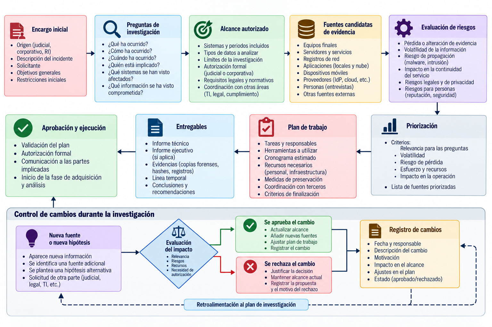
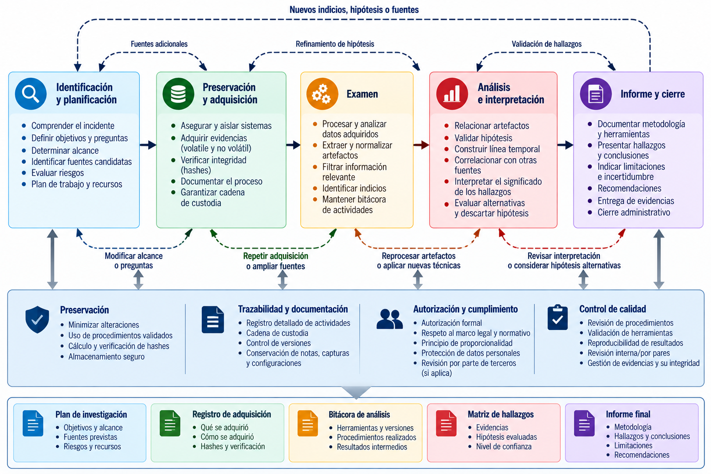
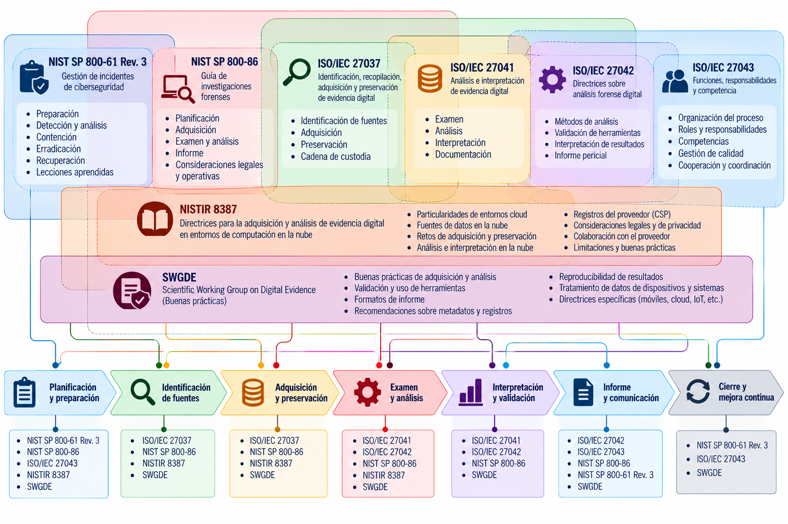
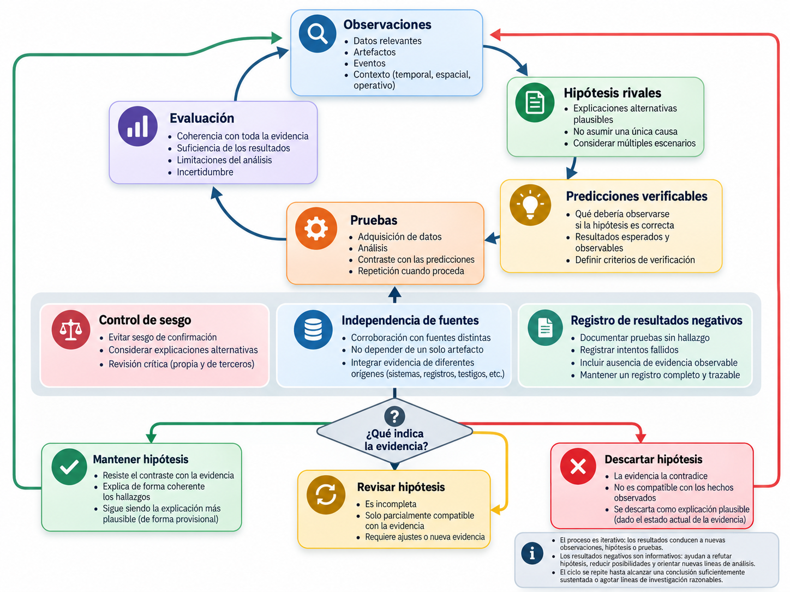
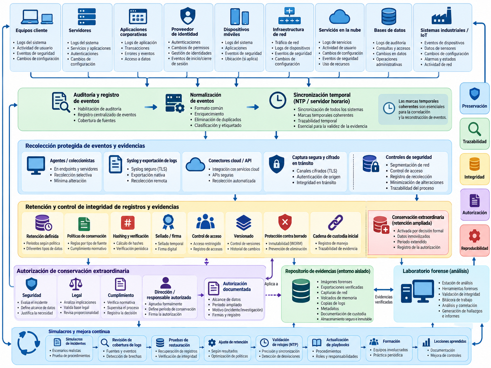

# Metodologías y estándares de investigación

> "En el momento presente es demasiado fácil utilizar datos incompletos y un razonamiento imperfecto para llegar a cualquier conclusión que deseemos."
> ("At the present moment it is all too easy to use incomplete data and imperfect reasoning to reach any conclusion we wish.")
> — Isaac Asimov, Forward the Foundation (Hacia la Fundación), Parte 3: "Hari Seldon"
> 
> NOTA: Hari Seldon está respondiendo a las presiones del general Tennar de la junta militar, quien pretendía forzar las conclusiones matemáticas hacia lo que al régimen le convenía.

La calidad de una investigación digital no se mide por el número de herramientas utilizadas ni por la cantidad de archivos recuperados. Se mide, ante todo, por la capacidad de responder a unas preguntas delimitadas mediante procedimientos técnicamente adecuados, legalmente autorizados y suficientemente documentados como para que una tercera persona competente pueda evaluar sus resultados. Una captura de memoria impecable puede carecer de utilidad si se obtuvo después de que el sistema fuese reiniciado; un informe de cientos de páginas puede resultar débil si confunde indicios con hechos demostrados; una conclusión correcta puede ser difícil de defender cuando no consta cómo se llegó a ella.

En el capítulo anterior se estableció que los datos digitales no constituyen una explicación automática de lo ocurrido. Son observaciones que necesitan contexto, interpretación y corroboración. Esa distancia entre la huella y la conclusión es, precisamente, el espacio que ocupa la metodología forense. Su función es reducir la improvisación, limitar los sesgos, conservar la integridad de las evidencias y hacer explícitos los motivos de cada decisión. **El método no sustituye al criterio profesional: lo obliga a ser justificable.**

El problema adquiere especial importancia cuando una investigación atraviesa distintos entornos. Un incidente puede comenzar con la autenticación de una cuenta en la nube, continuar mediante una sesión de navegador, afectar a una máquina virtual y terminar con la descarga de datos hacia un servicio externo. Es posible que cada fuente utilice formatos, relojes, mecanismos de retención y administradores diferentes. En ocasiones habrá acceso físico al dispositivo; en otras, solo existirá una API o una exportación proporcionada por un tercero. Pretender aplicar mecánicamente el mismo procedimiento a todas esas fuentes sería tan inadecuado como prescindir de un procedimiento común.

Este capítulo presenta un marco de trabajo para convertir una solicitud de investigación en un proceso controlado. Se abordarán la planificación y el alcance, las fases del trabajo forense, los principales estándares y recomendaciones internacionales, el contraste de hipótesis, la reproducibilidad y la validación de resultados. Finalmente, se examinará la *preparación forense* o *forensic readiness*: las decisiones que una organización debe adoptar antes de sufrir un incidente si pretende investigar después con garantías. El objetivo no es memorizar una secuencia de pasos, sino comprender las decisiones que hacen que un examen sea fiable y defendible.

> **Principio metodológico:** toda decisión significativa de una investigación debería poder responder a tres preguntas: qué se decidió, por qué se decidió y qué consecuencias tuvo para la evidencia o para el alcance de las conclusiones.

## Planificación y alcance de una investigación

### La investigación comienza antes de abrir la primera evidencia

Es habitual imaginar al analista forense trabajando frente a una estación especializada, examinando una imagen de disco o reconstruyendo una línea temporal. Sin embargo, buena parte de la calidad de su trabajo se decide antes de que abra la primera herramienta. Una investigación que comienza con preguntas imprecisas suele terminar en una exploración sin límites claros. Una investigación que ignora sus restricciones de tiempo puede perder evidencias efímeras. Y una investigación cuyo fundamento de autorización no ha sido establecido puede generar problemas jurídicos o de confidencialidad independientemente de su calidad técnica.

La planificación consiste en transformar una sospecha, una alerta o un encargo en un conjunto de cuestiones verificables. No equivale a anticipar la respuesta. Consiste en definir qué se necesita averiguar, qué fuentes podrían aportar información, con qué permisos se cuenta y cuáles son las prioridades de conservación. Para ello se requiere una conversación inicial entre quien solicita la investigación, quienes administran los sistemas, el responsable de seguridad y, cuando corresponda, los asesores jurídicos o la autoridad competente.

Consideremos una empresa que comunica lo siguiente: «Creemos que un empleado se ha llevado información confidencial». Tal formulación mezcla un posible hecho —una transferencia o copia— con una atribución personal y una intención. El encargo necesita descomponerse. ¿Qué información se considera afectada? ¿Se ha confirmado su salida? ¿De qué sistema? ¿En qué intervalo? ¿Qué cuentas podían acceder? ¿Se sospecha una copia a una memoria externa, un correo, un repositorio remoto o una plataforma de colaboración? ¿La persona trabajaba desde un dispositivo corporativo o personal? ¿Cuál es el fundamento que permitiría examinar cada uno de esos entornos?

Las respuestas no determinan de antemano que haya existido una conducta indebida. Permiten construir un plan de búsqueda de evidencia. Por ejemplo, el objetivo «determinar si se descargaron documentos de un repositorio corporativo entre el lunes y el miércoles» es más preciso que «encontrar quién robó los datos». El primero puede orientar la revisión de registros de auditoría y descargas; el segundo corre el riesgo de convertir la investigación en una búsqueda retrospectiva de confirmación de una acusación.

Una buena definición del objeto incluye también la posibilidad de que la hipótesis inicial sea falsa. La ausencia de documentos en una carpeta puede deberse a una eliminación, pero también a un movimiento, un cambio de permisos, un error de sincronización o una vista mal configurada. Planificar significa reservar espacio para esas explicaciones alternativas, aunque a primera vista parezcan menos llamativas.

### Del relato inicial a las preguntas investigables

En cualquier encargo conviene separar al menos cuatro elementos: el **relato recibido**, los **hechos inicialmente constatados**, las **preguntas pendientes** y las **hipótesis de trabajo**. Esa separación evita que una afirmación de un testigo, una alerta automática o una interpretación preliminar acaben reproduciéndose como si fueran hechos probados.

El relato recibido es lo que alguien comunica: «Han accedido a mi correo». Un hecho inicialmente constatado podría ser: «El proveedor registra una autenticación satisfactoria desde una dirección IP no reconocida por el titular». La pregunta investigable sería: «¿La sesión asociada a esa autenticación permitió acceder a mensajes y realizar operaciones sobre ellos?». Las hipótesis abarcarían, entre otras, un acceso no autorizado, el uso legítimo de una red o dispositivo diferente, una sesión delegada o un registro interpretado de manera incorrecta.

La diferencia puede parecer lingüística, pero es operativa. Si el analista parte de que la cuenta ha sido comprometida, podría concentrarse exclusivamente en rastros de exfiltración y dejar de revisar mecanismos de autenticación legítimos. Si parte de que existe una autenticación que debe ser explicada, buscará evidencias que puedan confirmar o descartar varios escenarios.

Las preguntas deben ser suficientemente concretas para orientar la recogida de datos y suficientemente abiertas para admitir resultados inesperados. Algunas preguntas frecuentes son: ¿se ejecutó un programa determinado?, ¿se estableció una sesión de acceso remoto?, ¿se copió un archivo?, ¿se modificaron permisos?, ¿se utilizó una credencial después de su revocación?, ¿qué secuencia temporal puede reconstruirse? Otras preguntas requieren una cautela adicional: ¿quién estaba físicamente delante del equipo?, ¿por qué actuó de ese modo?, ¿a qué persona corresponde una dirección IP? Estas últimas pueden no ser resolubles solo con evidencia técnica.

Un criterio útil consiste en formular cada pregunta junto con una posible condición de contraste. «¿Se descargó el fichero X?» puede contrastarse mediante registros de acceso, respuestas de la API, trazas del cliente, metadatos del almacenamiento y, si existen, artefactos del dispositivo receptor. «¿Lo hizo la persona Y?» exige otras fuentes y puede permanecer abierto incluso cuando la descarga está demostrada. La precisión metodológica incluye reconocer desde el principio esa diferencia.

### Objetivos, entregables y criterios de cierre

Una investigación necesita un objetivo operativo y un producto final. Los objetivos pueden ser distintos según el contexto. En una actuación judicial interesa conservar y examinar determinados soportes para responder a los extremos del encargo pericial. En una investigación corporativa se buscan hechos relevantes para una decisión interna, respetando sus límites de autorización y las garantías aplicables. Durante la respuesta a incidentes, la prioridad puede consistir en comprender un compromiso con rapidez suficiente para apoyar la contención sin destruir información relevante.

El entregable tampoco será siempre el mismo. Puede consistir en un informe pericial completo, un informe técnico de hallazgos, una cronología sustentada, un inventario de evidencias, un dictamen sobre la fiabilidad de un artefacto o una comunicación urgente para los responsables de respuesta. Es aconsejable acordar quién recibirá el resultado, qué grado de detalle necesita, si existirán entregas provisionales y qué información debe quedar reservada a anexos técnicos.

También conviene definir qué significará terminar. Una investigación no concluye necesariamente cuando se han explicado todos los aspectos de un suceso. Puede concluir cuando se han contestado las preguntas autorizadas, se han agotado razonablemente las fuentes disponibles y se han documentado las incertidumbres que permanecen. La diferencia es importante: la ausencia de certeza sobre un extremo no impide alcanzar resultados técnicamente útiles respecto a otros.

El cierre requiere distinguir entre una **conclusión negativa**, una **ausencia de hallazgo** y una **limitación de examen**. «No se encontró un registro de eliminación» significa que no se identificó ese artefacto en lo examinado. No equivale a «se demostró que no hubo eliminación». Si el sistema rota los registros cada siete días y la incidencia ocurrió hace un mes, la limitación de retención debe aparecer expresamente en el informe. Un criterio de cierre razonable no impone resultados; fija las condiciones para reconocer cuándo la evidencia disponible ya no permite avanzar de modo justificado.

### Alcance técnico: sistemas, datos, periodos y operaciones

El alcance delimita el espacio dentro del cual el analista puede trabajar. Habitualmente tiene dimensiones organizativas, técnicas, temporales y jurídicas que conviene documentar por separado. En lo organizativo, se identifican los responsables de los sistemas, las personas autorizadas a solicitar acciones y los destinatarios de la información. En lo técnico, se determina qué dispositivos, cuentas, máquinas virtuales, servicios, aplicaciones o registros pueden examinarse. En lo temporal, se establece la ventana investigada y el margen necesario para reconstruir antecedentes y consecuencias. En lo jurídico, se concreta la fuente de autorización y las limitaciones que impone.

Supongamos que la petición autoriza revisar la actividad de una cuenta corporativa durante una semana. El alcance no se amplía automáticamente a todo el correo de su titular, a los documentos personales almacenados localmente ni a servicios externos que utilicen las mismas credenciales. Puede ser técnicamente posible acceder a datos que queden fuera del encargo; esa posibilidad no convierte su examen en necesario ni autorizado. Si aparecen indicios que justifican una ampliación, deberá valorarse y aprobarse por el cauce correspondiente antes de proceder, salvo situaciones excepcionales que tengan fundamento propio y deban quedar documentadas.

Las ventanas temporales exigen atención especial. Un incidente descubierto el viernes puede haberse iniciado el lunes anterior; un mecanismo de persistencia puede haberse instalado meses antes; una modificación de archivo puede reflejar una sincronización posterior al hecho. Por ello es útil distinguir la *ventana principal* —el intervalo que interesa investigar— de una *ventana de contexto* limitada, destinada a establecer líneas de referencia, antecedentes o continuidad temporal. Ambas deben justificarse y estar sometidas a criterios de minimización.

En sistemas distribuidos, las fronteras técnicas raramente coinciden con las administrativas. Un servidor puede pertenecer a una empresa, alojarse en infraestructura de un tercero, autenticarse contra un proveedor de identidad y registrar sus eventos en una plataforma externa. Identificar quién controla cada dato y quién puede autorizar su acceso es una tarea de planificación, no una formalidad que pueda posponerse hasta el momento de descargarlo.

### Alcance dinámico y control de cambios

No es razonable exigir que toda fuente relevante sea conocida al principio. La propia investigación puede descubrir servicios, cuentas, equipos o periodos que no figuraban en el planteamiento inicial. El método debe permitir cambios, pero no cambios invisibles. Una ampliación de alcance requiere registrar el hallazgo que la motivó, el nuevo objeto propuesto, su relación con las preguntas originales, la autoridad que la aprueba y las posibles consecuencias para tiempo, recursos y confidencialidad.

Pensemos en un caso iniciado sobre un equipo Windows. Los registros muestran que la cuenta investigada utilizó una aplicación de almacenamiento remoto. Examinar el servicio podría ser decisivo, pero no estaba incluido en el encargo. Una actuación correcta separa tres acontecimientos: descubrir una referencia al servicio en el equipo, solicitar la ampliación y, una vez autorizada, adquirir los datos del servicio. Esa trazabilidad permite que otra persona comprenda por qué la investigación terminó incluyendo una fuente inicialmente desconocida.

Una modificación también puede reducir el alcance. Si las primeras comprobaciones muestran que la aplicación atribuida a un dispositivo pertenece realmente a otro, persistir en el examen del primero puede ser desproporcionado. Documentar por qué se descarta una fuente es tan importante como justificar por qué se incorpora.

### Autorización, proporcionalidad y minimización

El analista forense no debe equiparar acceso técnico con facultad legítima. Disponer de credenciales de administrador, de un agente EDR o de una copia de seguridad no autoriza por sí mismo cualquier búsqueda imaginable. La legitimidad depende del escenario, la titularidad de los sistemas, los contratos, los procedimientos internos, los derechos de las personas afectadas y, cuando proceda, las decisiones de una autoridad judicial. La aplicación concreta de estos elementos exige asesoramiento jurídico; este capítulo describe el principio operativo, no pretende sustituirlo.

La proporcionalidad consiste en ajustar la actuación a la finalidad perseguida y al impacto razonablemente previsible. Si el objetivo es determinar si una cuenta accedió a una carpeta específica, puede ser suficiente examinar eventos de acceso y permisos. Una adquisición íntegra del ordenador, que incluye documentos ajenos a la investigación, quizá sea innecesaria o deba justificarse especialmente. La minimización busca evitar la recogida y exposición de información irrelevante. Ambas decisiones deben equilibrarse con la necesidad de preservar datos efímeros que, si se pierden, no podrán recuperarse después.

Existe una tensión legítima entre preservar ampliamente y examinar de forma limitada. En determinadas circunstancias puede estar justificada una conservación más amplia para evitar la desaparición irreversible de datos, acompañada de restricciones severas en su acceso, análisis y divulgación. No debe confundirse esa posibilidad con una autorización genérica para revisar todo el contenido preservado. La política concreta deberá fundamentarse en las competencias legales del caso y quedar reflejada en el plan.

También se considera desde el principio la presencia de información especialmente protegida, secretos profesionales, comunicaciones privadas, datos personales de terceros o información sometida a confidencialidad contractual. Su posible aparición puede exigir filtrados, segregación de funciones, autorizaciones adicionales o revisión jurídica previa. El investigador debe conocer estos límites antes de que un resultado potencialmente relevante termine incorporado inadvertidamente a un informe de amplia distribución.

### Evaluación inicial de riesgos y prioridades

Una investigación forense es también una gestión de riesgos. Algunos riesgos afectan a la evidencia: pérdida por apagado, sobrescritura de registros, caducidad de sesiones, cambios producidos por el propio analista o indisponibilidad de un proveedor. Otros afectan a las personas y a la organización: interrupción de servicios críticos, expansión de un compromiso, exposición de datos personales o retrasos en obligaciones de comunicación. Hay además riesgos metodológicos: escoger una herramienta no probada, trabajar con una versión incompatible o interpretar timestamps sin conocer la zona horaria.

No basta con elaborar una lista. Conviene relacionar cada riesgo con una decisión concreta. Si una máquina virtual comprometida conserva únicamente registros en memoria, la prioridad puede ser adquirirlos antes de detenerla. Si mantiene una conexión activa hacia un atacante, el riesgo de propagación puede aconsejar aislarla inmediatamente, aunque se pierda parte de la información volátil. Si controla un proceso industrial, una decisión abrupta podría producir daños superiores a los que se pretende evitar. En cada escenario cambian las condiciones; no existe una secuencia universal e invariable.

La priorización puede representarse mediante una matriz sencilla que considere impacto, volatilidad, accesibilidad y coste de intervención. La matriz no sustituye al juicio profesional ni debe convertirse en una fórmula automática. Sirve para explicitar los factores examinados. En particular, la dificultad de adquirir una evidencia no determina por sí sola su valor: a veces una fuente fácil de recoger es decisiva, y otras una adquisición costosa apenas añade información a lo que ya está demostrado.

### El plan de investigación como documento vivo

El plan inicial no necesita ser un documento extenso. Sí debe ser concreto. Es útil que incorpore el identificador del asunto, la persona o entidad solicitante, los objetivos, la autorización, las fuentes previstas, las restricciones, las responsabilidades, las prioridades de adquisición, las herramientas principales y el criterio de comunicación de incidencias. En actuaciones complejas se añaden ventanas de mantenimiento, dependencias con proveedores, normas de transferencia de evidencias y mecanismos de revisión.

Puede redactarse en lenguaje natural, siempre que permita verificar las decisiones. Una formulación del tipo «examinar los equipos afectados y elaborar informe» es demasiado vaga. En cambio, un plan que diga «preservar los eventos de autenticación del proveedor durante el periodo autorizado; adquirir los registros de actividad de la aplicación; contrastar ambos conjuntos usando identificadores de sesión; evaluar la actividad realizada por los tokens asociados; comunicar inmediatamente cualquier evidencia de acceso activo no autorizado» tiene un alcance operativo comprensible.

El plan debe mantener una distinción clara entre lo previsto y lo realmente ejecutado. Durante la investigación surgirán incidencias: un soporte no estará disponible, una API rechazará determinadas consultas, un archivo resultará corrupto o una ventana de retención será menor de la esperada. El expediente final deberá mostrar esas diferencias. No se trata de ocultar desviaciones para que el trabajo parezca perfecto, sino de permitir que se comprenda qué se hizo de verdad y qué limitaciones provocó cada cambio.

### Caso conductor: acceso sospechoso a un repositorio en la nube

Para seguir el capítulo utilizaremos un supuesto ficticio. Una empresa detecta que, a las 03:14, una cuenta con acceso a un repositorio documental inició sesión desde una dirección IP inusual. Al día siguiente, el propietario del repositorio observa que una carpeta contiene menos archivos. El equipo de seguridad recibe un aviso de autenticación anómala y solicita una investigación preliminar. La cuenta pertenece a una persona que trabaja en remoto y utiliza habitualmente varios dispositivos.

La alarma inicial plantea tres preguntas diferentes: si la autenticación fue legítima, qué operaciones se ejecutaron durante la sesión y qué explica la ausencia aparente de archivos. Ninguna exige presuponer un robo. El primer plan contempla los registros del proveedor de identidad, la auditoría del repositorio, los eventos de la aplicación y, si existe autorización, los artefactos del dispositivo corporativo. Las hipótesis incluyen acceso no autorizado, operación legítima, sincronización defectuosa, cambio de permisos y movimiento de documentos.

Hay dos datos temporales que requieren precaución. La marca de las 03:14 podría estar expresada en UTC o en una zona local y no tiene por qué corresponder al mismo reloj que utilizó el sistema de alertas. Además, el descubrimiento al día siguiente no indica cuándo dejaron de mostrarse los archivos. El plan incorpora una ventana de contexto anterior y posterior al aviso y obliga a conservar las marcas temporales originales antes de normalizarlas.

Al revisar el servicio, los investigadores descubren que los registros detallados de descargas se conservan solo durante un periodo limitado. La prioridad de preservarlos aumenta. Sin embargo, el acceso al dispositivo personal que a veces utiliza el titular no está autorizado; por tanto, no se incluye por el mero hecho de ser potencialmente útil. Este ejemplo acompañará la discusión sobre fases, validación y preparación forense, mostrando cómo un mismo caso puede evolucionar sin perder sus límites metodológicos.

## Fases del proceso forense

### Un modelo de proceso, no una cadena rígida

Los modelos de investigación digital suelen describir actividades como identificar, recoger, adquirir, preservar, examinar, analizar, interpretar y comunicar. Resulta útil agruparlas porque cada una tiene una finalidad y produce documentación diferente. Sin embargo, la práctica raramente presenta fronteras perfectas. El descubrimiento de un archivo durante el examen puede revelar una fuente adicional que debe preservarse. Una hipótesis descartada puede modificar la estrategia de análisis. Una dificultad técnica puede obligar a validar de nuevo una herramienta o a regresar a la planificación.

El proceso debe entenderse como un sistema de decisiones encadenadas y revisables. **Que las fases puedan repetirse no significa que puedan ejecutarse sin control.** Cada retorno a una etapa anterior tiene que conservar la trazabilidad de lo que se sabía en ese momento y de la razón del cambio. El expediente debe permitir reconstruir no solo la secuencia de hechos investigados, sino también la secuencia de decisiones investigadoras.

Las denominaciones varían entre publicaciones. La ISO/IEC 27037 pone el foco en la identificación, recogida, adquisición y preservación. La ISO/IEC 27042 aborda el análisis y la interpretación. La ISO/IEC 27043 proporciona una visión más amplia de la investigación de incidentes, incluida la preparación previa y el cierre. El modelo divulgado por NIST SP 800-86 integra las técnicas forenses en la respuesta a incidentes y diferencia actividades de recogida, examen, análisis e información de resultados. Sus propuestas resultan compatibles a nivel conceptual, aunque no deben presentarse como si fueran un procedimiento literal único o una certificación automática de calidad.

Para organizar el trabajo de este libro emplearemos una secuencia orientativa: **activación y preparación; identificación y priorización; recogida y adquisición; preservación y control de integridad; examen; análisis y contraste; comunicación; cierre y conservación**. La preservación no comienza después de adquirir, ni termina cuando empieza el análisis. Es una condición transversal que acompaña toda la vida de la evidencia. La documentación, el control de acceso y la revisión técnica también están presentes desde el primer momento.

### Activación, recepción del encargo y preparación inmediata

El proceso se activa por una denuncia, un requerimiento pericial, una alarma de seguridad, una sospecha interna o la necesidad de examinar una anomalía técnica. La primera decisión consiste en establecer la naturaleza de la solicitud y el marco de actuación. Deben identificarse las personas responsables, la información disponible, el riesgo de pérdida de datos y los límites de autorización. En una intervención urgente, esta actividad puede completarse inicialmente con una conversación registrada y ampliarse después, pero la urgencia no convierte el alcance en ilimitado.

Desde el primer contacto deben preservarse los datos que podrían desaparecer antes de que finalice la planificación. Una organización con registros de corta retención puede necesitar exportarlos de inmediato. Un sistema encendido con cifrado activo puede requerir valorar la captura de memoria o de metadatos volátiles antes de apagarlo. Si existe una intrusión en curso, la respuesta debe coordinar la preservación con las medidas de contención. Algunas decisiones serán irreversibles; por eso es especialmente importante documentar quién las tomó y sobre qué información se apoyó.

En esta fase se crean los primeros identificadores del caso y de las evidencias. Conviene que el identificador sea único, estable y utilizable en nombres de archivos, formularios, etiquetas y comunicaciones. También se designan espacios seguros para recibir datos y se evita que las pruebas terminen repartidas entre carpetas personales, correos sin control y dispositivos extraíbles no inventariados. Aunque todavía no se haya adquirido ningún soporte, el expediente ya ha comenzado.

### Identificación y localización de fuentes

Identificar una fuente no equivale a poseerla. Significa reconocer que un elemento podría contener información útil y determinar dónde se encuentra, de quién depende, cómo se accede a él y cuál es su riesgo de alteración o pérdida. Las fuentes pueden ser físicas —un ordenador, un teléfono, una unidad externa—, lógicas —un volumen, una cuenta, una base de datos— o distribuidas —una aplicación SaaS con datos y registros repartidos entre proveedores—.

La identificación exige construir un mapa técnico del escenario. En una aplicación corporativa, la actividad puede observarse parcialmente desde el navegador, el proveedor de identidad, la aplicación, una pasarela de API, el servicio de almacenamiento, el sistema de monitorización y el perímetro de red. Ninguna fuente ofrece necesariamente una vista completa. El proveedor de identidad puede registrar que una autenticación fue satisfactoria, pero no todas las operaciones ejecutadas después. La aplicación puede conocer la operación sobre un documento, pero no si quien controlaba la sesión era su titular legítimo. La memoria del dispositivo puede revelar actividad local, pero no el histórico que el servicio remoto ya ha eliminado.

Una herramienta práctica es la **matriz fuente-pregunta**. No se trata de recopilar todo lo accesible: se relaciona cada pregunta con las fuentes capaces de contrastarla y con las restricciones que presentan. Así, para conocer si un documento fue descargado podrían revisarse registros de acceso del repositorio, trazas de API, registros de proxy y artefactos del cliente. Una exportación parcial de logs o una retención vencida se anotan como limitaciones. La matriz ayuda a detectar dependencias ocultas, por ejemplo que todas las fuentes supuestamente independientes provengan en realidad de un mismo evento normalizado por un SIEM.

En el caso conductor, la alerta de acceso anómalo lleva a localizar cuatro fuentes principales: el proveedor de identidad, la auditoría del repositorio, los registros de la aplicación y el dispositivo corporativo. También se detecta que algunas descargas se realizan mediante tokens de API. Ese dato no demuestra una extracción, pero obliga a considerar registros que inicialmente no estaban previstos. La incorporación a la adquisición se hará dentro del alcance autorizado o tras su ampliación documentada.

### Recogida, adquisición y sus diferencias

En lenguaje cotidiano suelen confundirse *recoger* y *adquirir*. En el ámbito forense conviene diferenciarlos porque describen actividades y riesgos distintos. La **recogida** puede consistir en localizar, asegurar, trasladar o poner bajo control un dispositivo u otro elemento que contiene datos potencialmente relevantes. La **adquisición** implica obtener una representación de esos datos para su conservación y examen: una imagen de almacenamiento, una captura de memoria, una exportación de registros, una copia lógica o una extracción mediante una interfaz autorizada.

En una intervención sobre un ordenador apagado, puede recogerse físicamente el equipo y adquirir después una imagen de sus soportes en un laboratorio. En un servidor crítico, retirar la máquina quizá resulte inviable y la adquisición deba efectuarse de forma controlada en el propio entorno. En servicios en la nube, es frecuente que no exista acceso físico al soporte subyacente y que la única vía de adquisición sea una API, una instantánea gestionada o una exportación del proveedor. Son procedimientos con diferentes alcances, dependencias y grados de control.

Una adquisición física de un disco puede incluir sectores no asignados y metadatos internos del sistema de archivos, pero su cobertura estará limitada por las características del medio, las zonas inaccesibles, el cifrado, las herramientas y el estado del sistema. Una adquisición lógica copia determinados objetos y puede conservar propiedades relevantes, aunque no represente todos los sectores ni toda la información borrada. Una exportación de un servicio remoto depende de los datos que expone la plataforma, de los permisos utilizados, de los filtros aplicados y de los comportamientos de la API. Elegir un método implica aceptar un conjunto de posibilidades y limitaciones.

La idea de *no alterar nunca el original* expresa una aspiración de preservación, pero sería engañoso aplicarla sin matices a sistemas en funcionamiento. Leer determinados recursos puede producir registros, modificar tiempos de acceso o activar procesos auxiliares. Ejecutar una herramienta de adquisición de memoria modifica inevitablemente parte del estado volátil. En plataformas remotas, una llamada a la API puede generar auditoría adicional. El objetivo es utilizar procedimientos apropiados, reducir los efectos evitables y **documentar los cambios esperados o detectados**, no prometer una ausencia absoluta de intervención cuando técnicamente resulta imposible.

Siempre que sea posible se trabaja con copias de examen y se mantiene una referencia identificable del origen. Deben registrarse el método, la herramienta y versión, los parámetros, el intervalo de operación, el operador, los resultados, los errores y cualquier discrepancia relevante. Una colección parcial o defectuosa no se convierte en completa porque la herramienta haya mostrado un mensaje de éxito.

### Preservación y continuidad de la evidencia

La preservación persigue mantener las propiedades relevantes de la evidencia y permitir que su origen, tratamiento y estado puedan explicarse. Abarca la protección física de los soportes, el control lógico de las copias, las condiciones ambientales cuando importan, la prevención de escrituras accidentales, la documentación de accesos y la política de conservación. No se reduce a calcular una suma hash.

La **cadena de custodia** documenta la posesión y las transferencias de los elementos de evidencia a lo largo del tiempo. Los **registros de tratamiento** describen qué operaciones técnicas se realizaron sobre ellos. Ambos mecanismos se complementan. Una cadena de custodia impecable no demuestra por sí sola que una imagen fue adquirida sin errores; una coincidencia de hashes no demuestra quién controló el dispositivo antes de la adquisición. La fiabilidad exige examinar conjuntamente procedencia, método y continuidad.

Los algoritmos hash criptográficos se utilizan para comprobar si dos conjuntos de bytes son iguales con una garantía práctica adecuada. Por ejemplo, calcular SHA-256 sobre un archivo adquirido y volver a calcularlo cuando se entrega a otro laboratorio ayuda a detectar modificaciones. Sin embargo, su interpretación tiene condiciones: hay que saber exactamente qué objeto se sometió a hash, si se trataron metadatos por separado, si un contenedor incluye información propia y si la adquisición omitió zonas no legibles. El mismo hash verificado en dos ocasiones confirma la continuidad de esos bytes entre verificaciones; no acredita por sí mismo que el origen fuese auténtico o que la extracción fuera exhaustiva.

En entornos de nube, la preservación puede incluir retenciones legales o administrativas, instantáneas, exportaciones versionadas y custodia de respuestas de API con sus metadatos. Debe registrarse si el proveedor genera internamente identificadores o hashes, y qué alcance tienen. Un ETag, una firma de servicio o un campo llamado `checksum` no deben tratarse automáticamente como si fueran un hash criptográfico del mismo objeto lógico que examina el investigador. Su semántica depende de la plataforma y del proceso que lo generó.

La preservación también alcanza la evidencia derivada. Cuando el analista convierte un registro binario a CSV, extrae una base SQLite o exporta resultados desde una herramienta, el producto debe quedar vinculado a su origen mediante identificadores, rutas, procedimientos y, cuando proceda, hashes. Un informe que solo conserve capturas de pantalla de resultados seleccionados difícilmente permitirá repetir el análisis sin conocer las fuentes primarias.

### Examen: extraer información sin adelantar conclusiones

El examen forense transforma los datos adquiridos en información accesible para su estudio. Incluye identificar particiones, interpretar sistemas de archivos, extraer metadatos, recuperar registros, reconstruir bases de datos, localizar artefactos, descodificar formatos y preparar conjuntos de eventos. Esta actividad puede ser automatizada en buena medida, pero los resultados deben revisarse bajo un criterio técnico explícito.

Una herramienta puede indicar que un archivo se ejecutó, que una URL fue visitada o que una memoria USB se conectó. Esas etiquetas resumen reglas de interpretación que pueden contener simplificaciones. La creación de un registro no siempre equivale a ejecución humana; la existencia de un enlace en un historial no siempre implica que una página se visualizase; una coincidencia de nombre no garantiza identidad de archivo. Durante el examen deben preservarse los datos subyacentes necesarios para valorar tales afirmaciones.

El examen incluye también el filtrado por relevancia, siempre dentro del alcance. No todo dato hallado debe analizarse en profundidad. Las búsquedas pueden combinar intervalos, rutas, usuarios, indicadores y tipos de artefacto. Conviene documentar los criterios para que otra persona sepa por qué ciertos elementos entraron en el conjunto examinado y otros quedaron fuera. Un filtro mal definido puede resultar tan perjudicial como una adquisición incompleta.

Los fallos tienen valor metodológico. Si una herramienta no consigue descodificar un artefacto, el analista debería identificar si se trata de corrupción, cifrado, versión no admitida, ausencia de componentes o comportamiento anómalo de la propia herramienta. No basta con omitir silenciosamente el archivo. Registrar el límite del examen impide que la ausencia de resultado sea interpretada como ausencia de evidencia.

### Análisis: relacionar datos y reconstruir acontecimientos

El análisis comienza cuando el investigador trata de explicar qué significan los artefactos y cómo se relacionan con las preguntas planteadas. Puede estudiar cronologías, comparar sesiones, identificar patrones de autenticación, relacionar un proceso con una conexión de red o contrastar la actividad observada con la configuración conocida de un sistema. La diferencia con el examen no es siempre una frontera temporal; es principalmente una diferencia de propósito: **el examen obtiene y organiza información; el análisis evalúa su significado**.

Un registro que indica una autenticación satisfactoria demuestra, dentro de las limitaciones del sistema de auditoría, que se produjo un evento de ese tipo. Para concluir que alguien accedió a un documento quizá sea necesario relacionarlo con una sesión concreta, una acción de aplicación y una respuesta del servicio. Para afirmar que hubo transferencia de contenido hará falta valorar qué registra realmente la plataforma: una solicitud iniciada, una respuesta entregada, un número de bytes transferidos o un objeto descargado de manera completa no son necesariamente equivalentes.

La correlación requiere conocer los relojes y los identificadores utilizados. Los registros pueden guardar UTC, zonas locales, tiempo Unix, marcas con precisión variable o tiempos de recepción distintos a los tiempos de origen. Antes de construir una línea temporal se debe conservar el valor original y documentar la conversión. Una marca con resolución de un segundo no permite ordenar con certeza dos eventos que ocurrieron dentro de ese mismo segundo si no hay otros datos que indiquen precedencia.

También deben reconocerse las dependencias entre fuentes. Un panel SIEM, una alerta del EDR y un informe semanal pueden utilizar el mismo evento inicial. Contarlos como tres pruebas independientes exagera la corroboración. Por el contrario, una entrada de auditoría del almacenamiento y un artefacto de descarga en el dispositivo cliente pueden aportar perspectivas más independientes sobre una operación. La fuerza de la correlación depende tanto de la coherencia como de la procedencia de cada dato.

El análisis se beneficia de registrar hipótesis rivales y de buscar evidencia capaz de refutarlas. En nuestro caso, el repositorio parece haber perdido archivos tras una autenticación inusual. Al contrastar registros, se descubre que una tarea de sincronización había movido parte de los documentos a otra ruta. El evento de autenticación sigue siendo relevante, pero ya no puede utilizarse como explicación automática de la desaparición. La investigación debe examinar ambas cuestiones por separado y evaluar si existe relación demostrable entre ellas.

### Interpretación y valoración de límites

Interpretar significa traducir un conjunto de observaciones técnicas a afirmaciones cuya fuerza se corresponda con la evidencia. No todas las inferencias tienen el mismo nivel. «El servicio registró una llamada `DELETE` para el objeto X» es distinto de «el objeto X quedó eliminado de forma irreversible». La primera puede proceder de un registro concreto; la segunda exige conocer el comportamiento del servicio, el resultado de la llamada, el versionado, las políticas de retención y las posibles copias existentes.

Del mismo modo, «la cuenta A inició sesión» no implica necesariamente «la persona titular de A actuó». Entre ambos enunciados intervienen la gestión de credenciales, el uso compartido, la delegación, el robo de tokens, el acceso físico al dispositivo y otros factores. La interpretación debe mostrar las transiciones entre observación, inferencia y conclusión, especialmente cuando el resultado puede tener consecuencias jurídicas o profesionales.

Una forma útil de redactar hallazgos combina cuatro elementos: la observación, la procedencia, su interpretación y una reserva explícita. Por ejemplo: «El registro de auditoría del servicio documenta tres operaciones de descarga asociadas al identificador de sesión S, entre las 03:16 y las 03:19 UTC. Dicho identificador corresponde a la autenticación de la cuenta A. El registro permite vincular operaciones y sesión, pero no identificar por sí solo a la persona que controlaba la cuenta». La reserva no debilita el hallazgo: evita atribuirle un significado que no puede sostener.

La valoración de limitaciones debe ser concreta. No aporta mucho escribir «las herramientas informáticas pueden cometer errores» si no se explica qué afectación tendría en el caso. Es preferible indicar que «el sistema conservó eventos de inicio de sesión, pero no el contenido de las respuestas de API», o que «la herramienta utilizada no soporta el formato de la base de datos en esta versión». Una limitación bien descrita muestra dónde termina el conocimiento disponible y permite planear nuevas verificaciones.

### Informe, revisión y comunicación

El resultado de la investigación debe poder comunicarse a personas que no necesariamente comparten el conocimiento técnico del analista. Un buen informe no es una transcripción de comandos. Explica qué se solicitó, bajo qué condiciones se trabajó, qué fuentes se examinaron, con qué métodos, qué hallazgos se obtuvieron y qué conclusiones admiten. Los detalles de ejecución, hashes y registros completos pueden incorporarse en anexos o en el expediente técnico, sin sacrificar la inteligibilidad del cuerpo principal.

La revisión no debe limitarse a corregir el estilo. Es recomendable verificar la correspondencia entre conclusiones y evidencia, la integridad de las referencias, la coherencia de las fechas, el carácter adecuado de las herramientas y la presencia de limitaciones. En un laboratorio con varios profesionales, un segundo examinador puede reproducir pruebas seleccionadas o realizar una revisión técnica independiente. En equipos pequeños, también pueden utilizarse listas de comprobación, pruebas automatizadas y muestreos sistemáticos, aunque conviene no confundirlos con una revisión realmente independiente.

Durante un incidente activo pueden necesitarse comunicaciones intermedias antes del informe final. Esas comunicaciones deben diferenciar claramente hechos confirmados, interpretaciones provisionales y acciones recomendadas. Una recomendación de contención puede ser urgente y razonable aun cuando no se conozca todavía toda la secuencia del ataque. Lo que no resulta aceptable es presentar como conclusión cerrada una evaluación preliminar solo porque se necesita tomar una decisión operativa.

### Cierre, conservación y aprendizaje

El cierre incluye verificar que las preguntas del encargo han recibido una respuesta o que las razones de no responder están documentadas; inventariar los materiales conservados; registrar la disposición de soportes y copias; confirmar las autorizaciones de acceso y transferencia; y determinar los periodos de conservación aplicables. También implica asegurar que las versiones del informe queden identificadas. Si posteriormente aparece una corrección relevante, deberá emitirse una versión o adenda trazable, no sustituir silenciosamente la original.

La devolución o eliminación de materiales tiene consecuencias que deben regularse. Un soporte original puede requerir devolución al titular o depósito bajo custodia. Una copia forense puede permanecer sometida a una obligación legal de conservación. Determinados datos personales deben ser eliminados cuando ya no exista fundamento para conservarlos. Las reglas concretas dependen del procedimiento y del ordenamiento aplicable. El principio común es que el destino de la evidencia sea una decisión autorizada y documentada, no un efecto accidental de la limpieza de un directorio.

Por último, la investigación puede revelar problemas que no forman parte de sus conclusiones sobre el hecho investigado, pero sí del aprendizaje organizativo: ausencia de auditoría, desfases horarios, retención insuficiente, herramientas sin probar, cuentas sin inventario o falta de responsables para aprobar adquisiciones. Esas observaciones alimentan la preparación forense, que se abordará al final del capítulo. Una organización madura no espera al siguiente incidente para corregir deficiencias evidentes.

### Ejemplo de secuencia documentada en el caso conductor

La investigación del repositorio permite observar las fases como un proceso iterativo. Al recibir la alerta, el responsable autoriza una preservación inicial de registros. Se identifican los sistemas relacionados y se exportan las fuentes con retención corta. Durante el examen aparecen dos tipos de evento: una autenticación desde una IP inusual y un conjunto de operaciones de sincronización. El análisis muestra que las carpetas visibles cambiaron, pero los objetos continuaron almacenados con nuevos identificadores de ruta. Esta explicación debilita la hipótesis de eliminación manual sin resolver todavía el origen de la autenticación.

En ese punto se revisa el plan. La pregunta sobre desaparición de archivos queda razonablemente contestada mediante registros de movimiento y estado del almacenamiento. La pregunta sobre el inicio de sesión exige examinar otros indicadores, como el método de autenticación, el dispositivo registrado, las sesiones previas y los tokens derivados. Si los datos disponibles son insuficientes para identificar al operador humano, así se hará constar. No existe obligación metodológica de fabricar una respuesta completa allí donde las fuentes no permiten obtenerla.

La cronología del propio trabajo también será trazable: cuándo se solicitó la intervención, cuándo se exportaron los registros, quién autorizó cada fuente, qué consultas se realizaron, qué herramientas se usaron y cuándo se formularon o revisaron las hipótesis. Este doble registro —de los hechos investigados y de las actuaciones investigadoras— constituye una de las bases de una investigación reproducible.

## Normas ISO/IEC, recomendaciones NIST y buenas prácticas SWGDE

### Qué significa trabajar conforme a un estándar

La expresión «análisis forense conforme a estándares internacionales» se utiliza con frecuencia, pero puede significar cosas muy distintas. Una norma internacional es un documento desarrollado mediante un proceso de normalización y destinado a establecer requisitos, directrices o modelos de referencia. Una guía técnica aporta recomendaciones o buenas prácticas que pueden adoptarse según el contexto. Un procedimiento operativo es la traducción de esos principios a las condiciones de un laboratorio o una organización. La acreditación, cuando existe, es un reconocimiento formal de competencias o conformidad dentro de un alcance determinado. Ninguna de estas categorías debe confundirse con las demás.

Citar una norma en un informe no equivale a demostrar que se han aplicado sus principios. Para que la referencia tenga significado es necesario explicar qué procedimiento concreto se utilizó, qué registros lo respaldan y cómo se resolvieron las circunstancias particulares. Del mismo modo, seguir una guía no convierte automáticamente una evidencia en admisible ante cualquier tribunal. La valoración jurídica depende del procedimiento, del contexto, de los derechos afectados y de la legislación aplicable.

La normalización aporta un lenguaje común y facilita la revisión del trabajo, pero no elimina la incertidumbre propia de los sistemas digitales. Una norma puede orientar sobre conservación y trazabilidad sin determinar cuál es la herramienta correcta para una versión reciente de un sistema operativo. Una guía puede describir la utilidad de las funciones hash sin garantizar que una adquisición concreta no haya sufrido omisiones. Una metodología profesional combina referencias generales, procedimientos propios probados y justificación específica del caso.

En este libro se utilizarán los documentos ISO/IEC para estructurar principios, las publicaciones NIST como referencia técnica y organizativa y las recomendaciones SWGDE para concretar prácticas habituales de adquisición, examen, pruebas de herramientas y elaboración de informes. Se citarán por su identificador y edición porque los contenidos evolucionan. Antes de aplicar cualquiera de ellos a un encargo real conviene comprobar la versión vigente y la normativa exigible en la jurisdicción correspondiente.

### ISO/IEC 27037: identificación, recogida, adquisición y preservación

La **ISO/IEC 27037:2012** constituye una referencia central para el tratamiento inicial de evidencia digital potencial. Su ámbito comprende la identificación, recogida, adquisición y preservación. Estos conceptos son fundamentales porque las decisiones de los primeros momentos condicionan lo que podrá analizarse después. Una evidencia no adquirida antes de que expire su retención, o un soporte alterado sin documentación, puede dejar de ofrecer la información necesaria para responder a una pregunta.

La norma permite pensar en el ciclo inicial desde la perspectiva de las personas encargadas de tratar la evidencia. Antes de actuar deben comprender qué elementos pueden contener datos, qué condiciones presentan y qué acciones reducirían el riesgo de pérdida o alteración. En un escenario físico importan el estado del dispositivo, las conexiones, los periféricos y las condiciones de transporte. En un escenario lógico o remoto importan la autenticación, la configuración, los permisos, el estado del servicio y el método por el que se obtendrán los datos.

Su enfoque resulta especialmente útil al distinguir el hecho de asegurar un elemento del hecho de copiar sus datos. Una entidad puede quedar bajo custodia antes de que se examine técnicamente su contenido. En cambio, una API puede proporcionar una copia lógica sin que el investigador tenga acceso a la infraestructura donde reside la información original. Las dos situaciones requieren una explicación de qué se ha preservado realmente y con qué garantías.

Las propiedades deseables de una actuación incluyen que pueda justificarse su pertinencia, que los procedimientos se adapten a las circunstancias y que se conserve un registro de acciones suficiente para valorar la fiabilidad de los resultados. La documentación no es un añadido burocrático: forma parte de la información que permite establecer continuidad y procedencia. El capítulo dedicado a adquisición profundizará en soportes, bloqueadores de escritura, formatos de imagen, memoria y captura remota; aquí interesa entender que todos esos mecanismos responden a un mismo principio metodológico.

La ISO/IEC 27037 no proporciona una receta universal para resolver investigaciones completas. No pretende desarrollar con el mismo nivel de detalle la correlación de eventos, el contraste de hipótesis o la interpretación de hallazgos. Esas actividades se relacionan más directamente con otras normas de la misma familia. Asignar correctamente el ámbito de cada referencia evita la práctica, demasiado frecuente, de atribuir a un solo estándar la totalidad del procedimiento.

### ISO/IEC 27041: adecuación y garantía de los métodos

La **ISO/IEC 27041:2015** aborda una pregunta menos visible, pero decisiva: ¿cómo puede demostrarse que un método de investigación es adecuado para el objetivo que pretende cumplir? El uso de una herramienta conocida o de una técnica extendida no basta para responder. Hay que conocer las características de los datos, definir qué resultado se espera, evaluar las limitaciones del procedimiento y comprobar que su implementación funciona de manera suficientemente fiable en el escenario previsto.

La noción de que un método debe ser *apto para su finalidad* —*fit for purpose*— introduce una exigencia de proporcionalidad técnica. Una técnica que sirve para recuperar archivos simples quizá no sea adecuada para interpretar un sistema de archivos cifrado. Un extractor de eventos probado sobre una versión anterior de una aplicación puede fallar ante un cambio de esquema. Una exportación mediante API puede ser precisa para determinadas operaciones y, al mismo tiempo, incapaz de recoger eventos ya eliminados del servidor.

La adecuación se analiza comparando requisitos y capacidades. Si el encargo requiere determinar el instante de una operación con precisión de milisegundos, una fuente que registra únicamente minutos no satisface esa necesidad por sí sola. Si se quiere verificar la eliminación de un objeto, hay que comprobar que el registro utilizado distingue entre solicitud, autorización, ejecución y resultado. Si se pretende analizar un contenedor forense, debe probarse que la herramienta interpreta correctamente sus segmentos, metadatos y posibles errores.

La 27041 es especialmente relevante cuando se usan scripts propios, herramientas nuevas o procedimientos no tradicionales. Estos métodos no deben descartarse automáticamente, pero requieren evidencias de funcionamiento. Se pueden crear conjuntos de datos con resultados conocidos, ejecutar pruebas controladas, comparar salidas con implementaciones independientes y conservar los informes de ensayo. El nivel de prueba debería corresponder al riesgo de una interpretación incorrecta: no demanda lo mismo un visor auxiliar que un programa cuyos resultados sustentan la conclusión central de un peritaje.

En un informe, la justificación metodológica no necesita reproducir toda la documentación de ingeniería de una herramienta, pero sí debe permitir entender por qué se consideró adecuada. Una frase como «se empleó la herramienta X, versión Y, cuya compatibilidad con el formato Z fue comprobada mediante un conjunto de referencia» tiene mayor valor que una referencia genérica a «software profesional». Si hubo una función no validada o un resultado anómalo, debe indicarse y evaluarse su impacto.

### ISO/IEC 27042: análisis e interpretación

La **ISO/IEC 27042:2015** dirige la atención al análisis y la interpretación de la evidencia digital. Se ocupa de cuestiones como continuidad, validez, repetibilidad, reproducibilidad y registro suficiente para permitir un examen independiente. Su aportación principal es recordar que extraer datos no equivale a interpretarlos correctamente. Entre un registro y una conclusión intervienen conocimientos sobre el funcionamiento del sistema, reglas de inferencia y decisiones que deben poder explicarse.

Por ejemplo, un fichero con determinado nombre puede aparecer en una carpeta temporal. La observación directa puede estar clara, pero su significado depende de cómo lo crea la aplicación, cuándo lo modifica y qué circunstancias producen artefactos semejantes. Si el analista desconoce estos mecanismos, puede convertir un dato verdadero en una afirmación falsa. La validez del análisis exige demostrar que el significado atribuido al artefacto está respaldado por comportamiento conocido o por pruebas específicas.

La norma también resulta útil cuando existen varias técnicas posibles. Dos herramientas pueden extraer campos distintos del mismo archivo, trabajar sobre versiones diferentes o representar de otra forma los tiempos. No basta con elegir la salida más favorable a una hipótesis. Hay que analizar la discrepancia, identificar posibles causas y justificar cuál es la interpretación técnicamente más fundada. Las divergencias entre métodos no son siempre un inconveniente; pueden revelar limitaciones que pasarían desapercibidas si se utilizara una sola herramienta.

El examen independiente requiere conservar la procedencia de los datos, las transformaciones realizadas y las decisiones interpretativas. Cuando la conclusión depende de un comportamiento complejo, es valioso acompañarla de un ensayo controlado o de referencias técnicas verificables. Esas pruebas no garantizan que todos los casos futuros se comporten del mismo modo, pero permiten establecer el alcance de la inferencia y sus límites.

### ISO/IEC 27043: principios y procesos de investigación

La **ISO/IEC 27043:2015** ofrece una visión de conjunto de los principios y procesos de investigación de incidentes que implican evidencia digital. Su alcance se extiende desde la preparación anterior al incidente hasta el cierre. Por ello funciona como marco integrador de las actividades que en otras normas se estudian con mayor detalle. Resulta especialmente útil para organizaciones que necesitan diseñar procedimientos completos y no únicamente instrucciones sobre adquisición de soportes.

Su enfoque ayuda a identificar dependencias entre áreas: una buena preservación necesita preparación; un examen técnicamente correcto requiere saber cuál es la pregunta; la interpretación depende del método de obtención; y el informe final depende de que todas las decisiones relevantes hayan quedado registradas. Una investigación no es una suma de tareas aisladas, sino una sucesión de actuaciones que deben mantener coherencia entre sí.

La amplitud de la norma permite aplicarla conceptualmente a escenarios distintos: accesos indebidos, alteración de datos, fallos de sistemas o conflictos corporativos. No debe deducirse de ello que prescribe soluciones idénticas para cada caso. Un examen sobre un teléfono confiscado, una investigación de fraude en una aplicación SaaS y una respuesta a ransomware pueden compartir principios, pero difieren en autoridades, urgencia, fuentes y riesgos. La metodología debe admitir esas diferencias sin renunciar a la trazabilidad.

Si se observa conjuntamente la familia ISO/IEC 27037, 27041, 27042 y 27043, se obtiene una estructura especialmente útil: tratar correctamente la evidencia, comprobar la adecuación de los métodos, analizar e interpretar de manera rigurosa e integrar todo ello en un proceso de investigación coherente. Esta relación es una síntesis didáctica de sus ámbitos, no una transcripción de sus contenidos normativos ni una exigencia de aplicarlas como etapas consecutivas.

### Otras normas relacionadas: gestión de incidentes y competencia de laboratorio

La familia **ISO/IEC 27035** se ocupa de la gestión de incidentes de seguridad de la información. Es relevante porque muchas investigaciones forenses se realizan durante una respuesta operativa. En particular, la ISO/IEC 27035-1:2023 establece principios y un proceso de gestión de incidentes, mientras que la ISO/IEC 27035-2:2023 desarrolla orientaciones para planificar y preparar la respuesta y aprender de ella. Su foco no es sustituir el examen forense, sino situarlo dentro de responsabilidades más amplias: coordinación, decisiones de contención, comunicaciones, recuperación y mejora.

Esta conexión ayuda a evitar dos errores opuestos. El primero consiste en sacrificar toda la evidencia para restablecer el servicio sin valorar alternativas de preservación. El segundo consiste en bloquear indefinidamente una medida de contención necesaria por perseguir una adquisición ideal que quizá no sea viable. La coordinación entre responsables de respuesta, propietarios de sistemas y analistas permite adoptar decisiones documentadas que ponderen ambos objetivos.

La **ISO/IEC 17025:2017** tiene otro propósito: establece requisitos generales de competencia, imparcialidad y funcionamiento coherente de laboratorios de ensayo y calibración. Es una referencia relevante para la gestión de calidad en determinados laboratorios forenses y puede formar parte de esquemas de acreditación cuando sea aplicable. Sin embargo, no debe afirmarse que cualquier profesional que realice un análisis forense esté automáticamente sometido a una obligación universal de acreditación ISO/IEC 17025. El contexto regulatorio, la actividad y los requisitos de la entidad solicitante determinan su aplicabilidad.

Desde una perspectiva metodológica, sus principios de competencia, control de métodos, registros técnicos y revisión refuerzan ideas que ya han aparecido: las herramientas necesitan pruebas, las personas necesitan formación, los procedimientos deben controlarse y el expediente debe permitir entender qué ocurrió. La calidad forense es una propiedad del sistema completo de trabajo, no una cualidad que se compra con una licencia de software.

### NIST SP 800-86: técnicas forenses integradas en operaciones de seguridad

El **National Institute of Standards and Technology (NIST)** publica guías y documentos técnicos utilizados internacionalmente. La **NIST SP 800-86**, *Guide to Integrating Forensic Techniques into Incident Response*, publicada en 2006, sigue siendo una referencia conceptual para incorporar actividades forenses a investigaciones de incidentes y problemas operativos de tecnología. Su utilidad reside en relacionar recogida, examen, análisis e información de resultados con fuentes como archivos, sistemas operativos, tráfico de red y aplicaciones.

El carácter histórico de su publicación debe declararse. Los principios generales mantienen valor, pero muchas tecnologías descritas han evolucionado de forma considerable. La guía antecede a numerosos modelos actuales de servicios SaaS, orquestación de contenedores, almacenamiento distribuido y mecanismos modernos de cifrado de dispositivos. Utilizarla como marco no equivale a considerarla un manual actualizado para todos los entornos contemporáneos.

NIST presenta la integración del trabajo forense desde una perspectiva operativa de TI, no como un compendio de procedimientos judiciales. Esta distinción importa. La recogida de datos dentro de una empresa durante un incidente y la actuación sobre dispositivos sujetos a una orden judicial pueden compartir técnicas, pero las garantías y competencias no tienen por qué coincidir. Cualquier procedimiento debe ajustarse al marco jurídico aplicable y a las obligaciones de la organización.

La aportación más perdurable de SP 800-86 es mostrar que el examen forense no empieza y termina en el disco duro. Los archivos, los registros del sistema, las comunicaciones y las aplicaciones proporcionan perspectivas complementarias. En el caso del repositorio, esta idea se traduce en considerar juntos los eventos de identidad, la auditoría del servicio, los rastros del cliente y las trazas de red, en lugar de buscar toda la explicación en un único dispositivo.

### NIST SP 800-61 Rev. 3: respuesta a incidentes y gestión del riesgo

La **NIST SP 800-61 Rev. 3**, publicada en abril de 2025, sitúa la respuesta a incidentes dentro de las actividades de gestión del riesgo del **NIST Cybersecurity Framework 2.0**. Sustituye a la revisión anterior de la publicación. Su enfoque resulta relevante porque la investigación forense es con frecuencia uno de los instrumentos que permiten comprender un incidente, valorar su alcance y orientar la recuperación.

La visión contemporánea de la respuesta a incidentes reconoce que la preparación no pertenece solo a un equipo de emergencia. Afecta al gobierno de la seguridad, al conocimiento de activos, a la protección, a la detección, a la respuesta y a la recuperación. Para el analista forense esto tiene consecuencias inmediatas: la disponibilidad de logs, las identidades bien inventariadas, las copias recuperables y los procedimientos de escalado dependen de decisiones adoptadas mucho antes de que se produzca una alerta.

No conviene presentar SP 800-61 Rev. 3 como si fuera una sustitución técnica de SP 800-86. Son documentos con finalidades distintas. La primera orienta la integración de técnicas forenses; la segunda aborda la respuesta a incidentes desde la gestión del riesgo. Trabajarán mejor juntas cuando se entienda que una investigación necesita tanto técnicas fiables como coordinación organizativa.

### NISTIR 8387: preservación a lo largo del ciclo de vida

El informe **NISTIR 8387**, *Digital Evidence Preservation: Considerations for Evidence Handlers* (2022), se centra en los problemas específicos de conservar evidencia digital. Es especialmente valioso para recordar que una evidencia puede seguir siendo relevante mucho después de haberse obtenido y examinado. No basta con realizar una copia inicial: hay que asegurar que el objeto y su contexto sigan disponibles y verificables cuando vuelva a necesitarse.

La preservación a largo plazo plantea dificultades diferentes de la adquisición. Puede cambiar la tecnología de almacenamiento; pueden desaparecer programas capaces de interpretar formatos propietarios; pueden caducar claves de acceso o cifrado; pueden fallar soportes; pueden alterarse permisos; puede necesitarse una nueva copia para migrar los datos. Una política adecuada relaciona integridad, disponibilidad, control de acceso, documentación y condiciones de conservación.

Desde una perspectiva práctica, es recomendable considerar el problema del formato. Conservar un archivo de evidencia en un contenedor poco documentado y no guardar la información necesaria para interpretarlo puede dificultar una revisión años después. Por el contrario, mantener formatos conocidos, versiones de herramientas, documentación de adquisición y manifestaciones de integridad ayuda a preservar no solo los bytes, sino la posibilidad de comprenderlos.

### NIST CFTT y los conjuntos de referencia

El programa **Computer Forensics Tool Testing (CFTT)** de NIST desarrolla metodologías y recursos destinados a evaluar herramientas forenses. Su relevancia no radica en proporcionar una etiqueta universal de «herramienta certificada», sino en fomentar pruebas reproducibles con especificaciones, conjuntos de ensayo y criterios de evaluación. Los resultados de pruebas concretas ayudan a entender capacidades y limitaciones de productos y versiones específicos.

Una herramienta puede funcionar correctamente en un tipo de sistema de archivos y presentar fallos en otro. Puede manejar de manera fiable imágenes sin daños y comportarse de modo diferente ante sectores defectuosos. Puede reconocer determinados formatos y no admitir extensiones recientes. La prueba rigurosa evita razonar de esta manera: «La herramienta es conocida; por tanto, todo lo que muestra es verdadero». Una afirmación más defendible sería: «La función utilizada ha sido sometida a pruebas relevantes para estos datos y sus resultados se han contrastado con evidencia independiente cuando ha sido necesario».

Los conjuntos de referencia con resultado conocido permiten comparar lo esperado con lo obtenido. El diseño de estos ensayos debe incluir condiciones ordinarias y casos límite: registros ausentes, fechas extremas, nombres con caracteres especiales, estructuras corruptas, duplicados, formatos parcialmente compatibles y diferencias de codificación. Aunque ninguna colección de pruebas puede cubrir todas las circunstancias, su utilización reduce la dependencia de suposiciones no comprobadas.

### SWGDE: buenas prácticas orientadas al trabajo cotidiano

El **Scientific Working Group on Digital Evidence (SWGDE)** publica documentos de buenas prácticas para actividades de evidencia digital. Sus textos se distinguen por abordar problemas operativos concretos: recogida, adquisición, examen, pruebas de herramientas, informes, evidencia en nube y otros entornos especializados. Debe atenderse a la edición específica y a la fecha de cada documento, ya que las recomendaciones se revisan periódicamente.

Entre los documentos relevantes se encuentran las buenas prácticas de **recogida de evidencia digital** (SWGDE 18-F-002), de **adquisición forense de ordenadores** (SWGDE 17-F-002) y de **examen forense de ordenadores** (SWGDE 18-F-001). La distinción entre ellas refuerza la idea de que obtener un soporte, adquirir sus datos y examinarlos son actividades relacionadas, pero no equivalentes. Los documentos insisten en preparar el entorno, conocer las herramientas, preservar integridad, registrar incidencias y conservar información suficiente para revisión posterior.

Las directrices de SWGDE sobre adquisiciones señalan expresamente la necesidad de entender el efecto de la técnica sobre la fuente. Si resulta imposible evitar toda alteración, debe describirse la intervención de manera suficientemente detallada. Esta aproximación es especialmente razonable en sistemas vivos o remotos: exige rigor sin fingir que las operaciones de lectura son siempre invisibles para el sistema observado.

Las recomendaciones sobre **pruebas de herramientas**, como SWGDE 18-Q-001, ofrecen criterios de ensayo previos al uso operativo. Las relativas a **informes**, como SWGDE 18-Q-002, recuerdan la necesidad de identificar encargo, elementos examinados, métodos, resultados, conclusiones cuando procedan y destino de las evidencias. Existen además documentos específicos sobre **evidencia de proveedores de servicios en la nube**, que resultan útiles para entender los problemas de dependencia del proveedor, formatos de exportación y alcance de los datos disponibles.

SWGDE no reemplaza la legislación, las resoluciones judiciales, los procedimientos de una organización ni los requisitos de un organismo acreditador. Sus documentos tampoco deben asumirse como instrucciones universales aplicables sin adaptación. Su principal valor es aportar una referencia profesional para diseñar procedimientos y detectar aspectos que una actuación improvisada podría pasar por alto.

### Comparación práctica de las referencias principales

La siguiente tabla resume el foco metodológico de las referencias tratadas. Es una **orientación editorial**, no una equivalencia normativa entre documentos.

| Referencia | Pregunta que ayuda a responder | Uso principal en una investigación |
|---|---|---|
| ISO/IEC 27037:2012 | ¿Cómo identificar, recoger, adquirir y preservar evidencia potencial? | Tratamiento inicial y preservación. |
| ISO/IEC 27041:2015 | ¿Es adecuado y suficientemente probado el método? | Selección y validación de procedimientos. |
| ISO/IEC 27042:2015 | ¿Cómo analizar e interpretar con continuidad y posibilidad de revisión? | Análisis, interpretación y garantías técnicas. |
| ISO/IEC 27043:2015 | ¿Cómo encajan las actividades en una investigación completa? | Organización del proceso y cierre. |
| ISO/IEC 27035 (familia) | ¿Cómo se gestiona la respuesta a incidentes? | Coordinación con seguridad y operaciones. |
| ISO/IEC 17025:2017 | ¿Cómo demostrar competencia y consistencia en un laboratorio? | Gestión de calidad, cuando resulte aplicable. |
| NIST SP 800-86 | ¿Cómo integrar técnicas forenses en TI y respuesta a incidentes? | Marco práctico de fuentes y actividades. |
| NIST SP 800-61 Rev. 3 | ¿Cómo integrar la respuesta a incidentes en la gestión del riesgo? | Preparación, coordinación y recuperación. |
| NISTIR 8387 | ¿Cómo conservar evidencia digital durante su ciclo de vida? | Custodia y preservación continuada. |
| NIST CFTT | ¿Cómo evaluar la fiabilidad de funciones de herramientas? | Pruebas basadas en requisitos y datos conocidos. |
| SWGDE | ¿Qué buenas prácticas concretas ayudan en cada actividad? | Procedimientos de campo, adquisición, examen y calidad. |

### Cómo se traduce una referencia en un procedimiento verificable

Supongamos que un laboratorio pretende instaurar un procedimiento para adquirir evidencias mediante una API de auditoría. La referencia a estándares no debería quedarse en una cabecera del documento. La organización puede convertir sus principios en preguntas operativas. Primero, ¿se dispone de autorización y se ha delimitado el alcance? Segundo, ¿qué datos expone la API y cuáles omite? Tercero, ¿cómo se registra la consulta y se conserva la respuesta original? Cuarto, ¿cómo se verifica que la paginación no ha dejado eventos sin obtener? Quinto, ¿qué pruebas demuestran que el conversor de JSON a tabla no pierde campos ni altera tiempos?

A continuación se diseña un procedimiento: registrar identificadores del servicio, versión de API, cuenta o rol utilizado, filtros, intervalos, tokens de paginación, códigos de respuesta y marcas temporales de extracción; conservar la respuesta original con protección de acceso; calcular hashes de archivos resultantes; anotar errores y reintentos; ejecutar una comprobación de completitud si el servicio la permite; y distinguir las transformaciones realizadas en las copias de trabajo. El procedimiento se prueba con un entorno de referencia y se revisa cuando cambia la API.

Una vez adoptado, el procedimiento debe utilizarse de forma consistente, pero admite excepciones justificadas. Si un proveedor modifica inesperadamente el servicio durante un incidente, quizá haya que utilizar otra ruta de exportación. La decisión deberá registrarse, explicando qué se preservó, qué diferencias de cobertura presenta la alternativa y cómo se validaron los resultados. **La conformidad metodológica se demuestra con registros de actuación y criterios de calidad, no con una colección de nombres de normas.**

## Hipótesis, reproducibilidad y validación de resultados

### Investigar no consiste en confirmar la primera explicación

Una hipótesis forense es una explicación provisional de un conjunto de hechos observados que puede contrastarse mediante evidencia. No debe confundirse con una intuición, una acusación o una conclusión anticipada. Es útil cuando permite derivar consecuencias observables: si ocurrió lo propuesto, ¿qué rastros esperaríamos encontrar?, ¿en qué sistemas?, ¿con qué limitaciones?, ¿qué evidencia sería difícil de explicar si la hipótesis fuera correcta?

El razonamiento exige diferenciar varias etapas. Se recibe una observación; se plantean explicaciones; se identifican predicciones; se buscan datos; se interpreta su correspondencia con las predicciones; y se valora qué explicaciones permanecen plausibles. El proceso es iterativo. Una nueva evidencia puede modificar o descartar hipótesis, revelar una causa no prevista o demostrar que la pregunta original estaba mal formulada.

El riesgo metodológico más común es el *sesgo de confirmación*: favorecer la evidencia que apoya una explicación temprana y relegar la que la contradice. Puede aparecer de manera sutil. Quien recibe el encargo «demostrar que el trabajador copió información» tenderá a interpretar cada archivo temporal, cada unidad conectada y cada registro de transferencia como parte del mismo relato. Si el encargo se formula como «determinar si existieron copias o transferencias y quiénes o qué sistemas pudieron intervenir», aumenta la posibilidad de examinar alternativas sin reducir el rigor.

El analista no tiene que fingir una neutralidad imposible de toda intuición. La experiencia produce hipótesis útiles. Lo importante es establecer mecanismos que impidan tratarlas como pruebas: formular hipótesis rivales, registrar predicciones antes de revisar determinados conjuntos de datos, anotar resultados contrarios y realizar revisiones independientes cuando la trascendencia del caso lo aconseje.

### Hipótesis alternativas y predicciones observables

Retomemos la desaparición aparente de archivos del repositorio. Una primera hipótesis atribuye el cambio a una eliminación manual. Otras proponen un movimiento entre carpetas, una sincronización conflictiva, una modificación de permisos y un problema de visualización. Las cinco son compatibles, al menos inicialmente, con la observación de que el usuario ya no encuentra ciertos documentos. Su valor reside en que generan predicciones diferentes.

Si hubo eliminación manual, podrían existir registros de operaciones de borrado, eventos de papelera o cambio de estado, identificadores de objetos afectados y operaciones asociadas a una sesión. Si hubo movimiento, aparecerán cambios de ruta, identificadores que conservan continuidad, eventos de renombrado o de traslado y acceso desde otra ubicación. Si existió un conflicto de sincronización, podrían encontrarse versiones divergentes, registros del cliente, colas pendientes o mensajes de resolución de conflictos. Un cambio de permisos generaría discrepancias entre existencia y visibilidad del objeto para distintas identidades. Un fallo de interfaz podría reproducirse al modificar filtros, caché, permisos de visualización o consultas, sin que el contenido haya cambiado realmente.

La comparación puede sistematizarse:

| Hipótesis | Evidencia que la apoyaría | Evidencia que la debilitaría | Advertencia |
|---|---|---|---|
| Eliminación manual | Operación de borrado ejecutada y registrada; objeto pasa a estado eliminado. | Continuidad del objeto en otra ubicación y ausencia de cambio de estado, si la auditoría es completa. | No todos los servicios registran o conservan todos los borrados. |
| Movimiento | Operaciones de traslado o cambio de ruta; identificador estable. | Objeto definitivamente eliminado sin rastro de nueva ubicación, si existen datos completos. | Algunas interfaces implementan movimientos como copia y borrado. |
| Sincronización | Registros de cliente, conflictos, versiones y tareas automáticas. | Actividad humana inequívoca no explicada por los procesos de sincronización. | Las tareas pueden operar con credenciales del usuario. |
| Cambio de permisos | Nuevas ACL, herencia modificada, diferencias entre identidades. | Acceso denegado no asociado a permisos o inexistencia comprobada del objeto. | La caché de autorización puede retrasar cambios visibles. |
| Fallo de visualización | Discrepancias entre API, búsqueda y vista; filtros o cachés. | El objeto tampoco existe en fuentes independientes, dentro de la cobertura disponible. | Una interfaz puede fallar a la vez que existe otra causa real. |

La tabla muestra un matiz importante: **las hipótesis no siempre son mutuamente excluyentes**. Puede haberse producido un movimiento automático y, después, una eliminación manual. Un cambio de permisos puede coexistir con una sesión comprometida. El investigador no debe forzar todos los hechos a una única explicación por comodidad narrativa.

### Corroboración, independencia y calidad de las fuentes

Corroborar no consiste en repetir la misma afirmación con diferentes palabras. Una evidencia ofrece mayor apoyo a un hallazgo cuando procede de un mecanismo distinto, tiene propiedades conocidas y resulta coherente con lo observado. Si un informe de seguridad, un panel de control y una alerta se alimentan del mismo registro, los tres pueden ayudar a localizar el dato, pero no equivalen a tres observaciones independientes. Por el contrario, un evento de descarga en el servidor y un archivo adquirido en el dispositivo cliente representan perspectivas diferentes, aunque también será necesario demostrar su relación.

La independencia tiene grados. Dos fuentes pueden depender del mismo reloj, de una misma cuenta o de un mismo proveedor. Una plataforma de detección puede enriquecer eventos con datos externos que no son observaciones directas. Un proxy puede registrar solicitudes, mientras que la aplicación registra acciones de negocio. Ambas fuentes ofrecen información complementaria, pero una avería común en la red puede afectar a su cobertura temporal. Por ello es útil registrar la procedencia y los pasos de transformación, no solo el nombre de la herramienta donde se visualizó el resultado.

La calidad de una fuente también depende de su precisión, resolución, cobertura, retención y semántica. Un log puede ser auténtico, pero incompleto. Puede registrar fielmente un intento de operación sin documentar su éxito. Puede utilizar un identificador de cuenta correcto y, aun así, no indicar a qué persona física correspondió el control de la sesión. Una evidencia no se vuelve irrelevante por tener límites; se vuelve peligrosa cuando esos límites se ignoran.

### Ausencia de evidencia y evidencia de ausencia

En las investigaciones digitales se encuentra con frecuencia el argumento «no hay registros, por tanto no ocurrió». La conclusión puede ser incorrecta. La ausencia de un evento solo resulta significativa si existe una expectativa razonablemente fundada de que, en caso de producirse el hecho, el sistema lo habría registrado y conservado. Para valorar esa expectativa se requiere conocer la configuración, el nivel de auditoría, el periodo de retención, las posibles pérdidas y el funcionamiento de las consultas realizadas.

Supongamos que una empresa afirma que no hubo accesos a un repositorio porque su SIEM no presenta alertas. Es posible que el SIEM solo genere alertas ante umbrales concretos, que no reciba todos los eventos o que la regla pertinente estuviera deshabilitada. La ausencia de alertas no prueba la ausencia de acceso. Si, en cambio, se dispone de un registro completo y validado de todas las operaciones de lectura del periodo autorizado, con comprobaciones de integridad y cobertura, la falta de una operación específica puede aportar información negativa con mayor fuerza.

Incluso entonces la conclusión debe formularse dentro de sus límites: «No se identificaron eventos de descarga del objeto X en los registros completos disponibles para el intervalo Y, cuyo mecanismo de auditoría estaba habilitado y fue comprobado». No equivale necesariamente a descartar copias anteriores, otros canales de extracción o errores desconocidos. La precisión del lenguaje refleja la precisión de la investigación.

### De la correlación temporal a la relación causal

Que dos acontecimientos sean próximos no demuestra que uno haya causado el otro. Una autenticación a las 03:14 y una modificación documental a las 03:16 pueden guardar relación; también pueden pertenecer a procesos independientes. La cronología permite establecer compatibilidad temporal, pero la causalidad necesita vínculos adicionales: identificadores de sesión, correlación de solicitudes, trazas de procesos, relaciones padre-hijo, eventos de autorización o pruebas controladas del comportamiento de la aplicación.

Los errores de tiempo pueden distorsionar esa valoración. Un sistema registra el evento al producirse, otro cuando lo recibe y un tercero al procesarlo. La normalización a UTC facilita la comparación, pero no convierte en exactos relojes que estaban desincronizados. Si una máquina tenía cinco minutos de desfase, debe conservarse el dato sobre el desfase y, cuando sea posible, estimar su incertidumbre. Ordenar acontecimientos por timestamps sin considerar ese margen puede producir una cronología aparentemente precisa y materialmente incorrecta.

También es preciso distinguir correlación técnica de atribución personal. Un token emitido para una cuenta permite vincular ciertas operaciones a una credencial o sesión, pero una credencial puede ser robada, delegada, compartida o utilizada por un servicio automatizado. La identificación de una persona requiere un conjunto distinto de evidencias y, con frecuencia, datos externos a la tecnología. El informe debe evitar que la precisión de los identificadores técnicos se convierta en una falsa precisión sobre la autoría humana.

### Repetibilidad, reproducibilidad y revisión independiente

En el lenguaje cotidiano, *repetible* y *reproducible* se usan como sinónimos. En el análisis técnico conviene precisar su significado y declarar cómo se emplean. Una **repetición** de una operación se realiza bajo condiciones sustancialmente equivalentes, con el mismo método y una configuración controlada. Una **reproducción independiente** pretende obtener resultados compatibles a partir de información suficiente, potencialmente con otro analista o una implementación diferente. La terminología formal puede variar entre marcos metrológicos y documentos normativos; lo fundamental es describir las condiciones efectivamente comprobadas.

Supongamos que una herramienta extrae 152 eventos de una base de datos. Ejecutarla por segunda vez sobre la misma copia con idénticos parámetros permite comprobar estabilidad de la operación. Utilizar otra herramienta, o una consulta documentada que lea directamente las estructuras pertinentes, permite valorar si el resultado depende de una implementación. Ambas verificaciones son valiosas, pero responden a preguntas diferentes. Una herramienta puede equivocarse de manera perfectamente repetible.

La reproducibilidad exige conservar información suficiente: copia de evidencia identificada, hashes cuando correspondan, versión de herramienta, sistema de ejecución relevante, comandos, parámetros, filtros, configuración de zona horaria, dependencias, resultados y anotaciones sobre el tratamiento de errores. Si la aplicación necesita una licencia, una base de firmas o un componente remoto, conviene documentarlo. Si se utilizaron modelos automáticos de clasificación, deben distinguirse sus resultados de los datos primarios y registrarse las condiciones de uso que afecten a su estabilidad.

No todos los resultados pueden reproducirse literalmente. Una consulta a un servicio remoto puede devolver menos registros días después por la política de retención. Un equipo encendido cambia constantemente. Un servidor externo puede alterar sus contenidos. En esas circunstancias, la reproducibilidad se apoya en conservar las respuestas originales, registrar el contexto y demostrar que las transformaciones posteriores sí pueden examinarse. El método debe reconocer la irrepetibilidad de ciertas adquisiciones sin renunciar al control de calidad de lo que se obtuvo.

### Validación de métodos y verificación de resultados

La **validación** de un método busca establecer si es adecuado para la finalidad prevista; la **verificación** de una ejecución concreta busca comprobar si lo realizado produjo los resultados esperados dentro de sus condiciones. La terminología puede variar según el estándar utilizado, por lo que en documentación técnica es aconsejable definirla. En ambos casos se persigue evitar que una salida aparentemente convincente sustituya a una prueba de funcionamiento.

Un ejemplo ilustra la diferencia. Antes de utilizar un programa propio para interpretar registros JSON, el laboratorio lo prueba con archivos construidos que contienen eventos duplicados, campos opcionales, caracteres Unicode, tiempos con diferentes zonas y respuestas paginadas. Se compara su salida con los resultados conocidos. Esa actividad aporta confianza sobre la adecuación del método para el tipo de datos ensayado. Durante un caso concreto, se revisan los errores del proceso, el número de entradas tratadas y muestras representativas de los eventos exportados. Esa comprobación se refiere a la ejecución particular.

La validación debe contemplar tanto casos normales como límites. Si una herramienta descarta silenciosamente registros con un campo vacío, el problema podría no aparecer en conjuntos de prueba demasiado limpios. Si un parser convierte todos los tiempos a la zona horaria del ordenador del analista, la discrepancia podría producir una cronología falsa. Si la aplicación trunca identificadores de gran tamaño al exportarlos a una hoja de cálculo, el daño puede pasar inadvertido hasta que se intenten correlacionar fuentes.

Cuando se emplea software de terceros, la información del fabricante y las pruebas publicadas pueden orientar, pero no siempre sustituyen la evaluación de la combinación concreta de versión, función y formato utilizada. Los cambios de versión pueden modificar el comportamiento. La revisión de notas de lanzamiento, errores conocidos y pruebas con datos de referencia resulta especialmente importante tras actualizaciones relevantes. En la medida de lo posible, las herramientas que sustentan conclusiones decisivas deben contrastarse con métodos independientes o con muestras examinadas manualmente.

### Resultados discordantes y resolución de conflictos

Dos técnicas pueden producir valores diferentes sin que ninguna esté necesariamente defectuosa. Una herramienta puede mostrar la marca de creación del archivo; otra, la de inserción en una base de datos. Ambas pueden etiquetarse en pantalla como «fecha». Un visor puede ocultar registros eliminados; un parser forense puede recuperarlos. Un registro puede expresar tiempo local y otro UTC. Antes de escoger un resultado, el analista debe averiguar qué representa exactamente cada campo.

El procedimiento razonable consiste en conservar ambas salidas, recuperar los datos subyacentes, verificar conversiones y revisar la documentación del formato o el comportamiento de referencia. Si persiste una discrepancia relevante, debe declararse. En ocasiones la conclusión será un intervalo temporal en vez de una hora exacta; en otras, un hallazgo se excluirá por falta de garantías. Es preferible reducir la precisión de una afirmación a sostener una exactitud ficticia.

La divergencia también puede deberse a un cambio real en la fuente entre capturas. Por eso importa la secuencia de adquisición. Dos consultas al mismo servicio realizadas en momentos distintos no son necesariamente dos medidas sobre un objeto inmutable. Los sistemas distribuidos pueden presentar consistencia diferida, cambios de estado y datos actualizados de manera asíncrona. La documentación debe indicar el momento y las condiciones de cada observación.

### El registro de decisiones y el control del sesgo

Además de registrar comandos y herramientas, resulta útil mantener un **diario de decisiones analíticas**. En él se indica cuándo se formuló una hipótesis, qué datos la motivaron, qué pruebas se propusieron y qué resultado obtuvo cada una. Cuando se cambia de explicación, se conserva el razonamiento anterior en lugar de reescribir retrospectivamente la historia. Esta práctica permite que una revisión posterior identifique si las conclusiones se apoyaban en evidencias disponibles en aquel momento o si surgieron por acomodación posterior.

Un formato sencillo incluye: identificador de decisión, fecha, pregunta, hipótesis, predicciones, fuentes examinadas, resultado, interpretación provisional, incertidumbre y siguiente acción. No necesita convertirse en una carga desproporcionada, pero es especialmente valioso en casos prolongados, con varias personas o con hallazgos potencialmente controvertidos. También facilita continuar un análisis tras una pausa sin depender de la memoria del investigador.

En asuntos delicados puede ser conveniente que una persona revise las evidencias sin conocer inicialmente la identidad del sospechoso o el resultado esperado por quien encargó el trabajo, siempre que la organización de la investigación lo permita. La revisión por pares, los criterios previos de selección y la conservación de resultados negativos son otras formas de reducir sesgos. Ningún control elimina por completo la interpretación humana; su objetivo es hacer visibles los supuestos y limitar los efectos de una preferencia no justificada.

### Un ejemplo completo de contraste de hipótesis

Volvamos al caso del repositorio. La hipótesis H1 afirma que una persona eliminó archivos manualmente utilizando la cuenta investigada. H2 propone que una tarea automática los trasladó. H3 atribuye la pérdida aparente a permisos. Antes de examinar los eventos detallados, el equipo define qué esperaría encontrar: para H1, operaciones de borrado con resultado satisfactorio; para H2, eventos de movimiento y persistencia de los identificadores; para H3, objetos existentes que no resultan visibles para el rol del usuario.

La auditoría muestra operaciones de movimiento ejecutadas por una integración de sincronización. El historial de versiones confirma que varios documentos continúan almacenados, aunque asociados a rutas diferentes. Una consulta con permisos de administrador permite recuperar sus identificadores; otra, con el rol del usuario afectado, demuestra que parte de los objetos no se muestra en su vista habitual. Estos datos apoyan una combinación de H2 y H3. No se hallan eventos de borrado en el periodo conservado, pero el informe evita convertir esa ausencia en una prueba absoluta de que nunca se produjo una eliminación.

En paralelo, la autenticación desde una IP inusual sigue sin explicarse completamente. Los eventos del proveedor de identidad muestran que la sesión utilizó un mecanismo de autenticación permitido y que se emitió un token. Los registros de la aplicación no muestran, durante el intervalo disponible, acciones de modificación asociadas a esa sesión. Se alcanza por tanto una conclusión limitada: la desaparición aparente de los archivos se explica por movimiento y permisos con el grado de corroboración descrito; la autenticación inusual merece investigación adicional, pero no se ha demostrado que provocara el cambio documental.

Este resultado puede parecer menos espectacular que atribuir la pérdida a un intruso. Sin embargo, es metodológicamente más sólido porque **separa lo observado, lo corroborado y lo que permanece abierto**. La finalidad de una investigación no es producir una historia convincente, sino una explicación proporcionada a las evidencias disponibles.

## Preparación forense (*forensic readiness*)

### Investigar después depende de decisiones tomadas antes

La expresión inglesa *forensic readiness* suele traducirse como **preparación forense** o **preparación para la investigación forense**. Describe la capacidad de una organización para identificar, conservar y utilizar evidencia digital de manera eficiente y fiable cuando surge una necesidad legítima de investigación. No consiste en mantener permanentemente un laboratorio examinando a todos los usuarios. Consiste en diseñar sistemas, responsabilidades y procedimientos para que, cuando aparezca un incidente, la información necesaria no haya desaparecido y pueda tratarse correctamente.

Muchas investigaciones fracasan parcialmente por decisiones que se tomaron meses o años antes de que ocurriera el hecho. Una aplicación deja de generar registros porque nadie definió requisitos de auditoría. Un servicio conserva eventos durante tres días aunque los incidentes se descubren habitualmente varias semanas después. Las marcas temporales de dispositivos distintos no pueden correlacionarse porque faltan referencias fiables de sincronización. Una plataforma externa posee los datos, pero el contrato no prevé su entrega en un formato útil. Un sistema registra únicamente una cuenta técnica compartida y no permite distinguir qué operador realizó cada acción.

En estas situaciones el analista puede actuar con gran competencia y, aun así, no disponer de evidencias suficientes. La preparación forense busca reducir esa distancia entre lo que sería necesario investigar y lo que la arquitectura realmente permite observar. Se integra en la gestión del riesgo, la seguridad operativa, la continuidad y la gobernanza de datos, pero tiene objetivos propios: mejorar la disponibilidad y fiabilidad de los rastros, reducir el tiempo de preservación y facilitar investigaciones proporcionadas.

La preparación no significa conservar todo de forma indefinida. Esa estrategia sería costosa, aumentaría la superficie de exposición y podría vulnerar obligaciones de minimización o plazos de conservación. La decisión madura consiste en identificar los escenarios relevantes, determinar qué evidencia se necesitaría y configurar una retención razonada, protegida y revisable. La capacidad investigadora debe equilibrarse con privacidad, coste, disponibilidad y requisitos legales.

### Partir de preguntas, escenarios y activos críticos

El diseño comienza identificando los sucesos que la organización necesitaría investigar: accesos indebidos, filtraciones, fraude, manipulación de registros, sabotaje, instalación de software malicioso, abuso de privilegios o fallos de configuración con consecuencias relevantes. Cada escenario se traduce en preguntas. Para un posible abuso de credenciales interesará saber qué identidad autenticó, con qué factores, desde dónde, qué sesión obtuvo y qué operaciones ejecutó. Para una alteración de datos interesará conocer el objeto, el cambio, su autor técnico, el mecanismo utilizado y las versiones anteriores.

Las preguntas permiten establecer requisitos de evidencia antes de comprar herramientas o ampliar la retención de todo el entorno. Un registro que solo indica «inicio de sesión correcto» quizá sea suficiente para determinadas métricas de operación, pero insuficiente para reconstruir el uso posterior de un token en varias aplicaciones. Un historial de cambios puede indicar que un objeto fue modificado y no conservar quién inició la modificación ni si procedía de una integración automática. La preparación exige comprobar estas limitaciones en condiciones reales.

El inventario de activos resulta esencial. No se puede planificar la preservación de un sistema cuya existencia se desconoce. Deben identificarse servicios corporativos, proveedores de identidad, repositorios, endpoints, dispositivos móviles gestionados, servidores, entornos de virtualización, aplicaciones SaaS, sistemas de control y soluciones de seguridad. Junto al activo debe constar quién lo administra, quién puede autorizar la extracción de datos, qué auditoría genera, dónde la almacena y durante cuánto tiempo se conserva.

El resultado no tiene por qué ser una enciclopedia de infraestructura. Un inventario actualizado con propietarios y relaciones entre servicios ofrece más valor que un documento extenso que nadie mantiene. Cuando las organizaciones crecen, la automatización de descubrimiento y la gestión de configuraciones pueden ayudar a detectar activos nuevos. La preparación forense debe incorporarse a los procesos de alta, modificación y retirada de sistemas para evitar que el inventario envejezca desde el día de su aprobación.

### Diseño de registros útiles y semánticamente claros

La disponibilidad de logs constituye una condición necesaria para muchas investigaciones, pero su cantidad no garantiza utilidad. Un buen registro debe representar una acción o un estado con suficiente contexto: qué ocurrió, cuándo, sobre qué recurso, mediante qué identidad técnica, con qué resultado y, cuando sea posible, a través de qué sesión o petición. Los campos adecuados dependen de la aplicación. Un evento de autenticación, una modificación de permisos y una descarga de objeto no necesitan exactamente la misma estructura.

Es importante conservar identificadores estables que permitan relacionar fuentes. Un identificador de petición puede conectar el registro de una pasarela de API con el registro de aplicación; un identificador de sesión puede vincular autenticación y operaciones posteriores; el identificador interno de un objeto puede permitir seguir su historia a través de cambios de nombre o ruta. Cuando estos identificadores faltan, el analista se ve obligado a correlacionar por proximidad temporal o coincidencias de texto, técnicas generalmente menos concluyentes.

También conviene registrar el **resultado** de las operaciones. Una solicitud de eliminación rechazada por falta de permisos no tiene las mismas consecuencias que una operación completada. Un acceso de lectura autorizado por la aplicación no confirma necesariamente que el cliente recibiera todos los bytes solicitados. Un registro de aplicación que informa de un error puede necesitar correlación con la capa de almacenamiento. La semántica del evento debe estar documentada: qué lo desencadena, en qué momento se genera y qué garantías ofrece respecto al resultado real.

Los registros deben diseñarse evitando que la utilidad forense justifique almacenar secretos de forma insegura. Tokens de acceso, contraseñas, claves privadas, datos sensibles en cuerpos de petición o contenido completo de comunicaciones pueden aparecer accidentalmente en sistemas de auditoría. Es preferible almacenar identificadores y metadatos suficientes para investigar, proteger los campos especialmente sensibles y disponer de procedimientos de acceso excepcional cuando corresponda. La seguridad del sistema de logs forma parte del diseño, no una tarea posterior.

### Tiempo, sincronización y calidad cronológica

Las marcas temporales son uno de los elementos más utilizados y peor interpretados en una investigación. Una preparación adecuada define fuentes de tiempo fiables, mecanismos de sincronización y políticas de registro consistentes. Es recomendable conservar tiempo en UTC cuando la arquitectura lo permita, sin perder la información original sobre zona horaria, precisión y procedencia. Los sistemas que usan hora local deben documentar la configuración y las reglas de cambio estacional aplicadas.

La sincronización mediante servicios adecuados reduce discrepancias, pero no garantiza que todos los eventos compartan la misma precisión. Un registro puede generarse cuando ocurre la operación; otro, cuando llega a una cola; otro, cuando el colector lo escribe en disco. El campo `timestamp` puede referirse a cualquiera de estos momentos. Una organización preparada conoce las diferencias y procura conservar tanto el tiempo de origen como el de recepción cuando la plataforma lo permite.

Las incidencias de sincronización también deben generar evidencias. Si un servidor pierde su fuente de tiempo o presenta un desfase importante, esa circunstancia debería quedar registrada y ser accesible para el analista. En un sistema crítico, verificar periódicamente la deriva de los relojes es una tarea con valor forense, no solo administrativo. Las diferencias de milisegundos pueden ser irrelevantes para un caso de movimientos de archivos durante varios días y decisivas para reconstruir una cadena de peticiones de alta frecuencia.

### Retención, rotación y conservación selectiva

La retención debe relacionarse con el tiempo habitual de detección e investigación. Una organización que descubre incidentes tras varias semanas no puede depender exclusivamente de registros que se eliminan cada pocos días. Por otra parte, almacenar toda la telemetría durante años puede ser inviable y desproporcionado. La solución suele combinar niveles: datos de alta granularidad con retención más corta, eventos de seguridad relevantes conservados durante periodos definidos y mecanismos para suspender la eliminación ordinaria cuando existe una investigación legítima.

Es útil construir una matriz de retención por fuente que indique productor, contenido, volumen aproximado, frecuencia de rotación, plazo, localización, responsable, permisos y mecanismo de exportación. La matriz se revisa cuando cambian los sistemas o los riesgos. También conviene ensayar las políticas en lugar de fiarse de su configuración nominal. Una regla que declara noventa días de conservación no garantiza que realmente existan noventa días de eventos si el espacio se agota, el proveedor aplica límites adicionales o la ingesta se interrumpe.

La **conservación extraordinaria** durante una investigación —por ejemplo, una retención legal autorizada o la suspensión controlada de la rotación de determinados registros— debe ser un procedimiento previsto, no una improvisación. Es necesario definir quién puede ordenarla, qué datos comprende, durante cuánto tiempo se mantendrá, qué medidas de seguridad incorpora y quién decide su levantamiento. El registro de la medida ha de incluir el fundamento y el momento exacto de aplicación.

Para servicios en la nube, las opciones de exportación y conservación dependen del contrato, el plan de servicio y las interfaces ofrecidas. No debe darse por supuesto que una consola permite recuperar información que ya ha expirado ni que una copia de seguridad sustituye a una auditoría de operaciones. Las pruebas de retención deberían incluir simulaciones de acceso a eventos históricos y confirmación de la integridad de la exportación.

### Integridad, seguridad de los logs y separación de funciones

Los propios registros pueden ser objetivo de un atacante. Una intrusión con privilegios elevados puede permitir alterar o eliminar eventos almacenados localmente. Por ello, los sistemas de auditoría deberían incorporar controles que dificulten su manipulación no autorizada: centralización razonada, controles de acceso, segregación de funciones, almacenamiento con protecciones de inmutabilidad cuando resulte apropiado, supervisión de la ingesta y registro de cambios administrativos.

Ningún mecanismo convierte los logs en una fuente infalible. Un atacante puede impedir que el evento se genere, comprometer la aplicación antes de la escritura o provocar pérdidas en el transporte. Las garantías de inmutabilidad tampoco se extienden automáticamente a la veracidad del contenido original. Conservar de forma inalterable un evento falso no lo transforma en verdadero. El propósito de los controles es reducir oportunidades de manipulación y aportar información para detectar fallos, no prometer una confianza absoluta.

La separación de funciones es una medida valiosa. Cuando quien administra una aplicación también puede eliminar sin rastro todos sus registros, el riesgo investigador aumenta. Las organizaciones pueden asignar la administración del servicio y de su archivo de auditoría a roles distintos, con procedimientos controlados para excepciones. En entornos pequeños quizás no sea posible una segregación perfecta; aun así pueden utilizarse copias externas, registros de acceso, alertas sobre cambios y revisiones periódicas.

La supervisión debe verificar la **salud de la evidencia**. ¿Están llegando eventos de todos los activos previstos? ¿Existen retrasos anómalos? ¿Han cambiado las tasas de ingesta? ¿Se mantienen los campos obligatorios? Una caída del volumen de registros puede indicar una avería, un cambio de configuración o una actuación maliciosa. Detectarla a tiempo evita descubrir durante una investigación que la plataforma llevaba semanas sin recibir información.

### Arquitectura de conservación y cadena de custodia digital

La preparación forense requiere definir dónde se almacenarán las evidencias adquiridas y quién las controlará. No es recomendable improvisar un destino en el ordenador personal del analista o en una carpeta compartida sin trazabilidad. Una arquitectura adecuada puede combinar repositorios cifrados, controles de acceso basados en roles, verificaciones de integridad, copias de seguridad, retención definida y registros de auditoría sobre consultas y transferencias.

Cada evidencia debe recibir un identificador y mantener su relación con el origen. Si una adquisición produce varios segmentos, manifiestos y registros de ejecución, el conjunto tiene que poder reconocerse como una unidad lógica. Una estructura de directorios uniforme ayuda, pero no sustituye a los metadatos de custodia. Un nombre de archivo descriptivo puede modificarse; un identificador de evidencia estable y registrado es una referencia más sólida.

En equipos con varios analistas, la separación entre copia maestra y copias de trabajo reduce riesgos. La copia preservada debe mantenerse bajo controles estrictos, mientras que las herramientas procesan derivados identificados. Si es necesario trasladar materiales a otro laboratorio, deben preverse mecanismos seguros de transferencia, cifrado y verificación. No basta con enviar un enlace: debe quedar claro qué se entregó, a quién, cuándo y qué verificación de integridad se realizó tras la recepción.

También importa la recuperación ante fallos. Una organización puede conservar correctamente los datos y perderlos durante una avería del repositorio de evidencias. Las copias de seguridad y las pruebas de restauración deben incluir tanto los objetos como sus metadatos, permisos, índices y registros de custodia. La continuidad de una investigación prolongada depende de que el sistema de conservación sea operativamente sostenible.

### Preparación de personas, funciones y autorizaciones

Las mejores herramientas pierden utilidad cuando no está claro quién tiene capacidad para actuar. Una organización preparada establece funciones: quién detecta y escala, quién autoriza la preservación, quién ejecuta adquisiciones, quién administra las fuentes, quién valora las consecuencias jurídicas y quién revisa los resultados. Estas funciones pueden recaer en una misma persona en organizaciones pequeñas, pero las responsabilidades deben seguir siendo reconocibles.

El procedimiento debe resolver situaciones fuera del horario habitual. Si un incidente ocurre de madrugada y un registro caducará antes del siguiente día laborable, ¿quién puede autorizar una exportación urgente? ¿Quién puede activar una retención extraordinaria en el proveedor de identidad? ¿Cómo se contacta con el propietario del servicio? ¿Qué hacer si la persona responsable no está disponible? Un directorio de contactos desactualizado puede causar pérdidas de evidencia tan graves como un fallo de software.

La formación debe centrarse en acciones concretas. El personal de soporte puede necesitar saber qué no debe hacer con un equipo potencialmente comprometido; los administradores deben conocer cómo conservar logs sin alterar innecesariamente el sistema; el equipo de seguridad debe comprender qué artefactos se pierden al reiniciar o restaurar; los asesores jurídicos deben conocer los límites técnicos de las fuentes que se pretenden solicitar. No es necesario convertir a toda la organización en especialistas forenses, sino evitar que actuaciones ordinarias destruyan información relevante.

Los simulacros permiten comprobar la coordinación. Un ejercicio puede plantear una cuenta sospechosa, un equipo con cifrado activo o una aplicación que pierde datos. El objetivo es medir si la organización localiza las fuentes, obtiene autorización, preserva a tiempo y registra las operaciones. El aprendizaje procede de comparar lo que se esperaba hacer con lo que realmente fue posible ejecutar.

### Laboratorio, procedimientos y herramientas preparados

La preparación incluye disponer de un entorno técnico confiable. Los sistemas de análisis deben mantenerse separados de los entornos de producción en la medida necesaria, con almacenamiento suficiente, controles de acceso y herramientas cuyos comportamientos sean conocidos. No hace falta que todo laboratorio sea una infraestructura compleja, pero sí que el entorno permita trabajar sin contaminar accidentalmente las evidencias o mezclarlas entre casos.

Es conveniente mantener procedimientos documentados para situaciones habituales: recepción de dispositivos, adquisición de discos, captura controlada de memoria, exportación de registros, preservación de datos SaaS, tratamiento de soportes dañados y entrega de resultados. Cada procedimiento debe incluir prerrequisitos, limitaciones, registros esperados y criterios de verificación. Debe revisarse cuando cambian las herramientas, los sistemas operativos o los formatos.

Los laboratorios deberían conservar conjuntos de referencia y pruebas de herramientas. Un cambio de versión puede alterar la descodificación de artefactos sin que el usuario lo advierta de inmediato. Una actualización del sistema operativo de la estación también puede afectar a controladores, permisos o bibliotecas. Mantener un registro de versiones y realizar pruebas selectivas tras cambios relevantes aporta confianza y facilita explicar por qué se utilizó una configuración determinada.

La automatización puede mejorar consistencia, pero introduce dependencias nuevas. Un script que siempre ejecuta los mismos comandos ayuda a reducir olvidos; si contiene un error, lo repetirá con la misma eficacia. Por eso conviene versionar el código, probarlo con datos conocidos, mantener registros de ejecución y revisar los resultados cuando aparecen formatos o situaciones no previstos. **Automatizar una tarea no equivale a validar su interpretación.**

### Preparación forense en la nube, contenedores y entornos efímeros

Los entornos contemporáneos presentan un desafío particular: muchos objetos que contienen evidencia existen solo durante periodos breves. Una función sin servidor puede ejecutarse y desaparecer sin dejar un sistema operativo accesible. Un contenedor puede destruirse y recrearse automáticamente. Una instancia escalada de forma dinámica puede utilizar almacenamiento efímero. Si la organización espera a identificar el incidente para decidir qué debe conservar, quizá ya no existan las fuentes más relevantes.

La preparación debe incluir la exportación anticipada de eventos críticos fuera de los componentes efímeros. En orquestadores, puede ser necesario conservar auditoría del plano de control, eventos de despliegue, manifiestos, imágenes utilizadas, identidades de servicio y registros de ejecución. En servicios gestionados, hay que verificar qué tipos de actividad audita el proveedor y cuáles dependen de una configuración opcional. No todos los planes de servicio proporcionan la misma granularidad ni los mismos periodos de retención.

También conviene conocer qué capturas pueden realizarse sin detener un servicio. Una instantánea de almacenamiento puede preservar determinados bloques, pero no necesariamente el estado de memoria, las sesiones o los mensajes pendientes. Una copia de configuración puede explicar cómo estaba previsto que funcionara un servicio, pero no demostrar que cada petición se procesó conforme a esa configuración. La preparación forense incorpora estas distinciones al plan de adquisición antes de que exista presión operativa.

Los contratos con proveedores son parte de la capacidad técnica. Si se necesita acceder a registros que solo conserva un tercero, deberá saberse quién puede solicitarlos, qué autorización se exige, qué costes pueden generarse y cuáles son los plazos. Una organización sin procedimiento de solicitud puede perder evidencias mientras identifica al interlocutor correcto. Este problema es especialmente visible en servicios multirregión, plataformas de colaboración y sistemas administrados por proveedores externos.

### Medir la preparación: indicadores que aporten información

La preparación forense no debería evaluarse mediante afirmaciones vagas como «tenemos SIEM» o «conservamos muchos logs». Resulta más útil medir capacidades observables. Un indicador puede ser el porcentaje de activos críticos con fuentes de auditoría inventariadas y comprobadas. Otro, el tiempo necesario para preservar los registros de una cuenta comprometida desde que se solicita la acción. También puede medirse el porcentaje de procedimientos de adquisición probados recientemente, la proporción de fuentes con sincronización temporal monitorizada o la tasa de exportaciones que superan verificaciones de integridad y completitud.

Estos indicadores necesitan contexto. Una reducción del tiempo de adquisición no siempre es buena si se consigue omitiendo comprobaciones. Un aumento del volumen de registros no garantiza más capacidad investigadora si se deben a duplicados o eventos poco útiles. Es preferible medir escenarios concretos: «ante una sospecha de acceso a documentos, ¿podemos identificar la sesión, la operación, el objeto y el resultado dentro del periodo de retención comprometido?». Una prueba de extremo a extremo responde mejor que una cifra agregada de gigabytes almacenados.

El seguimiento debe incluir los fallos detectados en incidentes y simulacros. Cada investigación permite descubrir carencias: campos que no se generan, exportaciones defectuosas, responsables ausentes, inconsistencias horarias o políticas mal configuradas. Convertir esos hallazgos en acciones asignadas y verificadas cierra el ciclo de mejora. Sin responsables ni fechas de revisión, la preparación forense corre el riesgo de convertirse en documentación decorativa.

### Un programa gradual para organizaciones pequeñas y medianas

No todas las organizaciones pueden desplegar un centro de operaciones de seguridad o un laboratorio especializado. La preparación forense debe adaptarse a los recursos disponibles. En una empresa pequeña, las primeras medidas pueden ser identificar sistemas críticos y proveedores, conservar adecuadamente registros de autenticación y administración, sincronizar relojes, proteger las copias de seguridad, asegurar que los servicios permiten exportar auditoría y establecer un contacto para actuar en caso de incidente.

El siguiente nivel consiste en definir procedimientos de preservación, implantar controles de integridad, separar permisos de administración y custodia, documentar ventanas de retención y probar la recuperación de registros históricos. Cuando el riesgo y el tamaño lo justifiquen, se incorporan automatización, centralización avanzada, simulacros periódicos y herramientas especializadas. Esta evolución por etapas suele ser más efectiva que adquirir una plataforma compleja sin responsables ni casos de uso definidos.

El coste de preparar una investigación debe compararse con el coste potencial de no poder realizarla. Un incidente no esclarecido puede prolongar la exposición, impedir determinar qué datos se vieron afectados o dificultar decisiones contractuales y legales. No obstante, tampoco sería razonable intentar conservar cada bit generado por cada sistema. El equilibrio se encuentra en priorizar escenarios de mayor impacto y fuentes cuya desaparición impediría responder a preguntas importantes.

En el caso del repositorio, una organización razonablemente preparada habría establecido auditoría de autenticación, operaciones sobre objetos y cambios de permisos; habría inventariado el proveedor y la aplicación; habría documentado la retención efectiva; y dispondría de un mecanismo autorizado para conservar eventos antes de su caducidad. Con esas condiciones, el analista podría contrastar la autenticación sospechosa con los movimientos documentales sin tener que improvisar accesos ni depender de capturas informales.

### Simulacro de preparación: desaparición de documentos

Imaginemos que una organización desea comprobar su capacidad antes de sufrir un incidente real. En un repositorio de pruebas crea varias carpetas, mueve documentos, cambia permisos y provoca una sincronización conflictiva con una cuenta de ensayo. Mantiene un registro de referencia con las acciones realizadas y sus tiempos reales. Después entrega al equipo encargado únicamente un aviso semejante al que recibiría en producción: «Faltan documentos; hubo una autenticación inusual».

El equipo debe localizar las fuentes disponibles, solicitar autorización, exportar los datos y formular hipótesis. El ejercicio no se evalúa solo por si descubre correctamente el movimiento de archivos. También se comprueba cuánto tardó en encontrar al responsable del servicio, si obtuvo respuestas completas de la API, si los relojes eran coherentes, si los registros mostraban el resultado de las operaciones y si quedó documentación suficiente para repetir el tratamiento de las exportaciones.

En una revisión posterior pueden encontrarse fallos concretos. Quizá el proveedor de identidad conservaba las autenticaciones, pero no los detalles del método utilizado; quizá la aplicación no registraba el identificador interno del objeto; quizá una exportación de miles de eventos omitió páginas porque el script no trataba correctamente un token de continuación. Estos descubrimientos permiten mejorar el sistema antes de una investigación real y sirven al mismo tiempo como pruebas de adecuación de los procedimientos.

La evaluación también debería revisar el impacto sobre la privacidad. Si el ejercicio exige inspeccionar innecesariamente cuentas de personas reales, el propio diseño es deficiente. Utilizar cuentas y datos sintéticos, definir reglas de acceso y separar objetivos técnicos de información personal demuestra que la preparación forense puede reforzar las garantías en lugar de debilitarlas.

### La preparación forense como propiedad de la organización

La preparación forense funciona cuando deja de depender de la memoria de una única persona. Una organización puede contar con un experto capaz de obtener registros complejos, pero seguir siendo vulnerable si ese conocimiento no está documentado, si nadie puede sustituirle o si las autorizaciones tardan más que el periodo de retención. Las capacidades duraderas requieren procedimientos sencillos, inventario actualizado, contactos, pruebas y revisiones.

Desde una perspectiva estratégica, la preparación aporta algo más que mejores informes. Reduce la incertidumbre inicial durante los incidentes, facilita tomar decisiones proporcionadas, disminuye el riesgo de destruir evidencias mediante operaciones de recuperación y mejora la relación con asesores jurídicos, aseguradoras, proveedores y autoridades cuando es necesario comunicar resultados. No garantiza que todas las investigaciones puedan resolverse, pero evita que la organización pierda innecesariamente oportunidades de conocer lo sucedido.

El objetivo final no es que cada sistema registre todo, sino que la organización conozca de antemano **qué podrá demostrar, con qué datos y durante cuánto tiempo**. Esa pregunta relaciona arquitectura, seguridad, operaciones, calidad y derechos de las personas. Por eso la preparación forense debe entenderse como una capacidad transversal y revisable, no como la compra aislada de una herramienta.

## Conclusión: la investigación como proceso auditable

El análisis forense digital necesita herramientas, pero depende de una disciplina que empieza antes de utilizarlas. El encargo ha de traducirse a preguntas investigables; esas preguntas determinan qué fuentes pueden ser relevantes; las fuentes condicionan las técnicas disponibles; y las técnicas deben producir resultados que puedan comprobarse e interpretarse sin ocultar su incertidumbre. Cuando se invierte este orden y se comienza explorando datos sin propósito definido, aumenta el riesgo de exceder el alcance, interpretar coincidencias como causalidades o perder información esencial mientras se persiguen detalles secundarios.

Planificar no significa anticipar todos los acontecimientos. Una investigación puede descubrir evidencias inesperadas, cambiar de hipótesis y modificar prioridades. Lo que la hace rigurosa no es seguir un guion inmutable, sino conservar la capacidad de justificar sus cambios. La trazabilidad se refiere tanto a la cadena de custodia de los objetos como al historial de decisiones del investigador. Ambas historias deben ser coherentes y revisables.

Las normas ISO/IEC ofrecen referencias para el tratamiento de evidencia, la adecuación de los métodos, el análisis y la organización del proceso. NIST contribuye con orientación técnica, criterios de prueba y una perspectiva de integración con la respuesta a incidentes. SWGDE desarrolla buenas prácticas de aplicación directa. Ninguna referencia reemplaza la necesidad de comprender los sistemas examinados, comprobar las herramientas, respetar el alcance autorizado y explicar el significado real de los datos.

La hipótesis es un instrumento de trabajo, no un destino predeterminado. Los hechos deben utilizarse para poner a prueba las explicaciones, incluidas aquellas que contradicen la sospecha inicial. Repetir una operación, emplear una segunda herramienta, comprobar la cobertura de los registros y conservar los resultados negativos son medidas concretas para aumentar la confianza. Cuando la evidencia no permite una atribución o una explicación completa, reconocer el límite constituye una conclusión profesional válida.

Finalmente, la capacidad de investigar depende de la preparación del entorno. La auditoría, la retención, la sincronización temporal, el inventario de activos, los permisos de extracción y la conservación de evidencias deben diseñarse antes del incidente. La preparación forense conecta así la investigación con la arquitectura y el gobierno cotidiano de la tecnología. Un método excelente no puede recuperar retrospectivamente toda la información que nunca se registró o que ya fue eliminada.

> **Idea central del capítulo:** una investigación defendible no necesita aparentar certeza absoluta. Necesita demostrar que sus preguntas fueron pertinentes, sus métodos adecuados, sus datos preservados, sus inferencias contrastadas y sus límites declarados.

En los capítulos siguientes se examinarán los requisitos jurídicos, la escena digital, la cadena de custodia y las técnicas de adquisición. El marco presentado aquí servirá para interpretar esas actividades como decisiones dentro de un proceso de investigación, y no como una colección inconexa de herramientas y comandos.

## Referencias y lecturas recomendadas

Las referencias siguientes son fuentes técnicas y normativas para ampliar los conceptos desarrollados. Las normas ISO/IEC son documentos sujetos a derechos de autor y, en general, su texto completo requiere acceso a través de los canales oficiales. Las descripciones de su ámbito incluidas en este capítulo se han elaborado a partir de la información pública de los organismos editores y de principios técnicos generales; no reproducen su articulado. Para trabajos profesionales debe verificarse la edición y vigencia aplicables en la fecha de actuación.

1. **ISO/IEC 27037:2012.** *Information technology — Security techniques — Guidelines for identification, collection, acquisition and preservation of digital evidence.* International Organization for Standardization. [Ficha oficial](https://www.iso.org/standard/44381.html).
2. **ISO/IEC 27041:2015.** *Information technology — Security techniques — Guidance on assuring suitability and adequacy of incident investigative method.* International Organization for Standardization. [Ficha oficial](https://www.iso.org/standard/44405.html).
3. **ISO/IEC 27042:2015.** *Information technology — Security techniques — Guidelines for the analysis and interpretation of digital evidence.* International Organization for Standardization. [Ficha oficial](https://www.iso.org/standard/44406.html).
4. **ISO/IEC 27043:2015.** *Information technology — Security techniques — Incident investigation principles and processes.* International Organization for Standardization. [Ficha oficial](https://www.iso.org/standard/44407.html).
5. **ISO/IEC 27035-1:2023.** *Information technology — Information security incident management — Part 1: Principles and process.* International Organization for Standardization. [Ficha oficial](https://www.iso.org/standard/78973.html).
6. **ISO/IEC 27035-2:2023.** *Information technology — Information security incident management — Part 2: Guidelines to plan and prepare for incident response.* International Organization for Standardization. [Ficha oficial](https://www.iso.org/standard/78974.html).
7. **ISO/IEC 17025:2017.** *General requirements for the competence of testing and calibration laboratories.* International Organization for Standardization. [Ficha oficial](https://www.iso.org/standard/66912.html).
8. **Kent, K.; Chevalier, S.; Grance, T.; Dang, H. (2006).** *Guide to Integrating Forensic Techniques into Incident Response.* NIST SP 800-86. [Publicación oficial](https://csrc.nist.gov/pubs/sp/800/86/final). DOI: [10.6028/NIST.SP.800-86](https://doi.org/10.6028/NIST.SP.800-86).
9. **Nelson, A.; Rekhi, S.; Scarfone, K.; Souppaya, M. (2025).** *Incident Response Recommendations and Considerations for Cybersecurity Risk Management: A CSF 2.0 Community Profile.* NIST SP 800-61 Rev. 3. [Publicación oficial](https://csrc.nist.gov/pubs/sp/800/61/r3/final). DOI: [10.6028/NIST.SP.800-61r3](https://doi.org/10.6028/NIST.SP.800-61r3).
10. **Guttman, B.; White, D. R.; Williams, S.; Walraven, T. (2022).** *Digital Evidence Preservation: Considerations for Evidence Handlers.* NISTIR 8387. [Publicación oficial](https://www.nist.gov/publications/digital-evidence-preservation-considerations-evidence-handlers). DOI: [10.6028/NIST.IR.8387](https://doi.org/10.6028/NIST.IR.8387).
11. **NIST.** *Computer Forensics Tool Testing (CFTT) Program.* [Descripción del programa](https://csrc.nist.gov/Projects/mobile-forensics/cftt).
12. **SWGDE (2025).** *Best Practices for Digital Evidence Collection.* Documento 18-F-002, versión 2.0. [Publicación oficial](https://www.swgde.org/documents/published-complete-listing/18-f-002-2-0/).
13. **SWGDE (2025).** *Best Practices for Computer Forensic Acquisition.* Documento 17-F-002, versión 2.1. [Publicación oficial](https://www.swgde.org/documents/published-complete-listing/17-f-002-2-1/).
14. **SWGDE (2025).** *Best Practices for Computer Forensic Examinations.* Documento 18-F-001, versión 2.0. [Publicación oficial](https://www.swgde.org/documents/published-complete-listing/18-f-001-2/).
15. **SWGDE (2024).** *Minimum Requirements for Testing Tools Used in Digital and Multimedia Forensics.* Documento 18-Q-001, versión 2.1. [Publicación oficial](https://www.swgde.org/documents/published-complete-listing/18-q-001-minimum-requirements-for-testing-tools-used-in-digital-and-multimedia-forensics/).
16. **SWGDE (2018).** *Requirements for Report Writing in Digital and Multimedia Forensics.* Documento 18-Q-002, versión 1.0. [Publicación oficial](https://www.swgde.org/documents/published-complete-listing/18-q-002-swgde-requirements-for-report-writing-in-digital-and-multimedia-forensics/).
17. **SWGDE (2024/2025).** *Best Practices for Digital Evidence Acquisition, Preservation, and Analysis from Cloud Service Providers.* Documento 23-F-004, versión 1.1. [Referencia en NIST OSAC](https://www.nist.gov/osac/standards-library/swgde-23-f-004-11).

