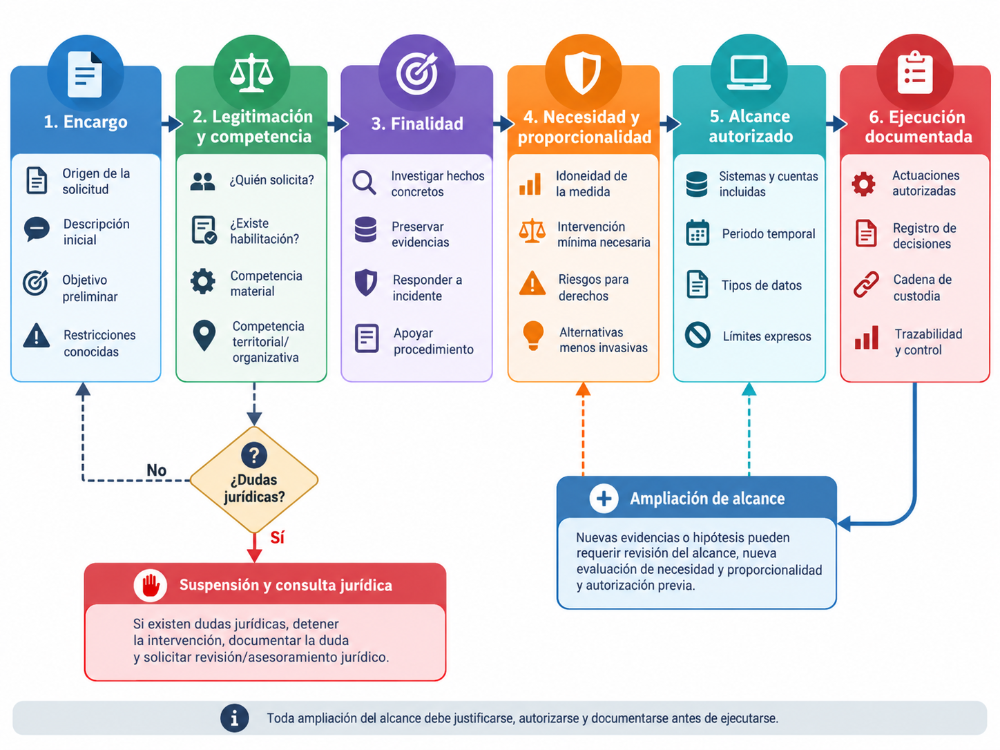
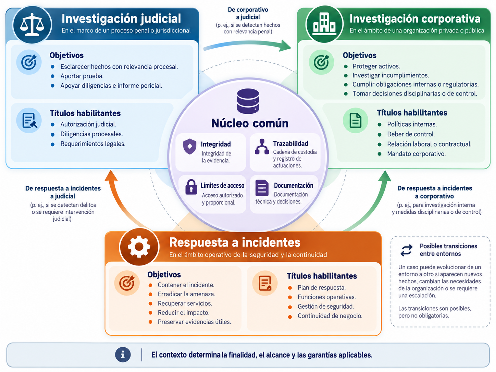
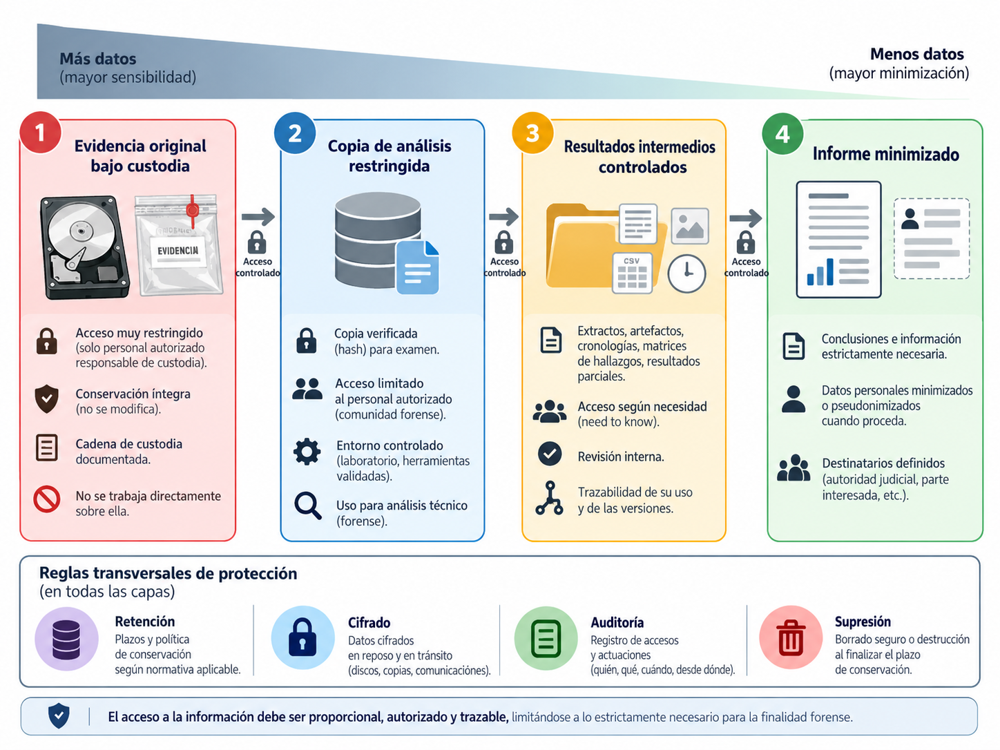
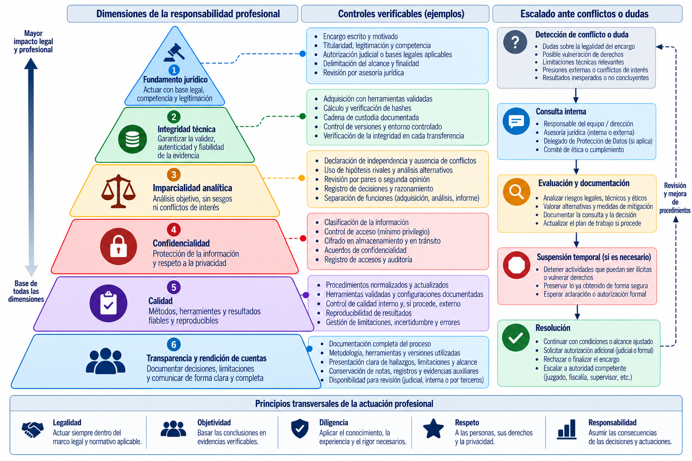

# Marco legal, responsabilidad y ética profesional

> "El aspecto más triste de la vida actual es que la ciencia reúne conocimiento mucho más rápido de lo que la sociedad adquiere sabiduría." 
> ("The saddest aspect of life right now is that science gathers knowledge faster than society gathers wisdom.")
> 
> — Isaac Asimov, Isaac Asimov's Book of Science and Nature Quotations (1988)
> NOTA: Existe un abismo entre el desarrollo de herramientas forenses capaces de extraerlo absolutamente todo frente a la madurez jurídica y ética necesaria para saber qué se puede tocar, cuándo y con qué garantías. 

El análisis forense digital se desarrolla en un terreno en el que la capacidad técnica no equivale a la facultad de actuar. Que una herramienta permita acceder a un teléfono, recuperar mensajes eliminados o reconstruir la actividad de una cuenta no significa que el analista esté autorizado a hacerlo. La distinción parece elemental, pero condiciona todas las etapas de una investigación: desde la primera conversación con quien encarga el trabajo hasta la destrucción o devolución de las copias obtenidas. En un laboratorio se puede demostrar la posibilidad de una adquisición; en un caso real, además, es imprescindible justificar su legitimidad.

Un ordenador contiene documentos de trabajo, pero también comunicaciones privadas, información sobre terceras personas, credenciales, fotografías, datos médicos, mensajes familiares y rastros de actividades que nada tienen que ver con el suceso investigado. Una cuenta en la nube puede pertenecer a una organización y, al mismo tiempo, incorporar información de trabajadores, clientes y proveedores sometida a diferentes deberes de confidencialidad. Incluso un registro aparentemente inocuo —la hora de inicio de sesión o la dirección IP asignada a un dispositivo— puede convertirse en dato personal cuando permite identificar directa o indirectamente a una persona. La investigación forense necesita esos registros para reconstruir acontecimientos, pero no puede tratar la información disponible como si careciera de titulares, derechos o contexto.

A la dificultad técnica se añade la diversidad de escenarios. Un juzgado puede encomendar a un perito el examen de un soporte concreto. Una empresa puede investigar una posible extracción de información confidencial. Una aseguradora puede solicitar un dictamen sobre un incidente. Un equipo de respuesta puede adquirir evidencias mientras contiene un ataque. Un abogado puede pedir la evaluación crítica de un informe de la parte contraria. Las obligaciones no son idénticas: cambian la fuente de legitimación, el alcance autorizado, las garantías exigibles y los destinatarios de los resultados.

El objetivo de este capítulo consiste en proporcionar al profesional una forma rigurosa de razonar sobre tales límites. Se estudiarán la autorización, la legitimidad del tratamiento y la proporcionalidad; las diferencias entre los procedimientos judiciales y corporativos; la privacidad y la protección de datos; los problemas de jurisdicción, especialmente en servicios en la nube; y los deberes éticos y profesionales de quienes identifican, adquieren, analizan e interpretan evidencias digitales. No se pretende convertir al investigador en jurista. Se pretende evitar que el desconocimiento jurídico convierta una actuación técnicamente impecable en una intervención cuestionable o lesiva para los derechos de las personas.

El marco de referencia principal será el de **España y la Unión Europea**, con atención a instrumentos internacionales cuando el supuesto lo requiera. Las reglas expuestas deben contrastarse siempre con el texto vigente, el procedimiento aplicable y las circunstancias del caso. La valoración de la licitud, de la admisibilidad de una prueba o de la existencia de responsabilidades corresponde a los órganos y profesionales competentes; el perito no sustituye sus funciones.

> **Principio rector:** el acceso técnicamente posible no es necesariamente un acceso legítimo. Antes de actuar deben estar claros el fundamento de la intervención, las preguntas que se pretende responder, los límites del examen y quién está facultado para autorizarlo.

## Autorización y legitimidad de una investigación

### Poder acceder no significa tener derecho a examinar

En la práctica cotidiana resulta frecuente que las facultades técnicas y las jurídicas se confundan. Un administrador puede disponer de privilegios suficientes para consultar buzones, copiar volúmenes virtuales y leer registros de autenticación. Un responsable de sistemas puede controlar un equipo corporativo que utiliza una persona determinada. El titular de un contrato de almacenamiento puede descargar todas las copias de seguridad asociadas al servicio. Ninguna de esas circunstancias resuelve por sí sola si un análisis concreto resulta lícito, proporcionado y compatible con las obligaciones de confidencialidad.

El **control material** de un dispositivo describe quién puede manipularlo. La **titularidad** se refiere a quién ostenta determinados derechos sobre él o sobre el servicio. La **facultad de administración** permite realizar operaciones técnicas dentro de un ámbito de gestión. La **autorización para investigar** habilita unas actuaciones dirigidas a un fin delimitado. Estos planos pueden coincidir, pero también pueden separarse por completo. Una universidad puede ser propietaria de un portátil, un profesor puede usarlo diariamente, el departamento de sistemas puede administrarlo y el acceso a determinados contenidos personales puede seguir estando limitado por las garantías aplicables.

Es por eso que una orden informal como «revísalo todo y dime qué encuentras» constituye un punto de partida deficiente. Su vaguedad no evita responsabilidades: las desplaza hacia el profesional que decide unilateralmente hasta dónde llegar. La primera obligación práctica consiste en precisar quién solicita el trabajo, con qué competencia, para qué finalidad, sobre qué objetos y mediante qué operaciones. En una investigación interna pueden requerirse intervenciones coordinadas de seguridad, asesoría jurídica, recursos humanos y protección de datos. En una investigación penal, el régimen de habilitación depende de las diligencias acordadas por la autoridad judicial y de la legislación procesal.

El analista debe trabajar con documentos que permitan reconstruir esa legitimidad. Una autorización no necesita adoptar siempre la misma forma, pero su contenido debe poder verificarse: identidad y cargo del autorizante, fecha, hechos o incidente que motiva la actuación, sistemas cubiertos, intervalo temporal, categorías de datos, técnicas autorizadas, restricciones expresas, personas que ejecutarán la actuación y reglas para ampliar el alcance. Cuando una resolución judicial existe, hay que atender a sus términos efectivos, no a una interpretación extensiva de lo que «seguramente se quiso decir».

### Tres preguntas que deben resolverse antes de comenzar

Conviene ordenar la revisión jurídica inicial alrededor de tres cuestiones relacionadas, pero distintas. **La primera es quién tiene facultad para ordenar o consentir una operación determinada**. **La segunda es qué normas permiten tratar la información que se obtendrá**. **La tercera es si la intervención concreta resulta necesaria y proporcionada respecto al objetivo**. Contestar una sola no hace desaparecer las otras dos.

Un investigador puede recibir instrucciones del representante de una empresa para examinar los registros de una plataforma corporativa. La empresa puede tener una base legítima para ciertos tratamientos, pero deberá delimitar las consultas y controlar el acceso de quienes intervengan. Un empleado puede consentir voluntariamente la entrega de determinados archivos, pero ese consentimiento no convierte en irrelevantes los derechos de terceras personas mencionadas en ellos. Una autoridad puede obtener un soporte físico durante una diligencia; en determinados supuestos, el acceso a los datos alojados en ese soporte exige una habilitación adicional y específica.

Estos problemas no se resuelven con una fórmula universal. El análisis debe identificar la naturaleza del caso —judicial, laboral, contractual, administrativo o de seguridad—, los titulares potencialmente afectados y la operación pretendida. Preservar un archivo de auditoría en el servidor de la propia organización puede presentar exigencias distintas de abrir el correo privado del usuario, clonar su teléfono personal o iniciar una sesión en una cuenta alojada por un proveedor extranjero. El profesional no tiene por qué emitir una opinión jurídica definitiva sobre cada paso, pero sí debe detectar las situaciones en las que es imprescindible obtenerla antes de continuar.

La autorización y su justificación deben registrarse **antes** de ejecutar acciones intrusivas, salvo supuestos de actuación urgente previstos legalmente y debidamente amparados, cuya apreciación no corresponde improvisar al técnico. Una necesidad operativa intensa no crea automáticamente una excepción jurídica. Cuando existe riesgo de pérdida inmediata de datos, una respuesta responsable puede consistir en solicitar una orden de conservación, asegurar registros cuya preservación ya esté legitimada o elevar la decisión con carácter urgente a las personas competentes.

### Finalidad, necesidad y proporcionalidad

La legitimidad no se agota en disponer de un documento firmado. También exige que la medida sea adecuada al propósito perseguido. Una investigación sobre accesos indebidos a un repositorio durante dos días no justifica sin mayor razonamiento la lectura indiscriminada de años de correspondencia personal. Una sospecha sobre la instalación de un programa no convierte en pertinentes todas las fotografías del dispositivo. El hecho de que la información pueda recuperarse técnicamente tampoco obliga a recuperarla.

La **finalidad** identifica el problema que se intenta esclarecer. La **necesidad** exige explicar por qué una determinada medida aporta información relevante y por qué no basta una alternativa menos intrusiva que permita alcanzar razonablemente el mismo objetivo. La **proporcionalidad** obliga a ponderar la intensidad de la intervención frente a la importancia del interés protegido, los riesgos y los derechos que puedan verse afectados. Estos conceptos poseen un contenido jurídico cuya aplicación concreta depende del caso, pero tienen consecuencias técnicas muy prácticas.

Por ejemplo, ante un posible uso indebido de una cuenta de colaboración empresarial, puede ser razonable empezar por los registros de autenticación, los eventos de descarga y la configuración de permisos. Si esos datos permiten establecer lo ocurrido, quizá no sea necesario acceder al contenido de los documentos descargados. Si los registros revelan una operación cuya naturaleza no puede determinarse sin examinar un archivo concreto, podrá plantearse una ampliación motivada y delimitada. El orden de consulta no es una regla automática: es una forma de justificar por qué se elige una fuente frente a otra más invasiva.

La minimización también puede expresarse mediante parámetros verificables: identificadores de cuentas, fechas iniciales y finales, rutas afectadas, categorías de evento, destinatarios de una comunicación o tipos de artefactos. Esos filtros deben documentarse con precisión. Sin embargo, hay ocasiones en que adquirir una imagen completa de un soporte resulta técnicamente necesario para preservar sectores, estructuras o metadatos que quedarían excluidos con una copia selectiva. La adquisición amplia y el examen ilimitado son decisiones diferentes. Puede conservarse una imagen íntegra bajo controles estrictos y restringir las búsquedas analíticas a lo autorizado, siempre que el fundamento y las garantías de la adquisición sean adecuados.

### La delimitación del alcance como garantía

El alcance constituye una barrera de control para el investigador y una garantía para las personas afectadas. Debe definir tanto lo **incluido** como lo **excluido**. Un encargo podría autorizar el análisis de los eventos de acceso a una aplicación, el historial de cambios de un conjunto determinado de archivos y las conexiones desde dos terminales corporativos durante una semana. Al mismo tiempo, podría excluir el contenido de las conversaciones privadas, otros departamentos, dispositivos particulares y periodos anteriores, salvo autorización posterior.

Es frecuente que durante el examen aparezcan indicios que apunten hacia otra fuente. Por ejemplo, un registro de descarga puede mostrar que la cuenta investigada se utilizó desde un teléfono ajeno al inventario. El hallazgo justifica formular una nueva pregunta, pero no habilita automáticamente la adquisición del teléfono. El analista debe conservar el dato que ha encontrado, detenerse en el límite de su mandato y solicitar una ampliación cuando proceda. Esa ampliación debería identificar la nueva fuente, su relevancia, las operaciones previstas, las personas afectadas y las razones que justifican la intervención.

Otra situación delicada aparece cuando la evidencia contiene información sobre hechos distintos del encargo inicial. Un análisis sobre filtración documental puede revelar datos íntimos, comunicaciones protegidas o una posible actividad ilícita no relacionada. La respuesta no consiste en explotar libremente ese descubrimiento. Debe preservarse la confidencialidad, limitar la difusión y trasladar la cuestión a quien corresponda para decidir qué tratamiento resulta legítimo. En contextos judiciales existen reglas particulares para hallazgos casuales, secreto profesional y acceso a información especialmente protegida; su aplicación requiere dirección jurídica y procesal.

La revisión del alcance tiene una dimensión temporal. Un plan inicialmente proporcionado puede dejar de serlo si aparecen fuentes menos invasivas, se demuestra que una hipótesis era falsa o se obtiene la información necesaria. La autorización no convierte todo lo permitido en obligatorio. Una práctica madura incluye momentos de reconsideración: ¿sigue siendo necesaria la siguiente adquisición?, ¿persiste la finalidad?, ¿podemos contestar ya las preguntas?, ¿qué riesgo introducirá ampliar la búsqueda?

### Documentar la autorización y sus cambios

La documentación mínima de un expediente debería permitir reconstruir qué se solicitó, quién lo autorizó y en qué condiciones se realizó. Un registro de alcance puede conservar el identificador del caso, el motivo de apertura, las preguntas investigables, la autoridad u órgano que decide, las categorías de información, los sistemas afectados, los responsables de ejecución y las restricciones conocidas. A ese registro se incorporarán las ampliaciones o modificaciones sucesivas, con su fecha y justificación.

Las instrucciones de un cliente privado deberían distinguirse de las decisiones técnicas adoptadas por el perito. El cliente define el encargo y su finalidad legítima; el profesional decide, dentro de sus competencias y autorizaciones, cómo obtener resultados fiables. Cuando un cambio altere materialmente los derechos afectados, el profesional no debe convertirlo en una simple variación instrumental. Revisar una ruta adicional dentro del mismo volumen puede ser una adaptación menor; acceder por primera vez a un buzón privado o a la cuenta personal de un tercero es una intervención de naturaleza distinta.

También conviene registrar expresamente las acciones **no realizadas**. Si se decidió no adquirir un teléfono por falta de autorización, no recuperar conversaciones privadas por irrelevancia o no consultar una base de datos externa por dudas de jurisdicción, la anotación contextualiza las limitaciones del informe. Una conclusión como «no se hallaron comunicaciones externas» sería equívoca si no se examinó la principal fuente donde podrían haberse producido. El alcance no es un anexo administrativo: forma parte del significado técnico de cualquier resultado.

### Escenario práctico: sospecha de filtración desde un portátil corporativo

Una empresa de ingeniería detecta que varias carpetas de proyectos fueron consultadas la noche anterior a la salida de un trabajador. El responsable de tecnología solicita una copia completa del portátil que utilizaba y pretende recuperar todos sus mensajes. La sospecha puede justificar una investigación; sin embargo, la medida pedida requiere una valoración adicional.

El investigador comienza por separar las preguntas: si se accedió a determinados archivos, si se copiaron fuera del entorno autorizado, qué identidades y dispositivos aparecen asociados a las operaciones y si existen explicaciones legítimas. Solicita información sobre las políticas de uso de equipos, las advertencias e instrucciones conocidas por la plantilla, la administración del dispositivo, la participación de las áreas correspondientes y la base jurídica del tratamiento. Propone preservar los registros de acceso sujetos a rotación y, bajo autorización, examinar primero los eventos relacionados con las rutas y el intervalo definidos.

Si se concluye que es necesaria una adquisición del portátil, el alcance del análisis debe quedar igualmente delimitado. La imagen puede contener información ajena al expediente; los filtros, los accesos autorizados y la documentación deben impedir que esa información se transforme en un objeto de exploración general. Si aparecen documentos de terceras personas o comunicaciones protegidas, el procedimiento debe prever cómo segregarlos y cuándo solicitar orientación jurídica. El informe recogerá los hallazgos técnicos y evitará afirmar, por el mero uso de una cuenta, que una persona determinada ejecutó materialmente cada acción.

La lección del ejemplo no es que siempre deba elegirse una adquisición selectiva ni que una imagen completa esté prohibida. La lección es que **la decisión técnica debe estar vinculada a la finalidad y a una autorización real**, con un tratamiento proporcional de la información afectada.

## Tratamiento de evidencias en investigaciones judiciales y corporativas

### La evidencia no cambia de naturaleza, pero sí su contexto jurídico

Un registro de autenticación es técnicamente el mismo objeto con independencia de que lo examine una unidad policial, un equipo de seguridad empresarial o un perito de parte. Lo que cambia son las competencias de quienes intervienen, las garantías del procedimiento, las posibilidades de acceso, las reglas de comunicación y el modo en que el resultado podrá utilizarse. Por ello, no basta con definir la cadena de custodia o calcular un resumen criptográfico: hay que situar cada actuación en su marco procesal o contractual.

La expresión «prueba digital» se utiliza coloquialmente para describir archivos, registros, imágenes forenses, fotografías o mensajes. Conviene diferenciar el **dato o evidencia digital** obtenido durante una investigación del **medio probatorio** a través del cual se incorpora a un procedimiento y de la **valoración** que hará el órgano competente. La existencia de un archivo relevante no garantiza por sí sola que sea admisible ni que demuestre la interpretación propuesta. Tampoco un informe pericial sustituye al juzgador. El perito aporta conocimientos especializados, expone operaciones y explica limitaciones; el resultado jurídico es otra cuestión.

En el orden jurisdiccional civil español, la Ley de Enjuiciamiento Civil contempla medios relacionados con la reproducción de palabras, sonidos e imágenes y con instrumentos que permiten archivar o reproducir datos (entre otros, artículos 299, 382 y 384). Es una referencia útil para comprender que las evidencias electrónicas se introducen y valoran dentro de un procedimiento, sometidas a reglas de contradicción y valoración. En el orden penal, la Ley de Enjuiciamiento Criminal establece un régimen específico para diversas medidas de investigación tecnológica, con requisitos y garantías que no se trasladan mecánicamente a los encargos privados.

### Investigación penal: intervención y control judicial

En una investigación penal pueden intervenir policía judicial, Ministerio Fiscal, órganos judiciales, especialistas y peritos. Las facultades de cada actor no son intercambiables. El analista puede ser requerido para realizar operaciones técnicas dentro de una diligencia acordada por la autoridad competente. Ese encargo exige conocer la resolución, sus límites y el procedimiento de preservación y entrega de las evidencias.

La Ley de Enjuiciamiento Criminal española contiene previsiones relevantes en los artículos **588 bis** y siguientes sobre medidas de investigación tecnológica. En particular, los artículos **588 sexies a, b y c** regulan extremos del registro de dispositivos de almacenamiento masivo de información. Un principio especialmente importante es que **la mera incautación de un dispositivo durante un registro no legitima automáticamente el acceso a su contenido**. La motivación y el alcance del acceso deben examinarse conforme a las reglas aplicables, incluida la autorización judicial cuando corresponda. Es una distinción esencial entre aprehender el objeto físico y registrar el universo informativo que contiene.

Los registros remotos de equipos informáticos se someten a un régimen específico en los artículos **588 septies**; no deben confundirse con una operación habitual de administración remota ni con la simple exportación autorizada de un registro corporativo. Las medidas de conservación de datos y otras diligencias relacionadas tienen también previsiones diferenciadas. El técnico ha de saber reconocer cuándo una operación entra en terrenos sometidos a control judicial, para no tratarla como un problema de credenciales o conectividad.

La autorización judicial delimita objeto, duración, condiciones y garantías según la medida. Desde el punto de vista forense, eso implica preparar una actuación capaz de demostrar qué se examinó, qué procedimientos se aplicaron, qué copias se realizaron y si surgieron circunstancias que exigían una nueva decisión judicial. La tentación de «aprovechar» que una imagen ya está montada para consultar otros directorios puede resultar incompatible con el mandato. La técnica debe obedecer al alcance, no ampliarlo silenciosamente.

### Aprehensión, adquisición y análisis: operaciones distintas

La **aprehensión** o intervención de un dispositivo afecta a la posesión o disponibilidad del soporte. La **adquisición** produce una copia o extracción de información. El **análisis** interpreta datos y artefactos. Son operaciones que pueden practicarse por personas distintas, en lugares diferentes y bajo condiciones específicas. Su diferenciación permite revisar tanto la integridad como la legitimidad de cada fase.

Supongamos que se interviene un teléfono durante una diligencia. La actuación sobre el objeto puede incluir su identificación, documentación, aislamiento y traslado. La posterior extracción lógica, física o mediante un servicio de respaldo puede requerir otras decisiones, dependiendo del título habilitante. No es correcto afirmar que «se analizó el teléfono porque estaba intervenido» sin documentar qué autorización amparaba el acceso. Del mismo modo, una autorización para examinar información almacenada no debe interpretarse automáticamente como permiso para acceder activamente a cuentas remotas vinculadas, realizar comunicaciones con terceros o modificar contenidos.

El informe técnico debería permitir seguir la secuencia sin confusión: dispositivo recibido, estado, precintos, responsables de custodia, método de adquisición, identificadores de la extracción, comprobaciones de integridad, acciones sobre copias y resultados. Si el acceso técnico exige alterar el estado del equipo —por ejemplo, iniciar una sesión, desbloquear un dispositivo o ejecutar un agente de adquisición— debe explicarse qué cambios podrían producirse y por qué eran razonables y autorizados.

### Custodia, integridad y contradicción

La cadena de custodia documenta la trayectoria de la evidencia y las personas que la han tenido bajo su responsabilidad. Incluye entrega, recepción, almacenamiento, apertura, reproducción y, cuando corresponda, devolución. Su utilidad consiste en poder explicar razonablemente que el objeto examinado es el que se obtuvo y qué ocurrió con él. La ausencia de una anotación no tiene una consecuencia procesal idéntica en todos los asuntos: habrá que valorar su naturaleza, relevancia y efecto sobre la fiabilidad y el procedimiento. No corresponde al técnico declarar automáticamente «nula» toda evidencia con una incidencia documental.

Los resúmenes criptográficos ayudan a detectar diferencias entre determinadas representaciones binarias, pero no prueban por sí solos el origen, la licitud de la adquisición o la exactitud de una interpretación. Si una exportación se genera desde una interfaz de proveedor, el hash de ese fichero permitirá comprobar que el fichero no cambió después de su generación. No demostrará, por sí mismo, que la plataforma exportó todos los eventos existentes, que el usuario mostrado era el autor físico de la acción o que las marcas temporales reflejaban un reloj correctamente sincronizado.

La posibilidad de **contradicción** —que las partes puedan conocer y discutir los elementos relevantes en los términos del procedimiento— refuerza la importancia de conservar metodologías, versiones de herramientas, filtros, parámetros, ficheros de entrada y resultados intermedios. Un informe que solo presenta capturas seleccionadas dificulta su revisión. A veces no será posible compartir datos completos por confidencialidad o protección de terceros; en tal caso deberán emplearse mecanismos procesales y técnicos adecuados para permitir el examen sin difundir información innecesaria.

### Perito judicial, perito de parte y técnico que interviene en los hechos

La función de un especialista puede variar. Un **perito designado judicialmente** recibe un cometido dentro del procedimiento. Un **perito de parte** es contratado por una persona u organización interesada en el litigio. Un **analista de respuesta a incidentes** puede haber participado antes en la contención y recuperación de los sistemas, y ser llamado después para explicar decisiones técnicas. Un **testigo de hechos** relata lo que presenció o realizó. A veces una misma persona reúne conocimientos técnicos y participación directa; esa doble condición debe hacerse transparente.

Ser contratado por una parte no equivale a tener permiso para deformar los resultados. La independencia intelectual se manifiesta en la elección de métodos adecuados, en la declaración de limitaciones y en la capacidad de comunicar hallazgos desfavorables para quien paga el trabajo. El cliente puede definir preguntas legítimas y exigir claridad, pero no debería dictar qué hechos «deben» encontrarse. Si el análisis contradice la hipótesis inicial, la responsabilidad profesional exige expresarlo.

El técnico que ejecutó medidas urgentes durante un incidente merece especial atención. Su intervención pudo modificar procesos, credenciales, conexiones o registros. Esos cambios pueden haber sido necesarios para proteger el servicio, pero deben distinguirse de los artefactos atribuibles al incidente. Una cronología coherente incorpora la actuación defensiva como evento de la investigación, no como ruido que se omite. Las conclusiones tendrán que reconocer las limitaciones derivadas de operaciones irreversibles.

### Investigación corporativa: propiedad, poder de dirección y límites

Las organizaciones poseen intereses legítimos en proteger su información, garantizar la seguridad de los sistemas y cumplir obligaciones contractuales y legales. En España, el empleador tiene facultades de vigilancia y control dentro de los límites del ordenamiento, pero no dispone de un derecho irrestricto sobre todo lo que circula por un dispositivo que entrega a una persona trabajadora. El artículo **87 de la Ley Orgánica 3/2018 (LOPDGDD)** reconoce el derecho a la intimidad en el uso de dispositivos digitales puestos a disposición por el empleador y establece condiciones relativas a los criterios de utilización, información a la plantilla y garantías cuando se admiten usos privados.

Por ello, la política de uso de medios corporativos no es una formalidad que se redacta después del incidente. Debe existir, ser accesible, comunicarse y aplicarse conforme a las normas pertinentes. Su contenido puede ayudar a definir expectativas de privacidad y mecanismos de control, pero no transforma automáticamente en proporcional cualquier inspección. La necesidad de revisar comunicaciones, historiales o ficheros exige valorar el objetivo, los medios disponibles y las garantías concretas.

El uso de cámaras y la geolocalización de trabajadores tienen reglas específicas en los artículos **89 y 90 de la LOPDGDD**. Si durante la investigación se propone consultar imágenes, sonidos o posiciones de un trabajador, deben revisarse las condiciones legales de obtención y uso de esas fuentes, además de la finalidad inicial de los sistemas. No puede suponerse que la existencia de una grabación permita reutilizarla indiscriminadamente. Las exigencias de información previa, proporcionalidad y protección de espacios íntimos son particularmente relevantes.

El investigador corporativo debería actuar con un mandato claro del responsable competente y coordinarse, cuando proceda, con asesoría jurídica, recursos humanos, representación de trabajadores y delegado de protección de datos. Los controles pueden ser necesarios para un incidente de seguridad; al mismo tiempo, se debe evitar que una investigación técnica se convierta en una vigilancia generalizada o en una búsqueda retrospectiva de comportamientos ajenos al hecho investigado.

### Investigación interna, expediente disciplinario y procedimiento penal

Una organización puede investigar incumplimientos contractuales o hechos que sospecha delictivos. Sin embargo, una investigación interna no adquiere por ello las potestades de la policía judicial. Una empresa no puede ordenar registros secretos de cuentas ajenas ni acceder a datos custodiados por terceros simplemente porque teme haber sufrido un delito. Cuando las actuaciones exijan facultades reservadas a autoridades públicas, será necesario acudir a los cauces competentes.

La comunicación de resultados también requiere cuidado. El informe interno puede ser utilizado para valorar una decisión disciplinaria, mejorar controles, defender intereses ante un litigio o formular una denuncia. Esas finalidades no justifican revelar todo el material obtenido a todo destinatario. Conviene separar el informe ejecutivo, los hallazgos técnicos y la evidencia bajo custodia. Los anexos pueden contener credenciales, datos sensibles o información de terceros que no debe circular junto con un resumen de gestión.

Si existe la posibilidad de un procedimiento penal, la organización debe preservar datos relevantes y recibir asesoramiento sobre los canales apropiados de entrega a la autoridad. Manipular cuentas, recuperar información mediante accesos no autorizados o alterar sistemas de posibles implicados puede comprometer la investigación y generar riesgos adicionales. La colaboración con la autoridad y la conservación de evidencias deben planificarse sin convertir al departamento de sistemas en un investigador con potestades que no le corresponden.

### Comparación operativa de los tres escenarios principales

| Aspecto | Investigación judicial | Investigación corporativa | Respuesta a incidentes |
|---|---|---|---|
| Finalidad habitual | Aclarar hechos relevantes para un procedimiento | Esclarecer incidentes o incumplimientos dentro de competencias legítimas | Comprender y contener una amenaza y recuperar operaciones |
| Título habilitante | Resoluciones, diligencias y competencias procesales aplicables | Facultades legítimas, base jurídica del tratamiento y autorizaciones internas | Competencias de seguridad y operación, junto a las habilitaciones pertinentes |
| Acceso a fuentes | Limitado por las medidas legalmente acordadas | Limitado por derechos, políticas y alcance autorizado | Limitado por roles operativos, derechos y proporcionalidad |
| Prioridad temporal | Garantías procesales y preservación | Preservación compatible con continuidad y derechos | Puede predominar la urgencia de contención y conservación volátil |
| Resultado | Dictamen, actuaciones o informe incorporable al procedimiento | Informe interno, pericial o de cumplimiento | Informe de incidente, cronología, indicadores, evidencias y lecciones |
| Principal riesgo | Exceder la autorización o comprometer garantías | Invadir privacidad o exceder la finalidad | Alterar evidencias en operaciones urgentes o ampliar accesos sin control |

Esta tabla describe tendencias, no compartimentos estancos. Un incidente puede comenzar en el equipo de seguridad, continuar como investigación interna y terminar en un proceso judicial. La transición debe quedar registrada. La legitimidad de una fase no se presume idéntica en las siguientes y los documentos generados para un objetivo pueden requerir revisión antes de utilizarse para otro.

### Caso práctico: una cuenta comprometida durante la respuesta

El centro de operaciones de una empresa detecta varias autenticaciones sospechosas y descargas de documentos en un servicio de colaboración. Para contener la amenaza, deshabilita temporalmente la cuenta, revoca sesiones activas y conserva los eventos disponibles. Días después, se solicita un informe con destino a una posible reclamación judicial.

Durante la fase de respuesta, el equipo actuó con un objetivo prioritario de seguridad. Sus acciones deben constar en la cronología: hora de revocación de sesiones, cambios de configuración, herramientas utilizadas y registros exportados. El informe posterior no puede tratar esos cambios como comportamiento del presunto atacante. Debe separar los datos de la plataforma, las actuaciones de defensa y las inferencias que vinculan ambas secuencias.

La segunda fase puede exigir revisar legitimidad y alcance de nuevas fuentes, conservar copias verificables, validar formatos y preparar anexos capaces de soportar una contradicción pericial. Nada obliga a repetir todo el incidente como si no hubiera existido una respuesta operativa; tampoco permite fingir que la documentación inicial poseía una formalidad que realmente no tenía. La transparencia sobre el origen de la evidencia hace el resultado más sólido, incluso cuando revela límites.

## Protección de datos y privacidad

### La investigación como tratamiento de información personal

La protección de datos no es una cuestión secundaria que comienza cuando se redacta el informe. Aparece desde el instante en que se identifican usuarios, direcciones, comunicaciones, cuentas y dispositivos asociados a personas físicas. Bajo el **Reglamento (UE) 2016/679**, conocido como Reglamento General de Protección de Datos (*RGPD*), la noción de dato personal comprende información relativa a personas identificadas o identificables. Los identificadores en línea, las ubicaciones y las combinaciones de registros pueden entrar en ese concepto. Además, «tratamiento» incluye operaciones tan cotidianas para un analista como consultar, copiar, clasificar, conservar, correlacionar, exportar y suprimir datos.

No toda información técnica es necesariamente personal en cualquier circunstancia. Un identificador completamente ajeno a personas identificables puede no serlo, mientras que una dirección IP, un identificador de dispositivo o un registro de actividad pueden adquirir esa condición por el contexto y por la información adicional disponible. Una tabla de auditoría donde aparecen nombres, usuarios o direcciones vinculadas a trabajadores exige desde el principio valorar la protección de datos. La seudonimización puede reducir la exposición, pero no equivale sin más a una anonimización irreversible.

Esta perspectiva tiene una consecuencia práctica: una imagen de disco, un volcado de memoria o una exportación de correo no son simplemente «objetos forenses». También pueden ser conjuntos de datos personales sometidos a principios de licitud, finalidad, minimización, seguridad y conservación limitada. La posibilidad de que se utilicen como evidencia no elimina tales principios. Puede justificar determinados tratamientos cuando exista fundamento suficiente y garantías adecuadas, pero nunca sustituye la valoración jurídica concreta.

El **responsable del tratamiento** determina sus fines y medios esenciales. El **encargado del tratamiento** actúa por cuenta de aquel, conforme al artículo 28 y a las condiciones que resulten aplicables. Un laboratorio forense externo puede desempeñar funciones de encargado en determinados contratos, aunque la calificación no depende del nombre que figure en la factura. Si decide por su cuenta finalidades nuevas o reutiliza material para sus propias actividades, pueden cambiar su condición y sus responsabilidades. Los miembros del equipo que acceden a información personal deben hacerlo dentro de sus funciones e instrucciones, con controles efectivos y deber de confidencialidad.

### No todos los contextos se rigen por la misma norma

En España conviven diferentes regímenes jurídicos. Para numerosos tratamientos empresariales, administrativos y profesionales resulta central el RGPD, complementado por la LOPDGDD. Sin embargo, el RGPD excluye de su ámbito material determinados tratamientos realizados por autoridades competentes para fines de prevención, investigación, detección o enjuiciamiento de infracciones penales. En ese ámbito, el marco específico deriva de la **Directiva (UE) 2016/680** y de su transposición española mediante la **Ley Orgánica 7/2021**.

La diferencia importa porque una investigación penal oficial no puede describirse sin más como si fuera un expediente interno de una empresa. No deben trasladarse automáticamente las bases jurídicas, los procedimientos para ejercer derechos o las reglas de comunicación de información de un régimen al otro. Además, una empresa privada que investiga un posible fraude no pasa a convertirse por ese motivo en una autoridad competente sometida al régimen policial-penal. Por regla general, su tratamiento requiere encaje en el marco que le corresponda como organización privada, aunque los hechos investigados pudieran constituir un delito.

El analista debería reconocer, como mínimo, cuatro escenarios: tratamiento empresarial ordinario de registros; investigación interna sobre trabajadores; tratamiento por autoridades competentes con fines penales; y actuaciones de un perito que maneja información en el marco de un procedimiento judicial. En cada caso pueden concurrir disposiciones sobre secreto profesional, derechos fundamentales, reglas procesales y protección de datos. La solución no consiste en memorizar una única base jurídica, sino en identificar quién decide, con qué finalidad y dentro de qué régimen.

### Bases jurídicas: el consentimiento no es la respuesta universal

El artículo **6 del RGPD** establece distintas bases de licitud del tratamiento, entre ellas el cumplimiento de obligaciones legales, la realización de misiones de interés público, la ejecución de contratos y la satisfacción de intereses legítimos en las condiciones previstas. La base adecuada depende del responsable, la operación y la normativa aplicable. No es correcto afirmar que todas las investigaciones forenses requieren consentimiento ni, en el extremo opuesto, que toda investigación de seguridad queda legitimada por el simple interés de la organización.

En el contexto laboral, el consentimiento de la persona trabajadora puede resultar problemático como fundamento cuando existe una relación de desequilibrio. Además, una política corporativa firmada no constituye un consentimiento irrestricto para cualquier control posterior. Las obligaciones de información, la finalidad, los derechos y las garantías aplicables deben analizarse con independencia de que exista una cláusula contractual genérica.

Para una organización puede ser legítimo registrar accesos de seguridad, investigar una intrusión y conservar ciertos datos cuando concurra una base adecuada. Pero la licitud de recopilar registros no legitima automáticamente todas las operaciones posteriores. La exportación a un laboratorio extranjero, la revelación a un proveedor de inteligencia de amenazas o el uso de un modelo de inteligencia artificial externo pueden constituir tratamientos adicionales con riesgos y condiciones propias. Una evaluación correcta se centra en la operación real, no en una etiqueta genérica como «ciberseguridad».

También existen **categorías especiales de datos** del artículo 9 del RGPD, cuya utilización se somete a restricciones reforzadas. Una investigación de un portátil puede revelar información de salud, convicciones, afiliación sindical u otros contenidos especialmente protegidos. Los datos relativos a condenas e infracciones penales se rigen por previsiones específicas del artículo 10. El analista no puede suponer que su relevancia potencial basta para levantar todas las restricciones; debe escalar la cuestión y aplicar controles apropiados.

### Principios del RGPD trasladados a decisiones técnicas

El artículo **5 del RGPD** reúne principios que pueden traducirse a prácticas concretas. La **licitud, lealtad y transparencia** exigen identificar la base de actuación y cumplir las obligaciones de información que procedan, teniendo en cuenta las posibles limitaciones legalmente establecidas. La **limitación de la finalidad** impide convertir una investigación de accesos en una explotación general de comportamientos personales. La **minimización** favorece el uso de filtros y la separación entre datos relevantes y material incidental. La **exactitud** obliga a corregir atribuciones erróneas y a distinguir los registros de las conclusiones. La **limitación del plazo de conservación** exige revisar por cuánto tiempo deben mantenerse copias e informes. La **integridad y confidencialidad** obligan a proteger los repositorios, las comunicaciones y los soportes.

Finalmente, la **responsabilidad proactiva** exige que el responsable pueda demostrar el cumplimiento de esos principios. No basta con declarar que los datos se utilizaron correctamente: se necesitan decisiones registradas, controles de acceso, políticas, autorizaciones y registros de tratamiento. La documentación forense resulta útil también en este plano, porque permite relacionar los accesos a la evidencia con una finalidad definida y una persona responsable.

La minimización merece un análisis específico. Una imagen forense completa puede capturar millones de objetos, incluidos archivos eliminados, espacios no asignados y contenidos ajenos. En determinados escenarios esa amplitud es necesaria para no perder contexto técnico o para preservar el estado del soporte. Sin embargo, **obtener mucho no obliga a leerlo todo ni a divulgarlo todo**. Puede aplicarse una estrategia en dos niveles: una adquisición documentada y protegida cuando esté jurídicamente justificada, seguida de un análisis filtrado por objeto, periodo y relevancia. El acceso al material excluido debe quedar restringido, y cualquier ampliación necesita justificación.

### Privacidad desde el diseño del procedimiento forense

Los principios de privacidad desde el diseño y por defecto, recogidos en el artículo **25 del RGPD**, pueden orientar la arquitectura de un laboratorio. En lugar de confiar únicamente en la discreción de los profesionales, se establecen controles que reducen estructuralmente la exposición: separación de casos, cifrado de almacenamiento, credenciales nominales, privilegios mínimos, registros de acceso, permisos temporales y reglas de eliminación.

Por ejemplo, una estación de análisis no debería conservar indefinidamente montajes de imágenes ajenas cuando termina un caso. Las carpetas temporales, miniaturas, índices de búsqueda y cachés creadas por las herramientas pueden contener copias de datos personales aunque el archivo principal se encuentre protegido. Las aplicaciones forenses que generan bases de datos auxiliares deben configurarse y supervisarse para que sus resultados permanezcan dentro del perímetro autorizado. La eliminación al cierre del expediente requiere tener en cuenta estas copias derivadas.

Conviene distinguir entre **evidencia maestra**, **copias de trabajo**, **resultados intermedios** y **extractos incluidos en el informe**. La evidencia maestra puede conservarse con acceso extraordinariamente restringido; la copia de trabajo sirve para el examen; los resultados intermedios permiten reproducir operaciones; los extractos divulgables incorporan solo lo necesario para sustentar hallazgos. No siempre es posible separar material con total limpieza, pero el esfuerzo de segmentación reduce riesgos y facilita la respuesta a solicitudes de acceso y auditorías.

La gestión de claves es otro aspecto crítico. Cifrar un repositorio sin establecer una política de custodia, recuperación y rotación de claves puede proteger frente a accesos indebidos y, simultáneamente, impedir el cumplimiento de una obligación legítima de conservación. La arquitectura adecuada combina confidencialidad con disponibilidad controlada, separación de funciones y registro de aperturas. En casos sensibles, el uso de autorizaciones múltiples para acceder a originales o a secretos especialmente protegidos puede añadir garantías.

### Datos de terceros y descubrimientos incidentales

Las evidencias suelen incluir información de personas que no son objeto de investigación: clientes, familiares, contactos, profesionales externos o compañeros de trabajo. Un buzón puede incorporar cientos de conversaciones privadas que carecen de interés. Una copia de memoria puede contener credenciales de servicios ajenos. Un repositorio puede incluir información comercial de terceros. La relevancia de un archivo determinado no transforma todo su contenido en materia libremente examinable.

Por esta razón, antes de analizar grandes conjuntos conviene decidir cómo se reconocerán y tratarán los hallazgos incidentales. Una opción consiste en establecer categorías de exclusión y protocolos de segregación: documentos de salud, comunicaciones con asesores jurídicos, mensajes personales y material ajeno al periodo investigado. La selección concreta debe adaptarse al contexto legal y no puede convertirse en una técnica para ocultar evidencia relevante. Cuando la pertinencia o la protección jurídica de un documento sea dudosa, la revisión por personal autorizado y con competencia adecuada ofrece más garantías que una decisión unilateral del analista.

La **información cubierta por secreto profesional** exige especial cuidado. El correo de un abogado, por ejemplo, puede encontrarse técnicamente en un dispositivo accesible, pero su tratamiento plantea cuestiones adicionales que deben resolverse por los cauces pertinentes. No corresponde al profesional técnico decidir por sí solo que una comunicación protegida deja de estarlo porque contiene un término de búsqueda relevante. En el informe pueden describirse las limitaciones y el tratamiento seguido sin reproducir el contenido confidencial.

Los datos de menores, personas vulnerables o víctimas de determinados hechos requieren protección reforzada, tanto en el manejo de la evidencia como en la redacción de entregables. La curiosidad técnica —examinar fotografías, conversaciones o perfiles para «completar el contexto»— nunca es una finalidad legítima por sí misma. La disciplina profesional se demuestra especialmente al no abrir información cuyo examen no está justificado.

### Seguridad, incidentes de datos personales y deberes de notificación

El artículo **32 del RGPD** exige medidas técnicas y organizativas apropiadas al riesgo, que pueden incluir cifrado, confidencialidad, resiliencia y evaluación de controles. En un laboratorio forense esas medidas deben contemplar amenazas particulares: robo de soportes, sincronización accidental con nubes personales, fugas por herramientas, acceso de terceros al puesto de análisis, pérdida de claves o contaminación entre expedientes.

Una investigación puede originarse en una violación de seguridad de datos personales. Es importante separar dos preguntas: **qué sucedió técnicamente** y **qué deberes de notificación se activan**. Bajo el artículo **33 del RGPD**, determinados incidentes deben notificarse a la autoridad de control sin dilación indebida y, de ser posible, dentro de las 72 horas desde que el responsable tenga conocimiento, salvo cuando sea improbable que entrañen riesgo para los derechos y libertades de las personas físicas. El artículo **34** regula la comunicación a los interesados en supuestos de alto riesgo, con condiciones y excepciones. La calificación concreta corresponde al responsable y a quienes le asesoran, no al analista por intuición.

El equipo forense contribuye proporcionando una cronología verificable, categorías de datos potencialmente afectadas, número aproximado de registros, vectores de acceso, estado de los sistemas y grado de incertidumbre. No debe retrasar la comunicación necesaria hasta alcanzar una certeza absoluta. También debe evitar lo contrario: presentar estimaciones preliminares como hechos cerrados. Es válido comunicar una conclusión provisional claramente identificada y actualizarla según se incorporen nuevos elementos.

Un informe puede afirmar, por ejemplo, que se confirmó la descarga de un archivo comprimido desde una cuenta administrativa, pero que no se dispone de registros suficientes para identificar de forma completa su contenido o destino. Esa incertidumbre resulta relevante para la evaluación del riesgo. La obligación de documentar lo que se sabe y lo que no se sabe favorece decisiones regulatorias más responsables.

### Conservación, bloqueo y eliminación: un equilibrio difícil

Las investigaciones necesitan preservar datos, pero la conservación indefinida no puede darse por supuesta. El principio de limitación temporal del RGPD debe relacionarse con obligaciones legales, plazos de prescripción, exigencias procesales, contratos y posibles reclamaciones. Una política de retención operativa de treinta días puede ser insuficiente para investigar un incidente conocido meses después; una decisión de conservar durante años todas las exportaciones sin distinción puede ser desproporcionada. La respuesta exige categorías, justificaciones y reglas de revisión.

Es útil diferenciar la retención **ordinaria** de los sistemas —determinada por finalidades de operación, seguridad y cumplimiento— de una conservación extraordinaria o **legal hold** vinculada a un asunto específico. La segunda debe activarse por quien posea competencia para ello, identificar el material y el motivo, limitar accesos y establecer cuándo revisar o levantar la medida. No se trata de un permiso genérico para prolongar sin límite todos los tratamientos.

Cuando existe una solicitud de supresión, una obligación de bloqueo, un derecho ejercitado o una orden de conservación, el analista debe evitar respuestas automáticas. Puede haber razones jurídicas para conservar cierta información aun cuando termine su uso ordinario; también pueden existir obligaciones de restringir el tratamiento y evitar consultas adicionales. En España, la LOPDGDD incorpora la figura del **bloqueo de datos** en su artículo 32, cuyo alcance debe examinarse con asesoramiento adecuado. Desde la perspectiva técnica, conservar no significa necesariamente mantener los datos visibles para todos los usuarios o disponibles para búsquedas rutinarias.

Al finalizar el caso debe existir una decisión expresa sobre originales, copias, índices, archivos temporales y documentación. Algunas evidencias deberán entregarse al órgano correspondiente; otras se conservarán bajo mandato o contrato; otras deberán eliminarse mediante procedimientos apropiados y documentados. Antes de destruir, es necesario verificar que no existen obligaciones de conservación pendientes. Un proceso controlado evita tanto la pérdida prematura como la acumulación indefinida de datos sensibles.

### Uso de servicios externos y herramientas con componentes en la nube

Las aplicaciones modernas de análisis pueden ofrecer reconocimiento de texto, clasificación automática, traducción, búsqueda semántica o procesamiento asistido por modelos de inteligencia artificial. Estas funciones resultan atractivas cuando una investigación contiene grandes volúmenes de documentos. Sin embargo, enviar evidencia a un servicio externo puede constituir una comunicación a un tercero y, según la arquitectura del proveedor, una transferencia internacional de datos. También puede dar lugar a retenciones, registros, uso para mejora de servicios o acceso por subencargados.

La decisión requiere examinar el contrato, la condición del proveedor, los lugares de procesamiento, las políticas de conservación, las garantías técnicas y las obligaciones aplicables. No es prudente copiar correos corporativos, documentos confidenciales o extractos de memoria a una aplicación pública de IA con la expectativa de que «no pasa nada porque solo se usa para analizar». Tampoco es suficiente anonimizar superficialmente un texto si las combinaciones de datos permiten reidentificar a personas o revelar secretos empresariales.

Si una herramienta local puede realizar la operación necesaria sin salir del laboratorio, se reduce una parte del riesgo, aunque no desaparecen las exigencias de licitud, seguridad y validación. Si el procesamiento externo resulta indispensable, deben existir autorizaciones, contratos y garantías adecuados. Además, las salidas generadas automáticamente deben verificarse: un resumen producido por un modelo no equivale a una constatación forense, y una clasificación probabilística no debe presentarse como prueba de autoría.

### Un caso de privacidad en la práctica: análisis de un buzón

Una organización investiga si una cuenta corporativa envió un fichero estratégico a un destinatario externo. Los registros del servidor muestran un mensaje saliente, pero el encabezado y el asunto no permiten determinar qué contenido fue enviado. El equipo solicita una exportación completa de los diez últimos años del buzón.

El profesional comienza por identificar qué sería necesario para responder a la pregunta: fecha aproximada, cuenta emisora, destinatario, identificador de mensaje y, si es posible, huellas del adjunto. Una búsqueda limitada puede recuperar el mensaje pertinente sin explorar años de conversaciones. Si la plataforma exige una exportación más amplia por limitaciones técnicas, debe explicarse la razón, establecer una conservación protegida y limitar el examen a los filtros previstos. La mera disponibilidad de correspondencia personal no autoriza a incorporarla al informe.

Durante la extracción aparece un correo privado con información médica. No está relacionado con el hecho investigado. El analista no lo utiliza como indicio, no lo adjunta y evita reproducirlo en los resultados de búsquedas. Si el sistema de análisis ha generado miniaturas o índices derivados, aplica también las reglas de protección y cierre correspondientes. El informe se centra en el mensaje relevante y documenta los criterios de selección sin divulgar material incidental.

La calidad de la investigación no disminuye por haber dejado fuera información irrelevante. Al contrario, una delimitación clara ayuda a defender que los hallazgos provienen de un procedimiento orientado a preguntas legítimas y no de una exploración indiscriminada.

## Jurisdicción y obtención de evidencias

### Un sistema digital no termina en la frontera del dispositivo

Los sistemas actuales distribuyen funciones entre lugares, empresas y ordenamientos diferentes. Un ordenador localizado en España puede autenticarse mediante un proveedor de identidad gestionado desde Irlanda, consultar una aplicación alojada en otro Estado miembro, generar trazas en una región de procesamiento distinta y almacenar copias de respaldo fuera del Espacio Económico Europeo. El investigador puede observar todas esas relaciones en una misma línea temporal, pero no adquiere por ello un derecho uniforme a intervenir sobre todos los sistemas.

La **jurisdicción** plantea preguntas sobre qué autoridades y tribunales son competentes, qué legislación resulta aplicable y cómo puede requerirse colaboración para acceder a información situada o controlada en otro territorio. La **ubicación física de los datos** es relevante en algunos escenarios, pero no siempre basta para resolver estas cuestiones. También importan el establecimiento del proveedor, el domicilio de las personas afectadas, la naturaleza del servicio, el lugar desde el que se ofrece y las obligaciones impuestas por los distintos sistemas jurídicos. Una copia replicada puede existir temporalmente en varias regiones; una empresa puede gestionar una base de datos desde un país sin que eso determine por sí solo todas las reglas de acceso.

El error habitual consiste en transformar un problema internacional en una cuestión de conectividad: «La consola de administración funciona desde aquí, luego puedo descargarlo». Una API puede permitir exportar mensajes almacenados por un proveedor extranjero; esa capacidad técnica no resuelve las condiciones contractuales, la protección de datos, la autoridad para ordenar la operación ni la eventual necesidad de asistencia judicial internacional. Antes de comenzar, el plan debe identificar la fuente, quién la controla, qué derecho se pretende ejercer y cuáles son los canales apropiados para obtenerla.

### Residencia de datos, control administrativo y facultad jurídica

Conviene separar la **residencia** de la información, el **control operativo** del servicio y la **facultad jurídica** para exigir o realizar la obtención. Un proveedor puede ofrecer al cliente la posibilidad de elegir una región de almacenamiento. Esa preferencia no asegura que todos los metadatos, registros de soporte, datos de autenticación o copias de continuidad se procesen exclusivamente en ella. A su vez, una persona puede administrar un servicio sin tener acceso a todos los registros técnicos, porque el proveedor conserva las trazas en un plano de control separado.

La investigación comienza con un inventario de fuentes y responsables: cuenta o suscripción, organización titular del contrato, región de datos declarada, subencargados conocidos, categorías de logs disponibles, ubicación aproximada de los registros y canales de solicitud. Los acuerdos de nivel de servicio y las condiciones de privacidad pueden limitar las exportaciones, establecer plazos de retención o determinar qué procedimientos se utilizan ante un requerimiento oficial. Registrar esas características desde el inicio impide que la ausencia de un artefacto se interprete erróneamente como ausencia de actividad.

Una exportación que aparece bajo un nombre como *audit log* no tiene necesariamente la cobertura de auditoría que su nombre sugiere. Puede excluir operaciones administrativas, accesos mediante aplicaciones heredadas o eventos anteriores a la activación de una licencia. La documentación del proveedor puede describir esos límites y formar parte de la base para interpretar el valor de la evidencia. También deben anotarse filtros y opciones empleados en la exportación, pues la selección puede introducir exclusiones sin que el analista sea consciente.

### Cooperación penal internacional y preservación urgente

Cuando la investigación corresponde a autoridades competentes y afecta a datos controlados en otra jurisdicción, existen mecanismos de cooperación internacional. Entre ellos se encuentran los instrumentos de asistencia judicial mutua y el **Convenio sobre la Ciberdelincuencia del Consejo de Europa**, conocido como **Convenio de Budapest**, que contiene disposiciones sobre conservación rápida de datos y cooperación para su obtención. Estos instrumentos operan dentro de sus condiciones propias; no autorizan a cualquier investigador particular a solicitar o extraer directamente información de terceros.

La preservación rápida responde a un problema específico: los registros pueden desaparecer por rotación antes de que concluya una solicitud formal de entrega. Por ello, los mecanismos jurídicos pueden distinguir entre ordenar que determinados datos **se conserven** y obtener efectivamente una copia de ellos. En el ámbito técnico, esa diferencia se refleja en actuaciones también distintas. Solicitar la retención de ciertos logs no equivale a adquirir su contenido, y la existencia de una obligación de conservar no permite inferir un acceso ilimitado.

El Convenio de Budapest contempla modalidades de acceso transfronterizo bajo condiciones delimitadas, incluida la relativa a datos públicamente disponibles y determinados accesos consentidos conforme a su artículo 32. Esa previsión no debe leerse como una licencia general para explorar sistemas extranjeros con credenciales obtenidas durante una investigación. La identidad y competencia de quien actúa, el carácter voluntario y lícito del consentimiento y la naturaleza del dato son determinantes. En situaciones ambiguas, debe intervenir la autoridad o el asesoramiento jurídico competente antes de acceder.

En la práctica, el analista puede resultar decisivo sin asumir funciones que no le corresponden: identifica los registros pertinentes, especifica las cuentas y periodos, documenta la volatilidad, indica formatos deseables y propone comprobaciones de integridad. Esa precisión facilita que quien tiene autoridad formule una solicitud útil. Una petición demasiado amplia puede encontrar obstáculos jurídicos y técnicos; una petición incompleta puede llegar cuando el proveedor ya ha eliminado los datos.

### El régimen europeo de pruebas electrónicas: e-Evidence

La Unión Europea ha establecido instrumentos específicos para facilitar, bajo condiciones y garantías, la obtención y conservación de prueba electrónica en procedimientos penales transfronterizos. El **Reglamento (UE) 2023/1543** regula las órdenes europeas de producción y las órdenes europeas de conservación dirigidas a determinados prestadores de servicios. **Es aplicable desde el 18 de agosto de 2026**. Se acompaña de la **Directiva (UE) 2023/1544**, relativa a establecimientos designados y representantes legales de prestadores a efectos de recabar pruebas electrónicas.

La actualidad de este régimen importa para un libro publicado en 2026: no debe describirse como una promesa futura ni presentarse como una herramienta de investigación privada. Las órdenes están destinadas a autoridades competentes en el marco de los procedimientos contemplados y sujetas a requisitos de emisión, controles, derechos y mecanismos de ejecución. Su ámbito no equivale al acceso indiscriminado a todos los datos en la nube ni reemplaza la necesidad de examinar la categoría de información solicitada.

Desde la perspectiva forense, destacan dos conceptos. La **orden de conservación** busca evitar que datos específicos dejen de estar disponibles mientras se tramita la actuación posterior. La **orden de producción** persigue que el prestador entregue la información que corresponde conforme al mecanismo jurídico aplicable. En ambos casos resultan esenciales la correcta identificación de cuentas, periodos y categorías, la documentación de las respuestas y la verificación de qué recibió realmente el investigador.

El profesional debe distinguir, además, entre el instante en que el proveedor registra un evento, el momento en que se emite una orden, la fecha en que se ejecuta y aquella en que se genera la exportación. Es posible que los datos ya hubieran dejado de existir antes de recibir la orden. También pueden existir diferencias entre el formato interno de auditoría del proveedor y el entregado. Una línea temporal rigurosa registra esas circunstancias, porque inciden directamente en la posibilidad de corroborar hechos.

### Las solicitudes extranjeras no son instrucciones técnicas ordinarias

El artículo **48 del RGPD** contiene reglas relativas al reconocimiento y ejecución de decisiones de autoridades y tribunales de terceros países que exijan transferencias o comunicaciones de datos personales, sin perjuicio de otros fundamentos de transferencia previstos en el capítulo V. Su aplicación es jurídica y depende de las circunstancias, pero transmite una idea fundamental: recibir un requerimiento extranjero no equivale, por sí solo, a disponer de legitimidad universal para comunicar datos.

Imaginemos una empresa europea que recibe de una entidad extranjera una solicitud de exportación de mensajes de varios trabajadores. La petición menciona una investigación y pide al equipo de sistemas «cooperación inmediata». El analista no debería ejecutar la exportación solo porque la solicitud parece formal. Debe verificar su procedencia, remitirla a quienes gestionan requerimientos legales y exigir instrucciones validadas sobre datos, finalidad y alcance. Si existe riesgo de pérdida, se valorará por los canales competentes una medida de conservación adecuada, sin asumir que conservar y entregar son actos equivalentes.

La misma cautela resulta pertinente con empresas matrices, filiales, consultoras o aseguradoras de otros países. La relación contractual entre entidades del mismo grupo no convierte automáticamente en libre la circulación de evidencias. Deben analizarse responsables y encargados, acceso remoto, destinatarios y posibles transferencias internacionales, así como las excepciones o garantías aplicables. Las medidas de cifrado, la seudonimización y el acceso limitado pueden reducir riesgo, pero no sustituyen una base jurídica válida.

### Transferencias internacionales en la práctica del laboratorio

El capítulo V del RGPD regula las transferencias de datos personales a terceros países u organizaciones internacionales. Las herramientas disponibles pueden incluir decisiones de adecuación, garantías adecuadas y excepciones específicas, según las condiciones previstas. No basta con identificar dónde está la sede comercial del proveedor; es necesario conocer quién accede a los datos, desde dónde y con qué garantías. El análisis depende de la transferencia concreta y de las obligaciones vigentes.

Supongamos que un laboratorio español contrata un servicio de procesado documental con servidores fuera del Espacio Económico Europeo. El proveedor afirma que cifra los archivos en tránsito y ofrece un contrato estándar. El cifrado es importante, pero no resuelve todas las cuestiones: quién conserva las claves, si existe acceso administrativo al contenido, cuánto tiempo permanecen los ficheros, qué subcontratistas intervienen y qué régimen de transferencia resulta aplicable. Las recomendaciones del **Comité Europeo de Protección de Datos** sobre medidas complementarias a herramientas de transferencia constituyen una referencia para este tipo de análisis.

En un laboratorio avanzado, la clasificación previa de casos puede evitar decisiones apresuradas. Algunas evidencias podrán procesarse localmente por su sensibilidad o por restricciones contractuales; otras se gestionarán mediante servicios expresamente autorizados; y otras exigirán un tratamiento especialmente segregado. Esta planificación no impide el trabajo forense: permite que la tecnología utilizada no introduzca un problema jurídico adicional.

### El uso de credenciales obtenidas durante la investigación

Las credenciales constituyen un caso singular. Durante un análisis pueden recuperarse contraseñas, tokens de acceso, cookies de sesión o claves de API. Su presencia es un dato potencialmente relevante, pero usarlos para abrir otras cuentas constituye una operación distinta. La obtención de un secreto durante una adquisición autorizada no implica una autorización general para autenticarse en sistemas relacionados. El acceso puede afectar a datos nuevos, modificar marcas temporales, activar controles de seguridad o cruzar fronteras jurídicas.

El artículo **197 bis del Código Penal español**, dentro de su ámbito de aplicación, contempla conductas de acceso no autorizado a sistemas de información vulnerando medidas de seguridad, así como determinados supuestos de interceptación de transmisiones no públicas. No corresponde al analista calificar automáticamente cualquier operación como delictiva o inocua. Sí debe saber que experimentar con credenciales ajenas sin título suficiente no es una simple técnica de verificación. Incluso una autenticación aparentemente pasiva puede modificar registros, activar notificaciones y producir un perjuicio operativo.

Ante una credencial recuperada, la conducta técnicamente prudente consiste en documentar dónde apareció, qué sistemas podría identificar, su estado conocido y su relevancia. Si es necesario verificar su validez, debe definirse expresamente la operación, la autorización y el entorno, favoreciendo mecanismos de comprobación menos intrusivos cuando existan. La reconstrucción de un compromiso de cuentas puede basarse en logs y configuraciones sin volver a utilizar los tokens del presunto atacante.

### Pruebas electrónicas proporcionadas por terceros

Las investigaciones dependen cada vez más de exportaciones entregadas por proveedores, clientes o administradores. El analista puede no haber controlado la generación original del archivo. Su tarea no consiste en fingir que lo adquirió directamente, sino en documentar la procedencia y evaluar qué fiabilidad puede atribuirse a cada componente.

Una entrega debería acompañarse, cuando sea viable, de información sobre la fuente, el procedimiento de exportación, la identidad y rol del operador, las fechas, los filtros aplicados, el formato, la zona horaria, los identificadores de cuenta, las posibles limitaciones de retención y los hashes de los ficheros finalmente proporcionados. Si el proveedor firma digitalmente el paquete o genera un manifiesto, debe conservarse el mecanismo de verificación. Si no lo hace, la ausencia de firma no convierte automáticamente la entrega en inútil: delimita qué controles pueden practicarse.

También deben evitarse equivalencias fáciles. Un CSV de auditoría generado por una API puede contener filas íntegras respecto a la consulta, pero estar incompleto respecto al conjunto real de eventos. Una captura de pantalla puede reflejar una interfaz en un instante determinado, pero ocultar filtros, paginación, campos expandibles o elementos fuera de la vista. Una carta de un proveedor puede explicar la procedencia sin permitir reproducir el sistema interno. La valoración final necesita combinar metadatos, documentación, coherencia de formatos y corroboración externa.

### Caso práctico: archivos desaparecidos en un repositorio multinacional

Una consultora española investiga la desaparición de documentos de un espacio colaborativo. La sede contractual del proveedor está en otro Estado miembro, los usuarios trabajan desde tres países y el servicio conserva registros detallados durante un periodo limitado. El departamento de seguridad puede consultar determinados eventos desde la consola corporativa, pero no tiene acceso a los logs internos de infraestructura.

La hipótesis inicial es que una persona eliminó deliberadamente los documentos. Sin embargo, también podrían haberse movido, modificado los permisos o fallado una sincronización. El equipo conserva los registros administrativamente accesibles dentro de sus atribuciones, registra filtros y periodos, verifica permisos actuales y revisa el historial de versiones. No intenta acceder a las cuentas privadas de los usuarios ni solicita informalmente a una filial extranjera todos sus datos personales.

Si los hallazgos justifican recurrir a registros de proveedor que no están disponibles para el cliente, se define con exactitud qué eventos serían necesarios y se eleva la petición por los cauces contractuales o jurídicos que correspondan. Si existen indicios de delito y se activa un procedimiento penal, la autoridad competente determinará los instrumentos utilizables, incluidas, cuando procedan, las herramientas europeas o de cooperación internacional. La función técnica consistirá en preservar, interpretar y documentar lo recibido sin ocultar diferencias de procedencia y alcance.

La conclusión podría indicar que hay evidencia sólida de un cambio de permisos a una hora determinada, pero no de eliminación de datos, y que una atribución personal definitiva no puede realizarse con la información disponible. Esa respuesta puede ser menos espectacular que la acusación inicial, pero es más precisa y responsable.

## Ética, imparcialidad y responsabilidad profesional

### La responsabilidad empieza donde termina la capacidad de la herramienta

La ética profesional no es un complemento ornamental de la técnica forense. Constituye una condición de su credibilidad. Un analista puede trabajar con métodos reproducibles y conservar todos los hashes correctamente y, sin embargo, actuar de modo irresponsable si excede su autorización, manipula la presentación de los resultados, esconde incertidumbres o utiliza información sensible para una finalidad ajena. La integridad de una evidencia debe ir acompañada de la integridad de quien la trata.

La responsabilidad profesional puede examinarse en tres dimensiones. La **técnica** exige conocer los procedimientos, sus limitaciones y las condiciones de validez de los resultados. La **jurídica y organizativa** exige actuar dentro del mandato y cumplir las normas aplicables. La **ética** exige tratar con honestidad a quienes solicitan el trabajo, a las personas afectadas y a los destinatarios del informe, incluso cuando una conducta impropia pudiera resultar difícil de detectar. Las tres dimensiones se refuerzan mutuamente; ninguna permite compensar la ausencia de las otras.

En el ámbito procesal civil español, el artículo **335.2 de la Ley de Enjuiciamiento Civil** recoge expresamente el deber de objetividad del perito, incluyendo la consideración de circunstancias que puedan favorecer o perjudicar a cualquiera de las partes. El principio sirve para ilustrar una exigencia general de la actividad pericial: el especialista no debe buscar exclusivamente datos favorables a la hipótesis del cliente. Su función consiste en esclarecer hechos mediante conocimientos especializados, no en construir una narración conveniente.

No debe confundirse la independencia profesional con la ausencia de toda relación con las partes. Muchos peritos son contratados por quienes tienen interés legítimo en un procedimiento; otros pertenecen a organizaciones donde investigan incidentes internos. La cuestión ética es si pueden aplicar un método honesto, revelar conflictos relevantes, comunicar los límites del análisis y negarse a presentar como probado lo que no está demostrado. Cuando esas condiciones no se cumplen, la calidad de la evidencia pierde significado práctico.

### Imparcialidad y sesgos de interpretación

Los sistemas digitales producen una gran cantidad de datos y el analista rara vez puede examinarlos sin selección. Cada consulta, filtro, palabra clave e hipótesis dirige la atención hacia una parte de la información. La selección es inevitable; el sesgo no tiene por qué serlo. El primer paso consiste en reconocer que las expectativas influyen en lo que se considera relevante y en cómo se interpreta una coincidencia.

El **sesgo de confirmación** aparece cuando se buscan indicios que apoyen una sospecha y se ignoran explicaciones alternativas. El **sesgo de anclaje** hace que la primera hipótesis recibida del cliente determine la interpretación posterior de los registros. El **sesgo de autoridad** puede llevar a aceptar una conclusión porque proviene de un superior, de una herramienta reconocida o de otro perito. El **sesgo retrospectivo** provoca que una secuencia parezca obvia una vez conocido el desenlace. Ninguno requiere mala fe: pueden aparecer incluso en profesionales experimentados.

La mitigación necesita prácticas concretas. Antes del examen, es útil escribir las preguntas investigables y las hipótesis rivales. Durante el análisis, deben registrarse resultados que contradigan la versión inicial. En la revisión, otra persona puede examinar una muestra de artefactos sin conocer la atribución personal propuesta, cuando el procedimiento lo permita. Las conclusiones importantes deben vincularse a evidencias identificables y verificarse con fuentes cuyo origen sea suficientemente independiente.

La independencia de fuentes merece precisión. Dos exportaciones del mismo sistema pueden parecer corroboración, aunque procedan de la misma base de datos y compartan errores. Un indicador de un panel de seguridad y un evento de una API pueden derivar ambos de un único registro subyacente. La verdadera corroboración requiere valorar cómo se generó cada dato, quién lo produjo y qué dependencias existen entre las fuentes. Repetir la misma inferencia con dos interfaces no la transforma en un hecho independiente.

### Diferenciar observación, hallazgo, inferencia y atribución

Una de las responsabilidades más exigentes del perito consiste en utilizar un lenguaje proporcional a la evidencia. Una **observación** describe lo que consta directamente: «El registro contiene un evento de autenticación satisfactoria a las 02:17». Un **hallazgo** integra interpretación técnica: «El evento corresponde a una sesión emitida para la cuenta examinada». Una **inferencia** combina hallazgos para explicar un acontecimiento: «La sesión probablemente se utilizó para consultar el repositorio». La **atribución personal** añade una cuestión más compleja: quién controlaba realmente la sesión y con qué intención.

Los saltos entre esos niveles exigen justificación creciente. Una dirección IP no identifica necesariamente a la persona usuaria; una credencial válida no demuestra que actuara su titular; un artefacto de ejecución no siempre permite reconstruir el propósito de quien puso en marcha el programa. La coincidencia de una marca temporal con una presencia física puede ser significativa, pero no debe convertirse en identidad demostrada sin corroboración adecuada. La prudencia de vocabulario no reduce el valor del informe: permite conocerlo.

Es especialmente importante evitar expresiones aparentemente técnicas que esconden una valoración moral o jurídica. «El empleado robó los archivos» incluye autoría, intención y calificación del hecho. Si lo que se ha constatado es una descarga, debe describirse como tal, junto con su origen, destino aparente y limitaciones. «Se identificó actividad compatible con exfiltración» puede ser una conclusión adecuada cuando existen indicios, pero debe explicarse qué la apoya y qué alternativas no se han podido descartar. El informe forense no debería sustituir hechos por calificativos.

Tampoco conviene transformar la incertidumbre en porcentajes improvisados. Decir que una hipótesis es «un 95 % segura» no aporta rigor si no existe un modelo validado que produzca y justifique esa cifra. Son preferibles formulaciones que indiquen el soporte de la conclusión: «Se confirma la existencia de la sesión», «los datos son compatibles con una copia», «no se dispone de elementos suficientes para atribuir la operación a una persona física». Cuando se empleen escalas de confianza deben definirse previamente, con sus límites y criterios.

### Competencia técnica y derecho a reconocer límites

Nadie domina por igual los sistemas de archivos, las plataformas móviles, las redes industriales, la criptografía, la nube y el análisis de malware. Una actuación ética requiere aceptar ese límite. Un profesional puede ser competente para adquirir y analizar registros de Windows y necesitar apoyo especializado al interpretar un dispositivo iOS cifrado o un sistema industrial propietario. Reconocer la necesidad de otro especialista no constituye un defecto: evita que una conclusión insegura se presente como conocimiento experto.

Las herramientas tampoco confieren competencia por sí mismas. Que un programa forense clasifique un registro como «archivo eliminado» no significa que el término refleje necesariamente el comportamiento real del sistema. Una herramienta puede interpretar incorrectamente marcas temporales, estructuras dañadas o artefactos de una versión reciente. Su resultado debe relacionarse con el formato de origen y, cuando la conclusión sea decisiva, contrastarse mediante análisis manual, otra herramienta o pruebas controladas.

La validación debe ser proporcionada al riesgo. Para una operación rutinaria conocida, puede bastar una comprobación documentada. Para un artefacto novedoso del que depende una atribución personal, pueden requerirse ensayos de reproducción con datos de referencia, revisión por pares y documentación de alternativas. Los informes deben reflejar el alcance de esa validación. Presentar la salida de un software como una verdad infalible porque el producto es comercial o popular constituye una delegación indebida del juicio profesional.

Mantener competencia implica actualizar conocimientos. Los sistemas cambian sus políticas de registro, versiones de formatos, esquemas de cifrado y mecanismos de autenticación. Una interpretación correcta para una versión antigua puede dejar de serlo después de una actualización. Antes de aplicar un procedimiento aprendido en otro caso, deben verificarse las condiciones del sistema actual. Las referencias bibliográficas, documentación de proveedores y pruebas locales forman parte de ese trabajo, especialmente cuando se incorporan nuevas herramientas o automatizaciones.

### Conflictos de interés y presión del cliente

Un conflicto de interés puede ser económico, personal, profesional u organizativo. Un investigador puede haber diseñado los controles de seguridad cuya eficacia debe evaluar. Puede haber participado en una decisión operativa que produjo la pérdida de registros. Puede tener relaciones con una persona investigada o con una organización que financia el trabajo. La existencia de relaciones previas no determina automáticamente la imposibilidad de intervenir, pero puede comprometer la percepción o la realidad de su independencia y debe ser examinada.

La transparencia permite gestionar buena parte de estas situaciones. Conviene declarar vínculos relevantes, delimitar el cometido y, en asuntos sensibles, promover revisión independiente de los hallazgos. Si un analista participó en la contención, puede documentar con precisión sus acciones, pero sería inadecuado omitir una decisión propia que alteró un registro decisivo. Si el cliente solicita confirmar una conclusión que la evidencia no respalda, debe resistirse a modificar el texto por conveniencia y, si es necesario, renunciar al encargo de acuerdo con sus obligaciones contractuales y profesionales.

La presión adopta formas sutiles. «Necesitamos una conclusión clara para mañana» puede traducirse en un incentivo para ignorar la falta de fuentes. «No incluyas esa limitación porque confunde al juez» puede impulsar a suprimir información esencial. «La dirección está convencida de que fue esta persona» puede orientar filtros y selección de artefactos. El profesional responsable responde delimitando lo que puede afirmarse y dejando constancia de las limitaciones. Una conclusión más breve y prudente puede ser mucho más útil que un informe contundente pero vulnerable al examen crítico.

### Confidencialidad y necesidad de conocer

Las evidencias digitales pueden contener información extremadamente sensible. Su mera custodia confiere una responsabilidad que se mantiene fuera del horario de trabajo y, en general, más allá de la terminación del encargo. El deber de confidencialidad se traduce en decisiones sencillas pero estrictas: no comentar detalles identificables con personas ajenas, no utilizar ejemplos reales sin autorización y anonimización efectiva, no copiar evidencias a soportes personales y no convertir las capturas de un caso en material de demostración pública.

La aplicación de permisos por **necesidad de conocer** debe regir incluso entre miembros de un mismo equipo. Que varias personas trabajen en el laboratorio no significa que todas deban poder abrir las evidencias de cada expediente. Los registros de acceso, los permisos temporales y la separación entre casos reducen errores accidentales y permiten aclarar responsabilidades si se produce una incidencia. Las plataformas de colaboración interna deben configurarse con el mismo criterio que los repositorios principales.

La comunicación hacia los destinatarios del informe requiere adaptación. El equipo de respuesta necesita indicadores y decisiones técnicas; la dirección puede necesitar impacto y riesgos; un tribunal requiere hechos, metodología y justificación. La diferencia de presentación no autoriza a alterar el contenido material de las conclusiones. La confidencialidad tampoco implica ocultar información relevante a quienes tienen legítimo derecho a conocerla, sino utilizar canales y versiones apropiados para cada destinatario.

### Transparencia sobre errores y correcciones

En cualquier investigación pueden aparecer errores: una conversión de zona horaria equivocada, una herramienta configurada con un filtro incorrecto, un archivo duplicado que altera un recuento o una secuencia atribuida inicialmente a la cuenta equivocada. La exigencia ética no consiste en prometer infalibilidad. Consiste en detectar, corregir y documentar errores de forma proporcionada a sus consecuencias.

Si el error se descubre antes de emitir el informe, la bitácora debe recoger qué cambió y por qué. Si se detecta después de entregar resultados, puede ser necesario emitir una corrección o adenda, comunicar el alcance del cambio y revisar conclusiones relacionadas. Reemplazar silenciosamente un documento entregado destruye trazabilidad y debilita la confianza. El control de versiones debe identificar de manera inequívoca qué informe ha visto cada destinatario.

Es igualmente importante distinguir entre **cambio de interpretación** y **alteración de evidencia**. Una hipótesis puede revisarse porque aparecen nuevos datos o porque una metodología demuestra que un artefacto se interpretó mal. Ese cambio no significa que se haya modificado el archivo original. El expediente debe conservar tanto los resultados anteriores como el motivo de su revisión. La evolución razonada de una conclusión puede ser un signo de rigor, no de inconsistencia.

### Seguridad psicológica, trato humano y consecuencias de los informes

Las investigaciones afectan a personas. Una sospecha de filtración puede comprometer un empleo, una reputación o una relación contractual. La interpretación de mensajes personales puede poner de manifiesto circunstancias íntimas ajenas al incidente. Un dictamen apresurado puede inducir medidas disciplinarias o denuncias basadas en una atribución insegura. El trabajo forense no es una actividad moralmente neutra por el simple hecho de analizar bits.

Un profesional debe tratar a las personas afectadas con respeto, evitar expresiones despectivas y no presentar sospechas como culpabilidades. El anonimato relativo de una cuenta o una dirección IP no reduce esa obligación. La disciplina narrativa consiste en hablar de sistemas, artefactos y acciones comprobables antes de construir afirmaciones sobre individuos. La formulación correcta protege tanto a las personas como a la credibilidad técnica del informe.

Las entrevistas o solicitudes de información a usuarios pueden producir sesgos y riesgos de privacidad. Cuando el analista participe en ellas, deberá respetar su ámbito de competencia y las garantías aplicables. Una pregunta sugestiva puede contaminar el relato; enseñar antes de tiempo una hipótesis puede alterar recuerdos o comportamientos; confrontar directamente a una persona investigada puede comprometer actuaciones formales. La coordinación con profesionales jurídicos o de investigación humana es tan importante como la correlación de registros.

También importa la comunicación de resultados negativos. Si no se han encontrado indicios suficientes para sostener una acusación, debe indicarse con precisión. No hallar un evento en un registro incompleto no equivale a demostrar que el evento nunca ocurrió; pero tampoco es aceptable mantener una acusación por la sola expectativa de que «algo aparecerá». La responsabilidad consiste en describir qué se buscó, qué cobertura existía y qué puede concluirse con ese resultado.

### Inteligencia artificial y automatización: ayuda, no autoridad

La automatización permite analizar miles de eventos, identificar patrones y preparar cronologías. Las herramientas basadas en modelos de lenguaje pueden resumir registros, traducir documentos o proponer hipótesis. Todas estas posibilidades requieren una disciplina adicional: conocer las entradas utilizadas, evaluar el rendimiento real y verificar cada afirmación decisiva frente a la fuente primaria. Un modelo puede producir referencias inexistentes, combinar casos distintos o introducir relaciones causales donde solo hay proximidad textual.

La ética del uso de inteligencia artificial en un caso forense no se agota en comprobar que el resumen «suena razonable». Deben considerarse la confidencialidad de los datos enviados, las condiciones de uso, la capacidad de reproducir las operaciones, los posibles sesgos del sistema y las expectativas de quienes recibirán el informe. Si un resultado importante fue obtenido o transformado mediante automatización, conviene documentar el papel de la herramienta y las verificaciones realizadas por el profesional.

Una práctica correcta es utilizar estos sistemas para tareas auxiliares y contrastar sistemáticamente los resultados. Pueden ayudar a localizar conceptos dentro de documentos o a proponer expresiones de búsqueda, pero no deberían recibir la responsabilidad final de decidir si una persona cometió un hecho, si una evidencia es auténtica o si una actuación estuvo autorizada. Los modelos no asumen la responsabilidad profesional que corresponde al analista y a quien dirige la investigación.

### Responsabilidad del laboratorio y de la organización

El comportamiento individual resulta insuficiente si la organización no proporciona medios para trabajar correctamente. Un laboratorio necesita procedimientos de admisión de casos, verificación de autorizaciones, segregación de evidencias, gestión de credenciales, registros de custodia, copias de seguridad, control de herramientas y revisión de informes. Sin estas medidas, la ética se convierte en una exigencia abstracta depositada en personas sometidas a presión y plazos difíciles.

La dirección debe asegurar recursos acordes con el riesgo y evitar incentivos que premien exclusivamente la rapidez o el volumen de hallazgos. También debe definir procedimientos para comunicar conflictos de interés, errores, solicitudes impropias y dudas sobre la legitimidad de actuaciones. El analista necesita un canal real para suspender una operación cuando el riesgo jurídico o técnico supera su competencia, sin verse obligado a improvisar por falta de interlocutores.

La revisión por pares aporta una garantía valiosa, siempre que se realice con independencia suficiente y conocimiento del método. No basta con revisar la ortografía del informe. La revisión técnica puede comprobar correspondencia entre conclusiones y evidencias, filtros, integridad, reproducibilidad, sesgos, cronología, limitaciones y adecuación del lenguaje. En asuntos especialmente sensibles es recomendable que una persona distinta valide las inferencias decisivas o revise los elementos que podrían refutarlas.

### Decisiones difíciles: cuándo detener una investigación

No existe una regla ética que obligue a agotar siempre todas las posibilidades técnicas. A veces lo correcto es detenerse. Puede faltar autorización para una nueva fuente, haber desaparecido el objetivo legítimo, haberse comprobado que la siguiente medida sería desproporcionada o existir un conflicto de interés incompatible con una actuación independiente. La suspensión debe documentarse, comunicarse a quien corresponda y acompañarse de medidas de preservación legítimas si existe riesgo de pérdida.

Detenerse también puede ser adecuado cuando la evidencia es insuficiente para una conclusión sólida. No todo caso requiere un culpable y no todo incidente puede reconstruirse completamente. El cierre profesional puede consistir en exponer las hipótesis compatibles con los datos, la información que faltó y qué habría sido necesario preservar para esclarecer mejor el hecho. La falta de certeza no debe compensarse con un lenguaje categórico.

En sentido contrario, tampoco debe abandonarse una línea de investigación solo porque sus resultados contradigan la expectativa del cliente. Si una fuente pertinente y autorizada ofrece una explicación inocua, debe ser tratada con la misma seriedad que aquella que apunta a una actividad indebida. La obligación de considerar información favorable y desfavorable es parte de la imparcialidad, no una concesión voluntaria.

### Un compromiso profesional verificable

La ética es más útil cuando puede expresarse en conductas observables. En la apertura se verifica el mandato y se identifican riesgos. En la adquisición se minimizan alteraciones y se documentan excepciones. En el análisis se contrastan hipótesis alternativas y se conservan resultados negativos. En la interpretación se distinguen hechos de inferencias. En el informe se declaran fuentes, herramientas, incertidumbre y posibles conflictos. En el cierre se protege y gestiona el destino de las evidencias.

Un código de conducta interno puede sintetizar esas obligaciones, pero su eficacia depende de que existan mecanismos para cumplirlo: revisiones, formación, gestión de incidentes del propio laboratorio y una cultura que permita rectificar. La confianza de un tribunal, de una empresa o de una persona afectada no debería descansar en una declaración de honor aislada, sino en un conjunto de decisiones trazables.

## Caso integrador: una investigación con límites jurídicos y técnicos

### El encargo y las primeras decisiones

Una compañía que presta servicios de mantenimiento industrial detecta que un usuario externo accedió a una plataforma de documentación durante la madrugada. Los eventos disponibles muestran una autenticación correcta y varias solicitudes a la API de descarga. La cuenta pertenece a una ingeniera que trabaja de forma híbrida y que, según la primera información recibida, se encontraba de vacaciones. La empresa sospecha que alguien utilizó sus credenciales para obtener documentación confidencial.

La dirección solicita «revisar toda la actividad de la trabajadora, incluidos sus dispositivos y mensajes». El equipo de seguridad sabe que el servicio conserva los registros detallados durante un periodo corto. Existe, por tanto, una tensión inmediata: preservar datos antes de su rotación y evitar una intervención indiscriminada sobre información personal. El analista propone separar las actuaciones de conservación que ya pueden realizarse legítimamente dentro de la plataforma administrada de aquellas nuevas adquisiciones que requieren una autorización y valoración específica.

El encargo se redefine en términos comprobables: establecer si se produjo una sesión, identificar qué operaciones quedaron registradas, determinar qué documentos pudieron descargarse, reconstruir los controles de autenticación utilizados y evaluar qué explicaciones alternativas encajan con los datos. Se documentan las cuentas, aplicaciones y fechas incluidas. Al mismo tiempo, el asesoramiento jurídico revisa la base de tratamiento y el alcance permitido respecto a recursos corporativos y posibles dispositivos particulares.

En esta fase no se solicita a la trabajadora que entregue su teléfono personal ni se inicia sesión con tokens recuperados. La empresa puede necesitar información de ese tipo más adelante, pero su utilidad hipotética no convierte automáticamente la medida en legítima. El expediente registra esa exclusión de manera expresa, con la posibilidad de reconsiderarla si aparecen razones y habilitaciones suficientes.

### Preservación, exportación y evaluación de datos

Se exportan los eventos de autenticación, los registros de la API disponibles y el historial de cambios de permisos dentro del alcance autorizado. El operador documenta la identidad de la cuenta administrativa utilizada, la fecha y hora de la operación, los parámetros de búsqueda, el formato entregado y los hashes calculados sobre los ficheros resultantes. Se conserva también la documentación técnica necesaria para comprender qué representa cada campo de registro.

El equipo advierte que el panel de auditoría permite consultar noventa días de determinados eventos, pero solo treinta de otros. Esta diferencia limita la reconstrucción retrospectiva. Se anotan además la zona horaria de presentación, la resolución de las marcas temporales y la posibilidad de retrasos en la ingestión. El registro de una descarga puede indicar que la plataforma procesó una solicitud; no demuestra necesariamente por sí solo que el archivo terminara íntegramente almacenado en el dispositivo remoto.

La autenticación aparece asociada a una dirección IP residencial conocida, pero esa coincidencia no acredita quién tenía el control físico del equipo en el instante de la operación. El sistema de identidad permite identificar un método de autenticación multifactor, pero no aporta directamente la identidad de la persona que confirmó la notificación. El analista evita convertir correlaciones en autoría. El dato disponible es compatible con distintos escenarios: sesión legítima, credenciales compartidas, compromiso del dispositivo, uso remoto no detectado o una interpretación incompleta de los registros.

### Aparición de una fuente situada fuera del alcance

En uno de los eventos aparece el identificador de un cliente de sincronización instalado en un dispositivo que no figura en el inventario empresarial. El administrador local propone usar el token de sesión recuperado para acceder a la cuenta del dispositivo. El analista se opone a ejecutar la acción sin resolver antes su alcance y legitimidad. La mera existencia del token como evidencia no autoriza a emplearlo para una operación distinta sobre información potencialmente privada.

En su lugar, se verifica qué puede deducirse de los registros que ya están disponibles, se comprueba si el servicio conserva detalles adicionales mediante sus mecanismos administrativos autorizados y se describe qué información permanece inaccesible. La existencia de una fuente externa se incorpora como limitación y, en caso de ser necesaria, se eleva una petición formal de ampliación con fundamento, datos buscados y salvaguardas. Si los datos están bajo control de un proveedor situado fuera de España, se identifican los canales contractuales o jurídicos apropiados antes de solicitar su entrega.

El informe provisional describe una descarga asociada a un identificador de sesión, pero deja abierta la autoría. La dirección considera que esa cautela debilita su posición. El perito explica que presentar una atribución personal no demostrada sería mucho más vulnerable. Una conclusión limitada pero sostenida permite adoptar medidas de seguridad y solicitar nuevas diligencias sin confundir sospechas con hechos constatados.

### Revisión independiente y comunicación

Antes del informe final, otro especialista examina los eventos decisivos sin partir de la conclusión propuesta. Detecta que una parte de las solicitudes corresponde a la comprobación automática de versiones realizada por el cliente, no necesariamente a descargas solicitadas manualmente. El primer analista revisa los recuentos y separa los eventos automáticos de las transferencias que parecen responder a operaciones de usuario. La corrección se documenta y se conservan los resultados anteriores como parte del historial técnico.

El informe final incluye una síntesis comprensible, la metodología, los límites jurídicos y técnicos, una cronología de eventos, las comprobaciones de integridad, las hipótesis valoradas y las conclusiones con su incertidumbre. Se omiten de la versión ejecutiva datos personales que no son necesarios para decidir las medidas de contención. La evidencia íntegra queda restringida en un repositorio protegido y su destino posterior se somete a la política de conservación aplicable y a las decisiones del responsable.

La conclusión confirma que se produjo actividad desde una sesión asociada a la cuenta investigada, que una parte de esa actividad corresponde a solicitudes de descarga y que existen elementos insuficientes para atribuir materialmente las operaciones a una persona concreta. El caso demuestra que una investigación útil no necesita ignorar las garantías jurídicas para avanzar. Al contrario, cuando la recogida de datos, las decisiones de alcance y las inferencias son transparentes, el resultado se vuelve más defendible.

### Qué enseña el caso

El supuesto conecta las cinco dimensiones estudiadas. La **autorización** impide que el encargo inicial se transforme en una búsqueda general. La **diferencia entre contextos** obliga a distinguir respuesta operativa, investigación laboral y posible proceso judicial. La **protección de datos** exige controlar exportaciones, accesos e informes. La **jurisdicción** condiciona nuevas solicitudes al proveedor. La **ética profesional** conduce a corregir el análisis y a declarar los límites de la atribución.

Ninguna de esas exigencias es ajena al trabajo técnico. Todas influyen en qué artefactos se obtienen, cómo se documentan, quién puede verlos y qué conclusiones se expresan. Una investigación que no puede explicar sus propias decisiones de acceso tiene un problema de trazabilidad tan real como aquella que pierde el historial de una evidencia.

## Conclusión

El análisis forense digital obtiene su valor de una combinación inseparable de conocimientos técnicos, actuación legítima y razonamiento honesto. Los sistemas ofrecen datos; las herramientas permiten adquirirlos y procesarlos; la metodología ayuda a convertirlos en hallazgos. Pero solo un marco de autorización, proporcionalidad, protección de las personas y responsabilidad profesional permite sostener ese trabajo dentro de una investigación real.

La primera disciplina consiste en reconocer el límite de las facultades. No basta con conocer una contraseña, poseer físicamente un dispositivo o administrar una plataforma. Es necesario determinar quién puede ordenar cada intervención, para qué finalidad, con qué base y bajo qué restricciones. Cuando el alcance cambia, debe revisarse la autorización. Cuando una medida revela datos de terceros, debe protegerse lo ajeno al caso. Y cuando los hechos apuntan a otra jurisdicción, deben utilizarse los procedimientos adecuados, sin convertir la facilidad técnica en una forma de eludirlos.

La segunda disciplina consiste en respetar la diferencia entre contextos. Una actuación policial o judicial se rige por competencias y garantías procesales específicas. Una investigación empresarial depende de facultades legítimas y de los derechos de las personas afectadas. La respuesta a incidentes puede requerir decisiones urgentes para proteger servicios, pero no transforma todas las operaciones técnicas en actuaciones forenses libres de restricciones. Los expedientes pueden pasar de un contexto a otro, y esa transición debe quedar documentada.

La tercera disciplina se refiere al tratamiento de información. Los datos personales aparecen en prácticamente cualquier investigación significativa: identificadores, comunicaciones, ubicaciones, contenidos y registros. La minimización, el control de acceso, la seguridad, la conservación justificada y el tratamiento de información incidental no son trámites externos al laboratorio. Deben integrarse en la arquitectura de herramientas y procedimientos y mantenerse hasta el cierre definitivo del caso.

La cuarta disciplina es la imparcialidad. El perito debe poder explicar tanto los datos que apoyan una hipótesis como aquellos que la debilitan. Tiene obligación de señalar incertidumbres, reconocer errores, no atribuir acciones sin sustento suficiente y aceptar que algunas preguntas no pueden contestarse con las fuentes disponibles. La credibilidad no procede de la contundencia verbal, sino de la relación demostrable entre las observaciones, los métodos y las conclusiones.

Por último, la responsabilidad no recae solamente sobre una persona. Las organizaciones que investigan necesitan políticas de uso, canales de autorización, procedimientos de custodia, sistemas de protección de datos y mecanismos de revisión de calidad. Sin esa infraestructura, incluso los mejores profesionales trabajarán expuestos a improvisaciones y presiones evitables. La preparación jurídica y ética, al igual que la preparación técnica, debe comenzar mucho antes de que aparezca el incidente.

> **Idea central del capítulo:** la evidencia no adquiere legitimidad por ser digital ni credibilidad por haber sido procesada con una herramienta reconocida. Su utilidad depende de cómo se obtuvo, qué derechos se respetaron, qué controles se aplicaron y hasta dónde permiten llegar realmente sus resultados.

El siguiente capítulo profundizará en la escena digital y la cadena de custodia. Allí estas exigencias se traducirán en operaciones concretas de identificación, preservación, documentación, transporte, almacenamiento y entrega. El marco jurídico y ético desarrollado aquí seguirá siendo la condición de partida de todas ellas.

## Referencias jurídicas y lecturas recomendadas

Las referencias se ofrecen como fuentes primarias para verificar conceptos y profundizar en el marco español y europeo. Los textos consolidados de las bases de datos oficiales facilitan su consulta, pero para una actuación profesional debe contrastarse la redacción y vigencia relevantes en la fecha de los hechos y del procedimiento. Este capítulo tiene finalidad técnica y editorial; **no sustituye el asesoramiento jurídico especializado**.

1. **Constitución Española de 1978.** Especialmente artículo 18, relativo a intimidad, domicilio, secreto de las comunicaciones y garantías frente al uso de la informática. [BOE, texto oficial](https://www.boe.es/buscar/act.php?id=BOE-A-1978-31229).
2. **Ley de Enjuiciamiento Criminal.** Real Decreto de 14 de septiembre de 1882, en sus disposiciones vigentes sobre diligencias y medidas de investigación tecnológica, particularmente los artículos 588 bis y siguientes. [BOE, texto consolidado](https://www.boe.es/buscar/act.php?id=BOE-A-1882-6036).
3. **Ley Orgánica 13/2015, de 5 de octubre.** Reforma de la Ley de Enjuiciamiento Criminal para el fortalecimiento de garantías procesales y regulación de medidas de investigación tecnológica. [BOE](https://www.boe.es/buscar/act.php?id=BOE-A-2015-10725).
4. **Ley 1/2000, de 7 de enero, de Enjuiciamiento Civil.** Entre otros, artículos 299, 335, 382 y 384 sobre medios de prueba, peritos y datos electrónicos. [BOE, texto consolidado](https://www.boe.es/buscar/act.php?id=BOE-A-2000-323).
5. **Ley Orgánica 10/1995, de 23 de noviembre, del Código Penal.** Especialmente preceptos sobre descubrimiento y revelación de secretos y acceso no autorizado a sistemas de información. [BOE, texto consolidado](https://www.boe.es/buscar/act.php?id=BOE-A-1995-25444).
6. **Reglamento (UE) 2016/679, Reglamento General de Protección de Datos (RGPD).** Artículos 4–6, 9–10, 24–25, 28, 32–35 y 44–49, entre otros. [EUR-Lex, texto oficial](https://eur-lex.europa.eu/eli/reg/2016/679/spa).
7. **Ley Orgánica 3/2018, de 5 de diciembre, de Protección de Datos Personales y garantía de los derechos digitales.** Especialmente artículos 32 y 87–90. [BOE, texto consolidado](https://www.boe.es/buscar/act.php?id=BOE-A-2018-16673).
8. **Directiva (UE) 2016/680.** Protección de datos tratados por autoridades competentes para fines penales. [EUR-Lex](https://eur-lex.europa.eu/eli/dir/2016/680/spa).
9. **Ley Orgánica 7/2021, de 26 de mayo.** Protección de datos personales tratados para fines de prevención, detección, investigación y enjuiciamiento de infracciones penales y ejecución de sanciones penales. [BOE, texto consolidado](https://www.boe.es/buscar/act.php?id=BOE-A-2021-8806).
10. **Reglamento (UE) 2023/1543, de 12 de julio de 2023.** Órdenes europeas de producción y conservación de pruebas electrónicas en procesos penales. Aplicable desde el 18 de agosto de 2026. [EUR-Lex, texto oficial](https://eur-lex.europa.eu/eli/reg/2023/1543/spa).
11. **Directiva (UE) 2023/1544, de 12 de julio de 2023.** Establecimientos designados y representantes legales de prestadores para recabar pruebas electrónicas en procesos penales. [EUR-Lex](https://eur-lex.europa.eu/eli/dir/2023/1544/spa).
12. **Convenio del Consejo de Europa sobre la Ciberdelincuencia (Convenio de Budapest), ETS n.º 185.** Particularmente disposiciones sobre conservación y cooperación internacional, incluidos los artículos 16, 29–32. [Consejo de Europa](https://www.coe.int/en/web/cybercrime/the-budapest-convention).
13. **Fiscalía General del Estado (2019).** *Circular 1/2019, de 6 de marzo, sobre disposiciones comunes y medidas de aseguramiento de las diligencias de investigación tecnológicas en la Ley de Enjuiciamiento Criminal.* [BOE](https://www.boe.es/diario_boe/txt.php?id=BOE-A-2019-4240).
14. **Comité Europeo de Protección de Datos (2021).** *Recommendations 01/2020 on measures that supplement transfer tools to ensure compliance with the EU level of protection of personal data*, versión final. [EDPB](https://www.edpb.europa.eu/documents/recommendation/recommendations-012020-on-measures-that-supplement-transfer-tools-to_en).
15. **Agencia Española de Protección de Datos.** Guías, informes y orientaciones sobre protección de datos y derechos digitales en el ámbito laboral y sobre gestión de violaciones de seguridad. [Portal oficial](https://www.aepd.es/).
16. **European Court of Human Rights (Tribunal Europeo de Derechos Humanos).** Jurisprudencia sobre privacidad y vigilancia en el trabajo, incluida *Bărbulescu c. Rumanía* (Gran Sala, 2017) y *López Ribalda y otros c. España* (Gran Sala, 2019). [HUDOC, buscador oficial](https://hudoc.echr.coe.int/).
17. **NIST (2006).** Kent, K.; Chevalier, S.; Grance, T.; Dang, H. *Guide to Integrating Forensic Techniques into Incident Response*, SP 800-86. Referencia técnica complementaria, no fuente de autorización jurídica. [NIST](https://csrc.nist.gov/pubs/sp/800/86/final).
18. **SWGDE.** Publicaciones sobre adquisición, conservación, análisis, validación e informes de evidencia digital. Recomendaciones técnicas que no sustituyen el marco jurídico aplicable. [Repositorio oficial](https://www.swgde.org/documents/published-complete-listing/).
