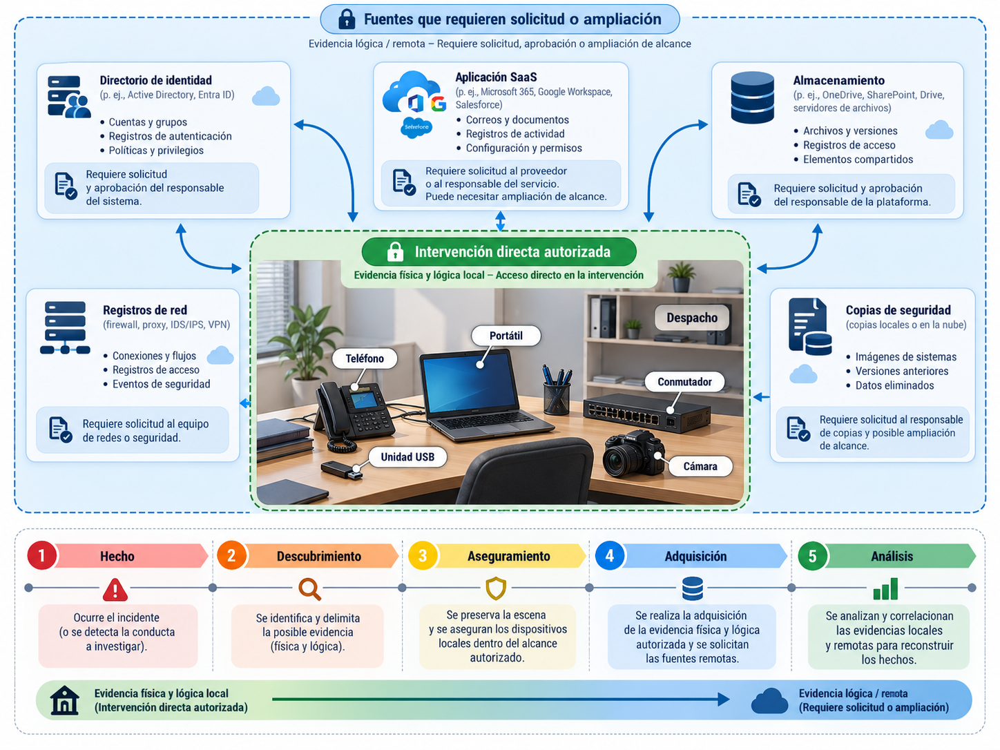
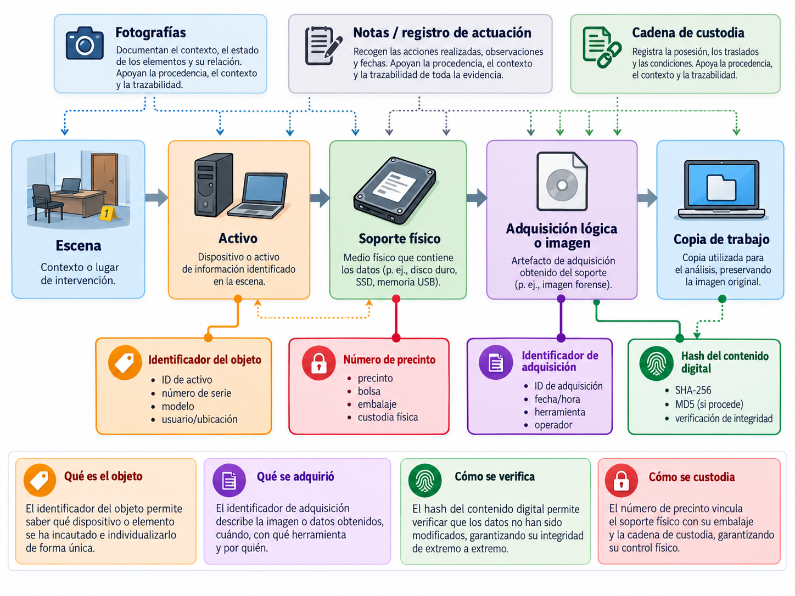
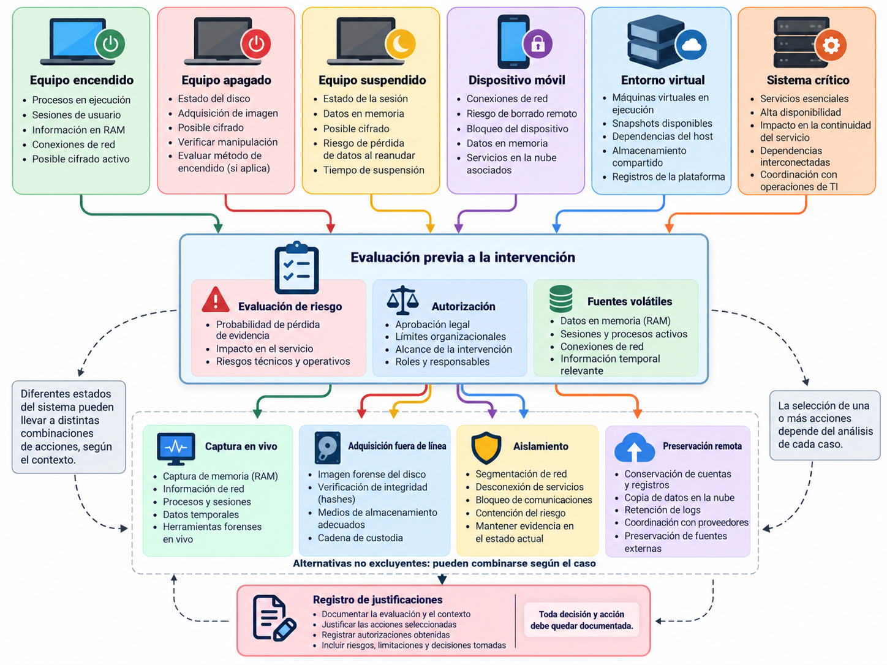
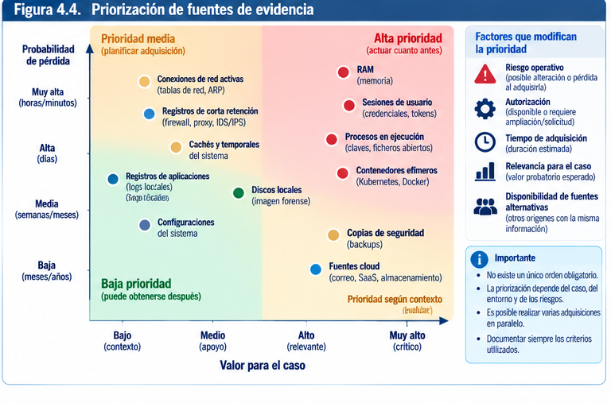
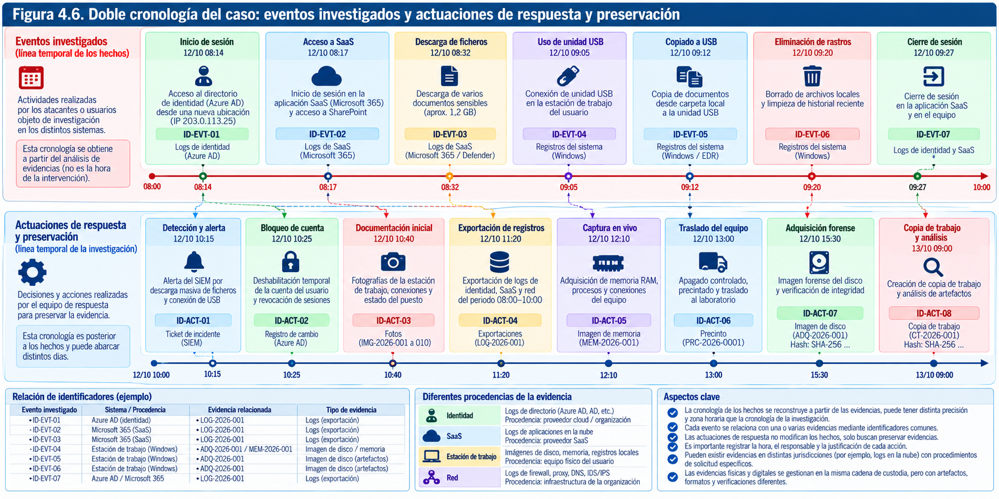

# La escena digital y la cadena de custodia

> Había una sola cosa que podía hacer (...) Instalé un receptor de Registro Visual, para que cualquier cosa que sucediera quedase preservada para su estudio posterior. Con la esperanza, la descabellada pero ferviente esperanza, de que lo que me confundía en ese momento pudiera aclararse tras una revisión.
> («There was one thing I could do... I set up a Visual Record receiver, so that whatever happened might be preserved for future study. This was in the hope, the wild but earnest hope, that what confused me at the time might become plain upon review.»)
> 
> — Isaac Asimov, Fundación (Foundation), Parte V: «Los Príncipes Comerciantes» (Hober Mallow durante su juicio)

Una investigación forense puede fracasar antes de que el analista examine su primer archivo. Basta con que alguien reinicie un ordenador cifrado sin comprobar su estado, desconecte una máquina virtual cuya memoria todavía contiene información relevante, manipule un teléfono sin registrar las operaciones o traslade un disco sin identificar quién lo recibió. En ocasiones la pérdida es irreversible: una clave que residía en memoria desaparece, una sesión autenticada expira, una cola de registros se sobrescribe o un soporte queda dañado durante el transporte. Otras veces la información sobrevive, pero la investigación pierde la capacidad de demostrar de dónde procedía y qué ocurrió con ella durante la intervención.

La escena digital constituye el punto de encuentro entre los hechos, la tecnología y las decisiones humanas. A diferencia de una escena física delimitada por las paredes de una habitación, puede extenderse a estaciones de trabajo, servidores, teléfonos, soportes extraíbles, redes, sistemas de vigilancia, máquinas virtuales y servicios prestados desde otros países. Incluso cuando el objeto de la intervención es un único portátil, sus rastros pueden depender de un proveedor de identidad, una plataforma de correo, un servidor de ficheros o un sistema de copias de seguridad. Por eso, asegurar una escena no significa necesariamente ocupar una sala ni retirar todos sus dispositivos. Significa reconocer las fuentes relevantes, preservar las posibilidades de investigación y mantener bajo control las actuaciones que podrían modificar o destruir información.

El capítulo anterior estableció que toda intervención necesita un fundamento legítimo y un alcance definido. Aquí ese principio se traduce en decisiones materiales: quién entra en la escena, qué puede tocar, qué debe fotografiarse, qué información es urgente, cuándo conviene aislar un sistema y cómo se acredita la continuidad entre un objeto localizado y los resultados que finalmente aparecen en un informe. La dimensión jurídica permanece presente, aunque el propósito central sea operativo. Una cadena de custodia impecable no convierte en lícito un acceso no autorizado; una autorización válida tampoco convierte en fiable una adquisición mal documentada.

Conviene distinguir desde el principio **recogida**, **adquisición** y **preservación**. La recogida puede consistir en hacerse cargo de un dispositivo físico. La adquisición crea u obtiene una representación de datos —por ejemplo, una imagen de disco, una extracción lógica o un volcado de memoria—. La preservación agrupa las medidas encaminadas a impedir pérdidas o modificaciones injustificadas a lo largo de todo el ciclo de vida de la evidencia. No siempre coinciden en el tiempo ni las realiza la misma persona. Es posible preservar datos remotos sin disponer todavía de una copia; es posible adquirir un registro sin retirar el servidor; y es posible custodiar un teléfono cuya extracción se realizará semanas después, siempre que se haya elegido y documentado una estrategia de conservación apropiada.

Este texto toma como referencias metodológicas la familia de buenas prácticas de **SWGDE**, especialmente sus documentos sobre recogida de evidencia y adquisición informática; **ISO/IEC 27037:2012**, dedicada a identificación, recogida, adquisición y preservación; las guías **NIST SP 800-86** y **NIST SP 800-101 Rev. 1**; y las orientaciones del **National Institute of Justice** para primeros intervinientes. Estos documentos no sustituyen la legislación ni establecen una secuencia universal aplicable a cualquier escena. Las técnicas propuestas deben adaptarse al dispositivo, al riesgo, a las facultades de intervención y a los procedimientos vigentes del organismo o laboratorio.

La idea principal a lo largo de todo el capítulo es sencilla, aunque su aplicación no siempre lo sea: **la evidencia debe conservarse junto con la historia verificable de las decisiones que permitieron obtenerla**. Preservar un archivo sin conservar su contexto puede ser insuficiente. Documentar una intervención sin preservar la información puede ser inútil. La solidez aparece cuando ambas obligaciones se cumplen de manera coordinada.

## Identificación y aseguramiento de la escena

### La primera decisión no es técnica: determinar qué escena tenemos delante

Antes de conectar herramientas, extraer cables o pedir credenciales, es necesario comprender qué ha ocurrido, qué se ha autorizado y qué puede perderse. Una llamada que comunica «han desaparecido documentos de un repositorio» no describe todavía una escena forense. Los archivos pueden haber sido eliminados, movidos, ocultados por un cambio de permisos, retirados por una política de retención o mostrarse incorrectamente por un error de sincronización. Del mismo modo, una estación de trabajo con una alerta de malware puede ser el origen de la actividad, una víctima secundaria o simplemente el dispositivo donde se detectó un comportamiento generado en otro lugar.

El responsable de la intervención necesita obtener un relato inicial sin transformarlo en una conclusión anticipada. Importa registrar quién notificó el hecho, cuándo se advirtió, cuál fue la última situación conocida, qué sistemas están afectados y qué operaciones se realizaron después de la detección. También debe identificarse el motivo de la intervención: investigación judicial, investigación interna autorizada, respuesta a un incidente o aseguramiento de información para una controversia. Cada contexto impone límites diferentes a la presencia del equipo, a la obtención de datos y a su eventual comunicación.

La escena ha de interpretarse como un **conjunto de relaciones entre objetos, servicios, personas y tiempos**. El disco de un ordenador no es independiente de la cuenta con la que se inicia sesión. Un archivo compartido puede tener réplicas, versiones y enlaces de acceso. Una cámara puede conservar las imágenes en una tarjeta local, en un grabador o en una plataforma externa. Un registro de autenticación puede originarse en un proveedor de identidad y no en la aplicación examinada. Localizar el equipo físicamente visible no garantiza haber identificado la fuente que conserva el dato decisivo.

Esta distinción resulta especialmente importante cuando varias organizaciones comparten infraestructura. Un contratista administra una plataforma, el titular de los datos es otra entidad, el equipo se encuentra en unas instalaciones arrendadas y los registros se retienen en un servicio de terceros. Quien interviene debe confirmar qué puede preservar directamente, qué necesita solicitar y qué no puede examinar sin una autorización adicional. Las operaciones urgentes no eliminan estas fronteras; obligan a gestionarlas con rapidez.

### Delimitación material, lógica y temporal

Una escena suele tener, al menos, tres dimensiones. La **material** identifica espacios físicos, dispositivos, soportes, cableado, conexiones y objetos asociados. La **lógica** comprende cuentas, máquinas virtuales, recursos compartidos, volúmenes, identidades, claves, registros y relaciones entre servicios. La **temporal** delimita cuándo pudo producirse el hecho y cuánto tiempo seguirán disponibles los rastros relevantes. Ninguna dimensión puede considerarse aislada.

Pensemos en una investigación por acceso indebido a una aplicación de gestión. La dimensión material incluye el portátil desde el que supuestamente se accedió y los dispositivos de red de la oficina. La lógica incorpora la identidad del usuario, la aplicación, sus API, el almacenamiento y la plataforma de auditoría. La temporal comienza antes del primer acceso sospechoso e incluye, quizá, la creación de una credencial días atrás y la expiración de registros una semana después. Si el equipo se ocupa correctamente, pero los registros remotos se borran por rotación, el aseguramiento ha sido incompleto.

Una delimitación útil debe responder a cuatro preguntas: qué sistemas son potencialmente relevantes, en qué intervalos, por qué relación concreta con el hecho y con qué fundamento pueden intervenirse. La delimitación no exige conocer desde el inicio todas las fuentes. Exige contar con un mecanismo documentado para ampliar el alcance cuando aparezcan nuevas relaciones. La incorporación de un equipo adicional no debería quedar oculta en una nota técnica ni justificarse retrospectivamente mediante la relevancia de lo hallado.

 

### Asegurar sin destruir: control de personas, accesos y cambios

En una escena física, impedir que personas no autorizadas entren y manipulen objetos constituye una precaución intuitiva. En un entorno digital existe un equivalente menos visible: impedir que continúen tareas automáticas, accesos remotos y operaciones administrativas capaces de alterar información relevante. Puede ser necesario restringir la presencia física en una sala, pero también identificar quién posee privilegios para apagar servicios, reinstalar equipos, purgar registros o cambiar reglas de retención.

La primera protección consiste en **controlar y documentar la intervención humana**. Se designa una persona responsable de la escena, se identifica a quienes participan, se registra su entrada y salida cuando resulte procedente y se acuerda que ninguna manipulación se realice sin comunicación al responsable. En una organización pequeña puede bastar un registro sencillo; en una intervención judicial o de especial relevancia se aplicarán las medidas previstas por el procedimiento correspondiente. Lo importante es que una decisión tomada por un técnico de soporte, un responsable de sistemas o un tercero contratado no se vuelva invisible para el equipo forense.

En paralelo se evalúa la **actividad técnica en curso**. Un sistema puede estar cifrando ficheros, borrando registros, sincronizando documentos o recibiendo órdenes remotas. Mantenerlo conectado preserva algunos datos volátiles, pero también permite que el incidente continúe. Aislarlo puede detener la propagación y dificultar la actuación del adversario, aunque modifique conexiones y haga inaccesibles servicios remotos. No existe una respuesta correcta independiente del contexto. La decisión debe vincularse al riesgo de daño, la volatilidad, las fuentes alternativas, las obligaciones legales y la continuidad operativa.

La seguridad de las personas siempre prevalece sobre la comodidad forense. Un equipo puede encontrarse en una instalación eléctrica, una planta industrial, una unidad sanitaria o un entorno con riesgos físicos. Intervenir sobre controles industriales, dispositivos médicos o maquinaria sin coordinación con su responsable técnico puede causar daños reales. La obtención de evidencias no autoriza a provocar una parada insegura. En esos casos debe planificarse la captura con especialistas operativos y, si procede, priorizar registros externos que permitan estudiar el incidente sin manipular inicialmente el sistema crítico.

### Reconocimiento inicial: observar antes de actuar

Una disciplina básica del aseguramiento consiste en **registrar el estado encontrado antes de modificarlo**, siempre que la urgencia y la seguridad lo permitan. Se anotan fecha y hora del hallazgo, lugar, personas presentes, condiciones ambientales pertinentes, pantallas visibles, aplicaciones abiertas, conexiones físicas y dispositivos cercanos. Se toman fotografías generales para fijar la disposición de la escena y después imágenes de detalle que permitan distinguir identificadores, puertos, cables y daños visibles. Fotografiar no equivale a interpretar; constituye una forma de conservar observaciones para futuras comprobaciones.

La documentación visual debe evitar dos errores comunes. El primero es mostrar únicamente primeros planos sin contexto: una memoria USB fotografiada sobre una mesa puede reconocerse, pero no saberse dónde estaba conectada ni a qué equipo pertenecía. El segundo es confundir una fotografía posterior a la manipulación con el estado original. Si se retiró una tapa, se desconectó un cable o se movió un dispositivo para leer su número de serie, esa alteración debe quedar registrada. No es necesario ocultar la intervención para defenderla; es necesario explicar qué cambió y por qué.

Ante un equipo encendido, la pantalla puede contener una sesión desbloqueada, una herramienta de cifrado, una transferencia en curso o una alerta de seguridad. La fotografía de la pantalla preserva parte del contexto, pero no sustituye una adquisición técnica: no registra procesos ocultos, datos de memoria ni conexiones que no aparezcan en la interfaz. También es posible que la pantalla muestre información sensible ajena a la finalidad autorizada. La documentación debe gestionarse conforme al principio de acceso limitado; las fotografías de la escena son, en sí mismas, material potencialmente confidencial.

Hay detalles que merecen especial atención por su relación con la futura interpretación: reloj mostrado en pantalla, zona horaria configurada cuando pueda comprobarse, estado de conexión a redes, indicadores de alimentación, presencia de unidades externas, disposición de un NAS, numeración de puertos y conexiones de almacenamiento. Si no es posible comprobar alguno de esos elementos sin intervenir, se indica como no verificado. La precisión de una nota es preferible a una descripción aparentemente completa basada en suposiciones.

### Preservación remota y decisiones urgentes

No todas las escenas pueden visitarse. Es posible que el activo esté en otra sede, que solo exista como instancia en la nube o que pertenezca a un proveedor que conserva registros durante un periodo breve. En esas situaciones, asegurar la escena puede consistir en solicitar la preservación de datos, impedir rotaciones mediante un cambio autorizado de retención, realizar una exportación conforme al procedimiento disponible o capturar un estado de máquina virtual con las limitaciones conocidas.

Una **solicitud de conservación** y una **entrega de datos** no son la misma operación. La primera pretende evitar la pérdida de información potencialmente relevante; la segunda implica obtenerla. En ambos casos hay que atender al régimen contractual y jurídico aplicable, especialmente si interviene una autoridad o si la información está controlada por un tercero. Una empresa tampoco debe asumir que una cuenta administradora de la nube le concede automáticamente facultades para consultar contenidos personales de cualquier usuario.

Cuando la actuación depende de una API, de un panel web o de una consola de administración conviene documentar la identidad usada, los permisos efectivos, el intervalo consultado, los filtros, la paginación, el formato exportado, las advertencias del servicio y la hora de la extracción. Un archivo CSV obtenido de una consola no contiene necesariamente todos los campos que el proveedor almacena; una descarga puede excluir registros antiguos, datos sujetos a restricciones o elementos no visibles para ese rol. La limitación de la fuente debe incorporarse al inventario y, más adelante, al análisis.

### Ejemplo: una sala de servidores después de una intrusión

Una organización descubre una cuenta administrativa utilizada fuera de horario. En la sala técnica hay dos servidores físicos, un NAS, una consola de virtualización y un cortafuegos. Uno de los servidores muestra una sesión activa; otro está apagado. La respuesta operativa ha bloqueado temporalmente la cuenta y aislado una VLAN. La escena ya ha cambiado antes de que llegue el analista, pero no por ello carece de valor. El primer trabajo consiste en reconstruir esas actuaciones iniciales y obtener sus registros: quién bloqueó la cuenta, desde qué consola, a qué hora, qué reglas modificó y qué servicios pudieron quedar afectados.

El inventario preliminar revela que la aplicación comprometida está alojada en una máquina virtual sobre el servidor encendido. Los registros del proveedor de identidad se conservan solo durante un plazo limitado, mientras que el NAS dispone de instantáneas diarias. La prioridad no puede decidirse por proximidad física. Puede ser más urgente preservar los registros remotos y la memoria de la máquina virtual que retirar el servidor apagado. Sin embargo, cualquier captura de una instantánea debe revisarse para saber si incluye memoria, si altera el estado de la máquina y si es coherente con los procedimientos de la plataforma.

El equipo documenta el estado de la sala, registra las actuaciones ya realizadas, acuerda el alcance y comienza por aquellas fuentes cuya pérdida es más probable. Solo después decide qué dispositivos físicos necesitan retirarse. Si una nueva fuente aparece —por ejemplo, una consola SaaS administrada por un tercero— se inicia el procedimiento de ampliación pertinente. El caso muestra por qué asegurar una escena consiste en gestionar fuentes y riesgos, no en apagar indiscriminadamente todo lo que se encuentra.

## Inventario y documentación de dispositivos

### Inventariar no es redactar una lista de objetos

Un inventario forense debe permitir reconocer inequívocamente aquello que se ha localizado, relacionarlo con su contexto y seguir su trayectoria. Una enumeración del tipo «ordenador, dos discos y teléfono» resulta insuficiente incluso para una intervención pequeña. Se necesita un **identificador único de evidencia**, vinculado al número del caso, que no dependa únicamente de la etiqueta comercial, del nombre del equipo o del número de serie del fabricante. Dos discos del mismo modelo pueden llevar etiquetas intercambiadas; un equipo puede carecer de número visible; y una imagen de disco, al no ser un objeto físico, necesita también su propio identificador.

La identificación debe separar tres niveles: **activo**, **soporte u objeto** y **conjunto de datos adquirido**. El activo representa el sistema en contexto, como una estación de ingeniería denominada `ENG-WS-07`. El soporte es, por ejemplo, la unidad SSD extraída de esa estación. El conjunto adquirido puede ser una imagen E01 obtenida del SSD o una colección lógica de registros. Estos elementos están relacionados, pero no son intercambiables. En una investigación con varias copias, conservar esta distinción evita que un informe atribuya al equipo completo un hash calculado sobre una imagen concreta.

Puede adoptarse una nomenclatura como `AF-2026-017-E03` para un objeto y `AF-2026-017-E03-A01` para su primera adquisición. El patrón exacto no es obligatorio: lo esencial es que sea estable, único dentro del sistema de gestión y suficientemente sencillo para utilizarse sin errores. Si se descubre una etiqueta equivocada, se documenta la corrección; no se reescribe silenciosamente el historial. El identificador debe mantenerse en formularios, contenedores de evidencia, fotografías, registros de adquisición y entregas.

### Atributos del inventario físico y lógico

La ficha de un equipo físico suele incluir fabricante, modelo, número de serie, etiqueta de activo, descripción, ubicación exacta de hallazgo, estado de encendido, conexiones relevantes, soporte instalado cuando sea identificable, daños aparentes y observaciones. Se incorpora quién lo localizó, quién lo manipuló, la hora del registro y el identificador de la fotografía. Conviene distinguir **dato observado** de **dato proporcionado por otra persona**. «Número de serie leído en la carcasa» no posee la misma procedencia que «número de serie comunicado por administración de sistemas».

Las conexiones aportan contexto. Una unidad USB conectada a un puerto trasero puede ser pertinente si se investiga una posible extracción de datos. Un cable conectado a un adaptador de red distinto del principal puede explicar rutas alternativas. Una estación puede tener simultáneamente Ethernet, Wi-Fi y una VPN. Antes de desconectar, la documentación debe permitir reconstruir la topología que se observó. En escenas complejas, una fotografía general y un esquema sencillo de conexiones son más eficaces que una serie de notas inconexas.

El inventario lógico incorpora identificadores distintos: nombre de host, UUID de máquina virtual, identificador de volumen, ID de cuenta, tenant, suscripción cloud, región, ID de instancia o nombre de recurso. Algunos son modificables, otros se reutilizan o pueden no ser globalmente únicos. Un nombre de host por sí solo no demuestra identidad física ni continuidad temporal. Por ello se asocia cada identificador a su fuente, a la fecha de observación y, cuando procede, a otros atributos que permitan corroborarlo.

En dispositivos móviles la identificación exterior puede requerir cautela: no siempre es posible observar el IMEI, el número de serie o la versión del sistema sin desbloquear el equipo o interactuar con él. La ficha recogerá únicamente lo comprobado sin operaciones no autorizadas y registrará qué datos quedan pendientes para una adquisición especializada. En servicios remotos, la ficha debe indicar además el mecanismo de exportación, los permisos del rol utilizado y el proveedor responsable de la conservación de los datos.

### La fotografía y el croquis como evidencias de contexto

Una fotografía no es un simple recordatorio visual. Puede ayudar a demostrar la posición de un objeto antes de su recogida, la existencia de conexiones y el estado de sellos o etiquetas. Debe conservarse el archivo original de captura cuando sea posible, registrar quién realizó la fotografía y diferenciarlo de versiones editadas para presentación. Recortar una imagen con finalidad ilustrativa no es necesariamente incorrecto; el problema surge cuando se pierde el original o se presenta el recorte como si contuviera toda la escena.

Los dispositivos de captura también generan metadatos que pueden ayudar a ordenar fotografías, aunque no deben considerarse relojes de referencia sin comprobación. La hora EXIF puede ser incorrecta por configuración, cambio horario o sincronización defectuosa. Conviene fotografiar, si resulta pertinente, una referencia horaria controlada o documentar la desviación del reloj de la cámara respecto de una fuente fiable. Si las fotografías son realizadas por diferentes personas, deberá preservarse quién captó cada una y su secuencia real.

Los croquis y diagramas permiten representar relaciones que no aparecen completas en una fotografía. El trazado de un cable puede atravesar un armario cerrado, y un disco asociado a una máquina virtual puede residir en un almacenamiento compartido situado en otro edificio. Un croquis puede combinar elementos físicos con una representación lógica, siempre que indique qué parte fue observada y qué parte procede de documentación técnica. La etiqueta «topología declarada por el administrador» evita presentar una hipótesis de arquitectura como una observación directa.

### Documentar el estado y el comportamiento, no solo la identidad

El inventario también debe reflejar condiciones que condicionan la extracción posterior. ¿Está el equipo encendido? ¿La pantalla está bloqueada? ¿Se aprecia un software de cifrado? ¿Existen notificaciones de sincronización? ¿El dispositivo presenta daños? ¿Está conectado a la corriente? ¿Hay un disco externo montado? ¿Se observan LEDs de actividad? Esas preguntas ayudan a valorar riesgos, pero no autorizan a realizar manipulaciones para obtener respuesta a todas ellas.

Una descripción como «portátil apagado» puede ser ambigua. Algunos equipos modernos utilizan suspensión, hibernación o modos de espera conectada; una pantalla oscura no demuestra ausencia de alimentación. La observación debe formularse con precisión: «pantalla negra; indicador de alimentación encendido; ventilador audible», o «no se observan indicadores de actividad; no se manipuló el botón de encendido». De forma semejante, «servidor aislado» requiere especificar si se desconectó físicamente, se bloqueó su puerto de conmutador, se modificó una regla de cortafuegos o se retiraron credenciales de acceso.

Las notas también deben registrar incidencias y límites. Si no pudo leerse el número de serie porque abrir el equipo habría alterado un precinto, se señala. Si un dispositivo no se fotografió antes de que personal de emergencia lo desplazara, se consigna esa circunstancia. Si un administrador había reiniciado el servidor antes de la llegada del equipo forense, el hecho forma parte de la historia de la escena y puede explicar la ausencia de determinados registros volátiles.

### Modelo de ficha de inventario

La siguiente ficha ficticia muestra un nivel razonable de detalle para una primera intervención. Los nombres y valores son ilustrativos; no representan evidencias reales.

| Campo | Registro ilustrativo |
|---|---|
| Caso | AF-2026-017 |
| Evidencia | AF-2026-017-E03 |
| Tipo | Portátil corporativo |
| Fabricante y modelo | Fabricante X, serie profesional Y |
| Identificación visible | Serie de carcasa `S-EXEMPLO-207` (ficticia) |
| Etiqueta corporativa | ENG-WS-07 |
| Lugar | Despacho de ingeniería, puesto 4 |
| Localización | 21/10/2026, 09:42 CEST (hora registrada por interviniente) |
| Estado observado | Encendido, pantalla bloqueada, alimentación conectada |
| Conexiones visibles | Ethernet, corriente, memoria USB conectada |
| Fotografías | AF-2026-017-F012 a F019 |
| Precinto posterior | P-006381 (ejemplo) |
| Recogida | Pendiente de decisión; equipo inicialmente preservado in situ |
| Observaciones | No se pulsaron teclas ni se desconectaron cables durante el reconocimiento |

Una ficha de esta clase debe vincularse al registro de actuaciones, no sustituirlo. La hora de localización no es la hora de recogida, y ninguna de las dos equivale necesariamente al momento en que se adquirieron datos. Una misma evidencia puede experimentar varios cambios de estado entre esos acontecimientos. El inventario fija qué se encontró; la bitácora de intervención explica qué se hizo; y la cadena de custodia acredita quién asumió su control en cada transferencia.

### Relaciones entre evidencias y procedencia de los datos

En una investigación moderna pueden coexistir cientos de archivos exportados, imágenes de disco, fotografías, capturas de memoria y registros descargados. Sin una estructura relacional, el inventario termina convertido en una lista que no permite reconstruir la procedencia. Conviene documentar que la adquisición `A01` procede del soporte `E03`, que la copia de trabajo `C02` se creó a partir de `A01` y que el informe cita el artefacto `H17`, extraído mediante un procedimiento determinado de esa copia.

Esta relación puede representarse como un **grafo de procedencia**: objeto original, operación de adquisición, archivo resultante, verificación de integridad, derivaciones analíticas y hallazgo. No hace falta implantar una herramienta compleja para obtener su beneficio. Una tabla bien diseñada y referencias cruzadas consistentes pueden ser suficientes en casos modestos. En investigaciones de gran volumen conviene utilizar un gestor de evidencias que conserve relaciones, permisos y auditoría de cambios.

Un principio útil es evitar que la misma palabra «original» se aplique a elementos distintos. El disco físico intervenido puede ser el soporte original. El fichero entregado por un proveedor puede ser la primera copia disponible para el laboratorio, pero no necesariamente el archivo original almacenado en la plataforma. La imagen adquirida puede convertirse en **copia maestra de referencia** para el análisis, sin convertirse por ello en el dispositivo físico que la originó. La terminología debe explicar exactamente qué se conserva y qué se verificó.

### Ejemplo: un disco externo que cambia de manos

Un analista localiza un disco externo conectado a una estación de trabajo, lo fotografía, lo identifica y lo desconecta conforme a la estrategia acordada. Una segunda persona traslada el soporte al laboratorio y una tercera realiza la imagen forense. Si en todos los documentos aparece simplemente «disco USB», el historial será débil. Si el objeto dispone de identificador, descripción, fotos, número de precinto, registro del retiro, entrega firmada y correspondencia con la adquisición, será posible reconstruir la operación.

Supongamos, sin embargo, que el laboratorio descubre que el número de serie leído en la escena no coincide con el registrado durante la adquisición. La reacción correcta no consiste en modificar las fichas antiguas para eliminar la discrepancia. Debe abrirse una incidencia, comparar fotografías y etiquetas, establecer si hubo un error de transcripción o una sustitución y dejar constancia de la resolución. Una corrección transparente puede preservar la fiabilidad del caso; una corrección invisible puede convertir una equivocación menor en una duda sobre toda la documentación.

## Intervención sobre equipos encendidos y apagados

### El estado del equipo condiciona la estrategia

La primera decisión al intervenir sobre un equipo informático suele formularse incorrectamente como una alternativa simple: apagarlo o dejarlo encendido. En realidad, deben considerarse muchos estados. Un servidor puede estar operativo y accesible; una estación puede tener la pantalla bloqueada y el volumen cifrado montado; un portátil puede encontrarse suspendido; un dispositivo puede aparentar estar apagado y continuar conectado en un modo de bajo consumo; una máquina virtual puede seguir ejecutándose aunque nadie tenga abierta su consola. Las posibilidades de preservación varían radicalmente.

Un equipo encendido conserva **información volátil** que puede desaparecer al interrumpir la alimentación: contenido de memoria, procesos en ejecución, conexiones de red, sesiones de usuario, material criptográfico en uso y parte del estado de aplicaciones. Esa información puede resultar decisiva para reconstruir un incidente, especialmente si existen indicios de ejecución de código en memoria, conexiones con infraestructura externa o cifrado de volúmenes. Por otro lado, mantener el sistema operativo permite que continúen procesos legítimos y maliciosos, que se escriban registros y que un adversario actúe de forma remota. La preservación no equivale a congelación perfecta.

Un equipo realmente apagado presenta otro conjunto de ventajas y límites. Por regla general es más sencillo evitar modificaciones del sistema operativo durante una adquisición fuera de línea, pero quizá se hayan perdido claves, sesiones y procesos volátiles. Arrancarlo para examinar su contenido puede disparar montajes automáticos, recuperación de sistemas de archivos, sincronizaciones o cambios en metadatos. Si está cifrado, arrancarlo sin el procedimiento adecuado puede no permitir acceder a sus datos y complicar una intervención posterior.

La estrategia debe derivarse de una **evaluación de consecuencias**, no de una regla universal aprendida fuera de contexto. Una orden de desconectar de inmediato todos los dispositivos puede ser necesaria ante un riesgo físico o una instrucción legal específica, pero no constituye por sí sola una buena práctica general. Tampoco lo es mantener todo encendido a cualquier precio. La decisión razonable conserva las fuentes más importantes que todavía pueden obtenerse, minimiza alteraciones y deja constancia de las renuncias inevitables.

### Equipos encendidos: observación, captura y control del riesgo

La intervención sobre un equipo encendido comienza con la observación externa del estado que presenta: alimentación, pantalla, actividad aparente, periféricos, conexiones y señales de ejecución. La presencia de una pantalla bloqueada no autoriza a intentar contraseñas, desbloquear cuentas o elevar privilegios fuera del alcance establecido. Si se ha autorizado una actuación en vivo, hay que precisar previamente qué clases de información se pretenden obtener y qué herramientas resultan adecuadas.

La **adquisición en vivo** consiste en extraer datos de un sistema que continúa ejecutándose. Puede abarcar memoria RAM, tablas de procesos, conexiones, sesiones, descriptores de archivos, información de dispositivos montados o registros disponibles únicamente durante la operación. Su principal ventaja es que permite observar estados que no existirán después del apagado. Su principal limitación es que el propio acto de observar puede alterar el sistema: iniciar un programa crea procesos, ocupa memoria, modifica cachés, abre archivos y genera eventos. Este fenómeno no invalida automáticamente la evidencia, pero obliga a documentar cómo se produjo y qué artefactos pueden atribuírsele.

Por esa razón conviene preparar de antemano medios de recogida adecuados. Una herramienta que se ejecuta desde un soporte externo no se vuelve inocua por ese motivo: utiliza memoria, bibliotecas y servicios del sistema examinado. Puede incluso desencadenar alertas de seguridad o interactuar con el software que se pretende estudiar. Se debe conocer su funcionamiento, su versión, las dependencias y, cuando sea posible, disponer de pruebas previas sobre sistemas comparables. Si el método genera archivos temporales, registros o servicios, esos efectos deben identificarse.

La elección del destino de la adquisición también influye en la escena. Es posible guardar resultados en una unidad externa preparada, en un repositorio de red controlado o en almacenamiento remoto seguro. Cada alternativa añade riesgos: escribir localmente puede consumir espacio o sobrescribir datos; transferir por red altera conexiones y genera tráfico; utilizar una unidad externa puede producir eventos de conexión USB. La intervención debe registrar el medio de destino, su identificación y el procedimiento de protección aplicado a los resultados.

En un sistema comprometido es prudente desconfiar de lo que el propio sistema informa. Un proceso malicioso con privilegios elevados puede manipular vistas y registros. Las herramientas ejecutadas dentro del sistema operativo pueden observar una representación parcial o falseada. Cuando el alcance y las circunstancias lo permitan, conviene contrastar con fuentes independientes, como telemetría de red, capturas del hipervisor, registros centralizados y adquisiciones fuera de línea. No toda discrepancia revela manipulación deliberada: también puede deberse a cambios de estado entre dos capturas.

### La paradoja de la memoria: capturar lo que cambia al capturarlo

La memoria RAM representa el caso paradigmático de evidencia dinámica. Su contenido cambia constantemente por la actividad del sistema. Una captura completa realizada en un equipo en funcionamiento tiene un intervalo de adquisición: las primeras páginas pueden haberse leído segundos o minutos antes que las últimas. No equivale, por tanto, a una fotografía atómica de todo el estado de la memoria. El analista debe conocer las capacidades y limitaciones de la herramienta utilizada y evitar describir el volcado como una representación perfecta de un instante único.

La captura puede revelar estructuras de procesos, módulos cargados, conexiones, fragmentos de documentos, datos de sesión y material criptográfico presente en ese momento. Sin embargo, no garantiza encontrar todas las claves ni todas las huellas de una actividad. Algunas regiones pueden estar protegidas, no ser accesibles o haber sido reutilizadas. El volcado puede contener información privada de personas no relacionadas con la investigación. Por ello se exige una autorización adecuada, protección reforzada de la evidencia y análisis proporcional.

En las adquisiciones de memoria es especialmente importante comprender qué significa el valor hash. Calcular SHA-256 sobre el archivo resultante permite verificar posteriormente que **ese archivo** no ha cambiado. No demuestra que el sistema estuviera inmóvil durante la recogida ni que la herramienta obtuviera absolutamente todo el contenido de la memoria. Tampoco permite esperar que dos capturas sucesivas tengan el mismo hash: el sistema continúa funcionando y sus datos son diferentes. La fiabilidad se apoya en el método, la documentación y la corroboración, además de en la integridad de la copia obtenida.

Imaginemos que un analista adquiere memoria, luego enumera conexiones y finalmente recoge registros del sistema. Al procesar el volcado identifica una conexión asociada a un proceso sospechoso que ya no aparece en el listado posterior. La diferencia no es, por sí sola, un defecto de la adquisición. Puede significar que la conexión terminó durante la intervención. El análisis tendrá que confrontar marcas temporales, evidencia de red y alcance real de cada técnica, en lugar de suponer que todos los resultados representan el mismo instante.

### Cifrado, autenticación y sesiones abiertas

El cifrado completo de disco modifica de forma significativa la estrategia. Un volumen protegido puede estar accesible mientras el sistema está encendido y montado, pero requerir una clave o un procedimiento de desbloqueo después del apagado. Esto afecta tanto a estaciones como a servidores, máquinas virtuales y ciertos soportes externos. El estado de una sesión abierta no equivale necesariamente al estado de cifrado del almacenamiento: es posible que el disco siga montado con la pantalla bloqueada, o que el sistema requiera nuevas credenciales para un recurso concreto.

Ante un equipo encendido con cifrado aparente, el analista debe identificar las opciones técnicas **sin improvisar actuaciones intrusivas**. Puede ser prioritario preservar la información accesible mediante métodos autorizados y documentados, o puede ser preferible retirar el soporte y trabajar fuera de línea si se dispone legítimamente del material necesario. La decisión depende del riesgo, de los permisos, de las herramientas y del valor de los datos volátiles. Un reinicio puede hacer que desaparezca la posibilidad de acceder a información que estaba descifrada en ese momento.

Las credenciales encontradas durante una intervención requieren un tratamiento especialmente prudente. Localizar una contraseña, un token o una clave privada no equivale a recibir autorización para usarla en otra cuenta, ampliar el acceso a nuevos dispositivos o consultar servicios de terceros. Su existencia puede ser relevante como evidencia; utilizarla puede constituir una actuación nueva con implicaciones jurídicas y técnicas propias. Cuando sea necesario acceder a un servicio, se debe optar por mecanismos autorizados, auditables y compatibles con las reglas del procedimiento.

También es importante diferenciar **capturar una sesión** de **suplantar una identidad**. El hecho de que una aplicación esté abierta puede facilitar la exportación legítima de información, pero la operación debe encontrarse dentro del alcance y quedar registrada. Un analista no debe navegar libremente por espacios personales aprovechando que la sesión está iniciada. El carácter oportunista de un acceso no lo convierte en proporcionado.

### Suspensión, hibernación y estados híbridos

Los modos de ahorro energético introducen ambigüedad en la escena. En una suspensión convencional ciertos datos pueden permanecer en memoria mientras el sistema dispone de energía; la hibernación puede trasladar parte del estado al almacenamiento; los mecanismos modernos de suspensión conectada pueden mantener actividades de red y sincronización. La configuración exacta depende del hardware, del sistema operativo y de sus políticas. Una pantalla cerrada no permite inferir por sí sola el modo utilizado.

Manipular la tapa, el teclado, el ratón o el botón de encendido puede reactivar el equipo y modificar su estado. Por eso, cuando no existe urgencia ni riesgo inmediato, conviene documentar los indicadores visibles y consultar el procedimiento específico del laboratorio antes de actuar. Puede ser necesario conocer el modelo y las políticas de energía del dispositivo para valorar si una desconexión hace perder información. La incertidumbre sobre el estado debe reconocerse, no resolverse mediante un gesto automático.

La hibernación también puede dejar artefactos en disco que contengan información procedente de memoria, pero su existencia y utilidad no deben darse por supuestas. Hay sistemas que cifran ese material, sistemas que lo sobrescriben y configuraciones que lo eliminan. La posibilidad de recuperar información debe analizarse de acuerdo con el soporte, la versión del sistema y las acciones previas.

### Equipos apagados: preservar antes de arrancar

Cuando un dispositivo está apagado y no existe una razón fundada para iniciar su funcionamiento, suele ser prudente **mantenerlo en ese estado** hasta realizar una adquisición planificada. No se trata de una regla absoluta, sino de una medida para evitar cambios innecesarios. Encender un ordenador para «mirar qué contiene» puede alterar registros, actualizar bases de datos, iniciar tareas programadas, conectarse a redes, montar volúmenes y reconfigurar servicios. Tales cambios dificultan distinguir la actividad anterior de la generada por la investigación.

La intervención fuera de línea puede incluir la retirada del soporte de almacenamiento o el uso de un entorno de adquisición controlado, siempre que el hardware y las autorizaciones lo permitan. Un bloqueador de escritura puede reducir el riesgo de modificaciones durante el acceso a ciertos soportes, pero su eficacia depende del tipo de interfaz, del dispositivo y de que se utilice correctamente. El profesional debe conocer los casos que no cubre; los bloqueadores no constituyen una garantía abstracta aplicable por igual a cualquier SSD, dispositivo integrado o servicio remoto.

Hay sistemas donde extraer el soporte es difícil, arriesgado o innecesario. Muchos portátiles modernos incorporan almacenamiento soldado, elementos de seguridad integrados o cifrado vinculado al hardware. Algunos servidores necesitan controladoras y configuraciones específicas para interpretar correctamente un conjunto de discos. En estos escenarios la adquisición lógica, la exportación mediante herramientas del fabricante o la captura desde un hipervisor pueden ser alternativas justificadas. Cada una representa una clase diferente de evidencia y debe describirse como tal.

La evidencia física también puede incluir huellas, trazas biológicas, restos materiales o indicios de manipulación del hardware. Abrir una carcasa sin coordinarse con otros especialistas puede destruir esas fuentes. Las recomendaciones forenses digitales no eliminan las exigencias de otras disciplinas; el orden de intervención debe acordarse cuando varias especialidades comparten el objeto.

### Apagado ordenado frente a retirada de alimentación

La distinción entre un apagado normal del sistema y una interrupción súbita de alimentación suele aparecer en los manuales clásicos. Un apagado ordenado puede cerrar sesiones, registrar eventos, limpiar áreas temporales y activar procedimientos de eliminación o sincronización. Una retirada súbita de alimentación puede impedir algunas de esas operaciones, pero también puede ocasionar daños, corrupción o pérdida de datos pendientes de escritura. Ninguna de las dos opciones es universalmente preferible.

Las características actuales complican más el problema. Los sistemas de archivos emplean diarios y mecanismos de recuperación; las controladoras de SSD realizan operaciones internas; las baterías mantienen la alimentación de portátiles; ciertas fuentes están respaldadas por sistemas de alimentación ininterrumpida; y algunos servidores ofrecen mecanismos de gestión remota. Desconectar un cable no siempre provoca el efecto que se supone. Antes de adoptar una medida irreversible hay que comprender qué se apaga realmente y qué consecuencias puede tener.

En contextos corporativos el equipo de respuesta puede necesitar detener un proceso destructivo de inmediato. Esa necesidad operativa se documenta y coordina. En una intervención pericial en la que no existe una amenaza activa, normalmente habrá más margen para analizar opciones de conservación. El objetivo no es defender una técnica por tradición, sino justificar por qué se eligió el curso de actuación menos perjudicial para los fines legítimos del caso.

### Dispositivos móviles: conectividad, bloqueo y alimentación

Los teléfonos plantean una combinación singular de volatilidad, cifrado, conectividad y control remoto. Pueden recibir órdenes, borrar o sincronizar contenidos y cambiar su estado mientras permanecen aparentemente inactivos. El estado de encendido, la pantalla bloqueada, la presencia de una sesión reciente y el nivel de batería condicionan las oportunidades de adquisición. Sin embargo, interactuar con un dispositivo puede modificar datos, exigir autenticación o activar mecanismos de seguridad. Por ello, el primer interviniente debe aplicar un procedimiento específico y, cuando sea posible, contar con personal competente en análisis móvil.

La **aislación radioeléctrica** suele evaluarse para reducir comunicaciones que alteren la evidencia. Puede realizarse mediante mecanismos de configuración autorizados o con dispositivos de apantallamiento apropiados. Ninguna solución debe suponerse perfecta sin verificarla: el modo avión puede no deshabilitar todas las radios según modelo y configuración, y una bolsa Faraday defectuosa o mal cerrada puede permitir comunicaciones. La pérdida de cobertura puede hacer que el teléfono aumente su actividad de búsqueda de red y consuma más batería. Además, una bolsa con alimentación externa puede requerir un diseño específico para evitar que el cable actúe como vía de comunicación o antena.

Si el dispositivo está apagado, encenderlo puede modificar sustancialmente su estado de seguridad y debe evitarse salvo decisión técnicamente fundada y autorizada. Si permanece encendido, apagarlo puede impedir una extracción posterior de determinados datos. Estas decisiones no pueden reducirse a «todos los teléfonos encendidos se dejan encendidos» o «todos se colocan en modo avión». El profesional debe evaluar el modelo, el estado, los riesgos, las capacidades disponibles y la preservación de la cadena de custodia. Las guías móviles de NIST y SWGDE aportan criterios, pero las tecnologías cambian con rapidez y obligan a mantener actualizados los procedimientos.

Las baterías de litio añaden un problema de seguridad física. Un dispositivo hinchado, perforado, caliente o dañado no debe tratarse como un objeto inocuo que puede cargarse o introducirse en un contenedor cerrado sin más. Las medidas de seguridad, embalaje y transporte adecuadas al estado de la batería pueden prevalecer sobre la conservación electrónica inmediata. Si el equipo necesita seguir alimentado, ha de elegirse una solución segura y supervisada, evitando improvisaciones con cargadores y cables.

### Virtualización, contenedores y servicios remotos

En una escena virtual no siempre existe un objeto físico identificable como «el ordenador». Una instancia puede depender de varios discos virtuales, instantáneas, capas de almacenamiento, redes lógicas y servicios de identidad. Suspender, apagar, migrar o tomar una instantánea puede tener efectos diferentes sobre memoria y disco. El analista debe conocer qué captura realmente la operación, qué metadatos aporta, si requiere pausar la máquina y qué registros genera en el plano de administración.

Una instantánea de volumen en un servicio cloud puede representar un estado del almacenamiento, pero no proporcionar una captura de memoria ni garantizar por sí sola la consistencia de una aplicación con escrituras en curso. Una instantánea de máquina virtual puede contener memoria en determinadas configuraciones o no incluirla en otras. Los contenedores suelen tener capas efímeras cuya desaparición depende del ciclo de vida del orquestador. Destruir y recrear un contenedor para «limpiar» la infraestructura puede hacer perder procesos, archivos temporales y metadatos de ejecución.

El análisis de estos sistemas requiere coordinar registros del hipervisor o plano de control, datos de la máquina invitada, redes virtuales, almacenamiento, APIs y bitácoras de administración. La adquisición puede hacerse sin intervención física, pero eso no reduce la importancia de la cadena de custodia: debe quedar claro quién exportó qué recurso, con qué identidad, en qué región, bajo qué filtros y a qué destino. Si el proveedor entrega archivos ya preparados, habrá que conservar el paquete original de entrega, sus metadatos y las condiciones de generación.

### Sistemas críticos y dispositivos especializados

La intervención sobre un NAS, un equipo industrial, un grabador de videovigilancia o un dispositivo embebido puede exigir conocimientos ajenos a la informática de escritorio. Un NAS con varios discos no se comprende examinando cada unidad como si fuera independiente: puede utilizar RAID, sistemas de archivos distribuidos, cifrado o snapshots. Extraer discos sin registrar posiciones, bahías, controladora y estado de la matriz puede dificultar la reconstrucción. En un grabador de vídeo, desconectar la alimentación puede interrumpir la grabación y provocar una pérdida o una inconsistencia; en ciertos casos la exportación controlada de un intervalo debe valorarse antes de intervenir sobre el hardware.

Los sistemas industriales y sanitarios requieren coordinación operativa para evitar daños a personas y procesos. Puede ser más seguro preservar registros de un concentrador, capturas pasivas de red o historiales del sistema de supervisión que manipular un controlador en funcionamiento. En dispositivos IoT, sensores y equipos emparejados, parte de la evidencia puede estar fuera del dispositivo: plataforma cloud, aplicación móvil, router o concentrador. La escena incluye esas dependencias y no únicamente el objeto encontrado.

### Matriz de decisiones para la primera intervención

La siguiente tabla no constituye un algoritmo obligatorio. Expone preguntas que orientan una decisión documentada; la técnica concreta depende del caso.

| Estado o contexto | Riesgo relevante | Oportunidad de conservación | Precaución metodológica |
|---|---|---|---|
| Equipo encendido, sin amenaza activa aparente | Alteración por procesos y por herramientas | Datos volátiles, sesiones, volúmenes montados | Evaluar captura en vivo y sus efectos antes de intervenir |
| Equipo encendido con actividad destructiva | Pérdida de datos y propagación | Memoria, eventos remotos, conexiones | Coordinar contención y preservación; justificar las prioridades |
| Equipo apagado | Pérdida previa de estado volátil | Adquisición controlada de almacenamiento | No arrancar solo para inspeccionar; valorar cifrado y hardware |
| Portátil suspendido | Reanudación involuntaria o pérdida de estado | Posible información de sesión | Documentar indicadores; no inferir el estado solo por la pantalla |
| Teléfono encendido | Borrado remoto, comunicaciones, batería | Estado accesible y datos transitorios | Aislamiento y energía conforme a procedimiento especializado |
| Máquina virtual activa | Pérdida de memoria y artefactos efímeros | Captura desde host o plano de control | Verificar alcance real de snapshots y consistencia |
| Infraestructura crítica | Riesgos para seguridad y servicio | Telemetría externa y registros de control | Coordinar con responsables y no improvisar paradas |

### Registro ilustrativo de una intervención en vivo

Una bitácora breve, ficticia, ayuda a comprender qué nivel de precisión se necesita. No es una receta de comandos ni supone que las técnicas resulten apropiadas para cualquier sistema.

| Hora local | Actuación documentada | Motivo o efecto observado |
|---|---|---|
| 10:02:14 CEST | Se inicia la inspección de la estación E03 sin interacción con teclado | Pantalla bloqueada; alimentación y Ethernet presentes |
| 10:04:32 CEST | Se comprueba la autorización para adquirir memoria y datos volátiles | Alcance confirmado por el responsable designado |
| 10:07:05 CEST | Se conecta el soporte de adquisición A-USB-04 | La conexión puede generar eventos del sistema; se registra el identificador |
| 10:08:11 CEST | Comienza la captura de memoria mediante herramienta validada, versión consignada en la ficha técnica | Estado dinámico; se documentan duración y posibles efectos |
| 10:15:48 CEST | Finaliza la captura; se anotan mensajes y errores | Un área no pudo leerse; se conserva el registro íntegro |
| 10:17:20 CEST | Se calcula SHA-256 del archivo resultante en el destino | Fijación de una referencia de integridad de esa copia |
| 10:20:03 CEST | Se transfiere el archivo al repositorio autorizado | Se registra responsable, destino y verificación posterior |

Los tiempos son ilustrativos. No debe deducirse de ellos que la captura de memoria siempre dure varios minutos ni que las mismas herramientas puedan utilizarse en todos los equipos. La bitácora muestra algo más importante: **la trazabilidad de la intervención importa tanto como el archivo obtenido**. Una extracción sin errores aparentes puede ser cuestionable si no se sabe qué sistema se examinó, en qué estado, con qué versión de herramienta y mediante qué método.

## Orden de volatilidad y conservación de evidencias

### La volatilidad es una propiedad de la información en su contexto

El **orden de volatilidad** expresa la idea de que ciertas fuentes pueden desaparecer antes que otras y, por tanto, requieren una atención temporal diferente. Se usa con frecuencia para explicar por qué conviene considerar conexiones, memoria y sesiones antes que determinados datos persistentes. Pero no debe confundirse con una clasificación rígida de dispositivos ni con un mandato de adquisición aplicable a cualquier incidente. Lo que importa no es únicamente el tipo de soporte: importan las condiciones que pueden hacer desaparecer la información concreta.

Una sesión en memoria puede terminar en segundos; un registro de seguridad puede conservarse durante meses; un disco puede fallar de manera inminente; una instancia cloud puede destruirse automáticamente al cabo de cinco minutos; y un proveedor puede purgar un conjunto de eventos cuando finaliza un plazo contractual. La memoria suele ser volátil, pero también puede estar disponible mediante una captura suspendida; un archivo suele ser persistente, pero puede residir en una capa efímera de contenedor. La volatilidad describe **riesgo de pérdida**, no una etiqueta permanente del objeto.

NIST SP 800-86 presenta un ejemplo de priorización de datos volátiles de sistemas operativos que incluye conexiones de red, sesiones de inicio, contenido de memoria, procesos, archivos abiertos, configuración de red y hora del sistema. Es una guía útil para comprender que los estados desaparecen de formas distintas. Sin embargo, no debe aplicarse como una secuencia mecánica. En un equipo cifrado, el estado del volumen montado puede condicionar toda la intervención. En una infraestructura virtual, una instancia a punto de terminar exige atención inmediata a su memoria y almacenamiento efímero. En un incidente de ransomware activo, detener el daño puede resultar más urgente que completar una enumeración exhaustiva.

La decisión necesita una evaluación explícita de **relevancia, volatilidad, accesibilidad, riesgo y coste de intervención**. No toda fuente volátil es pertinente. Capturar la memoria de un sistema ajeno al incidente solo porque está encendido puede generar una enorme cantidad de datos privados y comprometer recursos sin aportar valor. A la inversa, preservar un registro remoto con retención de veinticuatro horas puede ser más importante que obtener inmediatamente un disco almacenado bajo control físico.

### Una clasificación orientativa, no una escalera obligatoria

Puede resultar útil agrupar fuentes por la forma en que pierden información:

| Familia de fuente | Mecanismo frecuente de pérdida | Pregunta de preservación |
|---|---|---|
| Sesiones y conexiones activas | Cierre, expiración, desconexión, cambio de estado | ¿Existe una fuente externa que registre la sesión y sus atributos? |
| Memoria y procesos | Apagado, reinicio, reutilización de memoria, finalización de procesos | ¿Puede capturarse de modo autorizado y con herramientas adecuadas? |
| Contenedores y recursos efímeros | Destrucción, reasignación, escalado, rotación automática | ¿Qué datos residen fuera del volumen persistente? |
| Registros de corta retención | Rotación, límites de cuota, políticas de ciclo de vida | ¿Cuándo se perderá la ventana investigada? |
| Colas y mensajes transitorios | Consumo, confirmación, caducidad | ¿Hay una forma legítima de congelar o exportar su estado? |
| Almacenamiento de equipos | Sobrescritura, mantenimiento, TRIM, borrado, daño físico | ¿Qué operaciones posteriores podrían modificarlo? |
| Instantáneas y copias históricas | Caducidad programada, consolidación, eliminación de versiones | ¿Cuáles son la cobertura temporal y la política de retención? |
| Evidencias bajo custodia | Fallos de soporte, acceso no autorizado, corrupción, pérdida de claves | ¿Existen copias verificadas y controles duraderos? |

La posición de una fuente en una tabla orientativa no establece automáticamente su prioridad. Un registro guardado durante una hora puede ser más urgente que una conexión cuya información ya quedó registrada por un sensor de red. Una copia histórica puede tener una fecha de eliminación más próxima que un fichero local. En determinados soportes SSD la conservación debe tener en cuenta procesos internos y borrado lógico, pero sería engañoso prometer recuperaciones basadas en un supuesto «tiempo fijo» antes de que ocurra TRIM: el comportamiento depende del sistema, la controladora, el estado del dispositivo y las operaciones posteriores.

### Una priorización defendible se razona y se registra

En una escena con varias fuentes, el analista puede construir una matriz provisional. Para cada fuente se anotan su relación con las preguntas de investigación, el plazo estimado de disponibilidad, el grado de control sobre ella, las consecuencias de intervenir y la posibilidad de obtener una alternativa independiente. Una clasificación cualitativa —alta, media, baja o desconocida— puede ser suficiente; asignar valores numéricos aparentando una precisión científica inexistente resulta menos útil.

Por ejemplo, ante una intrusión en un servidor Linux alojado en una plataforma de virtualización, podría considerarse alta la urgencia de preservar memoria si existe una sesión sospechosa activa y una posible ejecución residente. También puede ser urgente exportar logs centralizados si rotan cada pocas horas. Una copia de seguridad mensual conservada sin modificaciones puede tener menor urgencia inicial, aunque un valor probatorio enorme para comparar estados anteriores. El orden resultante no debe justificarse con la frase «se siguió el orden estándar», sino con las condiciones observadas.

El razonamiento cambia durante la intervención. Una sesión expira, una copia comienza a fallar o aparece un nuevo sistema en el que se han realizado las mismas conexiones. Debe existir un mecanismo para revisar prioridades y, si cambia el alcance, obtener la autorización correspondiente. **La prioridad no es un permiso**. El riesgo de pérdida puede justificar la urgencia de solicitar una conservación, pero no habilita por sí mismo un acceso ajeno a las facultades del investigador.

### La conservación comienza antes de la adquisición

Preservar datos puede significar medidas diferentes. En una estación, puede consistir en restringir alteraciones y preparar una adquisición controlada. En un servidor de registros, puede ser modificar de forma autorizada una política de rotación. En un servicio en la nube, puede requerir una solicitud al proveedor o la exportación de eventos antes de que desaparezcan. En una base de datos, puede ser necesaria una copia consistente con mecanismos propios del motor. En un dispositivo móvil, puede exigir gestionar alimentación y comunicaciones de forma especializada.

No existe un método único para «congelar» todos esos estados. Además, algunas medidas de conservación **también modifican metadatos y generan eventos**. Al activar una retención ampliada, una exportación o una suspensión de tareas se crean registros administrativos y puede cambiar el comportamiento normal del sistema. Tales modificaciones no deberían ocultarse. En determinados casos es preferible documentar con precisión una operación necesaria que pretender una ausencia absoluta de cambios imposible de conseguir.

La conservación tiene también una dimensión temporal. Si se solicita a un proveedor que retenga determinados registros, el equipo debe verificar que la solicitud fue recibida, qué datos comprende, desde cuándo se aplica y hasta cuándo permanece vigente. No debe confundirse la aceptación de una petición con la confirmación de que la información existía o ha sido efectivamente conservada. Una orden de preservación puede llegar después de que una rotación haya eliminado registros y no recuperarlos mágicamente.

### Integridad: qué demuestra y qué no demuestra un hash

Los valores hash criptográficos desempeñan un papel esencial en la verificación de integridad de archivos e imágenes forenses. Un algoritmo como SHA-256 produce un resumen calculado sobre una secuencia concreta de bytes. Si posteriormente se calcula el hash sobre esa misma secuencia y el resultado coincide, existe una fuerte base técnica para afirmar que el contenido no ha cambiado entre verificaciones, bajo las propiedades del algoritmo utilizado.

No obstante, un hash **no demuestra de manera autónoma** quién creó el archivo, que su contenido sea verdadero, que proceda de una fuente legítima ni que la adquisición incluyera todos los datos potencialmente accesibles. Un archivo manipulado antes de la recogida tendrá un hash perfectamente válido. Una exportación incompleta de registros puede conservarse sin modificación y seguir siendo incompleta. La integridad es un requisito importante, pero no equivale a autenticidad de origen, exhaustividad o interpretación correcta.

Es fundamental identificar **sobre qué objeto exacto se calculó** el resumen: flujo leído del dispositivo, archivo de imagen en bruto, contenido lógico adquirido, contenedor forense, cada segmento del contenedor o conjunto empaquetado por un proveedor. Dos herramientas pueden generar contenedores diferentes a partir del mismo flujo de datos; sus hashes de archivo no coincidirán necesariamente, aunque los datos contenidos puedan corresponder. Los metadatos añadidos a un contenedor también forman parte de sus bytes. Por ello las fichas de adquisición deben distinguir hashes del contenido adquirido de hashes calculados sobre archivos de almacenamiento o entrega.

En la práctica, puede ser útil disponer de un valor calculado durante la adquisición y una verificación posterior sobre la imagen, cuando el procedimiento y el formato lo permitan. La documentación debe indicar algoritmo, fecha, herramienta, objeto de cálculo y resultado. En adquisiciones lógicas o sistemas activos quizá no exista una referencia estable del origen con la que comparar el resultado. Se debe explicar entonces qué se verificó realmente y conservar los registros de la operación. El valor hash sirve como control verificable, no como sustituto del procedimiento.

### Errores de lectura, datos inaccesibles y alcance real

La adquisición forense rara vez constituye un proceso perfecto en todos los entornos. Un disco puede contener sectores defectuosos; una controladora puede impedir leer áreas protegidas; una interfaz lógica puede omitir archivos; una API puede limitar resultados; un teléfono puede restringir determinadas bases de datos; un motor de bases de datos puede ofrecer una exportación consistente solo bajo ciertas condiciones. La descripción «imagen completa» debe utilizarse con cautela cuando existen regiones inaccesibles o errores.

Los errores deben registrarse y evaluarse, no ocultarse para presentar la adquisición como exitosa. Si una herramienta informa de bloques no leídos, se conserva su registro y se identifica, en la medida de lo posible, qué parte de los datos puede estar afectada. La coincidencia posterior del hash del archivo adquirido no elimina los sectores que no pudieron capturarse. Si una adquisición se repite, los resultados pueden diferir por cambios de la fuente o por correcciones de lectura; esos hechos requieren interpretación.

El objetivo profesional no consiste en prometer una adquisición perfecta, sino en ofrecer un resultado **con alcance conocido y límites expresos**. Un conjunto parcial puede responder de forma fiable a una pregunta específica. Una copia técnicamente impecable puede ser insuficiente para otra. La decisión de continuar con una adquisición dañada o intentar técnicas adicionales deberá ponderar el riesgo de deterioro, el valor esperado y las posibilidades disponibles.

### Conservación de la procedencia de exportaciones y registros

En sistemas remotos y aplicaciones corporativas, buena parte de la evidencia llega como CSV, JSON, PDF, paquetes ZIP o resultados de API. Esos formatos son útiles, pero su procedencia debe quedar acreditada. Un CSV de eventos sin información sobre filtros, zona horaria, columnas omitidas o cuenta de exportación puede ser difícil de interpretar. Una captura de pantalla puede demostrar lo que mostraba una interfaz, pero no reemplaza los registros subyacentes ni permite inferir necesariamente su exhaustividad.

Una adquisición de registros bien documentada conserva, cuando resulte posible, la **consulta**, el **intervalo temporal**, la **identidad y permisos usados**, el **formato de salida**, la **cantidad de registros**, los **controles de paginación**, los **mensajes de error** y los **identificadores de la solicitud**. Si el servicio ofrece metadatos de generación del paquete, se preservan junto a los archivos. Si se realiza una transformación posterior —normalización de hora, conversión de JSON a CSV, descompresión, eliminación de duplicados—, se genera un resultado derivado y se conserva la fuente original.

Una prueba de integridad no evita que las marcas temporales sean erróneas. Un registro puede expresar una hora local sin zona, una marca UTC correcta o una marca procedente de un reloj desfasado. Durante la recogida conviene registrar la referencia temporal utilizada y cualquier desviación conocida. Convertir todos los tiempos a UTC para el análisis suele facilitar la correlación, pero exige conservar el valor original y explicar la transformación. No debe «corregirse» una hora editando silenciosamente el registro fuente.

### Reglas de retención y preservación extraordinaria

El almacenamiento indefinido no es sinónimo de buena conservación. Las evidencias pueden contener información personal, secretos comerciales y datos altamente sensibles. Su retención debe responder al fundamento y la finalidad del caso, a las obligaciones aplicables y a los procedimientos establecidos. Una organización puede conservar registros ordinarios durante un plazo determinado y necesitar una retención extraordinaria para una investigación concreta. Esa decisión debe autorizarse, delimitarse, registrarse y revisarse periódicamente.

La conservación extraordinaria, en ocasiones denominada *legal hold* en entornos corporativos, busca evitar que una política rutinaria elimine información relevante. Debe especificar qué fuentes se incluyen, qué intervalo cubre, quién autoriza la medida, cómo se verifica su aplicación y bajo qué condiciones termina. No es una habilitación indiscriminada para examinar todos los contenidos preservados; conservación y acceso mantienen requisitos diferentes.

Una política madura evita dos extremos: perder información relevante porque nadie suspendió una rotación conocida y conservar sin límite copias de todos los dispositivos por mera prudencia. El equilibrio requiere colaboración entre seguridad, asesoría jurídica, protección de datos, responsables de infraestructura y laboratorio. La trazabilidad de las decisiones permite explicar por qué un dato se preservó, por qué se excluyó otro y cuándo se devolvió o eliminó una copia.

### El efecto de una intervención previa a la llegada del perito

Muchas escenas se reciben después de decisiones operativas adoptadas por terceros. Un técnico ha reiniciado un servidor, un usuario ha cambiado su contraseña, el sistema EDR ha puesto en cuarentena un fichero o el proveedor ha bloqueado una cuenta. No es razonable exigir que toda organización se abstenga de protegerse hasta disponer de un analista forense. Pero es necesario reconstruir las modificaciones para interpretar correctamente la evidencia.

El perito debe obtener los registros y testimonios técnicos de esas actuaciones, separar los hechos conocidos de los comunicados y valorar qué fuentes se perdieron. Si se sabe que una máquina fue reiniciada, la ausencia de determinadas conexiones en la memoria recogida después no permite afirmar que nunca existieron. Si una aplicación fue actualizada durante la respuesta, parte de sus archivos y marcas temporales podrían proceder del mantenimiento. La cronología de la intervención forma parte de la cronología del caso, pero ambas deben diferenciarse.

En consecuencia, la preservación eficaz requiere **forensic readiness**: procedimientos previos, registros de cambios, sincronización de relojes, capacidad de exportación, responsables designados y formación básica para los primeros intervinientes. Un entorno preparado no evita todas las pérdidas, pero reduce las decisiones improvisadas y facilita distinguir los efectos del incidente de los efectos de la respuesta.

## Cadena de custodia, embalaje y almacenamiento

### Custodia significa continuidad demostrable, no una firma aislada

La **cadena de custodia** puede describirse como el registro continuo y verificable de las personas, lugares, estados y actuaciones que afectan a una evidencia desde su identificación o recogida hasta su destino final. Su finalidad es que un tercero pueda reconstruir quién tuvo control sobre un elemento, durante qué intervalo, con qué motivo, en qué condiciones y mediante qué transferencias. La terminología y las consecuencias procesales concretas dependen de la jurisdicción y del contexto; no debe confundirse una práctica técnica de trazabilidad con un dictamen jurídico sobre admisibilidad.

En la práctica es frecuente reducir la custodia a una hoja con nombres y firmas. Ese registro puede ser necesario, pero no resulta suficiente si no permite identificar el objeto o relacionar una entrega con un estado verificable. Una sucesión de firmas sobre «un ordenador portátil» carece de fuerza descriptiva cuando había tres portátiles idénticos en la escena. Tampoco basta con conocer quién transportó un disco si no se registró cómo se embaló, qué precinto utilizaba, dónde se almacenó y quién pudo acceder a él.

La cadena debe integrarse con inventario, fotografías, bitácora, registros de adquisición y controles de integridad. Cada componente responde a una pregunta. El inventario permite saber **qué** es el objeto. La documentación de la escena indica **dónde y en qué estado** se encontró. La cadena de custodia muestra **quién lo controló y cuándo**. La bitácora técnica describe **qué operaciones** se realizaron. Los hashes de copias digitales ayudan a comprobar **qué contenido** permaneció inalterado. Ninguno sustituye a los demás.

La continuidad no exige necesariamente que una sola persona supervise físicamente el objeto las veinticuatro horas. Puede mantenerse mediante transferencias registradas, almacenes controlados, accesos auditados y procedimientos documentados. Lo decisivo es que no existan intervalos inexplicados de disponibilidad material o lógica relevantes para la evaluación del caso. Cuando se detecta una discontinuidad, la reacción profesional consiste en investigarla y documentarla, no en inventar una firma retrospectiva ni en ocultar la incidencia.

### Inicio de la custodia y delimitación de responsabilidades

La custodia comienza cuando una persona u organización asume formalmente el control de una evidencia, de acuerdo con su procedimiento. En una intervención física puede iniciarse en el momento de recogida. En una exportación remota puede comenzar cuando el laboratorio recibe y fija una copia, aunque la fuente original siga bajo administración del proveedor. Es imprescindible dejar claro qué control se ejercía y sobre qué objeto.

Si un proveedor entrega un archivo ZIP con registros de actividad, el analista puede custodiar la **copia recibida**, documentando el canal de entrega y sus verificaciones. Esa cadena no acredita por sí misma lo ocurrido en los sistemas internos del proveedor antes de generar el paquete. Para conocer ese tramo pueden necesitarse declaraciones técnicas, metadatos de exportación, registros del servicio o documentación de sus procedimientos. Una cadena de custodia local no convierte automáticamente una exportación de tercero en una captura íntegra de origen conocido.

La responsabilidad debe asignarse de forma expresa. El interviniente que recoge la evidencia responde de las actuaciones que realiza; quien la transporta debe mantener las condiciones previstas; el custodio del laboratorio controla el acceso y el almacenamiento; el analista documenta las operaciones de examen; el destinatario final debe dejar constancia de la recepción. Las funciones pueden coincidir en una persona en casos pequeños, pero no desaparecen por ello las necesidades de registro y separación de operaciones.

La custodia también tiene un componente institucional. Un técnico puede entregar un equipo a un depósito especializado sin que una persona concreta permanezca a su lado. En esa transferencia han de poder identificarse el centro receptor, las condiciones de admisión, la persona que acepta el objeto, la referencia del lugar de almacenamiento y los controles de acceso. La entrega a una instalación no significa que el equipo quede fuera del sistema de trazabilidad.

### Transferencias: información mínima que debe acompañar al objeto

Toda transferencia relevante debería permitir responder, al menos, a estas preguntas: qué evidencia se entrega, quién la entrega, quién la recibe, cuándo ocurre, dónde ocurre, cuál es su finalidad y qué estado presenta. En soportes físicos se añaden condiciones de embalaje, numeración de precintos y anomalías. En archivos digitales se incluyen el mecanismo de transferencia, identificador del paquete o archivo, verificaciones de integridad y destino autorizado. No es necesario que todo se encuentre en una única hoja, siempre que la relación entre registros sea inequívoca.

Una tabla de ejemplo ayuda a visualizarlo:

| Fecha y hora (zona) | Evidencia | Origen → destino | Motivo | Estado verificado | Referencia |
|---|---|---|---|---|---|
| 21/10/2026 11:25 CEST | E03 | Interviniente A → custodio B | Traslado a depósito | Embalaje P-006381 íntegro | TR-001 |
| 21/10/2026 13:04 CEST | E03 | Custodio B → examinador C | Adquisición autorizada | Precinto íntegro antes de apertura | TR-002 |
| 21/10/2026 15:40 CEST | E03 | Examinador C → custodio B | Devolución al depósito | Nuevo precinto P-006392 | TR-003 |
| 21/10/2026 16:02 CEST | A01 | Examinador C → repositorio seguro | Conservación de imagen | SHA-256 verificado; fichero identificado | TD-004 |

Los nombres genéricos, identificadores y horarios son ficticios. Lo esencial es advertir que el equipo físico `E03` y la imagen `A01` tienen historias relacionadas pero no idénticas. La apertura de un precinto no es una ruptura de custodia si la realiza la persona autorizada, en el procedimiento previsto y queda documentada, incluido el reemplazo del cierre. Un sello que aparece roto sin explicación, en cambio, constituye una incidencia que debe investigarse.

Las firmas manuscritas, electrónicas o los registros de un sistema de gestión pueden ayudar a atribuir cada transferencia, según el marco y las reglas aplicables. Ningún formato es inherentemente suficiente en cualquier escenario. Importan la identificación efectiva de la persona, la resistencia a alteraciones, la conservación del registro y la posibilidad de verificarlo después. Un formulario de papel puede ser sólido con control documental; una base de datos puede ser débil si cualquiera puede reescribir entradas sin auditoría.

### Precintos, etiquetas y embalaje: controles físicos con objetivos concretos

El embalaje protege frente a daño, contaminación, pérdida, acceso indebido y condiciones ambientales incompatibles con la conservación. Debe seleccionarse según el dispositivo y el medio de transporte. Un disco duro, una placa electrónica, un teléfono, un servidor completo y una tarjeta de memoria no presentan los mismos riesgos. Tampoco todos requieren el mismo contenedor o pueden transportarse legalmente y con seguridad de igual manera.

Las etiquetas deberían permitir identificar el caso y la evidencia sin revelar información confidencial innecesaria a terceros. Un número de precinto registrado permite detectar determinadas aperturas, aunque no demuestra por sí solo que el objeto nunca haya sido manipulado. Los precintos son un **control de indicios de apertura**, no una garantía absoluta de inviolabilidad. Antes de mover o abrir un embalaje deben fotografiarse y registrarse su estado y cualquier anomalía visible.

En soportes electrónicos sensibles a descargas electrostáticas pueden utilizarse materiales antiestáticos apropiados. Sin embargo, no todos los materiales comercializados como «antiestáticos» son equivalentes ni adecuados para todos los dispositivos. La elección debe atender al tipo de soporte y a las recomendaciones del fabricante o del procedimiento del laboratorio. Las unidades magnéticas, la electrónica expuesta y los soportes ópticos tienen necesidades distintas de protección frente a impactos, humedad, presión y condiciones térmicas.

Es preferible proteger un disco duro contra golpes y vibraciones con un sistema apropiado a envolverlo indiscriminadamente en materiales que puedan generar electricidad estática o impedir disipar calor. Los dispositivos que permanecen encendidos generan calor y requieren ventilación y alimentación controladas. Los que incorporan baterías de litio deben observar precauciones específicas, especialmente si están dañados o muestran hinchazón. Una solución de apantallamiento radioeléctrico no sustituye las condiciones de seguridad de la batería ni las medidas contra sobrecalentamiento.

Para medios extraíbles de pequeño tamaño, una etiqueta adherida directamente al objeto puede resultar poco práctica o provocar daños. Puede ser más adecuado un contenedor individual identificado que conserve el soporte y evite mezclas. Cuando varios discos forman parte de una matriz, deben registrarse su orden de extracción, bahía de origen, cableado y asociación con controladoras o chasis. El inventario del conjunto y el de cada miembro cumplen funciones complementarias.

### Particularidades del traslado de equipos activos

Transportar un dispositivo encendido puede ser necesario en algunas intervenciones especializadas, pero añade dificultades significativas: alimentación continua, calor, seguridad física, conexiones, vibraciones y posibilidad de apagado durante el trayecto. No debería convertirse en práctica habitual por miedo abstracto a perder una clave. Antes de decidirlo, deben evaluarse alternativas de adquisición en la escena, conservación remota o coordinación con laboratorio especializado.

En teléfonos y otros dispositivos de radio puede considerarse el apantallamiento, pero hay que comprobar la eficacia real de la solución y el estado energético. Un sistema que pierde conectividad puede incrementar el consumo tratando de encontrar la red. Si el nivel de batería cae hasta provocar apagado, la medida de aislamiento podría producir precisamente la pérdida que se pretendía evitar. La estrategia necesita considerar aislamiento, alimentación, ventilación y seguridad de forma conjunta.

Los equipos no deben transportarse conectados a redes ajenas o improvisadas si ello genera riesgos de acceso remoto o alteración. Tampoco debe suponerse que desactivar todas las comunicaciones sea técnicamente posible sin interactuar con el dispositivo. El procedimiento debe ser específico, estar respaldado por personal competente y dejar constancia de cualquier modificación de estado ocurrida durante el traslado.

### Almacenamiento físico: seguridad y condiciones verificables

Una sala de evidencias necesita controles de acceso compatibles con el valor y sensibilidad de los objetos. Es importante saber quién está autorizado a entrar, cómo se registra cada entrada, qué ocurre fuera del horario habitual, cómo se separan los casos y quién puede retirar o devolver elementos. El nivel de seguridad depende de la organización y del procedimiento aplicable; una instalación policial, un laboratorio privado y una empresa pueden utilizar mecanismos diferentes sin renunciar a la trazabilidad.

El almacenamiento debe proteger frente a robo, manipulación, incendios, inundaciones, humedad, temperatura inadecuada y fallos de infraestructura. Algunos soportes deteriorados necesitan condiciones o manipulaciones especiales para no agravar daños. Un dispositivo con batería defectuosa puede requerir aislamiento físico de seguridad y supervisión distinta de la utilizada para discos externos en buen estado. Los protocolos de seguridad material tienen prioridad sobre una organización administrativa cómoda del depósito.

La conservación a largo plazo requiere revisar periódicamente el estado de los soportes. La vida útil de una unidad no está garantizada por permanecer apagada en una estantería. Los fallos de almacenamiento pueden surgir por envejecimiento, defectos de fabricación, pérdida de integridad de los medios o problemas de lectura posteriores. Mantener referencias de integridad y, cuando esté autorizado, copias de seguridad verificadas permite reducir la dependencia de un único soporte vulnerable.

Un depósito bien organizado ofrece registros de ubicación, ingresos, movimientos, responsables y controles. No es imprescindible utilizar tecnología compleja para ello, pero sí establecer responsabilidades inequívocas y auditar las desviaciones. La seguridad física no termina cuando se cierra una puerta: incluye los procedimientos para abrirla, atender una emergencia, admitir un objeto nuevo y corregir un error de localización.

### Custodia digital: repositorios, permisos y verificaciones

Las imágenes forenses y exportaciones pueden conservarse en un repositorio digital en lugar de circular como soportes físicos. La custodia sigue siendo necesaria. Se deben controlar identidades, roles, permisos, accesos, operaciones administrativas, copias, restauraciones, cambios de ubicación y eliminación. Una ruta de servidor escrita en un informe no demuestra quién pudo acceder al contenido ni si alguien lo modificó antes de la verificación.

Una arquitectura razonable distingue **copia de referencia**, **copia de trabajo** y **resultados derivados**. La copia de referencia se conserva con controles de escritura estrictos y un registro de integridad. Las copias de trabajo permiten ejecutar herramientas, crear índices y producir artefactos sin modificar la referencia. Los resultados derivados incluyen bases de datos de análisis, cronologías, exportaciones y documentos que deben relacionarse con la fuente de la que proceden. Esa separación facilita repetir el examen y analizar discrepancias.

El cifrado en reposo y en tránsito ayuda a proteger datos sensibles, pero introduce nuevas dependencias: claves, permisos de descifrado, caducidad de credenciales y procedimientos de recuperación. Una evidencia cifrada cuya clave se pierde puede permanecer intacta y, sin embargo, volverse inutilizable. La gestión de claves es, por tanto, parte de la preservación. Debe evitarse conservar contraseñas de repositorios junto a los soportes a los que protegen o compartir credenciales personales entre analistas.

Los controles de solo lectura, versionado, inmutabilidad lógica o almacenamiento de tipo WORM pueden aportar garantías adicionales. Deben comprenderse sus límites: un administrador con determinados privilegios quizá pueda cambiar políticas, eliminar cuentas o alterar configuraciones. Una etiqueta de «inmutable» no reemplaza la auditoría ni la revisión del diseño. Los sistemas cloud también dependen de contratos, regiones, identidades y procedimientos de exportación y recuperación. En todos los casos se debe conservar la evidencia de las operaciones administrativas relevantes.

### El ciclo de vida de la copia y su historia técnica

Una cadena de custodia digital robusta no registra únicamente que un archivo se copió de un ordenador a otro. Debe permitir reconstruir la creación de la adquisición, su nombre y tamaño, los hashes calculados, los destinos, las verificaciones posteriores y las derivaciones de análisis. Si se comprime un archivo, se genera un objeto distinto; si se descifra bajo autorización, se produce otro conjunto; si se extraen ficheros de un contenedor, los elementos resultantes tienen relaciones de procedencia que conviene conservar.

Es útil distinguir operaciones que cambian la **representación** de la información de operaciones que cambian su **contenido semántico**. Convertir una zona horaria para una cronología transforma la presentación temporal; convertir un registro JSON a CSV puede omitir tipos, estructura o campos si se realiza incorrectamente; reconstruir una base de datos puede crear vistas derivadas. Los resultados deben identificar herramienta, versión, parámetros y fuente. La integridad de una derivación no demuestra por sí misma que la transformación fuese correcta: para eso se necesitan validación y, cuando procede, reproducción independiente.

El uso de repositorios compartidos también exige evitar accesos que mezclen casos. Un índice de búsqueda construido con evidencias de investigaciones distintas puede provocar contaminación analítica y vulnerar confidencialidad. La segregación debe diseñarse desde el almacenamiento hasta las herramientas de procesamiento. El control de permisos debe aplicarse a copias temporales, archivos de intercambio y resultados intermedios, no solo a la carpeta etiquetada como «evidencias».

### Incidentes de custodia y tratamiento de discrepancias

Una incidencia puede consistir en un precinto deteriorado, una fecha incorrecta, una unidad cuya identificación no coincide, una transferencia no firmada, un hash diferente al esperado o una restauración de copia sin registro. No todas tienen las mismas consecuencias. El profesional debe identificar qué se sabe, qué pudo cambiar y qué controles permiten delimitar el problema. La respuesta no debe confundirse con declarar automáticamente inútil toda la evidencia ni con minimizar la incidencia sin análisis.

Si falla una verificación hash, la primera obligación es detener operaciones que puedan agravar el problema, preservar los registros disponibles y comprobar que se están comparando realmente los mismos objetos y algoritmos. Podría haberse calculado un hash sobre el contenido de una imagen y otro sobre el contenedor, o haberse modificado un fichero. También podría existir corrupción. La discrepancia no se resuelve recalculando un nuevo hash y sustituyendo el anterior sin explicación. Debe conservarse el valor histórico, investigar la causa y registrar la decisión final.

Si un precinto se encuentra abierto al llegar al laboratorio, debe documentarse de inmediato su estado, quién lo recibió, las condiciones de embalaje y la ruta seguida. Las fotografías anteriores pueden ayudar a determinar si el defecto existía en origen. Cuando no sea posible reconstruir quién tuvo acceso, se debe expresar el límite. Una investigación puede conservar otras evidencias independientes que mantengan valor, pero no corresponde al analista inventar continuidad donde no puede demostrarla.

La confianza aumenta cuando los procedimientos prevén los errores. Un sistema que permite registrar incidencias, corregir fichas con historial y solicitar revisión por un segundo profesional resulta más fiable que otro donde todas las entradas aparecen perfectas porque las equivocaciones se borraron. La calidad se mide por la posibilidad de auditar las decisiones, no por la ausencia artificial de problemas.

### Entrega, devolución, destrucción y cierre de custodia

El fin del análisis no implica necesariamente el fin de la custodia. Una evidencia puede permanecer sujeta a una investigación judicial, a una medida de conservación extraordinaria, a un procedimiento administrativo o a obligaciones contractuales. Su destino debe decidirse conforme al marco aplicable y quedar documentado. Las opciones pueden incluir devolución del objeto, traslado a otra autoridad, conservación temporal, eliminación autorizada de copias de trabajo o destrucción segura cuando proceda.

La entrega a un tercero debe precisar si se transfiere un soporte físico, una copia digital, un conjunto parcial de artefactos o un informe. Se registra el destinatario, el fundamento de la entrega, el canal, las medidas de protección y el resultado de la verificación de integridad. En una transferencia digital pueden utilizarse cifrado, canales autenticados y comprobaciones hash. Debe evitarse entregar por comodidad un volumen completo de información sensible cuando solo se requieren determinados elementos, siempre que la entrega parcial sea jurídicamente y técnicamente apropiada.

La devolución de un dispositivo puede requerir comprobar el estado del embalaje y los accesorios asociados. La destrucción de una copia puede necesitar un registro del procedimiento y del soporte afectado. En medios modernos, el borrado seguro debe adaptarse a las capacidades de la tecnología y no basarse en suposiciones sobre la eficacia de sobrescribir determinados sectores. Si existe una obligación de conservación vigente, destruir datos para liberar espacio constituye una decisión potencialmente grave; si el plazo ha expirado, conservarlos indefinidamente también puede ser improcedente.

Cerrar la custodia significa que la trayectoria de cada objeto tiene un destino conocido. Un informe técnicamente correcto acompañado por decenas de copias sin control es señal de un expediente todavía incompleto. La disciplina profesional comprende tanto la adquisición inicial como la disposición final.

### La cadena de custodia no reemplaza la interpretación

Conviene insistir en un error recurrente. Una evidencia puede tener una cadena de custodia íntegra y, sin embargo, no demostrar el hecho que se pretende atribuirle. Un archivo con un nombre comprometedor puede haber sido creado automáticamente por una aplicación. Un registro de acceso asociado a una cuenta no prueba por sí solo quién utilizó esa identidad. Un hash idéntico confirma la estabilidad del archivo verificado, no la veracidad de todas sus afirmaciones.

La cadena permite confiar en que el material examinado corresponde al material conservado bajo determinadas condiciones. La interpretación requiere además métodos adecuados, contexto, hipótesis alternativas y corroboración. Ambas dimensiones son necesarias, pero resuelven preguntas distintas. Por eso las hojas de custodia deben permanecer vinculadas al análisis sin convertirse en un argumento retórico de certeza absoluta.

## Caso integrador: aseguramiento de una escena híbrida tras una extracción de documentos

### El encargo y las primeras noticias

Una empresa ficticia de ingeniería comunica que varios documentos de un proyecto reservado parecen haber sido descargados desde una cuenta corporativa fuera del horario habitual. El equipo de seguridad detecta un volumen anómalo de transferencias y avisa al responsable de cumplimiento. La organización solicita una investigación técnica limitada a determinar qué recursos se consultaron, desde qué contextos se produjo el acceso y qué fuentes deben conservarse para permitir una eventual revisión independiente. El caso es inventado; todos los identificadores, horas y resultados se incluyen únicamente con finalidad ilustrativa.

La cuenta afectada pertenece a una persona que utiliza un portátil corporativo, pero esa coincidencia no demuestra que la persona ejecutara la descarga. Es posible que se utilizaran credenciales comprometidas, tokens de sesión, automatizaciones autorizadas o integraciones de servicio. El equipo de investigación evita formular una acusación inicial. En su lugar define preguntas comprobables: qué operaciones se realizaron sobre los documentos, qué identidad registraron las plataformas, qué dispositivos o direcciones aparecen, qué mecanismos de autenticación intervinieron y si existe correlación con actividad local en el equipo.

El encargo escrito delimita el examen a una cuenta corporativa, un portátil concreto, los registros administrativos de las plataformas utilizadas y un intervalo temporal de tres días. Se establece quién puede autorizar ampliaciones y se designan responsables de seguridad, análisis, custodia y asesoría jurídica. El equipo acuerda que la contención operativa seguirá bajo responsabilidad de respuesta a incidentes y que sus actuaciones se comunicarán para poder distinguirlas de la actividad investigada.

La situación inicial no es estática. La cuenta ya fue bloqueada por seguridad; el proveedor de identidad mantiene registros durante una ventana limitada; el portátil está encendido y bloqueado; y la plataforma documental conserva versiones históricas de ciertos archivos. Un técnico informa de que reinició el agente EDR del portátil, aunque no el sistema operativo completo. Ese dato se documenta como declaración del técnico pendiente de contraste con registros, no como observación directa del perito.

### Reconocimiento, fotografía y catálogo de fuentes

Al llegar al puesto de trabajo, el analista confirma el identificador del equipo con la ficha corporativa y comprueba los datos visibles de su carcasa. Fotografía la mesa, las conexiones y la pantalla bloqueada sin introducir credenciales. También localiza una memoria USB que permanece conectada. En las notas se distinguen los hechos observados de la información declarada: la presencia física de la memoria está comprobada, pero no se sabe aún quién la conectó ni qué datos contiene.

Se abre un registro de escena con hora, zona horaria, personas presentes y alcance. El portátil recibe el identificador `AF-2026-028-E01`; la memoria USB, `AF-2026-028-E02`. Los registros de identidad obtenidos posteriormente se identificarán como adquisición `A03`, y la exportación de la aplicación documental como `A04`. Esta organización impide confundir elementos de naturalezas diferentes. Las fotografías generales, los detalles del equipo y el listado de conexiones se relacionan con `E01` y `E02` desde el inicio.

El inventario lógico revela que el sistema utiliza un proveedor de identidad, una aplicación SaaS y una solución centralizada de seguridad. La memoria del portátil podría contener información de sesión, pero el sistema presenta cifrado de disco y un estado de bloqueo que exige evaluar cuidadosamente la intervención. El analista no intenta desbloquearlo ni utiliza credenciales que no se le hayan autorizado. Solicita confirmación expresa del alcance técnico previsto y verifica que existen herramientas y personal adecuados para la posible captura de memoria.

En paralelo, el responsable de seguridad conserva las configuraciones de las acciones de contención ya ejecutadas: bloqueo de cuenta, revocación de sesiones y cambio de una regla de acceso condicional. Esas operaciones pueden alterar el estado de las sesiones y generar nuevos registros. Por ello su cronología se archiva separadamente de los eventos investigados, aunque más adelante ambas líneas temporales deberán correlacionarse.

### La priorización cambia el orden intuitivo

La proximidad física sugiere ocuparse primero del portátil. Sin embargo, el proveedor de identidad conserva determinada telemetría detallada durante menos tiempo que el almacenamiento documental, y un administrador confirma que la ventana investigada está próxima al límite de retención. El equipo decide gestionar primero la preservación autorizada de esos registros, mientras otro interviniente mantiene el control de la escena física. La medida no implica examinar información de nuevas cuentas ni ampliar los permisos de manera indiscriminada.

Para la exportación de registros se documentan usuario o identidad administrativa utilizada, permisos, intervalo, zona horaria, filtros, formato, número de entradas y advertencias de la herramienta. El archivo se recibe en un destino controlado, se calcula su SHA-256 y se conserva como referencia. Se crea una copia separada para examen. Como el servicio admite paginación, se comprueba que todas las páginas previstas fueron recuperadas y se registra cualquier limitación de la API. El hash prueba la estabilidad del fichero exportado, no que el proveedor conservara absolutamente todos los eventos desde el inicio del incidente.

A continuación se evalúa la posible adquisición en vivo del portátil. La autorización incluye memoria y datos operativos vinculados al incidente, con limitaciones de uso de información incidental. El examen deberá minimizar alteraciones y registrar las operaciones ejecutadas. Un especialista verifica previamente la herramienta y acuerda el destino seguro de la captura. Se mantiene la distinción entre lo que la herramienta puede obtener y lo que el analista está facultado para examinar.

La unidad USB constituye otra posible fuente, pero no existe una relación probada con la descarga. Se decide recogerla bajo el alcance autorizado y examinarla mediante un procedimiento posterior, sin asumir que su mera presencia implica exfiltración. El equipo documenta el puerto de conexión, los identificadores visibles y el momento de retirada. Su estudio permitirá contrastar hipótesis, no confirmar automáticamente la sospecha inicial.

### Adquisición, embalaje y traslado

Durante la captura de información volátil se generan registros de herramienta y se conserva la secuencia de actuaciones. El proceso informa de que una zona protegida no pudo leerse. La incidencia se documenta y no se presenta la captura como absolutamente completa. Se calculan y registran hashes de los archivos resultantes, identificando qué objeto representa cada valor. También se anotan los tiempos de inicio y finalización y la diferencia entre esos momentos y la hora que mostraba el equipo cuando se observó, sin dar por supuesta la precisión de ninguno de los relojes.

Tras completar las operaciones autorizadas en vivo, el equipo debe decidir cómo preservar el soporte persistente. La política técnica permite una adquisición planificada en laboratorio; por ello documenta los pasos de preparación y gestiona el traslado del portátil. La decisión de apagado o conservación del estado no se resuelve por una instrucción genérica, sino por la combinación de cifrado, disponibilidad de mecanismos de adquisición y riesgo operativo. El procedimiento concreto y su justificación quedan en la bitácora.

El portátil se identifica, embala y precinta. La memoria USB se conserva en un contenedor individual, también identificado, para evitar que dos objetos se mezclen. La persona que recoge las evidencias transfiere su control al responsable del transporte. Se registran identificadores, precintos, estado aparente, hora y lugar. El laboratorio verifica esos datos al recibirlos. Una discrepancia entre el número de precinto consignado en una ficha y el observado físicamente se trata como incidencia y se resuelve mediante las fotografías y registros disponibles, sin modificar silenciosamente la anotación original.

En el laboratorio se crea la adquisición del almacenamiento conforme al método elegido y se conserva la información sobre errores, herramienta, versión, configuración y verificaciones. La copia de referencia se almacena con acceso restringido, mientras el análisis se realiza sobre derivados autorizados. La entrada al repositorio, la creación de las copias de trabajo y sus referencias de integridad quedan auditadas. De esta forma, un revisor podrá seguir la procedencia de un artefacto citado desde el informe hasta el origen que lo produjo.

### Correlación y límites de la atribución

El examen posterior permite reconstruir un conjunto de operaciones: el proveedor de identidad registra autenticaciones de la cuenta, la aplicación documental registra descargas y el sistema local conserva algunos artefactos compatibles con actividad del navegador. Los registros externos muestran una dirección IP vinculada a las solicitudes. Sin embargo, ninguno de esos datos identifica por sí solo a la persona sentada ante el portátil. La IP puede corresponder a un acceso compartido o a una conexión mediante proxy, los tokens pueden reutilizarse y los registros de aplicación pueden documentar la identidad lógica sin acreditar una presencia física.

La investigación incorpora explicaciones alternativas. Una hipótesis sostiene que el usuario legítimo descargó los documentos. Otra plantea el uso de credenciales por un tercero. Una tercera considera una integración automatizada cuya configuración fue modificada. Cada hipótesis exige observaciones distintas: telemetría de autenticación, identificadores de dispositivo, actividad local, ejecución de procesos, permisos de aplicaciones y operaciones de servicio. La conclusión debe reflejar qué explicaciones fueron corroboradas, cuáles quedaron debilitadas y cuáles no pudieron evaluarse por falta de datos.

Además, la captura parcial de memoria impide afirmar que se observaron todos los procesos que pudieron estar presentes. La ausencia de un programa concreto en el volcado no demuestra que nunca se ejecutara. El equipo cita esa limitación junto con la posible diferencia temporal entre la captura, los registros de la aplicación y los eventos centralizados. El informe distingue hechos técnicos documentados de atribuciones personales que requerirían otras fuentes y, en su caso, otra clase de investigación.

En este punto aparece una nueva fuente: un teléfono personal presuntamente vinculado a la autenticación multifactor. El hecho de que pudiera aportar información no significa que el equipo pueda intervenirlo. La fuente se comunica al responsable, se registra la necesidad de valorar una ampliación y no se examina hasta resolver las cuestiones de legitimidad, necesidad y proporcionalidad. El procedimiento no obstaculiza la investigación; evita que una conclusión técnicamente atractiva se obtenga mediante una intervención fuera de alcance.

### El expediente final como historia verificable

El caso no se cierra con una carpeta denominada «pruebas» y varias capturas de pantalla. El expediente conserva autorización, inventario, fotografías, registros de contención previa, bitácoras, fichas de adquisición, logs de herramientas, hashes, cadena de custodia, incidencias y resultados. Cada hallazgo relevante remite a la fuente y al procedimiento que permitió obtenerlo. Los documentos originales se preservan en sus formatos, mientras que las conversiones utilizadas para la cronología se identifican como productos derivados.

El laboratorio comunica sus conclusiones dentro del alcance acordado y distingue las preguntas respondidas de aquellas que permanecen abiertas. Puede afirmarse, por ejemplo, que una plataforma registró determinadas operaciones de descarga asociadas a una identidad digital, con la precisión y los límites de los registros disponibles. No corresponde convertir automáticamente esa observación en una atribución personal inequívoca. La cadena de custodia permite confiar en el recorrido de los datos examinados; la valoración de autoría necesita pruebas adicionales y un razonamiento independiente.

### Qué revela este caso sobre la escena digital

El supuesto integra los cinco temas del capítulo. La **identificación** evita reducir la escena a un portátil y reconoce proveedores, cuentas y registros. El **inventario** proporciona identidad estable a equipos, soportes y adquisiciones. La **intervención según el estado** permite decidir qué información volátil conviene preservar sin convertir la captura en una operación automática. El **orden de volatilidad** explica por qué una exportación remota puede preceder a una retirada física. La **custodia** garantiza que los resultados conservan una relación documentada con los objetos, las transferencias y las operaciones.

La principal enseñanza no es que exista una secuencia perfecta. En otro incidente podría ser imprescindible aislar inmediatamente el portátil para detener una amenaza activa, conservar una máquina virtual antes de que el orquestador la destruya o priorizar un soporte dañado que está a punto de dejar de funcionar. Lo profesional es poder explicar qué riesgos se identificaron, qué se hizo, qué se dejó de hacer y cómo esas decisiones condicionan los resultados.

## Conclusión

La escena digital es un entorno dinámico de fuentes conectadas cuya conservación exige algo más que conocimientos de adquisición. Su aseguramiento comienza con preguntas sobre legitimidad, alcance, riesgos y relaciones entre sistemas. Un equipo visible puede ser solo una parte de la evidencia, y una fuente remota puede perderse antes de que se retire el primer disco. La labor del analista consiste en reconocer esas dependencias y transformar una situación cambiante en un conjunto de observaciones y operaciones documentadas.

El inventario constituye la primera infraestructura de trazabilidad. Identificar correctamente activos, soportes, adquisiciones y copias evita atribuciones erróneas y permite reproducir el recorrido de un hallazgo. La documentación de estados y conexiones conserva el contexto físico y lógico que más tarde podría desaparecer. La calidad no depende de completar todos los campos posibles, sino de distinguir claramente lo observado, lo comunicado, lo inferido y lo que quedó sin comprobar.

La intervención sobre sistemas encendidos y apagados requiere juicio técnico. No es posible conservar simultáneamente todos los estados ni impedir que cualquier acción altere algo. La adquisición de memoria modifica el sistema del que obtiene información; el apagado elimina determinadas fuentes; el aislamiento puede proteger el servicio y alterar las conexiones; una instantánea puede preservar solo parte del estado de una máquina virtual. La justificación y la documentación de esas decisiones son componentes de la fiabilidad forense.

El orden de volatilidad aporta un criterio valioso, pero no una receta inflexible. La prioridad se construye con relevancia, riesgo de pérdida, accesibilidad, autorización, continuidad operativa y recursos disponibles. Un procedimiento que responde a esas variables es más sólido que una secuencia aplicada por costumbre. Igualmente, la conservación de registros y objetos debe concebirse a lo largo del tiempo, desde la petición urgente hasta la disposición final.

La cadena de custodia integra todos esos esfuerzos. Su finalidad no consiste en adornar una evidencia con firmas, sino en explicar su procedencia y cada transferencia significativa. Embalajes, precintos, repositorios, controles de acceso, verificaciones hash y bitácoras contribuyen de forma complementaria. Cuando ocurre una incidencia, la transparencia de su investigación fortalece el expediente mucho más que el intento de ocultarla. Cuando una fuente no puede verificarse plenamente, el límite debe declararse.

Finalmente, una evidencia íntegra no es necesariamente una interpretación correcta. El análisis posterior deberá convertir registros y objetos en hallazgos mediante métodos conocidos, hipótesis alternativas y corroboración. Lo que este capítulo aporta es el suelo sobre el que ese trabajo puede construirse: material preservado, fuentes identificables, decisiones justificadas y una trayectoria verificable desde la escena hasta el laboratorio.

> **Importante:** conservar evidencia digital significa preservar tanto la información como la capacidad de demostrar qué información se obtuvo, de dónde procedía, cómo fue tratada, qué pudo cambiar y quién asumió su control en cada momento.

El siguiente capítulo abordará con más detalle las técnicas de adquisición de evidencias y sus mecanismos de verificación. Allí se desarrollarán imágenes físicas y lógicas, formatos de contenedor, bloqueadores de escritura y particularidades de almacenamiento. Las reglas de reconocimiento, preservación y custodia estudiadas aquí seguirán siendo el contexto indispensable de esas operaciones.

## Referencias técnicas y lecturas recomendadas

Las fuentes siguientes orientan los procedimientos expuestos y permiten profundizar en sus fundamentos. Se han identificado las ediciones cuando corresponde. Las recomendaciones técnicas **no constituyen por sí mismas autorización jurídica** ni sustituyen protocolos institucionales, normas de seguridad laboral o requerimientos del procedimiento concreto. Las guías históricas deben interpretarse con atención a la evolución de las plataformas y los dispositivos.

1. **ISO/IEC (2012).** *ISO/IEC 27037:2012 — Information technology — Security techniques — Guidelines for identification, collection, acquisition and preservation of digital evidence*. Norma sobre reconocimiento, recogida, adquisición y preservación de evidencia digital. [Ficha oficial de ISO](https://www.iso.org/standard/44381.html).
2. **Scientific Working Group on Digital Evidence (SWGDE, 2025).** *Best Practices for Digital Evidence Collection*, **18-F-002, versión 2.0 (30 de junio de 2025)**. Preparación, seguridad, búsqueda, documentación, adquisición y conservación. [Documento oficial](https://www.swgde.org/documents/published-complete-listing/18-f-002-2-0/).
3. **SWGDE.** *Best Practices for Computer Forensic Acquisition*, **17-F-002, versión 2.1**. Métodos de adquisición, límites, verificación y documentación. [Documento oficial](https://www.swgde.org/documents/published-complete-listing/17-f-002-2-1/).
4. **SWGDE (2022).** *Best Practices for Remote Collection of Digital Evidence from a Networked Computing Environment*, **22-F-003, versión 1.0 (22 de septiembre de 2022)**. Consideraciones sobre adquisición remota, autorización, herramientas, alteraciones y registros. [Documento oficial en PDF](https://www.swgde.org/wp-content/uploads/2023/11/2022-09-22-SWGDE-Best-Practices-for-Remote-Collection-of-Digital-Evidence-from-a-Networked-Computing-Environment-22-F-003-1.0.pdf).
5. **SWGDE.** *Best Practices for Mobile Device Evidence Collection, Preservation, Handling, and Acquisition*, **18-F-003**. Buenas prácticas relativas a estado, conectividad, documentación y preservación de dispositivos móviles; debe consultarse la versión publicada vigente. [Catálogo oficial de publicaciones](https://www.swgde.org/documents/published-complete-listing/).
6. **Kent, K.; Chevalier, S.; Grance, T.; Dang, H. (NIST, 2006).** *Guide to Integrating Forensic Techniques into Incident Response*, **NIST SP 800-86**. Guía histórica de técnicas forenses aplicadas a respuesta a incidentes; no constituye un manual exhaustivo ni asesoramiento jurídico. [Ficha oficial](https://csrc.nist.gov/pubs/sp/800/86/final).
7. **Ayers, R.; Brothers, S.; Jansen, W. (NIST, 2014).** *Guidelines on Mobile Device Forensics*, **NIST SP 800-101 Revision 1**. Conservación, adquisición y limitaciones en dispositivos móviles. [Ficha oficial](https://csrc.nist.gov/pubs/sp/800/101/r1/final).
8. **National Institute of Justice (NIJ, 2008).** *Electronic Crime Scene Investigation: A Guide for First Responders*, segunda edición, **NCJ 219941**. Reconocimiento, documentación, recogida, embalaje, transporte y almacenamiento. [Oficina de Programas de Justicia de Estados Unidos](https://www.ojp.gov/library/publications/electronic-crime-scene-investigation-guide-first-responders-second-edition).
9. **National Institute of Justice (NIJ, 2009).** *Electronic Crime Scene Investigation: An On-the-Scene Reference for First Responders*, **NCJ 227050**. Referencia breve para primeras intervenciones. [NIJ](https://nij.ojp.gov/library/publications/electronic-crime-scene-investigation-scene-reference-first-responders).
10. **NIST Computer Forensics Tool Testing Program (CFTT).** Publicaciones de pruebas y métodos de evaluación de herramientas forenses. Su aplicabilidad depende de la función, versión y entorno de la herramienta examinada. [Portal oficial](https://www.nist.gov/itl/ssd/software-quality-group/computer-forensics-tool-testing-program-cftt).
11. **SWGDE.** Repositorio de documentos sobre informes, validación, adquisición, análisis en la nube, dispositivos especiales y tratamiento de evidencia digital. Conviene comprobar la edición vigente antes de aplicar una recomendación. [Catálogo completo](https://www.swgde.org/documents/published-complete-listing/).
12. **National Institute of Standards and Technology (NIST).** Recursos sobre seguridad, gestión de incidentes y preservación de información. Los estándares y guías constituyen referencias metodológicas sujetas a contexto, no sustitutos de una valoración jurídica. [Computer Security Resource Center](https://csrc.nist.gov/).

