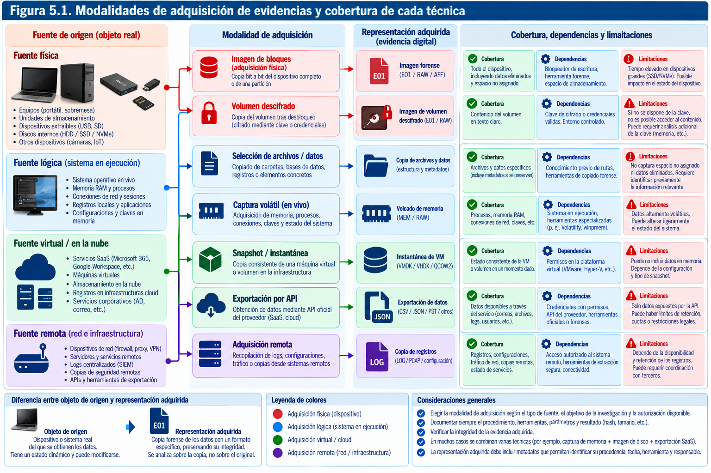
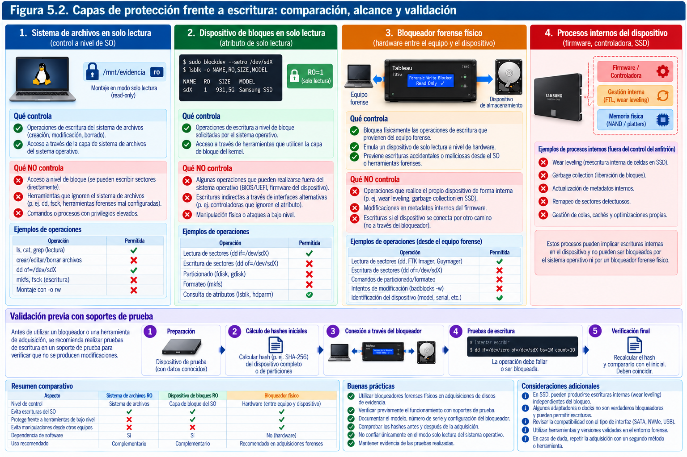
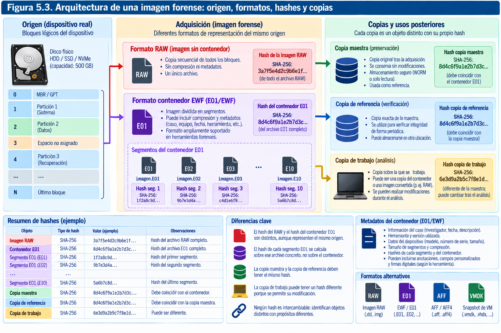
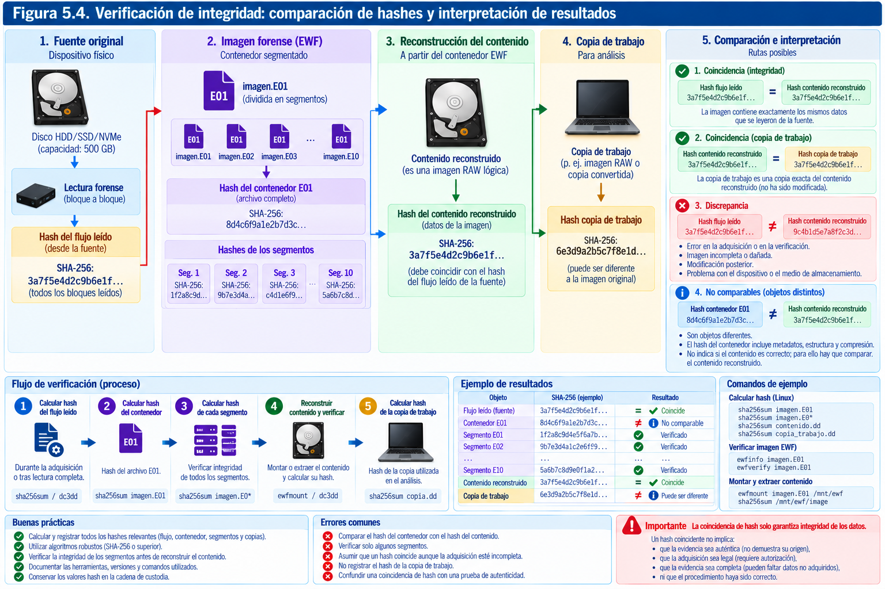
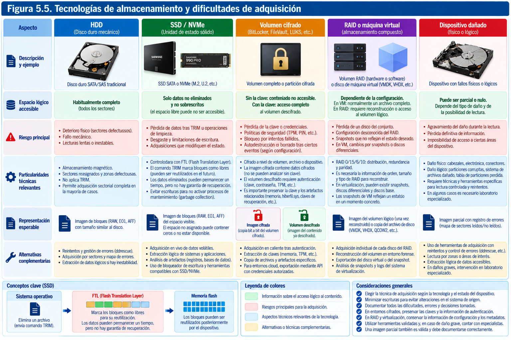
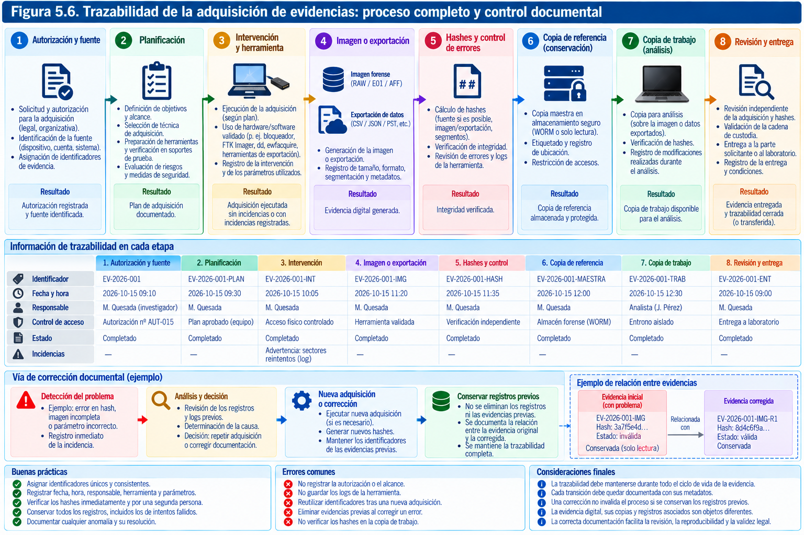

# Adquisición de evidencias y verificación de integridad

> "No es una cuestión de enfoque. Hay factores aleatorios que afectan al flujo de información... lo que llamamos el principio de incertidumbre. Cuando se registra y se interpreta, ese factor aleatorio se traduce en borrosidad, o "ruido", como dicen los técnicos en comunicaciones. (...) La naturaleza física del universo impone límites."
> ("It’s not a question of focus. There are random factors affecting the neutrino stream... What we call the uncertainty principle. When the stream is recorded and interpreted, the random factor comes out as fuzziness, or "noise" as the communications boys speak of it. (...) The physical nature of the universe sets limits.")
> 
> — Isaac Asimov, The Dead Past (El pasado muerto, diálogo entre el físico Foster y el historiador Potterley)


La adquisición de evidencias digitales constituye uno de los momentos más delicados de una investigación forense. Hasta ese instante, el investigador ha identificado fuentes de información, delimitado un escenario, evaluado riesgos y preparado una intervención. A partir de la adquisición comienza a existir un nuevo objeto probatorio: un conjunto de datos obtenidos de una fuente concreta, mediante un procedimiento determinado, en un momento identificable y bajo unas condiciones que deben poder explicarse. La operación parece sencilla cuando se describe como una copia. Sin embargo, copiar no significa necesariamente adquirir de forma forense, y una copia técnicamente exacta puede resultar insuficiente para responder a las preguntas de un caso si se desconoce qué parte de la fuente se ha obtenido, qué transformaciones se han producido o qué información ha quedado fuera.

Imaginemos que una organización detecta una posible extracción no autorizada de documentos desde un equipo portátil. El ordenador utiliza una unidad SSD, tiene el disco cifrado y permanece encendido con una sesión de usuario abierta. Parte de los documentos se almacena en una aplicación corporativa en la nube; otra parte se ha sincronizado en una carpeta local. La cuenta sospechosa continúa activa y algunos registros del proveedor tienen un periodo de retención limitado. La decisión de apagar el equipo para extraer su unidad, aparentemente conservadora, puede impedir el acceso posterior a los datos descifrados. Mantenerlo encendido permite capturar información efímera, pero también provoca nuevas escrituras, actualizaciones y cambios en los registros. Obtener únicamente una exportación lógica puede preservar los documentos visibles sin conservar los indicios de su eliminación. Realizar una imagen completa del SSD, por su parte, no garantiza recuperar datos sobre los que ya haya actuado TRIM.

La tarea del analista consiste en elegir y justificar una combinación de técnicas que conserve la información relevante con el menor riesgo razonable y dentro de la autorización recibida. No existe una técnica universal que sea simultáneamente completa, inocua, rápida y aplicable a cualquier tecnología. Una adquisición rigurosa se reconoce, precisamente, por la capacidad de explicar qué se consiguió, qué no pudo conseguirse y por qué el resultado es fiable dentro de sus límites.

Este capítulo desarrolla los procedimientos de adquisición física, lógica y remota; el papel de los bloqueadores de escritura; la naturaleza y los formatos de las imágenes forenses; el uso correcto de las funciones hash; las particularidades de los soportes y sistemas modernos; y la documentación necesaria para convertir una operación técnica en un proceso auditable. La atención se centra en el razonamiento metodológico y en las prácticas reproducibles, sin confundir el dominio de una herramienta con la competencia profesional para emplearla.

## Adquisición física, lógica y remota

### Del hallazgo a la adquisición: definir exactamente el objeto

En el lenguaje corriente, una evidencia puede ser «el ordenador», «el móvil» o «la cuenta de correo». Estas expresiones sirven para una primera conversación, pero no describen con precisión qué se va a adquirir. El objeto de adquisición puede ser una unidad física completa, una partición, un volumen lógico descifrado, una memoria RAM, un conjunto de archivos, una base de datos, una máquina virtual, una exportación de auditoría o una respuesta estructurada de una API. Cada opción delimita un universo de datos diferente y, por tanto, un conjunto distinto de conclusiones posibles.

Antes de iniciar cualquier operación conviene formular dos preguntas. La primera es **qué fuente constituye el origen técnico de los datos**: el SSD instalado en el portátil, el volumen expuesto por el sistema operativo, un recurso compartido, el backend de una aplicación o un proveedor externo. La segunda es **qué representación de esa fuente se va a conservar**: una secuencia de sectores direccionables, el contenido de determinados archivos con metadatos, una exportación de registros, una instantánea o una captura de memoria. Confundir origen y representación conduce a expresiones como «se obtuvo una copia exacta del ordenador» cuando, en realidad, se descargaron algunas carpetas mediante la interfaz de usuario.

La distinción se hace todavía más importante en un entorno de nube. El administrador de una plataforma puede exportar los mensajes de un buzón, pero normalmente no tiene acceso a los bloques físicos de almacenamiento donde el proveedor conserva esos mensajes. Una instantánea de una máquina virtual puede abarcar determinados discos virtuales, mientras que sus registros de identidad y actividad permanecen en otros servicios. En ambos casos, una adquisición es útil y potencialmente sólida, pero no debe describirse como una imagen física integral de toda la infraestructura.

Una ficha de planificación de adquisición debería dejar establecidos al menos los siguientes extremos: identificador de fuente y autorización; finalidad y preguntas del caso; técnica propuesta; condiciones iniciales; clases de datos incluidas y excluidas; riesgos de pérdida o modificación; herramienta y formato; capacidad de destino; método de verificación; y criterios para suspender o repetir la operación. Esta planificación no es un trámite añadido al trabajo técnico: constituye la referencia contra la que se evaluará el resultado.

### Qué significa adquirir físicamente

La expresión *adquisición física* suele utilizarse para referirse a la obtención de los datos accesibles en una unidad de almacenamiento por debajo del nivel del sistema de archivos. En un disco de ordenador, el resultado habitual es una imagen sector a sector del espacio de direcciones lógicas que el dispositivo presenta al sistema anfitrión. En algunos entornos especializados, el término puede significar acceso de nivel todavía inferior, como la extracción de memoria de un chip. Por ello, el informe debe especificar el método real en lugar de confiar únicamente en una etiqueta genérica.

Una adquisición de bloques de una unidad completa suele incluir la tabla de particiones, los sistemas de archivos existentes, las estructuras auxiliares, los sectores no asignados a archivos y, según la tecnología y el método, el espacio no asignado entre particiones. Esta amplitud es valiosa cuando se investigan borrados, persistencia de malware, alteraciones del sistema, cambios de particiones o rastros que no aparecen en la navegación normal del explorador.

No obstante, una imagen sectorial del dispositivo **no representa necesariamente la totalidad de la información física almacenada por su hardware**. El controlador de un SSD administra internamente páginas NAND que no están expuestas por la interfaz lógica; los mecanismos de reasignación de sectores de un HDD pueden ocultar sectores defectuosos sustituidos; y determinadas áreas especiales pueden quedar fuera del espacio direccionable observado. También pueden existir zonas restringidas por la configuración del dispositivo, dependientes de sus interfaces y capacidades. En un informe resulta preferible escribir «imagen de todos los bloques lógicos accesibles mediante la interfaz empleada» que afirmar, sin matices, «copia absoluta de todos los datos del soporte».

La adquisición física ofrece amplitud, pero tiene costes. Puede demandar muchas horas, espacio proporcional a la capacidad del dispositivo y técnicas de lectura tolerantes a errores. También puede proporcionar bytes cifrados que resulten imposibles de interpretar sin las credenciales o claves necesarias. En un equipo activo y cifrado, una imagen del volumen descifrado obtenida mediante mecanismos del sistema puede aportar más información inmediatamente útil que una imagen de la unidad apagada. Ambas representan cosas distintas y, cuando el alcance lo permite, pueden complementarse.

### La adquisición lógica y sus distintas modalidades

Una adquisición lógica obtiene información a través de una abstracción proporcionada por el sistema operativo, una aplicación, una base de datos o un servicio. Puede incluir archivos y directorios, mensajes, registros, objetos de almacenamiento, exportaciones de correo, colecciones de una base de datos y metadatos ofrecidos por la interfaz. No necesariamente incluye sectores libres, estructuras internas inaccesibles ni todos los estados históricos del origen.

La adquisición lógica no debe considerarse una alternativa inferior por definición. Es con frecuencia la técnica apropiada cuando se necesita preservar un buzón empresarial en funcionamiento, un conjunto de documentos compartidos, un teléfono cuyo fabricante restringe el acceso a bloques o un servicio de nube sin acceso al almacenamiento subyacente. Su calidad depende de la exactitud del alcance, la cobertura de los datos relevantes y la fidelidad de la exportación. Un volcado lógico que conserva los encabezados completos de los mensajes, los identificadores originales y los registros de auditoría puede tener un valor probatorio superior a una colección desordenada de capturas de pantalla.

Bajo la denominación lógica conviven procedimientos muy distintos. Una copia realizada con herramientas del sistema de archivos puede preservar rutas, tamaños y algunos tiempos, pero perder listas de control de acceso, flujos alternativos, atributos extendidos o propietarios si se utiliza una opción inadecuada. Una exportación nativa de una aplicación puede transformar nombres, fechas, estructuras o formatos. Una consulta SQL puede devolver un subconjunto correcto de filas sin preservar transacciones recientes, registros de escritura anticipada o el historial de modificaciones. Una API puede paginar los resultados, imponer límites de velocidad o dejar fuera objetos eliminados. Por ello, no basta con decir «se hizo una copia lógica»; es necesario identificar la interfaz, sus parámetros y sus límites.

Consideremos una carpeta con documentos en un equipo Windows. Copiar su contenido al arrastrarlo a una memoria USB puede modificar fechas de acceso, generar archivos auxiliares y omitir rutas largas o ciertos atributos. Una herramienta que preserve de manera explícita las marcas temporales, los permisos y otros metadatos reduce algunas pérdidas, pero tampoco convierte esa copia en una imagen de disco. La idoneidad de una adquisición lógica se determina por la relación entre la pregunta de investigación y los elementos que efectivamente reproduce.

### Adquisición selectiva, focalizada y de triaje

El volumen de datos de una investigación puede superar con facilidad la capacidad de adquisición y revisión disponible. Un servidor con decenas de terabytes, cientos de estaciones o un repositorio SaaS con millones de documentos plantea un problema de proporcionalidad, tiempo y coste. En ese contexto, una adquisición selectiva, también denominada *targeted acquisition*, puede conservar las fuentes y los objetos con mayor relevancia inicial.

La selección debe guiarse por hipótesis y criterios registrados, no por una confianza intuitiva en que «los archivos importantes» se encuentran en determinadas carpetas. Si el objetivo es reconstruir un acceso remoto, los registros de autenticación, las claves usadas, los eventos del sistema y las conexiones pueden resultar más decisivos que los documentos de usuario. Si se analiza una posible eliminación de información, limitarse a los archivos visibles constituye una elección especialmente arriesgada. La ausencia de un archivo en la exportación no demuestra que nunca existiera.

El triaje es un procedimiento de decisión rápida que permite identificar sistemas o datos merecedores de una adquisición más profunda. No constituye por sí mismo una conclusión forense definitiva. Es legítimo comenzar por una búsqueda de nombres, un listado de procesos o un conjunto limitado de registros y ampliar después el alcance, siempre que la técnica utilizada, sus efectos y sus límites queden recogidos en la documentación. Una adquisición selectiva puede ser el primer paso de un proceso escalonado o su resultado suficiente, según la finalidad y la autorización.

### Adquisición en vivo y fuera de línea

Otra clasificación atraviesa las anteriores: la diferencia entre adquirir un sistema mientras funciona y obtener los datos con el sistema detenido o desconectado. Ambas posibilidades existen tanto para adquisiciones amplias como para adquisiciones focalizadas.

En una **adquisición en vivo**, la fuente permanece operativa. Es posible recoger la memoria RAM, la lista de procesos, conexiones y sesiones, las claves accesibles al proceso autorizado, el estado de dispositivos, los contenedores en ejecución y determinados datos descifrados. Sin embargo, la herramienta ejecutada utiliza recursos, crea procesos, abre archivos, puede generar registros y modifica el sistema observado. La adquisición en vivo busca minimizar y documentar esos cambios, no fingir que no se producen.

En una **adquisición fuera de línea**, el soporte se conecta a una estación de adquisición bajo controles adecuados o se arranca el equipo mediante un entorno controlado, con las precauciones necesarias para impedir modificaciones. Esta modalidad facilita una lectura más estable de datos persistentes, pero no recupera automáticamente información que dependía de la sesión activa. El cifrado de disco completo, el arranque seguro, la soldadura del almacenamiento a la placa y las dependencias de plataformas remotas pueden alterar por completo la viabilidad del método.

La decisión no se resuelve con la regla simplista de «siempre apagar primero» o «siempre capturar RAM». Deben ponderarse la volatilidad, el valor esperado, el riesgo de que el sistema sea alterado, la continuidad de servicio y la capacidad del equipo pericial. Un servidor que sostiene una instalación sanitaria o industrial puede exigir coordinación y un procedimiento específico antes de cualquier intervención. Un equipo que se sospecha manipulado de forma remota puede requerir contención inmediata, aun cuando se pierdan determinados datos efímeros. La decisión debe quedar justificada en términos de riesgos aceptados y beneficios de preservación.

### Adquisición remota y de terceros

Adquirir de forma remota significa obtener información sin tener necesariamente el soporte bajo control físico directo. Puede hacerse desde una herramienta de administración desplegada en un equipo, mediante un agente forense, a través de SSH o de una API, desde una consola de virtualización o mediante una exportación solicitada a un tercero. Este tipo de adquisición resulta habitual en organizaciones distribuidas, servicios en la nube e investigaciones de incidentes que afectan a muchos activos.

El principal problema metodológico no es la distancia, sino el cambio de confianza: el investigador depende de sistemas de autenticación, conexiones, agentes, relojes, permisos y respuestas de plataformas que pueden encontrarse fuera de su control. Debe registrarse quién ejecutó la operación, con qué identidad, desde qué entorno, qué credenciales o privilegios autorizados se utilizaron, cuáles fueron los filtros y cómo se entregó la información. En caso de datos recibidos de terceros es importante conservar el paquete original de entrega, sus mensajes acompañantes, su estructura y sus verificaciones, antes de extraerlo o transformarlo para el análisis.

Las plataformas SaaS suelen ofrecer varios niveles de exportación: contenido del usuario, registros de auditoría, datos administrativos y artefactos sujetos a retención especial. La información disponible puede variar entre planes, licencias, regiones, periodos de conservación y permisos. Una exportación íntegra «según la API consultada» no demuestra que se hayan obtenido todos los datos mantenidos internamente por el proveedor. Las consultas y respuestas deben documentarse, incluyendo errores, paginación, truncamientos, límites temporales y diferencias entre exportaciones sucesivas.

La adquisición remota obliga asimismo a valorar el riesgo de intervención sobre el sistema. Una consulta que parece de lectura puede actualizar el último acceso de un objeto; ejecutar un agente puede registrar servicios; crear una instantánea puede modificar metadatos operativos. No se trata de prohibir estas acciones, sino de conocerlas, reducirlas y documentarlas. Las mejores prácticas de SWGDE para recolección remota y para proveedores cloud son referencias útiles para esta tarea.



### La matriz de decisión: cobertura frente a invasividad y tiempo

Seleccionar una modalidad requiere comparar tres dimensiones que no avanzan necesariamente juntas: cobertura de evidencia, riesgo de alteración y coste temporal u operativo. Una imagen de bloques puede ofrecer gran cobertura del espacio lógico de una unidad, pero no incorporar una sesión descifrada ni los datos que residen solo en la nube. Una exportación API puede obtener rápidamente registros críticos y, al mismo tiempo, depender de la exactitud de los filtros. Una captura de RAM puede preservar procesos y claves, pero demanda intervenir sobre el sistema activo y tiene una ventana temporal estrecha.

La siguiente tabla es orientativa. No establece una jerarquía universal entre métodos:

| Modalidad | Objeto típico | Ventaja principal | Limitación relevante | Verificación habitual |
|---|---|---|---|---|
| Imagen de bloques | Unidad o volumen direccionable | Amplitud del espacio lógico | Puede incluir datos cifrados o no accesibles; no equivale a NAND completa | Hash del flujo adquirido y verificación de imagen |
| Copia lógica | Archivos y metadatos seleccionados | Proporcionalidad y acceso dirigido | Excluye sectores libres y atributos no exportados | Hash por archivo y manifiesto del conjunto |
| Captura en vivo | RAM, procesos, sesiones, volumen abierto | Conserva estados efímeros y datos descifrados | Modifica el entorno operativo | Hash de salida, registros de ejecución y contexto |
| Exportación API | Objetos, eventos y registros de servicio | Acceso a sistemas remotos y cloud | Retención, paginación y permisos limitan cobertura | Hash del paquete, consulta y manifiesto |
| Instantánea | Disco virtual o estado admitido por plataforma | Conservación rápida de un estado coherente según mecanismo | No representa necesariamente memoria ni servicios externos | Identificadores, metadatos, hashes de exportación |
| Recuperación de soporte dañado | Bloques legibles y mapa de errores | Rescata información sin exigir lectura perfecta | Sectores irrecuperables, degradación adicional | Mapa de sectores, hash de imagen resultante y limitaciones |

El método elegido debe describirse en el plan y revisarse si las condiciones reales contradicen las previstas. Por ejemplo, si un disco presentado como HDD es en realidad un SSD con cifrado, las expectativas de recuperación de borrados y el tratamiento del soporte cambian. El analista no debería continuar por inercia con el procedimiento inicialmente seleccionado.

### Una adquisición escalonada en un caso corporativo

Volvamos al portátil del caso inicial. La organización pretende determinar si una cuenta autorizada descargó documentos del repositorio, si posteriormente salieron del equipo y qué evidencias respaldan esa secuencia. El ordenador está encendido y el usuario ha sido separado temporalmente de sus funciones. Existe autorización escrita para preservar el equipo y exportar los registros corporativos; no se ha autorizado revisar cuentas privadas ajenas a la finalidad.

Una estrategia razonable podría comenzar por registrar el estado del equipo y los servicios, solicitar al proveedor SaaS la conservación de registros expuestos a rotación y evaluar si procede capturar memoria y los volúmenes montados. También se puede valorar una imagen de bloques fuera de línea, una vez protegida la información volátil y resuelto el problema de acceso al cifrado. Paralelamente, el área de identidad puede exportar los eventos de autenticación y cambios de sesión dentro del alcance aprobado. Las adquisiciones se realizarán con identificadores separados y una relación documental que explique cómo se complementan.

El resultado no es una única «gran evidencia», sino un conjunto coherente: registros del proveedor, instantáneas o exportaciones, memoria o datos vivos si se han autorizado, imagen del soporte y documentos de trazabilidad. Cada pieza tendrá su propia procedencia, fecha, cobertura y forma de verificación. La correlación de esas piezas pertenece a la fase de análisis; no debe improvisarse durante la adquisición ni alterar el registro de lo que efectivamente se conservó.

## Bloqueadores de escritura

### El riesgo de modificar la fuente durante su lectura

Los sistemas operativos y las herramientas habituales fueron diseñados para trabajar con soportes activos, no para preservar objetos probatorios. Cuando se conecta una unidad, un equipo puede intentar reconocer particiones, montar sistemas de archivos, comprobar errores, crear carpetas auxiliares, indexar contenido o actualizar metadatos. Incluso una inspección aparentemente inocua puede activar componentes que realizan escrituras. En otros casos, los cambios proceden del propio dispositivo, cuyos procesos internos continúan funcionando aunque el anfitrión solo solicite lecturas.

El bloqueo de escritura tiene un objetivo delimitado: impedir, dentro de las capacidades del mecanismo empleado, que operaciones originadas por el equipo de adquisición modifiquen el contenido accesible del soporte. La prevención de modificaciones reduce el riesgo de contaminación y facilita explicar que los datos obtenidos proceden del soporte intervenido y no de una intervención accidental del analista. No exime de mantener una cadena de custodia, documentar los pasos ni comprobar la adquisición.

Es importante comprender que «solo lectura» puede referirse a capas diferentes. Un sistema de archivos montado con la opción `ro`, un dispositivo de bloques marcado como de solo lectura, un controlador que rechaza determinados comandos de escritura y un puente físico diseñado como bloqueador forense no proporcionan las mismas garantías. La presencia de una opción de software no demuestra, por sí sola, que se hayan interceptado todos los caminos de modificación relevantes para la interfaz y el firmware del dispositivo.

### Bloqueadores de escritura por hardware

Los bloqueadores físicos se interponen entre la estación forense y el soporte. Habitualmente exponen una interfaz de lectura al ordenador del examinador y restringen operaciones de escritura dirigidas al dispositivo de origen. Existen soluciones específicas para SATA, SAS, USB y otros entornos; ciertas interfaces modernas, como NVMe, requieren adaptadores o equipos especializados. La elección depende de la compatibilidad real con el soporte, los comandos admitidos, la alimentación y la versión de firmware del bloqueador.

Un bloqueador puede informar de que rechaza operaciones de escritura, pero el investigador no debería limitarse a confiar en un indicador luminoso. Debe verificar el modelo, identificar su versión y confirmar que ha sido probado para la combinación de hardware y protocolo relevante. El programa *Computer Forensic Tool Testing* (CFTT) del NIST ha publicado procedimientos y resultados relativos a categorías de herramientas, entre ellas las de bloqueo de escritura y adquisición de discos. Sus criterios ayudan a entender qué propiedades se deben comprobar, aunque la validación concreta corresponde al entorno donde se va a usar la herramienta.

Hay situaciones en las que un bloqueador por hardware introduce una limitación importante. Una unidad cifrada puede presentar únicamente bloques cifrados cuando se conecta fuera de su ordenador original. Un equipo con almacenamiento soldado puede impedir el acceso directo sin técnicas invasivas. Un dispositivo con daños físicos puede reaccionar mal al cambio de alimentación o de adaptador. En estos escenarios, la protección frente a escrituras no puede decidirse aisladamente de la estrategia global de preservación.

### Bloqueo por software y precauciones en Linux

Un laboratorio Linux permite inspeccionar discos y realizar imágenes con herramientas de propósito general, pero debe configurarse cuidadosamente. Las reglas de montaje automático, los servicios de escritorio, el gestor de volúmenes y las rutinas de descubrimiento de dispositivos pueden actuar antes de que el analista haya comprobado qué unidad se acaba de conectar. Por ello, el procedimiento debe empezar por un entorno controlado, con los servicios de automontaje deshabilitados y con reglas previamente probadas para el equipo empleado.

Un comando como `blockdev --setro` establece una condición de solo lectura en la capa del dispositivo de bloques gestionada por Linux. Es útil como defensa adicional en escenarios concretos; **no es una prueba suficiente de bloqueo forense integral ni sustituye sin más a un bloqueador validado**. De forma semejante, montar un sistema de archivos con `-o ro` reduce operaciones de escritura desde esa montura, pero no demuestra que el dispositivo completo esté protegido frente a otras rutas de acceso. Algunos sistemas de archivos poseen mecanismos de recuperación de diario o de modificación de estado que exigen opciones adicionales o, preferentemente, evitar el montaje de la fuente.

En Linux, `/dev/sda` o `/dev/nvme0n1` son nombres asignados dinámicamente; no deben aceptarse como identificadores permanentes. Antes de operar sobre un dispositivo conviene cotejar identificadores estables, modelo, número de serie, capacidad y ruta física. Una confusión entre origen y destino puede destruir un soporte o sobrescribir evidencia. La validación de identidad debe repetirse tras reconectar, reiniciar o cambiar un adaptador.

**Ejemplo de identificación no destructiva en laboratorio:**

```bash
lsblk -o NAME,PATH,TRAN,MODEL,SERIAL,SIZE,RO,TYPE,MOUNTPOINTS
ls -l /dev/disk/by-id/
```

El primero ofrece una vista del estado actual del sistema y el segundo permite relacionar algunas rutas estables con los nodos del núcleo. La salida debe contrastarse con la etiqueta física, el registro de inventario y el contexto de conexión. Ninguna de estas órdenes autoriza a asumir que una unidad es la correcta solo porque aparece en primer lugar. Tampoco garantiza que todas las unidades expongan un serial fiable, especialmente cuando existen adaptadores USB o controladoras que modifican la información presentada.

En una estación correctamente preparada se puede consultar el atributo de solo lectura de un dispositivo:

```bash
sudo blockdev --getro /dev/disk/by-id/ID_VERIFICADO
```

El valor observado documenta el estado reportado por esa interfaz de software en ese momento. No certifica la ausencia de escrituras autónomas del firmware ni la cobertura de un bloqueador externo. Esta diferencia entre *medida aplicada* y *garantía realmente obtenida* debe mantenerse en todo procedimiento pericial.

### Verificación práctica del bloqueo

Un mecanismo de bloqueo no se valida escribiendo datos de prueba sobre una evidencia real. La evaluación debe realizarse antes, sobre soportes de laboratorio conocidos y sin valor probatorio. Una prueba habitual consiste en establecer un estado inicial del soporte de ensayo, calcular sus hashes, intentar operaciones controladas de escritura a través de la configuración que se desea evaluar, comprobar su rechazo y confirmar que los bytes accesibles y los metadatos relevantes permanecen sin cambios. El protocolo debe incluir operaciones representativas del conjunto de comandos que el bloqueador afirma restringir.

Este ensayo es más fiable cuando se repite tras actualizaciones de firmware, cambios de adaptadores, sustitución del sistema operativo o incorporación de nuevas familias de dispositivos. La mera compatibilidad eléctrica no demuestra la compatibilidad forense. Las unidades NVMe pueden gestionarse con comandos y rutas distintos de los empleados por un disco SATA, y algunos puentes USB no conservan toda la información de identificación del dispositivo. Además, la función del bloqueador debe ensayarse con la herramienta real de adquisición, ya que las interacciones entre componentes pueden introducir comportamientos imprevistos.

El resultado se documentará con fecha, responsable, versiones, soporte de prueba, comandos o acciones efectuadas, resultados observados y limitaciones. Si la prueba demuestra que una configuración no bloquea determinadas operaciones, la conclusión correcta no es ocultar el problema: debe retirarse o restringirse ese procedimiento hasta disponer de controles adecuados.

### Lo que un bloqueador no impide

El bloqueo de escritura suele interpretarse erróneamente como una congelación completa del estado de almacenamiento. En realidad, un SSD puede gestionar internamente reasignaciones, recogida de basura y operaciones de mantenimiento. Aunque el anfitrión no emita escrituras, la representación de determinadas zonas puede verse afectada por el diseño del dispositivo o por operaciones previamente programadas. En otros casos, el contenido leído puede cambiar por defectos físicos, errores intermitentes o comportamientos del firmware. El bloqueador reduce un vector concreto de modificación, pero no elimina todos los riesgos.

Tampoco impide que el operador confunda unidades, lea un dispositivo incompleto, corte la alimentación o seleccione un rango erróneo de bloques. No resuelve problemas de autorización ni de privacidad. Un bloqueo impecable aplicado a un soporte equivocado produce una adquisición técnicamente controlada pero inútil para el caso. A la inversa, una adquisición lógica en vivo puede ser válida y necesaria aunque no exista bloqueo de escritura, siempre que se registre y justifique el tratamiento de modificaciones inherentes a la operación.



### Decidir sin convertir el bloqueador en un ritual

La buena práctica no consiste en introducir sistemáticamente el mismo accesorio en todas las investigaciones, sino en escoger controles coherentes con el riesgo. Ante un HDD convencional, accesible y estable, un bloqueador validado puede formar parte de la vía preferente para una imagen fuera de línea. Ante un ordenador encendido con cifrado activo, aislar y extraer el disco sin examinar el estado de las claves puede resultar contraproducente. Ante un servicio SaaS, el control pertinente no será un bloqueo físico, sino una exportación con credenciales autorizadas, registros de actividad, verificación del paquete recibido y protección de las copias.

Así entendidos, los bloqueadores son componentes de un sistema de aseguramiento de calidad, no símbolos de validez automática. El informe ha de identificar el mecanismo utilizado, la razón de elegirlo, sus resultados de verificación y cualquier circunstancia que pueda afectar a la integridad o a la cobertura de la adquisición.

## Imágenes forenses y sus formatos

### La imagen forense como objeto independiente

Una imagen forense es una representación conservada de datos obtenidos de una fuente mediante un proceso de adquisición documentado. Con frecuencia se asocia a una copia de disco sector a sector, pero el concepto abarca también representaciones de particiones, volúmenes, memorias y ciertos conjuntos de datos estructurados. Lo esencial no es la extensión del archivo resultante, sino la correspondencia entre los datos adquiridos y la fuente que se afirma representar.

Conviene diferenciar tres elementos. El **soporte original** es la unidad o sistema de origen; la **adquisición** es la operación que extrae los datos y produce un resultado; y la **imagen** es el objeto digital resultante de esa operación. Posteriormente se pueden generar **copias de referencia** destinadas a conservar el resultado y **copias de trabajo** sobre las que realizar búsquedas, montajes, transformaciones y análisis. Los nombres pueden variar entre laboratorios, pero la relación entre los objetos debe permanecer explícita.

La imagen obtenida no es un archivo «idéntico al disco» en todos los sentidos. Un disco es un dispositivo que expone bloques y responde a comandos; una imagen es un archivo o conjunto de archivos que contiene una secuencia de datos, acompañada o no de metadatos. El proceso puede capturar todos los bloques accesibles, una partición, solo los bloques utilizados o un conjunto lógico. También puede comprimir, segmentar y encapsular la información. La fidelidad se evalúa respecto del objeto y alcance declarados, no por una equivalencia metafórica entre ambos soportes.

### Imagen RAW: simplicidad y transparencia

Una imagen RAW, frecuentemente identificada por extensiones como `.dd`, `.raw` o `.img`, suele almacenar una secuencia lineal de bytes correspondiente a los bloques leídos del origen. Su principal virtud es la sencillez: un programa capaz de leer archivos binarios puede examinarla y, si conoce la geometría y los desplazamientos necesarios, interpretar sus particiones y sistemas de archivos. No depende de un formato de contenedor complejo para representar la secuencia adquirida.

La contrapartida es que un RAW convencional no incorpora de manera intrínseca un registro completo de quién lo creó, qué herramienta se utilizó, cuál era el número de serie del dispositivo, qué sectores fallaron ni cómo se verificó la operación. Esa información debe conservarse en un manifiesto, un informe de adquisición, los registros de la herramienta y otros ficheros relacionados. Tampoco es habitual que RAW comprima automáticamente: una imagen completa de un dispositivo de 1 TB puede requerir una capacidad de destino cercana a su tamaño lógico, incluso si muchos bloques contienen ceros o datos repetidos. Algunas técnicas del sistema de archivos de destino permiten almacenar regiones dispersas sin ocupar todos los bloques físicos, pero esa optimización debe distinguirse de los bytes que la imagen representa.

RAW ofrece interoperabilidad con numerosas herramientas, facilita el cálculo de hashes de la secuencia y permite efectuar comprobaciones sencillas. En un entorno de laboratorio, puede resultar muy adecuada para discos de prueba, soportes pequeños y flujos de adquisición que necesitan transparencia. No es, sin embargo, una solución universal: en casos amplios puede ser conveniente usar contenedores que integren metadatos, segmentación, compresión y mecanismos adicionales de control.

### El formato EWF y los ficheros E01

El formato conocido como EWF (*Expert Witness Format*) y su uso habitual mediante archivos E01 permite almacenar evidencia adquirida en un contenedor forense, con información descriptiva y, según la variante y las opciones elegidas, compresión, segmentación y mecanismos de verificación. Su adopción en numerosos laboratorios ha favorecido la compatibilidad con herramientas de análisis comerciales y abiertas. No todas las variantes históricas y modernas del formato son idénticas, por lo que conviene identificar la herramienta y la versión que han producido el conjunto.

Una adquisición E01 suele generar uno o varios segmentos. Si el tamaño total lo requiere, el primer fichero puede denominarse `.E01` y continuar con extensiones secuenciales. La existencia de varios segmentos no implica que haya varias adquisiciones independientes: forman parte de un contenedor lógico. Perder un segmento puede impedir el análisis completo o comprometer la validación. El laboratorio debe conservar todos los elementos relacionados y registrar su estructura y sus comprobaciones.

La compresión tiene efectos sobre los hashes que conviene anticipar. El hash calculado sobre el **contenido lógico reconstruido** de la imagen puede corresponder al flujo de bytes adquirido desde la fuente. En cambio, el hash calculado sobre los **bytes del archivo contenedor E01** representa ese archivo empaquetado, incluyendo cabeceras y datos comprimidos; normalmente será distinto del hash del flujo fuente. Ambos valores son útiles, pero verifican objetos diferentes. Comparar uno con otro y concluir que la adquisición está alterada sería un error conceptual.

Los contenedores también pueden incorporar información sobre errores de lectura o metadatos relevantes, aunque la disponibilidad exacta depende del formato y de la herramienta. No debe darse por supuesta la conservación de una propiedad sin comprobar que el software realmente la registra. Una ficha de adquisición EWF debería anotar el formato concreto, los parámetros de compresión y segmentación, la herramienta y su versión, los hashes y el resultado de verificación, además de los informes generados.

### AFF, AFF4 y otras representaciones

AFF (*Advanced Forensic Format*) surgió como una alternativa orientada a mejorar el almacenamiento de imágenes y metadatos forenses. AFF4 desarrolla un modelo de contenedor más flexible, destinado a representar conjuntos de datos, flujos y relaciones mediante estructuras de almacenamiento y metadatos. Sus posibilidades incluyen usos para los que una secuencia RAW simple resulta menos expresiva. Sin embargo, la interoperabilidad real no se debe presuponer: una herramienta puede admitir cierto subconjunto de un formato y otra puede interpretarlo de manera distinta.

En el ecosistema forense también se utilizan formatos propietarios, contenedores de adquisición lógica y paquetes nativos de cada proveedor. Las exportaciones de correo pueden adoptar estructuras como MBOX, PST u otros formatos; una captura de memoria suele guardarse en un archivo binario acompañado de un registro; y una adquisición cloud puede consistir en cientos de objetos y un manifiesto. No es correcto describir todas esas representaciones como E01 ni convertir una exportación de aplicación en una «imagen física» por el hecho de empaquetarla posteriormente.

El criterio de selección debe contemplar interoperabilidad, compatibilidad futura, conservación de metadatos, capacidad de segmentación, integridad verificable, necesidad de compresión y posibilidad de reconstruir los bytes relevantes con herramientas independientes. Para un libro o un procedimiento destinado a durar años, es preferible enseñar los principios de representación antes que imponer un producto comercial cuya disponibilidad o compatibilidad pueda cambiar.

### Las imágenes segmentadas

Dividir una adquisición en segmentos facilita almacenarla en destinos con límites de tamaño, transferirla por redes o distribuirla entre medios de conservación. La segmentación introduce, al mismo tiempo, más elementos que gestionar. Los segmentos deben identificarse de manera inequívoca, conservar su orden y acompañarse de un manifiesto que documente su pertenencia al conjunto.

Es útil mantener dos niveles de verificación: uno para cada fichero tal como está almacenado y otro para el contenido adquirido reconstruido, siempre que la herramienta y el formato lo permitan. El primer nivel detecta la modificación o pérdida de un segmento concreto. El segundo comprueba que la reconstrucción del flujo ofrece los mismos bytes que se registraron en la adquisición. Si se ha usado compresión, cifrado del repositorio o transferencia a otro almacenamiento, estos niveles ayudan a localizar el punto donde se ha producido una incidencia.

La fragmentación arbitraria de un archivo RAW con herramientas generales puede resultar manejable, pero debe documentarse con precisión y probarse la reconstrucción. Si se utiliza un contenedor EWF, normalmente conviene dejar la segmentación a una herramienta que conozca el formato. El propósito es asegurar que el examinador futuro pueda identificar y utilizar el conjunto sin depender de conjeturas sobre nombres de archivo.

### Compresión, cifrado y preservación del contenido

La compresión sin pérdida reduce el espacio necesario cuando los datos son compresibles; no garantiza ahorrar espacio en soportes que contienen información ya comprimida o cifrada. Un volumen BitLocker, FileVault o LUKS en estado cifrado puede presentar una entropía alta y ofrecer una reducción escasa. En cambio, una imagen de bloques con grandes zonas de ceros puede comprimirse notablemente.

La compresión debe ser reversible y la verificación debe permitir comprobar que la secuencia reconstruida es la esperada. Si un contenedor forense se cifra para proteger los datos en reposo, aparece una capa adicional de dependencia: conservar la clave y los mecanismos de descifrado se vuelve tan importante como conservar el archivo. El cifrado del repositorio protege la confidencialidad de la evidencia; no debe confundirse con el cifrado que ya existía en la fuente investigada.

En una infraestructura seria resulta conveniente separar la preservación de la **imagen maestra**, el acceso controlado a **copias de referencia** y la generación de **copias de trabajo**. Una política de almacenamiento inmutable o de escritura restringida puede reforzar la conservación, pero la inmutabilidad debe probarse y auditarse. Una copia desconectada y cifrada reduce ciertos riesgos, aunque exige procedimientos de recuperación de claves y verificación periódica. La integridad no es un atributo que se establezca una vez y se olvide; es un estado que se comprueba a lo largo del ciclo de vida del objeto.

### Metadatos de adquisición y metadatos de contenido

Los metadatos de adquisición describen cómo se obtuvo la evidencia: fecha, identificador del operador, método, herramienta, número de serie del origen, parámetros y resultados. Los metadatos de contenido, por el contrario, se encuentran dentro de los datos adquiridos: marcas temporales del sistema de archivos, atributos, propietarios, estructuras de partición y registros de actividad, entre otros. La diferencia importa porque los primeros documentan el proceso forense y los segundos pueden constituir materia de análisis del caso.

Un error habitual consiste en interpretar la fecha de creación del archivo E01 en el laboratorio como la fecha de creación de los archivos contenidos en el disco. Esa fecha pertenece al objeto de adquisición, no al evento investigado. De forma parecida, si una exportación cloud se descarga hoy, la fecha de descarga del paquete no coincide necesariamente con la creación o modificación de los objetos exportados. Los metadatos de distintas capas deben conservar su denominación, fuente y zona horaria.

### Ejemplo controlado de imagen RAW en Linux

Los comandos siguientes ilustran un flujo con **medios de laboratorio sin valor probatorio**. No deben ejecutarse sobre dispositivos reales hasta comprobar identidad, autorización, montaje, bloqueo y capacidad de destino. En especial, nunca se debe sustituir de forma improvisada el origen por una ruta como `/dev/sda` sin identificarla.

Primero se identifican las unidades visibles y las rutas persistentes:

```bash
lsblk -o NAME,PATH,MODEL,SERIAL,SIZE,RO,TYPE,MOUNTPOINTS
ls -l /dev/disk/by-id/
```

En una situación de entrenamiento donde la fuente sea un fichero preparado, el mismo concepto puede practicarse sin acceder a un disco físico:

```bash
mkdir -p laboratorio/adquisiciones
# "fuente-lab.img" es un archivo sintético preparado previamente.
dd if=fuente-lab.img \
   of=laboratorio/adquisiciones/ADQ-LAB-001.raw \
   bs=4M iflag=fullblock status=progress
sha256sum fuente-lab.img \
          laboratorio/adquisiciones/ADQ-LAB-001.raw
```

La comparación de hashes comprueba que los dos archivos contienen la misma secuencia de bytes para el algoritmo utilizado. No demuestra cómo fue creado `fuente-lab.img` ni que represente un dispositivo completo: esas garantías dependen de la trazabilidad del origen. Se recomienda que los ejemplos iniciales del laboratorio usen fuentes sintéticas o imágenes ya preparadas para evitar que un error de sintaxis afecte a un soporte real.

Para una unidad física, una herramienta específica de adquisición debe registrar los errores y el proceso de verificación. Si se utiliza `dd` en un dispositivo sano y protegido, los controles externos —identificación, bloqueo, cálculo de hash, registro de fallos y revisión de tamaño— deben completarse explícitamente. `dd` no convierte por sí solo una copia en procedimiento forense certificado.

### Consulta y validación de una imagen EWF

En un laboratorio que emplee `libewf` se dispone de utilidades como `ewfinfo` y `ewfverify`. Su función es, respectivamente, consultar información del contenedor y realizar comprobaciones de consistencia y verificación según el formato soportado. La sintaxis debe consultarse en la versión instalada, y una verificación satisfactoria debe interpretarse de acuerdo con lo que la herramienta documenta realmente:

```bash
ewfinfo ADQ-2026-001.E01
ewfverify ADQ-2026-001.E01
```

Una comprobación de estructura interna no sustituye automáticamente la comparación con un hash del flujo leído originalmente, ni confirma que el dispositivo fuente se identificó correctamente. Puede ser una prueba sólida de que el contenedor almacenado conserva determinados datos y se reconstruye de forma consistente, pero la conclusión pericial debe mencionar la cobertura exacta de la verificación.



### Selección de formato en escenarios habituales

Una investigación de un puesto de trabajo con disco extraíble y buen estado puede optar por una imagen sectorial RAW o EWF, según la infraestructura de análisis y conservación. En un caso con necesidad de transferencia de varios terabytes, la compresión y segmentación pueden favorecer un contenedor que admita esos recursos. En el examen de un servidor crítico, puede resultar más viable una instantánea de volúmenes y la posterior exportación verificada, siempre que se entiendan sus garantías de coherencia. En un incidente cloud, un paquete original exportado mediante API será normalmente el objeto base que se deba custodiar.

Esta diversidad exige evitar la frase «hemos hecho una imagen forense» como si describiera por sí sola un procedimiento. El informe debería responder a las preguntas siguientes: ¿imagen de qué?, ¿obtenida por qué interfaz?, ¿con qué cobertura?, ¿mediante qué herramienta?, ¿en qué formato?, ¿con qué transformaciones?, ¿cómo se verificó?, ¿qué quedó excluido? Solo cuando esas respuestas están disponibles se puede valorar de manera fundada la utilidad de la adquisición.

## Hashes y comprobación de integridad

### Una huella criptográfica no es una cadena de custodia

Una función hash criptográfica transforma un conjunto de bytes de longitud arbitraria en un resumen de longitud fija. SHA-256, por ejemplo, produce un resultado de 256 bits que se representa habitualmente como 64 caracteres hexadecimales. Un pequeño cambio en los bytes de entrada producirá, con probabilidad abrumadora, un resumen distinto. Esta propiedad permite detectar alteraciones entre dos estados de un objeto digital.

El valor hash es una herramienta esencial de la informática forense, pero su interpretación requiere precisión. Si dos archivos tienen el mismo SHA-256 y han sido calculados correctamente, existe una evidencia técnica muy fuerte de que contienen los mismos bytes. Eso no significa que procedan de la misma fuente física, que sean lícitos, que todos los datos relevantes del dispositivo hayan sido adquiridos o que la persona investigada haya creado esos bytes. El hash no autentica por sí solo la identidad del operador ni el contexto de obtención. Tampoco reemplaza el registro de transferencias ni las autorizaciones.

Para que un hash tenga valor de control debe estar asociado al objeto exacto sobre el que se calculó, a un momento, a una herramienta y a un procedimiento. Un número escrito sin indicar si corresponde al disco, al volumen descifrado, al contenedor E01 o al fichero comprimido puede originar aparentes contradicciones durante la revisión.

### Funciones hash y resistencia criptográfica

Las funciones utilizadas para verificar integridad deben ser apropiadas para el contexto y el periodo de conservación. MD5 y SHA-1 han formado parte de numerosos flujos de trabajo forense históricos, pero presentan debilidades criptográficas conocidas, especialmente en su resistencia a la generación deliberada de colisiones. No conviene emplearlas como única garantía de integridad en adquisiciones nuevas cuando se dispone de alternativas modernas. SHA-256 y otras funciones de la familia SHA-2 ofrecen una elección conservadora y ampliamente interoperable; SHA-3 es otra familia estandarizada que puede utilizarse donde exista soporte adecuado.

La colisión criptográfica es la existencia de dos entradas distintas con el mismo resumen. No equivale a que cualquier coincidencia entre hashes sea sospechosa ni a que la integridad de todas las pruebas históricas con MD5 sea automáticamente inválida. La relevancia del riesgo depende del algoritmo, del escenario de ataque, del control sobre los datos de entrada y de la forma en que se utiliza el hash. El criterio profesional consiste en elegir algoritmos adecuados y declarar las limitaciones, no en presentar el hash como un mecanismo infalible.

Utilizar dos algoritmos puede aportar compatibilidad con herramientas o repositorios que manejan formatos distintos, pero conviene priorizar al menos uno resistente a colisiones conocidas. Un informe puede incluir SHA-256 como valor de referencia y MD5 como identificador auxiliar por razones de interoperabilidad, aclarando que este último no sustituye la garantía ofrecida por el primero.

### Hash de la fuente, de la adquisición y de la copia

En la práctica intervienen varias comparaciones posibles:

- El **hash del flujo fuente** puede calcularse durante la lectura desde el origen, cuando la herramienta lo soporta.
- El **hash del contenido adquirido** representa los bytes reconstruidos a partir de la imagen o exportación.
- El **hash del contenedor** identifica los bytes del fichero que guarda la adquisición, incluidas sus cabeceras, compresión y metadatos externos al flujo.
- El **hash de una copia de trabajo** permite confirmar la coincidencia con el objeto del que procede, cuando no se realizan transformaciones.
- El **hash por archivo** permite verificar individualmente objetos de una adquisición lógica; el conjunto requiere además un manifiesto completo, cobertura declarada y control de su estructura.

No todos los procedimientos pueden producir todos estos valores. En un dispositivo con sectores que cambian, errores de lectura o cifrado que presenta datos distintos entre sesiones, volver a leer el origen para calcular un segundo hash puede dar un resultado diferente sin que ello implique una manipulación. Por el contrario, dos hashes coincidentes calculados sobre una imagen incompleta no convierten los sectores ausentes en datos válidos. La verificación y la completitud son propiedades distintas.

### Cuándo calcular los hashes

Una estrategia habitual consiste en calcular un valor durante la adquisición y otro al terminar sobre la representación adquirida. Posteriormente, se vuelve a comprobar la integridad antes de transferir, abrir para análisis o entregar la evidencia. El momento exacto depende de la técnica y de la estabilidad de la fuente.

Si la lectura original fue fiable y el dispositivo permaneció estable, la coincidencia entre la huella del flujo de origen y la de la imagen reconstruida refuerza la correspondencia. Si hubo errores, la herramienta puede introducir rellenos, omisiones o marcas; entonces la comparación debe interpretarse a la luz del mapa de sectores legibles y de la política aplicada. Si la fuente es una plataforma en la nube, el primer valor fiable disponible puede ser el SHA-256 del paquete exportado al llegar al laboratorio, acompañado de un manifiesto del proveedor. No debe inventarse un hash «de origen» que nunca se calculó.

La integridad debe comprobarse también después de operaciones de mantenimiento, migración de repositorios o traslado a soportes de conservación. Un laboratorio que custodia grandes volúmenes de evidencias necesita una política verificable de comprobaciones periódicas, alertas de error y gestión de versiones, no una simple carpeta con ficheros y un listado de hashes guardado durante años.

### Ejemplo: verificar una adquisición lógica

Supongamos que un departamento autorizado entrega tres archivos obtenidos de una carpeta corporativa: un PDF, un CSV de auditoría y un registro de accesos. El objetivo es preservar esos archivos tal como se recibieron. Para comprobar su integridad no es suficiente calcular un único hash sobre una carpeta, porque una carpeta no constituye por sí sola una secuencia de bytes definida de forma universal. Se puede crear un manifiesto con el nombre exacto y el SHA-256 de cada archivo, conservar ese manifiesto y verificar posteriormente el conjunto.

En un directorio de prueba con nombres sencillos, el procedimiento puede representarse así:

```bash
cd adquisicion-logica-lab
sha256sum documento.pdf auditoria.csv accesos.log \
    > manifiesto-sha256.txt
sha256sum -c manifiesto-sha256.txt
```

La salida permite comprobar la coincidencia entre los archivos presentes y los resúmenes consignados. En un caso real, se registrarían también el tamaño, la ruta original, los metadatos relevantes, la fecha de exportación, la identidad del exportador y cualquier transformación. Si los nombres contienen caracteres especiales, rutas complejas o miles de elementos, conviene utilizar herramientas de generación de manifiestos que definan inequívocamente la codificación, el escape de nombres y el orden. El manifiesto debe custodiarse y verificarse, por ejemplo mediante firma digital o mediante su incorporación a un repositorio con controles de integridad y auditoría.

El ejemplo revela una limitación importante. Si antes de crear el manifiesto se omitió uno de los archivos existentes en la fuente, la comprobación será correcta para los tres recibidos, pero no advertirá necesariamente la omisión. La validación criptográfica acredita la estabilidad de un conjunto definido; la evaluación de su exhaustividad requiere contrastar el procedimiento de obtención y el inventario esperado.

### La importancia del tamaño, las rutas y la semántica

En una adquisición de imagen de disco, el tamaño esperado constituye una verificación básica. Una imagen que termina antes del último sector direccionable puede ser parcial. Sin embargo, una igualdad de tamaños tampoco demuestra identidad de contenido. De manera semejante, una coincidencia de hash de una copia no comprueba que esa copia sea el dispositivo correcto si el origen no se identificó adecuadamente.

En adquisiciones lógicas, los nombres de archivo, los directorios y los metadatos pueden ser tan relevantes como el contenido. Dos ficheros con el mismo SHA-256 pueden encontrarse en rutas distintas y haber sido usados en contextos diferentes. El hash del contenido no captura por sí mismo permisos, propietario, nombre, ruta ni la totalidad de los metadatos de sistema de archivos. Cuando estas propiedades importan, deben registrarse y verificarse por separado.

Hay asimismo diferencias entre el contenido lógico y la representación física. Un documento puede tener contenido idéntico aunque haya sido movido; un sistema de archivos puede actualizar su diario sin que cambien los bytes de un archivo; una exportación CSV puede representar los mismos registros que otra exportación y, sin embargo, diferir en codificación, salto de línea u orden de filas. En todos estos casos, los hashes responden a una pregunta limitada: si dos secuencias concretas de bytes coinciden, no si dos estados operativos son semánticamente equivalentes.

### Errores de lectura, hashes parciales y discordancias

La aparición de una diferencia entre hashes obliga a investigar, no a atribuir de inmediato una manipulación. Las causas posibles incluyen una transferencia truncada, corrupción accidental, selección de un archivo distinto, cambio en la representación, descompresión incorrecta, segmentos faltantes, fallos de almacenamiento o modificaciones reales. La respuesta metodológica consiste en comprobar qué se comparó, repetir de forma controlada las verificaciones disponibles, analizar registros y conservar ambos valores con sus circunstancias.

No se debe alterar una evidencia para conseguir que «el hash cuadre». Tampoco resulta aceptable calcular únicamente el valor de un fichero alterado y sustituir el registrado inicialmente sin explicar la incidencia. Los resultados negativos forman parte de la historia de custodia y pueden ser necesarios para interpretar una conclusión. Si una adquisición original presentó errores y se realizó otra posteriormente, ambas deben conservar identificadores distintos; la segunda no borra el hecho de que la primera fuera incompleta.

Cuando solo se pudieron leer determinadas regiones, puede calcularse un hash sobre cada región o sobre el fichero resultante, pero debe declararse la cobertura. La huella no permite inferir los bytes de las regiones ilegibles. La documentación del mapa de errores y de la política de relleno resulta crucial para evitar que los programas de análisis interpreten como datos originales los ceros presentes en los huecos de un rescate.

### Firmas digitales, sellado temporal y hashes

Un hash puede incorporarse a un documento firmado digitalmente o registrarse en un sistema de sellado temporal. Estas técnicas añaden propiedades diferentes. La firma puede vincular una declaración a una identidad o clave bajo un esquema de confianza, mientras que un sello temporal confiable puede respaldar la existencia de determinado resumen en un momento. Ninguna de ellas demuestra por sí sola que el contenido proceda del dispositivo indicado ni que la adquisición haya sido exhaustiva; esas propiedades siguen dependiendo del procedimiento y sus registros.

En una organización es útil distinguir entre tres preguntas: ¿los bytes se han mantenido íntegros?, ¿quién documentó o aprobó la actuación?, ¿desde cuándo existe una determinada representación registrada? El hash, la firma y el sello temporal atienden parcialmente a estas preguntas desde planos técnicos diferentes. Su combinación mejora la auditabilidad cuando se aplica correctamente, pero no transforma una obtención no autorizada o un dato mal atribuido en una evidencia concluyente.

### Árboles de hashes y grandes conjuntos de datos

Cuando las adquisiciones contienen muchos ficheros o grandes cantidades de bloques, resulta conveniente usar esquemas de verificación por fragmentos. En lugar de depender exclusivamente de un único resumen del conjunto, se pueden calcular hashes por segmento y construir estructuras de agregación, como árboles de Merkle. Estos mecanismos permiten localizar qué parte de un conjunto ha cambiado sin releer siempre la totalidad para identificar la discrepancia. También facilitan ciertos procesos de transferencia y verificación distribuidos.

Su utilidad no elimina la necesidad de conocer el criterio de fragmentación, el orden de los elementos y las reglas de composición. Dos conjuntos que contienen idénticos archivos pero siguen órdenes distintos pueden generar raíces diferentes. Si el árbol se construye sobre bloques, modificar el tamaño de bloque o la estructura de empaquetado cambia el resultado aunque determinados contenidos de interés se conserven. Un protocolo de verificación debe documentar el algoritmo completo, no solo la raíz final.

### Detección de errores y autenticidad: una distinción final

Es frecuente leer que una evidencia «es auténtica porque su hash coincide». La coincidencia demuestra que el objeto verificado coincide en bytes con la referencia empleada, dentro de las garantías del algoritmo y de la operación. La autenticidad en una investigación abarca además la procedencia, las condiciones de obtención, la identidad y el control de la fuente, los posibles cambios anteriores a la adquisición y la correspondencia entre el objeto y el hecho investigado.

El informe debe evitar tanto el exceso de confianza como el escepticismo indiscriminado. Un hash correctamente calculado y custodiado proporciona una garantía técnica importante; negar su utilidad sería incorrecto. Atribuirle capacidades que no posee también lo sería. La práctica profesional consiste en integrar la comprobación de integridad dentro de una cadena de afirmaciones verificables, desde la fuente identificada hasta el resultado presentado.




## Particularidades de HDD, SSD, cifrado y sistemas dañados

### El soporte físico condiciona lo que puede recuperarse

El análisis de evidencias almacenadas comienza a menudo con una abstracción cómoda: un dispositivo que entrega una secuencia ordenada de sectores. Esa abstracción es suficiente para muchas tareas, pero oculta diferencias fundamentales entre tecnologías. Un disco duro magnético, una unidad SSD SATA, un SSD NVMe, una memoria USB de bajo coste y un volumen virtual sobre almacenamiento distribuido pueden presentar una interfaz aparentemente similar y comportarse de manera muy distinta ante lecturas, borrados, pérdidas de alimentación o comandos de mantenimiento.

La identificación correcta de la tecnología no es una curiosidad de inventario. Determina qué mecanismos de adquisición pueden utilizarse, cuáles son los riesgos de daño, qué datos cabe esperar en las zonas no asignadas y cómo interpretar una ausencia. También puede cambiar el sentido de una intervención: extraer una unidad física de un equipo para conectarla al laboratorio es viable en algunos ordenadores, pero imposible o perjudicial en otros que integran almacenamiento, controladora y claves criptográficas en una misma arquitectura.

En una investigación profesional no debe confundirse el procedimiento que se sabe ejecutar con el procedimiento que más conserva. El analista necesita conocer suficientemente el soporte para explicar qué propiedades del medio pueden influir sobre el resultado.

### Discos magnéticos: sectores, remapeos y datos residuales

En un HDD convencional los datos se almacenan mediante estados magnéticos sobre platos, administrados por una controladora. El sistema anfitrión accede normalmente a direcciones lógicas de bloque; no controla directamente la disposición física de los sectores. El firmware puede reasignar sectores defectuosos a áreas de reserva y ocultar ese remapeo al sistema operativo. Por tanto, una imagen completa del espacio lógico del disco no equivale siempre a la extracción de todas las regiones físicas que existen en su interior.

Los HDD siguen siendo especialmente relevantes para recuperar archivos eliminados porque la eliminación lógica suele afectar primero a metadatos y a la asignación de espacio, sin implicar necesariamente una sobreescritura inmediata del contenido. Si los sectores de un archivo borrado continúan intactos y accesibles, pueden ser recuperables mediante el sistema de archivos, sus estructuras auxiliares o técnicas de *file carving*. Esta posibilidad no constituye una garantía: el uso posterior del disco, las tareas automáticas, la fragmentación, la compresión, el cifrado y los fallos físicos pueden reducir o eliminar el contenido disponible.

La estabilidad mecánica merece especial atención. Un HDD que presenta ruidos anómalos, errores crecientes o problemas de reconocimiento puede deteriorarse durante una adquisición intensiva. Cada nuevo ciclo de encendido y cada lectura de una zona dañada puede incrementar el riesgo. Ante síntomas claros de avería física, la primera obligación es evaluar si el caso requiere un laboratorio especializado en recuperación de soportes, no insistir repetidamente con una herramienta general hasta agotar la unidad.

Una intervención no especializada puede convertir una avería parcial en una pérdida irreversible. Abrir el conjunto mecánico, sustituir componentes sin condiciones adecuadas o ejecutar utilidades de reparación sobre el origen compromete tanto los datos como la explicación técnica de lo sucedido. La prioridad debe ser obtener la mejor representación posible del soporte con una estrategia de lectura proporcional al estado del dispositivo.

### SSD: controladora, FTL, TRIM y recogida de basura

En una unidad SSD, los datos residen en memoria flash gestionada por una controladora que traduce bloques lógicos en páginas físicas. Esta capa, habitualmente denominada FTL (*Flash Translation Layer*), permite distribuir escrituras, gestionar bloques defectuosos y efectuar tareas de mantenimiento. El sistema anfitrión no ve necesariamente la ubicación física real de un sector lógico y no puede asumir que cada dirección permanezca vinculada al mismo conjunto de celdas a lo largo del tiempo.

El mecanismo TRIM y sus equivalentes según la interfaz permiten que el sistema operativo informe a la unidad de qué rangos lógicos ya no contienen datos que el sistema de archivos considere necesarios. Después de recibir esa información, la controladora puede tratar el contenido correspondiente como descartable y gestionar sus páginas mediante sus procesos internos. El resultado observable varía entre unidades, controladoras, sistemas de archivos y estados de funcionamiento. Algunas lecturas posteriores de rangos descartados pueden devolver ceros u otro comportamiento documentado por el dispositivo; en otros contextos, pueden observarse diferentes respuestas. No existe un plazo universal que permita afirmar que todos los archivos borrados se destruyen de inmediato, pero tampoco es legítimo prometer que permanecerán recuperables hasta una sobrescritura visible.

La recogida de basura (*garbage collection*) reorganiza internamente la memoria para disponer de bloques reutilizables. Estas operaciones ayudan al rendimiento y a la vida útil del SSD, pero complican la inferencia forense sobre estados físicos anteriores. La posibilidad de desactivar TRIM en el sistema operativo no recupera automáticamente datos ya descartados, ni garantiza que la unidad detenga todas sus tareas internas. El analista debe registrar el tipo de dispositivo, su interfaz y las condiciones conocidas, y evitar conclusiones categóricas basadas exclusivamente en que un archivo borrado no aparece en la imagen.

En ciertos entornos pueden existir instantáneas, versiones anteriores, copias de seguridad, registros o datos replicados que documenten el contenido perdido. La investigación de un borrado en SSD debe considerar esas fuentes alternativas desde el principio, en lugar de concentrarse únicamente en técnicas clásicas de recuperación de sectores. La ausencia de restos en el espacio lógico no demuestra que el archivo nunca existiera ni que fuera borrado por una persona concreta.

### NVMe, unidades externas y adaptadores

NVMe es un protocolo concebido para acceder a almacenamiento no volátil con baja latencia, habitualmente a través de PCI Express. Aunque un SSD NVMe comparte con otros SSD los problemas de la FTL y de la gestión del borrado, su adquisición plantea particularidades de conectividad, comandos, nombres de dispositivo y compatibilidad de herramientas. No es apropiado asumir que un adaptador diseñado para SATA protegerá una unidad NVMe por el mero hecho de que ambos sean «discos».

Los puentes USB añaden otra capa de comportamiento. Un adaptador puede ocultar o modificar el número de serie presentado al anfitrión, limitar el acceso a comandos específicos o transformar determinadas respuestas. La presencia de una unidad detrás de USB no informa por sí sola de la tecnología interna. Algunas memorias externas incorporan además cifrado en la carcasa o en la controladora; retirar el disco interno y conectarlo mediante otro adaptador puede producir bytes aparentemente ininteligibles aunque no exista ninguna contraseña adicional introducida por el usuario en ese momento.

El registro de adquisición debe identificar el conjunto utilizado: unidad, carcasa, cableado relevante, adaptador, estación forense y modo de conexión. Si un cambio de interfaz produce un tamaño o una identidad diferente, esa discrepancia debe investigarse antes de continuar. La normalidad aparente de una operación de lectura no sustituye la comprobación de que se están adquiriendo los bloques esperados.

### Cifrado completo de disco: dos representaciones posibles

El cifrado completo de disco protege los datos almacenados frente a accesos que no dispongan de las claves correspondientes. Entre las soluciones habituales se encuentran BitLocker en Windows, FileVault en macOS y configuraciones basadas en LUKS o dm-crypt en Linux. Sus arquitecturas difieren, y algunas combinan contraseñas de usuario, claves de recuperación, módulos TPM o componentes de seguridad integrados. La adquisición debe tener en cuenta tanto la existencia del cifrado como el estado del sistema en el momento de intervenir.

Si se obtiene una imagen de bloques de la unidad apagada, es posible que gran parte del contenido aparezca cifrado. Esa imagen puede ser valiosa porque conserva una representación del soporte y permite posteriores intentos legítimos de descifrado cuando se obtienen las credenciales o claves adecuadas. Sin embargo, no es equivalente a una imagen del volumen ya descifrado. Si, en cambio, se adquiere un volumen montado y accesible a través de un sistema activo, el resultado puede contener datos en claro que la unidad física almacena cifrados. Esta segunda representación depende de la capa de descifrado y puede excluir partes del dispositivo que queden fuera de ese volumen.

La actuación debe intentar preservar las dos perspectivas cuando sean relevantes y viables dentro del alcance. El momento es crítico: apagar o reiniciar el dispositivo puede cerrar una sesión y destruir información necesaria para mantener el acceso. La captura de datos en vivo, las claves de recuperación facilitadas por el titular autorizado o los mecanismos empresariales de gestión del cifrado pueden ser alternativas. Cualquier manipulación de credenciales, acceso a datos descifrados o exportación de claves está sujeta a autorización, proporcionalidad y procedimientos específicos de protección.

Un informe correcto describiría, por ejemplo, que «se adquirió el volumen lógico descifrado mediante la sesión autorizada activa y, posteriormente, se conservó una imagen de bloques cifrada de la unidad física». Esta formulación es mucho más informativa que «se copió el disco» y permite entender por qué los hashes de ambas representaciones no coinciden.

### Cifrado por archivo, contenedores cifrados y datos en uso

El cifrado puede estar limitado a carpetas, archivos, bases de datos o contenedores virtuales. En esos casos, un disco aparentemente no cifrado puede conservar archivos cifrados cuya interpretación dependa de una contraseña, una clave guardada en un gestor de secretos o una sesión de aplicación. También pueden existir claves temporales o materiales de autenticación que solo estén disponibles mientras se ejecuta un proceso.

Adquirir un archivo cifrado y obtener su versión descifrada son actuaciones diferentes. Ambas pueden ser pertinentes: la primera conserva la representación original visible en el soporte; la segunda permite examinar el contenido al que tenía acceso una aplicación. La obtención de la segunda puede requerir ejecutar software, introducir credenciales o usar mecanismos de exportación que alteran metadatos. Deben registrarse el alcance, la herramienta, las autorizaciones y el resultado de esas transformaciones.

El investigador no debe almacenar contraseñas o claves en texto claro dentro de los informes generales si ello no es indispensable. Los secretos se custodiarán con controles reforzados, separando las copias operativas de la documentación destinada a terceros. En una investigación corporativa, la capacidad técnica para acceder a material cifrado no elimina las limitaciones de privacidad ni permite ampliar por iniciativa propia la inspección a cuentas personales o espacios ajenos a la finalidad autorizada.

### Errores de lectura y dispositivos parcialmente dañados

Una adquisición perfecta exige que los bloques seleccionados puedan leerse de manera fiable. Cuando el dispositivo devuelve errores, la herramienta puede detenerse, omitir regiones o aplicar un criterio de relleno. La elección tiene consecuencias técnicas y probatorias: una imagen incompleta puede ser el mejor resultado posible, pero debe describirse como tal y conservar un mapa preciso de los intervalos no recuperados.

La herramienta GNU `ddrescue` está diseñada para rescatar datos desde medios que presentan errores de lectura. Permite trabajar con un archivo de mapa (*mapfile*) que registra el estado de los bloques y facilita reanudar la recuperación y concentrar reintentos donde tienen sentido. No es un sustituto automático de una estación forense ni de un procedimiento de preservación; su utilidad está en gestionar de forma controlada un problema concreto de lectura. El manual oficial recomienda utilizar el mapa y advierte expresamente contra reparar un sistema de archivos dañado sobre el soporte fuente.

En un entorno de laboratorio sin evidencia real, el principio de funcionamiento puede ilustrarse con un dispositivo sintético preparado y un destino vacío:

```bash
# Ejemplo exclusivamente de laboratorio.
# El archivo de origen es una imagen de ensayo, no un dispositivo real.
mkdir -p laboratorio/rescate

ddrescue -n fuente-danada-lab.img \
    laboratorio/rescate/ADQ-LAB-RESCATE.raw \
    laboratorio/rescate/ADQ-LAB-RESCATE.map
```

La opción `-n` realiza una primera pasada evitando determinadas operaciones intensivas de recuperación. El mapa conserva información necesaria para valorar los segmentos obtenidos y las áreas pendientes. Si se plantean reintentos, deben justificarse según el estado del dispositivo y el riesgo de degradación; no conviene establecer automáticamente un número elevado sobre soportes físicamente inestables.

Conviene conservar tanto la imagen como el mapa, los registros de ejecución y un resumen del estado de recuperación. Al reutilizar un mapa debe asegurarse que corresponde al mismo origen y a la misma imagen de salida; aplicar el archivo de mapa equivocado puede invalidar las expectativas del rescate. Un hash de la imagen resultante sirve para verificar su conservación posterior, pero no demuestra que los sectores ilegibles hayan sido recuperados.

### Qué hacer con los sectores no recuperados

Cuando una lectura falla, el archivo de salida puede presentar ceros u otros bytes preexistentes, según el modo de trabajo, el destino y la herramienta. No se debe asumir que esos bytes proceden de la fuente. En particular, un destino previamente utilizado puede contener información antigua en las regiones que no hayan sido sobrescritas durante la recuperación. Esta posibilidad obliga a controlar el estado inicial del destino y a interpretar conjuntamente la imagen y el mapa de lectura.

Si en el informe se utiliza una imagen con áreas no recuperadas, es necesario cuantificarlas de forma proporcional: número de regiones, tamaño total estimado, posiciones afectadas y consecuencias previsibles para los sistemas de archivos. No basta con escribir «la imagen se completó con algunos errores». Si un archivo importante atraviesa un sector ilegible, una herramienta de análisis puede mostrarlo parcialmente y, en algunos casos, representar su contenido restante con ceros. Ese archivo no es necesariamente idéntico al original.

La transparencia sobre los errores permite seguir analizando las zonas recuperadas sin formular afirmaciones más amplias de lo que permite la evidencia. Un disco dañado no hace inútil todo el caso, pero obliga a ajustar el alcance de las conclusiones. Este principio es especialmente importante cuando se utilizan hashes: la verificación de la imagen reconstruida y la integridad de los datos realmente recuperados no deben confundirse con la integridad de lo que nunca pudo leerse.

### RAID, volúmenes lógicos y almacenamiento distribuido

En sistemas corporativos es habitual que una unidad lógica esté construida sobre varios soportes físicos. RAID, LVM, Storage Spaces, pools ZFS, plataformas de virtualización y sistemas distribuidos introducen una separación entre discos, volúmenes y objetos visibles. La adquisición de un único disco miembro puede no contener datos interpretables de forma autónoma. También puede faltar información relevante si se copian únicamente los archivos expuestos por el volumen y no las estructuras que describen su configuración.

El analista debe identificar la arquitectura antes de separar componentes. Registrar el orden de discos, sus números de serie, la configuración de la controladora, el tamaño de bloques o *stripe*, los parámetros del pool y las versiones de software puede ser esencial para reconstruir el conjunto. Extraer y conectar discos sin documentar su posición puede dificultar o impedir la recuperación de la estructura original. Algunas configuraciones pueden volverse inconsistentes si se desmontan sin coordinación o si el sistema continúa operando mientras se obtienen imágenes individuales.

Las instantáneas de sistemas de archivos o de hipervisores ofrecen alternativas operativas, pero debe conocerse su semántica. Una instantánea de almacenamiento puede representar un punto de consistencia del sistema de archivos, un estado coordinado con aplicaciones o, en situaciones menos favorables, un conjunto de bloques capturado sin garantizar coherencia transaccional de todas las aplicaciones. Una instantánea de disco de una máquina virtual no incluye necesariamente memoria RAM, conexiones activas, registros externos ni discos no gestionados por la misma plataforma.

La elección entre imagen física de miembros, adquisición del volumen lógico, instantánea y exportación de la máquina dependerá del objetivo. Si se investiga corrupción de metadatos RAID, los discos miembros pueden ser fundamentales. Si se necesita reconstruir una acción de usuario sobre un recurso de trabajo, una instantánea coherente del volumen y sus registros puede resultar más útil y menos disruptiva. Como en todo el capítulo, la denominación de la técnica debe reflejar lo que realmente se ha conservado.

### Sistemas en producción y coherencia de los datos

La adquisición de un sistema que sigue escribiendo presenta un problema de consistencia. Si una imagen se genera durante varias horas, los bloques adquiridos al principio pueden reflejar un estado distinto de los bloques leídos al final. El resultado no representa necesariamente un punto temporal atómico. Los riesgos se incrementan en bases de datos, máquinas virtuales, sistemas de archivos con mucha actividad y servidores con escrituras concurrentes.

Las tecnologías de instantáneas y los mecanismos de consistencia de aplicación buscan reducir este problema. En Windows pueden intervenir servicios como VSS; en sistemas Linux pueden utilizarse mecanismos de instantánea del volumen o del sistema de archivos; en entornos de base de datos existen exportaciones consistentes y métodos coordinados con registros de transacciones. Cada mecanismo tiene requisitos, efectos y limitaciones. Una copia de archivos abiertos realizada sin coordinación puede contener estados intermedios imposibles de reproducir después.

La consistencia del origen en un momento y la integridad de la imagen conservada son propiedades diferentes. Una imagen puede estar intacta y representar fielmente una lectura realizada sobre datos que estaban cambiando. En ese caso el hash puede verificarse perfectamente, pero el conjunto puede no corresponder a una transacción lógica coherente. La documentación debe indicar si se suspendieron escrituras, se utilizó una instantánea, se aplicó un modo de solo lectura o se realizaron exportaciones consistentes con mecanismos de aplicación.

### La nube y los soportes que nunca llegan al laboratorio

En servicios cloud, el investigador suele adquirir objetos lógicos, no discos de infraestructura compartida. Las copias de seguridad y las instantáneas pueden existir bajo gestión del proveedor, mientras que el cliente solo puede solicitar exportaciones o actuar sobre recursos que administra. Deben identificarse qué datos están dentro del control contractual, qué información requiere cooperación del proveedor y qué solicitud exige autorizaciones adicionales o cauces legales.

La localización lógica del recurso, la región contractual y la ubicación efectiva de réplicas pueden no coincidir. Este hecho afecta a la obtención y a la jurisdicción, pero también a la integridad y la consistencia. Una operación de exportación de millones de objetos podría durar mucho tiempo y mezclar versiones de diferentes momentos si no se establece un punto de referencia o una instantánea. Algunas APIs devuelven identificadores de versión, ETags o checksums que ayudan a correlacionar objetos; no debe asumirse que todos los ETags constituyen hashes criptográficos del contenido, pues su significado puede variar con el servicio y el método de subida.

Una estrategia adecuada comprende la conservación del paquete original, el manifiesto de objetos y versiones, los parámetros de la consulta y los registros de transferencia. Si el proveedor facilita un informe de generación o de conservación legal, debe incorporarse al expediente con su procedencia. La ausencia de acceso al soporte físico no invalida la adquisición lógica; simplemente define un límite que debe explicarse.

### Eliminación segura y funciones de saneamiento: una advertencia esencial

Las herramientas y normas de saneamiento de soportes persiguen hacer inviable la recuperación de datos en determinados contextos. Su finalidad es distinta y, en ocasiones, opuesta a la preservación forense. Comandos de borrado seguro, *sanitize*, *crypto erase*, recreación de sistemas de archivos y utilidades de reparación pueden alterar irreversiblemente el contenido que se pretende investigar. No deben ejecutarse sobre una evidencia original como paso rutinario de adquisición.

La guía NIST SP 800-88 Rev. 2, publicada en 2025, trata sobre **saneamiento de medios**, no sobre cómo recuperar información borrada. Puede ayudar a comprender por qué ciertas operaciones diseñadas para eliminación de datos dificultan la recuperación posterior y a definir la disposición final autorizada de los soportes. No debe citarse como si garantizara resultados de recuperación o describiera una técnica universal para SSD.

Cuando se decide devolver o destruir una evidencia al final del periodo de conservación, el procedimiento de saneamiento queda sujeto a obligaciones legales y políticas de custodia que deben documentarse. Esa etapa pertenece al ciclo de vida del objeto, pero no forma parte de la adquisición técnica inicial.

### Caso práctico: un portátil cifrado con SSD y sincronización cloud

Una empresa investiga la posible extracción de información confidencial desde un portátil con SSD NVMe y cifrado de disco. El sistema está encendido, una sesión corporativa permanece abierta y una herramienta de sincronización conecta el equipo con un repositorio SaaS. El analista dispone de autorización para conservar datos profesionales relevantes y los registros corporativos relacionados con una ventana temporal delimitada.

El primer riesgo es perder estados efímeros al apagar el ordenador. El segundo es que el dispositivo continúe modificando registros o recibiendo órdenes remotas. El tercero consiste en que una imagen física obtenida posteriormente muestre únicamente bytes cifrados y no permita acceder a la misma representación que estaba visible durante la sesión. El cuarto es depender exclusivamente de la copia local cuando el historial de versiones y los accesos al repositorio residen en la nube.

La respuesta no consiste necesariamente en una operación única. Es razonable documentar el estado inicial, valorar la contención de comunicaciones, preservar los registros externos con ayuda de sus administradores autorizados y estudiar una adquisición en vivo de elementos que solo existen mientras funciona el sistema. Antes de apagar, debe decidirse si hay material criptográfico o información relevante que no podrá recuperarse después. Si se dispone de mecanismos legítimos de recuperación del cifrado, una imagen de bloques fuera de línea puede complementar la adquisición lógica realizada desde el entorno activo.

En la documentación deberían figurar dos distinciones. La primera es técnica: el volumen descifrado, la imagen cifrada del soporte y la exportación del proveedor son representaciones diferentes, aunque estén relacionadas con un mismo equipo o usuario. La segunda es temporal: el momento de creación de la imagen, el de los archivos contenidos y el de los accesos investigados pertenecen a cronologías distintas. Un hash de la imagen física no puede compararse directamente con el del volumen descifrado; cada uno verifica su propia secuencia.

Supongamos que una búsqueda posterior no encuentra fragmentos de los archivos eliminados en el espacio no asignado del SSD. Ese resultado no demuestra que nunca se copiaron ni que alguien aplicó necesariamente una técnica antiforense. El comportamiento de TRIM, las escrituras posteriores y los mecanismos de sincronización son explicaciones posibles. Para establecer qué ocurrió habrá que correlacionar registros de acceso, historial de versiones, archivos locales, dispositivos conectados y cualquier otra fuente obtenida lícitamente.



## Documentación del procedimiento de adquisición

### Documentar para hacer verificable la actuación

El trabajo de adquisición no finaliza cuando la herramienta anuncia que ha terminado. Finaliza, en términos profesionales, cuando se han comprobado los resultados, conservado los registros, identificado el objeto obtenido y documentado de manera suficiente el proceso para que otra persona cualificada pueda evaluarlo. Una evidencia cuyos bytes se conservan intactos puede perder gran parte de su utilidad si no se sabe de qué fuente procede, si el rango de bloques está definido o si los errores de lectura se resolvieron o simplemente se ignoraron.

La documentación no se reduce al informe final. Comprende registros contemporáneos elaborados durante la intervención, identificadores de origen y destino, fotografías, salidas de herramientas, manifiestos de archivos, referencias de versiones de software, constancia de autorizaciones y un historial de transferencias. Es habitual que estas piezas se distribuyan en varios documentos y sistemas; lo importante es que permanezcan vinculadas mediante identificadores inequívocos.

El objetivo práctico de un expediente de adquisición es que un revisor pueda responder sin recurrir exclusivamente al recuerdo del operador: qué se pretendía conservar, cuál era el origen, qué se hizo, cuándo y bajo qué condiciones, qué se obtuvo, qué incidencias aparecieron, qué verificaciones se realizaron y dónde quedó depositado el resultado. Esta disciplina protege la calidad del examen incluso cuando no existe controversia judicial, porque facilita la detección de errores, la continuidad entre turnos de analistas y la reproducción de resultados.

### Identificadores: caso, origen, adquisición y copia

Una investigación puede contener decenas de equipos, múltiples volúmenes por equipo, varias adquisiciones de una misma fuente y numerosas copias. Utilizar un único identificador para todas esas entidades crea ambigüedad. Es aconsejable separar, al menos, el **identificador de caso**, el **identificador del objeto o fuente**, el **identificador de adquisición** y el **identificador de copia**.

Por ejemplo, el caso `CAS-2026-014` puede contener un portátil `OBJ-2026-014-03`. De ese portátil pueden obtenerse una captura de memoria `ADQ-2026-014-07` y una imagen del disco `ADQ-2026-014-08`. La copia de trabajo de la imagen puede quedar registrada como `TRB-2026-014-08-A`. La relación entre estos elementos impide confundir el disco intervenido con el archivo producido o asumir que dos adquisiciones son versiones intercambiables de una misma secuencia de bytes.

También es útil registrar los números de precinto de los embalajes físicos, sin mezclarlos con los identificadores de imagen. Un precinto documenta un mecanismo de control sobre el acceso al paquete; no describe el hash de los bytes contenidos en una imagen. Del mismo modo, los números de serie de fabricación ayudan a identificar un dispositivo, pero no sustituyen al identificador de evidencia asignado por el laboratorio, especialmente cuando hay varios soportes de igual modelo o algunos carecen de serial fiable.

El sistema de identificación debe admitir excepciones. Una adquisición remota puede no tener ningún precinto; una exportación cloud puede proceder de una cuenta lógica sin soporte físico intervenido; un conjunto RAID puede componerse de varias unidades que comparten un volumen lógico. Forzar todas las evidencias a un formulario diseñado exclusivamente para discos externos oculta información. Lo correcto es un modelo flexible con tipos de objetos relacionados.

### Estado inicial y condiciones de acceso

Antes de adquirir, el analista documenta el estado observado del origen. En un soporte extraíble interesan el modelo, serie, interfaz, capacidad presentada, estado físico, precintos, conexiones y eventual daño. En un sistema encendido se registran, según el alcance, la hora observada, la sesión abierta, las conexiones, el estado del cifrado, los procesos relevantes, las unidades montadas y las medidas de contención aplicadas. En una fuente remota se consignan la cuenta o recurso, el ámbito administrativo, la región o entorno, la identidad autorizada utilizada y las condiciones de acceso.

Debe distinguirse entre observación y explicación. Es una observación documentable que un volumen se encontraba montado como descifrado a determinada hora. Es una inferencia que había permanecido descifrado durante los días anteriores. Registrar la primera no autoriza automáticamente la segunda. Esta separación, ya examinada al estudiar el valor de las evidencias digitales, se mantiene durante toda la adquisición.

La documentación también recoge el reloj y la zona horaria. Un timestamp en formato UTC no debe mezclarse sin aviso con una hora local; tampoco es correcto convertir todas las marcas a la zona horaria del examinador y perder la representación original. Cuando se utilice una fuente temporal externa, se indicará cuál; si el equipo investigado presenta un desfase conocido, se registrará como observación. Una diferencia horaria puede condicionar la correlación futura entre logs, archivos y operaciones de laboratorio.

### Registro de la herramienta y de sus parámetros

No basta con escribir «se utilizó software forense». La herramienta debe identificarse por nombre, versión y, cuando sea relevante, compilación o distribución. Deben consignarse también el sistema donde se ejecutó, sus componentes de captura, los parámetros significativos y el formato de salida. En adquisiciones automatizadas puede resultar útil conservar el fichero de configuración o la invocación completa, revisando previamente que no exponga credenciales o secretos innecesarios.

La configuración influye en el resultado. Elegir la unidad completa o una partición; incluir o excluir espacio no asignado; utilizar compresión; establecer tamaños de segmento; activar el tratamiento de errores; seleccionar algoritmos de hash; o habilitar determinados filtros cambia los datos obtenidos o la forma en que quedan representados. Una persona distinta no podrá reproducir razonablemente la operación si solo dispone del nombre de la aplicación.

El registro puede incluir información que la herramienta produce automáticamente: inicio y fin, número de bytes adquiridos, sectores con errores, velocidades, mensajes, hashes y resultado de la verificación. Estos registros deben incorporarse tal como fueron generados, preferiblemente como archivos originales, y relacionarse con el informe narrativo. Si se resume una salida extensa, el resumen no debería sustituir al registro completo cuando este sea relevante para una revisión posterior.

### Incidencias y desviaciones

En adquisiciones reales aparecen situaciones no previstas: una unidad se desconecta, la batería cae, el proveedor interrumpe una exportación, un disco informa sectores ilegibles, una captura de memoria provoca inestabilidad o una sesión se cierra durante la intervención. El impulso de presentar un procedimiento impecable puede tentar al operador a excluir esas incidencias del informe. Es un error. La credibilidad de una adquisición aumenta cuando sus limitaciones se describen de forma verificable y proporcionada.

Cada incidencia debería registrar su momento, el síntoma observable, la herramienta que lo detectó, la decisión adoptada, la autorización necesaria y las consecuencias para el resultado. No todo error exige invalidar por completo la adquisición, pero sí entender su alcance. Si una exportación remota se reanuda tras una interrupción, debe comprobarse que los rangos o páginas solicitadas no hayan quedado duplicados u omitidos. Si la imagen de un disco contiene sectores ilegibles, deben conservarse las posiciones y el criterio utilizado para completar el archivo de salida.

La decisión de repetir puede tener riesgos. Una segunda lectura de un dispositivo físicamente deteriorado puede empeorar la situación; una segunda exportación cloud puede reflejar un estado distinto del primero; una segunda captura de RAM no es idéntica a la inicial porque el sistema continúa ejecutándose. Repetir no equivale necesariamente a reproducir, y una adquisición posterior debe recibir su propio identificador cuando represente un nuevo estado u operación independiente.

### La ficha de adquisición: un modelo de referencia

El siguiente modelo puede adaptarse a un procedimiento operativo interno. Está deliberadamente diseñado para distinguir campos que en la práctica suelen confundirse. No constituye un formulario oficial ni sustituye los requisitos de custodia aplicables a cada organización.

| Campo | Contenido a registrar |
|---|---|
| Caso e intervención | Identificador, referencia de encargo, autoridad o responsable que solicita |
| Autorización y alcance | Base de actuación, fecha, sistemas o datos incluidos, exclusiones, cambios aprobados |
| Fuente | Identificador del objeto, origen físico o lógico, titularidad o unidad responsable |
| Estado inicial | Encendido/apagado, cifrado, montaje, conexión, daños, observaciones, fotografías |
| Identificación técnica | Modelo, serie, capacidad, interfaz, ruta o identificador cloud, zona/región si procede |
| Modalidad | Física de bloques, lógica, remota, en vivo, instantánea, exportación por API |
| Herramienta | Nombre, versión, sistema anfitrión, configuración, parámetros significativos |
| Protección | Bloqueo de escritura, modo solo lectura, control de acceso, límites de intervención |
| Fechas y responsables | Inicio y fin, zona horaria, ejecutor, testigos o revisores si los hay |
| Destino | Identificador de adquisición, formato, estructura, ruta de custodia y capacidad |
| Cobertura | Rango de bloques u objetos, filtros, periodos, exclusiones y criterios utilizados |
| Integridad | Algoritmos, hashes del objeto definido, momento de cálculo y resultados de comparación |
| Errores | Sectores ilegibles, API fallida, interrupciones, reintentos y decisiones adoptadas |
| Resultado | Completo según alcance / parcial / fallido; justificación de la valoración |
| Custodia | Precintos, transferencias, depósito físico o lógico, accesos y copias derivadas |
| Referencias | Logs originales, fotografías, manifiestos, actas, tickets y autorizaciones |

Las fichas deben evitar campos ambiguos. En lugar de «hash del disco» conviene utilizar «SHA-256 del flujo lógico de adquisición», «SHA-256 del contenedor E01» o «SHA-256 del fichero exportado», según corresponda. En lugar de «completo» sin cualificación, es preferible «completó todos los bloques direccionables que reportó el dispositivo; sin errores de lectura observados», si eso es lo que realmente acredita la operación. La precisión terminológica facilita evaluar la evidencia años después.

### Registro de transferencias de evidencia digital

En la custodia física suelen constar la persona que entrega, quien recibe, fecha, motivo y estado del embalaje. Para los derivados digitales es necesario añadir el objeto exacto transferido, la forma de transporte, la verificación de integridad y los controles de acceso. Una imagen movida de un disco de adquisición a un repositorio protegido puede conservar sus bytes, pero el laboratorio debe poder explicar cómo se comprobó esa coincidencia y quién tuvo acceso a los archivos durante el traslado.

Las transferencias entre repositorios pueden introducir capas de cifrado, fragmentación o almacenamiento de objetos. La aplicación de un hash al archivo original y la comprobación del mismo archivo al llegar ayudan a verificar la continuidad. Si se trata de un contenedor comprimido o cifrado, se debe decidir si se verifican los bytes del contenedor, el contenido reconstruido o ambos. El registro indicará qué fue realmente comprobado. La copia de trabajo debe quedar identificada como derivado de la imagen preservada; no corresponde reetiquetarla como si fuese el objeto original.

Un sistema de almacenamiento con permisos estrictos, auditoría de lecturas y escrituras, autenticación robusta y redundancia aporta controles útiles. Sin embargo, un registro de almacenamiento inmutable tampoco reemplaza la necesidad de revisar que la adquisición inicial era la esperada. En todos los casos, las medidas de seguridad deben proteger la confidencialidad de datos personales o empresariales contenidos en la evidencia, no solo prevenir alteraciones.

### De los registros operativos al informe pericial

Los registros detallados están destinados a permitir la revisión técnica. El informe dirigido a una autoridad judicial, una dirección de empresa o un equipo de respuesta necesita seleccionar esa información y explicar su relevancia sin perder precisión. La descripción de la adquisición suele contener: origen, legitimación y alcance, método elegido, estado inicial, medidas de preservación, herramientas, resultado, validación, incidencias y límites.

Una formulación adecuada podría ser la siguiente: «En fecha y hora indicadas, se adquirió una imagen de los bloques lógicos accesibles de la unidad identificada como OBJ-03, mediante el dispositivo de bloqueo de escritura registrado y la herramienta especificada en el acta. La adquisición produjo el conjunto de segmentos ADQ-08, cuyo contenido reconstruido fue verificado con SHA-256. No se notificaron errores de lectura. La operación no incluyó información de memoria RAM ni recursos alojados exclusivamente en servicios externos». La afirmación es verificable y expresa qué propiedades no están cubiertas.

Frente a ello, expresiones como «se clonó el ordenador sin modificar nada» o «se obtuvo una copia perfecta de toda la información» suelen exceder lo que técnicamente puede demostrarse. Ninguna redacción elegante sustituye la necesidad de registros, pero una buena redacción evita introducir afirmaciones absolutas innecesarias y permite a lectores no técnicos comprender qué acredita la evidencia.

### Revisión independiente y control de calidad

Una adquisición compleja se beneficia de una segunda revisión. Esta no consiste necesariamente en repetir toda la lectura del soporte, que podría ser inviable o perjudicial. Puede abarcar la comprobación del inventario, la validación de identidades, la revisión de parámetros, la comparación de tamaños esperados, la comprobación de hashes, el examen de registros de errores y la confirmación de que el destino incluye todos los segmentos y manifiestos.

El revisor debe poder identificar no conformidades y registrar las acciones correctivas. Si falta una fotografía, una zona horaria o un número de serie, debe determinar si puede subsanarse de forma legítima consultando documentos contemporáneos o si la incertidumbre ha de mantenerse expresamente. No es aceptable completar retrospectivamente un dato dudoso como si hubiera sido observado en el momento original. Toda corrección debe conservar su autor, fecha y motivo.

Este control resulta especialmente valioso cuando la adquisición se entrega a un tercero o forma parte de un proceso judicial. Una revisión externa puede descubrir que el hash consignado corresponde al archivo comprimido en vez del contenido reconstruido, que un segmento fue omitido al copiarlo o que se confundió la ruta de un dispositivo. Detectarlo a tiempo permite corregir la documentación antes de que el error se propague al análisis y a las conclusiones.

### Un procedimiento operativo verificable

Un laboratorio puede estructurar su procedimiento de adquisición en decisiones sucesivas, sin convertirlo en una secuencia rígida para cualquier caso. Antes de tocar la fuente se verifica el encargo, la autorización, la identidad del objeto y las características que condicionan la técnica. A continuación se valora la volatilidad, la presencia de cifrado, el estado físico y la posibilidad de obtener una representación suficientemente completa. Se eligen herramientas y controles validados, se prepara el destino y se establece un sistema de identificadores.

Durante la operación se registran los parámetros y las incidencias contemporáneamente. Al terminar se comparan los resultados con el alcance previsto, se comprueba la estructura y la integridad de los archivos, se revisan las áreas omitidas y se protege el conjunto. Si la adquisición es parcial, se documenta como parcial. Si aparecen nuevas fuentes, se gestiona la ampliación de alcance antes de obtenerlas. El procedimiento finaliza con el depósito, la entrega controlada de copias de trabajo y la revisión de calidad.

La flexibilidad es una exigencia metodológica y no una licencia para improvisar. Una investigación de incidente puede capturar primero registros de corta retención y después una imagen de disco; un caso sobre un HDD estable puede comenzar por la imagen física; un móvil cifrado puede exigir conservar el estado encendido y consultar procedimientos específicos. En todos los casos se mantiene una obligación común: poder explicar la secuencia real de actuaciones, las razones que la determinaron y las limitaciones resultantes.



## Caso integrador: reconstrucción de una adquisición compleja

### El encargo

La empresa ficticia MareNorte Ingeniería detecta que un conjunto de planos reservados ha aparecido en una ubicación externa no autorizada. Los archivos estaban alojados en un repositorio de colaboración y eran utilizados desde un portátil corporativo. La investigación debe averiguar qué documentos se descargaron, si se utilizaron dispositivos externos y si la información fue remitida a otros destinos. El servicio de identidad conserva registros durante un plazo limitado y el portátil se encuentra encendido, con cifrado activo y una sesión laboral abierta.

El encargo inicial autoriza la adquisición del equipo, el acceso a registros corporativos y las exportaciones necesarias del repositorio empresarial, dentro de una ventana temporal definida. Excluye cuentas personales del trabajador y otros recursos no relacionados. El equipo de respuesta aplica medidas de contención coordinadas con el responsable de seguridad, documentando las acciones y evitando extender la inspección a sistemas para los que no existe habilitación.

La estrategia contempla varias fuentes porque ninguna de ellas resulta suficiente por sí sola. Una imagen de bloques puede conservar rastros locales, pero no los eventos internos de la aplicación SaaS. Una exportación SaaS puede identificar descargas, pero no demuestra que un archivo haya sido copiado a un USB concreto. Una captura de RAM puede mostrar procesos y claves accesibles, pero su contenido es volátil y no acredita necesariamente lo sucedido días antes. La adquisición se diseña como un conjunto de representaciones complementarias, cada una sujeta a su propio control de integridad.

### La decisión inicial y los riesgos

En la llegada al puesto se identifica el portátil y se fotografían su pantalla, sus conexiones y los dispositivos próximos. Se documenta el estado de las cuentas y de la red. Dado que el cifrado está activo y el sistema sigue encendido, se evalúa si una adquisición en vivo puede conservar datos que desaparecerían con el apagado. La intervención se limita al alcance autorizado y se revisa que las herramientas estén preparadas para evitar una exploración improvisada de datos personales ajenos al caso.

Al mismo tiempo, el servicio de identidad notifica que determinados registros se encuentran próximos al final de su periodo de retención. El equipo legal y el responsable habilitado gestionan su conservación y exportación. Esta decisión prioriza una fuente que puede desaparecer con independencia del estado del portátil. No existe contradicción entre preservar un endpoint y solicitar registros remotos: ambas actuaciones atienden riesgos de pérdida diferentes.

El análisis de riesgo identifica también una posibilidad de contenido malicioso en el portátil. Por ello se establece una técnica de contención proporcionada que evite nuevas comunicaciones no autorizadas sin destruir innecesariamente los estados que se pretende recoger. Las operaciones y sus efectos quedan registrados. La contención pertenece al contexto de respuesta a incidentes, pero influye directamente en las condiciones de la adquisición y debe aparecer en su documentación.

### Adquisición del portátil y de las fuentes externas

Se obtiene una captura autorizada de memoria y una exportación focalizada de ciertos artefactos del sistema en vivo. Posteriormente, una vez resuelta la estrategia de cifrado y valorado el estado del dispositivo, se realiza una adquisición de los bloques lógicos accesibles mediante un procedimiento documentado. Para conservar los datos descifrados relevantes se utiliza asimismo una representación lógica del volumen montado. Cada salida recibe un identificador propio, un manifiesto y una comprobación de integridad.

El repositorio SaaS genera una exportación de actividad con la ventana temporal definida, identificadores de cuenta, acciones de descarga y metadatos disponibles. El proveedor de identidad facilita los registros de autenticación en un paquete separado. Se conservan los parámetros de consulta, la cuenta administrativa autorizada utilizada y los metadatos de generación. Si la aplicación produce ficheros CSV o JSON, se mantienen los originales y se crean copias de trabajo para su normalización durante el análisis.

Aparece también una memoria USB en el entorno, pero el objeto no fue identificado en el encargo inicial. En vez de adquirirlo sin más, el analista registra su presencia, su relación aparente con la escena y solicita la aclaración o ampliación correspondiente antes de examinar su contenido. La necesidad técnica de contrastar una hipótesis no implica automáticamente legitimidad para consultar cualquier dispositivo próximo.

### Verificación de integridad y una incidencia documentada

Las primeras adquisiciones se verifican conforme al procedimiento. Los paquetes de la nube y los archivos de memoria reciben hashes SHA-256 calculados al incorporarse al repositorio. Para la imagen EWF se conserva el resultado de verificación del flujo reconstruido y se documentan los segmentos que forman el contenedor. Las copias de trabajo se generan posteriormente, conservando una separación entre material de referencia y datos manipulados durante el análisis.

En una de las transferencias aparece una discrepancia: la copia destinada a otro laboratorio tiene un hash distinto del fichero de referencia. La revisión revela que el segmento final del contenedor quedó incompleto durante la transferencia. El equipo conserva el registro de la incidencia, anula esa copia como material apto para análisis y repite la transferencia desde la fuente custodiada. La copia corregida verifica satisfactoriamente. El informe documenta el incidente y sus efectos; no se modifica el registro inicial para ocultarlo.

La diferencia entre integridad y procedencia se vuelve aquí tangible. El hash correcto del nuevo conjunto permite comprobar que el fichero transferido coincide con el conservado, pero la identidad del soporte original procede de la ficha de escena y de la adquisición. También hay una diferencia entre una copia corrupta y una imagen fuente dañada: en este caso el problema estaba en la transferencia, no en la lectura del portátil. Distinguir ambos supuestos evita introducir dudas injustificadas sobre el origen.

### Resultados y límites de la fase de adquisición

Al cerrar esta fase, el laboratorio dispone de una imagen de bloques del portátil, una representación lógica de datos descifrados, una captura de memoria, registros de identidad, una exportación del repositorio y la documentación asociada. Se han preservado elementos con diferente procedencia, cobertura temporal y estructura. También se ha registrado qué información estaba excluida, qué actuaciones necesitaron autorización adicional y qué operaciones se ejecutaron sobre un sistema en funcionamiento.

Aún no puede afirmarse que la persona titular de la cuenta haya extraído deliberadamente los planos. Esa atribución requiere análisis e interpretación posteriores: correlación de tiempos, actividades del dispositivo, sesiones de identidad, eventos de SaaS y posibles trazas de soportes externos. La fase de adquisición acredita que se obtuvieron ciertos datos mediante determinados procedimientos y que esos datos fueron preservados y verificados según controles concretos. No convierte automáticamente los datos obtenidos en una explicación de los hechos.

La lección principal del caso no es que todas las investigaciones deban seguir idéntica secuencia. Es que una adquisición bien diseñada preserva distintas representaciones de un escenario, hace visibles sus límites y deja constancia de las decisiones necesarias para que la investigación pueda continuar sin depender de la memoria de quien intervino.

## Conclusiones

La adquisición forense se encuentra en la intersección entre tecnología, método y responsabilidad. Su éxito no depende exclusivamente de obtener la mayor cantidad de datos, sino de conservar los adecuados con garantías verificables y de poder explicar qué representan. Una imagen de bloques, una exportación lógica, una captura en vivo o una adquisición remota son instrumentos diferentes que sirven a preguntas diferentes. La técnica debe seleccionarse según las características de la fuente, los objetivos del caso, la volatilidad, el riesgo y las autorizaciones disponibles.

Los bloqueadores de escritura reducen el riesgo de alterar determinados soportes, pero no congelan todos los procesos internos del dispositivo ni convierten la operación en una adquisición válida por sí solos. Los formatos forenses facilitan almacenar y verificar datos, pero ninguna extensión de archivo reemplaza la documentación. Los hashes proporcionan una comprobación criptográfica poderosa sobre conjuntos concretos de bytes, pero no prueban automáticamente la autenticidad, la procedencia, la licitud o la completitud del origen. Los SSD, los sistemas cifrados, los soportes dañados y las arquitecturas distribuidas demuestran que la adquisición no puede resolverse mediante un procedimiento único.

El criterio que debe permanecer estable es la trazabilidad. Identificar la fuente, declarar la representación obtenida, conservar la salida original, registrar el proceso, explicar los errores y verificar las copias constituye una cadena de garantías complementarias. Cada una cubre un riesgo diferente y ninguna debe atribuirse propiedades que no posee. El analista competente no promete una copia perfecta de una realidad técnica cambiante: ofrece una adquisición cuya cobertura, integridad y limitaciones pueden evaluarse con independencia de quien la practicó.

Sobre esta base, los capítulos siguientes podrán abordar la estructura de los sistemas de archivos, los artefactos de los sistemas operativos y las técnicas de examen. En todos ellos, los hallazgos deberán vincularse a las adquisiciones descritas aquí. Una interpretación rigurosa empieza con datos de procedencia conocida; cuando esa procedencia es incierta, la incertidumbre debe acompañar a la conclusión.

## Referencias y lecturas recomendadas

Las referencias siguientes identifican fuentes técnicas de orientación y consulta. Su aplicación debe adaptarse a la tecnología, a la versión concreta de la herramienta y a las obligaciones legales y organizativas del caso. Las publicaciones de mejores prácticas no sustituyen las autorizaciones ni los procedimientos de la institución competente.

1. **SWGDE**. *Best Practices for Computer Forensic Acquisition*, documento 17-F-002, versión 2.1. Scientific Working Group on Digital Evidence. https://www.swgde.org/documents/published-complete-listing/17-f-002-2-1/
2. **SWGDE**. *Best Practices for Digital Evidence Collection*, documento 18-F-002, versión 2.0. Scientific Working Group on Digital Evidence. https://www.swgde.org/documents/published-complete-listing/18-f-002-2-0/
3. **SWGDE**. *Best Practices for Remote Collection of Digital Evidence from an Endpoint*, documento 22-F-003, versión 2.0. Scientific Working Group on Digital Evidence. https://www.swgde.org/documents/published-complete-listing/22-f-003-best-practices-for-remote-collection-of-digital-evidence-from-an-endpoint/
4. **SWGDE**. *Best Practices for Digital Evidence Acquisition, Preservation, and Analysis from Cloud Service Providers*, documento 23-F-004, versión 1.1 (2025). https://www.swgde.org/documents/published-complete-listing/23-f-004-best-practices-for-digital-evidence-acquisition-preservation-and-analysis-from-cloud-service-providers/
5. **NIST**. *Guide to Integrating Forensic Techniques into Incident Response*, SP 800-86 (2006). https://doi.org/10.6028/NIST.SP.800-86
6. **NIST**. *Guidelines for Media Sanitization*, SP 800-88 Rev. 2 (2025). Referencia sobre saneamiento de soportes y disposición de medios, no sobre recuperación forense. https://doi.org/10.6028/NIST.SP.800-88r2
7. **NIST**. *Computer Forensic Tool Testing (CFTT)*. Programa de evaluación de herramientas y procedimientos de prueba de informática forense. https://www.nist.gov/itl/ssd/software-quality-group/computer-forensics-tool-testing-program-cftt
8. **ISO/IEC**. *27037:2012 — Guidelines for identification, collection, acquisition and preservation of digital evidence*. Norma de referencia sobre tratamiento inicial de evidencias digitales. https://www.iso.org/standard/44381.html
9. **GNU Project**. *GNU ddrescue Manual*. Documentación técnica de recuperación de datos, mapas de progreso, manejo de errores y advertencias sobre dispositivos dañados. https://www.gnu.org/software/ddrescue/manual/ddrescue_manual.html
10. **libewf**. Proyecto y documentación de herramientas de lectura y escritura del formato Expert Witness. https://github.com/libyal/libewf
11. **NIST**. *FIPS 180-4 — Secure Hash Standard (SHS)*. Especificación de SHA-1 y de la familia SHA-2; las decisiones actuales deben atender a la fortaleza del algoritmo y a las recomendaciones vigentes. https://doi.org/10.6028/NIST.FIPS.180-4
12. **NIST**. *FIPS 202 — SHA-3 Standard: Permutation-Based Hash and Extendable-Output Functions*. https://doi.org/10.6028/NIST.FIPS.202

---

*Nota editorial.* Los ejemplos de comandos están destinados a entornos de laboratorio controlados, con imágenes sintéticas o medios expresamente preparados. Las rutas de dispositivos, las características del software y las opciones de adquisición deben comprobarse en cada sistema antes de realizar una intervención. Los diagramas indicados como figuras 5.1 a 5.6 se incorporarán en una fase posterior; no forman parte todavía de este archivo.
