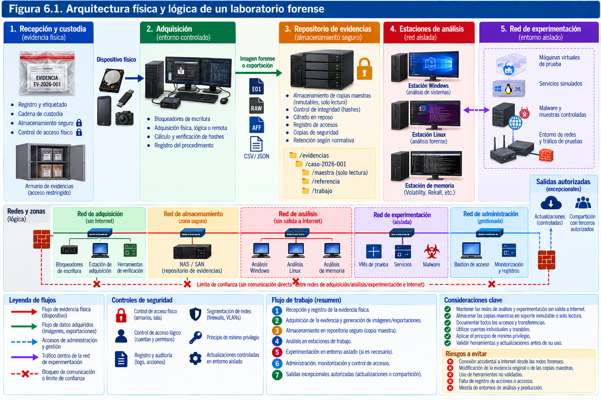
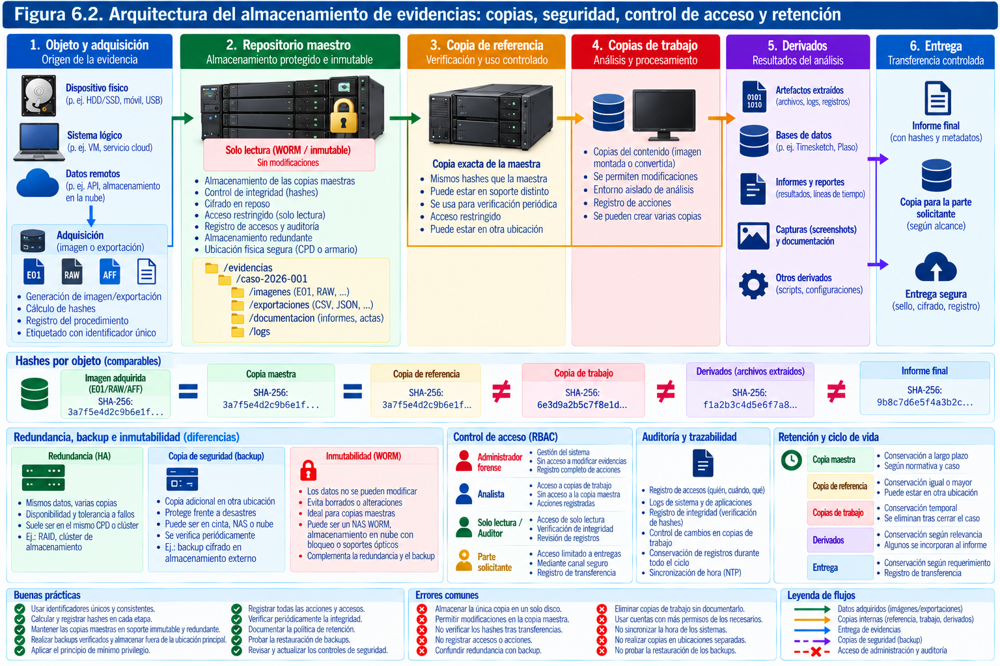
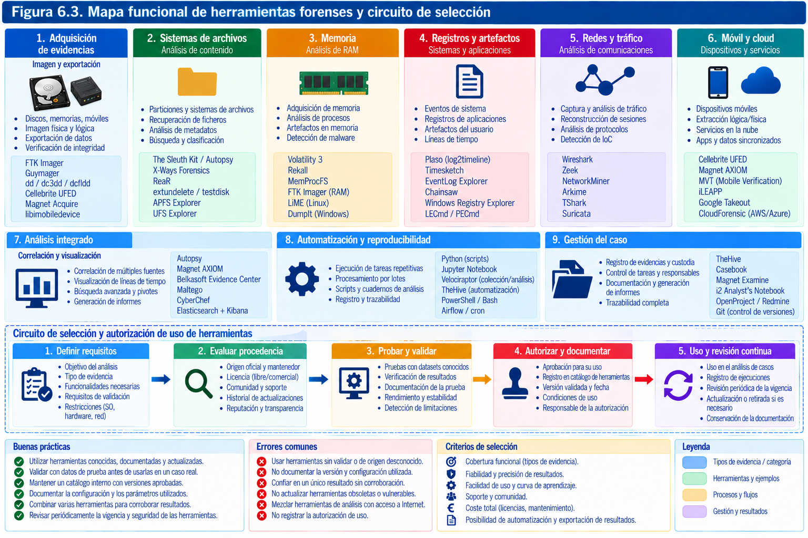
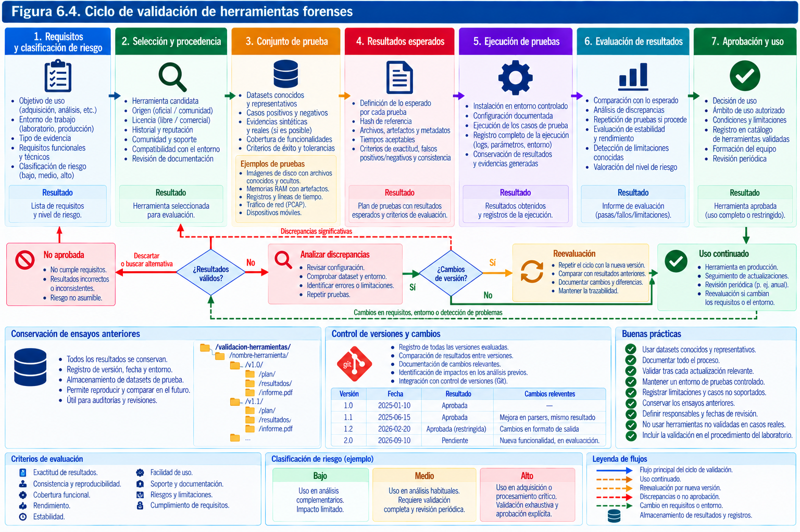
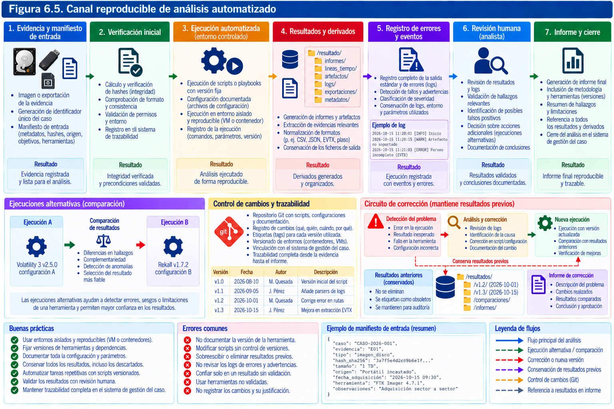
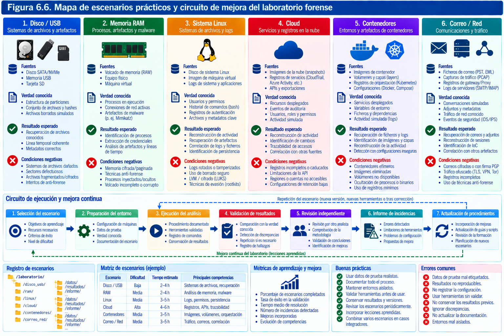

# Preparación del laboratorio forense

> *La fiabilidad de una investigación no comienza cuando el analista abre la primera imagen de disco. Comienza mucho antes: cuando decide qué sistemas utilizará, cómo los comprobará, dónde conservará los datos y de qué modo podrá explicar cada operación realizada.*

El laboratorio forense constituye el espacio técnico y organizativo en el que las evidencias digitales se reciben, preservan, examinan, correlacionan y transforman en resultados documentados. Puede ocupar una instalación física con zonas de acceso restringido, estar distribuido entre varias sedes o apoyarse parcialmente en infraestructuras virtuales. Su carácter forense, sin embargo, no depende de la cantidad de ordenadores, de las marcas de las herramientas ni de la apariencia de sus instalaciones. Depende, sobre todo, de la capacidad para trabajar de forma controlada, minimizar modificaciones injustificadas y demostrar de dónde procede cada resultado.

Conviene distinguir desde el principio entre tres realidades que a menudo se confunden. El **almacén de evidencias** conserva los originales y sus representaciones autorizadas; la **infraestructura de examen** proporciona capacidad de cálculo y herramientas para trabajar sobre copias; y el **entorno experimental** permite probar procedimientos, reproducir comportamientos y estudiar hipótesis sin comprometer el material del caso. En un laboratorio pequeño, las tres funciones pueden compartir una sala o determinados equipos, pero no deberían compartir indiscriminadamente permisos, credenciales, redes y directorios de datos.

La preparación no se reduce a instalar aplicaciones. También exige determinar qué perfiles pueden acceder al laboratorio, cómo se incorporan herramientas nuevas, cómo se registran las versiones utilizadas, qué sucede si un soporte presenta errores, quién autoriza la conexión a una red exterior o qué procedimiento se sigue cuando una automatización devuelve resultados inesperados. En otras palabras: además de disponer de capacidad técnica, el laboratorio necesita gobierno y memoria de sus propias actuaciones.

Este capítulo aborda la construcción progresiva de esa capacidad. Primero se estudia el diseño físico y virtual; después, la organización de las estaciones y del almacenamiento; a continuación, las familias de herramientas libres y comerciales y sus criterios de selección. El análisis se completa con un método de validación, una propuesta de automatización trazable y una serie de escenarios reproducibles. No se pretende ofrecer una única arquitectura válida para cualquier organización. Un equipo que atiende investigaciones corporativas urgentes, un laboratorio pericial que recibe dispositivos intervenidos judicialmente y un grupo de investigación que trabaja exclusivamente con conjuntos de datos públicos tienen necesidades distintas. Comparten, no obstante, la obligación de conocer sus capacidades y reconocer sus límites.

La guía NIST SP 800-86 sitúa la organización de las técnicas forenses dentro de la respuesta a incidentes y subraya la necesidad de ajustarse al contexto operativo y jurídico. Las recomendaciones SWGDE y el programa CFTT de NIST aportan, por su parte, criterios útiles para ensayar herramientas y documentar su comportamiento. Ninguna de estas referencias sustituye la evaluación concreta que debe realizar el propio laboratorio: una herramienta contrastada para una función, versión y tipo de datos no queda automáticamente validada para todas sus posibilidades.

## Equipamiento físico y virtual

### Diseñar a partir de las preguntas que debe responder el laboratorio

El primer error de diseño consiste en adquirir equipos antes de definir las investigaciones que deberán atender. Una estación extraordinariamente potente para el análisis de memoria puede resultar poco útil si el laboratorio no dispone de un medio fiable para adquirir discos NVMe. Del mismo modo, un armario repleto de bloqueadores de escritura apenas resuelve un incidente cuyo material principal consiste en registros de identidad alojados en una plataforma SaaS. El inventario de capacidades debe preceder al catálogo de compras.

La planificación comienza por los **casos de uso**: adquisición de ordenadores encendidos y apagados, extracción de dispositivos móviles, análisis de sistemas Windows y Linux, interpretación de memoria volátil, respuesta remota, tráfico de red, servicios cloud, máquinas virtuales o investigación de aplicaciones empresariales. Para cada clase conviene conocer la frecuencia estimada, las dimensiones habituales de los datos, el grado de urgencia, las tecnologías empleadas, los requisitos de autorización y la posibilidad de necesitar especialistas externos.

El segundo elemento es el **volumen de trabajo simultáneo**. No equivale analizar diez casos pequeños a mantener abiertos dos asuntos que contienen decenas de terabytes, numerosos soportes y retenciones prolongadas. La capacidad del laboratorio se mide en una combinación de almacenamiento, rendimiento de entrada y salida, tiempo de procesamiento, personal cualificado y capacidad de conservar evidencias durante años. Si se aumenta uno de esos recursos sin revisar los demás, el cuello de botella simplemente cambia de ubicación.

Resulta útil formular preguntas concretas: ¿puede recibirse un dispositivo sin conectar su contenido a la red corporativa? ¿Existe una ruta para capturar memoria antes de un apagado inevitable? ¿Se puede examinar una imagen E01 sin modificar el original? ¿Cómo se recuperaría una copia de referencia si falla el almacenamiento principal? ¿Dónde quedan las credenciales temporales usadas para una exportación cloud? ¿Es posible reproducir una versión antigua de una herramienta después de una actualización? Cada respuesta condiciona el diseño.

El laboratorio debe diferenciar también la **capacidad declarada** de la **capacidad comprobada**. Tener instalado un programa que anuncia compatibilidad con un formato de disco no equivale a haber demostrado que lo interpreta correctamente en las configuraciones relevantes. Disponer de un hardware de bloqueo de escritura tampoco garantiza que se haya comprobado con la combinación exacta de interfaz, adaptador y firmware prevista. El inventario útil asocia capacidades con procedimientos verificados, no solo con equipos disponibles.

### Zonas físicas y circulación del material

Un laboratorio puede organizarse en zonas con finalidades diferentes, aunque no siempre sea necesario construir divisiones arquitectónicas. Una zona de **recepción** permite registrar la llegada de soportes, identificar su procedencia, fotografiar embalajes y comprobar precintos. El área de **custodia** reserva un espacio controlado para los objetos originales. La zona de **adquisición** concentra interfaces, bloqueadores y equipos que entran en contacto con las fuentes. Por último, el área de **análisis** alberga las estaciones que procesan copias y producen resultados.

La circulación deseable es sencilla de explicar: un objeto se registra, se deposita o se traslada de manera documentada a la zona adecuada, se adquiere siguiendo un procedimiento autorizado y vuelve a una custodia definida. Los resultados digitales siguen un itinerario distinto, a través de repositorios y permisos propios. En algunos casos, el dispositivo original debe permanecer encendido o no puede abandonar su ubicación; entonces la escena, el lugar de custodia y el laboratorio dejan de coincidir. La documentación tiene que reflejar esa excepción en lugar de fingir que todos los objetos han seguido el circuito estándar.

El control físico incluye cerraduras, gestión de llaves o credenciales, registro de visitantes, separación de funciones, protección frente al fuego y daños por agua, acondicionamiento eléctrico y detección de incidentes ambientales. Estos controles no garantizan por sí solos la conservación, pero disminuyen riesgos previsibles. Una interrupción de alimentación durante la escritura de una imagen, por ejemplo, puede dejar un resultado incompleto. Una avería de climatización que provoque temperaturas anómalas puede comprometer estaciones y cabinas de discos. Un inventario sin ubicación actualizada convierte cualquier búsqueda posterior en una investigación dentro de la propia organización.

La electricidad merece especial atención. Un sistema de alimentación ininterrumpida permite cerrar adquisiciones y equipos con seguridad ante cortes breves; no debe interpretarse como autonomía ilimitada. Conviene comprobar su capacidad real bajo carga, su antigüedad, las baterías y el tiempo necesario para detener operaciones. La protección contra sobretensiones, las tomas identificadas y la distribución equilibrada de cargas completan la medida. En instalaciones que trabajan con soportes potencialmente dañados, además, deben existir superficies adecuadas, medios de descarga electrostática cuando proceda y reglas para evitar manipulaciones innecesarias.

La recepción de aparatos húmedos, quemados, con baterías hinchadas o afectados por un accidente requiere un circuito especial de seguridad. La prioridad es proteger a las personas y prevenir daños adicionales. No debe energizarse de forma improvisada un dispositivo que presenta signos de deterioro físico. En determinados casos será razonable derivarlo a una instalación de recuperación especializada, conservando y documentando su estado y las transferencias realizadas.

### Puestos de adquisición, examen y administración

Aunque una misma estación pueda desempeñar varias funciones, es útil distinguir sus perfiles. El **puesto de adquisición** está preparado para conectarse a evidencias físicas con las garantías pertinentes. Puede contar con controladoras y adaptadores SATA, SAS, USB y NVMe, bloqueadores compatibles y herramientas para registrar errores de lectura. Su prioridad es obtener una representación definida de la fuente, no ejecutar indiscriminadamente todas las aplicaciones de análisis.

El **puesto de examen** trabaja principalmente con imágenes, volcados y exportaciones previamente incorporados al caso. Necesita memoria, capacidad de proceso y almacenamiento rápido, especialmente cuando genera índices, recupera archivos eliminados o reconstruye líneas temporales con millones de registros. El **puesto de administración**, finalmente, gestiona permisos, copias de seguridad, actualizaciones del entorno y supervisión. Mantener separadas esas funciones reduce la posibilidad de que una credencial administrativa utilizada cotidianamente comprometa también el repositorio de evidencias.

La separación puede ser física, lógica o mixta. No obliga a comprar un ordenador por cada operación, pero sí a precisar qué usuario y qué proceso pueden acceder a cada recurso. Una estación de análisis no necesita permiso de escritura sobre la copia maestra del caso. Un servidor de informes no debería tener acceso irrestricto a todos los discos intervenidos. Un sistema de actualizaciones puede necesitar conexión a Internet, mientras que una imagen sospechosa debe examinarse en un entorno aislado. El diseño debe reflejar esas diferencias.

Un puesto de recepción no debería utilizar una cuenta personal del analista como mecanismo de auditoría. La identidad individual es necesaria para atribuir acciones, pero los registros deben mantenerse en una infraestructura controlada por la organización y con un procedimiento de conservación independiente del puesto desde el que se trabaja.

### Virtualización y separación de entornos

La virtualización facilita construir laboratorios complejos con recursos limitados. Un hipervisor permite alojar simultáneamente máquinas Windows, Linux y servidores, configurar redes de investigación, realizar instantáneas para pruebas y restablecer escenarios a estados conocidos. Tecnologías como KVM/QEMU, Proxmox VE, Hyper-V o VMware cumplen distintas necesidades; ninguna es por sí misma la plataforma universal del análisis forense. Lo decisivo es comprender sus características, los formatos utilizados y los efectos de sus operaciones sobre los datos.

Conviene separar, al menos, tres familias de máquinas virtuales. Las **máquinas instrumentales** ejecutan aplicaciones de análisis, indexación o correlación. Las **máquinas de experimentación** reproducen comportamientos mediante datos sintéticos o públicos. Las **máquinas de simulación adversarial** pueden generar tráfico, malware de prueba o técnicas controladas de intrusión y requieren un aislamiento más estricto. La etiqueta «laboratorio» no convierte automáticamente en inocua una muestra de código potencialmente dañino.

Una instantánea de máquina virtual no debe confundirse con una imagen forense completa. Puede almacenar diferencias de disco, memoria, estado de dispositivos y metadatos particulares de la plataforma. Su comportamiento depende del hipervisor, de la configuración y del momento de captura. Algunas instantáneas son consistentes a nivel de sistema de archivos; otras no garantizan consistencia transaccional de aplicaciones. Para preservar evidencia procedente de una máquina virtual interesa documentar qué se exportó: disco base, cadena de discos diferenciales, configuración, estado de memoria o una combinación de ellos.

También importa la procedencia del tiempo. Las máquinas invitadas pueden sincronizarse mediante NTP, mediante herramientas del hipervisor, por el reloj del anfitrión o por varias vías a la vez. Suspender y reanudar un invitado puede producir saltos aparentes que alteren el significado de sus registros. Un laboratorio preparado contempla estas características en sus pruebas de interpretación de marcas temporales.

### Topología de red y niveles de confianza

La red del laboratorio no es una simple extensión de la red de la oficina. Debe diseñarse pensando en dos flujos distintos: el de administración de la infraestructura y el de datos potencialmente hostiles obtenidos durante una investigación. Una segmentación razonable puede disponer de una red para gestión del hipervisor y almacenamiento, otra para estaciones de análisis, una para escenarios reproducibles y una zona aislada para ejecutar software o contenidos peligrosos.

El empleo de VLAN ayuda a separar dominios de difusión, pero **una VLAN no constituye por sí sola una barrera completa de seguridad**. Las reglas de enrutamiento y cortafuegos determinan si existe conectividad entre segmentos. El propio hipervisor puede introducir puentes, adaptadores adicionales o funciones de enrutamiento que rompan el aislamiento previsto. Las máquinas con dos interfaces, una hacia la red corporativa y otra hacia el laboratorio, merecen atención especial porque pueden convertirse en rutas involuntarias entre ambas.

Un entorno destinado al análisis estático de archivos no requiere, por principio, acceso a Internet. Cuando una técnica precisa consultar un servicio externo —por ejemplo, recuperar metadatos públicos de un dominio— conviene definir qué datos saldrán del laboratorio y con qué autorización. Subir un archivo evidencial completo a un servicio de análisis en línea puede divulgar datos personales, secretos comerciales o información sometida a reserva. Incluso la búsqueda pública de un hash puede revelar intereses de la investigación o establecer asociaciones no previstas.

En el análisis dinámico de software sospechoso, la salida a Internet debe evaluarse de manera específica. A veces basta una red interna simulada que conteste a peticiones DNS y HTTP sintéticas; otras investigaciones necesitan observar conexiones externas reales. Esa decisión requiere control de destino, registro de tráfico, límites temporales, contención y aprobación del alcance. Una máquina virtual «sin acceso a la LAN» pero con NAT hacia Internet no está aislada: posee conectividad saliente y puede producir consecuencias fuera del laboratorio.



### Dimensionamiento, redundancia y crecimiento

El diseño de capacidad comienza por estimar la cantidad de información que entra y la que produce el proceso de análisis. Una adquisición de un disco de 2 TB puede consumir una cantidad similar de espacio en formato RAW. A ella se suman copias de referencia, índices, bases de datos, archivos recuperados, imágenes de memoria, resultados exportados y versiones de informes. La compresión puede reducir algunos componentes, pero no debe suponerse una tasa fija: el comportamiento depende del tipo de datos, del cifrado, de la compresión previa y del formato de imagen.

Una estimación orientativa puede representarse así:

$$
C_{\mathrm{necesaria}} = C_{\mathrm{evidencias}} + C_{\mathrm{referencias}} + C_{\mathrm{trabajo}} + C_{\mathrm{derivados}} + C_{\mathrm{reserva}}
$$

La expresión no implica que todas las investigaciones deban mantener tres copias de cada objeto ni que cada copia ocupe el mismo espacio. Su propósito es hacer visible el coste que suele ocultarse cuando se compara únicamente la capacidad de los discos intervenidos. La retención legal de casos cerrados puede superar con mucho el tiempo necesario para analizarlos, y el laboratorio debe estimar ambos horizontes por separado.

Además del volumen, importa la velocidad. La adquisición secuencial de un disco grande, la creación simultánea de índices y las consultas aleatorias sobre millones de archivos tienen perfiles de entrada y salida distintos. Un almacenamiento HDD puede resultar adecuado para conservar grandes imágenes de referencia, mientras que los derivados de análisis y las bases de datos se benefician de SSD o NVMe. Esta distinción ayuda a optimizar recursos sin sacrificar las garantías de conservación.

RAID, copias de seguridad e inmutabilidad resuelven problemas diferentes. RAID puede aportar continuidad ante la avería de determinadas unidades, pero no restaura por sí solo archivos borrados, datos cifrados por ransomware ni configuraciones alteradas. La copia de seguridad permite recuperar estados anteriores dentro de sus límites de retención. La inmutabilidad o protección frente a modificación ayuda a resistir ciertas amenazas, aunque requiere comprobar permisos, credenciales y mecanismos de administración. Ninguna de esas medidas constituye por sí sola una cadena de custodia.

El crecimiento debe ser modular. La introducción de un nuevo sistema de archivos, un formato de nube o una familia de dispositivos no debería obligar a rediseñar toda la infraestructura. Un laboratorio maduro conserva procedimientos comunes de identificación, registro y validación, y añade módulos especializados cuando la naturaleza de los casos lo exige.

### Continuidad operativa y fallo previsto

La preparación incluye asumir que algo fallará: una fuente de alimentación, un disco, un cable, una herramienta, la conexión al proveedor cloud o una credencial temporal. El laboratorio debe poder distinguir entre una avería ordinaria y un incidente de integridad de evidencia, y saber cómo reaccionar ante ambos sin ocultar la incidencia. Los errores no documentados son más peligrosos que muchos errores detectados a tiempo.

Un plan elemental contempla la recuperación de los inventarios, el registro de custodia, los procedimientos de trabajo y las claves necesarias para acceder a evidencias cifradas. De nada sirve contar con tres copias de un repositorio si todas dependen de una única cuenta comprometida o de una clave almacenada en el mismo servidor. La recuperación debe ensayarse periódicamente sobre un conjunto de prueba y registrarse, no limitarse a la presencia de una tarea programada que informa de «copia realizada».

Conviene reservar capacidad alternativa para operaciones urgentes: un puesto secundario, adaptadores de repuesto, soportes vacíos identificados, acceso a otro laboratorio o un contrato de recuperación especializada. La contingencia no debe consistir en improvisar el uso de cualquier ordenador disponible. Cuanto mayor sea la presión de tiempo, más necesaria resulta una infraestructura conocida.

## Estaciones de trabajo y almacenamiento de evidencias

### La estación como parte de la cadena técnica

En una investigación, la estación de análisis no es un elemento neutro. Su sistema operativo decide cómo se enumeran los dispositivos, sus controladores interpretan protocolos, sus bibliotecas leen formatos y sus aplicaciones generan resultados. Una modificación de la configuración puede alterar una adquisición o una interpretación aunque el analista ejecute aparentemente el mismo procedimiento. Por esta razón, las estaciones deberían inventariarse como instrumentos de trabajo y no solo como ordenadores de propósito general.

La ficha técnica de una estación incluye identificador del equipo, componentes relevantes, sistema operativo, versión y nivel de actualización, interfaces de almacenamiento, herramientas instaladas, controladores especiales y cambios conocidos. Para una operación concreta no siempre será necesario consignar todos esos elementos en el informe final, pero sí debe ser posible reconstruir el entorno utilizado cuando una discrepancia lo haga relevante. Si una herramienta produjo un fallo que desaparece al cambiar de versión del controlador NVMe, esa dependencia es parte de la explicación técnica.

La estandarización facilita el mantenimiento. Contar con un número reducido de imágenes maestras de sistema operativo, configuraciones conocidas y procedimientos de puesta en servicio disminuye la diversidad accidental entre estaciones. La estandarización no debe conducir, sin embargo, a imponer el mismo entorno para toda clase de evidencias. Algunas adquisiciones requieren Windows por compatibilidad con controladores, otras se realizan mejor en Linux y ciertos análisis necesitan versiones concretas de macOS o herramientas de un fabricante. La solución no es una estación universal imaginaria, sino un catálogo controlado de entornos especializados.

En las estaciones utilizadas para procesar archivos potencialmente maliciosos deben aplicarse medidas adicionales. Es preciso limitar las credenciales, deshabilitar servicios innecesarios, controlar dispositivos USB y evitar que el contenido de evidencia se abra automáticamente con aplicaciones capaces de ejecutar macros, previsualizadores vulnerables o complementos no comprobados. Una vista previa gráfica también es software que procesa datos no confiables y, por tanto, puede representar una superficie de ataque.

### Memoria, CPU, GPU y rendimiento efectivo

El número de núcleos y la cantidad de memoria influyen en el rendimiento, pero no de manera uniforme. El análisis de una imagen pequeña con unos pocos registros no necesita una estación de gama extrema. En cambio, indexar varios terabytes, descomprimir colecciones grandes, procesar fotografías o construir una línea temporal global puede requerir cantidades importantes de RAM y numerosas operaciones de disco. La capacidad de memoria reduce la paginación, pero no sustituye un almacenamiento rápido ni corrige una herramienta que escala mal.

Las tareas se benefician de recursos diferentes. Algunas son secuenciales y están limitadas por la velocidad de lectura. Otras distribuyen el trabajo entre núcleos, mientras que ciertas operaciones criptográficas aprovechan instrucciones específicas de la CPU. Una GPU puede acelerar funciones concretas, por ejemplo determinados procesos de reconocimiento, clasificación o recuperación autorizada de contraseñas, pero no hace automáticamente más rápido cualquier análisis. Cada mejora de hardware debería justificarse mediante una medida reproducible, no solo por especificaciones comerciales.

Para dimensionar una estación es preferible ensayar una carga representativa. Puede prepararse un conjunto sintético de archivos, una imagen de prueba de varios tamaños y una colección de eventos conocida. Se mide el tiempo de extracción, la memoria máxima utilizada, las tasas de lectura y escritura, el número de errores y el espacio temporal necesario. Después se varía un recurso cada vez. Si duplicar la RAM no altera el tiempo porque el almacenamiento alcanza su límite, la inversión prioritaria está en otro componente.

En laboratorio forense, la rapidez es importante, pero no debe conseguirse ocultando errores o descartando verificaciones. Un procesamiento que termina antes porque omite archivos dañados sin avisar no constituye una mejora. La métrica principal debe combinar **tiempo, cobertura, integridad y explicabilidad**.

### Sistemas operativos de trabajo

No existe una obligación técnica de que todos los investigadores utilicen el mismo sistema operativo. Windows concentra numerosas suites comerciales y herramientas especializadas. Linux ofrece un entorno flexible para montaje controlado de imágenes, automatización, análisis de sistemas de archivos y procesamiento masivo de registros. macOS puede ser necesario para determinados procedimientos de análisis o reproducción de artefactos propios de su ecosistema. La elección responde a requisitos verificables de adquisición, compatibilidad, soporte y seguridad.

En Linux, una diferencia fundamental es la que existe entre **detectar un dispositivo** y **montar automáticamente su sistema de archivos**. Un soporte puede ser reconocido por el núcleo sin que todavía se haya accedido a su contenido en la forma pretendida. Los servicios de escritorio que realizan montajes automáticos, indexación o generación de miniaturas pueden interferir en un entorno de adquisición. Por eso conviene deshabilitar comportamientos automáticos relevantes, comprobar el estado de montaje y trabajar con bloqueadores o procedimientos validados cuando la fuente es original.

Los siguientes comandos sirven para inventariar una estación Linux y sus dispositivos, no para demostrar por sí mismos que existe protección forense:

```bash
uname -a
lsblk -o NAME,SIZE,MODEL,SERIAL,RO,TYPE,MOUNTPOINTS
findmnt
lsusb
lspci
```

El atributo `RO` mostrado por `lsblk` resulta útil para diagnóstico, pero no es una certificación de inalterabilidad del soporte ni sustituye las pruebas de protección frente a escritura. Asimismo, el uso de `sudo` no convierte una operación en forense; solo la ejecuta con mayores privilegios, lo que exige más cautela.

Una práctica recomendable es mantener una ficha de arranque que registre la versión de la distribución, el núcleo, las bibliotecas y las herramientas empleadas. Las actualizaciones de seguridad deben planificarse, pero cuando introducen cambios relevantes es necesario comprobar nuevamente las funciones forenses afectadas. Aplazar indefinidamente todas las actualizaciones crea riesgos propios; actualizarlas sin control puede romper reproducibilidad. Ambos extremos son evitables mediante gestión de versiones y pruebas.

### Modelos de almacenamiento y separación entre originales y derivados

La distinción entre objeto físico, adquisición, copia de referencia, copia de trabajo y producto analítico debe traducirse en una estructura de almacenamiento comprensible. Una imagen recibida de una autoridad, un fichero E01 generado por el laboratorio y una carpeta exportada desde un proveedor SaaS pueden tener naturalezas diferentes, pero deben poder integrarse en un mismo expediente sin perder su procedencia.

Puede organizarse un caso mediante zonas lógicas:

```text
CASO-2026-014/
├── 00-administracion/
│   ├── autorizaciones/
│   ├── inventario/
│   └── custodia/
├── 01-originales-digitales/
│   ├── ADQ-001/
│   └── ADQ-002/
├── 02-referencia/
│   ├── ADQ-001/
│   └── ADQ-002/
├── 03-trabajo/
│   ├── analista-a/
│   └── analista-b/
├── 04-derivados/
│   ├── artefactos/
│   ├── cronologias/
│   └── informes-de-herramientas/
├── 05-validacion/
├── 06-informe/
└── manifiestos/
```

La estructura es ilustrativa y no debe copiarse literalmente a todos los casos. Algunas organizaciones mantienen los originales digitales en un repositorio independiente, gestionado por un sistema de evidencias, y solo exponen referencias lógicas en el expediente. Otras almacenan los derivados en bases de datos o sistemas de objetos. Lo importante es que la ubicación no sustituya al identificador y que el mecanismo de vinculación entre elementos no dependa exclusivamente del nombre de una carpeta.

Una política de denominación evita ambigüedades. Por ejemplo, `OBJ-014-03` puede identificar el soporte intervenido; `ADQ-014-03-A` la primera adquisición de ese soporte; `REF-014-03-A-01` una copia de referencia verificada, y `TRB-014-03-A-02` una copia destinada a examen. Los identificadores no se deben reciclar después de un error. Si se repite una adquisición, el nuevo resultado merece un identificador propio y una relación explícita con el anterior.

La copia maestra o adquisición inicial se protege frente a modificaciones; la referencia puede conservarse para comprobaciones periódicas; la copia de trabajo se utiliza para extraer artefactos e incorporar resultados. No todas las herramientas interpretan del mismo modo una imagen segmentada o un volumen descifrado, y una copia transformada puede no conservar exactamente la misma secuencia de bytes que su origen. En esos casos deben registrarse los objetos comparables y el procedimiento de transformación.

### Control de acceso y principio de mínimo privilegio

El acceso al repositorio debe basarse en la función que desempeña cada persona y en su participación autorizada en un caso. No es necesario que todos los miembros del laboratorio puedan examinar todas las evidencias. La separación por expediente y por clase de recurso disminuye el riesgo de consulta improcedente, alteración accidental y divulgación. Un investigador puede necesitar lectura de una copia de trabajo y escritura sobre su carpeta de resultados, pero no permisos para eliminar originales o alterar registros de custodia.

Los permisos convencionales de un sistema de archivos constituyen la primera línea, no la única. Es aconsejable controlar cuentas privilegiadas, accesos remotos, autenticación multifactor cuando resulte viable, cuentas de servicio y credenciales para aplicaciones que indexan repositorios. La cuenta técnica que ejecuta una tarea automática debe tener acceso solamente a las entradas y salidas necesarias. Su actividad debe quedar asociada a la ejecución específica, no confundida con la identidad de la persona que revisa los resultados.

La protección de originales requiere un enfoque por capas: permisos, almacenamiento que impida o dificulte modificaciones, registro de accesos, verificaciones de integridad y procedimientos de restauración. El almacenamiento de tipo WORM o la retención inmutable de objetos puede aportar garantías adicionales, pero hay que estudiar quién puede modificar las políticas, borrar claves, cambiar la retención o administrar el sistema. La posibilidad de que un administrador con privilegios excepcionales altere la configuración forma parte del modelo de amenaza.

Un sistema de auditoría no cumple su función si sus registros pueden ser modificados sin rastro por la misma cuenta que realiza las operaciones analizadas. Cuando sea posible, los eventos deben remitirse a un destino separado, con acceso restringido y política de retención conocida. No todos los laboratorios necesitarán un SIEM completo, pero todos deberían poder responder quién accedió a una evidencia relevante, cuándo y para qué operación.

### Integridad, copias de seguridad y recuperación

La verificación de integridad de los contenidos digitales se apoya habitualmente en funciones hash como SHA-256. Su uso debe ser preciso. Un hash identifica una secuencia concreta de bytes: si se calcula sobre un contenedor EWF, no tiene por qué coincidir con el hash del flujo de bloques reconstruido ni con el de cada segmento E01, E02 y sucesivos. Registrar solo «hash de la imagen» sin aclarar el objeto puede generar una falsa apariencia de discrepancia.

Para un archivo ordinario de laboratorio, la comprobación puede ejecutarse con:

```bash
sha256sum muestra_prueba.bin
sha256sum -c muestra_prueba.bin.sha256
```

La segunda instrucción presupone que se ha preparado previamente un archivo de comprobación con el nombre y formato adecuados. La equivalencia entre dos valores no certifica la autenticidad de la fuente, la legalidad de la obtención, la exhaustividad de la adquisición ni la ausencia de errores de interpretación. Es una propiedad de integridad aplicada a los bytes comparados.

Las comprobaciones periódicas deben estar justificadas por el riesgo y el sistema de almacenamiento. Un repositorio con detección de corrupción a nivel de bloques, redundancia y vigilancia activa puede adoptar una estrategia distinta de un conjunto de discos externos desconectados. En cualquier caso, interesa documentar fecha, herramienta, objeto examinado, valor esperado, valor obtenido, resultado y tratamiento de excepciones. La discrepancia no debe desaparecer del histórico porque una copia de respaldo permita sustituir el archivo.

La copia de seguridad del repositorio se diseña a partir de objetivos definidos de recuperación. El *recovery point objective* (RPO) expresa la pérdida de datos tolerable medida en tiempo; el *recovery time objective* (RTO), el plazo que se pretende para restaurar el servicio. Ambos conceptos proceden de continuidad de negocio y deben adaptarse al valor de las evidencias. Un RPO de 24 horas puede ser inaceptable para registros de custodia o adquisiciones que no pueden repetirse. Además, hay situaciones en las que no existe una adquisición recuperable fuera del sistema principal, de modo que el riesgo no se reduce a un número abstracto.

El laboratorio debe ensayar restauraciones sobre un espacio separado. La prueba debe comprobar tanto la recuperación de los contenidos como la de su identidad, metadatos y permisos. Recuperar un archivo sin los manifiestos que explican su procedencia puede preservar los bytes, pero empobrecer gravemente su valor operativo y probatorio.

### Cifrado, claves y tratamiento de información sensible

El cifrado en reposo protege frente a ciertos accesos no autorizados al almacenamiento. El cifrado de transporte reduce la exposición durante transferencias entre estaciones y repositorios. Ambos requieren gestión cuidadosa de claves, copias de recuperación y separación de funciones. En un laboratorio, perder una clave de cifrado puede equivaler a perder el acceso a un conjunto irremplazable de evidencias; conservar todas las claves junto a las propias evidencias puede anular buena parte de la protección.

Conviene distinguir entre claves de infraestructura, claves utilizadas para abrir evidencias cifradas y credenciales temporales de proveedores cloud. Pertenecen a ciclos de vida diferentes. Las primeras sostienen el servicio, las segundas pueden constituir material relacionado con el caso y las terceras quizá deban revocarse al terminar una exportación. Su gestión debe quedar regulada sin escribirlas innecesariamente en bitácoras, comandos visibles, capturas de pantalla o repositorios de código.

Los conjuntos de evidencia contienen con frecuencia datos no relacionados con el objeto de la investigación. La capacidad técnica de consultar una carpeta no implica autorización para revisar todo su contenido. El almacenamiento debe permitir aplicar segmentación por caso, registro de accesos y medidas de minimización en los derivados e informes. Cuando una revisión produce extractos de correos, historiales médicos o documentos personales ajenos al objeto investigado, el laboratorio debe poder controlar su circulación y los destinatarios autorizados.

Para compartir resultados, una alternativa es elaborar paquetes de entrega que contengan únicamente los archivos necesarios, manifiestos de integridad, explicación metodológica y un registro de salida. No se debe sustituir esta selección razonada por una copia completa del directorio de trabajo. Las exportaciones automáticas merecen revisiones específicas para detectar rutas absolutas, nombres de usuario, tokens, claves o comentarios internos inadvertidamente incluidos.

### Capacidad de almacenamiento y política de retención

Un almacenamiento de evidencias no puede administrarse como un directorio temporal del que se borran los casos más antiguos cuando falta espacio. La retención se vincula a la finalidad, el régimen jurídico aplicable, las obligaciones contractuales y las instrucciones de la autoridad o responsable competente. Los plazos pueden diferir entre el soporte original, la adquisición, los archivos de trabajo, la información de auditoría y el informe definitivo.

Por tanto, cada expediente necesita un estado: abierto, pendiente de revisión, entregado, sometido a conservación extraordinaria, cerrado o sujeto a eliminación autorizada, entre otros. La transición de estados debe registrarse. La supresión de un derivado que ya no resulta necesario puede ser legítima, mientras que eliminar un original sometido a una orden de conservación sería gravísimo. La automatización del almacenamiento debe conocer esa diferencia.

Los equipos de análisis suelen acumular datos intermedios que pueden ser especialmente sensibles: índices que contienen fragmentos de textos, bases de datos de palabras clave, miniaturas, cachés, ficheros temporales y resultados de herramientas. Una política de retención que solo mencione imágenes E01 y documentos PDF deja fuera una parte importante de la información del caso. La limpieza del espacio de trabajo requiere identificar primero los derivados y comprobar qué otros procesos los necesitan.

El almacenamiento también envejece. Las tecnologías, interfaces y formatos cambian. Una evidencia que deba conservarse durante años necesita una estrategia de migración controlada para evitar dependencia de hardware obsoleto o de una aplicación sin soporte. Migrar no significa reinterpretar: cuando sea posible, se preservan los bytes originales y los metadatos de custodia; la transformación necesaria se registra como un nuevo derivado y no como una modificación silenciosa del original.



### Ejemplo de diseño: dos laboratorios, dos escalas

Imaginemos un laboratorio pequeño con dos analistas y un volumen moderado de casos. Puede disponer de un puesto de adquisición dedicado, dos estaciones de análisis, almacenamiento central con permisos por expediente, copia de seguridad fuera de línea y una plataforma de virtualización para pruebas. Su prioridad es documentar correctamente las intervenciones y disponer de procedimientos validados para las técnicas más utilizadas. No necesita replicar la infraestructura de una unidad nacional de investigación para actuar con rigor.

Una unidad de mayor tamaño quizá requiera varios puestos de adquisición, capacidad para procesar simultáneamente evidencias de móviles y ordenadores, sistemas de indexación distribuida, almacenamiento con niveles de rendimiento, administración central de identidades y repositorios sometidos a retenciones diferenciadas. La complejidad trae ventajas de escala, pero también nuevas dependencias: versiones coordinadas, colas de trabajo, control de recursos compartidos y una auditoría capaz de reconstruir qué nodo ejecutó cada operación.

En ambos casos, la pregunta correcta es la misma: ¿puede reconstruirse el camino desde la fuente hasta el hallazgo sin recurrir a suposiciones sobre el comportamiento del entorno? Si la respuesta es negativa, el laboratorio necesita corregir su arquitectura o sus procedimientos, con independencia de que cuente con dos o doscientas máquinas.

## Herramientas forenses libres y comerciales

### La herramienta como medio, no como garantía

La elección de una herramienta forense suele comenzar por una pregunta incorrecta: cuál es «la mejor». Sin especificar la tarea, el tipo de evidencia, la versión de formato, los requisitos jurídicos y los recursos disponibles, la pregunta no tiene una respuesta útil. Un programa puede ser excelente para examinar una imagen NTFS y resultar inadecuado para adquirir un teléfono de última generación. Otro puede crear un informe visual convincente sin proporcionar suficiente información sobre el origen de determinados campos. Las capacidades no se comparan mediante una calificación global, sino función por función.

La herramienta tampoco sustituye el razonamiento. Un artefacto señalado como «ejecución de programa» necesita interpretarse de acuerdo con la fuente que lo produjo, la versión del sistema operativo y las condiciones conocidas de generación. Un evento marcado como «archivo eliminado» puede provenir de una operación del usuario, de sincronización, de mantenimiento automático o de una aplicación. Ninguna interfaz gráfica elimina la obligación de comprobar qué significa realmente el dato.

Las aplicaciones comerciales suelen aportar interfaces integradas, soporte contratado, conectores específicos y funciones que reducen tiempos en determinados flujos de trabajo. Las herramientas libres ofrecen transparencia de código en muchos proyectos, posibilidad de automatización, ausencia de ciertas dependencias de licencia y capacidad de especialización. Ninguna de las dos categorías es inherentemente más fiable. La transparencia de código no garantiza que se haya auditado correctamente; el carácter comercial no constituye validación independiente.

Lo prudente es construir una **cartera de herramientas**: soluciones principales para tareas frecuentes, herramientas secundarias para corroboración y utilidades especializadas para casos concretos. La cartera debe mantenerse como un inventario vivo, con versiones, fuentes oficiales, procedimientos comprobados, restricciones de licencia, responsables y resultados de las pruebas locales.

### Familias de herramientas y funciones

Las aplicaciones de **adquisición** realizan imágenes de dispositivos o extraen conjuntos de datos. Deben seleccionarse atendiendo a interfaces, formatos, gestión de errores, registro de parámetros y mecanismos de verificación. En este grupo pueden aparecer utilidades de línea de comandos, sistemas especializados de imagen y aplicaciones gráficas. El capítulo anterior explicó que no todas las adquisiciones tienen la misma cobertura: una imagen de bloques, una exportación lógica y un paquete devuelto por una API son objetos distintos.

Las herramientas de **análisis de sistemas de archivos** interpretan particiones, directorios, metadatos, estructuras internas y contenido. *The Sleuth Kit* proporciona utilidades de línea de comandos y bibliotecas para estas funciones, mientras que *Autopsy* ofrece un entorno gráfico extensible para investigaciones. Pueden combinarse para contrastar resultados, pero compartir componentes internos exige cuidado: dos interfaces basadas en la misma biblioteca no representan necesariamente una corroboración independiente.

La **informática forense de memoria** requiere otro tipo de instrumentación. Volatility 3 permite extraer e interpretar artefactos de determinados sistemas a partir de volcados de memoria. Su comportamiento depende del sistema de origen, la disponibilidad de símbolos, el complemento utilizado y el estado del volcado. Un proceso que no aparece en una salida no puede considerarse inexistente sin estudiar la cobertura y las limitaciones del método. La ausencia de hallazgos tampoco equivale automáticamente a ausencia de actividad sospechosa.

El análisis de **registros y líneas temporales** puede apoyarse en Plaso, cuyos componentes `log2timeline` y `psort` permiten extraer y procesar eventos, y en Timesketch, orientado a explorar cronologías colaborativamente. En ambos casos es esencial conservar la referencia a las fuentes, el significado de las marcas temporales y los filtros aplicados. El volumen de eventos que una herramienta representa gráficamente puede inducir una apariencia de precisión mayor que la disponible en los registros originales.

Las herramientas de **redes** como Wireshark y sus utilidades asociadas permiten inspeccionar capturas de paquetes y reconstruir determinados intercambios. Su cobertura depende de dónde se obtuvo la captura, qué tráfico atravesó el punto de observación, qué protocolos se reconocen y cuánto contenido está cifrado. Un PCAP capturado en un tramo de la red no constituye una imagen completa de toda la comunicación del sistema.

Para **respuesta remota y recopilación de artefactos**, Velociraptor proporciona un modelo basado en consultas y artefactos sobre equipos, incluyendo mecanismos de recogida mediante clientes y colectores preparados para actuar sin comunicación continua con un servidor. Estos procedimientos son útiles en incidentes distribuidos, pero pueden modificar el equipo de origen, consumir recursos y producir registros nuevos. El inventario de efectos previstos y la autorización forman parte de su puesta en servicio.

Hay herramientas de **análisis de malware** que examinan metadatos, importaciones, cadenas y estructuras de ejecutables, otras observan el comportamiento en ejecución y otras ayudan a aplicar reglas YARA. El laboratorio debe distinguir análisis estático, instrumentación y ejecución controlada. Abrir una muestra en un visor hexadecimal no plantea el mismo riesgo que ejecutarla en una máquina virtual con acceso de red. Cada técnica requiere una zona y un procedimiento acordes con su riesgo.

Por último, existen herramientas de **gestión del caso, informes y administración**. Su función no consiste en descubrir artefactos, sino en mantener la identidad de los objetos, asignar tareas, documentar revisiones y generar entregables. Una hoja de cálculo, un gestor documental o un repositorio Git pueden aportar valor en determinadas tareas, siempre que su uso cumpla los requisitos de confidencialidad, control de cambios y retención del expediente. No deben introducirse automáticamente datos sensibles del caso en plataformas externas por la comodidad de disponer de colaboración.

### Un catálogo orientativo y sus límites

El siguiente cuadro identifica ejemplos representativos, no una clasificación exhaustiva ni una recomendación comercial. Las funcionalidades concretas dependen de la edición, el sistema operativo, las licencias y la versión instalada.

| Familia | Ejemplos | Utilidad principal | Cautela de validación |
|---|---|---|---|
| Sistemas de archivos | The Sleuth Kit, Autopsy | Interpretación de imágenes, metadatos y archivos | Comprobar sistema de archivos y artefactos admitidos |
| Memoria | Volatility 3 | Extracción e interpretación de estructuras de RAM | Verificar símbolos, sistema y complementos |
| Cronologías | Plaso, Timesketch | Extracción, filtrado y correlación de eventos | Preservar zonas horarias, procedencia y filtros |
| Redes | Wireshark, TShark | Inspección de PCAP y protocolos | Estudiar punto de captura y tráfico no observable |
| Recopilación remota | Velociraptor | Colección estructurada de artefactos | Evaluar impacto en el equipo y cobertura del colector |
| Imágenes y examen integrado | FTK Imager, X-Ways Forensics, EnCase | Adquisición, examen y determinadas funciones integradas | Probar funciones y formatos efectivamente utilizados |
| Análisis integrado y correlación | Magnet AXIOM, Belkasoft X | Examen de distintas fuentes y presentación de resultados | Revisar interpretación de artefactos y trazabilidad |
| Entornos de investigación | SIFT Workstation, CAINE, REMnux | Paquetes y utilidades especializadas | Confirmar versiones incluidas y uso previsto |
| Análisis programático | Python, bibliotecas especializadas, consultas SQL | Extracción y tratamiento automatizado | Ensayar con datos conocidos y guardar el código exacto |

El hecho de que una aplicación figure en el catálogo NIST de herramientas no significa que haya sido probada ni certificada por NIST: el propio catálogo advierte que parte de la información procede del desarrollador. Los **informes de ensayo CFTT**, cuando existen para la herramienta y función pertinente, ofrecen una base de evaluación más específica. Aun así, el laboratorio debe comprobar que el entorno, la versión y las condiciones de uso coinciden razonablemente con aquellas de las pruebas publicadas.

Para el análisis móvil, cloud o de aplicaciones, la compatibilidad puede cambiar con rapidez. Es preferible evitar expresiones como «permite extraer todos los mensajes» o «recupera toda la actividad de un usuario». Los fabricantes incorporan y retiran soporte, los proveedores modifican APIs y los sistemas operativos alteran sus esquemas de almacenamiento. Una evaluación seria precisa fecha, combinación de versiones y resultado de pruebas representativas.

### Selección basada en requisitos medibles

Imaginemos que el laboratorio debe seleccionar una herramienta para examinar imágenes E01 de estaciones Windows. El proceso empieza estableciendo criterios: capacidad de abrir las imágenes utilizadas por la organización, comprobar sus segmentos, recuperar estructura de volúmenes, exportar archivos con sus metadatos, generar una cronología, conservar referencias al origen y producir registros de errores. Se añade la posibilidad de operar sin acceso a Internet, el coste de la licencia y las condiciones del soporte.

No todos los criterios tienen el mismo peso. La capacidad de presentar miniaturas de forma atractiva puede mejorar el trabajo, pero no compensa que el programa interprete incorrectamente un campo temporal crítico. Un modelo sencillo puede diferenciar requisitos imprescindibles, deseables y secundarios. Los imprescindibles se ensayan primero y funcionan como condiciones de aceptación. Solo después tiene sentido comparar comodidad, rendimiento o coste.

La selección debería considerar la **explicabilidad**. Una herramienta que permite exportar el archivo bruto, mostrar su ruta dentro de la imagen, indicar el parser aplicado y reproducir una consulta ofrece mayor capacidad de revisión que otra que presenta un único indicador sin fundamento accesible. Esto no obliga a descartar aplicaciones que abstraen mucha complejidad, pero sí a conocer qué partes pueden verificarse independientemente.

Es especialmente importante examinar el **modelo de dependencia** de los resultados. Si dos productos incorporan el mismo motor de interpretación, su coincidencia aporta menos independencia que si utilizan implementaciones diferentes. Si ambos leen una exportación ya transformada por un tercero, quizá estén corroborando únicamente el resultado de esa transformación, no la fuente original. La independencia no se mide por el número de ventanas abiertas, sino por la diversidad efectiva de procesos y observaciones.

### Versiones, firmas y procedencia del software

La instalación de herramientas debe seguir un procedimiento controlado. Conviene obtener los paquetes de fuentes oficiales, conservar referencias de descarga y verificar firmas o valores hash cuando el proyecto los publica por un canal confiable. También interesa guardar la versión exacta, la compilación, los módulos adicionales y las dependencias relevantes. Un archivo ejecutable llamado `forensic_tool.exe` no constituye una identificación suficiente.

Algunas soluciones descargan símbolos, módulos, firmas o reglas durante su uso. Ese comportamiento puede alterar resultados entre ejecuciones si no se controla. Es aconsejable conservar una instantánea del conjunto de reglas o de la versión del paquete utilizado, con su procedencia. En un análisis de memoria, por ejemplo, disponer de símbolos adecuados es esencial para interpretar determinadas estructuras; registrar solamente «se ejecutó Volatility» omite información crítica.

Los contenedores de software son útiles para fijar dependencias, pero la referencia a una etiqueta mutable como `latest` no permite reconstruir una ejecución pasada. Si se usa una imagen de contenedor, conviene registrar su identificador inmutable o digest, la configuración relevante, los volúmenes montados y los parámetros de ejecución. En los contenedores con acceso a imágenes evidenciales, además, los montajes en solo lectura deben comprobarse, no darse por supuestos.

Una solución comercial puede incorporar actualizaciones silenciosas, servicios en la nube o módulos que se activan por licencia. Es necesario conocer esas dependencias antes de instalarla en estaciones conectadas a evidencias sensibles. La comodidad operativa no justifica perder la capacidad de explicar qué versión o qué modelo de análisis produjo una conclusión determinada.

### Herramientas auxiliares y riesgo de interpretación

Parte del trabajo se realiza con utilidades generales: editores hexadecimales, intérpretes de Python, lectores de SQLite, motores de búsqueda, herramientas de compresión, conversores de fecha y clientes de bases de datos. Su condición de herramienta no especializada no las invalida para uso forense. Sin embargo, hay que comprender sus efectos y comprobar que la transformación efectuada conserva la información relevante.

Una consulta SQL puede devolver filas correctas y a la vez omitir registros que no satisfacen un filtro mal diseñado. Un conversor de fecha puede interpretar una marca temporal como segundos desde 1970 cuando en realidad usa otra época o unidad. Un programa de extracción puede normalizar finales de línea o sustituir caracteres no representables. Si el analista no registra esas decisiones, el resultado puede parecer originario de la evidencia cuando en realidad es un producto transformado.

Por esta razón, un laboratorio debería conservar los datos fuente, las reglas o consultas aplicadas y el resultado de su ejecución. La salida visual puede ser el medio más claro para presentar un hallazgo, pero la posibilidad de reproducirlo descansa en la disponibilidad de los elementos anteriores.



### Cuando ninguna herramienta resuelve por completo el problema

Las investigaciones reales contienen formatos desconocidos, aplicaciones propietarias y datos parcialmente corruptos. Una herramienta puede reconocer parte de una estructura sin comprender la totalidad de sus campos. En vez de forzar una interpretación mediante aproximaciones invisibles, el analista debe delimitar el resultado parcial y plantear técnicas complementarias: análisis de cabeceras, inspección hexadecimal, reproducción experimental, documentación del fabricante o comparación con muestras conocidas.

En ocasiones será preferible desarrollar un parser específico. Esa decisión incrementa el control sobre el tratamiento de los datos, pero también la responsabilidad de probar el código. El resultado de un script propio no adquiere fiabilidad por estar escrito en Python ni la pierde por no proceder de un fabricante. Su fiabilidad dependerá de los casos de prueba, la cobertura conocida, la revisión independiente y la posibilidad de reproducir la transformación.

El catálogo de herramientas del laboratorio debe contener también **limitaciones conocidas**. Registrar que una versión interpreta incorrectamente ciertos valores, que un complemento falla con determinados archivos o que una función necesita permisos adicionales puede ahorrar horas y evitar conclusiones defectuosas. Un historial de incidencias técnicas, compartido internamente sin divulgar datos innecesarios de casos, es una forma de conocimiento acumulado.

## Validación de herramientas

### Qué significa validar y qué no significa

La validación es una de las diferencias más importantes entre un laboratorio capaz de producir resultados convincentes y un laboratorio capaz de defenderlos. Validar no consiste en abrir una aplicación, comprobar que arranca y guardar una captura de pantalla. Tampoco se reduce a calcular el hash del instalador ni a confirmar que un fabricante anuncia soporte para un formato. Se trata de reunir evidencia objetiva, mediante ensayos apropiados, de que un procedimiento o herramienta funciona de manera adecuada **para el uso previsto y dentro de condiciones conocidas**.

Conviene diferenciar varias actividades. La **verificación de instalación** confirma que la herramienta recibida y su entorno coinciden con lo esperado. La **comprobación funcional** permite observar si realiza una operación concreta. La **validación del método** pretende demostrar que ese procedimiento es apto para su finalidad; cuando una organización usa el término *validación de herramienta*, normalmente se refiere a comprobar funciones y límites aplicables al trabajo previsto. La **verificación de resultados de un caso** contrasta salidas concretas con la evidencia y, cuando procede, con técnicas independientes. Son actividades relacionadas, pero no intercambiables.

El programa Computer Forensics Tool Testing (CFTT) del NIST constituye una referencia relevante: establece especificaciones funcionales, procedimientos, criterios y conjuntos de prueba para evaluar herramientas. La documentación SWGDE, especialmente *Minimum Requirements for Testing Tools Used in Digital and Multimedia Forensics*, propone pruebas mínimas según categorías y riesgos. Sus recomendaciones no implican que todas las herramientas deban ensayarse de idéntica manera, ni que un resultado favorable cubra cualquier versión o configuración.

La norma ISO/IEC 17025:2017, aplicable a la competencia y funcionamiento consistente de laboratorios de ensayo y calibración, puede servir como marco general de calidad en ámbitos pertinentes. No debería afirmarse que utilizar una herramienta verificada convierte automáticamente a un laboratorio en acreditado, ni que todos los laboratorios forenses digitales estén necesariamente sujetos a los mismos requisitos de acreditación. Cualquier declaración formal debe relacionarse con el alcance concreto de la acreditación, la entidad evaluadora y la normativa aplicable.

### Riesgo, criticidad y profundidad de la prueba

El esfuerzo de validación debe ser proporcional a las consecuencias de un error. Una herramienta que permite inspeccionar de forma auxiliar una cadena de texto plantea riesgos distintos de otra que escribe sobre la fuente durante una adquisición. La segunda puede destruir información irrecuperable; por ello necesita controles de mayor rigor antes de utilizarse sobre originales.

Es posible clasificar las herramientas en función de su intervención. Las de **protección y adquisición** pueden afectar directamente al soporte o determinar qué evidencia se conserva. Las de **procesamiento** transforman, extraen, indexan o interpretan datos. Las de **presentación** comunican resultados, elaboran gráficos y generan informes. Una misma aplicación puede pertenecer simultáneamente a varias categorías. No se valida «Autopsy» o «una suite forense» en abstracto: se prueban las funciones utilizadas y se documentan las limitaciones relevantes.

Un bloqueador de escritura exige comprobar que los intentos de modificación procedentes del anfitrión son bloqueados y que no impide la lectura esperada. Una herramienta de adquisición debe ensayarse con conjuntos conocidos que incluyan patrones comprobables, espacios no asignados y, cuando proceda, errores de lectura simulados. Un parser temporal necesita casos con zonas horarias, cambios de horario de verano y valores ambiguos. Un sistema de búsqueda ha de contrastarse con términos existentes y ausentes, codificaciones distintas y archivos que el producto declare soportar.

La priorización puede apoyarse en una matriz simple de **impacto y probabilidad**. El impacto es la gravedad de una posible alteración o interpretación incorrecta; la probabilidad se evalúa atendiendo a complejidad, madurez, cambios recientes, heterogeneidad de datos y experiencia previa. La matriz ayuda a asignar recursos, pero no sustituye las obligaciones que pudieran resultar de un procedimiento de calidad o una norma aplicable.

### Diseñar un conjunto de datos con verdad conocida

Un ensayo sólido requiere disponer de un conjunto cuyo contenido y comportamiento esperado sean conocidos antes de ejecutar la herramienta. En inglés suele denominarse *ground truth*. Puede tratarse de una imagen pequeña construida expresamente, registros generados en un entorno controlado o una muestra pública con respuestas documentadas. La clave es que el resultado esperado no se derive exclusivamente de la misma herramienta que se está comprobando: de lo contrario, la prueba se vuelve circular.

Supongamos que se desea evaluar un lector de imágenes forenses. Se construye un pequeño volumen de prueba y se incorporan archivos con nombres ASCII y Unicode, directorios anidados, distintas longitudes, contenidos conocidos y marcas temporales controladas. Cuando el sistema de archivos y el procedimiento lo permitan, se generan también archivos eliminados, espacio no asignado, archivos fragmentados y nombres potencialmente ambiguos. El laboratorio conserva una tabla que describe qué debería resultar visible y qué no puede garantizarse. La herramienta examinada se utiliza después sobre una adquisición de ese volumen.

Los resultados deben compararse con el manifiesto original y, cuando convenga, con otra técnica independiente. Si se esperan cincuenta archivos y se obtienen cuarenta y nueve, no basta anotar «casi correcto»: debe explicarse qué archivo falta, si el motivo es un defecto, una función no incluida o una propiedad del sistema de archivos. Una prueba que detecta límites conocidos puede ser más valiosa que una prueba aparentemente perfecta que nunca exigió a la herramienta.

Los datos sintéticos facilitan la repetición y evitan introducir información personal. No obstante, también tienen límites. Una imagen artificialmente pequeña puede no reproducir problemas de escala, daños físicos, escrituras concurrentes o combinaciones de software que aparecen en equipos reales. Por eso conviene combinar pruebas controladas con conjuntos públicos representativos y ensayos operativos que no expongan datos ajenos sin autorización.

El portal CFReDS de NIST ofrece conjuntos de referencia y materiales útiles para ensayar herramientas y formar profesionales. Debe revisarse la documentación de cada conjunto: no todos contienen la misma granularidad de respuestas esperadas ni permiten medir las mismas funciones. Un conjunto de datos diseñado para recuperación de archivos no valida automáticamente una herramienta de correlación de identidades cloud.

### Casos positivos, negativos y adversos

Un test útil incluye casos en los que una función **debe producir un hallazgo** y casos en los que **no debe producirlo**. Si un script identifica conexiones a una IP concreta, conviene darle registros con coincidencias legítimas, registros sin coincidencias y registros que contengan la cadena dentro de otro campo. El objetivo es comprobar tanto falsos negativos como falsos positivos, sin asumir que la ausencia de ambos en una muestra pequeña representa el comportamiento de toda la población de datos.

Los casos límite también son esenciales. Una marca temporal puede estar fuera del rango habitual; un fichero puede contener bytes nulos; una ruta puede incluir espacios, comillas, caracteres de control o Unicode; una exportación JSON puede presentar campos opcionales; un archivo de log puede terminar con una línea incompleta. Si la herramienta interpreta silenciosamente estas condiciones de manera errónea, el problema puede manifestarse mucho después en una conclusión de caso.

Las pruebas deberían cubrir **errores controlados**. Un segmento de imagen ausente, un fichero corrupto, un volumen de almacenamiento lleno o una conexión remota interrumpida no deberían conducir a un mensaje de éxito indistinguible del procesamiento íntegro. Cuando el sistema no pueda completar la operación, el analista necesita saber qué se obtuvo, qué faltó y cuál fue la causa conocida o probable. Una herramienta que falla de manera visible puede ser más segura que otra que entrega resultados parciales sin advertirlo.

Además se deben ensayar los **mecanismos de salida**. La exportación de un archivo puede modificar metadatos del sistema de archivos de destino; la generación de un CSV puede transformar separadores o codificaciones; la exportación de un informe puede truncar campos demasiado largos. El laboratorio debe poder rastrear esas modificaciones y decidir si el producto generado es apto para la finalidad del informe.

### Repetibilidad, reproducibilidad y contraste independiente

En lenguaje cotidiano, repetibilidad y reproducibilidad suelen utilizarse como sinónimos. En el trabajo técnico resulta útil distinguir, al menos, entre obtener resultados consistentes bajo condiciones esencialmente iguales y corroborarlos mediante otro operador, herramienta o entorno. La terminología formal puede variar según la referencia adoptada, por lo que conviene definirla expresamente en los procedimientos internos.

Una prueba de **repetibilidad** puede consistir en ejecutar tres veces un parser sobre la misma muestra congelada y comprobar si produce el mismo conjunto de registros normalizados. En cada ejecución se registran versión, parámetros, entrada, hora, código de salida y diferencias. Si el programa inserta un identificador aleatorio o una hora de procesamiento en su resultado, los archivos completos pueden diferir aunque los campos interpretados sean idénticos. Por eso las comparaciones deben atender a la naturaleza de la salida y no confiar ciegamente en un único hash del informe.

Una prueba de **reproducción externa** puede entregar el conjunto de prueba, el procedimiento y las expectativas a otro analista. Si este obtiene resultados distintos, debe investigarse si cambió la versión, el entorno, la configuración, el sistema de archivos o la interpretación humana. El desacuerdo no es necesariamente un fracaso: puede revelar una dependencia que nadie había documentado.

El **contraste con otra herramienta** aporta información cuando las implementaciones son suficientemente independientes. Sin embargo, la mera coincidencia no demuestra verdad. Dos herramientas pueden compartir una biblioteca de interpretación o un error conceptual. Cuando sea posible, la corroboración más valiosa relaciona la salida procesada con datos fuente observables, especificaciones de formato, registros de otro sistema y experimentos controlados.

### Plan de prueba y criterios de aceptación

Un procedimiento de validación debe existir antes de conocer los resultados. De otro modo, el investigador puede terminar ajustando inconscientemente las condiciones hasta que la herramienta parezca funcionar. La ficha del ensayo debería contener una referencia de versión, el objetivo, el conjunto de datos, las condiciones de entorno, los pasos previstos, las expectativas y los criterios para decidir si una función es apta para el uso previsto.

Una plantilla simplificada sería:

| Campo | Contenido que debe registrarse |
|---|---|
| Identificador | Código único del ensayo |
| Herramienta y función | Producto, módulo, versión y operación probada |
| Entorno | Sistema operativo, dependencias y configuración relevante |
| Conjunto de prueba | Identificador, procedencia, hash y descripción |
| Expectativa | Resultados que deberían obtenerse y criterios de tolerancia |
| Procedimiento | Pasos, parámetros, comandos y condiciones |
| Resultado observado | Salidas, errores, tiempos y comportamientos inesperados |
| Discrepancias | Diferencias respecto a las expectativas y evaluación |
| Conclusión | Aptitud para el uso previsto y limitaciones conocidas |
| Revisión | Responsable, fecha y aprobación según procedimiento interno |

El criterio de aceptación no debería limitarse a «sin errores». Una herramienta de recuperación puede producir resultados parciales de forma legítima porque los bloques se han sobrescrito; otra puede encontrar archivos pero asignarles nombres incorrectos. Debe fijarse qué aspectos son necesarios para considerar adecuada la función. Si se pretende usar un parser para calcular una cronología judicial, la precisión de las marcas temporales y la procedencia de cada evento son requisitos esenciales, no detalles secundarios.

Los resultados de una prueba se archivan como evidencias del **sistema de calidad del laboratorio**, separados del material de los casos. Esta separación permite volver a comprobar una herramienta sin exponer datos confidenciales. Cada ensayo puede incluir scripts, muestras, logs, capturas, tablas de comparación e informe de aceptación.

### Ejemplo de validación de una función de búsqueda

Supongamos que una herramienta afirma localizar expresiones en archivos de texto UTF-8. El laboratorio prepara un conjunto con cien archivos: algunos contienen la expresión en distintas posiciones, otros contienen variantes de mayúsculas, otros incluyen caracteres Unicode y otros contienen una cadena parecida que no debería coincidir. El inventario de verdad conocida se genera y comprueba mediante un procedimiento independiente.

La prueba se divide en escenarios. En el primero se busca la coincidencia exacta y se exige que aparezcan todos los archivos que contienen esa secuencia de bytes. En el segundo se utiliza una búsqueda insensible a mayúsculas y se verifica el comportamiento con caracteres Unicode. En el tercero se introduce un archivo inaccesible o corrupto y se comprueba si la herramienta informa de la excepción. En el cuarto se exportan resultados para confirmar que sus rutas y ubicaciones no se alteran.

Si la herramienta obtiene el conjunto esperado en los escenarios primero y tercero, pero presenta una ambigüedad en Unicode, puede considerarse apta para búsquedas exactas sobre archivos válidos y no apta, sin un procedimiento complementario, para búsquedas insensibles a mayúsculas con determinadas codificaciones. La conclusión restringida es más útil que un sello genérico de «validada».

Una validación rigurosa se relaciona así con el **uso declarado**. La organización no tiene por qué prohibir una herramienta para todas sus funciones cuando una prueba descubre un límite concreto. Debe, eso sí, impedir que el operador la utilice fuera de las condiciones conocidas sin evaluación adicional.

### Ensayar un bloqueador de escritura sin arriesgar una evidencia

La prueba de un bloqueador requiere un soporte de ensayo, nunca una evidencia original para la primera comprobación. Se prepara el soporte con datos conocidos y se documenta su estado inicial. Luego se conecta a través del bloqueador y se intenta realizar, de manera controlada, una operación de escritura que debería resultar denegada. Se verifica si hubo cambios en los bytes accesibles mediante lecturas y hashes adecuados, y se comprueba además que la lectura a través del bloqueador funciona correctamente.

El protocolo debe tener en cuenta que el tamaño del medio, la interfaz, los comandos y las capacidades del bloqueador pueden afectar al resultado. La comprobación de una única escritura ordinaria no demuestra que el dispositivo bloquee todas las clases posibles de comandos. Para evaluaciones más amplias pueden utilizarse procedimientos y materiales como los desarrollados por CFTT y su iniciativa *Federated Testing*. Las pruebas que pudieran alterar el soporte deben ejecutarse exclusivamente sobre datos de laboratorio desechables.

El informe de validación identifica modelo, número de serie, firmware, puertos, adaptadores, versión de software y tipo de soporte. Si se actualiza el firmware o se cambia un adaptador relevante, puede ser necesario repetir las pruebas afectadas. El laboratorio no debería extrapolar un resultado favorable a combinaciones jamás comprobadas.

### Automatizaciones y parsers propios: especial precaución

Los scripts locales pueden reducir tareas repetitivas, pero su familiaridad suele generar una falsa sensación de seguridad. Un pequeño programa que renombra archivos puede alterar asociaciones si se ejecuta sobre una ruta equivocada; un parser defectuoso puede cambiar unidades temporales, ignorar registros o producir duplicados; una consulta SQL incompleta puede excluir eventos relevantes. Su apariencia de simplicidad no elimina sus consecuencias.

Para utilidades internas de influencia significativa es recomendable realizar revisión por una persona distinta del desarrollador cuando sea viable, construir conjuntos de prueba que no se hayan utilizado solamente durante la programación y conservar los resultados. Las recomendaciones SWGDE distinguen estas herramientas de simples auxiliares administrativos y proponen pruebas proporcionadas a la complejidad y al efecto sobre los resultados.

En un proyecto versionado, cada modificación del script debería incluir una descripción, las pruebas ejecutadas y, cuando corresponda, una comparación entre resultados anteriores y nuevos. Una mejora de rendimiento que cambia la cantidad de registros detectados requiere explicación, incluso cuando el programador está convencido de que la nueva versión es más correcta.

### Errores descubiertos durante un caso y gestión de cambios

La validación previa disminuye riesgos, pero no elimina la aparición de defectos. Si durante un caso se descubre que una versión interpreta incorrectamente una clase de artefactos, es necesario delimitar su impacto: qué función, qué entradas, qué casos y qué conclusiones podrían estar afectados. Se suspende o restringe el uso de la función cuando el riesgo lo aconseje y se comunica la incidencia a quienes correspondan.

Después debe ensayarse la hipótesis del defecto sobre datos conocidos y buscarse un método de corroboración. Puede ser necesario reprocesar evidencias, corregir informes o emitir un anexo explicativo. La trazabilidad exige conservar resultados anteriores con su estado, documentar la corrección y dejar visible la relación entre ambos. Sobrescribir silenciosamente un informe defectuoso destruye información necesaria para comprender lo ocurrido.

La validación es por tanto un ciclo: se establecen requisitos, se ensaya, se autoriza el uso, se monitorizan incidencias, se revisan cambios y se reevalúa cuando la tecnología o las necesidades se modifican. Una herramienta no pasa de «no validada» a «válida para siempre» mediante un único acto administrativo.



### La documentación de validación como garantía de independencia

La existencia de un informe de prueba no debería reducirse a una formalidad. Su función es permitir que otra persona entienda qué se hizo, con qué medios, qué se esperaba encontrar y por qué se tomó una decisión. Un resumen ejecutivo puede expresar «apta para extraer archivos de imágenes RAW NTFS en las condiciones ensayadas», pero debe enlazar con registros suficientes para demostrarlo.

Cuando se utilizan pruebas publicadas por terceros, hay que distinguir su aceptación documental de la verificación propia del entorno. El laboratorio puede adoptar resultados externos si su procedimiento de calidad lo permite y la correspondencia con el uso previsto es razonable. Esa adopción exige identificar fuente y alcance, no copiar un logotipo institucional a la ficha de un producto.

El principio editorial que debe retenerse es sencillo: **la confianza se deposita en una combinación documentada de método, implementación, condiciones de uso y revisión; no en el nombre de una aplicación**. Esa idea resulta especialmente importante cuando el laboratorio incorpora técnicas nuevas que todavía no han acumulado experiencia operativa suficiente.

## Automatización, trazabilidad y reproducción de análisis

### Automatizar no es delegar el juicio pericial

La automatización ayuda a tratar grandes volúmenes de datos, aplicar procedimientos de forma consistente y repetir operaciones que manualmente serían lentas o propensas a errores. También puede multiplicar un defecto: un script que interpreta mal una fecha generará la misma conclusión equivocada sobre miles de registros. Por ese motivo, el objetivo principal no debe ser ejecutar más comandos en menos tiempo, sino construir procesos **observables, controlables y revisables**.

Es útil distinguir entre tareas mecánicas y tareas interpretativas. Calcular hashes, inventariar archivos, extraer metadatos, convertir formatos o comprobar la existencia de campos son funciones que admiten una elevada automatización cuando están bien definidas. Decidir si una conexión implica exfiltración, si una secuencia de autenticaciones corresponde a un acceso ilegítimo o si una persona concreta realizó una operación exige examinar hipótesis, contexto y limitaciones. Las herramientas pueden ayudar a organizar esa información, pero no deben convertirse en el origen no cuestionado de la conclusión.

Cada automatización debería responder a preguntas prácticas: ¿qué entradas admite? ¿Qué hace si falta un archivo? ¿Qué operación puede modificar los datos? ¿Qué registros produce? ¿Cuánto ocupa la salida? ¿Cómo detecta un procesamiento parcial? ¿Qué versiones de herramientas invoca? ¿Es posible detenerla sin dejar resultados aparentemente completos? ¿Cómo se puede comparar el resultado con una ejecución anterior? La capacidad para responder estas cuestiones es tan importante como que el programa funcione en el caso habitual.

### Diseñar el flujo de trabajo como una secuencia de transformaciones

Una arquitectura automatizada robusta separa **entradas**, **procesamiento** y **salidas**. Las entradas se identifican y verifican antes de comenzar. El procesamiento utiliza una versión determinada de las herramientas y recibe parámetros explícitos. Las salidas se guardan en un destino diferente, reciben identificadores y se acompañan de logs. Si un paso falla, la ejecución debe comunicarlo de manera inequívoca y conservar la información suficiente para determinar qué se completó.

El diseño puede imaginarse como un grafo dirigido de operaciones: una adquisición alimenta varios procesos de extracción; sus resultados contribuyen a una cronología, a una tabla de artefactos y a un conjunto de indicadores; los hallazgos finales remiten a los derivados y estos a su vez a la adquisición. El grafo no necesita una aplicación compleja para existir: puede representarse mediante manifiestos JSON, una base de datos o ficheros de control. Lo esencial es que las relaciones sean explícitas.

Un flujo reproducible distingue el **identificador del caso**, el **identificador del objeto adquirido**, la **ejecución concreta** y el **resultado generado**. Si un parser se lanza dos veces sobre la misma imagen con parámetros distintos, ambas salidas proceden del mismo origen, pero no son el mismo procesamiento. Si se detecta un error, la nueva ejecución no debería reemplazar silenciosamente a la anterior.

Una regla útil consiste en considerar los resultados como derivados inmutables de una ejecución documentada. Cuando algo necesita cambiarse, se crea una nueva versión y se deja registrada la relación de sustitución o corrección. Este enfoque impide que una actualización automática de una base de datos borre, sin querer, los resultados que sustentaron un informe anterior.

### Manifiestos, metadatos y registros de ejecución

Un **manifiesto** describe qué objetos participaron en un procesamiento y cómo se relacionan. Puede incluir sus identificadores, rutas relativas, tamaños, hashes, tipos, tiempos de captura y referencias de custodia. El registro de ejecución añade fecha y zona horaria, identidad o cuenta técnica, nombre y versión de la herramienta, parámetros, código de salida, mensajes de error y ubicación de resultados.

Para un proceso de extracción de eventos, un manifiesto simplificado podría representarse de la siguiente forma:

```json
{
  "schema_version": "1.0",
  "case_id": "CASO-2026-014",
  "run_id": "PROC-2026-014-003",
  "input": {
    "evidence_id": "ADQ-014-03-A",
    "object": "imagen_prueba.raw",
    "sha256": "VALOR_SHA256_REAL_DEL_OBJETO"
  },
  "process": {
    "tool": "herramienta-de-extraccion",
    "version": "VERSION_COMPROBADA",
    "configuration_id": "CFG-EXTRACCION-02"
  },
  "output": {
    "artifact_id": "DER-2026-014-022",
    "object": "eventos.jsonl",
    "status": "pendiente_de_verificacion"
  }
}
```

Los valores en mayúsculas son marcadores explicativos, no hashes válidos ni metadatos obtenidos de una ejecución real. El manifiesto constituye un ejemplo de estructura, no un estándar interoperable universal. Si se adopta un esquema para la organización, conviene definir qué campos son obligatorios, cómo se versiona y qué controles impiden contradicciones entre registros.

La fecha de ejecución debe almacenarse preferentemente de forma que incluya zona horaria o se exprese inequívocamente en UTC. Es importante conservar, además, el valor temporal original de los artefactos y las decisiones usadas para interpretarlo. Normalizar una fecha para visualizarla no debería destruir su representación inicial.

Los logs técnicos pueden contener rutas, nombres de usuario, direcciones de correo, tokens o fragmentos de evidencias. La trazabilidad no exige divulgar esta información indiscriminadamente. Se debe restringir el acceso a las bitácoras, minimizar secretos y utilizar mecanismos de redacción o seudonimización cuando los registros se incorporen a informes distribuidos a terceros.

### Un manifiesto SHA-256 sobre archivos sintéticos

El siguiente ejemplo de Python genera un inventario de hashes para **archivos de prueba** contenidos en un directorio y escribe el resultado fuera de él. No adquiere discos ni certifica cadena de custodia; sirve para comprender la construcción reproducible de un manifiesto sencillo. Es conveniente ejecutarlo en un entorno de experimentación, con ficheros propios, y validar su comportamiento antes de incorporarlo a procedimientos de trabajo.

```python
#!/usr/bin/env python3
"""Inventario SHA-256 de un directorio de prueba.

Uso: python3 inventario.py ENTRADA SALIDA_JSON
No modifica los contenidos de ENTRADA.
La salida debe estar fuera del directorio de entrada.
"""
import hashlib
import json
import sys
from datetime import datetime, timezone
from pathlib import Path


def sha256_archivo(ruta, bloque=1024 * 1024):
    resumen = hashlib.sha256()
    with ruta.open("rb") as archivo:
        while True:
            datos = archivo.read(bloque)
            if not datos:
                break
            resumen.update(datos)
    return resumen.hexdigest()


def main():
    if len(sys.argv) != 3:
        raise SystemExit("Uso: inventario.py ENTRADA SALIDA_JSON")

    origen = Path(sys.argv[1]).resolve(strict=True)
    salida = Path(sys.argv[2]).resolve()
    if not origen.is_dir():
        raise SystemExit("La entrada debe ser un directorio")
    if salida == origen or origen in salida.parents:
        raise SystemExit("La salida debe estar fuera de la entrada")
    if salida.exists():
        raise SystemExit("La salida ya existe: no se sobrescribe")

    archivos = []
    for ruta in sorted(origen.rglob("*")):
        if ruta.is_symlink():
            # No se siguen enlaces simbólicos por diseño.
            continue
        if not ruta.is_file():
            continue
        archivos.append({
            "ruta_relativa": ruta.relative_to(origen).as_posix(),
            "tamano_bytes": ruta.stat().st_size,
            "sha256": sha256_archivo(ruta),
        })

    manifiesto = {
        "creado_utc": datetime.now(timezone.utc).isoformat(),
        "algoritmo": "SHA-256",
        "elementos": archivos,
    }
    # Se exige un directorio de salida previamente autorizado.
    with salida.open("x", encoding="utf-8") as destino:
        json.dump(manifiesto, destino, ensure_ascii=False, indent=2)
        destino.write("\n")
    print(f"Inventariados {len(archivos)} archivos")


if __name__ == "__main__":
    main()
```

El programa ilustra varias decisiones explícitas: no sigue enlaces simbólicos, no sobrescribe un manifiesto existente y exige que la salida quede fuera de la entrada. Estas restricciones reducen errores frecuentes, pero el script no es suficiente para inventariar todos los elementos de una evidencia real. No conserva flujos alternativos NTFS, atributos extendidos, propietarios, enlaces duros, estructuras del sistema de archivos ni información sobre sectores no asignados. Tampoco garantiza una instantánea consistente si los ficheros cambian durante su lectura. No debe afirmarse que un árbol de archivos inventariado de este modo equivale a una imagen forense completa.

Incluso en un conjunto de prueba deben evaluarse las incidencias. Si un archivo se modifica mientras se calcula el hash, el valor resultante puede representar un estado transitorio. El código anterior no detecta por sí mismo todas esas condiciones. Para un uso más exigente habría que añadir gestión de excepciones por archivo, estado de ejecución, captura consistente de la fuente cuando sea necesaria, comprobaciones de cambios entre lecturas y pruebas específicas de rutas difíciles.

El ejemplo permite introducir otra distinción: **determinismo de resultados** no significa identidad byte a byte de todos los informes. Si se ejecuta el programa dos veces, los hashes de los archivos sin modificaciones deberían coincidir, pero el campo `creado_utc` será diferente. Una comparación razonable debe separar los datos investigados de los metadatos de procesamiento. Si el tiempo de ejecución interesa para la auditoría, debe conservarse, no eliminarse para obtener un informe artificialmente idéntico.

### Control de versiones y dependencia de datos

Los procedimientos se benefician de un sistema de control de versiones como Git, con separación estricta entre código y evidencias. Se pueden versionar scripts, documentación, especificaciones de pruebas y reglas de procesamiento. No debería utilizarse un repositorio Git corriente como depósito indiscriminado de imágenes forenses, secretos o conjuntos reales de evidencia, en especial si está sincronizado con servicios de terceros.

Un identificador de revisión del código permite relacionar un resultado con la implementación utilizada. Sin embargo, no basta registrar el *commit* si el procedimiento depende de paquetes externos, variables de entorno o servicios remotos. La reproducción requiere conocer las dependencias relevantes y, cuando sea posible, fijar versiones y registrar sus hashes. Las bases de datos de firmas o los modelos de clasificación también deben tratarse como dependencias que pueden cambiar.

La automatización puede ejecutarse en contenedores o máquinas virtuales preparadas a partir de configuraciones declarativas. Esto simplifica el despliegue y facilita reconstruir versiones antiguas. La contrapartida es que hay que conservar imágenes o procedimientos de reconstrucción, credenciales de registros de paquetes y una referencia confiable de los artefactos utilizados. Un archivo de configuración sin paquetes disponibles años después no reproduce por sí solo el entorno original.

Para tareas de investigación ordinaria, la solución puede ser modesta: entorno Python virtual, lista de dependencias fijadas, copia del script, manifiesto de entrada y registro de salida. La complejidad debe corresponder al riesgo. Un sistema de orquestación sofisticado puede introducir fallos difíciles de explicar si las necesidades reales se satisfacen mediante una secuencia pequeña y bien ensayada.

### Automatización en paralelo y efectos sobre la evidencia

Procesar simultáneamente varias imágenes incrementa la capacidad de trabajo, pero presenta riesgos. Dos procesos pueden competir por memoria y almacenamiento; las herramientas pueden utilizar directorios temporales con nombres idénticos; una base de datos común puede bloquearse; y un programador de tareas puede reiniciar automáticamente un proceso que debería haber quedado suspendido tras un error de integridad.

La concurrencia necesita reglas explícitas. Cada ejecución debe contar con un espacio de trabajo propio, límites razonables de CPU, memoria y almacenamiento, y una política de reintentos. Los reintentos son útiles ante errores transitorios de red, pero deben evitar duplicar o sobrescribir resultados sin registrar la repetición. Una exportación SaaS repetida en otro momento puede devolver un conjunto diferente porque el estado remoto cambió; no debe tratarse automáticamente como la misma adquisición.

El control de integridad de las entradas debe preceder al procesamiento, cuando técnicamente sea posible y pertinente. Si se detecta una discrepancia respecto al valor esperado, el flujo se detiene o se deriva a una revisión según el procedimiento aplicable. El sistema no debería «arreglar» silenciosamente un archivo de evidencia que parece corrupto. Si se usa una copia alternativa verificada, hay que registrar cuál y por qué.

La distinción entre adquisición y análisis reaparece aquí. Los procesos de adquisición remota pueden actuar sobre sistemas en producción y modificar su estado. Sus tiempos, consumo de recursos y efectos secundarios requieren pruebas diferentes de las necesarias para un parser que solo lee una copia inmóvil. No es correcto suponer que todo lo automatizado es de solo lectura porque el resultado final se guarda en un archivo.

### Orquestación y revisión humana

Una forma práctica de diseñar el proceso consiste en asociar a cada etapa un estado: pendiente, en ejecución, completada, completada con advertencias, fallida o sometida a revisión. Las condiciones de salida se definen previamente. Una etapa completada con advertencias puede permitir continuar ciertos análisis, pero debe trasladar sus limitaciones a los resultados posteriores.

El circuito debe identificar puntos de revisión humana. Por ejemplo, la admisión de un nuevo origen de datos requiere confirmar autorización; la adquisición se revisa para comprobar su cobertura; un parser recién actualizado necesita resultados de prueba; y los hallazgos utilizados en el informe deben ser corroborados según su relevancia. La revisión no significa abrir y leer manualmente cada archivo, sino ejercer control en decisiones de mayor impacto.

Para evitar que la supervisión se vuelva una formalidad, cada punto debe registrar qué se revisó y cuál fue la decisión. Una casilla marcada como «validado» sin referencia a elementos concretos ofrece poco valor. Es preferible anotar «se ha comprobado el hash de ADQ-014-03-A y el registro indica tres sectores ilegibles, descritos en INC-014-02» que presentar una afirmación genérica sobre el buen estado de la adquisición.

### Inteligencia artificial, clasificación y resultados probabilísticos

Los sistemas de aprendizaje automático pueden ayudar a agrupar archivos, localizar similitudes, transcribir contenido o seleccionar material para revisión. Su utilidad práctica no elimina la necesidad de distinguir **resultado de modelo** y **hecho evidencial**. Un clasificador que asigna una etiqueta a una imagen puede equivocarse; una transcripción puede inventar o confundir palabras; un modelo de lenguaje puede sintetizar de manera incorrecta una cronología si recibe datos ambiguos.

Cuando se utilicen estos recursos, el laboratorio debe conservar la entrada pertinente, la versión del modelo o servicio, la configuración disponible, los límites de transferencia de datos y la forma en que una persona verificó las afirmaciones decisivas. En servicios remotos debe comprobarse qué información se transmite, qué retención aplica el proveedor y qué autorizaciones resultan necesarias. No deben subirse automáticamente evidencias confidenciales a un servicio de IA de terceros.

Los modelos generativos introducen un problema añadido: la salida puede variar entre ejecuciones aun con entradas semejantes. Por ese motivo, un resumen automático no sustituye la conservación de los registros ni el razonamiento verificable. La automatización puede asistir en la búsqueda y organización, pero las conclusiones deben apoyarse en datos identificados y en una argumentación que permita su revisión independiente.



### Reproducción de una conclusión, no solo de un comando

Una conclusión reproducible no se agota en ejecutar otra vez la misma orden. El revisor debe poder identificar el dato original, conocer su contexto, aplicar el procedimiento de extracción y comprobar si la interpretación se sostiene. Si el informe afirma que un archivo fue abierto a una hora concreta, la revisión debe comprobar qué artefacto soporta esa afirmación, qué representa su marca temporal y si existen explicaciones alternativas.

Por tanto, la cadena de reproducción parte de la fuente, pasa por la adquisición y el parser, identifica el registro generado y llega a la proposición interpretativa. Cada transición tiene que ser explicable. Los manifiestos y scripts permiten reproducir el tratamiento de los datos; las notas del analista explican el razonamiento que conecta el tratamiento con la conclusión.

Una buena bitácora de análisis no es una transcripción indiscriminada de cada clic. Es un registro suficiente de operaciones materiales, decisiones, incidencias y resultados. Documentar con precisión no exige confundir detalle con ruido. El criterio es que otra persona competente pueda seguir el procedimiento y entender qué decisiones influyeron en el resultado.

## Preparación de escenarios prácticos

### Por qué una investigación simulada debe parecerse a una real

El laboratorio experimental permite ensayar herramientas, formar a investigadores y observar cómo se generan artefactos sin comprometer evidencias reales. Un escenario útil no consiste simplemente en encender varias máquinas virtuales y ejecutar comandos. Necesita una situación inicial conocida, una secuencia controlada de acciones, fuentes observables, resultados esperados y variaciones que obliguen a distinguir datos de inferencias.

Un ejemplo demasiado limpio puede ser engañoso. Si todos los registros están perfectamente sincronizados, ningún archivo cambia de nombre y una sola fuente confirma sin ambigüedad lo sucedido, el analista aprende a reconocer patrones, pero apenas practica la gestión de incertidumbre. La realidad contiene errores de reloj, registros ausentes, duplicados, permisos insuficientes, eventos automáticos y operaciones legítimas que se parecen a comportamientos sospechosos. Es deseable introducir algunas de esas condiciones de forma deliberada y documentar la verdad conocida antes de entregar el caso a quien lo examina.

Un escenario debe permitir responder tanto **qué ocurrió** como **qué no puede demostrarse con los datos disponibles**. La evaluación no debería recompensar afirmaciones categóricas cuando la evidencia admite varias explicaciones. Una reconstrucción que distingue adecuadamente hechos corroborados, hipótesis plausibles y extremos no resueltos refleja mejor la práctica profesional que un informe que pretende resolverlo todo sin mencionar limitaciones.

Los laboratorios sintéticos son particularmente adecuados para validar herramientas nuevas. La infraestructura puede reiniciarse a un punto conocido, repetir una secuencia y comparar los artefactos obtenidos en distintas versiones de software. Esa capacidad desaparece cuando se usa material real de terceros cuyo estado no puede reconstruirse libremente.

### Preparación de los activos y del inventario inicial

Antes de simular un incidente conviene crear un inventario del entorno: máquinas, sistemas operativos, versiones, direcciones lógicas internas, usuarios ficticios, servicios, aplicaciones y fuentes de registro activadas. Cada equipo recibe un identificador independiente de su nombre DNS o de la etiqueta que tenga en una interfaz. Si una VM se restaura y vuelve a generar un identificador interno distinto, el manifiesto de escenario debe poder reflejar esa relación.

La topología debe indicar conexiones autorizadas y prohibidas. Un dominio de pruebas, un servicio de archivos, un puesto cliente y un colector de eventos pueden instalarse en una red privada sin rutas hacia sistemas de producción. Si se requiere simular Internet, se emplean servicios locales que emiten respuestas controladas. El uso de nombres y direcciones reservadas para documentación —por ejemplo, `example.test` para nombres ficticios en un entorno preparado y las redes de documentación definidas para IPv4— ayuda a evitar atribuciones accidentales a terceros; en el despliegue real deben configurarse la resolución y el aislamiento de manera correcta.

El escenario debe incluir un método de reinicio seguro y una comprobación de estado. Las instantáneas pueden servir para restablecer máquinas de laboratorio, pero conviene saber si incluyen memoria y datos de discos adicionales. Si una base de datos queda fuera de la instantánea, la restauración de la máquina principal no devuelve todo el escenario al mismo punto. Este tipo de discrepancias explica por qué el manifiesto debe registrar las dependencias de cada activo.

La documentación inicial merece un tratamiento similar al de una adquisición: fecha de construcción, responsable, versiones, identificadores y valores hash de imágenes o paquetes relevantes. Estos datos no constituyen cadena de custodia judicial, pero aportan trazabilidad experimental y permiten saber si dos personas están examinando efectivamente el mismo material.

### Escenario de archivos y dispositivos extraíbles

Un primer escenario puede representar la sospecha de extracción de documentos desde una estación de trabajo. Se prepara una máquina Windows con un conjunto de archivos ficticios y un dispositivo USB destinado a pruebas. Durante una ventana temporal definida se realizan acciones conocidas: creación y modificación de documentos, copia selectiva, movimiento de una carpeta, conexión y retirada del USB y apertura de algunos archivos. Se añaden operaciones normales que generan artefactos semejantes, como actualizaciones del sistema o ejecuciones automáticas del explorador.

La verdad conocida describe cada acción y su hora de referencia, pero no se entrega inicialmente a quien examina la evidencia. El material de investigación puede incluir una imagen de disco, determinados registros y el contenido de la unidad extraíble, siempre que las adquisiciones se realicen conforme al procedimiento del propio laboratorio. El objetivo no es identificar a un culpable ficticio por intuición, sino reconstruir qué archivos estuvieron presentes, qué artefactos respaldan su acceso o transferencia y qué aspectos no pueden determinarse con certeza.

La prueba permite estudiar metadatos del sistema de archivos, elementos recientes, rastros de dispositivos y diferencias entre tiempo de creación y tiempo de modificación. Conviene introducir al menos un archivo que se haya movido sin copiarse al USB y otro que haya sido modificado después de la copia. Si la herramienta confunde esos hechos, el caso revela una limitación del método o de la interpretación.

El informe resultante debe expresar la diferencia entre la **existencia de un USB conectado**, la **presencia de archivos en ese USB** y la **atribución de una transferencia a una persona concreta**. Las tres proposiciones requieren evidencias de diferente naturaleza y fuerza. El uso de una misma cuenta del sistema operativo no elimina automáticamente la posibilidad de acceso por terceros o procesos automáticos.

### Escenario de memoria y sesión activa

El análisis de memoria merece un escenario distinto porque la evidencia puede desaparecer al apagar o reiniciar el equipo. En una máquina virtual de prueba se prepara una sesión con programas conocidos, una conexión de red controlada y archivos de uso temporal. Se registra el estado inicial y se obtiene una captura de memoria mediante un método previamente ensayado. Después se repite la prueba con algunos programas cerrados o en estados diferentes.

La comparación permite observar que los artefactos en memoria dependen del momento de adquisición y de condiciones internas del sistema. No existe una relación simple entre «programa ejecutado» y «proceso visible» en todas las circunstancias. Un programa puede haber terminado, un proceso puede conservar restos, y algunas estructuras pueden no ser recuperables. El laboratorio debe tener un mecanismo para documentar el momento de captura y las acciones que la propia herramienta de adquisición provocó en el equipo.

Para el análisis puede utilizarse una versión controlada de Volatility 3 con símbolos adecuados y funciones ya ensayadas. No es necesario ejecutar malware real para comprobar la capacidad de enumerar procesos y conexiones. Los programas de prueba y los servicios sintéticos proporcionan suficientes datos para practicar interpretación, validación y comparación entre ejecuciones.

Una variación valiosa introduce una diferencia intencionada de reloj entre el anfitrión y el invitado. Los analistas deben identificar qué marcas temporales proceden de cada sistema y explicar sus criterios de normalización. La prueba enseña que dos valores temporales aparentemente contradictorios pueden resultar compatibles al considerar sus fuentes y zonas horarias.

### Escenario de servidor Linux y persistencia legítima

Un servidor Linux de laboratorio puede representar la investigación de una cuenta de servicio cuya actividad genera dudas. Se preparan accesos SSH autorizados, tareas programadas y cambios conocidos de configuración. Algunas acciones se realizan mediante cuentas humanas, otras mediante procesos automáticos. Se conserva una copia de los registros relevantes y, cuando proceda, una adquisición del sistema de archivos.

El objetivo es comprobar si el analista distingue autenticación, apertura de sesión, ejecución de comandos y persistencia de una tarea. Un registro de autenticación satisfactorio no demuestra, por sí solo, que se ejecutara una orden determinada. Un archivo de historial de shell puede ser incompleto, alterarse por concurrencia o reflejar acciones cuya atribución necesita contrastarse. Una tarea de `cron` o un servicio `systemd` puede responder a administración legítima o a un mecanismo de persistencia no autorizado: la interpretación requiere conocer el contexto.

Una parte del caso puede incorporar archivos de configuración almacenados en un repositorio Git local. Se realizan cambios y restauraciones controladas, y se conserva una copia de la historia del repositorio. El analista deberá distinguir las marcas del sistema de archivos de las fechas registradas en commits, así como el hecho de que un autor declarado en un commit no autentica por sí solo a una persona física.

Este escenario puede servir, además, para comparar dos herramientas de análisis temporal. La comparación se centra en eventos normalizados y referencias al origen, no solo en el número global de filas. Si un parser interpreta un formato de journald y otro utiliza una exportación textual, deben quedar documentadas las diferencias de cobertura.

### Escenario de identidad y aplicación en la nube

Para simular un acceso indebido a una aplicación SaaS sin exponer cuentas reales, puede prepararse un servicio web local de prueba con autenticación, registros de actividad, almacenamiento de documentos sintéticos y una API de exportación. Si se emplea una plataforma real en una cuenta de laboratorio, deben definirse presupuestos, permisos mínimos, retención, región y procedimientos de eliminación autorizada. No se deberían utilizar cuentas personales ni datos verdaderos para acelerar la preparación.

El escenario contiene una secuencia controlada: autenticación exitosa, acceso a documentos, modificación de permisos y descarga de un conjunto ficticio. Una segunda sesión ejecuta acciones legítimas que pueden confundirse con las anteriores. El proveedor de identidad, la aplicación, la API y los registros de red emiten observaciones diferentes. El objetivo consiste en correlacionarlas sin atribuir a cada fuente visibilidad sobre operaciones que no registra.

La exportación de registros se lleva a cabo mediante un procedimiento autorizado y se conserva el resultado bruto de la API junto con los parámetros de consulta: intervalo temporal, filtro, paginación, permisos usados y respuesta del servicio. Si una API solo devuelve los primeros cien elementos por defecto, la omisión de paginación puede ocasionar una adquisición aparentemente correcta pero incompleta. Esta es una prueba excelente para una herramienta de recolección automatizada.

Una variación introduce retenciones distintas entre fuentes: el servicio de identidad conserva más eventos que la aplicación; el proxy registra conexiones pero no el contenido cifrado; el repositorio de documentos ofrece versiones anteriores, aunque no todas las operaciones de lectura. Se invita al analista a indicar qué hipótesis están corroboradas, cuáles permanecen abiertas y qué datos requerirían nuevas solicitudes o ampliación de alcance.

El resultado es útil tanto para validar conectores y parsers como para entrenar la formulación de preguntas que pueden responderse con una determinada fuente. La ausencia de una descarga en los registros de una aplicación no significa necesariamente que la descarga no haya existido si el origen carece de esa clase de auditoría.

### Escenario de contenedores y servicios efímeros

La virtualización moderna plantea problemas diferentes de los de un ordenador persistente. Un escenario con contenedores puede incluir una aplicación web, una base de datos y un servicio de registros separados, cada uno con ciclos de vida distintos. Se programan reinicios y sustituciones de contenedores, cambios de configuración y generación de archivos temporales. El laboratorio registra qué datos permanecen en volúmenes y cuáles desaparecen al destruir un contenedor.

La adquisición puede considerar imágenes de contenedor, configuración, registros del orquestador, volúmenes persistentes y exportaciones de la aplicación. No siempre existe una única imagen de disco que represente adecuadamente el estado global. La documentación debe conservar las relaciones entre instancias, capas y servicios, así como la hora de los eventos. Una copia de una imagen de contenedor no equivale a una captura completa de su estado de ejecución.

El caso permite ensayar procedimientos de preservación remota y verificar la capacidad de reproducir aplicaciones mediante configuraciones versionadas. Una versión del escenario puede almacenar registros en un volumen persistente; otra puede perderlos tras una rotación breve. Esta diferencia ilustra por qué la preparación forense debe diseñarse antes del incidente y por qué la volatilidad no depende únicamente de si el soporte es RAM o disco.

En términos de validación, el ejercicio comprueba que las herramientas puedan asociar correctamente identificadores de instancias, periodos de ejecución, imágenes y rutas de almacenamiento. Si dos contenedores sucesivos usan el mismo nombre de servicio, el analista no debería confundirlos con un único objeto inmutable.

### Escenario de red y correo con evidencias discordantes

Una investigación de correo sospechoso puede prepararse con mensajes de prueba, dominios controlados, cabeceras sintéticas y tráfico capturado en una red de laboratorio. Los mensajes contienen remitentes declarados, campos `Received`, resultados de autenticación de correo producidos por el entorno controlado y enlaces hacia un servidor local. El objetivo es analizar la diferencia entre identidad afirmada en el mensaje, servidores observados y validez de mecanismos de autenticación.

Para introducir ambigüedad, una parte del tráfico puede capturarse fuera del segmento por el que circula un mensaje. Otra parte puede aparecer en registros de aplicación pero no en el PCAP disponible. El caso muestra que la falta de paquetes en una captura no prueba la ausencia de comunicación en toda la red, y que determinados campos de correo pueden ser manipulados por un emisor antes del primer servidor confiable.

El laboratorio debe conservar el mensaje en un formato que mantenga sus cabeceras y contenido original, el PCAP, los registros del servidor y una cronología de las acciones del escenario. Los analistas pueden utilizar Wireshark y herramientas de análisis de correo para comprobar coincidencias y discrepancias. Una conclusión sólida explicará cuáles de los saltos de transporte están respaldados por infraestructura bajo control del laboratorio y qué afirmaciones proceden solamente de campos aportados por terceros.

Esta prueba permite valorar también la gestión de marcas temporales entre sistemas con relojes diferentes y la capacidad de diferenciar resolución temporal de exactitud. Un sello que contiene milisegundos no es necesariamente más exacto que otro expresado en segundos si el reloj de origen no estaba sincronizado.

### Preparar variaciones y condiciones negativas

Cada escenario debería disponer de al menos una versión básica, una versión con incidencias y una variante negativa. La básica comprueba que el procedimiento detecta los artefactos esperados. La versión con incidencias introduce ausencia de registros, errores de exportación, retrasos o cambios de formato. La variante negativa representa una actividad parecida pero legítima, para comprobar si el analista evita inferencias indebidas.

En el caso de dispositivos extraíbles, la variación negativa podría consistir en conectar un USB sin copiar documentos. En identidad, puede tratarse de un acceso desde una dirección IP compartida por varios usuarios legítimos. En correo, un mensaje con fallo de autenticación no tiene por qué ser automáticamente fraudulento en todos sus aspectos; puede reflejar errores de configuración o intermediarios de transporte. En contenedores, la desaparición de una instancia puede ser el resultado esperado de un despliegue automatizado.

La incorporación de condiciones negativas dificulta la tendencia a encontrar siempre un «culpable» o un indicador de compromiso. Un laboratorio profesional no debería valorar sus métodos únicamente por la cantidad de hallazgos, sino también por su capacidad para evitar afirmaciones injustificadas.

### Un caso integrador: la carpeta de contratos que dejó de estar disponible

Consideremos una organización ficticia que trabaja con documentación contractual en una aplicación interna. Un viernes, varias personas advierten que la carpeta de contratos de un proyecto ya no aparece en la interfaz. La dirección sospecha que un usuario la eliminó antes de abandonar la empresa, pero no dispone de evidencia suficiente. El equipo de seguridad recibe el encargo de preservar las fuentes disponibles e investigar qué ocurrió, dentro de un alcance autorizado y documentado.

El entorno de laboratorio reproduce la situación mediante una aplicación web de pruebas, un servicio de identidad, una estación cliente, un servidor Linux, una base de datos y un repositorio de documentos con historial de versiones. Se preparan tres eventos distintos: una operación de cambio de ubicación, una modificación de permisos y una sincronización incompleta en otro cliente. Además, un índice de búsqueda no se actualiza inmediatamente. Quien construye el escenario conoce la secuencia exacta, pero los analistas reciben solamente una descripción del incidente y las evidencias adquiridas.

El primer equipo se encarga de la recepción y catalogación. Comprueba que los paquetes de registros estén identificados, asigna códigos a cada adquisición, verifica hashes de archivos comparables y documenta la procedencia. El segundo se ocupa de la interpretación, sin recibir la verdad conocida. El tercero realiza una revisión independiente de una muestra de los resultados y de las limitaciones declaradas. Los roles pueden rotar entre distintas ejecuciones de la prueba.

El análisis se organiza alrededor de cinco hipótesis: eliminación intencionada, movimiento a otra ubicación, modificación de permisos, fallo de sincronización y error de visualización. Cada hipótesis implica predicciones verificables. Una eliminación debería dejar determinados rastros cuando la aplicación los registra; un cambio de permisos puede permitir la existencia del objeto sin visibilidad para ciertos perfiles; un movimiento debería reflejarse en metadatos de ubicación o historial; una sincronización fallida puede producir discrepancias entre servidor y cliente; un problema de indexación puede alterar la búsqueda sin cambiar el repositorio subyacente.

La evidencia disponible es deliberadamente imperfecta. La aplicación conserva eventos de negocio, pero omite ciertos accesos de lectura. El servicio de identidad registra autenticaciones y emisión de tokens, pero no cada operación documental. La estación mantiene artefactos locales y cachés que pueden representar estados antiguos. El servidor registra errores de la tarea de sincronización y el sistema de búsqueda conserva una reconstrucción anterior del índice. Ninguna fuente, aislada, contiene la explicación completa.

Los analistas deben producir una matriz que relacione dato, interpretación, hipótesis y limitación. Un registro de «objeto movido» puede apoyar la hipótesis de cambio de ubicación; una lista de permisos posterior al evento puede apoyar la hipótesis de restricción de acceso. No obstante, la correlación temporal de dos eventos no garantiza automáticamente que uno causara al otro. El informe debe separar hechos observados de explicaciones plausibles y especificar qué experimentos o datos adicionales podrían aumentar la confianza.

En una segunda ejecución, el responsable del escenario introduce un cambio no comunicado en la API de exportación: uno de los campos aparece con un nombre diferente y un parser antiguo lo ignora. La discrepancia debería descubrirse por controles de validación o, al menos, manifestarse como dato ausente o advertencia. Si la herramienta continúa silenciosamente, la incidencia se registra y se analiza cómo pudo afectar al informe. La corrección requiere una nueva ejecución identificada, no modificar manualmente el resultado anterior sin historial.

En una tercera ejecución se simula el fallo del almacenamiento de resultados. El equipo debe restaurar datos desde una copia de seguridad de laboratorio, comprobar manifiestos y recuperar relaciones entre evidencias. No basta con devolver los archivos a sus rutas: deben poder identificarse su versión, la adquisición que los produjo y los procesamientos que ya se habían ejecutado. La prueba mide así continuidad operativa y trazabilidad al mismo tiempo.

El caso integrador demuestra que la calidad del laboratorio depende de su capacidad para **reconstruir y explicar todo el itinerario de los datos**, incluso cuando el proceso se interrumpe, se repite o revela un error. Las herramientas especializadas facilitan la tarea, pero no sustituyen el inventario, las autorizaciones, los procedimientos, las revisiones ni la gestión de incidencias.

### Evaluación de la preparación y criterio de finalización

Un escenario no debería considerarse satisfactorio solo porque el equipo encontró el archivo o evento previsto. La revisión debe contemplar varias dimensiones: respeto del alcance, integridad de las entradas, completitud de las adquisiciones dentro de sus límites, fiabilidad de parsers, documentación de incidencias, calidad de las interpretaciones, capacidad de reproducción y seguridad del entorno.

Una matriz de revisión interna puede utilizar las siguientes preguntas:

| Dimensión | Pregunta de control | Evidencia esperada |
|---|---|---|
| Alcance | ¿Se actuó solo sobre fuentes autorizadas? | Plan, permisos y cambios aprobados |
| Preparación | ¿Se conocía el estado inicial del entorno? | Inventario y manifiesto de escenario |
| Adquisición | ¿Se identificaron entradas, errores y cobertura? | Registros, hashes y observaciones |
| Herramientas | ¿Las funciones utilizadas estaban comprobadas? | Ensayos y limitaciones conocidas |
| Trazabilidad | ¿Puede seguirse la relación entre fuente y hallazgo? | Identificadores y bitácora |
| Interpretación | ¿Se valoraron hipótesis alternativas? | Matriz de evidencias e inferencias |
| Reproducción | ¿Puede repetirse la parte técnica relevante? | Código, versiones, parámetros y muestras |
| Confidencialidad | ¿Se respetaron límites de acceso y difusión? | Permisos, auditoría y registro de entregas |
| Continuidad | ¿Se gestionaron fallos sin perder procedencia? | Pruebas de restauración e incidencias |

La matriz no equivale a una acreditación de laboratorio ni a una certificación formal. Es una herramienta para detectar carencias y priorizar mejoras. El nivel exigible depende del uso previsto y de las obligaciones aplicables. Los hallazgos sobre fallos del propio laboratorio deben tratarse con la misma disciplina que cualquier otra incidencia: registro, análisis de causa, corrección y comprobación posterior.



### De la simulación a la intervención real

Una preparación exitosa no significa que el laboratorio esté autorizado para utilizar cualquier técnica en cualquier investigación. Cada caso real exige revisar su encargo, las tecnologías presentes, el impacto de la intervención y los procedimientos aplicables. El entrenamiento permite reconocer problemas y acotar riesgos, pero no reemplaza la evaluación del contexto.

Es conveniente definir un umbral de escalado. Cuando se desconoce una tecnología, una adquisición exige operar sobre un soporte dañado, una función no ha sido comprobada o la intervención puede afectar gravemente a un servicio crítico, el investigador debe poder solicitar apoyo especializado. Reconocer límites profesionales es parte del rigor, no una carencia que deba ocultarse.

El valor de los simulacros aumenta cuando sus resultados modifican el laboratorio. Una prueba que descubre una copia de seguridad imposible de restaurar, una función de bloqueo mal configurada o una red experimental con salida indebida debe conducir a una mejora verificable. Repetir el mismo ejercicio sin corregir el problema solo produce familiaridad con el defecto.

## El laboratorio como sistema de confianza verificable

Los capítulos anteriores han mostrado que la identificación, la adquisición, la cadena de custodia y la interpretación de evidencias dependen de decisiones concretas. El laboratorio reúne esas decisiones dentro de una infraestructura capaz de conservarlas y hacerlas comprensibles. La calidad no se alcanza mediante un inventario de herramientas prestigiosas, sino con prácticas que permiten detectar errores, corregirlos sin borrar su historia y explicar los resultados obtenidos.

Un laboratorio pequeño puede trabajar con gran rigor si conoce bien sus límites, protege los originales, utiliza procedimientos proporcionados y documenta sus actuaciones. Uno grande puede ser vulnerable pese a disponer de tecnología avanzada si combina sin control redes, credenciales, versiones y repositorios. La infraestructura proporciona posibilidades; la disciplina transforma esas posibilidades en trabajo fiable.

La preparación comienza antes de recibir un caso y continúa después de cerrarlo. Los sistemas se actualizan, los formatos cambian, aparecen nuevos dispositivos, se modifican las APIs y las herramientas evolucionan. Por eso un laboratorio forense no se inaugura una vez para permanecer inalterado: se mantiene mediante ensayos periódicos, vigilancia de dependencias, revisión de incidentes internos y ejercicios de reproducción.

A la hora de formular una conclusión, el objetivo último no será demostrar que el analista utilizó una determinada aplicación. Será poder responder, con precisión, **qué evidencia se examinó, cómo se obtuvo, qué transformaciones sufrió, qué resultados produjo, cuáles son sus límites y por qué esos resultados sustentan —o no— una determinada interpretación**. Una infraestructura que permite contestar esas preguntas constituye la verdadera base de un laboratorio forense profesional.

## Referencias y lecturas recomendadas

Las publicaciones siguientes permiten ampliar los criterios expuestos. Debe comprobarse la versión vigente y el ámbito de aplicación antes de adoptar cualquiera de ellas como procedimiento interno. Cuando una norma esté sujeta a licencia, la referencia pública no sustituye la consulta autorizada del texto íntegro.

- **NIST**. *Guide to Integrating Forensic Techniques into Incident Response*, SP 800-86 (2006). Referencia de fundamentos y organización de actividades forenses en contextos de TI e incidentes. <https://csrc.nist.gov/pubs/sp/800/86/final>.
- **NIST**. *Computer Forensics Tool Testing (CFTT)*. Programa de especificaciones, metodologías y ensayos funcionales de herramientas forenses. <https://www.nist.gov/programs-projects/computer-forensics-tool-testing-cftt>.
- **NIST**. *Federated Testing Project*. Materiales y procedimientos de ensayos distribuidos para diversas categorías de herramientas. <https://www.nist.gov/itl/csd/secure-systems-and-applications/computer-forensics-tool-testing-program-cftt/federated>.
- **NIST**. *Computer Forensic Reference Data Sets (CFReDS)*. Conjuntos de datos y documentación útiles para pruebas y formación. <https://cfreds.nist.gov/>.
- **NIST**. *Computer Forensics Tools & Techniques Catalog*. Catálogo de funciones y herramientas; su inclusión no supone certificación ni evaluación independiente de cada producto. <https://toolcatalog.nist.gov/>.
- **NIST**. *NIST Cloud Computing Forensic Reference Architecture*, SP 800-201 (2024). Arquitectura de referencia para la preparación forense en servicios cloud. <https://csrc.nist.gov/pubs/sp/800/201/final>.
- **SWGDE**. *Minimum Requirements for Testing Tools Used in Digital and Multimedia Forensics*, documento 18-Q-001, versión 2.1. Recomendaciones sobre categorías y ensayos de herramientas forenses. <https://www.swgde.org/documents/published-complete-listing/18-q-001-minimum-requirements-for-testing-tools-used-in-digital-and-multimedia-forensics/>.
- **SWGDE**. *Model Standard Operation Procedures for Computer Forensics*. Referencia sobre procedimientos documentados, pruebas y producción de resultados. <https://www.swgde.org/documents/published-complete-listing/12-f-001-swgde-model-standard-operation-procedures-for-computer-forensics/>.
- **ISO/IEC**. *ISO/IEC 17025:2017 — General requirements for the competence of testing and calibration laboratories*. Referencia general de competencia e imparcialidad para laboratorios dentro de su ámbito. <https://www.iso.org/standard/66912.html>.
- **Sleuth Kit Labs**. Documentación oficial de *The Sleuth Kit* y *Autopsy*. <https://www.sleuthkit.org/>.
- **Volatility Foundation**. Repositorio y documentación técnica de *Volatility 3*. <https://github.com/volatilityfoundation/volatility3>.
- **Plaso**. *User's Guide* de `log2timeline`, `psort` y utilidades relacionadas. <https://plaso.readthedocs.io/en/latest/sources/user/Users-Guide.html>.
- **Timesketch**. Documentación y repositorio del proyecto de análisis colaborativo de líneas temporales. <https://github.com/google/timesketch>.
- **Velociraptor**. Documentación de recopilaciones y colectores sin conexión continua con el servidor. <https://docs.velociraptor.app/docs/deployment/offline_collections/>.

La bibliografía de herramientas se incorpora como información técnica contextual, no como aval comercial ni como garantía de que una función concreta esté disponible en todas las versiones. Las prácticas descritas deben adaptarse al alcance autorizado de cada investigación, a los procedimientos validados del laboratorio y a las exigencias legales aplicables.
