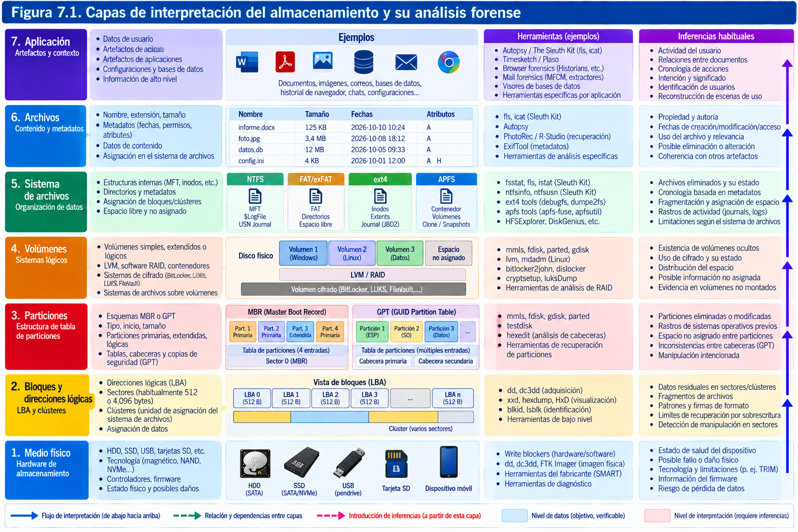
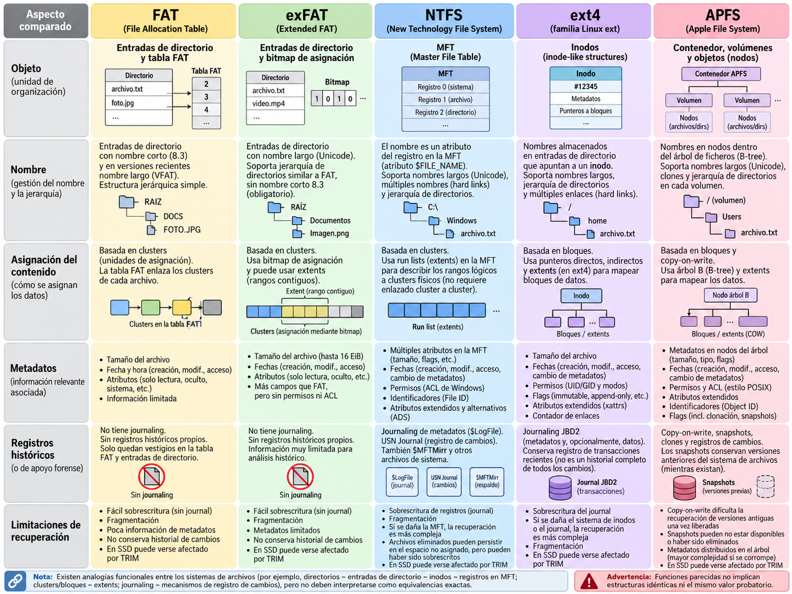
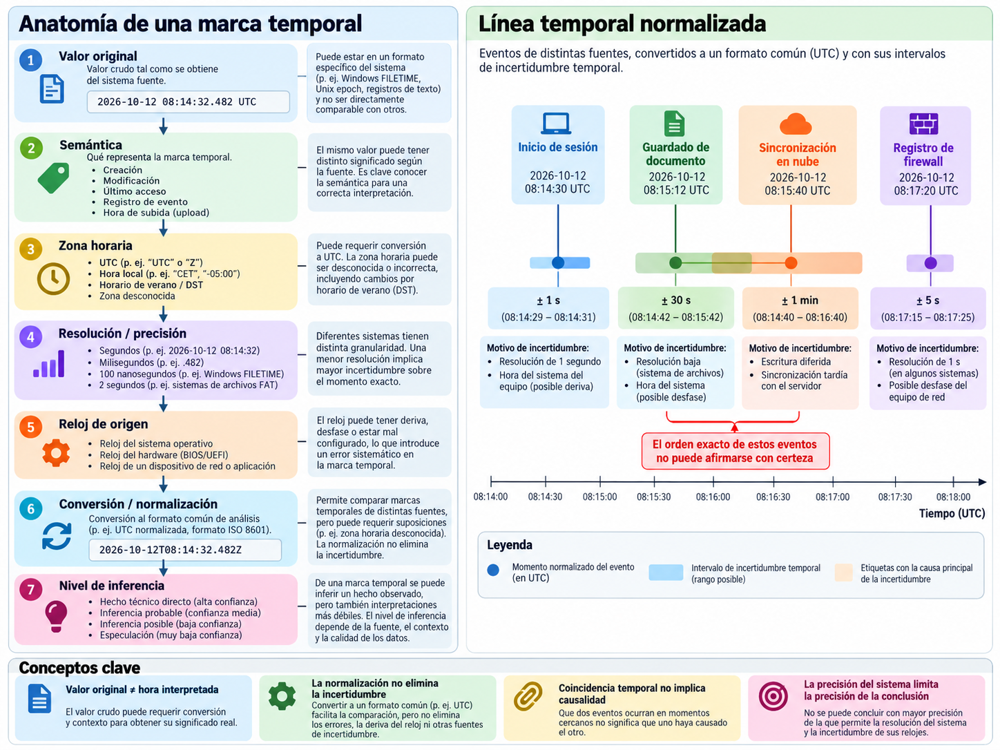
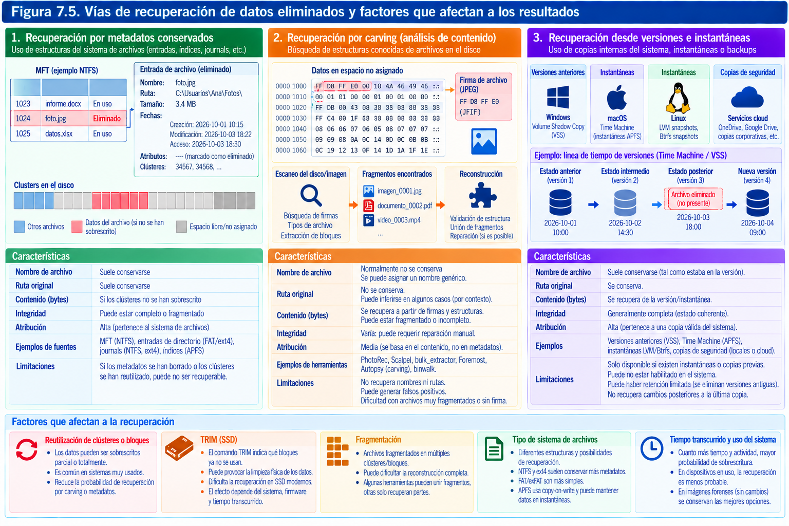
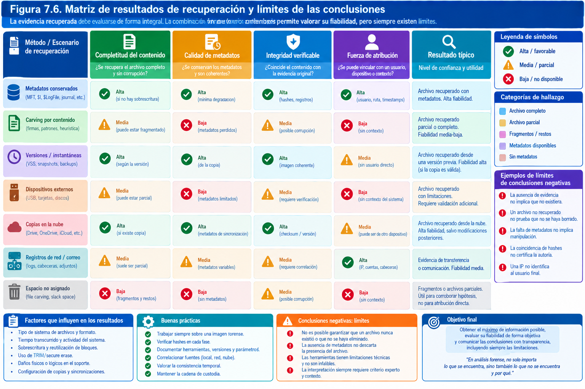

# Discos, particiones y sistemas de archivos

> "Vivimos en una economía de la información. Eso te lo enseñan en la escuela. Lo que no te dicen es que es imposible moverse, vivir, operar a cualquier nivel sin dejar rastros, bits, fragmentos aparentemente insignificantes de información personal. Fragmentos que pueden ser recuperados, amplificados..."
>
> — William Gibson, Johnny Mnemonic (1981)

## Introducción

Un disco no es una colección de documentos dispuestos en carpetas. Es un soporte que expone unidades de direccionamiento y sobre el que varias capas de software construyen estructuras de significado: tablas de particiones, volúmenes, sistemas de archivos, directorios, nombres, atributos y relaciones temporales. Para el usuario, un archivo puede ser una fotografía con un nombre reconocible. Para quien investiga, esa misma fotografía es también una secuencia de bytes cuya localización, asignación, historial y contexto deben demostrarse. La diferencia no es académica: de ella depende que un resultado sea repetible y que no se atribuya a un usuario una acción que solo se ha inferido de una estructura técnica.

El análisis forense de almacenamiento requiere razonar de abajo arriba y de arriba abajo. De abajo arriba, el investigador determina qué bytes se adquirieron, cómo se organizan y qué estructuras los interpretan. De arriba abajo, parte de una pregunta —por ejemplo, si un documento fue creado, copiado, modificado o eliminado— y busca qué artefactos pueden sostener o refutar cada explicación. Ninguno de los dos recorridos basta por sí solo. Una herramienta puede mostrar un archivo eliminado con una fecha precisa y, aun así, la interpretación ser equivocada porque la marca temporal se refiere a una entrada de directorio reutilizada, a un cambio de metadatos o a una conversión horaria incorrecta.

Este capítulo presenta las capas de almacenamiento, los esquemas MBR y GPT, los sistemas FAT, exFAT, NTFS, ext4 y APFS, la interpretación de metadatos y tiempos, y las posibilidades reales de recuperar información. Se presta especial atención a las diferencias entre *encontrar bytes*, *reconstruir un objeto* y *atribuir un hecho*. El tratamiento de discos cifrados, SSD y adquisición de soportes dañados se conecta con el capítulo anterior, pero aquí el foco está en el significado de las estructuras adquiridas y en los límites de su interpretación.



## Estructura de los soportes de almacenamiento

### Del medio físico al espacio direccionable

Los discos magnéticos, las memorias flash y los discos virtuales no almacenan los datos de la misma manera, pero suelen presentar al sistema operativo una interfaz de bloques direccionables. El sistema solicita leer o escribir bloques lógicos, mientras que el dispositivo o la capa de virtualización resuelve cómo materializar esas operaciones. La distinción es fundamental: el sector lógico que observa el analista no equivale necesariamente a una posición física estable dentro del soporte.

En un disco duro magnético, la controladora abstrae pistas, sectores físicos, zonas de reserva y reasignaciones. En un SSD, la capa de traducción flash (*Flash Translation Layer*, FTL) asigna direcciones lógicas a páginas y bloques de memoria que pueden cambiar por nivelación de desgaste, recolección de basura y operaciones de mantenimiento. En una máquina virtual, el disco aparente puede ser un archivo, una cadena de discos diferenciales, un volumen de red o una abstracción proporcionada por el hipervisor. El mismo número de bloque lógico puede corresponder a objetos físicos distintos en momentos diferentes.

Una adquisición de bloques obtiene la representación que el dispositivo entrega por su interfaz en ese momento. No debe describirse sin matices como una lectura de «toda la memoria física» del soporte: pueden existir áreas inaccesibles, bloques reasignados, espacios ocultos por el firmware o datos no expuestos por el controlador. Tampoco es seguro que los bloques liberados de un SSD conserven información recuperable. El alcance real depende del medio, la interfaz, su estado, la herramienta y las condiciones de adquisición.

### Sectores lógicos, tamaño de bloque y offsets

En muchos soportes se emplean sectores lógicos de 512 bytes o 4096 bytes, pero no debe asumirse uno de estos valores sin comprobarlo. Los formatos 512e presentan sectores físicos de 4096 bytes con interfaz lógica de 512; los dispositivos 4Kn exponen sectores lógicos de 4096. Un error en el tamaño de sector altera todos los cálculos de desplazamiento y puede provocar que una partición válida parezca corrupta.

El desplazamiento en bytes de un bloque lógico se obtiene multiplicando su dirección por el tamaño del bloque:

\[
\text{offset}_{\text{bytes}} = \text{LBA} \times \text{tamaño del sector lógico}
\]

Si una partición empieza en LBA 2048 y el sector lógico mide 512 bytes, el inicio está a 1 048 576 bytes del comienzo del dispositivo. Ese cálculo es verificable y debe constar en las notas si se extraen estructuras manualmente. Con sectores de 4096 bytes, el mismo LBA representaría un desplazamiento ocho veces mayor. El valor del LBA por sí solo, por tanto, no basta.

Un sistema de archivos puede agrupar varios sectores en una unidad de asignación o *clúster*. El clúster es una decisión del formato lógico; no debe confundirse con el sector lógico del dispositivo, con el bloque físico de un SSD ni con los bloques de una herramienta de adquisición. En ext4 se habla habitualmente de bloques del sistema de archivos, mientras que APFS utiliza su propia organización de bloques y objetos. Cada capa debe identificarse por separado.

### Capacidad anunciada, capacidad visible y geometría

La capacidad comercial de un dispositivo suele expresarse en unidades decimales: 1 TB representa 10¹² bytes. Los sistemas operativos y algunas herramientas emplean unidades binarias, como TiB, equivalentes a 2⁴⁰ bytes. La diferencia de presentación no implica pérdida de datos. Antes de afirmar que una imagen está incompleta, deben compararse tamaños en bytes, número de sectores, tamaño lógico de sector y eventuales límites de adquisición.

Las referencias históricas a cilindros, cabezas y sectores (*CHS*) permanecen en ciertos campos de MBR, pero en la práctica el direccionamiento LBA es el mecanismo relevante para los sistemas actuales. Las cifras CHS pueden ser ficticias o estar truncadas; usarlas como prueba principal de ubicación en discos modernos sería metodológicamente débil.

En una investigación deben conservarse, cuando estén disponibles, fabricante, modelo, número de serie, firmware, capacidad expuesta, tamaño lógico y físico de sector, interfaz, identificadores de volumen y cualquier advertencia de lectura. Estos atributos permiten detectar errores de identificación, pero tampoco prueban por sí solos que el soporte no haya sido sustituido o alterado.

### Capas intermedias: RAID, LVM, cifrado y virtualización

Una partición no siempre contiene directamente un sistema de archivos. Puede albergar un volumen cifrado, un miembro RAID, un volumen físico de LVM, un contenedor APFS u otra estructura. El investigador debe identificar las capas en el orden correcto y conservar la descripción de cada transformación. Montar directamente como NTFS un dispositivo que contiene LUKS no dará resultados válidos; interpretar un miembro RAID aislado como volumen completo puede producir datos fragmentarios o aparentes corrupciones.

En Linux, un esquema frecuente es disco → GPT → partición → LUKS → LVM → volumen lógico → ext4. En Windows puede aparecer disco → GPT → partición → BitLocker → NTFS. En macOS, disco → GPT → contenedor APFS → volúmenes APFS, eventualmente protegidos por cifrado. En virtualización puede añadirse una capa externa: archivo QCOW2 → disco virtual → GPT → volumen invitado. Cada capa tiene metadatos, riesgos y mecanismos de validación propios.

Una imagen de un miembro RAID no equivale a la imagen del volumen lógico reconstruido. Una instantánea de VM puede representar solo cambios respecto de un disco base. Una exportación de volumen descifrado no tiene los mismos bytes que la imagen cifrada subyacente, aunque ambas se refieran a datos relacionados. Los hashes deben asociarse al objeto concreto y no trasladarse de una representación a otra.

### El estado del soporte también es evidencia

El análisis no comienza únicamente cuando se abre el sistema de archivos. La existencia de particiones anómalas, zonas sin asignar, encabezados dañados, sectores ilegibles, volúmenes ocultos o discrepancias entre tablas puede ser relevante. Una partición eliminada de la tabla puede conservar parte de sus datos; una tabla modificada puede ocultar un volumen sin haberlo sobrescrito; un soporte con sectores defectuosos puede haber producido archivos aparentemente truncados sin intervención humana.

Por ello, la exploración inicial debería responder: ¿qué objeto se adquirió?, ¿qué tamaño y estructura tiene?, ¿qué capas se identifican?, ¿qué regiones son accesibles?, ¿qué errores se produjeron?, ¿qué partes no se interpretan todavía? Registrar explícitamente lo desconocido es preferible a rellenarlo con supuestos.

### Reconocimiento inicial con herramientas de solo lectura

En un entorno Linux de laboratorio pueden consultarse propiedades y particiones con comandos como los siguientes, aplicados a una **imagen de prueba** y no directamente a un original sin un procedimiento aprobado:

```bash
sha256sum disco-prueba.raw
file disco-prueba.raw
mmls disco-prueba.raw
fdisk -l disco-prueba.raw
```

`mmls`, de The Sleuth Kit, ayuda a enumerar regiones y particiones; `fdisk` ofrece otra perspectiva de la tabla. Los resultados no son intercambiables con una validación completa de la imagen. Si discrepan, deben conservarse ambas salidas, comprobar sector lógico, offsets y tipo de tabla, y examinar manualmente los campos relevantes. El uso de `file` es orientativo: detecta firmas, pero no demuestra que una estructura sea completa o íntegra.

La salida de cada herramienta debe asociarse con versión, parámetros, zona horaria del sistema de análisis, hash de entrada y fecha de ejecución. Una interpretación manual posterior ha de distinguirse del dato devuelto automáticamente.


### Interpretar sectores no equivale a interpretar archivos

Una imagen de almacenamiento puede examinarse desde al menos cuatro perspectivas, cada una de las cuales responde preguntas diferentes. En el nivel de bloques se determina qué secuencia de bytes ofrece el dispositivo: permite localizar firmas, regiones inaccesibles, estructuras repetidas y patrones de ocupación. En el nivel de particiones se establece cómo se delimitan espacios de uso. En el nivel del sistema de archivos se reconstruye la relación entre metadatos, nombres, directorios y contenido. Finalmente, el nivel de aplicación interpreta documentos, bases de datos, contenedores comprimidos o archivos de configuración con reglas que el sistema de archivos desconoce. Mezclar estos planos conduce a conclusiones difíciles de sostener.

Supongamos que se encuentra la firma de un documento PDF en un sector libre. El hecho inicial es que en una posición de la imagen existen bytes compatibles con un encabezado PDF; ni siquiera está demostrado todavía que exista un archivo íntegro. Si se reconstruye un conjunto de bloques y se valida su estructura, podrá afirmarse que se ha recuperado un objeto interpretable como PDF. Si aparecen en la misma imagen referencias de una antigua entrada de directorio, podremos relacionarlo, con reservas, con una ruta. Afirmar que alguien lo abrió, lo copió o lo eliminó exige información adicional. El salto del hallazgo de bytes a la conducta humana no lo proporciona el propio formato del disco.

La distinción entre **ubicación física**, **ubicación lógica** y **ubicación semántica** ayuda a precisar las notas. Una ubicación física puede ser desconocida o variable en un SSD; una ubicación lógica, en cambio, se expresa mediante LBA y desplazamiento; una ubicación semántica indica que esos bytes corresponden, por ejemplo, al atributo de datos de un archivo identificado por un registro MFT. El informe debe indicar qué plano utiliza. La expresión «recuperado del sector 315 000» aporta trazabilidad técnica, pero no sustituye el análisis del objeto reconstruido.

Conviene utilizar unidades inequívocas. Los términos «bloque», «sector», «clúster», «extento» y «página» pueden significar cosas distintas. Un **extento** suele representar una secuencia contigua de unidades lógicas; un **sector lógico** es la unidad de direccionamiento expuesta por el dispositivo; una **página de NAND** es una unidad física interna gestionada por la controladora; una **página de memoria** pertenece a otra capa del sistema. Un investigador que reciba una salida con la dirección `0x0000000001000000` debe conocer si se trata de un desplazamiento absoluto en bytes, un número de sector, un bloque de sistema de archivos o un offset relativo a un volumen.

### Alineación, estructuras superpuestas y falsos positivos

Las particiones modernas suelen comenzar en límites alineados, frecuentemente a 1 MiB, para mejorar compatibilidad y rendimiento. La alineación es una pista contextual, no una condición de validez ni una prueba de una configuración concreta. Un disco antiguo puede usar desplazamientos diferentes; un fabricante puede reservar regiones propias; una imagen procedente de una máquina virtual puede contener metadatos exteriores al disco que ve el invitado.

Hay otra fuente habitual de error: un mismo conjunto de bytes puede satisfacer más de un detector. Un bloque lleno de ceros puede parecer espacio sin uso, pero formar parte legítima de un archivo disperso, de un volumen cifrado que presenta ceros, de una instantánea o de una adquisición incompleta. Una firma de sistema de archivos hallada en espacio no asignado puede pertenecer a una partición anterior, a una imagen de disco guardada como archivo o a datos aleatorios que coincidan con parte de una cabecera. La detección de una firma constituye una hipótesis que debe contrastarse comprobando campos internos, coherencia de tamaños, referencias cruzadas y límites del soporte.

En una revisión manual se distingue entre **identificación por firma** y **validación estructural**. La primera suele ser rápida: una secuencia como `EFI PART` apunta a una cabecera GPT. La segunda exige verificar que la cabecera está donde debería, que sus longitudes son plausibles, que los desplazamientos no superan la imagen y que los valores CRC de la tabla concuerdan. En un entorno forense no se debe aceptar automáticamente toda sugerencia de una herramienta de reconocimiento, especialmente si el soporte está dañado o contiene restos de configuraciones antiguas.

Las imágenes que incluyen varios discos añadidos por concatenación, un encabezado propietario de contenedor o bloques ausentes merecen un examen adicional del formato externo. Un error de origen frecuente consiste en calcular la posición de una partición sobre los bytes del archivo de contenedor, en vez de hacerlo sobre el **flujo de bloques reconstruido**. La imagen EWF, por ejemplo, no se interpreta como si su archivo `.E01` fuese directamente un disco RAW. Primero hay que acceder a su contenido lógico mediante una herramienta compatible y documentar el proceso.

### Una primera ficha técnica del soporte

Antes de reconstruir cualquier archivo, el investigador puede redactar una ficha de reconocimiento cuyo interés va más allá del inventario. Debe permitir a otra persona repetir los cálculos y comprender qué partes de la imagen han quedado sin revisar. Un modelo operativo sería el siguiente:

| Campo | Ejemplo ficticio | Interpretación o comprobación |
|---|---|---|
| Evidencia | `EV-07-001` | Identificador del objeto adquirido |
| Adquisición | `ADQ-07-001` | Procedimiento y archivo resultante |
| Formato | RAW | Sin cabecera de contenedor asociada al archivo |
| Tamaño | 64 424 509 440 bytes | Medido sobre el flujo adquirido |
| Sector lógico | 512 bytes | Deducido de la documentación y contrastado |
| Sectores esperados | 125 829 120 | Tamaño dividido por 512, si no hay cabeceras externas |
| Tabla de particiones | GPT | Cabecera primaria y respaldo inspeccionadas |
| Volúmenes | FAT32 y NTFS | Tipos verificados, no solo reconocidos por firma |
| Errores de lectura | Ninguno registrado | Se debe disponer del log que lo sustente |
| Hash de la imagen | SHA-256 registrado | Identifica los bytes del objeto concreto |
| Regiones pendientes | Espacio entre particiones | No debe describirse como vacío sin examen |

El ejemplo no representa un caso real. La capacidad medida debe ser coherente con el formato; en un contenedor segmentado o comprimido el tamaño en disco de los ficheros no equivale necesariamente a la longitud del flujo lógico adquirido. Si la adquisición presenta sectores sustituídos por patrones de relleno a causa de errores, conviene registrar tanto la extensión afectada como el efecto que tiene sobre la interpretación.

La ficha también distingue **datos observados**, **configuración declarada** e **inferencias**. Un tamaño de sector reportado por un archivo de adquisición puede ser un parámetro suministrado por el operador; un valor observado en una cabecera del sistema de archivos ofrece una comprobación independiente, pero puede no coincidir con el tamaño lógico original del dispositivo. Las discrepancias no se ocultan: se investigan y se incorporan al registro.

### El laboratorio ante capas no evidentes

En investigaciones complejas es útil conservar un mapa de dependencias. En un servidor con LVM sobre RAID, por ejemplo, la evidencia puede proceder de tres discos físicos, de una imagen del dispositivo RAID ya presentado al sistema o de una exportación de un volumen lógico. Las tres opciones muestran objetos relacionados pero de alcance distinto. Con solo uno de los miembros RAID quizá no puedan reconstruirse los archivos; con la exportación lógica pueden quedar fuera las regiones que gestionaba la controladora; con una instantánea virtual pueden omitirse cambios pendientes en memoria.

Una buena pregunta de control es: «¿qué componente añadió, eliminó o transformó bytes entre el soporte original y la representación que examino?». La respuesta puede mencionar cifrado, compresión de imágenes, capas diferenciales, snapshots, virtualización, reasignación de bloques, caché o acceso a través de una API. Cada transformación es un punto donde hay que mantener identificadores y registros de verificación independientes.

La práctica de laboratorio debe evitar intervenir sobre la fuente para «hacer que se vea» una estructura. Si una imagen necesita ser descifrada, ensamblada o convertida, se documenta la transformación y se preserva la imagen anterior. Si una partición parece averiada, se trabaja con copias y se contrasta el estado antes y después de cualquier herramienta de reparación. Una operación aparentemente inocente, como abrir un volumen con un controlador que reproduce el diario o actualiza metadatos, puede alterar precisamente la información que se pretendía interpretar. No se trata de prohibir toda operación transformadora, sino de ubicarla sobre derivados controlados y explicitarla.

## Particiones MBR y GPT

### Qué resuelve una tabla de particiones

Una tabla de particiones describe regiones del espacio direccionable que se ofrecen como unidades lógicas independientes. No contiene necesariamente el inventario de archivos ni los nombres de directorios. Su misión principal es indicar dónde empiezan y terminan las regiones y, según el esquema, aportar tipos, identificadores y atributos. Una tabla de particiones válida no garantiza que el sistema de archivos dentro de cada región sea coherente.

La ausencia de una tabla reconocible tampoco implica que el soporte carezca de datos. Existen dispositivos formateados directamente sin particiones (*superfloppy*), volúmenes cifrados que ocultan firmas reconocibles, discos virtuales que representan un volumen y soportes con tablas destruidas. El primer diagnóstico debe describir la estructura observada, no imponer una arquitectura esperada.

### MBR: organización y límites

El esquema MBR tradicional sitúa información de arranque y una tabla de hasta cuatro entradas primarias en el primer sector lógico del disco, habitualmente de 512 bytes. En el formato clásico, la firma final `55 AA` ocupa los dos últimos bytes del sector. Cada entrada de partición tiene 16 bytes e incluye, entre otros campos, tipo, LBA inicial y número de sectores. Los campos de direccionamiento de 32 bits limitan el espacio representable con sectores de 512 bytes a aproximadamente 2 TiB.

El MBR clásico permite hasta cuatro particiones primarias; una de ellas puede designarse como extendida y albergar una cadena de registros de arranque extendidos (*EBR*) que describen particiones lógicas. La cadena no debe recorrerse suponiendo que todas las entradas son consecutivas o que las direcciones relativas se interpretan igual en todos los contextos. Una corrupción o manipulación de un EBR puede afectar la visibilidad de varios volúmenes.

Los tipos de partición son indicativos. Un valor de tipo asociado a NTFS no demuestra que dentro exista un NTFS funcional; puede haber un volumen reformateado, cifrado o sobrescrito. En la investigación se cotejan los campos de la tabla con las firmas y estructuras internas del volumen.

### GPT: cabeceras, entradas y redundancia

GPT, asociado habitualmente a UEFI, emplea direcciones LBA de 64 bits y una organización más flexible. Normalmente incluye un MBR protector en LBA 0, una cabecera GPT principal en LBA 1, una matriz de entradas de partición y una cabecera secundaria cerca del final del disco, acompañada de una copia de la matriz. La ubicación exacta y el tamaño de la matriz se obtienen de la cabecera y no deben deducirse de una plantilla fija.

La cabecera GPT incorpora, entre otros datos, la firma `EFI PART`, revisión, tamaño, LBA actual, LBA de respaldo, límites de espacio utilizable, GUID del disco, ubicación y tamaño de la matriz de entradas, y valores CRC32 para detectar determinadas corrupciones accidentales. Cada entrada puede incluir GUID de tipo, GUID único de partición, LBA inicial y final, atributos y nombre codificado en UTF-16LE.

La presencia de una cabecera secundaria es útil para contrastar o recuperar una tabla dañada, pero no convierte automáticamente una copia en verdadera y la otra en falsa. Una modificación intencionada puede afectar una o ambas. Si hay discrepancias, deben preservarse ambas versiones, comprobar CRC, tamaños y coherencia de límites, y buscar evidencia adicional de operaciones recientes de particionado.


### MBR protector, híbridos y anomalías

El MBR protector reduce el riesgo de que utilidades antiguas interpreten un disco GPT como vacío. En algunos entornos existen configuraciones híbridas MBR/GPT, que introducen dos descripciones potencialmente divergentes del mismo espacio. Estas configuraciones merecen especial cautela: una herramienta puede mostrar una partición y otra no, sin que ninguna haya leído mal los bytes; pueden estar aplicando interpretaciones distintas.

Una anomalía de particionado debe registrarse con precisión. «La partición no existe» es una conclusión excesiva si lo único observado es que no figura en la tabla principal. Resulta más defendible indicar que «la entrada de partición no aparece en la tabla GPT principal adquirida; se observa una entrada compatible en la tabla secundaria», añadiendo offsets y evidencias de contraste.

### Espacios entre particiones y regiones residuales

Los huecos anteriores, posteriores o intermedios entre particiones pueden contener restos de estructuras anteriores, datos arbitrarios, cargadores, metadatos de gestores de volúmenes o simplemente ceros. La existencia de bytes no nulos en una región sin asignar a particiones no prueba ocultación deliberada. Para valorar su significado deben examinarse firmas, continuidad, contexto y posibles explicaciones legítimas.

La alineación moderna de particiones suele dejar espacio inicial antes de la primera partición. También pueden aparecer particiones de recuperación, EFI, MSR u otras áreas de servicio. No deben clasificarse como «ocultas» por el mero hecho de que el explorador de archivos no les asigne letra o punto de montaje.

### Ejemplo de cálculo y verificación

Supóngase una imagen de prueba con sector lógico de 512 bytes y una entrada GPT que declara inicio en LBA 4096 y final en LBA 1052671, ambos inclusive. El volumen empieza en 2 097 152 bytes y ocupa 1 048 576 sectores, equivalentes a 536 870 912 bytes. Es importante explicitar que el LBA final es inclusivo:

\[
\text{sectores} = \text{LBA}_{final} - \text{LBA}_{inicial} + 1
\]

Una comprobación manual puede extraer una pequeña región de una **copia de trabajo** con `dd`:

```bash
dd if=disco-prueba.raw of=inicio-volumen.bin \
   bs=512 skip=4096 count=8 status=none
sha256sum inicio-volumen.bin
xxd -l 256 inicio-volumen.bin
```

Estos comandos no validan por sí solos el sistema de archivos: sirven para contrastar offsets y reconocer estructuras iniciales. Los valores de `skip` y `bs` deben derivarse de la evidencia concreta; copiarlos sin adaptación puede llevar a una región equivocada.


### Lectura forense de una cabecera MBR

La tabla MBR clásica se ubica en el primer sector lógico del disco y utiliza cuatro entradas de partición de 16 bytes cada una, situadas a partir del desplazamiento 446 de los primeros 512 bytes. Sus dos últimos bytes suelen corresponder a la firma `55 AA`. Esta descripción es estructural: la presencia de la firma no demuestra que las entradas de partición sean correctas, ni que exista un sistema de archivos íntegro en el intervalo que designan. En medios con sector lógico mayor de 512 bytes, estos campos tradicionales se mantienen en la porción inicial correspondiente.

Cada entrada contiene, entre otros datos, un indicador de arranque, un tipo de partición, una dirección inicial LBA de 32 bits y una longitud expresada también en sectores de 32 bits. Los campos históricos CHS están sometidos a restricciones que les restan utilidad práctica en medios actuales. El tamaño y la posición declarados por una entrada permiten proponer un intervalo, pero el analista debe contrastar que empieza en una región verosímil, que no invade el área de otras particiones y que la estructura que se encuentra en su inicio corresponde al tipo esperado.

La existencia de cuatro entradas no significa que todos los discos MBR solo puedan tener cuatro volúmenes utilizables. El esquema clásico admite particiones extendidas y cadenas de registros de arranque extendidos (*Extended Boot Records*, EBR), capaces de representar particiones lógicas. La reconstrucción de una cadena EBR exige distinguir entre direcciones relativas a la partición extendida y direcciones relativas a cada registro; un desplazamiento interpretado respecto del origen equivocado conduce a una extracción incorrecta. Algunas herramientas ocultan este detalle y presentan directamente los volúmenes resultantes, por lo que resulta útil comparar sus cálculos con las estructuras encontradas.

Cuando una entrada señala un volumen que ya no existe o apunta a un intervalo fuera del tamaño adquirido, hay varias explicaciones posibles: partición eliminada, disco clonado y redimensionado, error de una herramienta, corrupción accidental o manipulación deliberada. El forense no elige la opción más llamativa sin pruebas. Busca coincidencia de firmas de sistema de archivos en el destino, coherencia de superestructuras, restos de entradas anteriores y evidencias de operaciones administrativas.

**Ejemplo de razonamiento.** Una imagen de 32 GiB contiene un MBR válido desde el punto de vista de su firma, pero una entrada anuncia que un volumen comienza después del último LBA adquirido. El dato verificable es la incompatibilidad entre la entrada y el tamaño disponible. El hallazgo es que esa entrada no identifica un volumen contenido íntegramente en la imagen. La causa queda abierta: podría tratarse de una adquisición truncada o de una tabla inconsistente. Antes de concluir «partición falsa», se consulta el registro de adquisición y el tamaño original de la fuente.

### Verificación manual de GPT y redundancia no infalible

GPT introduce una cabecera primaria, normalmente en LBA 1, una matriz de entradas de partición y sus correspondientes estructuras de respaldo hacia el final del soporte. La especificación UEFI define campos de verificación CRC32 para la cabecera y para la matriz de entradas. Son mecanismos diseñados para detectar alteraciones accidentales de esas estructuras, no firmas criptográficas ni garantías de autenticidad. Un atacante con capacidad de escribir sobre el disco puede modificar una tabla y recalcular correctamente sus CRC.

Para evaluar una GPT se comprueba, como mínimo, la firma de cabecera, su tamaño, el valor `MyLBA`, la posición de la cabecera alternativa (`AlternateLBA`), los límites `FirstUsableLBA` y `LastUsableLBA`, la ubicación y longitud de la matriz de entradas, y las verificaciones CRC declaradas. También debe revisarse que las particiones activas no se solapen y que no apunten fuera del espacio utilizable. Una herramienta puede advertir de una cabecera primaria dañada y proponer reconstruirla desde la secundaria; la **propuesta de reparación** no autoriza al analista a modificar la evidencia original.

Hay situaciones especialmente interesantes. Tras ampliar un disco virtual, la GPT de respaldo puede permanecer en la antigua última posición y aparecer un espacio adicional al final. Tras clonar una unidad a otra de distinta capacidad, la geometría y los límites almacenados pueden dejar de describir completamente el medio. Al convertir un disco entre MBR y GPT, pueden subsistir restos de la tabla anterior. Incluso una GPT primaria y una secundaria válidas pueden no coincidir si fueron modificadas en momentos distintos. La comparación de ambas aporta una hipótesis sobre la historia del soporte, pero no fija por sí misma quién realizó la operación ni cuándo.

Los identificadores GUID permiten relacionar particiones y tipos, aunque no son identificadores criptográficos de procedencia. Una clonación puede duplicarlos. Un mismo GUID de partición observado en dos imágenes podría apoyar una relación de copia, pero deben descartarse plantillas reutilizadas, discos clonados legítimamente y artefactos derivados de la misma máquina virtual. Tampoco cabe concluir que un volumen contiene determinado sistema de archivos solo por su tipo GPT: el contenido debe comprobarse de forma independiente.

### La diferencia entre estructura declarada y estructura encontrada

Un mapa de particiones completo combina al menos dos perspectivas. La **estructura declarada** procede de MBR, GPT o del esquema de volúmenes identificado. La **estructura encontrada** se obtiene al inspeccionar firmas y metadatos compatibles con sistemas de archivos a lo largo del flujo de bloques. Normalmente ambas coinciden. Cuando no lo hacen, la discrepancia es precisamente un resultado susceptible de investigación.

Imaginemos una imagen que declara tres particiones y cuyo espacio entre la primera y la segunda contiene una posible cabecera NTFS. Si la cabecera presenta campos coherentes, copias de estructuras en posiciones esperadas y registros MFT reconocibles, podría corresponder a un volumen anterior. Sin embargo, también podría formar parte de un archivo de imagen que estuvo allí antes de una reorganización. Para discriminar, interesa buscar continuidad espacial de las estructuras, coherencia de límites, identificadores y evidencias externas del uso de la unidad. El hallazgo no se confirma con una búsqueda indiscriminada de la cadena `NTFS`.

Un sector de arranque válido, por sí solo, tampoco garantiza que el resto del sistema de archivos sea legible. Si se recupera un volumen anterior solo en parte, deben trazarse las regiones que se pueden describir con confianza y las que podrían pertenecer a datos de otro período. Un volumen «reconstruido» a partir de un arranque antiguo y una MFT posterior puede reunir estructuras de distintas épocas. El peligro consiste en presentar ese ensamblaje como una fotografía coherente del disco en un momento histórico que nunca existió.

### Análisis numérico de intervalos y solapamientos

Los intervalos deben trabajarse con una convención explícita. Cuando una partición comienza en LBA 2048 y ocupa 4096 sectores, su último sector es `2048 + 4096 - 1 = 6143`. El primer sector siguiente es 6144. Muchas herramientas muestran un extremo inicial y otro final inclusivo, mientras que programas y bibliotecas utilizan intervalos semiabiertos `[inicio, fin)`. No documentar esta diferencia provoca errores de un sector que pueden afectar precisamente al límite de una partición y a las estructuras de respaldo.

Para auditar cálculos sencillos puede utilizarse un script independiente con enteros, sin acceder al soporte original:

```python
# Ejemplo con datos sintéticos; no escribe sobre evidencias.
sector_bytes = 512
inicio_lba = 2048
longitud_sectores = 4096
ultimo_lba = inicio_lba + longitud_sectores - 1
inicio_bytes = inicio_lba * sector_bytes
longitud_bytes = longitud_sectores * sector_bytes
print(f"LBA final inclusivo: {ultimo_lba}")
print(f"Desplazamiento: {inicio_bytes} bytes")
print(f"Longitud: {longitud_bytes} bytes")
```

Si se comparan dos particiones, el solapamiento existe cuando comparten al menos un LBA. No debe confundirse que una partición termine en 6143 y la siguiente comience en 6144 con un solapamiento. El investigador que calcule tamaños en bytes deberá usar el sector lógico correspondiente a **esa adquisición**, no el de una unidad diferente conectada al laboratorio. De forma análoga, la extracción por offsets se realiza sobre el flujo lógico correcto y no sobre los bytes físicos del archivo EWF comprimido.

Un procedimiento defensable conserva tanto la salida de una herramienta reconocida como el cálculo independiente de uno o varios valores críticos. Si las herramientas no coinciden, es preferible registrar una tabla de discrepancias antes que forzar una interpretación común. La discrepancia puede proceder de un sector lógico supuesto, de una cabecera corrupta, de una GPT antigua o de un formato de imagen mal interpretado.

### Escenarios de práctica reproducible con particiones

Un laboratorio puede construir tres imágenes sintéticas diferentes para entrenar el reconocimiento sin necesidad de alterar un dispositivo incautado. En la primera, un disco MBR contiene dos particiones y una región sin asignar; la respuesta conocida incluye offsets, tipos y tamaños. En la segunda, una GPT tiene su cabecera primaria válida y la secundaria dañada en una copia; se espera que el analista la detecte sin reparar el original. En la tercera, la imagen incorpora una firma de sistema de archivos dentro de espacio no asignado sin suficientes estructuras complementarias; la respuesta correcta es **indicio no confirmado**, no «partición recuperada».

Estas prácticas muestran que un resultado negativo puede ser igualmente válido: no detectar una estructura compatible, no lograr calcular su tamaño con garantías o no encontrar pruebas de que una firma corresponda a un volumen operativo. Cada escenario debe conservar un manifiesto de generación, un hash del fichero de prueba y la verdad conocida contra la que se evaluarán las herramientas. Si se modifica un byte de la imagen para introducir una anomalía, se obtiene un **nuevo objeto de prueba**, con un identificador y un hash propios. La diferencia frente a la imagen original constituye parte de la práctica.

## Sistemas de archivos: FAT, exFAT, NTFS, ext4 y APFS

### Sistemas de archivos como modelos de asignación

Un sistema de archivos establece cómo se representan los objetos y cómo se relacionan nombres, directorios, contenidos, metadatos y espacio libre. Algunos modelos usan tablas de asignación, otros inodos y árboles, y otros combinan estructuras transaccionales con copia en escritura. Ningún formato puede interpretarse adecuadamente aplicando sin más los supuestos de otro.

La adquisición a nivel de bloques permite observar estructuras que una exportación lógica normalmente omite: entradas borradas, bloques no asignados, diarios, espacio de relleno y restos de asignaciones anteriores. Sin embargo, disponer de todos los bloques accesibles no garantiza poder reconstruir su significado. La corrupción, el cifrado, la sobrescritura y los cambios internos pueden impedir una interpretación fiable.

La tabla siguiente resume diferencias relevantes sin pretender sustituir la documentación técnica de cada implementación:

| Sistema | Estructura característica | Artefactos útiles | Precaución principal |
|---|---|---|---|
| FAT12/16/32 | Tabla de asignación y entradas de directorio | Entradas eliminadas, cadenas de clústeres | Reutilización y marcas temporales limitadas |
| exFAT | Mapa de asignación, bitmap y conjuntos de entradas | Entradas de archivo, asignación y metadatos | Semántica de asignación y recuperación variable |
| NTFS | MFT, atributos, bitmap y registros transaccionales | `$MFT`, `$UsnJrnl`, `$LogFile` | Distinguir contenido, atributos y operaciones registradas |
| ext4 | Inodos, extents, bitmaps y journal | Inodos, directorios, journal, extents | Reutilización, borrado y alcance del journal |
| APFS | Contenedores, objetos, B-trees y snapshots | Metadatos de volumen, instantáneas, clones | Copy-on-write, cifrado y cambios entre versiones |

### FAT: simplicidad aparente y ambigüedad forense

FAT organiza el volumen mediante una región de arranque, tablas de asignación, directorios y área de datos. La tabla FAT describe el estado de los clústeres y, para archivos no contiguos, la secuencia que compone su contenido. Las variantes FAT12, FAT16 y FAT32 difieren en el tamaño de las entradas y otros detalles estructurales; FAT32 no debe confundirse con un sistema que utilice exactamente 32 bits de direccionamiento libre para cada clúster.

Las entradas de directorio clásicas de 32 bytes almacenan nombre corto, atributos, marcas temporales, clúster inicial y tamaño. Los nombres largos se implementan mediante entradas adicionales que deben interpretarse conjuntamente con la entrada principal. Una entrada marcada como eliminada puede conservar nombre parcial, tamaño y clúster inicial, pero la cadena de asignación puede haberse liberado o reutilizado. Recuperar un archivo fragmentado basándose solo en su primer clúster puede producir un contenido erróneo que conserve, no obstante, una cabecera de archivo plausible.

En FAT, las marcas temporales presentan limitaciones de resolución y semántica. Algunas marcas de acceso almacenan solo la fecha, y las horas locales pueden carecer de información explícita de zona horaria. No deben compararse automáticamente con marcas UTC de otros sistemas sin registrar la conversión y la incertidumbre asociada.

Un archivo eliminado de una tarjeta FAT puede reconstruirse completamente si sus clústeres permanecen intactos y su distribución es deducible. Pero también puede producirse una recuperación parcial o un falso ensamblaje. La comprobación de cabeceras y pies de archivo es insuficiente para demostrar que todos los bytes intermedios pertenecen al mismo objeto.

### exFAT: almacenamiento extraíble contemporáneo

exFAT está diseñado para soportes y volúmenes que necesitan manejar archivos grandes y compartir datos entre plataformas. Emplea estructuras como el mapa de asignación (*allocation bitmap*) y conjuntos de entradas de directorio. La tabla FAT puede utilizarse para describir cadenas de clústeres, pero determinadas asignaciones contiguas se representan sin depender de una cadena FAT ordinaria. El analista no debe asumir que un valor aparentemente vacío en la FAT significa que no existe contenido asignado.

La recuperación depende de los campos conservados en las entradas, de la asignación y del grado de reutilización. Un conjunto de entradas puede incluir metadatos y nombres repartidos entre varias estructuras; si una parte está dañada o sobrescrita, puede mantenerse el contenido sin poder recuperar el nombre original, o viceversa. Los análisis deben distinguir los objetos íntegramente reconstruidos de los que solo son candidatos.

En medios extraíbles, exFAT plantea además cuestiones de procedencia. La fecha de modificación de un documento no indica necesariamente cuándo fue copiado al dispositivo; la operación de copia puede conservar algunas marcas y alterar otras. Para sostener que una memoria USB se utilizó para extraer información, el contenido del volumen debe correlacionarse con registros del equipo anfitrión, accesos, identificadores de dispositivo y, cuando existan, otras fuentes independientes.

### NTFS: registros, atributos y operaciones

NTFS representa gran parte de sus objetos mediante registros en la *Master File Table* (`$MFT`). Cada archivo o directorio puede tener atributos que describen nombres, datos, información estándar y otras propiedades. Algunos datos pequeños pueden ser residentes en el registro; otros se almacenan fuera y se describen mediante secuencias de asignación. El identificador de un registro MFT y su número de secuencia son relevantes para detectar reutilizaciones y evitar confundir objetos distintos que ocuparon la misma posición de tabla en momentos diferentes.

Los atributos `$STANDARD_INFORMATION` y `$FILE_NAME` pueden contener marcas temporales que no coincidan. Esa diferencia no es automáticamente indicio de manipulación: responden a funciones y patrones de actualización diferentes. Una interpretación sólida examina las cuatro marcas temporales habituales —creación, modificación de contenido, modificación de metadatos y acceso—, identifica su fuente exacta y considera operaciones como renombrado, copia, restauración, extracción de archivos o movimientos entre volúmenes.

La MFT permite detectar archivos existentes, algunos eliminados y relaciones entre directorios. No debe confundirse una entrada no asignada con la certeza de que el contenido sigue recuperable. Los clusters pueden haberse reutilizado, y los atributos residentes pueden haber desaparecido al reciclarse el registro. Asimismo, un registro MFT puede ser válido mientras el contenido referenciado sea ilegible o no esté presente en la adquisición.

NTFS dispone de artefactos adicionales. `$LogFile` se relaciona con operaciones de registro transaccional del sistema de archivos; `$UsnJrnl`, cuando está habilitado y disponible, puede conservar registros de cambios en objetos. Su presencia, retención y alcance varían. Un evento de USN no constituye por sí solo una narración completa de la actividad humana: expresa que se registró una determinada clase de cambio sobre un objeto en el sistema de archivos. La atribución a una aplicación o usuario requiere correlación adicional.

Los *Alternate Data Streams* (ADS) permiten asociar flujos de datos con un archivo más allá del flujo principal. El analista debe decidir si la herramienta de exportación conserva estos flujos; algunas copias lógicas pueden omitirlos. Los enlaces duros y puntos de nueva interpretación (*reparse points*) también pueden complicar la relación entre nombre, ruta y objeto físico.

### Ejemplo de interpretación de una eliminación en NTFS

Supóngase que la MFT contiene un registro marcado como no asignado para `informe.xlsx`, con un tamaño de 82 944 bytes. En `$UsnJrnl` aparece un evento compatible con eliminación y, en registros de aplicación, una sincronización posterior. El primer hallazgo defendible es que la imagen conserva un registro de sistema de archivos asociado a ese nombre y marcado como no asignado. El segundo es que un diario registra una operación compatible con eliminación en una fecha determinada. Todavía no puede concluirse quién eliminó el archivo, si lo hizo deliberadamente, si el contenido desapareció del repositorio remoto o si el evento fue resultado de sincronización.

Para contrastar hipótesis, se revisan la secuencia de registro MFT, referencias de directorio, marcas temporales, registros del cliente de sincronización, historial de versiones y auditoría del servicio remoto. Una coincidencia temporal estrecha ayuda a reconstruir, pero no convierte por sí misma dos eventos en causa y efecto.

### ext4: inodos, extents y diario

ext4 organiza datos y metadatos mediante grupos de bloques, inodos, estructuras de asignación y, habitualmente, un diario. Un inodo describe un objeto y puede contener atributos, marcas temporales y referencias a su contenido. Los nombres se mantienen en entradas de directorio: un inodo no equivale a una ruta textual única. Un mismo archivo puede tener varios enlaces duros, y una ruta puede cambiar sin que cambie el contenido.

Los *extents* describen rangos de bloques contiguos y sustituyen, en muchos casos, a listas extensas de bloques individuales. En la investigación es necesario interpretar los extents conforme a su estado y a las estructuras efectivamente presentes. Los bloques liberados pueden reutilizarse y las referencias del inodo pueden cambiar tras la eliminación. Por ello, la existencia de una referencia antigua no garantiza que el contenido permanezca.

El journal de ext4 facilita la coherencia del sistema de archivos ante interrupciones, pero no es un registro forense exhaustivo de todas las operaciones de usuario. Su alcance depende del modo de diario, la carga, la configuración y el tiempo transcurrido. Las operaciones de montaje o recuperación automática pueden modificar estructuras; de ahí la importancia de analizar una copia y de controlar las opciones de montaje, preferentemente evitando cualquier reproducción del journal sobre la evidencia de referencia.

ext4 puede almacenar tiempos con precisión subsegundo y campos adicionales, pero la disponibilidad de una fecha de creación depende de la estructura y de la herramienta utilizada. Las fechas mostradas por `stat` o por una suite forense deben interpretarse según la versión del sistema de archivos, la implementación y la procedencia del dato. Una fecha ausente no debe rellenarse con otra marca temporal sin dejarlo explícito.

### APFS: contenedores, volúmenes y copia en escritura

APFS emplea una arquitectura basada en contenedores y volúmenes, estructuras de objetos y mecanismos de copia en escritura (*copy-on-write*). Puede compartir espacio entre volúmenes del mismo contenedor y admitir instantáneas y clones. La visión de «un disco, una partición, un sistema de archivos» es insuficiente para describir estas relaciones.

La copia en escritura permite que determinadas versiones de estructuras permanezcan temporalmente disponibles sin sobrescribir directamente las anteriores. Sin embargo, ello no garantiza recuperación indefinida. La gestión de espacio, la eliminación de instantáneas, el cifrado y las operaciones de mantenimiento condicionan qué objetos son accesibles. Un análisis debe especificar si observa el estado actual, una instantánea concreta o una reconstrucción basada en objetos históricos.

Los clones pueden compartir extents de datos y divergir posteriormente. Dos archivos que muestran contenidos iguales no necesariamente fueron copiados byte a byte en el momento sugerido por sus marcas temporales. Del mismo modo, el espacio libre compartido entre volúmenes complica atribuir ciertos bloques a un único volumen sin interpretar correctamente los metadatos del contenedor.

El cifrado en APFS puede estar integrado con mecanismos de protección de claves del dispositivo. Obtener una imagen de bloques cifrados no implica que se puedan leer los archivos. La adquisición de un volumen accesible en una sesión autorizada y la adquisición del contenedor cifrado son representaciones distintas, con cobertura y riesgos diferentes. Su relación debe documentarse sin confundir los hashes.

### Comparación de operaciones comunes

La operación «copiar un archivo» no tiene una firma universal. En un volumen FAT puede crear una entrada nueva y asignar clústeres; en NTFS, generar nuevos registros y cambios en el journal; en ext4, modificar inodos y directorios; en APFS, intervenir mecanismos de clonación o copia en escritura. Las aplicaciones pueden conservar o modificar las marcas temporales, y los clientes de sincronización pueden producir cambios locales sin una interacción directa con el archivo.

Por ello, las conclusiones deben formularse con referencia al sistema de archivos y al artefacto: «se observó un nuevo registro de archivo», «se registró una operación de cambio de nombre», «el contenido es idéntico según SHA-256» o «existe una instantánea anterior que contiene una versión diferente». «El usuario copió el archivo a las 10:32» es una afirmación de mayor nivel que exige evidencia adicional sobre usuario, proceso, origen, destino y reloj.



### FAT en profundidad: cadenas, directorios y nombres largos

FAT nació en un contexto de medios comparativamente sencillos, pero su investigación requiere distinguir cuidadosamente las estructuras. El sector de arranque describe parámetros que permiten calcular dónde se encuentran las tablas FAT, el directorio raíz —según variante— y el área de datos. En FAT12 y FAT16, la posición del directorio raíz está restringida de forma distinta de FAT32; en este último, el directorio raíz se ubica en la región de datos y se trata de manera más parecida a otros directorios. La denominación FAT12, FAT16 o FAT32 se relaciona con la anchura práctica de las entradas de asignación y el número de clústeres, no con que las aplicaciones guarden respectivamente archivos de 12, 16 o 32 bits.

La FAT relaciona clústeres de datos mediante entradas que pueden indicar continuidad de una cadena, final de archivo, área libre o marcas de clúster defectuoso. Un archivo fragmentado puede ocupar una secuencia lógica cuyos clústeres físicos no sean contiguos. Recuperar solo desde el primer clúster hasta alcanzar la longitud anunciada, sin seguir la cadena que corresponda, puede producir un archivo aparente con bytes pertenecientes a objetos diferentes. La fragmentación es por ello una limitación importante de recuperaciones basadas únicamente en firmas.

Las entradas de directorio clásicas emplean nombres cortos compatibles con el esquema 8.3. Los nombres largos, habituales en Windows, se implementan mediante entradas adicionales asociadas a la entrada principal. Tras una eliminación pueden persistir restos de esas entradas, pero su asociación puede quedar debilitada si una parte ha sido reutilizada. Es incorrecto presentar siempre el nombre largo reconstruido como seguro solo porque varias entradas contiguas parecen contener caracteres de un mismo nombre. La validación exige examinar secuencias, indicadores y, cuando proceda, comprobaciones de consistencia previstas en el formato.

Al eliminar un archivo en FAT se suele marcar la entrada de directorio como eliminada y se liberan las entradas correspondientes de asignación. La información sobre el primer clúster o parte del nombre puede permanecer; sin embargo, la cadena de clústeres ya no tiene por qué ser recuperable a través de una FAT coherente. Se puede obtener una reconstrucción completa de archivos que estaban contiguos, mientras que los fragmentados pueden presentar discontinuidades silenciosas. El analista distingue entre archivo recuperado y contenido **aparentemente recuperado** cuyos límites no se han podido verificar.

Las marcas temporales de FAT tienen resolución y semántica diferentes de las de NTFS. Algunas variantes almacenan fechas y horas locales sin una zona horaria asociada de modo inequívoco. FAT clásico no presenta la misma riqueza de metadatos de cambio que otros formatos, por lo que la ausencia de una marca concreta no acredita que la operación correspondiente no ocurriera. En dispositivos extraíbles, además, es común que varios sistemas operativos manipulen los mismos archivos y apliquen reglas de conversión distintas.

### exFAT: mapa de asignación y conjuntos de entradas

En exFAT, la asignación de clústeres se gestiona mediante un *Allocation Bitmap*, y la FAT conserva funciones relevantes según cómo se organicen las cadenas de datos. Las entradas de archivo se presentan mediante conjuntos que incluyen una entrada principal y entradas secundarias, como extensión del flujo y fragmentos de nombre. El estado de asignación, los atributos, la longitud del flujo y los indicadores del archivo deben interpretarse de forma conjunta. Aplicar a exFAT las reglas de recuperación de FAT32 sin considerar esta diferencia puede producir falsos resultados.

Una característica práctica es que ciertas cadenas de clústeres pueden representarse como contiguas sin necesidad de seguir entradas FAT para cada enlace, según los indicadores del conjunto de entradas. En un archivo eliminado, la pérdida o reutilización de una parte del conjunto puede impedir determinar con seguridad si su contenido era contiguo, cuál era la longitud válida o cuál era el nombre completo. La existencia de bytes plausibles en el *cluster heap* no resuelve por sí sola esas dudas.

Las regiones de arranque principal y de respaldo de exFAT ofrecen posibilidades de comprobación de coherencia, pero su presencia no garantiza que todos los directorios estén íntegros. También conviene registrar la versión y las características implementadas, porque no todos los sistemas operativos aplican idénticas políticas de montaje y actualización de tiempo. La especificación del formato describe marcas locales de fecha y hora y mecanismos para almacenar desplazamientos respecto de UTC en determinados campos; la interpretación debe respetar la información concreta que realmente se encuentre disponible.

Un caso habitual es la memoria USB que se conecta a un ordenador con Windows y posteriormente a un equipo con macOS o Linux. Si un documento conserva un tiempo de modificación pero aparece con otra hora en una herramienta diferente, antes de inferir una manipulación deliberada hay que reconstruir la conversión desde el formato original y la zona horaria asumida por cada programa. La regla editorial es sencilla: **nunca se atribuye un cambio temporal a una persona sin descartar antes las transformaciones automáticas del soporte y del software**.

### NTFS: la MFT como fuente de relaciones, no como biografía perfecta

La *Master File Table* (MFT) es central en NTFS. Cada archivo y directorio dispone de registros y atributos que describen propiedades y, en determinados casos, contenido. Sin embargo, no debe simplificarse afirmando que «cada archivo cabe en un único registro». Atributos extensos, archivos muy fragmentados o determinadas características pueden implicar registros adicionales. Los atributos residentes almacenan datos dentro del registro cuando resulta posible; los no residentes los describen mediante asignaciones hacia clústeres del volumen.

En la reconstrucción de un objeto es necesario considerar la identidad del registro y su número de secuencia, no solo el número de entrada MFT aislado. Una entrada puede quedar libre y reutilizarse para otro archivo; si una herramienta une una referencia antigua con un registro posterior que tiene el mismo número base, puede establecer asociaciones erróneas. Por ello, los enlaces a directorios, los identificadores de archivo y los números de secuencia ofrecen comprobaciones importantes cuando se investigan referencias residuales.

Dos conjuntos de marcas temporales llaman especialmente la atención: las incluidas en atributos `$STANDARD_INFORMATION` y las relacionadas con `$FILE_NAME`. No tienen por qué evolucionar simultáneamente ni obedecer las mismas reglas en todas las operaciones. Sus discrepancias pueden ser indicios de copia, renombrado, modificación de metadatos o manipulación, pero no constituyen una firma universal de *timestomping*. Un cambio de nombre no implica necesariamente alteración de contenido; una copia puede generar tiempos de creación distintos manteniendo ciertos valores de modificación; una restauración puede conservar atributos que anteceden al momento de recuperación.

El diario `$LogFile` ayuda a comprender determinadas operaciones de NTFS y su consistencia transaccional, pero no es una grabación exhaustiva de toda la actividad del usuario. El diario de cambios USN, cuando existe y conserva registros relevantes, puede aportar eventos sobre archivos, sus identificadores y motivos de cambio. Microsoft advierte que estos registros no contienen información suficiente para revertir operaciones. Además, pueden rotarse o eliminarse entradas antiguas; varios cambios pueden quedar representados con menos detalle del que una investigación desearía.

Otro artefacto interesante es `$Bitmap`, utilizado para representar el estado de asignación de clústeres del volumen. Contrastar un archivo que se considera activo con su asignación puede revelar incoherencias, aunque los resultados exigen estudiar si se está trabajando con una instantánea consistente, si existen operaciones pendientes o si la herramienta reconstruye las estructuras del mismo momento lógico. Los archivos dispersos, las secuencias alternativas de datos (*Alternate Data Streams*) y los puntos de reanálisis introducen otros escenarios en los que el nombre visible no describe completamente el almacenamiento o la ruta real de acceso.

**Ejemplo interpretativo.** Un registro MFT de un informe aparece marcado como no asignado; hay referencias residuales al nombre anterior; una entrada USN compatible indica un cambio de nombre seguido de eliminación. Esto sostiene con más fuerza la historia de una operación sobre el archivo que el registro MFT por sí solo. Aun así, no identifica al usuario humano. Para atribuir una cuenta o una sesión sería necesario relacionar la actividad con registros adicionales de sistema, acceso, proceso y contexto organizativo, teniendo presentes sus propios límites.

### NTFS y los objetos que no parecen archivos ordinarios

La perspectiva centrada en archivos de usuario puede pasar por alto elementos decisivos. Los enlaces duros permiten varios nombres para un mismo archivo; su eliminación puede afectar a una entrada de directorio sin eliminar inmediatamente los datos mientras queden otras referencias. Los puntos de reanálisis pueden redirigir rutas, enlazar volúmenes o introducir un comportamiento que no se deduce del árbol mostrado por una herramienta básica. Las secuencias alternativas de datos pueden almacenar contenido no visible en listados simplificados, y los archivos comprimidos o dispersos necesitan interpretación específica de asignación y tamaño lógico.

El investigador debe anotar la diferencia entre «ruta aparente» y «objeto subyacente». Si una búsqueda textual devuelve dos rutas con idénticos hashes de contenido, podría tratarse de copias independientes, enlaces duros, clones gestionados por capas superiores o archivos coincidentes. El hash no resuelve por sí mismo la relación de almacenamiento. Cuando la cuestión investigada es si una persona duplicó un documento, resulta esencial discriminar entre una segunda representación de nombre y una copia materializada en otra ubicación.

En NTFS la asignación del espacio también puede modificarse sin que exista una acción intencional de borrado por parte del usuario. Limpiezas automáticas, restauraciones, actualizaciones del sistema, servicios de sincronización y procesos de seguridad pueden crear, mover y eliminar archivos temporales. Un informe prudente pregunta qué proceso pudo generar la operación antes de denominarla eliminación deliberada.

### ext4: inodos, directorios y operaciones transaccionales

En ext4, los metadatos centrales de un archivo residen en su inodo, mientras que el nombre se mantiene en estructuras de directorio que enlazan nombres e identificadores de inodo. La separación es importante: una entrada de directorio antigua puede señalar un inodo que posteriormente ha sido reutilizado para otro objeto. Leer el contenido actual de ese número y atribuírselo automáticamente al nombre antiguo puede unir información incompatible de distintas épocas.

Los *extents* permiten describir rangos de bloques contiguos con una estructura más compacta que una enumeración de cada bloque. No significa que todo archivo sea contiguo. Los archivos fragmentados pueden requerir varios extents; las formas internas de su árbol dependen del tamaño y la distribución. Existen además archivos dispersos, enlaces simbólicos, enlaces duros y datos que pueden residir en el propio inodo según características habilitadas. La herramienta de análisis debe manejar correctamente las características relevantes del sistema de archivos concreto.

El diario JBD2 y la política de consistencia merecen una advertencia. En la configuración habitual de ext4, el diario protege principalmente metadatos y no conserva necesariamente todas las escrituras de datos del archivo como lo haría una grabación de sesiones. Modos como `data=journal`, `data=ordered` y `data=writeback` no ofrecen las mismas garantías. En consecuencia, hallar una transacción compatible con una actualización de inodo no equivale a reconstruir todo el contenido anterior del archivo ni el motivo de esa actualización.

En la interpretación temporal, `ctime` designa el cambio de estado del inodo, no una fecha de creación universal. Algunos inodos ext4 incluyen `crtime` o tiempo de nacimiento, pero su existencia depende de formato y características. Los campos adicionales pueden proporcionar mayor precisión temporal, aunque una marca con muchos decimales no está automáticamente sincronizada con un reloj fiable. También pueden existir políticas de actualización de `atime` que reduzcan escrituras o impidan inferir todas las lecturas realizadas.

Un caso práctico: un fichero `informe.odt` deja de figurar en el directorio `/home/usuario/Documentos`, pero su inodo aparece en estructuras residuales. El analista tendrá que comprobar si el inodo sigue asignado a otro nombre, si pertenece a otro enlace duro, si su contenido ha sido reutilizado y si el diario aporta un indicio compatible con eliminación o renombrado. Si la reconstrucción solo identifica bloques de contenido sin una relación fiable con el directorio, el informe debe expresarlo: **contenido recuperado de la imagen**, sin atribución concluyente a una ruta anterior.

### APFS: contenedores, volúmenes, instantáneas y clones

APFS utiliza un modelo de contenedor en el que diferentes volúmenes pueden compartir espacio disponible. Por ello, la presencia de varios volúmenes no implica una partición independiente para cada uno. Sus estructuras de metadatos emplean mecanismos de copia en escritura (*copy-on-write*): ciertas actualizaciones generan nuevos objetos o nodos en lugar de sobrescribir todos los anteriores. Esto puede conservar información histórica en determinadas circunstancias, pero no autoriza a esperar que todo archivo eliminado siga disponible.

Las instantáneas (*snapshots*) registran estados coherentes según las capacidades y condiciones del sistema. Su valor forense consiste en que pueden permitir examinar la representación de un volumen en un momento diferente del actual. No son equivalentes a copias de seguridad completas y externas; su disponibilidad puede depender de políticas de retención, consumo de espacio, operaciones de mantenimiento y configuración. Tampoco debe inferirse que una instantánea contenga necesariamente todos los datos externos referenciados por una aplicación.

Los clones APFS pueden compartir extents entre archivos hasta que se modifican regiones concretas. Dos nombres pueden representar objetos independientes con contenido inicialmente común, sin que se haya realizado una segunda copia física completa de los bloques. La investigación de duplicaciones tiene que distinguir identidad del objeto, identidad del contenido, relación de clone y acción de copia en la aplicación. Del mismo modo, la eliminación de un nombre no implica necesariamente que todos los bloques de datos dejen de estar referenciados si otro clon o snapshot los conserva.

El cifrado de APFS introduce una limitación independiente de su estructura lógica. Una imagen de bloques cifrados puede ser íntegra y estar correctamente adquirida, pero resultar inaccesible a nivel de sistema de archivos sin los mecanismos legítimos necesarios para descifrarla. Una exportación del volumen ya desbloqueado proporciona un objeto analizable distinto de la imagen cifrada. Sus hashes no tienen por qué coincidir; el expediente debe describir cómo se obtuvieron y qué información quedó fuera.

En macOS las decisiones de presentación de volúmenes del sistema y de datos, sus roles y mecanismos de sellado pueden influir en la interpretación. No conviene identificar automáticamente el volumen mostrado por el Finder con una única estructura física independiente. Los análisis de APFS deberán registrar versión del sistema, capacidad de la herramienta, disponibilidad de snapshots y el nivel al que se llevó a cabo la adquisición.

### Comparación transversal: una misma pregunta, cinco respuestas estructurales

La pregunta «¿se eliminó el archivo?» se traduce de manera diferente en cada formato. En FAT puede comenzar por una entrada de directorio marcada y una cadena de clústeres liberada. En exFAT, por el conjunto de entradas y la información del mapa de asignación. En NTFS, por el estado de registros MFT y, si existen, por rastros transaccionales y de USN. En ext4, por la relación entre entradas de directorio, inodos, extents y diario. En APFS, por las estructuras del volumen y los posibles estados retenidos por instantáneas y clones.

| Sistema | Identificador o estructura central | Asignación de datos | Dificultad común tras eliminación | Apoyo contextual |
|---|---|---|---|---|
| FAT | Entradas de directorio | Tabla FAT y clústeres | Pérdida de cadena y fragmentación | Nombres, primer clúster, copias FAT si existen |
| exFAT | Conjuntos de entradas | Bitmap y FAT según uso | Entradas parciales o bitmap reutilizado | Flujo, nombre y metadatos asociados |
| NTFS | MFT y atributos | Runs y bitmap del volumen | Reutilización de registros o clusters | USN, `$LogFile`, otras fuentes Windows |
| ext4 | Inodos y directorios | Extents y bitmaps | Reutilización de inodos y bloques | Diario y registros Linux |
| APFS | Objetos del volumen y árboles | Mapeo de objetos, clones y espacio compartido | Cifrado, snapshots ausentes, reutilización | Estados de snapshot y registros del sistema |

La tabla es una guía conceptual, no un catálogo de garantías. Ningún formato permite deducir automáticamente intención o autoría. La interpretación debe incluir la versión del controlador, las capacidades de la herramienta y la posibilidad de que las operaciones de aplicaciones o del propio sistema hayan producido el mismo patrón.

## Metadatos y marcas temporales

### Qué es un metadato y qué no demuestra

Los metadatos describen propiedades de objetos y operaciones: nombres, tamaños, identificadores, permisos, atributos, referencias, tiempos, propietarios, ubicaciones y relaciones con otras estructuras. Son evidencia técnica, pero no una narración autosuficiente de la intención humana. Un nombre de usuario en un campo no demuestra quién estaba físicamente ante el equipo; un tiempo de creación no demuestra cuándo se redactó por primera vez el contenido; una ruta no prueba que el archivo haya sido abierto.

La procedencia del metadato importa tanto como su valor. Un campo obtenido directamente de una estructura de sistema de archivos tiene una cadena interpretativa diferente de una fecha mostrada por un explorador, de un EXIF de fotografía o de un encabezado HTTP. Los cuatro pueden ser útiles, pero sus relojes, reglas de actualización y posibilidades de manipulación difieren.

### MACB y otras convenciones temporales

En el análisis forense se utiliza con frecuencia la agrupación MACB: *Modified* (contenido modificado), *Accessed* (acceso), *Changed* (cambio de metadatos) y *Birth/Created* (creación). La correspondencia exacta con campos disponibles depende del sistema de archivos y de la herramienta. En sistemas Unix, `ctime` representa normalmente el cambio de estado del inodo, no la fecha de creación. En Windows, distintos atributos NTFS pueden exponer fechas con semánticas diferentes.

Las marcas de acceso son especialmente delicadas. Algunos sistemas reducen su actualización por rendimiento, utilizan `relatime` o `noatime`, o actualizan datos de forma diferida. La ausencia de cambio en una marca de acceso no demuestra que un archivo no haya sido leído. En sentido inverso, una actualización de acceso puede deberse a procesos automáticos, indexadores o antivirus, no necesariamente a una acción consciente del usuario investigado.

### Tiempo almacenado, tiempo mostrado y zona horaria

Una marca temporal puede almacenarse en UTC, en tiempo local sin zona explícita, en una época propia o con una resolución limitada. La herramienta puede convertirla a la zona horaria del analista, del sistema de origen o de un parámetro configurado. Una línea temporal que mezcle valores sin normalización puede introducir desplazamientos de una o varias horas y alterar el orden aparente de los hechos.

El procedimiento reproducible conserva, siempre que sea posible, el valor original, su formato, la zona horaria asumida, la conversión y la precisión. En investigaciones que atraviesan cambios de horario de verano, una hora local puede ser ambigua o inexistente. La documentación debe identificar qué regla de zona horaria se utilizó y si existe incertidumbre.

Además del huso horario, importan la deriva del reloj, la sincronización NTP, los ajustes manuales, la suspensión del equipo y los relojes independientes de dispositivos periféricos. Una diferencia de dos minutos entre registros de un portátil y de un servidor puede ser relevante para correlacionar eventos; antes de interpretarla como secuencia causal, conviene estimar la desviación de cada reloj.

### Precisión frente a exactitud

Un campo que muestra nanosegundos no implica que el evento se haya medido con exactitud de nanosegundos. La resolución del formato, la frecuencia de actualización del sistema, el mecanismo de escritura y la precisión del reloj son cuestiones distintas. Una herramienta que imprime nueve cifras decimales puede dar apariencia de precisión que la fuente no posee.

La incertidumbre temporal debe expresarse cuando afecte a una conclusión. Es más riguroso afirmar que «el registro sitúa la modificación aproximadamente a las 14:07, según el reloj del sistema» que presentar un segundo exacto como prueba irrefutable si se desconoce la sincronización. Las líneas temporales pueden ordenar observaciones sin eliminar las incertidumbres de cada una.

### Metadatos de aplicación y contenido

Los sistemas de archivos conviven con metadatos internos de documentos, fotografías, bases de datos y aplicaciones. Un documento de oficina puede incluir autor, fechas internas, revisiones o identificadores; una imagen puede contener EXIF; una base de datos puede registrar sus propios tiempos. Estos valores pueden ser más próximos al evento investigado o pueden estar más expuestos a edición. No debe privilegiarse uno sin estudiar cómo se genera.

La concordancia entre metadatos de distintas capas refuerza una hipótesis cuando las fuentes son realmente independientes. Si una herramienta genera dos informes a partir del mismo campo de la MFT, no se han obtenido dos corroboraciones independientes. La independencia se evalúa por el origen del dato, no por el número de programas que lo presentan.

### Cronologías y eventos derivados

Una cronología forense combina observaciones de varias fuentes para contrastar hipótesis. Debe conservar la relación entre cada evento normalizado y el artefacto original, con ruta, identificador, offset cuando corresponda, herramienta y reglas de conversión. Los eventos derivados —por ejemplo, «posible copia a USB»— se deben marcar como interpretaciones y no mezclar visualmente con registros primarios.

Una línea temporal puede revelar secuencias, agrupaciones y lagunas. No demuestra por sí sola causalidad. Si una entrada de directorio se elimina poco después de una conexión USB, ello es compatible con varias explicaciones: copia y borrado, sincronización, limpieza automática, reorganización o coincidencia. La investigación debe formular predicciones que permitan distinguirlas.



### Ejemplo de matriz de interpretación temporal

| Observación | Fuente | Qué permite afirmar | Qué no permite afirmar por sí sola |
|---|---|---|---|
| Fecha de modificación de contenido | Metadato de archivo | Valor registrado para esa propiedad | Autor o intención del cambio |
| Entrada de diario de cambio | Journal del sistema de archivos | Operación registrada dentro de su alcance | Historia completa del archivo |
| Archivo en carpeta de sincronización | Estructura local | Presencia en una ruta concreta | Que se haya descargado o abierto manualmente |
| Marca de acceso | Metadato del sistema de archivos | Valor actual del campo | Que no hubo accesos no registrados |
| Versión histórica cloud | Servicio remoto | Existencia de una versión según el proveedor | Identidad física de quien actuó |

La matriz no es una lista cerrada. Su utilidad consiste en obligar a separar observación e inferencia antes de redactar conclusiones.


### Metadatos de archivo, de sistema y de aplicación

Una de las dificultades de construir líneas temporales es que distintas capas asignan significados distintos al verbo «crear». La marca de creación de un archivo puede describir la aparición de un registro en el sistema de archivos actual; la fecha de creación interna de un documento puede haberse conservado al copiarlo; una base de datos puede registrar cuándo una fila fue insertada; un servicio de sincronización puede informar de cuándo recibió una versión. Todas estas fechas podrían ser correctas, pero responden a preguntas diferentes. El analista debe identificar la entidad cuya historia cuenta cada marca.

También es relevante distinguir entre un metadato **almacenado** en una estructura y un metadato **derivado** o calculado por una herramienta. El tamaño visible de un archivo disperso puede ser superior al espacio efectivamente asignado. La fecha «más antigua» de una cronología puede proceder de una conversión de formato, de un campo sin inicializar o de un valor predeterminado. Un informe cuidadoso registra, para cada marca crítica, su ubicación original, formato, precisión, zona de referencia y mecanismo de interpretación.

Los formatos con varias fuentes temporales son especialmente propensos a discrepancias. Un archivo NTFS puede contener varios tiempos que representan operaciones diferentes; ext4 registra `mtime` y `ctime` con semánticas distintas; exFAT puede necesitar interpretar componentes de zona horaria; APFS puede ofrecer alta resolución, pero no por ello mayor exactitud. El investigador no debe normalizar eliminando el valor original: conserva primero la marca tal como se almacena y después añade su presentación estandarizada para la comparación.

### Fijar una referencia temporal antes de ordenar los eventos

Para construir una línea temporal coherente es útil establecer UTC como escala de comparación, mientras se conservan en los registros las zonas y offsets originales. Esto no significa que todos los metadatos permitan una conversión inequívoca. Si una marca se almacenó en hora local sin zona y se desconoce dónde estaba configurado el sistema, convertirla a UTC requiere una hipótesis documentada. Esa incertidumbre debe permanecer visible en la cronología.

También deben considerarse el cambio estacional de hora, las configuraciones erróneas de reloj, las máquinas virtuales suspendidas, los registros recibidos con demora y las operaciones registradas por terceros. Un log puede contener la hora del evento observado, la hora de recepción y la hora de escritura definitiva. Un conjunto de eventos ordenados por una sola de esas marcas puede producir una secuencia engañosa si mezcla clases de tiempo diferentes.

Un ejemplo sencillo: el sistema A marca un acceso a las `09:58:30 UTC`; el sistema B registra la copia de un archivo a las `11:59:12` en hora local de Madrid durante horario de verano. Si B estaba efectivamente configurado en ese huso, la copia correspondería aproximadamente a `09:59:12 UTC`. Sin embargo, aún queda comprobar la sincronización de ambos relojes y que ambas marcas describen acciones comparables. La proximidad temporal ofrece una correlación posible, no demuestra causalidad.

Para evitar una precisión aparente excesiva se puede representar un evento como intervalo: entre `09:59:00` y `10:00:00 UTC`, por ejemplo, si la fuente solo conserva resolución de minuto o su reloj presenta un margen conocido. En ciertos casos lo correcto es conservar varios escenarios temporales alternativos. Un valor de fecha modificado por la aplicación o por una copia de archivos no se vuelve fiable simplemente por ser internamente consistente.

### Una tabla de procedencia para marcas temporales

La siguiente tabla constituye un ejemplo ficticio de cómo registrar interpretaciones sin perder el origen:

| ID | Fuente original | Campo y valor observado | Interpretación | Reserva |
|---|---|---|---|---|
| T-01 | Entrada MFT | `$SI.mtime` | Modificación de datos según semántica NTFS | Puede conservarse tras algunas copias |
| T-02 | Entrada MFT | `$FN` | Metadatos vinculados al nombre | No equivale a tiempo de intervención humana |
| T-03 | Inodo ext4 | `ctime` | Cambio de estado del inodo | **No** es creación |
| T-04 | Archivo exFAT | Tiempo local y offset disponible | Fecha/hora de operación según formato | Revisar zona y resolución |
| T-05 | Registro USN | Instante asociado a un cambio | Evento del diario | El diario puede ser incompleto |
| T-06 | Documento OOXML | Propiedad interna | Fecha declarada por la aplicación | Editable y transportable con el fichero |

La tabla debe ampliarse con el offset o identificador de artefacto y la herramienta que efectuó la decodificación. Mantener esa procedencia posibilita que otro analista vuelva a calcular la marca sin depender exclusivamente del CSV final. Cuando se fusionan millones de registros en una base de datos de cronología, esta relación con el origen es tan importante como los índices de búsqueda.

### Manipulación intencionada y transformaciones inocentes

La alteración deliberada de tiempos —frecuentemente denominada *timestomping*— puede buscar que un archivo parezca anterior a su existencia o que una modificación quede fuera del período examinado. Sin embargo, una incongruencia temporal también puede ser consecuencia de copia, extracción desde un archivo comprimido, restauración de una copia de seguridad, sincronización, migración de volumen o comportamiento del sistema operativo. La investigación necesita patrones corroborados, no reglas binarias.

Supongamos que un documento aparece con fecha de modificación de hace cuatro años, pero su registro MFT fue creado ayer. Una posibilidad es que se copiara ayer un archivo que ya existía; otra es que la fecha interna o del sistema de archivos fuese alterada. Si el registro USN y otros artefactos muestran creación reciente, no bastará para decidir entre ambas posibilidades. Habrá que examinar origen, rutas, contenido, registros de aplicación y operaciones de copia. La prudencia no impide concluir: obliga a explicar por qué se descartan alternativas antes de hacerlo.

La ausencia de cambios temporales también debe interpretarse con cuidado. Algunos accesos no actualizan `atime` por políticas de rendimiento; un objeto leído mediante ciertas interfaces puede no generar una marca de acceso útil. Afirmar «nadie abrió este archivo» porque no cambió el tiempo de acceso es una inferencia demasiado fuerte. En el sentido contrario, un tiempo de acceso reciente puede haberse generado por un servicio automático, un antivirus o un análisis forense ejecutado sin protección suficiente.

## Análisis de archivos eliminados y espacio no asignado

### Eliminar no siempre significa destruir

La eliminación lógica suele modificar referencias y estructuras de asignación antes que sobrescribir inmediatamente todos los bytes del contenido. Esto puede dejar restos recuperables, pero el mecanismo concreto varía por sistema de archivos, dispositivo y configuración. En SSD, las órdenes de descarte y los procesos internos pueden hacer que determinados bloques lógicos devuelvan ceros o datos no recuperables; no existe una regla universal sobre el instante en que desaparecen físicamente todos los restos.

En algunos casos, el archivo permanece en una papelera o mecanismo de versiones; en otros, se libera la entrada del sistema de archivos; en otros, se destruye una clave de cifrado y los bytes persisten sin ser descifrables. Estas situaciones no son equivalentes. Una investigación debe precisar qué tipo de eliminación se observó y qué representaciones se han examinado.

### Espacio asignado, no asignado y slack

El espacio asignado corresponde a regiones que el sistema de archivos considera ocupadas por objetos o estructuras. El espacio no asignado comprende regiones que el sistema no vincula actualmente a archivos activos, aunque puedan contener datos residuales. El *file slack* es el espacio dentro de la unidad de asignación final de un archivo que no forma parte de su tamaño lógico; su contenido depende del sistema, del modo de escritura y de la tecnología subyacente.

No debe confundirse el espacio no asignado dentro de un volumen con las regiones del disco que no pertenecen a ninguna partición. Tampoco debe confundirse un bloque que devuelve ceros con un bloque que nunca tuvo datos: puede haber sido limpiado, descartado, sobrescrito o sintetizado por una capa de almacenamiento. El investigador describe la observación antes de atribuir su origen.

### Recuperación basada en metadatos

La recuperación por metadatos intenta reconstruir un archivo utilizando entradas de directorio, registros de archivo, inodos, extents u otras referencias conservadas. Su principal ventaja es que puede recuperar nombre, ruta, tamaño, marcas temporales y asignación de contenido. Su limitación es que estas referencias pueden estar incompletas, reutilizadas o desactualizadas.

El resultado debe comprobarse de manera independiente. Una herramienta puede reconstruir un archivo cuyo encabezado es válido, pero cuyo tramo central procede de bloques reutilizados. En archivos comprimidos, cifrados o con estructura interna, los errores pueden hacerse evidentes al validar el formato; en datos arbitrarios, pueden pasar inadvertidos. Deben registrarse las partes recuperadas, las ausentes y cualquier inferencia empleada para completar la secuencia.

### File carving: recuperar sin estructura de directorio

El *carving* busca patrones y estructuras internas para localizar posibles archivos cuando los metadatos son insuficientes. Puede utilizar firmas de inicio y fin, longitudes, campos de formato y validaciones específicas. Es útil para imágenes, documentos y otros tipos reconocibles, pero no reconstruye automáticamente la ruta, el propietario, la fecha original ni el contexto de uso.

Los archivos fragmentados son un problema central. Si dos fragmentos no son contiguos y faltan referencias de asignación, el carving simple puede detenerse prematuramente, incorporar bytes ajenos o generar varios candidatos. Un archivo recuperado por firma debe identificarse como «objeto reconstruido a partir de una región» y no como «archivo original completo» salvo que existan pruebas suficientes de completitud.

La coincidencia de una firma tampoco garantiza que se trate de un archivo. Ciertas secuencias aparecen dentro de otros datos, en bloques comprimidos o en contenidos deliberadamente construidos. La validación del formato, la coherencia interna, el contexto y las posibles colisiones deben formar parte del procedimiento.

### Restos de bases de datos, contenedores y archivos comprimidos

No todos los datos relevantes aparecen como archivos autónomos. Fragmentos de documentos pueden permanecer en bases de datos SQLite, páginas libres, diarios WAL, cachés, archivos de paginación, miniaturas, contenedores comprimidos o estructuras de aplicaciones. La recuperación de una cadena de texto no prueba que exista un documento íntegro ni que la cadena haya sido visible para el usuario.

Cuando el contenido procede de una base de datos, deben conservarse el archivo principal y sus archivos auxiliares pertinentes, además de documentar la forma en que se obtuvo una vista consistente. Abrir directamente una base de datos sobre evidencia mutable puede alterar su estado o incorporar transacciones pendientes. En el laboratorio se trabaja con copias, se registran las herramientas y se valida qué páginas o registros sustentan cada hallazgo.

### Reutilización, sobrescritura y contaminación

La recuperación falla o se degrada cuando las estructuras o los datos han sido reutilizados. El montaje con escritura, el arranque de un sistema, las actualizaciones automáticas y las operaciones de reparación pueden introducir cambios adicionales. Por ello, una investigación no debe confundir un fracaso de recuperación con la inexistencia histórica de un archivo. La ausencia de resultado solo significa que no se recuperó mediante los métodos y fuentes examinados.

La contaminación también puede surgir de la propia herramienta: archivos temporales creados en el volumen equivocado, miniaturas generadas al explorar, índices automáticos, operaciones de reparación o cambios de zona horaria en los resultados. La protección de la evidencia y la separación entre maestro y copia de trabajo son requisitos prácticos para poder explicar y, cuando proceda, descartar estos efectos.

### Búsqueda de particiones y sistemas de archivos anteriores

Cuando se reformatea o modifica una tabla de particiones, pueden quedar firmas de volúmenes anteriores. Las herramientas de búsqueda de particiones pueden detectar sectores de arranque, superbloques o estructuras compatibles. Estos hallazgos son candidatos, no pruebas definitivas de que existiera un volumen íntegro con esos límites.

El investigador puede construir hipótesis de particionado histórico y contrastarlas con metadatos internos, tamaños, límites, copias de respaldo y coherencia de las estructuras. Debe evitar escribir una nueva tabla sobre el original para «ver si funciona». Cualquier reconstrucción se realiza sobre una copia de trabajo, con documentación de los supuestos y preservación de la imagen previa.



### Ejemplo de examen controlado de una imagen

En un laboratorio con una imagen sintética se puede seguir un recorrido escalonado. Primero se verifica el hash de la imagen y se registra su procedencia. Después se identifica la tabla de particiones y el inicio del volumen. A continuación se inspeccionan los metadatos del sistema de archivos, se listan archivos activos y eliminados y, solo si procede, se realizan búsquedas de firmas en regiones definidas.

The Sleuth Kit permite ilustrar el proceso, ajustando siempre el offset al caso:

```bash
# Imagen de laboratorio; offset expresado en sectores de la imagen.
mmls disco-prueba.raw
fsstat -o 2048 disco-prueba.raw
fls -r -d -o 2048 disco-prueba.raw

# Ejemplo: extraer un objeto por su identificador de metadatos,
# solo después de verificar que corresponde al sistema de archivos.
icat -o 2048 disco-prueba.raw 128 > objeto-recuperado.bin
sha256sum objeto-recuperado.bin
```

El identificador `128` y el offset `2048` son ilustrativos; no deben reutilizarse sin inspeccionar la imagen real. La salida de `fls -d` identifica entradas que la herramienta considera eliminadas según las estructuras disponibles. No es una lista histórica exhaustiva de todos los archivos borrados. Un informe debe registrar la versión de TSK, el sistema de archivos detectado, los parámetros y cualquier advertencia.

### Distinguir presencia, recuperación y atribución

Un resultado puede alcanzar distintos niveles de certeza. En el primero se localizan bytes compatibles con un formato. En el segundo se reconstruye un objeto con una estructura interna coherente. En el tercero se establece una relación plausible con un nombre o ubicación histórica. En el cuarto se correlaciona con eventos del sistema. Solo después, y con fuentes adicionales, puede plantearse una atribución a una cuenta, proceso o persona.

Los niveles no deben confundirse. Encontrar una miniatura de un documento no demuestra que el archivo original estuviera completo en el equipo. Recuperar una copia de un archivo en espacio no asignado no demuestra quién lo eliminó. Un registro de eliminación asociado a una cuenta no identifica necesariamente a la persona que controlaba la sesión. La fuerza del hallazgo depende de la cadena de inferencias y de las explicaciones alternativas descartadas.


### El borrado desde la perspectiva del usuario y del sistema de archivos

Decir que un archivo «ha sido borrado» suele ocultar varios estados técnicos. Puede haberse eliminado una entrada de directorio, haberse reducido a cero su número de referencias, haberse marcado libres sus clústeres, haberse truncado su contenido, haberse movido a una papelera o haberse eliminado una versión sincronizada mientras otra subsiste. Un archivo renombrado o trasladado dentro de un mismo volumen puede desaparecer de su carpeta inicial sin que se liberen sus bloques. Si se trata de un directorio compartido, una modificación de permisos puede hacer que un usuario deje de verlo sin que la estructura de almacenamiento haya cambiado.

La intervención forense necesita distinguir estas alternativas antes de iniciar una recuperación agresiva. Una búsqueda exhaustiva por firmas en espacio no asignado puede consumir tiempo y producir miles de objetos sin nombre, cuando el archivo sigue presente en otra ruta, en un enlace duro, en una instantánea o en una versión histórica del servicio. El objetivo no es recuperar el mayor número posible de objetos: es responder preguntas concretas con una metodología proporcionada.

La papelera del sistema o los mecanismos de retención de la aplicación pueden conservar metadatos sobre nombres y ubicaciones anteriores. No constituyen una prueba universal, porque pueden vaciarse, deshabilitarse o no intervenir en ciertas eliminaciones. Su ausencia tampoco implica una operación destinada a ocultar datos. Debe situarse cada mecanismo dentro del contexto técnico concreto del caso.

### Recuperación por metadatos frente a recuperación por firmas

Una recuperación apoyada en metadatos conserva, cuando están disponibles, relaciones entre el objeto, sus bloques y la estructura del sistema de archivos. Es frecuente que esa información permita reconstruir objetos fragmentados y atribuirles con mayor fundamento una ruta. No obstante, cuando los metadatos han sido reutilizados, los enlaces antiguos pueden perder fiabilidad. En recuperación por firmas o *carving*, por su parte, el punto de partida suele ser una estructura interna de formato: cabecera, pie, longitud declarada, índices de objetos o patrones de contenido. Puede encontrar datos sin un sistema de archivos interpretable, pero suele ofrecer menos contexto de procedencia.

La calidad del resultado depende del formato. Un JPEG clásico posee marcadores reconocibles, pero un archivo fragmentado puede necesitar técnicas adicionales para localizar partes no contiguas. Un ZIP contiene estructuras internas que ayudan a validar el directorio y los miembros, pero puede estar incompleto y aun así permitir recuperar algunos elementos. Un PDF puede contener objetos, tablas de referencias cruzadas y revisiones incrementales; una cabecera y un cierre presentes no prueban que todas sus páginas o recursos sean coherentes. Las bases de datos SQLite pueden conservar páginas libres, espacio interno y archivos auxiliares WAL, cuyo análisis es diferente de extraer un archivo completo.

Cuando se recupera un fichero mediante firmas conviene realizar comprobaciones sucesivas: identificación de formato, congruencia del tamaño, posibilidad de abrirlo en un analizador no destructivo, validación de estructuras internas, presencia de errores y comparación con otros fragmentos del mismo soporte. Un archivo que «se abre» no es necesariamente íntegro; un programa puede tolerar daños o rellenar bloques faltantes. El resultado puede clasificarse como íntegro estructuralmente, parcial legible, fragmentario o no validable, siempre especificando el criterio concreto empleado.

### El espacio no asignado tiene historia, pero no cuenta toda la historia

El espacio no asignado corresponde a bloques que el sistema de archivos actual considera disponibles, pero puede contener bytes de objetos anteriores. También puede contener datos generados por otra partición en una configuración previa, bloques puestos a cero durante mantenimiento o representaciones especiales gestionadas por un SSD o un disco virtual. La expresión «espacio libre» describe el estado **lógico** de asignación en un momento determinado; no garantiza la presencia ni la ausencia de datos históricos recuperables.

El espacio residual (*slack*) tampoco debe confundirse con espacio no asignado del volumen. Puede aparecer como diferencia entre el final lógico de un archivo y el final de la unidad de asignación que lo contiene. El comportamiento efectivo depende del sistema de archivos, del controlador, de la técnica de escritura y de si los bytes residuales son expuestos por la interfaz adquirida. No toda región slack conserva información de otro archivo, ni su contenido tiene necesariamente el mismo significado en todos los formatos.

Un análisis eficaz puede dividir las regiones recuperadas según su relación conocida con la estructura original: bloques no asignados por el mapa actual, restos de una entrada de directorio, áreas de una partición antigua y extents de un archivo todavía asignado. La clasificación evita que un mismo conjunto de bytes se contabilice como «cinco documentos distintos» cuando varias herramientas lo han encontrado por métodos diferentes.

### Fragmentación y falsos ensamblajes

El *file carving* de archivos fragmentados puede producir un problema particularmente delicado: combinar una cabecera genuina de un objeto con datos de otro que ocupaba bloques próximos. La salida puede abrirse y mostrar parte del contenido esperado, pero incluir errores o información ajena en otras secciones. Una herramienta que estima longitudes a partir de cabeceras o estructura interna puede reducir el riesgo sin eliminarlo. La reconstrucción debe documentar qué partes proceden de offsets conocidos y cuáles resultan de una estrategia heurística.

Para mostrar esta limitación puede diseñarse una práctica con un archivo de prueba de contenido conocido dividido en tres extents no contiguos. Una copia conserva sus metadatos; otra elimina deliberadamente los enlaces de asignación en una imagen sintética. El análisis por metadatos puede reconstruirlo cuando las referencias sobreviven, mientras que un carving secuencial simple puede fallar. Las diferencias entre ambas salidas son materia de informe y de evaluación de herramientas.

No deben presentarse sectores contiguos como pertenecientes al mismo archivo únicamente por cercanía. La asignación depende del estado del sistema, el tamaño de archivos y el comportamiento del controlador. La verificación por hash contra una copia conocida es excelente cuando existe esa referencia, pero en un caso real el fichero original puede no estar disponible. En ese supuesto, la validación de estructura y la coherencia con fuentes independientes sustituyen a la comparación ideal, sin prometer equivalencia absoluta.

### Riesgos durante el examen de archivos recuperados

Los objetos recuperados pueden estar malformados o haber sido creados con fines adversariales. Abrir automáticamente documentos, archivos comprimidos o ejecutables en una estación conectada a la red de gestión introduce un riesgo ajeno al objetivo probatorio. Es preferible realizar identificación e inspección con herramientas apropiadas en un entorno controlado, registrar sus versiones y escalar los objetos sospechosos a un laboratorio de análisis seguro.

También existe riesgo de contaminación documental. Si varias herramientas extraen el mismo objeto y le asignan un nombre distinto, el repositorio de resultados debe conservar identificadores y rutas de salida sin sobrescribir derivados anteriores. Si se decide recortar un fragmento o reparar la estructura de un archivo para leerlo, se crea una nueva versión derivada. El hash del derivado identifica el resultado de esa intervención; no debe presentarse como el hash de los bytes que había en la imagen original.

En un caso judicial o corporativo puede ser necesario minimizar la exposición de datos personales ajenos a los objetivos. Una recuperación masiva de material eliminado puede producir información íntima no relacionada con el incidente. La autorización, los filtros de alcance, los controles de acceso y las decisiones de descarte o retención tienen que aplicarse igualmente a los objetos recuperados. Que una herramienta sea técnicamente capaz de leer datos no implica autorización para utilizarlos con cualquier finalidad.

## Recuperación y limitaciones de los resultados

### Recuperación lógica y recuperación física especializada

La recuperación lógica utiliza las estructuras y los bloques que el dispositivo expone. La recuperación física especializada puede requerir intervenciones sobre electrónica, controladores o componentes del soporte y pertenece a un ámbito de mayor riesgo y especialización. No debe confundirse una técnica de laboratorio de recuperación de datos con un procedimiento forense validado para preservar todas las propiedades relevantes de la evidencia.

En un soporte dañado, cada intento de lectura puede modificar el estado o agravar la avería. El objetivo no siempre es maximizar inmediatamente la cantidad de bytes leídos: puede ser más importante obtener primero las regiones críticas para identificar el sistema de archivos, registrar errores y conservar oportunidades de lectura posteriores. La estrategia debe adaptarse al riesgo, la autorización y la capacidad técnica disponible.

### Imágenes parciales y mapas de errores

Una imagen parcial puede ser valiosa si se documenta exactamente qué regiones se adquirieron y cuáles no. Deben conservarse el mapa de lectura, las áreas con errores, el orden de intentos, los parámetros y las decisiones de reintento. Si una herramienta rellena con ceros regiones ilegibles, el analista debe distinguir esos ceros sintéticos de los bytes realmente leídos de la fuente.

Un hash de una imagen parcial verifica los bytes de esa representación concreta. No convierte en completos los sectores ausentes ni demuestra que los ceros correspondan al soporte original. Los informes deberían cuantificar, cuando sea posible, sectores esperados, sectores leídos, sectores fallidos y áreas no intentadas.

### Consistencia del sistema de archivos y reparación

Los sistemas de archivos pueden encontrarse en estado inconsistente por fallos, interrupciones o corrupción. Herramientas como `chkdsk`, `fsck` o utilidades de reparación de APFS pueden modificar estructuras. Ejecutarlas sobre la evidencia maestra sería incompatible con una preservación estricta salvo circunstancias excepcionales y debidamente justificadas. Si se necesita estudiar el efecto de una reparación, se realiza sobre una copia de trabajo claramente identificada y se conservan los estados anterior y posterior.

Una reparación que permite montar un volumen no demuestra que la estructura reparada sea idéntica a la que existía antes del incidente. La herramienta puede descartar entradas, reconstruir índices o modificar referencias. Los hallazgos obtenidos tras la reparación deben indicar esa dependencia y, cuando sea posible, contrastarse con la imagen previa.

### Cifrado, compresión y deduplicación

El cifrado puede impedir interpretar contenido aunque la adquisición de bloques sea íntegra. La compresión puede dificultar el carving y hacer que un fragmento visible no se corresponda con un archivo completo. La deduplicación y los clones pueden permitir que varios objetos compartan contenido físico. En estos entornos, «mismo hash» demuestra igualdad de los bytes comparados, no identidad de procedencia ni de historia.

La recuperación de claves o el acceso a volúmenes descifrados exige autorización y procedimientos específicos. Un sistema abierto y autenticado puede ofrecer una oportunidad de adquirir datos lógicos que no existiría tras apagarlo; esa decisión debe equilibrarse con volatilidad, riesgo de alteración y alcance autorizado. La relación entre imagen cifrada y exportación descifrada debe quedar explícita en la documentación.

### TRIM, FTL y expectativas realistas en SSD

Cuando el sistema operativo comunica que ciertos bloques lógicos ya no se necesitan, el SSD puede procesar la información mediante TRIM o mecanismos equivalentes. La respuesta de lectura posterior y la recuperación física dependen del dispositivo, firmware, configuración, tiempo y operaciones internas. Es incorrecto afirmar tanto que «un SSD conserva siempre lo eliminado hasta la sobrescritura» como que «TRIM borra siempre inmediatamente todos los datos».

La FTL, la nivelación de desgaste y la recolección de basura desacoplan el espacio lógico del físico. La adquisición ordinaria por interfaz obtiene lo que la controladora expone; no permite inferir con certeza qué páginas físicas residuales permanecen en chips de memoria. Una ausencia de datos recuperables debe describirse respecto de esa interfaz y del método empleado, no como una afirmación absoluta sobre el estado microscópico del dispositivo.

### Validación de archivos recuperados

La validación de un objeto recuperado debe ir más allá de comprobar que una aplicación puede abrirlo. Puede incluir coherencia de cabeceras y estructura interna, tamaños declarados, checksums propios del formato, comparación con versiones conocidas, extracción de metadatos, revisión de fragmentación y comprobación de que las regiones fuente no se solapan indebidamente con otros objetos reconstruidos.

En una investigación judicial o corporativa, también debe conservarse el procedimiento que permitió llegar al resultado: herramienta, versión, configuración, offsets, artefactos intermedios, mensajes de error y criterios de aceptación. Si dos herramientas discrepan, la discrepancia es un dato que debe investigarse; no debe ocultarse el resultado desfavorable ni escoger automáticamente el que confirma la hipótesis inicial.

### Clasificación de resultados y comunicación de incertidumbre

Es útil distinguir al menos cuatro clases de resultado: objeto recuperado y validado; objeto parcialmente recuperado; fragmento compatible con un formato; y referencia de metadatos sin contenido recuperable. La clasificación debe acompañarse de una explicación de los criterios aplicados. La palabra «recuperado» sin matices puede sugerir una completitud que la evidencia no sostiene.

Las conclusiones negativas requieren especial prudencia. «No se encontraron archivos eliminados» puede ser engañoso si solo se analizó la MFT o se omitió espacio no asignado. Una formulación más precisa es «no se identificaron entradas eliminadas compatibles con los criterios de búsqueda en las estructuras examinadas» y debe especificar qué regiones y técnicas quedaron fuera.

 

### Caso integrador: documentos desaparecidos y memoria USB

Una organización comunica que varios documentos de un repositorio local dejaron de aparecer el lunes por la mañana. Existe una sospecha de copia a un dispositivo USB, pero también se sabe que el equipo utiliza sincronización con un servicio remoto. El analista recibe una imagen de disco validada, una exportación de registros de conexión USB y una exportación limitada del servicio cloud. La pregunta inicial no es «¿quién robó los archivos?», sino qué ocurrió con cada objeto, qué fuentes permiten reconstruirlo y qué hipótesis alternativas siguen abiertas.

**Fase de delimitación.** Se comprueba el alcance autorizado: imagen de un portátil concreto, registros de su actividad y auditoría de un repositorio determinado. No se presupone autorización para acceder a cuentas personales ni para examinar todos los archivos ajenos al caso. Se registran hashes y características de cada adquisición y se identifica si el disco contiene cifrado, volúmenes adicionales o estructuras virtuales.

**Fase estructural.** La tabla GPT muestra una partición de sistema y un volumen de datos NTFS. La imagen contiene una MFT coherente y algunos registros no asignados. La presencia de entradas borradas se documenta sin inferir todavía causa. Se comprueba que la interpretación de la tabla de particiones coincide con los límites del volumen y que las herramientas no presentan advertencias de lectura.

**Fase de objetos.** Se identifican tres nombres de documentos asociados a registros MFT no asignados. Uno conserva contenido íntegro según su estructura interna; otro presenta regiones reutilizadas y solo permite recuperar una parte; el tercero tiene referencias de metadatos, pero no contenido recuperable. Los tres resultados se describen por separado. No se agrupan bajo la etiqueta «tres documentos recuperados».

**Fase temporal.** El diario de cambios registra operaciones compatibles con renombrado y eliminación durante una ventana de diez minutos. La conexión de un dispositivo USB aparece en una ventana cercana, pero la correlación temporal no demuestra copia. La exportación cloud muestra que dos documentos fueron movidos a otra carpeta por una operación de sincronización. El tercero presenta una versión histórica conservada por el servicio. Los tiempos se normalizan con referencia a las zonas y relojes de cada fuente.

**Contraste de hipótesis.** La hipótesis de eliminación manual predice eventos de eliminación y, posiblemente, artefactos de interacción. La de movimiento predice cambios de ruta sin pérdida necesaria de contenido. La de sincronización predice operaciones coherentes en cliente y servidor. La de copia a USB predice presencia de contenido o artefactos de copia en el destino y registros de actividad compatibles. La de fallo de visualización predice que el objeto siga accesible aunque no aparezca en la interfaz inicial.

Los resultados apoyan de manera diferente estas hipótesis. Dos documentos se explican de forma plausible por un movimiento sincronizado; uno tiene una eliminación local registrada, pero no se identifica la causa con suficiente seguridad. La conexión USB constituye un hecho técnico independiente que justifica contrastes adicionales, no una prueba suficiente de exfiltración. El informe no debería atribuir intenciones ni personas sin otras fuentes.

**Cierre del caso.** Se entregan tablas de artefactos con identificadores, offsets o referencias de registros, hashes de los objetos recuperados, herramientas y versiones, y limitaciones. Se conserva una matriz que separa hechos observados, inferencias, hipótesis descartadas y cuestiones abiertas. La principal lección es que la desaparición de un nombre de archivo no equivale a desaparición del contenido, y que la recuperación técnica no resuelve automáticamente la atribución.

### Protocolo resumido de revisión independiente

Antes de incorporar un resultado al informe, una segunda persona puede revisar: identificación y hash de la imagen de entrada; esquema de particiones y offsets; sistema de archivos y versión de herramientas; relación entre registros y contenidos; método de recuperación; verificaciones de integridad; normalización de tiempos; explicaciones alternativas; y lenguaje utilizado para expresar incertidumbre. El objetivo no es repetir mecánicamente toda la investigación, sino identificar puntos en los que una interpretación errónea alteraría la conclusión.

Cuando la revisión descubre un error, se documenta la corrección sin eliminar resultados previos. Si un offset fue calculado con sector lógico incorrecto, deben conservarse la salida inicial, el diagnóstico, la nueva ejecución y la relación entre ambas. La trazabilidad de los errores forma parte de la calidad del laboratorio.


### Qué significa una recuperación satisfactoria

El éxito de la recuperación debe definirse antes de comenzar y depender de la pregunta investigada. Para determinar si existió un documento puede bastar recuperar un fragmento identificable y corroborarlo con una referencia externa. Para probar el contenido íntegro de un contrato quizá sea necesario disponer de todas las páginas, validar sus firmas y distinguir versiones. Para relacionar una exportación con una memoria USB pueden ser decisivos los metadatos de una copia y los registros de conexión, aunque el archivo original ya no exista. No hay, por tanto, un porcentaje universal de recuperación que traduzca por sí solo la fuerza probatoria.

Resulta útil distinguir cuatro estados: **objeto completo y verificable**, cuando existe suficiente información para validar el contenido íntegro; **objeto parcialmente recuperado**, cuando algunas partes son legibles y otras faltan; **fragmento identificable**, cuando se reconocen bytes de interés sin poder reconstruir el conjunto; y **rastro indirecto**, cuando sobreviven referencias de nombre, tamaño o actividad, pero no los datos. La terminología debe acompañarse de explicaciones que indiquen los criterios usados y las limitaciones pendientes.

En ocasiones el resultado técnicamente más honesto consiste en demostrar que no puede establecerse algo. Un disco con regiones ilegibles, una exportación SaaS limitada por retención o un SSD cuyo controlador ha dejado de exponer bloques eliminados pueden impedir conocer el contenido anterior. El informe no debe convertir esa limitación en «no existieron archivos» ni en «el investigado los destruyó». Se puede expresar que no se ha obtenido evidencia suficiente para confirmar una hipótesis bajo el alcance y condiciones descritos.

### Recuperar datos sin alterar la evidencia de referencia

Los procedimientos destinados a «arreglar» el sistema de archivos pueden modificar estructuras de asignación, crear directorios de recuperación, reconstruir diarios, actualizar cabeceras o truncar datos inconsistentes. Estas operaciones son potencialmente útiles en administración de sistemas, pero no deben ejecutarse sobre la evidencia maestra. El trabajo sobre una copia permite comparar los cambios introducidos con el estado previo y evita borrar la información precisamente necesaria para explicar qué ocurrió.

La misma regla se aplica a utilidades especializadas en discos dañados: el proceso de lectura puede necesitar múltiples pasadas y generar un mapa de bloques recuperados y fallidos. La existencia de una imagen parcial útil no autoriza a afirmar que se adquirió todo el origen. La documentación del mapa de errores y la diferenciación entre bytes auténticamente leídos, bytes desconocidos y patrones de relleno son parte del resultado, no simples detalles operativos.

Cuando dos métodos proporcionan recuperaciones diferentes de un mismo objeto, el investigador puede conservar ambas y evaluarlas. Una vía puede reconstruir mejor la estructura, otra recuperar bloques adicionales y una tercera generar falsos positivos. La elección de un derivado como representación de trabajo debe justificar por qué es el más apropiado para una pregunta concreta, sin eliminar las salidas que contradicen o matizan esa elección.

### Caso complementario: ext4, instantánea y archivo de configuración

Consideremos una investigación ficticia de un servidor Linux cuya aplicación deja de funcionar después de un cambio no autorizado en su archivo de configuración. La copia de referencia incluye una imagen de un volumen ext4 y una instantánea virtual obtenida por separado. La pregunta inicial no es «¿quién manipuló el servidor?», sino «¿qué versión de configuración estaba disponible y qué evidencias existen de su cambio?».

El examen de ext4 permite identificar el inodo y los extents del archivo actual. La instantánea contiene una versión anterior con parámetros diferentes. Su comparación muestra dos estados del documento, no necesariamente todas las operaciones intermedias. Los metadatos de la instantánea permiten establecer cuándo se creó aquella representación, pero no prueban el momento en que se escribió cada byte del archivo. El registro del sistema, el historial de cambios de configuración y los mecanismos de despliegue podrían aportar eventos adicionales.

Si se descubre una referencia residual a un fichero temporal, el analista no debe concluir automáticamente que era una «copia de seguridad manual». Puede ser un archivo de reemplazo creado por un editor, un proceso de despliegue o una actualización transaccional. Se busca qué aplicaciones estaban activas y qué secuencia de escritura explica cada artefacto. Incluso una comparación binaria concluyente entre los dos estados del archivo no resuelve por sí sola la identidad de la persona o cuenta que originó el cambio.

La utilidad de este caso está en integrar tres niveles: bytes y extents, objetos de sistema de archivos, y actividad de administración. La evidencia se vuelve más sólida cuando los tres son coherentes, pero el informe debe señalar cuándo alguno de ellos falta. La frase «el archivo cambió entre las dos capturas» puede estar bien apoyada; «el administrador lo cambió a las 14:03» requerirá registros adicionales y una evaluación de alternativas.

### Matriz final de suficiencia probatoria

Antes de cerrar una recuperación, puede revisarse cada afirmación del informe mediante una matriz que distinga su respaldo:

| Afirmación propuesta | Evidencia mínima esperable | Comprobación adicional | Límite principal |
|---|---|---|---|
| «Se encontraron bytes de un PDF» | Offsets y bytes de cabecera o estructura | Validación de formato | Puede ser solo un fragmento |
| «Se reconstruyó un PDF» | Archivo derivado y trazabilidad de bloques | Validación estructural y de contenido | Puede estar incompleto |
| «El archivo estuvo en cierta ruta» | Metadatos o referencias de directorio | Contraste de identificadores y reutilización | Los metadatos pueden ser residuales |
| «La ruta dejó de existir» | Diferencia entre estados o registro de operación | Alternativas: mover, renombrar, permisos | No demuestra destrucción del contenido |
| «Se copió a una memoria USB» | Eventos compatibles en origen y destino | Hashes de contenidos, conexiones y tiempos | Coincidencia no identifica operador |
| «Una persona ejecutó la operación» | Relación entre cuenta, sesión y acciones | Corroboración independiente | Credenciales compartidas o suplantadas |

La matriz no prescribe un umbral jurídico universal; facilita examinar si los hallazgos técnicos sostienen exactamente la fuerza del lenguaje elegido. Si faltan datos para una afirmación, se rebaja su alcance o se convierte en hipótesis pendiente. Esta disciplina evita que los resultados del *carving*, las marcas temporales o los identificadores de partición se conviertan en declaraciones de autoría injustificadas.

El expediente de recuperación deberá conservar como mínimo la identificación de la imagen de origen, la herramienta y su versión, los comandos y parámetros, los offsets o identificadores de metadatos consultados, el método de reconstrucción, los errores relevantes, los hashes de los derivados y las revisiones realizadas. En investigaciones extensas, un manifiesto estructurado puede automatizar parte del registro sin sustituir el juicio profesional.

## Conclusiones

El análisis de discos y sistemas de archivos exige separar el soporte de la representación adquirida, la partición del volumen, el objeto de sus nombres, el contenido de sus metadatos y la observación de la inferencia. MBR y GPT describen regiones, pero no garantizan el estado de los archivos. FAT, exFAT, NTFS, ext4 y APFS ofrecen artefactos distintos y exigen comprender sus mecanismos de asignación, actualización y borrado. Las marcas temporales son útiles cuando se conserva su semántica y se controlan las conversiones y desviaciones de reloj.

La recuperación de archivos eliminados es una posibilidad condicionada, no una promesa. La ausencia de resultados no demuestra que nunca existieran datos; la presencia de fragmentos no prueba que se haya reconstruido un archivo completo; y la coincidencia de hashes no identifica a la persona que produjo los bytes. La calidad del análisis se mide tanto por lo que puede demostrar como por la claridad con la que reconoce lo que permanece incierto.

En los capítulos siguientes, estas bases permitirán interpretar artefactos específicos de Windows, Linux y macOS sin perder de vista el soporte que los contiene y las limitaciones de cada representación forense.

## Referencias técnicas y lecturas recomendadas

Las siguientes fuentes permiten ampliar y contrastar las estructuras y técnicas descritas. La documentación de implementación y los formatos evolucionan: antes de aplicar una técnica a un caso real debe verificarse la versión concreta de la herramienta y del sistema analizado.

1. Brian Carrier. *File System Forensic Analysis*. Addison-Wesley, 2005. Referencia de fundamentos y estructuras; comprobar cambios posteriores de formatos e implementaciones.
2. The Sleuth Kit. Documentación oficial y manuales de `mmls`, `fsstat`, `fls`, `icat` y demás utilidades: <https://www.sleuthkit.org/sleuthkit/docs.php>.
3. Microsoft. *[MS-FSCC]: File System Control Codes* y especificaciones relacionadas de sistemas de archivos: <https://learn.microsoft.com/en-us/openspecs/windows_protocols/>.
4. Microsoft. Documentación técnica de NTFS y referencias de archivos, atributos y registros de cambio: <https://learn.microsoft.com/en-us/windows/win32/fileio/>.
5. Microsoft. *exFAT File System Specification*: <https://learn.microsoft.com/en-us/windows/win32/fileio/exfat-specification>.
6. UEFI Forum. *UEFI Specification*, apartados relativos a GPT: <https://uefi.org/specifications>.
7. Linux Kernel Documentation. *ext4 Data Structures and Algorithms*: <https://www.kernel.org/doc/html/latest/filesystems/ext4/index.html>.
8. Apple Developer Documentation. *Apple File System Reference*: <https://developer.apple.com/support/downloads/Apple-File-System-Reference.pdf>.
9. NIST. *Guide to Integrating Forensic Techniques into Incident Response*, SP 800-86: <https://csrc.nist.gov/pubs/sp/800/86/final>.
10. NIST. *Computer Forensics Tool Testing (CFTT)*: <https://www.nist.gov/itl/ssd/software-quality-group/computer-forensics-tool-testing-program-cftt>.
11. GNU. *GNU ddrescue Manual*: <https://www.gnu.org/software/ddrescue/manual/ddrescue_manual.html>.
12. SWGDE. Publicaciones de buenas prácticas sobre adquisición, examen y validación: <https://www.swgde.org/documents/>.

