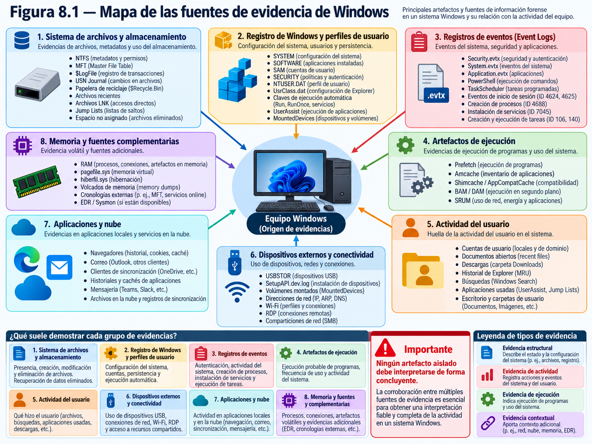
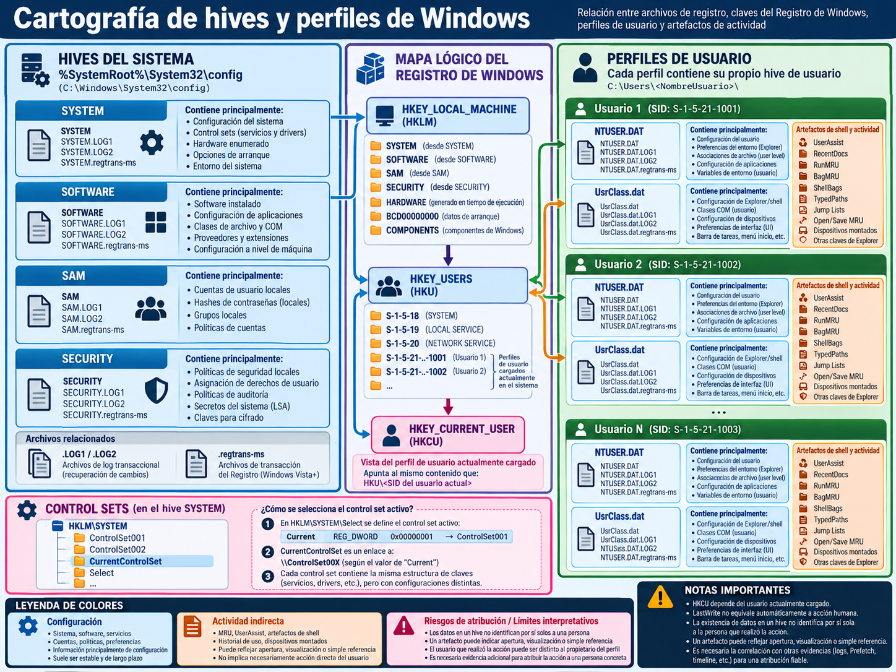
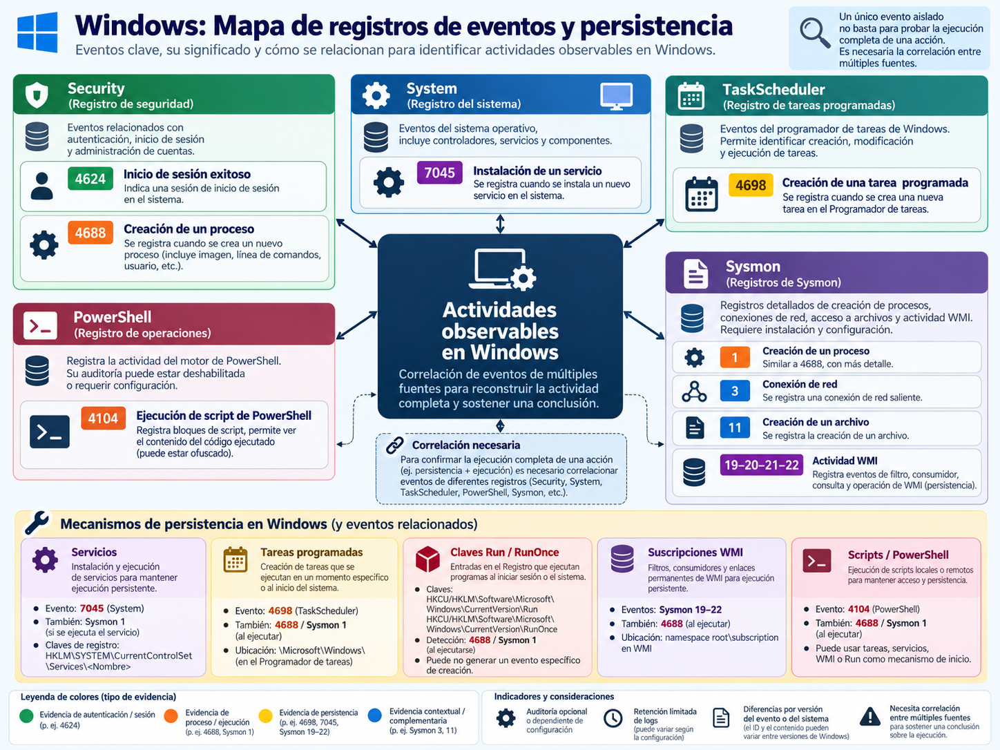
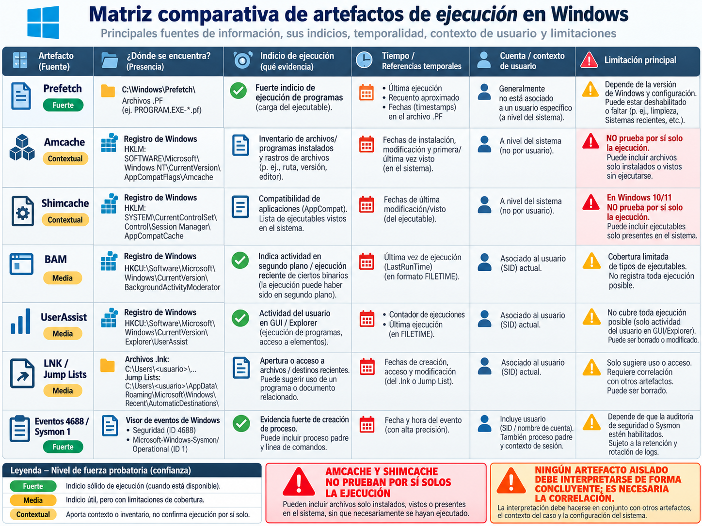
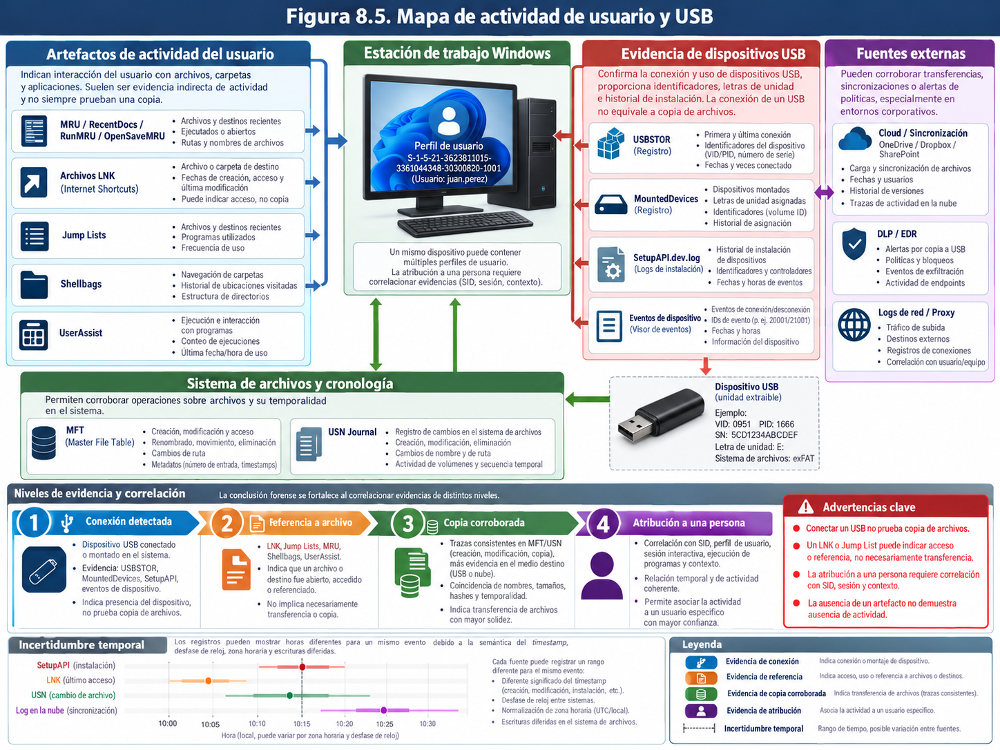
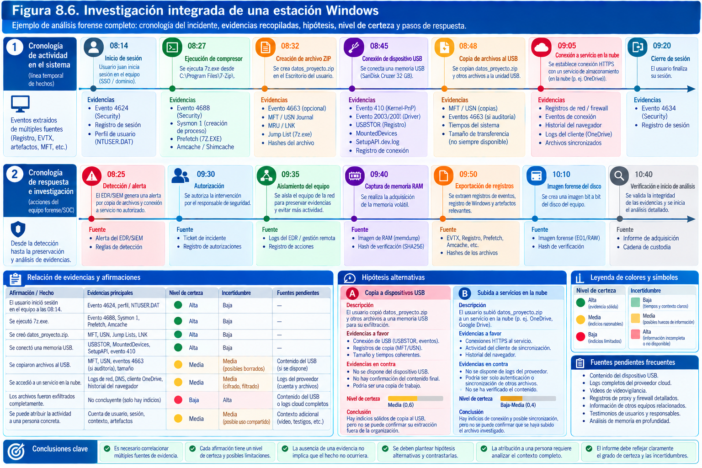

# Análisis forense de Windows

> "Behind the counter a boy with a shaven head stared vacantly into space, a dozen spikes of microsoft protruding from the socket behind his ear."
> "Detrás del mostrador, un chico con la cabeza rapada miraba fijamente al vacío, con una docena de púas de microsoft asomando por el conector tras su oreja."
>
> — William Gibson, Neuromancer (1984)

## Introducción

Una estación de trabajo con Windows no cuenta su historia mediante un único registro. La actividad que interesa a una investigación queda repartida entre el sistema de archivos, el Registro, los eventos, las bases de datos de aplicaciones, las estructuras de compatibilidad, los perfiles de usuario y, cuando existen, los sistemas de supervisión y servicios externos. Cada fuente fue diseñada para resolver una necesidad operativa diferente. Prefetch intenta acelerar determinadas cargas; el Registro conserva configuraciones y estados; el diario USN facilita el seguimiento de cambios del volumen; los registros de seguridad permiten auditar determinadas operaciones si la configuración lo admite. Ninguna de esas piezas fue creada como un acta pericial perfecta.

Por eso, investigar Windows no consiste en localizar una ruta conocida y traducir automáticamente su contenido a una afirmación sobre el comportamiento humano. La presencia de una referencia a un ejecutable no siempre demuestra que se ejecutó; un evento de autenticación no identifica necesariamente a quien estaba frente al teclado; una memoria USB conectada no acredita por sí sola que se copiaron documentos; y una ausencia de logs no prueba que no ocurrió la actividad buscada. El trabajo profesional convierte indicios de distinta naturaleza en una reconstrucción temporal razonada, con contrastes independientes y límites explícitos.

El capítulo se centra en Windows 10 y Windows 11, con referencias aplicables también a determinadas versiones de Windows Server. Las ubicaciones de artefactos, su estructura y su significado pueden variar entre compilaciones, ediciones, configuraciones empresariales y productos de terceros. Una investigación debe registrar la versión concreta del sistema, el alcance de la adquisición y la versión de los analizadores antes de interpretar resultados. Los nombres de productos mencionados son ejemplos de capacidades, no una garantía de exactitud universal ni una clasificación comercial de herramientas.

La secuencia propuesta va desde el reconocimiento general de fuentes hasta un caso completo de investigación en una estación corporativa. Los procedimientos de consulta se ilustran con comandos orientados a imágenes y copias de trabajo, y se advierte expresamente cuando una operación sobre un Windows encendido podría alterar la escena. La preservación, la custodia, las autorizaciones y los hashes de adquisición se han tratado en los capítulos anteriores; aquí se emplean como condiciones de partida para analizar qué sucedió dentro del entorno Windows.



## 1. Principales fuentes de evidencia

### 1.1. Windows como ecosistema de artefactos, no como una fuente única

Un sistema Windows mantiene múltiples estados simultáneamente. El almacenamiento contiene archivos, bases de datos, secuencias alternativas y metadatos de NTFS. La memoria contiene procesos, sesiones, conexiones y datos transitorios. Los componentes de seguridad generan eventos si están activados y disponen de retención. Las aplicaciones dejan historiales, cachés, archivos temporales y referencias a documentos. Los servicios corporativos pueden conservar actividad que ya no aparece en el equipo local.

En una investigación por posible extracción de información, las preguntas suelen ser más concretas que «¿se robó información?». Conviene distinguir si una cuenta inició sesión, si una carpeta fue explorada, si un archivo estaba disponible, si se abrió o copió, si se conectó un dispositivo extraíble, si se produjo una subida a un servicio remoto y si la secuencia puede vincularse a un usuario o proceso determinado. Cada pregunta requiere evidencias diferentes y tiene alternativas plausibles. El hecho de que todas esas preguntas se refieran al mismo equipo no las convierte en un único problema técnico.

Un inventario inicial de fuentes debe clasificar las fuentes por alcance y fiabilidad esperable:

| Familia | Ejemplos | Pregunta que puede apoyar | Limitación frecuente |
|---|---|---|---|
| Sistema de archivos | `$MFT`, `$UsnJrnl`, `$LogFile`, directorios | Qué objetos o cambios han quedado representados | Retención, reutilización y semántica de metadatos |
| Registro del sistema | `SYSTEM`, `SOFTWARE`, `SAM`, `SECURITY` | Configuración, identidades, dispositivos, persistencia | Actualización diferida, control sets y versiones |
| Registro de usuario | `NTUSER.DAT`, `UsrClass.dat` | Preferencias, actividad de shell y referencias | No todos los valores equivalen a acción consciente |
| Eventos | `Security.evtx`, `System.evtx`, canales operativos | Autenticación, procesos, servicios y actividad auditada | Políticas, filtrado, rotación y eliminación |
| Ejecución | Prefetch, Amcache, Shimcache, BAM, UserAssist | Presencia o posible ejecución de programas | Cobertura y fuerza probatoria distintas |
| Actividad documental | LNK, Jump Lists, MRU, Office, navegadores | Acceso o referencia a recursos y documentos | Eventos automáticos y artefactos incompletos |
| Periféricos | USBSTOR, USB, `MountedDevices`, SetupAPI | Identificación y conexión de dispositivos | Conexión distinta de copia de archivos |
| Memoria | RAM, procesos, conexiones y objetos del kernel | Estado en el momento de captura | Alta volatilidad y posible alteración durante adquisición |
| Telemetría adicional | Sysmon, EDR, proxy, DNS, identidad cloud | Contexto de procesos y comunicaciones | Puede no estar instalada o conservar todo |

La tabla es un mapa para formular solicitudes y no un inventario fijo que deba aparecer en cada equipo. Una organización puede impedir Prefetch en algunos servidores, habilitar Sysmon solo en ciertos equipos, redirigir perfiles, bloquear USB o aplicar una política de retención de eventos de duración limitada. La ausencia de un elemento en una imagen debe describirse después de comprobar que el artefacto es aplicable y que la adquisición cubría su ubicación.

### 1.2. Reconocimiento del sistema y versión examinada

Antes de convertir bytes en eventos, el analista necesita identificar la instalación: versión y compilación de Windows, arquitectura, idioma, zona horaria configurada, nombres de equipo y dominio, perfiles locales, unidades y posibles capas de cifrado. Los hives `SOFTWARE` y `SYSTEM` aportan parte de esta información, que puede contrastarse con directorios de sistema, registros de instalación, volúmenes y fuentes corporativas.

En un Windows disponible para una comprobación autorizada, los siguientes comandos ilustran qué datos se buscan. **Son consultas de un sistema de laboratorio; no se deben ejecutar por comodidad en el original si existe una adquisición suficiente.**

```powershell
Get-ComputerInfo | Select-Object WindowsProductName, WindowsVersion, OsBuildNumber,
    OsArchitecture, CsName
Get-TimeZone
Get-CimInstance Win32_OperatingSystem |
    Select-Object Caption, Version, BuildNumber, LastBootUpTime
Get-Volume | Select-Object DriveLetter, FileSystem, FileSystemLabel, Size
```

La salida de `Get-ComputerInfo` depende del entorno y la versión de PowerShell, y ciertos campos de nombre comercial pueden no reflejar por sí solos la edición real, especialmente después de actualizaciones mayores. El número de compilación, las claves de producto y los metadatos de instalación deben correlacionarse en caso de discrepancia. Una imagen tomada después de una actualización puede contener restos de la instalación anterior y perfiles migrados; esos vestigios no deben confundirse con el estado de producción en la fecha del incidente.

La zona horaria exige especial atención. Los eventos EVTX suelen incluir el instante UTC en su representación XML, pero las interfaces gráficas suelen convertirlo a la hora local del analista. Algunas bases de datos utilizan FILETIME, Unix epoch, WebKit timestamp o formatos propios. Una tabla forense debe preservar valor original, fuente, semántica, precisión, zona aplicada, corrección conocida del reloj y valor normalizado. No basta con pulsar «ordenar por fecha» en una herramienta que agrega orígenes heterogéneos.

### 1.3. Sistema de archivos y artefactos de volumen

Windows suele emplear NTFS en volúmenes de sistema de uso general; determinadas unidades externas pueden usar exFAT u otros formatos. En NTFS, la Master File Table (`$MFT`) conserva registros de objetos con identificadores y atributos; el diario de cambios (`$Extend\$UsnJrnl`) registra determinadas operaciones y puede rotar; el archivo de transacciones (`$LogFile`) refleja actividad del sistema de archivos con finalidad de recuperación transaccional. No son tres copias de la misma historia.

Un registro de `$MFT` puede aportar nombres, referencias de directorio y marcas de tiempo, pero las entradas se reutilizan. Los números de registro y secuencia ayudan a distinguir instancias; un nombre aparentemente familiar no basta para concluir continuidad entre dos objetos. Los atributos `$STANDARD_INFORMATION` y `$FILE_NAME` contienen marcas temporales con semánticas distintas y actualizaciones que dependen de operaciones concretas. Una diferencia entre ambas no es, por sí sola, prueba de manipulación de fechas.

El diario USN registra razones de cambio como creación, eliminación o renombrado; no equivale a un diario exhaustivo de operaciones humanas ni permite reconstruir automáticamente el contenido anterior. Microsoft advierte que pueden combinarse diversas modificaciones en el mismo registro y que los registros antiguos pueden eliminarse. A su vez, `$LogFile` requiere analizar transacciones y compensaciones; no conviene utilizarlo para adjudicar acciones a una cuenta sin otras fuentes.

Las instantáneas de volumen (*Volume Shadow Copy Service*, VSS), si están disponibles y son recuperables, ofrecen estados anteriores de algunos archivos y metadatos. Su existencia no es obligatoria: puede haber equipos sin copias, instantáneas eliminadas o volúmenes excluidos. Comparar varios estados puede revelar que un objeto existió antes de una fecha, no necesariamente la hora exacta de su creación o eliminación. Las instantáneas permiten ampliar la ventana retrospectiva, pero también introducen una dimensión temporal distinta de la captura actual.

### 1.4. Qué significa que un registro no aparezca

Uno de los errores más costosos en un informe consiste en pasar de «no he encontrado» a «no existió». Un registro puede faltar porque no estaba habilitado, porque se borró, porque rotó, porque quedó fuera de la adquisición o porque la aplicación que lo generaba cambió de comportamiento. Las posibilidades son técnicamente diferentes. Antes de usar una ausencia como dato negativo debe determinarse si el mecanismo habría registrado ese hecho y si su cobertura era suficiente durante la ventana investigada.

Por ejemplo, si el equipo no tenía habilitada la auditoría de creación de procesos, la ausencia del evento de seguridad 4688 no descarta una ejecución. Si Prefetch está desactivado, no habrá archivos `.pf` nuevos que examinar. Si una ejecución se produjo dentro de un contenedor, una máquina virtual o por acceso remoto, su huella local puede ser diferente de la esperada. Un analista no debe extrapolar un comportamiento observado en una imagen de laboratorio a todas las compilaciones Windows sin comprobarlo.

Una formulación válida sería: «En el conjunto de registros Security adquirido, que cubre de forma comprobada del día 12 al 18, no se observó un evento 4688 referente al ejecutable; la política de auditoría disponible no permite confirmar que todos los lanzamientos se registraran». Esa frase delimita una búsqueda y evita convertir un resultado negativo débil en una prueba de inocencia o culpabilidad.

### 1.5. Fuentes internas y externas: necesidad de corroboración

Un equipo unido a un dominio puede depender de Active Directory y registrar localmente algunos sucesos mientras los controladores de dominio conservan otros. Los accesos a Microsoft 365, servicios de almacenamiento y aplicaciones SaaS dejan eventos en el proveedor, no necesariamente en la estación. Una dirección IP, el nombre de un host y un identificador de sesión pueden unir esas fuentes, pero solo si las marcas temporales, las traducciones NAT, la retención y los identificadores se manejan correctamente.

La evidencia de red también puede explicar un suceso que los rastros locales no esclarecen. Una consulta DNS no acredita una descarga; una conexión TLS a una dirección remota puede ser insuficiente para identificar qué documento se transfirió; un registro de proxy puede mostrar una petición sin demostrar que llegó a completarse. La mejor reconstrucción posible suele resultar del cruce de fuentes: disco y memoria para el estado del equipo, Registro y eventos para operaciones locales, y fuentes corporativas para autenticación y tránsito de información.

### 1.6. Preparación de una recogida focalizada

Cuando el alcance requiere un triaje rápido, se priorizan artefactos según volatilidad, probabilidad de pérdida y relevancia, no por una lista universal. Los EVTX pueden rotar mientras la estación sigue operativa; las colas EDR pueden tener retención corta; las bases de datos de navegador pueden modificarse en segundos; las hives vivas necesitan técnicas coherentes de adquisición. Una recogida focalizada es útil cuando el tiempo es limitado, pero debe ser honesta respecto de todo aquello que deja fuera.

Una estructura de trabajo puede separar `originales/`, `adquisiciones/`, `derivados/`, `registros/` e `informes/`. Dentro del expediente, una tabla registra identificador, ruta dentro de la imagen, extracción realizada, herramienta y versión, hash del objeto extraído, responsable, hora y observaciones. La extracción de artefactos no transforma una copia selectiva en una imagen de disco completa; cada representación debe conservar su propia identidad.

Un conjunto mínimo destinado a investigar actividad local podría incluir los hives principales con sus logs transaccionales, los EVTX de los canales relevantes, Prefetch, Amcache, accesos recientes, Jump Lists, LNK, historia USB y metadatos de NTFS. Si se sospecha movimiento de información a la nube, los registros del proveedor y del proxy podrían tener mayor valor que algunos artefactos de ejecución. En todo caso, deben preservarse las condiciones de autorización: que algo sea técnicamente accesible no significa que esté incluido en el encargo.

### 1.7. Tratamiento de datos sensibles en el análisis Windows

Las imágenes de Windows contienen información que puede ser irrelevante y especialmente sensible: correos, credenciales derivadas, historiales, comunicaciones privadas, datos sanitarios y claves utilizadas por aplicaciones. Incluso un simple volcado de logs puede incluir rutas con nombres personales, direcciones de correo y parámetros de línea de comandos. El laboratorio debe aplicar permisos por caso, cifrado, registro de accesos y minimización en las salidas, sin destruir datos que deban conservarse como evidencia.

No se recomienda incluir en el informe principal el contenido íntegro de un perfil si bastan referencias a identificadores y fragmentos relevantes. Cuando el análisis exige revisar un objeto privado, debe registrarse la finalidad y mantenerlo en anexos protegidos si corresponde. De igual modo, exportar de forma indiscriminada claves o contraseñas de un sistema intervenido no es una consecuencia necesaria de todo análisis forense; exige un alcance específico y justificado.

## 2. Registro de Windows y perfiles de usuario

### 2.1. Un sistema de configuración con valor probatorio indirecto

El Registro de Windows es una base de datos jerárquica utilizada por componentes del sistema y aplicaciones. Sus claves contienen valores de distintos tipos, subclaves y metadatos de modificación. En una investigación puede aportar información de usuarios, dispositivos, servicios, ejecución indirecta, instalaciones, preferencias, aplicaciones y actividad de la interfaz. Sin embargo, no es un diario universal en el que cada lectura o modificación quede registrada con autor y motivo.

Es imprescindible distinguir las raíces lógicas mostradas por el Editor del Registro de los archivos físicos que el analista adquiere. `HKEY_LOCAL_MACHINE` representa información de sistema; `HKEY_USERS` incorpora hives de usuarios cargados; `HKEY_CURRENT_USER` es una vista contextual del hive del usuario de la sesión que consulta. Si un analista examina `HKCU` en su propia estación, está viendo su contexto, no necesariamente el perfil investigado. La interpretación offline requiere relacionar cada archivo con su SID y ruta de origen.

### 2.2. Hives del sistema y su localización

Entre los archivos relevantes se encuentran normalmente:

| Hive | Ruta típica en Windows | Utilidad principal |
|---|---|---|
| `SYSTEM` | `C:\Windows\System32\config\SYSTEM` | Servicios, control sets, dispositivos y configuración de arranque |
| `SOFTWARE` | `C:\Windows\System32\config\SOFTWARE` | Productos, sistema operativo, instalaciones y configuración de software |
| `SAM` | `C:\Windows\System32\config\SAM` | Cuentas y grupos locales, con información restringida |
| `SECURITY` | `C:\Windows\System32\config\SECURITY` | Políticas y datos de seguridad local protegidos |
| `DEFAULT` | `C:\Windows\System32\config\DEFAULT` | Configuración correspondiente al contexto predeterminado del sistema, no plantilla general de todos los usuarios |
| `NTUSER.DAT` | `C:\Users\<usuario>\NTUSER.DAT` | Configuración del perfil y preferencias asociadas a HKCU |
| `UsrClass.dat` | `C:\Users\<usuario>\AppData\Local\Microsoft\Windows\UsrClass.dat` | Configuración por usuario relacionada con clases y shell |
| `Amcache.hve` | `C:\Windows\AppCompat\Programs\Amcache.hve` | Inventario y compatibilidad de archivos y programas |

La existencia y ubicación exactas deben comprobarse en el caso real. Un perfil puede residir en una unidad distinta, estar redirigido, ser temporal o haberse eliminado. Las claves de un dominio no equivalen a las cuentas locales del SAM; la consulta a un controlador de dominio puede ser indispensable para identificar una cuenta del entorno empresarial.

El hive original debe adquirirse junto con sus ficheros de transacción aplicables, como `.LOG1` y `.LOG2`, si existen. Una copia aislada puede reflejar un estado inconsistente si había escrituras pendientes. Los analizadores capaces de reproducir las transacciones pueden reconstruir un estado más coherente; esa operación debe documentarse como procesamiento sobre un derivado, sin presentar el resultado como bytes idénticos al hive base de la imagen.

### 2.3. Control sets y configuración activa

El hive `SYSTEM` suele conservar diferentes conjuntos de control bajo claves `ControlSet00x`. La clave `Select` contiene referencias como `Current`, `Default` o `LastKnownGood`, según versión y configuración. `CurrentControlSet` es una vista dinámica del conjunto activo mientras Windows está ejecutándose; al analizar offline, esa vista puede no existir como clave física persistente. Un analizador serio debe resolver el control set correspondiente y mostrar cuál utilizó.

Esta distinción resulta importante al revisar `Services`, `Enum`, configuraciones de red y persistencia. Encontrar una entrada bajo un control set no demuestra que estaba activa al instante de interés. Tampoco debe eliminarse una diferencia como «duplicado»: puede reflejar configuraciones distintas para el arranque o la recuperación. La validez de la conclusión depende de identificar la instalación, la fecha de adquisición y el estado de arranque.

### 2.4. Claves LastWrite y su significado

Muchas claves del Registro tienen una marca `LastWrite` que representa una modificación de esa clave, no necesariamente de un valor concreto y mucho menos el uso de la configuración. La semántica depende de lo que modifique Windows o la aplicación. Una clave asociada a un dispositivo con `LastWrite` reciente puede haber cambiado por detección, actualización de controlador u otra operación; no demuestra automáticamente una primera conexión.

En ciertos artefactos se usan valores FILETIME explícitos, estructuras binarias y cadenas que incluyen sus propios tiempos. No debe sustituirse el tiempo interno por el `LastWrite` de la clave sin justificarlo. Cuando la herramienta presenta una fecha derivada, el analista ha de conservar al menos el tipo de campo, la interpretación realizada y su normalización. Si la fecha es incompatible con el resto de la secuencia, se investiga el motivo antes de descartarla o presentarla como anomalía maliciosa.

### 2.5. Identidades, SIDs y perfiles locales

En Windows, los SID identifican entidades de seguridad con mayor estabilidad que los nombres visibles. El nombre de una cuenta puede cambiar, mientras que el SID asociado sigue permitiendo relacionar su perfil y ciertos artefactos. Bajo `HKLM\SOFTWARE\Microsoft\Windows NT\CurrentVersion\ProfileList` suele encontrarse una correspondencia entre SIDs y rutas de perfiles. Se debe contrastar con cuentas locales o de dominio, servicios y sesiones, porque un perfil no prueba por sí solo presencia física ni uso exclusivo.

Si un perfil corresponde a una cuenta compartida, las referencias registradas dentro de él tienen atribución personal débil. Si la estación está gestionada por un sistema que ejecuta tareas bajo una cuenta de usuario, también pueden existir actividades automáticas. Por eso conviene formular afirmaciones como «el artefacto se encuentra en el hive correspondiente al SID X» o «la tarea se ejecutó en un contexto asociado a esa cuenta», reservando la atribución personal para evidencias adicionales.

### 2.6. Políticas de ejecución y claves de inicio automático

Las rutas de autoarranque incluyen ubicaciones conocidas como:

```text
HKLM\SOFTWARE\Microsoft\Windows\CurrentVersion\Run
HKLM\SOFTWARE\Microsoft\Windows\CurrentVersion\RunOnce
HKCU\SOFTWARE\Microsoft\Windows\CurrentVersion\Run
HKCU\SOFTWARE\Microsoft\Windows\CurrentVersion\RunOnce
```

Las claves bajo HKLM afectan generalmente al contexto de sistema o a diversos usuarios, mientras que las de HKCU son específicas del perfil. Su existencia puede apoyar una hipótesis de persistencia, pero no determina por sí sola que un programa arrancara efectivamente. Es necesario comprobar ruta, existencia del archivo, permisos, restricciones, logs y actividad de ejecución. También hay persistencia fuera de estas rutas: servicios, tareas, WMI, extensiones de shell, carpetas Startup y otros mecanismos legítimos o abusados.

Un valor Run que apunta a `C:\Users\Public\Updater\agent.exe` merece examen por su contexto, no porque esa ruta pruebe malicia. Se investigan el binario, la firma, los hashes, la cadena de instalación, el usuario con permisos sobre el directorio y los eventos que indiquen su creación. Renombrar un ejecutable para que recuerde un componente del sistema es un comportamiento posible de un actor malicioso, pero también pueden existir herramientas internas mal documentadas.

### 2.7. Configuración de red y conexiones conocidas

El Registro puede almacenar perfiles de red, parámetros de adaptadores, configuraciones TCP/IP y referencias históricas a redes utilizadas. Estas fuentes ayudan a ubicar un equipo en diferentes entornos, especialmente cuando se correlacionan con DHCP, VPN, Wi-Fi y logs de red. Los nombres de redes guardados no prueban que el equipo estuviera físicamente en un lugar determinado durante toda una franja temporal. El identificador de un punto de acceso o red corporativa también puede aparecer por importaciones de configuración y cambios de hardware.

La investigación de conexiones externas requiere más que un perfil de red: se revisan eventos de autenticación, logs de VPN, tablas y conexiones capturadas en memoria, DNS, proxy, firewall y EDR. Una sesión de red activa en la captura no siempre ha estado activa durante todo el incidente; una entrada histórica puede haber expirado antes de adquirir la máquina.

### 2.8. Actividad de shell en NTUSER.DAT y UsrClass.dat

El shell de Windows conserva numerosas preferencias y huellas de interacción. Entre las familias conocidas destacan `UserAssist`, `RecentDocs`, `RunMRU`, `TypedPaths`, `OpenSavePidlMRU`, `LastVisitedPidlMRU`, `ComDlg32` y `ShellBags`. Sus rutas precisas, representaciones y comportamiento varían entre generaciones del sistema. Algunas registran diálogos de apertura o guardado, otras referencias a programas lanzados desde Explorer y otras vistas de carpetas.

Una entrada en `RecentDocs` puede apoyar que un nombre de archivo fue relevante para un perfil, pero no acredita por sí sola que ese documento se leyera o que su contenido completo estuviera presente. Los diálogos comunes pueden registrar rutas seleccionadas aun cuando una operación se cancelara después. Las ShellBags permiten estudiar configuraciones de vistas de carpetas y pueden sobrevivir a la desaparición de una ruta, pero la fecha de una clave no debe transformarse sin análisis en «el usuario abrió esta carpeta en ese momento».

Para un estudio de movimiento de archivos, estos artefactos cobran valor al combinarse con Jump Lists, accesos recientes, historial de aplicación y NTFS. La fuerza de una reconstrucción no deriva de multiplicar capturas de la misma base de datos: diez herramientas que interpretan el mismo valor del Registro no equivalen a diez fuentes independientes.



### 2.9. Extracción y comprobación offline de hives

El procesamiento de hives se realiza preferentemente sobre copias verificadas. Entre las herramientas utilizadas en laboratorios se encuentran Registry Explorer, RECmd, RegRipper y bibliotecas de análisis del Registro, siempre que sus versiones y módulos estén validados para la construcción de Windows investigada. El objetivo inicial no es ejecutar todos los complementos, sino seleccionar los que responden a las preguntas del caso.

Un procedimiento verificable suele seguir esta secuencia: registrar hash del hive y ficheros de transacción, identificar ruta de origen, confirmar el SID del usuario, indicar el módulo y versión de parser, comprobar que reconoce el formato, guardar salida estructurada y revisar manualmente un subconjunto representativo. Las advertencias del parser se conservan; una clave con estructura inesperada no debe desaparecer del informe sin una nota.

En entornos Windows de prueba, `reg query` puede mostrar determinadas claves sin editar sus valores:

```powershell
reg query 'HKLM\SOFTWARE\Microsoft\Windows NT\CurrentVersion' /v CurrentBuild
reg query 'HKLM\SOFTWARE\Microsoft\Windows NT\CurrentVersion\ProfileList' /s
reg query 'HKCU\Software\Microsoft\Windows\CurrentVersion\Run'
```

Estos comandos leen el estado vivo, no el estado previo de una imagen. Si se emplean durante respuesta a incidentes, deben registrarse hora, identidad, motivo y entorno. No reemplazan una adquisición formal de hives ni documentan todas las transacciones en curso.

### 2.10. Restauración, copias previas y límites de RegBack

Las copias históricas del Registro, los puntos de restauración y las instantáneas pueden ofrecer estados distintos de una misma clave. Desde Windows 10 versión 1803, Microsoft dejó de crear por defecto determinadas copias automáticas del Registro en `RegBack`; que exista la carpeta no significa que contenga hives utilizables. En una investigación actual es necesario verificar realmente el tamaño, fecha, procedencia y consistencia de cada copia, sin presuponer que existe una copia de seguridad completa.

Comparar un valor entre dos estados puede demostrar que cambió entre ambos, pero no identificar el instante exacto de modificación ni a la persona responsable. Si un servicio está en una instantánea y ausente en otra, se investiga además cuándo se registró, si hubo actualización de software y cómo encajan los eventos del Service Control Manager. La comparación retrospectiva es más poderosa cuando se combina con registros de cambios del sistema de archivos y del sistema de despliegue corporativo.

### 2.11. Valor del Registro en hipótesis rivales

Supongamos que una carpeta de un usuario contiene referencias recientes a una utilidad de sincronización. Hay varias explicaciones: instalación voluntaria, ejecución de un paquete corporativo, actualización automática, software que utilizó la biblioteca compartida o mera presencia residual de una instalación anterior. El Registro puede revelar claves de instalación, tareas o valores Run; Amcache aporta referencias a programas; los logs pueden mostrar una ejecución; y el proxy una conexión. Sin ese contraste, la conclusión «el usuario sincronizó documentos» es prematura.

Una buena práctica consiste en abrir una tabla de hipótesis antes de interpretar claves: *H1: instalación y uso autorizado; H2: ejecución manual no autorizada; H3: despliegue automático; H4: artefactos residuales de uso anterior*. Para cada una se identifican predicciones verificables. Por ejemplo, un despliegue corporativo debería tener registros de inventario o distribución; una ejecución manual podría dejar UserAssist o Prefetch si las condiciones lo permiten. Una predicción incumplida debilita una hipótesis solo si la fuente era realmente observable.

## 3. Registros de eventos y mecanismos de persistencia

### 3.1. El modelo de eventos Windows

Los registros de eventos son una de las fuentes más utilizadas para reconstruir actividad en Windows porque pueden proporcionar identificadores, tiempos, proveedores y datos de contexto. Sin embargo, cada entrada representa lo que un componente emitió bajo una configuración concreta. La existencia de un evento no garantiza que el fenómeno investigado terminara con éxito y su ausencia no significa que nunca ocurriera.

Los registros modernos se almacenan habitualmente en formato EVTX, bajo `C:\Windows\System32\winevt\Logs\`, aunque pueden redirigirse, archivarse o exportarse. Los canales clásicos `System`, `Application` y `Security` conviven con numerosos canales de aplicaciones y servicios. Windows Event Log utiliza proveedores que publican eventos con identificador, versión, palabras clave, nivel y atributos. Dos eventos con el mismo número de identificación pero proveedores diferentes no tienen por qué significar lo mismo. Por tanto, una tabla pericial debe identificar **proveedor, canal, ID, versión y campos relevantes**.

El elemento `TimeCreated` de la representación XML proporciona un tiempo para ese evento, que debe normalizarse con su precisión y el estado del reloj de origen. Los campos `EventRecordID` permiten reconocer la posición relativa dentro de un canal, pero no son identificadores globales de acciones ni pruebas de integridad de toda la secuencia. Un fichero EVTX puede contener lagunas por rotación, configuración, pérdida de registros y otros factores. El análisis debe registrar el periodo temporal cubierto y cuándo empiezan y terminan las entradas disponibles.

### 3.2. Política de auditoría: condición previa para interpretar ausencias

Windows admite políticas de auditoría básicas y avanzadas. La configuración determina qué se registra, con posibles diferencias entre éxitos y fallos. La política puede modificarse por GPO, MDM o administradores y no siempre coincide con la que estuvo vigente durante el incidente. Resulta útil adquirir evidencia histórica de políticas corporativas y cambios, en vez de limitarse a ejecutar una consulta sobre el estado actual.

En una estación de prueba, `auditpol` informa sobre ciertas subcategorías configuradas:

```powershell
auditpol /get /category:*
Get-WinEvent -ListLog Security, System, Application |
    Select-Object LogName, RecordCount, MaximumSizeInBytes, LogMode
```

La salida solo describe la configuración observada, no prueba cómo estaba configurada el mes anterior. Algunos eventos dependen además de listas de control de auditoría del objeto (*SACL*) y de políticas específicas. En particular, el evento 4663 de acceso a objeto no debe esperarse para cualquier lectura de archivo: precisa condiciones de auditoría y atributos del objeto adecuados. Si el sistema solo registraba inicios de sesión, no se puede exigir que explique todas las aperturas de documentos.

Los logs pueden conservar datos personales o de seguridad, como nombres de cuenta, direcciones de equipos, parámetros y rutas. Su acceso ha de seguir el ámbito autorizado y sus exportaciones han de tratarse como evidencias derivadas; la copia desde un equipo en marcha es una intervención distinta de examinar el archivo EVTX ya adquirido en una imagen.

### 3.3. Eventos de autenticación y sesiones

Los eventos del canal `Security` permiten examinar ciertos inicios de sesión y cambios de identidad. El ID 4624 registra la creación satisfactoria de una sesión de inicio de sesión en el equipo donde se generó; 4625 corresponde a un intento fallido. El tipo de inicio de sesión (*Logon Type*) es esencial para evitar confundir una sesión interactiva con una conexión de red:

| ID o dato | Significado orientativo | Precaución de interpretación |
|---|---|---|
| 4624 tipo 2 | Inicio interactivo local | No prueba qué persona utilizó físicamente la sesión |
| 4624 tipo 3 | Acceso de red | Puede proceder de servicios y procesos automáticos |
| 4624 tipo 5 | Inicio por servicio | No equivale a un usuario sentado en el equipo |
| 4624 tipo 7 | Desbloqueo | Interpretar con cuenta, contexto y secuencia |
| 4624 tipo 9 | Credenciales nuevas | Identidad local y credenciales remotas pueden diferir |
| 4624 tipo 10 | Inicio remoto interactivo, como RDP | Requiere contrastar IP, host y registros del servicio |
| 4624 tipo 11 | Inicio interactivo con credenciales en caché | No supone autenticación online reciente del dominio |
| 4625 | Inicio fallido | No demuestra por sí solo un ataque de fuerza bruta |
| 4634 | Cierre de sesión de inicio de sesión | No siempre representa final de presencia física |
| 4647 | Cierre iniciado por usuario | No garantiza por sí solo que no quedaran procesos |
| 4648 | Intento de inicio usando credenciales explícitas | Examinar proceso y contexto de las credenciales |
| 4672 | Privilegios especiales asociados a una sesión | Puede ser normal en cuentas administrativas |
| 4778/4779 | Reconexión y desconexión de sesión de Terminal Services | Correlacionar con canales de RDP y host remoto |

Un `Logon ID` ayuda a correlacionar sucesos de una misma sesión en un host, sujeto a sus límites temporales y al reinicio del sistema. El nombre visible de la cuenta no basta si la cuenta fue renombrada; conviene conservar el SID cuando esté disponible. La dirección de origen puede estar vacía o no ser concluyente, y un servidor de salto o una VPN pueden introducir varias direcciones diferentes. La reconstrucción de una sesión remota debe considerar registros del equipo destino, del cliente, del gateway y de autenticación corporativa.

Un caso ilustrativo: un 4624 tipo 10 aparece a las 02:10 UTC y, cinco minutos después, se instala un servicio. Ambos eventos en el mismo equipo no prueban automáticamente que la persona que inició RDP instalara el servicio. Se investiga si existe una sesión relevante, un proceso que creó la instalación, los tokens utilizados, el servicio remoto invocado y la posibilidad de que una administración automatizada haya efectuado la operación.

### 3.4. Creación de procesos y acciones auditadas

El evento 4688 permite estudiar creación de procesos cuando la auditoría correspondiente está activada. Según política y versión, puede contener ruta, proceso creador, identificadores de seguridad y línea de comandos. La captura de parámetros de línea de comandos requiere configuración adecuada y debe considerarse su sensibilidad. El evento 4689, si está habilitado, puede aportar información de terminación de procesos.

No debe suponerse que todos los eventos 4688 contienen el mismo conjunto de campos. Las versiones del evento y los cambios de Windows determinan qué información está disponible. El analista ha de comprobar si los identificadores de proceso se han reutilizado, correlacionar con el tiempo y, si existe, utilizar también el `ProcessGuid` de Sysmon. Un PID aislado no identifica de forma persistente un proceso durante días ni entre reinicios.

En una revisión de eventos de un **laboratorio**, se puede filtrar una exportación cargada con PowerShell:

```powershell
# Analizar una copia de eventos, no el canal vivo del original.
Get-WinEvent -Path '.\evidencia\Security.evtx' |
    Where-Object { $_.Id -in 4624, 4625, 4688, 4698, 1102 } |
    Select-Object TimeCreated, Id, ProviderName, RecordId, Message |
    Export-Csv '.\derivados\eventos-filtrados.csv' -NoTypeInformation -Encoding UTF8
```

Este ejemplo es ilustrativo y no constituye una extracción completa de campos. Filtrar a través de `Message` presenta problemas de localización, saltos de línea y plantillas de mensajes faltantes. Para análisis reproducibles conviene parsear el XML y los `EventData`/`UserData` por nombre de campo, respetando la versión del evento y el proveedor. Además, al procesar EVTX corruptos o incompletos es necesario conservar los errores que impidan extraer registros.

### 3.5. Servicios como mecanismo de persistencia

El Service Control Manager administra servicios del sistema. Su configuración aparece en general dentro de `HKLM\SYSTEM\ControlSet00x\Services`; la creación de un servicio puede dejar el evento 7045 del proveedor Service Control Manager en `System`. Con auditoría correspondiente, el evento 4697 del canal `Security` también puede ser relevante. El registro de un servicio no acredita por sí solo que se iniciara, que su ejecutable funcionara correctamente ni que fuera malicioso.

El análisis se centra en nombre de servicio, tipo, ruta `ImagePath`, cuenta de ejecución, inicio automático o manual, dependencias y parámetros. Debe seguirse la ruta completa, no solo una coincidencia del nombre del archivo. Una ruta aparentemente legítima en `System32` puede apuntar a un binario legítimo o a otro alterado; una ruta en `ProgramData` puede corresponder a software corporativo. La validación se hace mediante hash, firma, historial de instalación, propiedad y eventos de ejecución.

En máquinas Windows, el comando `sc.exe qc` consulta un servicio determinado, y `Get-CimInstance Win32_Service` permite conocer configuraciones actuales:

```powershell
Get-CimInstance Win32_Service |
    Select-Object Name, State, StartMode, StartName, PathName
sc.exe qc 'NombreDelServicioDePrueba'
```

Esta consulta sobre sistema encendido se reserva para laboratorios o intervenciones autorizadas. El estado en la fecha de consulta no demuestra cuál era su estado durante el incidente. En una imagen offline resulta preferible examinar `SYSTEM`, los eventos y la existencia del ejecutable, además de sus modificaciones temporales.

### 3.6. Tareas programadas y su relación con el Registro

El Programador de tareas es un mecanismo legítimo de automatización y una vía habitual de persistencia. Las definiciones de tareas se encuentran normalmente bajo `C:\Windows\System32\Tasks\` y existen metadatos asociados en el Registro, en claves del servicio TaskCache. Pueden registrarse eventos en el canal `Microsoft-Windows-TaskScheduler/Operational` y, con políticas adecuadas, eventos de seguridad 4698, 4699 y 4702 para creación, eliminación y modificación. La existencia de una definición no significa ejecución real.

Una tarea debe analizarse como una relación entre **desencadenador, principal, acción, condiciones y estado**. Una acción puede lanzar un binario, un script, una tarea COM o una utilidad del sistema. Su nombre descriptivo puede ser inocuo aunque el comando sea relevante; también es frecuente encontrar tareas legítimas con nombres poco intuitivos. El registro de ejecución del Programador puede estar deshabilitado o incompleto y requiere contraste con procesos y accesos de archivo.

En un laboratorio, una consulta de solo lectura devuelve los campos de las tareas presentes:

```powershell
Get-ScheduledTask |
    Select-Object TaskPath, TaskName, State
Get-ScheduledTaskInfo -TaskName 'TareaDePrueba'
```

`LastRunTime` es un dato operativo y no necesariamente una evidencia suficiente de quién disparó una tarea. Se necesitan eventos, procesos, logs de la aplicación y conocimiento de las condiciones programadas. Si la tarea pertenece a una configuración gestionada, puede haber sido recreada por GPO o agentes de administración sin intervención directa del usuario local.

### 3.7. WMI, suscripciones permanentes y persistencia menos visible

Windows Management Instrumentation (WMI) permite automatizar acciones administrativas mediante consultas, filtros y consumidores de eventos. Algunas suscripciones permanentes pueden utilizarse legítimamente para operaciones de mantenimiento o abusarse para ejecutar código. La prueba no consiste solo en encontrar una clase o repositorio WMI, sino en identificar una relación funcional entre filtro, consumidor y vínculo, comprobar el comando o script ejecutable y buscar si se activó.

Sysmon, cuando está instalado y configurado para ello, puede generar los eventos 19, 20 y 21 sobre creación de filtros, consumidores y enlaces WMI. Su existencia aporta visibilidad, pero no convierte toda suscripción en actividad maliciosa ni cubre necesariamente instalaciones anteriores a la activación. La adquisición de la configuración y repositorios WMI deberá adaptarse al sistema y a la herramienta validada.

También existen mecanismos como carpetas de inicio, claves Winlogon y extensiones de ejecución, elementos COM, proveedores de servicios y políticas de inicio de sesión. Enumerarlos de forma indiscriminada genera ruido. Es más útil partir de una hipótesis: qué proceso se mantiene entre reinicios, con qué cuenta, por qué mecanismo, cuándo se estableció y qué registros confirmarían su activación.

### 3.8. PowerShell y sus fuentes de registro

PowerShell forma parte de la administración ordinaria de Windows, por lo que su presencia no es indicio automático de intrusión. Puede ejecutar comandos interactivos, scripts firmados, tareas y herramientas de automatización. Su análisis exige diferenciar versión, host, política de registro y objetivo: la consola interactiva, un proceso de servicio y PowerShell 7 pueden registrar en canales distintos.

En Windows PowerShell 5.1, con *Script Block Logging* habilitado, los eventos 4104 se almacenan en `Microsoft-Windows-PowerShell/Operational`. PowerShell 7 puede utilizar el canal `PowerShellCore/Operational` con registro adecuado. La cobertura depende de las políticas y no debe afirmarse que todo comando ejecutado acabará necesariamente en un único EVTX. Cuando hay registros de módulos, transcripciones o reenvío centralizado, constituyen fuentes adicionales; las transcripciones pueden almacenar datos confidenciales que deben protegerse.

La investigación puede necesitar reconstruir un script dividido en varios eventos, correlacionarlo con 4688 o Sysmon 1 y comprobar el resultado sobre el sistema de archivos. Un 4104 que contiene el texto de un comando no demuestra que se completara con éxito; la ejecución puede haber fallado o haberse cancelado. A la inversa, la ausencia de 4104 no descarta actividad PowerShell si la funcionalidad no estaba configurada o si los registros fueron eliminados.

### 3.9. Sysmon como telemetría complementaria

Sysmon, de Microsoft Sysinternals, es una fuente adicional muy valiosa cuando se ha desplegado y se ha documentado su configuración. No forma parte de un conjunto uniforme de eventos disponible por defecto en todas las instalaciones Windows. Sus reglas pueden excluir o incluir eventos, y determinadas clases —como conexiones de red— pueden estar deshabilitadas según configuración. El documento de configuración y su historial son parte del contexto necesario para interpretar ausencias.

Algunos eventos frecuentes son:

| ID de Sysmon | Tipo de actividad | Principal valor y limitación |
|---|---|---|
| 1 | Creación de proceso | Proceso, padre, comando y GUID; depende de configuración y retención |
| 2 | Cambio de fecha de creación de archivo | Aporta indicio de modificación temporal, no malicia automática |
| 3 | Conexión de red | Correlación proceso-red, si se habilitó |
| 7 | Carga de imagen | Detección de módulos, con volumen potencialmente alto |
| 8 | Hilo remoto | Señal técnica contextual, no prueba aislada de inyección |
| 10 | Acceso a proceso | Útil en secuencias sospechosas, con falsos positivos |
| 11 | Creación de archivo | Rastros de escritura, si cubiertos por filtros |
| 12–14 | Modificaciones de Registro | Creación, eliminación y cambios de valores según reglas |
| 19–21 | WMI | Registro de filtro, consumidor y enlace WMI |
| 22 | Consulta DNS | Contexto de resolución, sin acreditar transferencia |
| 23/26 | Borrado de archivo | Diferencia entre archivado y detección según tipo y configuración |

No todos los eventos existen en todas las versiones; el esquema exacto debe comprobarse en la documentación de la versión desplegada. La presencia de un `ProcessGuid` ayuda a relacionar eventos con más estabilidad que el PID aislado, pero la correlación sigue exigiendo contexto de host y origen. El evento 3 registra determinada conexión, no su contenido; el 22 muestra resolución DNS, no visita completada; y el 11 puede referirse a actividad normal de aplicaciones.

### 3.10. Microsoft Defender y EDR

Microsoft Defender Antivirus y las soluciones EDR pueden conservar alertas, detecciones, estados de cuarentena, cambios de configuración y actividad de procesos. Algunas fuentes residen en canales Windows, otras en sistemas centralizados con su propio periodo de retención. Si la investigación comenzó tras una alerta, conviene preservar tanto el mensaje original como la telemetría enriquecida, ya que las consolas pueden actualizar interpretaciones y agrupar eventos posteriores.

Una alerta de malware con un nombre de familia determinado no prueba la identidad de un archivo sin revisar el hash, la ruta y el motor de detección. Los antivirus pueden usar heurísticas y denominaciones diferentes. Es importante distinguir detección, bloqueo, cuarentena, eliminación y reparación: cada una tiene consecuencias distintas sobre la evidencia. Si el EDR aisló el dispositivo, puede haber modificado rutas de red o ejecutado acciones que deben aparecer en la cronología de respuesta, separadas de la cronología del presunto incidente.

### 3.11. Borrado de logs y manipulación de auditoría

El evento 1102 en el canal Security puede indicar que se borró el registro de auditoría de seguridad. Es relevante, pero no equivale automáticamente a una acción maliciosa. Se contrasta con mantenimiento, restablecimientos, políticas, rotación y registros centralizados. El evento 104 de determinados canales registra otras operaciones de limpieza, pero debe comprobarse su proveedor y ubicación antes de interpretar el número de evento.

Un atacante puede intentar modificar la política, detener servicios o borrar archivos, pero también hay procesos legítimos que alteran la observabilidad del sistema. La hipótesis de borrado deliberado requiere evidencias de proceso, usuario, método y temporalidad. Un salto en `EventRecordID`, por sí solo, exige examinar configuración, formato y circunstancias de adquisición; no debe describirse como prueba autosuficiente de eliminación intencionada.

### 3.12. Procedimiento de reconstrucción de persistencia

La investigación de una posible persistencia comienza identificando el evento que hizo sospechar el problema: una alerta de EDR, un proceso inusual o un comportamiento posterior al reinicio. Después se busca el mecanismo que podría lanzar ese proceso —servicio, tarea, Run, WMI u otro—, se verifica la existencia y contenido del objeto referenciado y se contrasta la secuencia con fuentes de ejecución.

Una matriz de trabajo útil distingue observación de interpretación:

| Evidencia | Observación verificable | Hipótesis apoyada | Qué falta comprobar |
|---|---|---|---|
| Servicio nuevo | Evento 7045 con ruta concreta | Se registró un servicio | Quién lo instaló y si se ejecutó |
| Clave Run | Valor en hive con ruta a ejecutable | Posible ejecución al iniciar sesión | Sesión, existencia y ejecución efectiva |
| Tarea programada | Archivo de tarea, TaskCache y evento 4698 | Configuración de automatización | Triggers, comandos, autorizaciones, ejecución |
| Sysmon 1 | Proceso y cadena de parentela registrados | Ejecución observada por Sysmon | Resultado, contexto y legitimidad |
| 4104 | Script block registrado | Procesamiento de bloque PowerShell | Efecto real y secuencia completa |
| Modificación de log | Evento de borrado o cambio de política | Reducción de visibilidad | Motivo, responsable y otras copias |

No existe obligación de que todas las filas aparezcan en un caso. La finalidad es construir hipótesis verificables. Para una conclusión afirmativa de persistencia es útil demostrar que el mecanismo persistió y que podía volver a activar el proceso; afirmar que se usó durante un día concreto requiere además evidencia temporal adecuada.



## 4. Artefactos de ejecución: Prefetch, Amcache, Shimcache y otros

### 4.1. La dificultad de probar que un programa se ejecutó

La pregunta «¿se ejecutó este archivo?» parece binaria, pero los artefactos Windows la responden con grados de evidencia distintos. Una referencia puede indicar presencia en disco; otra, intervención de una función del sistema que suele asociarse con ejecución; otra, un evento registrado explícitamente durante la creación de un proceso. Incluso cuando la ejecución está respaldada, todavía quedan por resolver el usuario, el resultado, la duración y la legitimidad de la acción.

El primer paso consiste en evitar que el nombre del artefacto determine la conclusión. Amcache no es simplemente «el historial de programas ejecutados». Shimcache, especialmente en Windows 10 y posteriores, puede representar presencia de archivos sin probar ejecución. Prefetch tiene un origen operativo orientado al rendimiento y no garantiza capturar todos los procesos, sobre todo en sistemas y configuraciones diferentes. El registro explícito de procesos de Sysmon o Security puede ser más directo, pero también depende de una telemetría previa.

Se considera útil trabajar con una escala de afirmaciones: *un archivo estaba referenciado*; *el sistema conservó un artefacto compatible con su lanzamiento*; *una fuente de auditoría registró creación del proceso*; *el proceso realizó una operación posterior corroborada*. Cada nivel necesita su propia evidencia. Los indicios deben sumar contexto, no convertirse mediante un algoritmo simple en un «porcentaje de culpabilidad».

### 4.2. Prefetch: finalidad, ubicación y contenido

Windows Prefetch está diseñado para apoyar determinadas optimizaciones de inicio y carga de aplicaciones. Sus archivos suelen encontrarse bajo `C:\Windows\Prefetch\` con extensión `.pf`. Pueden asociarse a un ejecutable y contener referencias a rutas de archivos utilizados durante el funcionamiento observado por el sistema, contador de ejecuciones y determinadas marcas temporales, según versión y formato. El nombre puede incorporar un hash de ruta o contexto cuyo significado debe interpretarse de acuerdo con la generación del sistema.

Un archivo `UTILIDAD.EXE-XXXXXXXX.pf` es una pista importante, pero un simple listado de nombres no agota el análisis. Es necesario examinar el formato binario con un parser compatible y contrastar nombre de ejecutable, ruta referida, contador, marcas temporales, volumen y archivos relacionados. Algunas versiones conservan varias últimas ejecuciones; el número y la semántica de esos campos dependen de la implementación, por lo que no es correcto prometer una lista completa de todos los lanzamientos.

La existencia de Prefetch puede aportar respaldo relativamente fuerte a que la aplicación fue ejecutada o cargada en condiciones que hicieron intervenir este mecanismo, pero su ausencia no excluye ejecución. La configuración de prefetching puede variar por edición y función del equipo, y los archivos rotan o se eliminan. Prefetch no debe utilizarse para deducir que una aplicación ejecutó una operación determinada solo porque aparezca en la lista de archivos referenciados: esas referencias pueden deberse a librerías, componentes o archivos abiertos por el programa con fines muy diversos.

Un ejemplo habitual consiste en hallar Prefetch de una herramienta de compresión y, al mismo tiempo, un archivo `.zip` creado en el escritorio. La combinación sustenta una hipótesis de preparación de un archivo comprimido, pero no acredita automáticamente que la herramienta generara *ese* ZIP. La inferencia se refuerza mediante logs de procesos, metadatos del archivo, directorios temporales, lista de archivos recientes y, cuando existe, contenido de la línea de comandos.

### 4.3. Versiones de Prefetch y problemas de interpretación

Los formatos de Prefetch evolucionan. En Windows modernos puede haber compresión de los archivos y cambios de estructura que requieren un parser actualizado. Un analizador antiguo puede producir fechas incorrectas, omitir campos o rechazar un archivo válido. Antes de trabajar con varios equipos es necesario identificar su versión de Windows y ejecutar pruebas representativas sobre artefactos de procedencia conocida.

Debe evitarse la conversión descuidada de marcas temporales. Algunas herramientas muestran hora local y otras UTC; el analista necesita saber si una columna expresa *último lanzamiento*, *una de las ejecuciones históricas* o *modificación del archivo Prefetch*. La fecha del propio `.pf` y las fechas internas del artefacto son objetos diferentes. En casos donde se sospecha timestomping, la discrepancia entre datos internos y metadatos externos puede resultar útil, pero debe contrastarse con el comportamiento legítimo del sistema.

El hash del nombre del archivo `.pf` no es un hash criptográfico de integridad del ejecutable. Es un elemento interno de identificación de contexto o ruta; su coincidencia no puede utilizarse como identificación pericial inequívoca del binario. Para conocer los bytes de un ejecutable, se necesita obtener y hashear el archivo correspondiente, además de comprobar si la ruta referida apuntaba entonces al mismo contenido que en el momento de adquisición.

### 4.4. Amcache: inventario y compatibilidad de programas

`Amcache.hve` se almacena habitualmente en `C:\Windows\AppCompat\Programs\Amcache.hve`. Contiene información asociada al inventario y compatibilidad de aplicaciones, cuya organización ha cambiado con las versiones de Windows. Puede incluir rutas, nombres, tamaños, metadatos de programa, referencias de compilación y, en determinados tipos de registro, hashes o identificadores de archivos. El contenido depende de los procesos de inventario y de la actividad de Windows, no de una garantía de auditoría exhaustiva.

El principal error consiste en transformar «archivo listado en Amcache» en «archivo ejecutado por una persona». Amcache puede referenciar archivos observados por mecanismos de inventario o instalación, incluso sin una ejecución interactiva demostrada. El analista debe comprobar qué clase de entrada utiliza su parser, qué evento operativo pudo originarla y qué significado tienen sus tiempos. Un identificador o hash truncado no debe compararse con un SHA-256 completo ni describirse como equivalente.

Amcache es especialmente útil para hallar rastros de binarios que ya no están en la ruta original. También puede aportar un contexto de instalación: nombre de programa, editor, carpeta, relación con componentes y cambios de versión. Si se identifica un ejecutable ya eliminado, su contenido no siempre puede recuperarse a partir de Amcache. Una ruta y metadatos no equivalen a una copia del binario.

En una investigación sobre una utilidad sospechosa, se relaciona la entrada con Prefetch, LNK, UserAssist, registros de procesos, MFT, paquetes instalados y firmas. La concordancia de varias fuentes aumenta la confianza; si solo existe Amcache, la formulación prudente será que el sistema conservaba una referencia compatible con presencia o inventario del archivo, no una ejecución confirmada.

### 4.5. Shimcache o AppCompatCache: lo que no debe inferirse

Shimcache, también denominado AppCompatCache, se relaciona con mecanismos de compatibilidad de aplicaciones y se conserva en el hive `SYSTEM`, en una ubicación que depende de la versión Windows. Sus entradas pueden reflejar rutas de ejecutables y metadatos temporales. El equipo de respuesta a incidentes de Microsoft ha señalado expresamente que **en Windows 10 y posteriores Shimcache no debe utilizarse por sí solo para demostrar ejecución**; se trata principalmente de un indicio de presencia o existencia.

La marca temporal asociada puede corresponder al último tiempo de modificación del archivo, no al momento en que fue visto por el mecanismo ni a una ejecución. Algunas versiones actualizan la representación persistida durante apagado o reinicio; una captura de disco durante una sesión activa puede no contener las referencias que aún estaban en memoria. La posición relativa de las entradas ofrece pistas limitadas y no debe convertirse en una cronología exacta de lanzamiento de aplicaciones.

Un ejemplo aclara el riesgo: una entrada para `C:\Temp\gestion.exe` presenta fecha anterior al supuesto incidente. No es legítimo concluir que `gestion.exe` se ejecutó ese día o que fue utilizado para copiar archivos. La fecha puede corresponder a modificación del binario, la entrada puede haberse generado por exploración de carpeta y el contenido del archivo pudo cambiar desde entonces. Solo con eventos de proceso, Prefetch u otras fuentes pertinentes se podrá fortalecer la hipótesis de ejecución.

La interpretación de Shimcache debe indicar en el informe la versión Windows y el parser usado, porque hay cambios de formato y comportamientos entre versiones. Una frase «Shimcache acredita que el programa se ejecutó» en un informe de Windows 11 sería metodológicamente cuestionable sin evidencia complementaria de ejecución.

### 4.6. BAM, DAM y referencias por SID

Windows incorpora mecanismos de moderación de actividad en segundo plano, como BAM (*Background Activity Moderator*) y, según versión, DAM. Pueden conservar referencias a ejecutables asociadas a SIDs y tiempos internos. Sus ubicaciones habituales se encuentran bajo `SYSTEM\ControlSet00x\Services\bam\State\UserSettings\<SID>` y otras variantes dependientes de la versión. No debe suponerse que ambas existen o que conservan exactamente el mismo formato en todos los equipos.

Una entrada BAM puede ser un indicio útil de actividad de determinados programas, particularmente cuando se identifica su estructura en una compilación conocida. Sin embargo, su cobertura y retención son limitadas: procesos, rutas, condiciones y clases de ejecución pueden no ser observados. El tiempo registrado requiere interpretación específica y no se debe describir como instante universal e inequívoco de «última ejecución» sin verificar el comportamiento en la versión concreta.

La vinculación a un SID ayuda a establecer el contexto de cuenta, pero no resuelve la atribución a una persona. Una tarea, una sesión reutilizada o un servicio pueden actuar con credenciales de usuario. En el informe conviene distinguir «entrada bajo SID X» de «la persona X lanzó manualmente el programa».

### 4.7. UserAssist y lanzamientos desde el shell

`UserAssist` suele localizarse dentro de `NTUSER.DAT` bajo rutas del tipo `Software\Microsoft\Windows\CurrentVersion\Explorer\UserAssist`. Sus valores pueden tener nombres codificados mediante ROT13 y estructuras binarias que contienen contadores y tiempos asociados a interacciones del shell. El comportamiento no equivale a un registro universal de cualquier proceso del equipo: refleja clases de uso observadas por Explorer y componentes relacionados.

Es posible encontrar referencias a aplicaciones abiertas desde la interfaz gráfica que no aparecen en otros mecanismos de ejecución. También hay accesos lanzados por scripts, servicios o aplicaciones que no quedan representados en UserAssist. Una entrada indica actividad compatible con la interacción del perfil con un elemento, pero no acredita que una persona determinada se sentara delante del equipo ni que utilizara todas las funciones de la aplicación.

En una investigación por posible uso de una herramienta de acceso remoto, la coexistencia de UserAssist con un 4688 y registros de conexión constituye un conjunto más robusto que cualquiera de los tres aislado. Si la ruta referida ya no existe, se puede buscar su historial en `$MFT`, `$UsnJrnl` y archivos borrados, y comprobar si había versiones anteriores con otro nombre.

### 4.8. Jump Lists y archivos LNK como artefactos de uso

Las Jump Lists proporcionan a Windows y a ciertas aplicaciones listas de elementos recientes o frecuentes. Sus archivos se almacenan normalmente bajo rutas de perfil como:

```text
C:\Users\<usuario>\AppData\Roaming\Microsoft\Windows\Recent\AutomaticDestinations\
C:\Users\<usuario>\AppData\Roaming\Microsoft\Windows\Recent\CustomDestinations\
```

Pueden contener referencias a rutas, identificadores de volumen, tiempos y datos embebidos propios del formato. Los archivos `.lnk` se encuentran, entre otras ubicaciones, en `C:\Users\<usuario>\AppData\Roaming\Microsoft\Windows\Recent\`, además de directorios de accesos directos normales. Las ubicaciones y formatos no son idénticos en todas las versiones ni en todas las aplicaciones.

Un LNK puede mostrar que una aplicación o el shell generó una referencia a un objetivo, incluso si el objetivo ya no está disponible. Pero la creación de un LNK no garantiza una apertura efectiva ni que el usuario tuviera conocimiento del archivo. Los metadatos internos pueden ser una fotografía del objetivo en el momento de creación o actualización del vínculo, y no el estado actual del recurso.

Los identificadores de volumen, rutas de red y metadatos de enlace son útiles para relacionar documentos con soportes extraíbles. Esa relación debe contrastarse con la historia USB y la actividad de NTFS. Si un archivo LNK conserva una ruta `E:\Proyectos\balance.xlsx`, puede apoyar que el perfil interactuó con un objetivo ubicado en esa letra en algún momento; no demuestra que la unidad `E:` actual sea el mismo dispositivo ni que el contenido se copiara desde una carpeta concreta.

### 4.9. SRUM y otras fuentes de actividad agregada

La base SRUM (*System Resource Usage Monitor*) puede conservar estadísticas de consumo de recursos o actividad de aplicaciones asociadas a determinados contextos. Está habitualmente en `C:\Windows\System32\sru\SRUDB.dat`. La base ESE requiere un parser compatible y, si existe una copia en uso, puede necesitar los archivos auxiliares adecuados para mantener coherencia. Las tablas y su significado han evolucionado entre versiones.

SRUM puede orientar sobre actividad de red o ejecución de aplicaciones por periodos agregados, pero no constituye un PCAP ni una lista completa de destinatarios y archivos transmitidos. Un volumen de tráfico asociado a un proceso no acredita qué documento se envió. La reconstrucción de una transferencia requiere endpoints, proxy, aplicación, historial de nube u otras fuentes que identifiquen contenido o transacciones.

La información de compatibilidad de programas, instaladores, cache de búsqueda, recientes de Office y navegadores puede enriquecer el análisis, pero no conviene llenar el informe de hallazgos inconexos. Si el objetivo es investigar el uso de un programa concreto, se priorizan las fuentes que aportan tiempo, identidad, contenido y resultado de su acción, respetando las limitaciones de cada una.

### 4.10. Línea de tiempo de ejecución: ejemplo comentado

Consideremos una imagen de Windows en la que se localizan los siguientes datos sintéticos:

| Hora UTC | Origen | Observación |
|---|---|---|
| 08:11 | MFT | Se crea una carpeta `C:\Users\Public\Transferencia` |
| 08:13 | Amcache | Existe una referencia a `archivador.exe` |
| 08:14 | Prefetch | Marca interna compatible con ejecución de `ARCHIVADOR.EXE` |
| 08:14 | Sysmon 1 | Se registra un proceso `archivador.exe` con parámetros de compresión |
| 08:15 | NTFS | Aparece `lote_2026.zip` con tamaño determinado |
| 08:19 | Proxy | Se registra una petición POST a un servicio externo |

Este conjunto permite reconstruir una secuencia de preparación de un archivo y actividad de red compatible con transferencia. La línea de comandos de Sysmon, si contiene rutas de entrada y salida, fortalece la asociación entre la aplicación y el ZIP. Pero todavía falta comprobar el contenido real del ZIP, el éxito de la petición y la relación con el usuario. El registro de proxy puede mostrar una petición abortada o un cuerpo parcial; la fecha MFT no indica necesariamente finalización de escritura; el nombre de un archivo no identifica su contenido.

Para expresar el hallazgo con precisión, podría escribirse: «En la estación analizada, las fuentes de creación de proceso y de sistema de archivos son coherentes con la generación de un archivo comprimido durante la ventana 08:14–08:15 UTC. El registro de proxy muestra actividad posterior dirigida al servicio X, pero se requiere su respuesta y metadatos adicionales para confirmar si se transfirió el contenido íntegro». La narrativa es útil porque separa lo probado de lo pendiente.

### 4.11. Tabla de fuerza interpretativa

| Artefacto | Presencia de archivo | Ejecución de programa | Resultado de la acción | Identidad personal |
|---|---|---|---|---|
| Amcache | Puede apoyar | No prueba por sí solo | No | No |
| Shimcache en Windows moderno | Puede apoyar | No prueba por sí solo | No | No |
| Prefetch | Referencia vinculada a carga | Indicio habitual relevante, dependiente del sistema | No | No |
| BAM/UserAssist | Referencia vinculada a actividad o contexto | Indicio condicionado a cobertura | No | No |
| LNK/Jump Lists | Referencia a ruta u objeto | Puede apoyar actividad de aplicación/usuario | No necesariamente | No |
| Security 4688 | Ruta de proceso registrada | Sí, si el evento y origen son válidos | No necesariamente | Contexto de cuenta, no persona |
| Sysmon 1 | Archivo de proceso identificado | Creación de proceso observada | No necesariamente | Contexto técnico, no persona |
| Telemetría de aplicación/servidor | Según contenido | Según evento | Puede documentar operaciones específicas | Requiere atribución independiente |

Las categorías no sustituyen el análisis de cada caso. En especial, los verbos *descargar*, *abrir*, *leer*, *copiar*, *comprimir* y *enviar* no son sinónimos. La investigación puede confirmar uno de ellos y carecer de evidencia sobre el siguiente. La calidad del informe depende de mantener estas diferencias incluso cuando los hallazgos parezcan encajar en una historia sencilla.




## 5. Actividad del usuario, archivos y dispositivos USB

### 5.1. Del perfil a la actividad: atribución por capas

Una investigación de actividad de usuario busca relacionar objetos técnicos con sesiones, cuentas y acciones sin saltar directamente a la identidad de una persona. El perfil Windows proporciona rutas, claves de Registro y datos de aplicaciones asociados a una cuenta, pero una sesión puede ser utilizada por automatismos, administradores remotos, software de asistencia o terceros que poseen credenciales. La pregunta «¿qué hizo este usuario?» debe fragmentarse en preguntas observables: qué cuenta tenía sesión, qué aplicación generó artefactos, qué documentos estaban accesibles, qué dispositivo se conectó y qué transacciones externas se registraron.

En un portátil corporativo suele ser útil combinar cuatro perspectivas. La primera es el contexto de cuenta y sesión, mediante SIDs, eventos de inicio y configuración de perfiles. La segunda es la actividad del shell y de las aplicaciones, con LNK, Jump Lists y recientes. La tercera es el sistema de archivos, con MFT, USN y versiones. La cuarta son las fuentes externas, como almacenamiento cloud, proxy, VPN y registros de dispositivo. Cada una corrige límites de las demás: si una referencia de aplicación es ambigua, la actividad de NTFS puede aportar qué archivo existió y cuándo; si un tiempo MFT es incierto, el log de servidor puede situar una transacción.

### 5.2. Archivos recientes y listas MRU

Windows y algunas aplicaciones mantienen listas de elementos usados recientemente, a menudo llamadas MRU (*Most Recently Used*). Estas listas son útiles para descubrir nombres y rutas que ya no se encuentran en el sistema de archivos, pero no son una biografía exacta del usuario. La aplicación puede agregar elementos al mostrar un diálogo, al importar un archivo, al abrir una vista previa o al ejecutar acciones en segundo plano.

Entre las claves relevantes están algunas variantes de `RecentDocs`, `ComDlg32\OpenSavePidlMRU` y `ComDlg32\LastVisitedPidlMRU`. La presencia, formato y semántica de esos valores dependen del Windows y de la aplicación. El parser debe explicar cómo tradujo estructuras binarias o codificadas. Un nombre hallado en MRU no demuestra que el contenido completo del archivo permanezca en el volumen ni que se generara en el host actual.

En un caso, `OpenSavePidlMRU` puede contener referencias a una carpeta de un recurso de red, mientras una Jump List alude al mismo documento y los eventos del servidor acreditan una descarga. El conjunto apunta a interacción con un documento, aunque las operaciones no necesariamente sean idénticas: el diálogo puede representar selección, la Jump List un elemento frecuente y el log un acceso remoto. La hipótesis más sólida no nace de considerar esas señales intercambiables, sino de ordenar sus significados.

### 5.3. Papelera y objetos eliminados

En NTFS, la Papelera de reciclaje utiliza normalmente un directorio `$Recycle.Bin` por volumen, con subdirectorios relacionados con SIDs de usuario. En versiones Windows modernas puede albergar pares de ficheros de información y contenido, conocidos por prefijos `$I` y `$R`, que aportan información como nombre o ruta original, tamaño y ciertos tiempos, dependiendo de la versión del formato. Debe validarse el contenido y su correspondencia; una entrada de Papelera es una fuente valiosa, pero no garantiza recuperar un archivo íntegro.

No todo borrado pasa por la Papelera. Las eliminaciones desde ciertas aplicaciones, unidades de red, APIs o procesos administrativos pueden comportarse de otra forma. Una Papelera vacía no prueba que no existieran archivos borrados, y una entrada de Papelera no identifica necesariamente la persona que pulsó «Eliminar». También pueden intervenir procesos de limpieza automatizada, aplicaciones de sincronización o herramientas de seguridad.

Un examen puede empezar con el inventario de entradas y su SID, contrastar las rutas originales con la MFT y correlacionar los tiempos con `$UsnJrnl`, historias de aplicación y eventos de sesión. Si un archivo aparece en la Papelera y en una instantánea antigua, las dos fuentes muestran estados diferentes; no deben confundirse los tiempos de eliminación, de adquisición y de creación de la instantánea.

### 5.4. Archivos temporales y persistencia de contenido

Las aplicaciones de Office, navegadores, visores PDF, editores y programas de compresión pueden crear archivos temporales y de recuperación. Su localización depende de versión y configuración, y puede extenderse a `AppData`, carpetas temporales de usuario, cachés de paquetes o directorios establecidos por políticas. Algunas aplicaciones crean copias automáticas o bases de datos de recuperación; otras solo conservan referencias. En ambos casos, los restos pueden revelar contenido parcial, nombres o estados anteriores.

Los archivos temporales deben examinarse sin atribuirlos inmediatamente al usuario. Un editor puede crear archivos de bloqueo o autosalvado de manera automática; Windows puede almacenar miniaturas generadas por la interfaz; el indexador puede procesar documentos que el usuario no abrió manualmente. La proximidad temporal ayuda a construir contexto, pero no convierte un artefacto automático en una acción consciente.

Los flujos de datos alternativos de NTFS, como `Zone.Identifier`, pueden aportar información sobre la procedencia atribuida a determinados archivos descargados. La presencia de una marca de zona no acredita por sí sola que un navegador específico descargara el archivo: puede propagarse en determinados movimientos y extracciones, alterarse o no existir según configuración y mecanismo utilizado. La falta de esa marca tampoco excluye descarga desde Internet.

### 5.5. Navegadores, clientes de sincronización y rutas cloud

En la estación Windows, los navegadores pueden aportar bases SQLite, cachés, metadatos de descargas, cookies y estado de sesiones. Sin embargo, el análisis detallado de navegadores y correo se desarrolla en un capítulo posterior. Aquí interesa su relación con la actividad local y con el movimiento documental: qué ruta de destino se consignó, qué nombre recibió un archivo, qué aplicación lo abrió y si existen registros externos de la transacción.

Los clientes de sincronización, como OneDrive u otros servicios empresariales, pueden mantener metadatos de disponibilidad local, estados de sincronización y referencias de archivos en la nube. Un archivo visible en Explorer no siempre conserva todo su contenido en disco: los mecanismos de archivos bajo demanda pueden representar elementos mediante marcadores o placeholders. La adquisición local puede contener únicamente metadatos y exigir una solicitud autorizada al proveedor para acceder al contenido o al historial de versiones.

Este hecho afecta especialmente a las conclusiones de extracción de datos. Que una carpeta sincronizada contenga archivos de un repositorio no demuestra que fueran descargados deliberadamente en el momento del incidente; pueden haberse sincronizado automáticamente mucho antes. Al contrario, un archivo inexistente localmente puede haber estado disponible en el servicio. Deben consultarse las políticas, los eventos de sincronización y, cuando estén dentro del alcance autorizado, los logs del proveedor.

### 5.6. Dispositivos USB: varias identidades que no deben confundirse

Los dispositivos USB plantean una dificultad de identificación particular porque pueden tener identificadores de controlador, producto, instancia, número de serie, volumen y letra asignada que cambian o no son exclusivos. Dos dispositivos de la misma marca pueden presentar campos similares; un adaptador puede interponer su propio identificador; el mismo volumen puede recibir letras distintas en sesiones diferentes. El informe debe distinguir **dispositivo físico**, **instancia enumerada**, **volumen montado** y **letra de unidad**.

Windows conserva rastros de dispositivos en el hive `SYSTEM`, en rutas como `Enum\USB` y `Enum\USBSTOR`; según versión, otros componentes de almacenamiento pueden usar ubicaciones adicionales. Bajo `MountedDevices` puede haber correspondencias entre identificadores de volúmenes y letras. En hives de usuario, `MountPoints2` puede aportar referencias relacionadas con volúmenes y recursos de red. La vinculación entre estas fuentes debe validarse por identificadores, tipos de dispositivo y tiempos, no solo por coincidencia de la letra `E:`.

`C:\Windows\INF\setupapi.dev.log` puede conservar información de instalación de dispositivos y controladores. Sus fechas suelen presentarse en un contexto local de Windows que requiere normalización; no deben mezclarse sin más con marcas UTC del Registro o EVTX. Un bloque de instalación es una evidencia de una operación de reconocimiento o instalación de dispositivo, no necesariamente de cada conexión posterior. La retención del log puede variar por actualizaciones y mantenimiento.

Los canales `Kernel-PnP`, `DriverFrameworks-UserMode`, `Partition/Diagnostic` y otros pueden aportar eventos útiles, pero su disponibilidad cambia según versión, configuración y retención. No es adecuado asegurar que un evento concreto aparece universalmente en Windows 10 y 11 sin verificar el proveedor y la compilación. Se busca una secuencia coherente que relacione detección, asignación de volumen, sesión de usuario y operaciones sobre archivos.

### 5.7. ¿Qué prueba una conexión USB?

Una conexión puede demostrar que Windows enumeró cierto dispositivo en determinado contexto temporal, con una fuerza dependiente de las fuentes. No demuestra que el usuario abriera un archivo de la unidad, que copiara información, que lograra una transferencia completa ni que luego conectara ese soporte a otra máquina. La operación de copia tiene evidencia diferente: registros en origen y destino, modificación o creación de archivos, procesos de transferencia, tiempos, hashes y, si está disponible, telemetría de DLP o EDR.

Supongamos que `USBSTOR` identifica un dispositivo y que una Jump List contiene una referencia a `F:\Clientes\contrato.pdf`. Puede afirmarse que existen rastros compatibles con una unidad externa y una referencia a un documento en una ruta de esa letra. Para afirmar que el archivo fue copiado desde el equipo corporativo a esa unidad, sería importante disponer de una imagen de la unidad destino, encontrar el contenido y estudiar su procedencia y tiempos, o contar con registros de copia suficientemente específicos. Una igualdad de hash en ambos extremos fortalece la identidad del contenido, pero no determina quién operó la copia.

### 5.8. Cruzar USB con NTFS y actividad de aplicaciones

El análisis de movimiento de archivos resulta más sólido cuando se identifican objetos de origen, operaciones de preparación y rastros de destino. Por ejemplo, si un archivo se leyó desde una carpeta corporativa, una aplicación de compresión creó un ZIP y se montó después un volumen USB, las relaciones temporales sugieren una hipótesis. Si además se recupera el mismo ZIP en el USB y se verifica su hash, aumenta la fuerza de la conclusión sobre presencia del contenido en ambos soportes. La identidad del operador sigue siendo una cuestión separada.

El tiempo de última modificación de un archivo en destino puede haberse conservado durante una copia. Una coincidencia de tiempos no revela necesariamente el instante en que se realizó la transferencia. En FAT o exFAT la granularidad y representación temporal difieren de NTFS; la zona horaria y los mecanismos de copia también pueden modificar los metadatos. Debe calcularse una ventana temporal a partir de fuentes con semánticas claras, no presentar una fecha aislada como hora inequívoca de salida de datos.

Los nombres iguales tampoco garantizan contenidos iguales; dos versiones de `presupuesto.xlsx` pueden representar documentos diferentes. Para comparar hay que calcular hashes de contenido sobre objetos completos y comparables y, cuando proceda, revisar estructuras internas, metadatos y versiones de los documentos. En formatos Office comprimidos internamente, una modificación pequeña puede cambiar el hash del archivo aunque el contenido visible apenas varíe.

### 5.9. Actividad de impresión, capturas y medios alternativos

La extracción de información no necesita necesariamente USB o una conexión a la nube. Puede producirse mediante impresión, captura de pantalla, correo, redes compartidas, portapapeles, sincronización de teléfono u otros canales. Algunos entornos conservan colas de impresión, registros de servicios, configuraciones de impresoras y datos en servidores de impresión, si estaban habilitados. Otros no preservan evidencia suficiente de qué páginas se imprimieron. La ausencia de USB no descarta salida de información por otros mecanismos.

Cuando una empresa investiga una posible fuga, el alcance autorizado debe contemplar qué fuentes se solicitarán y qué intrusión en la privacidad implican. Puede ser más proporcionado examinar logs DLP y de proxy que registrar indiscriminadamente el contenido personal del perfil. El analista debe comunicar si una conclusión depende de una fuente no obtenida, como un servidor de impresión o el historial de un teléfono.

### 5.10. Un ejemplo de confusión entre sincronización y copia manual

Consideremos una estación con OneDrive configurado para sincronizar una carpeta corporativa. Se encuentra un directorio con nombres idénticos a los de un repositorio compartido y varias marcas de modificación recientes. Sería un error concluir que el usuario «descargó esos documentos para llevárselos». La sincronización puede haber sido automática, las marcas temporales pueden proceder del servidor y algunas rutas pueden ser placeholders sin bytes completos.

Para contrastar la hipótesis de copia manual se comparan registros del cliente, eventos del proveedor, ejecución de herramientas, cambios del sistema de archivos y, si existe, actividad de red con contenido suficiente. También deben buscarse hipótesis alternativas: restauración del perfil, migración del equipo, rehidratación de archivos bajo demanda o intervención del departamento de TI. El análisis de Windows aporta señales, pero no reemplaza los registros del servicio cloud.

### 5.11. Cronología de usuario: diferentes fuentes, diferentes certezas

Una cronología de actividad puede contener eventos de login, marcas de documentos recientes, conexión USB, procesos y operaciones de red. Para cada fila es necesario registrar fuente, campo original, interpretación, incertidumbre, diferencia horaria y relación con la hipótesis. Una línea que muestre «apertura de documento» a partir de una simple marca en RecentDocs es demasiado fuerte si el artefacto solo conserva una referencia.

Es recomendable utilizar verbos calibrados: *registró*, *referenció*, *se observó*, *es compatible con*, *se acreditó mediante*, *no se pudo determinar*. Estos verbos hacen visible el salto entre dato e inferencia. Una frase que suene menos espectacular puede ser mucho más útil en sede judicial o en una revisión corporativa porque expone qué hechos podrían reproducir o contradecir otros analistas.



### 5.12. Guía de contraste antes de afirmar extracción de información

Antes de concluir que un archivo salió del equipo conviene responder, con evidencias identificadas, al menos a estas preguntas: ¿cuál es el objeto concreto y cómo se verificó su contenido?, ¿existe rastro de acceso o lectura?, ¿qué mecanismo pudo transferirlo?, ¿dónde aparece la copia o el registro de recepción?, ¿qué ventana temporal sustentan las fuentes?, ¿qué cuenta o proceso estuvo involucrado?, ¿qué explicaciones alternativas siguen abiertas? Si alguna pregunta no puede responderse, la conclusión se delimita al hecho realmente corroborado.

La existencia de una política de seguridad que prohíbe una operación es jurídicamente relevante, pero es distinta de la evidencia técnica de que esa operación ocurrió. Por ejemplo, el software DLP puede alertar sobre el intento de copiar archivos a USB sin demostrar que se completó la operación. Un evento de bloqueo es compatible precisamente con la ausencia de transferencia. Confundir intento y resultado puede llevar a conclusiones materialmente erróneas.

En una organización madura, los registros locales y corporativos se organizan para que esa cadena de preguntas tenga respuesta. Cuando faltan registros, debe recogerse la deficiencia como límite forense y posible recomendación de mejora de preparación forense, no como sustituto de la prueba de un incidente.

## 6. Investigación práctica de un equipo Windows

### 6.1. Planteamiento del caso: un archivo comprimido y una estación corporativa

El caso siguiente es ficticio y utiliza identificadores, tiempos y datos sintéticos. Se ha diseñado para demostrar un método de análisis y para poner a prueba hipótesis rivales, no para atribuir una conducta delictiva a ninguna persona real. La organización «NorteData» detecta en su estación `ND-WKS-17` una alerta de transferencia inusual. Durante la tarde del 12 de octubre de 2026, un equipo de seguridad identifica actividad de una herramienta de compresión, presencia de una unidad USB y una conexión HTTPS hacia un servicio externo. El responsable solicita esclarecer si se prepararon documentos corporativos, si llegaron a copiarse a un soporte extraíble y si hubo una transmisión completa a Internet.

El usuario habitual del puesto es una persona del departamento comercial. La máquina está unida al dominio corporativo y utiliza Windows 11, NTFS, BitLocker y una solución EDR. La compañía mantiene logs de identidad y proxy, y ha habilitado Sysmon con reglas parciales. La estación permanece encendida cuando se inicia la respuesta, pero el equipo de seguridad la aísla por red después de consultar la autorización. La intervención altera el estado operativo y puede eliminar sesiones: se documenta como acción de respuesta, no como evento anterior atribuible al investigado.

Las preguntas del encargo se formulan sin anticipar respuestas: ¿qué cuentas y procesos estuvieron activos?, ¿qué artefactos sostienen la existencia de un archivo `clientes_octubre.zip`?, ¿qué relación existe con la carpeta corporativa `D:\Clientes`?, ¿qué dispositivo USB estaba conectado?, ¿hay evidencia de que ese ZIP llegara al soporte?, ¿qué operación realizó la conexión HTTPS?, ¿existen explicaciones alternativas como sincronización automática o herramienta corporativa de respaldo?

El alcance incluye la estación Windows, los logs del proxy y del directorio durante el periodo definido y los registros del servicio de almacenamiento empresarial. No incluye inspección de cuentas privadas ni de dispositivos personales externos al encargo. Si aparece una pista que exige esos datos, el analista deberá formular una solicitud de ampliación; obtener credenciales de un navegador y probarlas sobre un servicio ajeno no es una prolongación automática de una investigación local.

### 6.2. Evidencias adquiridas y objetos de trabajo

El equipo recibe una imagen de disco realizada mediante un procedimiento validado, una captura de memoria previa al aislamiento y exportaciones seleccionadas de logs centrales. La imagen se acompaña de registro de adquisición, verificación SHA-256 del flujo adquirido y cadena de custodia. La captura de memoria tiene otro identificador, su propio hash y sus propias limitaciones. La exportación del proxy constituye un tercer objeto: su integridad puede verificarse desde que se exporta, pero el hash no demuestra que el servicio hubiese conservado todos los eventos del periodo.

| ID de evidencia | Objeto | Procedencia | Ejemplo de control |
|---|---|---|---|
| `EV-WIN-001` | Imagen forense de disco del equipo | Adquisición del volumen físico/lógico documentado | SHA-256 de imagen y registro de errores |
| `EV-MEM-002` | Volcado de RAM | Captura en vivo por operador autorizado | Hash propio, herramienta y hora |
| `EV-PXY-003` | Exportación de proxy | Equipo de redes, periodo autorizado | Hash de CSV/JSON, consulta y zona horaria |
| `EV-IDP-004` | Logs de identidad | Administrador del dominio o servicio | Solicitud, filtros, hash y retención |
| `EV-EDR-005` | Eventos exportados del EDR | Consola del proveedor | Versión de consulta y hora de extracción |

Los objetos no se deben fusionar en una carpeta de trabajo con nombres genéricos `evidencia.zip`. Cada uno conserva su identificación y metadatos. Los derivados —CSV, JSON, SQLite, líneas de tiempo y gráficos— se registran con hashes y referencias al origen. Una copia de un archivo extraída de NTFS no tiene que poseer el mismo hash que el contenedor de imagen del que procede; se comparan los bytes del mismo objeto o representaciones equivalentes, según corresponda.

Se crea un expediente de análisis con permisos restringidos, copias de referencia y una carpeta de derivados. Se registran las versiones de las herramientas y el entorno de ejecución, así como la fecha del sistema analista y las conversiones horarias. Si una herramienta necesita montar un volumen NTFS, se realiza mediante un procedimiento de solo lectura validado que no modifique el original; un montaje de Windows con operaciones de reparación automática no es aceptable sobre la evidencia maestra.

### 6.3. Primer reconocimiento del sistema

El examen identifica una instalación Windows 11, compilación y edición documentadas, un volumen NTFS de sistema y otro de datos, tres perfiles locales relevantes y una configuración de zona horaria de Madrid. Este resultado se obtiene de hives, sistema de archivos y metadatos de volumen, no de una única etiqueta de una herramienta. La línea de tiempo de trabajo se mantiene en UTC y conserva un campo con la conversión a hora local, incluyendo el cambio de horario estacional aplicable.

La estación presenta una configuración Sysmon que registra creación de procesos, algunos eventos de archivo y determinadas conexiones de red. Se preserva el archivo de configuración disponible y se advierte que su contenido actual no demuestra por sí solo que estuviera vigente toda la semana anterior. El canal Security incluye eventos de inicio de sesión y creación de procesos, pero hay periodos con menor densidad de entradas. Se comprueba la cobertura real con los primeros y últimos registros y con los sucesos de política.

El perfil de interés se identifica con un SID concreto y una ruta bajo `C:\Users\usuario.comercial`. El SID se utiliza de forma consistente al leer `NTUSER.DAT`, Jump Lists y eventos, evitando interpretar las hives de otro perfil administrativo como si fueran del usuario habitual. El inventario de evidencias incluye asimismo un perfil de cuenta de servicio que puede haber ejecutado tareas de sincronización.

### 6.4. Preservar antes de filtrar y analizar

El primer filtrado no debe destruir información del corpus de trabajo. Se mantienen todos los EVTX adquiridos, y una consulta inicial genera una tabla derivada con eventos relevantes. Para preservar reproducibilidad se registra el comando, la versión de PowerShell, el directorio de salida, la lista de ficheros procesados y cualquier excepción. El tratamiento de campos debe evitar depender de textos de mensajes localizados; los valores XML son preferibles en procesos automáticos.

Ejemplo de extracción estructurada de una **copia EVTX de laboratorio**, ejecutable en Windows con PowerShell y un fichero existente:

```powershell
# Trabajar exclusivamente con copias adquiridas.
$origen = '.\evidencia\Security.evtx'
$destino = '.\derivados\Security-eventos.csv'
$ids = @(4624, 4625, 4648, 4672, 4688, 4698, 4702, 1102)

$filas = foreach ($ev in (Get-WinEvent -Path $origen -ErrorAction Stop)) {
    if ($ev.Id -notin $ids) { continue }
    $xml = [xml]$ev.ToXml()
    $campos = @{}
    foreach ($dato in $xml.Event.EventData.Data) {
        $nombre = [string]$dato.Name
        if ($nombre) { $campos[$nombre] = [string]$dato.'#text' }
    }
    [pscustomobject]@{
        TiempoUTC    = $ev.TimeCreated.ToUniversalTime().ToString('o')
        Evento       = $ev.Id
        Proveedor    = $ev.ProviderName
        RegistroID   = $ev.RecordId
        Cuenta       = $campos['TargetUserName']
        LogonId      = $campos['TargetLogonId']
        Proceso      = $campos['NewProcessName']
        ProcesoPadre = $campos['ParentProcessName']
    }
}
$filas | Export-Csv -Path $destino -NoTypeInformation -Encoding UTF8
Get-FileHash -Algorithm SHA256 -Path $destino
```

El código es orientativo y **no es un parser universal**. Los nombres de campos varían entre ID y versión; el evento 4688, por ejemplo, no usa necesariamente la misma clave de usuario que un 4624, y el XML puede carecer de elementos que se consultan. El ejemplo mantiene vacíos en lugar de fabricar valores. En un análisis real se utiliza una tabla de mapeo por proveedor, evento y versión y se revisan las salidas con muestras representativas. El script tampoco procesa todos los canales ni conserva por sí solo los XML íntegros, que permanecen en el EVTX original.

Si no hay eventos 4688 relevantes pero la política no garantizaba auditoría de creación de procesos durante la ventana, la ausencia se registra como inconclusa. Si aparece un 1102, se examina su contexto; no se presupone intención dolosa. Si los eventos centrales siguen presentes mientras los locales han rotado, se preserva la diferencia temporal y de procedencia.

### 6.5. Localización de rastros de ejecución

El análisis del volumen encuentra referencias a `C:\ProgramData\NorteData\Tools\pack.exe`, una utilidad interna de compresión. En Amcache aparece un registro compatible con inventario o presencia. En Prefetch se obtiene una marca interna cercana al intervalo investigado. Finalmente, el EDR y Sysmon registran la creación de un proceso con ruta, parámetros y parentela suficientemente claros para sostener que el programa se ejecutó. La prueba de ejecución procede principalmente de estos eventos explícitos, no de sumar dos artefactos débiles.

El proceso observado recibió parámetros compatibles con creación de un ZIP desde una carpeta de trabajo. La ruta del ejecutable coincide con una herramienta utilizada por TI, pero esa coincidencia no resuelve si la operación formaba parte de una tarea legítima. Se consulta el inventario de software autorizado, la firma digital, el hash de los bytes adquiridos y el registro del despliegue corporativo. Se descubre que la herramienta es legítima, aunque la ejecución registrada no coincide con una tarea automatizada conocida.

En un informe preliminar se evita el titular «malware usado para robar archivos». La observación correcta es que una herramienta legítima fue ejecutada en un contexto que requiere aclaración. Esta distinción es esencial: herramientas de compresión, copia y administración tienen usos lícitos y abusivos. La atribución de una finalidad depende de datos adicionales, como parámetros, contenido del ZIP, destino y contexto organizativo.

### 6.6. Investigación del archivo comprimido

En la imagen NTFS se encuentra `D:\Trabajo\clientes_octubre.zip`. Su contenido se extrae desde la copia forense y se calcula SHA-256 sobre los bytes del archivo reconstruido. Se comprueba que el contenedor ZIP se puede abrir íntegramente con una herramienta validada y que contiene documentos cuyas rutas corresponden al proyecto corporativo. Se conserva el contenido completo bajo acceso restringido; para el informe general basta con una lista autorizada de identificadores y hashes, sin divulgar datos comerciales innecesarios.

La MFT conserva marcas de creación y modificación; el diario USN aporta registros compatibles con creación o modificación durante la ventana. Un evento Sysmon 11, si estaba cubierto por la configuración, refuerza que se creó el archivo. Ninguno de esos datos implica necesariamente que toda la secuencia de compresión terminara en la marca de creación mostrada por Explorer; el analista revisa los tiempos finales, las operaciones de cierre y la consistencia del archivo.

La presencia del ZIP en disco acredita una representación local recuperable de ese contenido en la fecha de adquisición. Los eventos de proceso y de archivo son coherentes con su producción durante el incidente, pero la inferencia sobre intención continúa abierta. Si la herramienta utilizó archivos temporales, se buscan, registran y correlacionan, sin convertir la ausencia de temporales en prueba de que no existieron.

### 6.7. La unidad USB: identificación sin atribución automática

Se encuentra en `SYSTEM` una instancia `USBSTOR` correspondiente a una memoria extraíble. SetupAPI refleja una instalación en un periodo anterior; otros eventos de dispositivo indican actividad durante la tarde estudiada. `MountedDevices` y un hive de usuario permiten relacionar de forma razonable el volumen con una letra empleada durante una sesión, pero se advierte que una letra no es un identificador estable del soporte.

El registro de usuario conserva un LNK con referencia a `E:\Entrega\clientes_octubre.zip`. Este hallazgo apoya que una ruta de archivo en un volumen asociado al dispositivo era conocida por el shell o una aplicación. **No demuestra por sí mismo la copia completa del ZIP al USB.** La imagen del dispositivo de destino no estaba incluida en el alcance ni disponible físicamente en la investigación, por lo que no hay un hash del archivo destino para comparar.

Se contrastan los eventos DLP y los de copia. El EDR registra un intento de escritura sobre unidad extraíble y una política de bloqueo activada, pero la salida no permite demostrar que se completó la transferencia de todos los bytes. La hipótesis de copia puede quedar abierta o resultar debilitada, según el detalle del registro. No se presentará como «exfiltración USB confirmada» un intento bloqueado o un LNK.

### 6.8. La conexión HTTPS y el límite de los metadatos de red

Un registro de proxy muestra una petición HTTPS destinada a un servicio de almacenamiento externo poco después de la ejecución de compresión. Se cuenta con la dirección de destino, método HTTP, hora, resultado de política y metadatos del volumen de tráfico. El tráfico estaba cifrado y la organización no conservó el cuerpo de la petición. Tampoco se dispone de logs del servidor externo bajo el alcance autorizado.

La hipótesis de subida del ZIP es plausible por la proximidad temporal, pero necesita corroboración del nombre del objeto, un identificador de transacción, resultado de respuesta o logs de destino. Si el proxy registra la petición como bloqueada, la conclusión cambia sustancialmente: puede haber intento sin transmisión completa. Si marca `200` o `201`, aún se requiere interpretar a qué operación correspondía y si se recibió el contenido esperado, porque una respuesta de un servicio no equivale necesariamente a que se almacenara ese ZIP.

Se solicita al equipo de redes información complementaria, preservando el alcance original y evitando que el analista pruebe cuentas no autorizadas. Si la información ya no se conserva, se registra la limitación y se emiten recomendaciones de retención para futuros casos. La pérdida de una fuente externa no puede rellenarse con supuestos derivados del disco Windows.

### 6.9. Cronología de hechos y cronología de intervención

Las acciones del equipo de respuesta son hechos reales que modifican la escena y deben documentarse por separado. El aislamiento de red, una consulta de cuentas, la adquisición de RAM, la exportación del EDR y el traslado del equipo tienen horas y responsables distintos de los eventos que se investigan. La siguiente tabla usa tiempos sintéticos en UTC:

| Hora UTC | Cronología | Origen | Observación o actuación |
|---|---|---|---|
| 12:17 | Hecho investigado | Security 4624 | Sesión de cuenta corporativa en la estación |
| 12:28 | Hecho investigado | Sysmon 1 / Prefetch | Ejecución compatible con utilidad de compresión |
| 12:30–12:33 | Hecho investigado | MFT / USN / Sysmon 11 | Creación y modificaciones del ZIP |
| 12:38 | Hecho investigado | USB / sistema | Enumeración o actividad de volumen extraíble |
| 12:41 | Hecho investigado | DLP | Intento de escritura sobre dispositivo externo |
| 12:46 | Hecho investigado | Proxy | Petición a servicio remoto, resultado incompleto |
| 14:05 | Respuesta | Centro de seguridad | Apertura de incidente y autorización inicial |
| 14:12 | Respuesta | EDR | Aislamiento de red documentado |
| 14:18 | Preservación | Operador forense | Adquisición de memoria RAM |
| 15:02 | Preservación | Equipo de respuesta | Exportación de registros centrales |
| 17:20 | Preservación | Laboratorio | Adquisición y verificación de imagen |
| Día siguiente | Análisis | Analista | Extracción, correlación y revisión de hallazgos |

La tabla debe completarse con identificadores de objetos y precisión de cada tiempo. La marca de un sistema de archivos puede no resolver segundos, mientras un evento Sysmon podría mostrar más precisión formal; esa mayor cantidad de decimales no garantiza que los relojes fueran más exactos. Si dos observaciones están separadas por tres segundos y los relojes de origen presentan una incertidumbre conjunta de un minuto, no se debe asegurar su orden causal.



### 6.10. Matriz de hipótesis rivales

La investigación parte de cuatro explicaciones no necesariamente excluyentes:

| Hipótesis | Predicción verificable | Evidencia disponible | Estado razonado |
|---|---|---|---|
| H1. Preparación local de ZIP con documentos corporativos | Proceso y creación de ZIP correlacionados; contenido relevante | Sysmon, NTFS y ZIP reconstruido | Fuertemente respaldada |
| H2. Copia íntegra del ZIP a unidad USB | Presencia de archivo de destino o registro específico de transferencia completa | Dispositivo reconocido, LNK, intento DLP | No acreditada de forma concluyente |
| H3. Subida del ZIP a servicio externo | Logs de aplicación/proxy/destino con objeto y finalización | Petición HTTPS y metadatos parciales | Compatible, pero no demostrada |
| H4. Actividad exclusivamente automatizada y autorizada | Registro de tarea, proceso de servicio, política o ticket TI | Herramienta legítima; automatismo no encontrado en registros disponibles | Debilitada, no eliminada en absoluto |

La calificación de la tabla es descriptiva, no una escala matemática de probabilidad ni una conclusión jurídica. La atribución personal no aparece como quinta hipótesis resuelta, porque todavía faltan fuentes suficientes para establecer quién operó físicamente la sesión y qué grado de control tenía sobre la cuenta. La presencia de sesión corporativa y ejecución de proceso demuestra contexto técnico de cuenta, no identidad humana de manera definitiva.

Para reducir sesgo de confirmación, el analista debe intentar refutar también la hipótesis que le resulte más convincente. Si la empresa esperaba encontrar una fuga USB, precisamente debe buscar registros DLP de bloqueo y ausencia de archivo completo. Si se sospecha subida a la nube, se revisan las respuestas de proxy y la posible transferencia de telemetría ordinaria sin contenido del ZIP. La comparación honesta de alternativas impide que una narrativa preconcebida absorba todos los indicios.

### 6.11. Conclusiones técnicas del caso

Una formulación equilibrada de resultados podría ser:

> El análisis de la estación `ND-WKS-17` identificó evidencias concordantes de ejecución de una utilidad de compresión y de creación de `clientes_octubre.zip`, cuyo contenido recuperado incluye archivos del repositorio corporativo especificado en el alcance. Se observaron eventos de un dispositivo USB y una referencia a una ruta en una unidad extraíble, pero no se obtuvo una copia de destino verificable ni un registro suficiente para confirmar la transferencia completa del ZIP a dicho soporte. Asimismo, se identificó una petición de red a un servicio externo, sin datos que permitan atribuir a esa petición la carga completa del archivo. Las fuentes relacionan los eventos con un contexto de sesión corporativa, pero no acreditan por sí solas la identidad de la persona que ejecutó cada operación.

La redacción distingue tres hechos: creación del archivo, indicios de actividad USB y petición de red. No los confunde con tres éxitos de exfiltración. A partir de ellos se pueden proponer pasos proporcionales: solicitar logs adicionales bajo autorización, verificar políticas DLP, preservar retención del servicio cloud y revisar la explicación del usuario con garantías adecuadas. El análisis técnico no debería dictar por sí solo una sanción, atribuir un delito ni sustituir la valoración jurídica.

Un informe completo incluiría la identificación de todos los objetos, herramientas y versiones; hashes de fuentes y derivados; fechas originales y normalizadas; descripción de procedimientos; evidencias negativas relevantes; explicación de incertidumbre; y revisión independiente. El informe ejecutivo no necesita detallar cada clave de Registro, pero debe mantener un enlace verificable con los anexos técnicos.

### 6.12. Validación y reproducibilidad del trabajo

Para verificar la cadena de interpretación, un segundo analista puede reproducir las operaciones centrales sobre una copia de referencia. Debe poder obtener la misma estructura de ZIP, hashes de archivos, filas de eventos seleccionadas y claves de Registro, considerando diferencias de formato en la presentación. Si una versión de parser informa tiempos distintos, ambas salidas se conservan, se investiga la conversión y se resuelve la discrepancia con fuentes primarias antes de modificar el informe.

La revisión independiente debe incluir controles negativos: ejecutar búsquedas sobre perfiles que no pertenecen al caso para comprobar si un artefacto es común; contrastar si otras estaciones presentan el mismo binario legítimo; revisar si el proxy registra conexiones idénticas generadas por actualizaciones; y verificar que la hora de un LNK no se ha confundido con la hora del archivo de destino. Un método que solo confirma la hipótesis elegida no está bien validado.

Los documentos del caso se versionan de manera que una corrección no elimine lo anterior. Si se descubre que el analista había interpretado una marca `LastWrite` como primer uso de USB, la rectificación debe conservar el registro anterior, indicar el motivo y reevaluar todas las conclusiones que dependían de esa inferencia. La rectificación documentada fortalece la transparencia del expediente.

### 6.13. Fallos frecuentes en una investigación de Windows

Los errores más habituales no son siempre fallos de herramientas; con frecuencia son errores de significado. Algunos ejemplos permiten reconocerlos:

- **Tomar `HKCU` del ordenador analista como si fuera el usuario investigado.** La vista depende del contexto de sesión; se requiere el hive y SID correctos.
- **Usar `CurrentControlSet` sin resolver el control set del hive offline.** Puede conducir a interpretar configuración distinta de la que se pretende estudiar.
- **Leer la fecha de Shimcache como hora de ejecución.** En Windows modernos, esa conclusión no está sustentada por el artefacto aislado.
- **Interpretar Amcache como un registro universal de lanzamientos.** Contiene referencias de compatibilidad e inventario con coberturas variables.
- **Concluir que hubo copia USB porque existe un dispositivo `USBSTOR`.** La conexión no documenta la transferencia.
- **Tratar el nombre de un LNK como prueba de que se abrió un archivo completo.** El acceso directo refleja una referencia, con semántica propia.
- **Convertir un evento 4624 en identificación de una persona.** El evento identifica un contexto de autenticación de cuenta.
- **Asumir que todos los Windows guardan Sysmon, 4104 o 4688.** Requieren condiciones previas específicas.
- **Convertir una conexión TLS en envío comprobado de un documento concreto.** La transferencia necesita trazabilidad propia.
- **Omitir eventos que contradicen la hipótesis.** Los bloqueos DLP, errores de proceso y solicitudes rechazadas pueden transformar la interpretación.

La corrección común a estos errores es exigir a cada conclusión una fuente adecuada para el verbo que utiliza. Si una fuente acredita «registrar», no se la obliga a demostrar «copiar» o «enviar». Esta disciplina permite producir un informe menos espectacular pero más defendible.

### 6.14. Plantilla breve de ficha de hallazgo

El análisis de Windows puede generar cientos de rastros. Para que el informe sea legible conviene condensar cada hallazgo relevante en una ficha con estructura estable:

| Campo | Ejemplo sintético |
|---|---|
| Código | `H-WIN-014` |
| Pregunta | ¿Se ejecutó la utilidad de compresión durante la ventana? |
| Fuente principal | `EV-EDR-005`, evento de proceso con tiempo UTC |
| Corroboración | `EV-WIN-001`, Prefetch y NTFS; exportación Sysmon |
| Datos observados | Ruta, proceso padre, argumentos, instante, objeto ZIP |
| Interpretación | Ejecución registrada, compatible con generación del ZIP |
| Alternativas | Tarea automatizada; proceso de TI; sesión utilizada por tercero |
| Limitación | No identifica a la persona física ni demuestra destino final |
| Derivados | CSV de procesos, ZIP extraído, hashes y capturas referenciadas |
| Revisión | Analista revisor, fecha, criterio y discrepancias |

La ficha no debe esconder información incómoda en una casilla llamada «otros». Si una observación contradice la interpretación, debe constar como prueba de contraste. Tampoco se requiere una lista exhaustiva de todos los artefactos irrelevantes: se conserva el corpus completo bajo custodia y el informe presenta los que afectan a las preguntas del encargo.

### 6.15. Cómo convertir la práctica en un laboratorio reproducible

El caso puede reproducirse parcialmente en una máquina virtual Windows con datos ficticios. Se prepara una estación con perfiles de prueba, documentos sintéticos y Sysmon configurado para la validación. Se ejecutan acciones conocidas: creación de un archivo ZIP, acceso a un documento desde Explorer, montaje de una memoria USB virtual o soporte de laboratorio, ejecución de una tarea autorizada y acceso a un servicio HTTP de pruebas. Se registra una «verdad conocida» independiente de los artefactos examinados: quién accionó qué, cuándo y con qué resultado.

A continuación, un analista que no conozca la verdad completa recibe las evidencias adquiridas y responde las preguntas. La revisión compara hallazgos y acciones reales, pero también los falsos positivos: si interpreta Amcache como ejecución, si identifica por error una descarga automática como copia manual o si afirma transferencia de un archivo que fue bloqueado. El laboratorio es especialmente valioso cuando demuestra que una herramienta puede presentar una fecha precisa y, pese a ello, necesitar una interpretación cautelosa.

Para mantener seguridad y legalidad, el escenario utiliza cuentas, ficheros y destinos controlados, sin extracción de datos personales reales. Los logs de prueba se conservan con hashes y las imágenes se identifican por versión. Una actualización de Windows o del parser obliga a reevaluar los resultados esperados; no basta con que un script anterior no genere errores.

### 6.16. Qué permanece fuera de la imagen Windows

Un volumen Windows, por completo que se haya adquirido, no contiene la totalidad del contexto de actividad. Los archivos de un servicio SaaS pueden no haberse descargado; los registros de identidad pueden vivir en otro sistema; los equipos móviles asociados podrían contener mensajes; un proxy puede conservar detalles que no aparecen en la estación; y ciertos sucesos que solo existieron en RAM pueden perderse si el equipo fue apagado. Estas limitaciones son una propiedad del alcance, no una «falta de pericia» que pueda suplirse con más herramientas sobre el mismo disco.

En una investigación real, pedir nuevas fuentes puede cambiar el alcance legal y operativo, requerir conservar datos con urgencia o involucrar otras jurisdicciones. El analista debe describir qué necesita, por qué, qué periodo y qué dato espera obtener. La solicitud debe ser específica para preservar proporcionalidad, minimizar exposición de terceros y mantener la cadena de custodia.

## Conclusiones

Windows ofrece un conjunto rico de rastros que permite reconstruir configuraciones, programas, sesiones, documentos y dispositivos. Su fortaleza reside en la diversidad: los hives muestran estado y referencias, EVTX registra eventos bajo determinadas políticas, los artefactos de ejecución aportan señales de intensidad distinta, NTFS conserva cambios y objetos, y las fuentes corporativas permiten observar transacciones fuera del equipo. Una investigación profesional no trata esas fuentes como si todas demostraran lo mismo.

En especial, un perfil no equivale a una persona, una conexión USB no prueba una copia, una referencia en Amcache o Shimcache no confirma por sí sola ejecución y una petición de red no demuestra exfiltración de un archivo. Cuando las fuentes permiten afirmar más, como una creación de proceso registrada o una coincidencia entre objetos digitales completos, el informe debe explicar exactamente qué mejora la certeza y qué preguntas continúan abiertas.

La interpretación de Windows exige además conservar las versiones: de la imagen, de la compilación del sistema, de los formatos y parsers y de los propios resultados. La reproducción y la revisión independiente no son trámites adicionales, sino controles que permiten separar los hechos observados de las inferencias que se construyen sobre ellos. El siguiente capítulo, dedicado al análisis de Linux, aplicará esta misma disciplina a otros mecanismos de registro, autenticación, procesos y sistemas de archivos.

## Referencias técnicas y lecturas recomendadas

Las fuentes siguientes se han elegido por su utilidad para verificar estructuras, eventos y límites de los artefactos. Los documentos operativos y las versiones de herramientas cambian: antes de un caso real se debe comprobar la documentación correspondiente a la versión exacta de Windows y del software utilizado. Los recursos que describen una fuente de datos no sustituyen pruebas de validación sobre un entorno conocido.

1. Microsoft. *4624(S): An account was successfully logged on*. Referencia oficial de los campos, tipos de inicio de sesión y sus límites: <https://learn.microsoft.com/en-us/windows/security/threat-protection/auditing/event-4624>.
2. Microsoft. *Advanced Audit Policy Configuration*: subcategorías y eventos de seguridad, entre ellos tareas programadas: <https://learn.microsoft.com/en-us/windows-server/identity/ad-ds/plan/security-best-practices/advanced-audit-policy-configuration>.
3. Microsoft. *Sysmon — Sysinternals*: función, canales, configuración y significado de las diferentes familias de eventos: <https://learn.microsoft.com/en-us/sysinternals/downloads/sysmon>.
4. Microsoft. *Sysmon configuration files*: referencia de tipos de eventos y filtrado: <https://learn.microsoft.com/en-us/windows/security/operating-system-security/sysmon/sysmon-configuration-files>.
5. Microsoft. *about_Logging* para Windows PowerShell 5.1: registro de bloques de script y evento 4104: <https://learn.microsoft.com/en-us/powershell/module/microsoft.powershell.core/about/about_logging?view=powershell-5.1>.
6. Microsoft. *about_Logging_Windows* para PowerShell 7: <https://learn.microsoft.com/en-us/powershell/module/microsoft.powershell.core/about/about_logging_windows>.
7. Microsoft. *Change Journal Records*: semántica y límites del diario de cambios NTFS: <https://learn.microsoft.com/en-us/windows/win32/fileio/change-journal-records>.
8. Microsoft. *The system registry is no longer backed up to the RegBack folder starting in Windows 10 version 1803*: <https://learn.microsoft.com/en-us/troubleshoot/windows-client/installing-updates-features-roles/system-registry-no-backed-up-regback-folder>.
9. Microsoft Incident Response. *Leveraging Windows Internals for Forensic Investigation*. Guía de interpretación de artefactos, con advertencias especialmente relevantes sobre Shimcache: <https://cdn-dynmedia-1.microsoft.com/is/content/microsoftcorp/microsoft/final/en-us/microsoft-brand/documents/IR-Guidebook-Final.pdf>.
10. Microsoft. *Troubleshoot unexpected reboots using system event logs*: referencia contextual sobre Service Control Manager, incluido evento 7045: <https://learn.microsoft.com/en-us/troubleshoot/windows-server/performance/troubleshoot-unexpected-reboots-system-event-logs>.
11. Microsoft. *File system functionality and NTFS technical documentation*: <https://learn.microsoft.com/en-us/windows/win32/fileio/>.
12. Microsoft Sysinternals. Herramientas oficiales para observación y análisis de Windows: <https://learn.microsoft.com/en-us/sysinternals/>.
13. Eric Zimmerman. *Eric Zimmerman's Tools*, documentación de herramientas y analizadores de artefactos Windows (contrastarlos con el corpus de prueba y la versión): <https://ericzimmerman.github.io/>.
14. The Sleuth Kit y Autopsy. Referencias de examen de imágenes, metadatos y actividad: <https://www.sleuthkit.org/>.
15. Velociraptor. Documentación de recogida y análisis de artefactos de Windows y metodologías reproducibles: <https://docs.velociraptor.app/>.
16. NIST. *Guide to Integrating Forensic Techniques into Incident Response*, SP 800-86: <https://csrc.nist.gov/pubs/sp/800/86/final>.
17. NIST. *Computer Forensics Tool Testing (CFTT)*. Ensayos de herramientas e importancia de la validación: <https://www.nist.gov/itl/ssd/software-quality-group/computer-forensics-tool-testing-program-cftt>.
18. SWGDE. Publicaciones de buenas prácticas de análisis, adquisición, revisión y elaboración de informes: <https://www.swgde.org/documents/>.
19. MITRE ATT&CK. Técnicas para interpretar comportamientos de Windows y contrastar hipótesis de persistencia o ejecución, sin reemplazar evidencia del caso: <https://attack.mitre.org/>.
20. Plaso y Timesketch. Documentación de construcción, agregación e interpretación de líneas temporales: <https://plaso.readthedocs.io/> y <https://timesketch.org/>.

