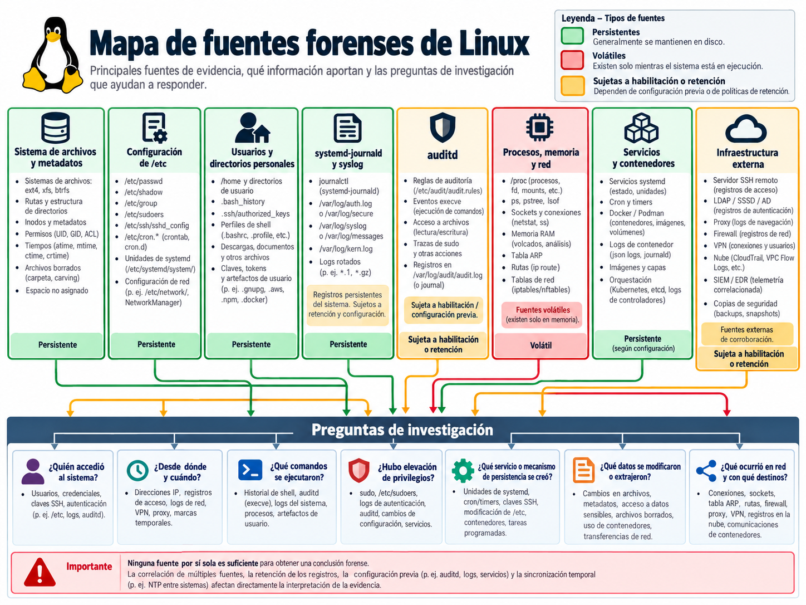
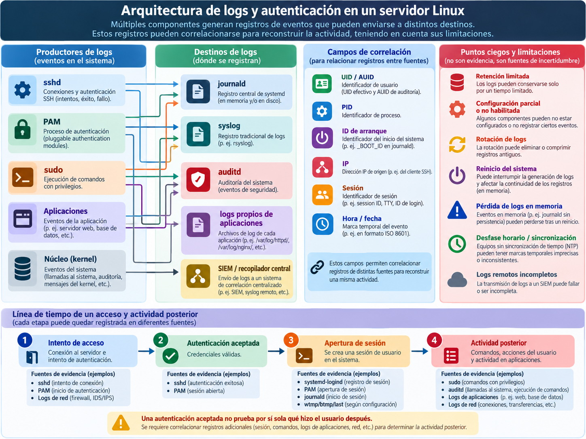
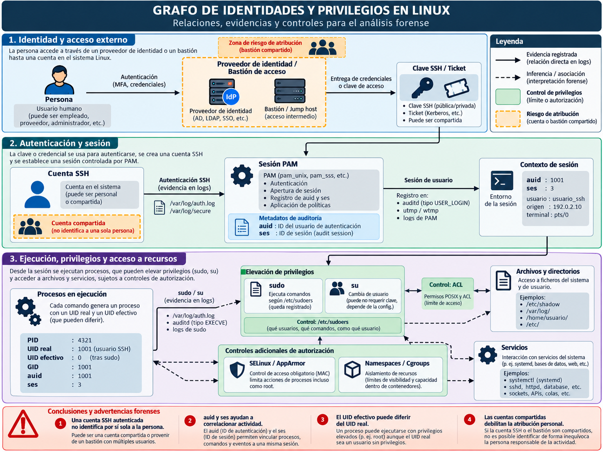
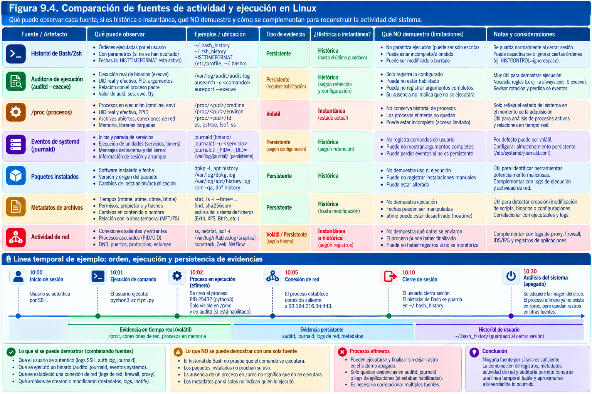
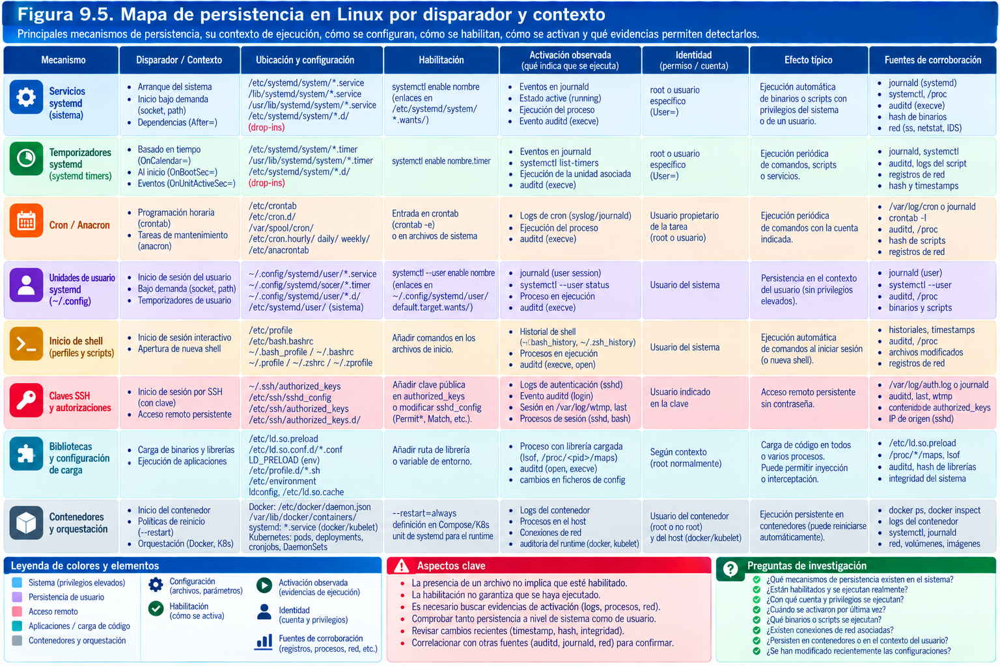
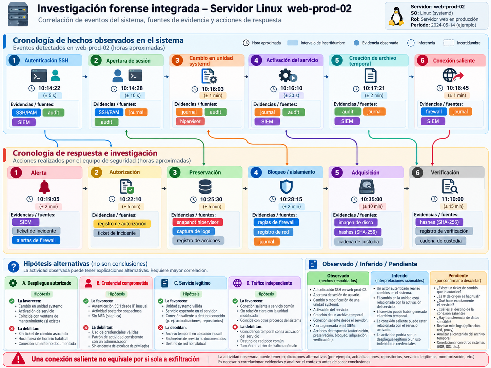

# Análisis forense de Linux

> "The street finds its own uses for things."
> "La calle encuentra sus propios usos para las cosas."
> 
> — William Gibson, Burning Chrome (1982) / Academy Leader (1991)

## Introducción

Cuando un servidor Linux aparece en una investigación, el primer obstáculo no suele ser la falta absoluta de información, sino la dispersión de sus rastros. Una conexión SSH puede figurar en el diario de `systemd`, en un archivo de autenticación, en un registro de auditoría del núcleo y en la plataforma central de supervisión. La creación de un proceso puede haber quedado reflejada por `auditd`, por un agente EDR o por una herramienta de observabilidad; en ausencia de esos componentes, quizá solo subsistan el ejecutable, sus archivos de salida y alguna referencia indirecta. Una tarea programada puede depender de `cron`, de un temporizador `systemd`, del gestor de procesos de una aplicación o de una plataforma de orquestación externa. No hay un «Registro de Linux» único al que acudir en busca de toda la actividad.

Esa diversidad es también una ventaja. Linux ofrece abundantes fuentes independientes: configuración legible, permisos y propietarios, registros de servicios, metadatos de sistemas de archivos, estados del gestor de servicios, evidencias de autenticación, datos en memoria y trazas de red. Su utilidad forense depende de la distribución, la versión, la política de registro, el perfil de seguridad, las herramientas instaladas y la forma en que el sistema ejecuta sus servicios. La misma ruta puede tener funciones diferentes en dos distribuciones; un nombre de servicio puede variar; y una instalación minimalista, un contenedor o una imagen inmutable pueden prescindir de componentes que se dan por supuestos en una estación de trabajo convencional.

Este capítulo desarrolla una metodología para examinar servidores y estaciones Linux con atención especial a Debian, Ubuntu y la familia Red Hat Enterprise Linux. Los ejemplos son transferibles, con adaptación, a otras distribuciones. Se distingue en todo momento la **evidencia observada** de la **interpretación técnica** y de la **atribución de una acción a una persona**. Una autenticación correcta con clave pública demuestra, dentro de los límites de los registros disponibles, que el servidor aceptó un mecanismo para una cuenta; no identifica necesariamente al operador humano de la clave. La existencia de una unidad `systemd` habilitada indica una configuración, no que su carga maliciosa llegase a ejecutarse. Un comando en un historial de shell es un indicio, no una transcripción completa y verificable de todas las operaciones realizadas.

El alcance tampoco debe confundirse con el estado actual de una máquina. Obtener resultados mediante `ps`, `ss`, `systemctl` o `journalctl` en un servidor activo produce una observación útil, pero la ejecución de programas puede modificar el propio entorno. Cuando exista una adquisición forense válida, se preferirá examinar una copia verificada y explicar qué hallazgos solo eran accesibles mediante una captura en vivo. Las instrucciones que aparecen a continuación ilustran tanto consultas de laboratorio como análisis sobre copias; **no son una autorización para intervenir en sistemas ajenos ni una invitación a ejecutar todas las órdenes en el original**.

El capítulo culmina con la investigación de un servidor web ficticio en el que se detectan autenticaciones inusuales, elevación de privilegios, una unidad de persistencia y comunicaciones salientes. La resolución no da por supuesta una intrusión completa ni una exfiltración: enfrenta hipótesis alternativas, reconstruye la secuencia hasta donde llegan las evidencias y especifica las fuentes que aún deberían solicitarse. Ese principio —delimitar lo demostrado y lo pendiente— es el vínculo entre el análisis Linux y la metodología general estudiada en los capítulos precedentes.
	



## 1. Estructura y fuentes de información

### 1.1. Investigar una instalación, no un sistema operativo abstracto

Linux designa principalmente un núcleo y un ecosistema de distribuciones, bibliotecas, utilidades y servicios. En el trabajo forense importa menos una definición académica que saber qué componentes concretos estaban presentes: el sistema de inicialización, el modo de almacenamiento del diario, el servicio SSH, el esquema de cuentas, el sistema de archivos, los mecanismos de aislamiento, los gestores de paquetes y las aplicaciones expuestas. Dos servidores con el mismo núcleo pueden tener una superficie probatoria muy distinta.

Una investigación empieza por identificar distribución y versión, arquitectura, versión del núcleo, zona horaria, nombre de host, identificador de máquina, topología de almacenamiento y entorno de ejecución. También interesa determinar si se trata de un equipo físico, una máquina virtual, un contenedor, una instancia cloud o una appliance que usa Linux internamente. El nombre `web-02` puede aparecer en `/etc/hostname`, pero ese dato admite cambios; el identificador `/etc/machine-id` ayuda a correlacionar fuentes de `systemd`, sin que por sí solo pruebe identidad física permanente. La plataforma de virtualización o el proveedor cloud pueden aportar referencias externas más fiables para una instancia concreta.

El examen inicial de una **copia montada sin escritura** permite reconocer una distribución mediante archivos como `etc/os-release`, comprobar los directorios presentes e identificar configuraciones sin arrancar el sistema intervenido. Como ejemplo de trabajo en un laboratorio, suponiendo que `/caso/raiz` contiene la raíz extraída de una imagen:

```bash
# Solo sobre la copia de análisis; no ejecutar sobre la fuente original.
cat /caso/raiz/etc/os-release
cat /caso/raiz/etc/hostname
cat /caso/raiz/etc/machine-id
ls -ld /caso/raiz/{etc,var,home,root,usr,opt} 2>/dev/null
find /caso/raiz/etc -maxdepth 2 -type f -name '*release*' -print
```

El comando `cat` no interpreta automáticamente la zona horaria del sistema examinado, y un árbol de directorios copiado sin metadatos puede haber perdido propietarios, ACL, enlaces o tiempos. Por eso, al citar un archivo deben figurar la imagen de origen, el sistema de archivos, la ruta, el identificador del objeto si está disponible, los metadatos conservados y la herramienta de extracción. Una extracción basada únicamente en carpetas puede ser adecuada para una pregunta restringida, pero no sustituye una imagen de bloques cuando se necesitan estructuras de directorio eliminadas, espacio no asignado o metadatos de bajo nivel.

### 1.2. Jerarquía del sistema de archivos y valor probatorio

La jerarquía habitual de Linux proporciona una orientación útil, aunque no una lista universal. `/etc` conserva configuraciones persistentes; `/var` reúne datos de estado variable, registros, colas y bases de datos de servicios; `/home` suele albergar perfiles de usuarios; `/root` contiene, cuando existe, el directorio personal de la cuenta administrativa; `/usr` concentra gran parte del software instalado; `/opt` puede alojar aplicaciones de terceros; `/tmp` y `/var/tmp` sirven para temporales con políticas de limpieza distintas; `/run` reúne estados efímeros del arranque en sistemas actuales. Los contenidos de `/proc`, `/sys` y muchos elementos de `/dev` no son carpetas corrientes almacenadas en disco: sus entradas presentan información del núcleo o interfaces a dispositivos y solo tienen sentido completo cuando el sistema está funcionando.

En una adquisición apagada, no cabe esperar que `/proc/<pid>/cmdline` conserve los argumentos de procesos históricos: el sistema de archivos `procfs` se genera dinámicamente. En cambio, en una captura de memoria o en registros de auditoría podrían quedar pistas sobre procesos ya terminados. Tampoco debe suponerse que todo `/run` está disponible en la imagen: a menudo reside en un `tmpfs` y desaparece al apagar. La combinación de imágenes de almacenamiento, memoria, diario persistente y telemetría externa define el alcance real de lo observable.

| Ubicación o familia | Información posible | Precaución interpretativa |
|---|---|---|
| `/etc/passwd`, `/etc/group`, `/etc/shadow` | Cuentas, identificadores, grupos y datos de autenticación local | No reflejan por sí solos identidades externas de LDAP/SSSD |
| `/etc/ssh/` | Configuración de `sshd`, claves de host, inclusiones | La configuración efectiva puede incluir fragmentos y condiciones `Match` |
| `/home/*`, `/root` | Claves, historiales, archivos de usuario, configuraciones | Propiedad y ubicación no identifican necesariamente al autor humano |
| `/var/log/` | Texto syslog, registros de aplicación, auditoría | Retención, rotación y aplicaciones pueden variar |
| `/var/log/journal/` | Diario persistente de `systemd`, si existe | Puede no haberse configurado o haber sido reducido |
| `/var/spool/cron/`, `/var/spool/cron/crontabs/` | Programaciones de usuario según distribución | La ubicación real depende del servicio cron instalado |
| `/etc/systemd/`, `/usr/lib/systemd/`, `/lib/systemd/` | Unidades, temporizadores y ajustes de servicios | Precedencias, enlaces y *drop-ins* modifican el resultado |
| `/var/lib/` | Bases de datos y estados de componentes | Una actualización o limpieza puede alterar registros históricos |
| `/tmp`, `/var/tmp`, `/dev/shm` | Temporales, archivos de trabajo y posibles cargas | Su persistencia depende de montaje, limpieza y reinicios |
| `/proc`, `/sys`, `/run` | Estado de procesos, núcleo y sesiones en vivo | No debe confundirse con contenido histórico de una imagen apagada |

En organizaciones con políticas de endurecimiento, partes del sistema pueden montarse con opciones como `noexec`, `nosuid` o `nodev`; determinados directorios pueden ser volúmenes independientes, estar cifrados o redirigirse a almacenamiento de red. Una imagen del disco de sistema no incluye necesariamente un volumen NFS montado ni el disco adjunto donde una aplicación mantiene su base de datos. Antes de declarar completa la recogida de un servidor es preciso reconstruir su tabla de montajes, sus volúmenes lógicos y, cuando proceda, sus dependencias cloud.

### 1.3. Particiones, volúmenes, montajes y sistemas de archivos

El examen de almacenamiento continúa el capítulo anterior. Linux puede arrancar desde GPT o MBR, utilizar ext4, XFS, Btrfs u otros sistemas de archivos, incorporar LVM, RAID por software, volúmenes cifrados con LUKS y espacios de almacenamiento efímeros. Cada capa posee sus propios metadatos y sus límites probatorios. Que la ruta `/var/log` exista en la raíz no demuestra que sus bytes se encontraran en el mismo dispositivo; podría ser un montaje, un enlace, un `bind mount` o una superposición de contenedor.

En un sistema de **laboratorio**, los comandos siguientes ayudan a entender qué información conviene obtener durante una intervención autorizada. La salida procedente del original se documentaría como adquisición en vivo, no como equivalente a una reconstrucción posterior:

```bash
lsblk -o NAME,TYPE,SIZE,FSTYPE,UUID,MOUNTPOINTS
findmnt -R /
cat /proc/mounts
blkid
# Si se usa LVM y está autorizado:
pvs; vgs; lvs -a -o +devices
```

Para un análisis apagado resulta preferible interpretar la tabla de particiones y los sistemas de archivos a partir de la imagen y leer `etc/fstab`, la configuración LVM y el inventario de infraestructura. Las rutas `/dev/sda`, `/dev/nvme0n1` o `/dev/mapper/...` pueden cambiar entre arranques; los UUID, los números de serie y los identificadores de volumen requieren también comprobación, pero suelen aportar mejores elementos de correlación que un nombre de dispositivo temporal.

**Montar un sistema de archivos no es una operación inocua en todos los contextos.** Por ejemplo, montar ext4 como solo lectura puede dar lugar, según el modo y entorno, a recuperación del diario si no se especifican las precauciones pertinentes. Para inspecciones de laboratorio sobre ext4 se considera una configuración de solo lectura que evite la reproducción del diario (`ro,noload`), atendiendo a la semántica de la versión del núcleo y validando previamente el procedimiento. Esto no reemplaza el uso de herramientas capaces de leer estructuras de archivos sin montar. En XFS, Btrfs o volúmenes cifrados, las decisiones son diferentes: copiar literalmente una receta de ext4 puede resultar inapropiado.

### 1.4. Sistemas de archivos y metadatos que deben conservarse

Un archivo de configuración puede parecer texto simple, pero su significado depende de más que sus líneas: propietario numérico, grupo, permisos, ACL, atributos extendidos, etiquetas SELinux, capacidades de archivo, enlaces simbólicos, inode, marcas temporales y ubicación dentro del sistema montado. Si esos datos se pierden en una copia manual, también se pierde la posibilidad de responder a preguntas sobre quién podía leer o modificar el objeto o sobre cómo una aplicación lo encontraba.

En ext4, los inodos y las entradas de directorio contienen información que no debe reducirse al nombre y a la fecha de modificación. En XFS y Btrfs existen estructuras y mecanismos históricos propios. En entornos con `overlayfs`, Docker o Kubernetes, un archivo visible en el árbol del contenedor puede pertenecer a una capa de imagen, a una capa escribible o a un volumen compartido. Dos archivos con la misma ruta visible para el proceso no tienen necesariamente el mismo origen en el sistema anfitrión. Atribuir cambios a un contenedor requiere identificar su capa, su instante de creación y el proceso o herramienta que actuó sobre ella.

Para documentar metadatos en una **copia extraída que los preserve**, pueden utilizarse comandos como `stat`, `getfacl`, `getfattr` o `getcap`. Un ejemplo ilustrativo:

```bash
stat /caso/raiz/etc/ssh/sshd_config
getfacl -p /caso/raiz/etc/ssh/sshd_config
getfattr -d -m '-' /caso/raiz/usr/local/bin/servicio 2>/dev/null
sha256sum /caso/raiz/etc/ssh/sshd_config
```

No debe suponerse que una copia a un sistema de archivos ajeno conserva ACL, atributos o etiquetas de origen. En una investigación con exigencias de precisión, esos resultados se contrastan con el volumen original de la imagen mediante herramientas compatibles con el sistema de archivos y la configuración del entorno. El hash del archivo conserva una referencia a sus bytes, no prueba por sí solo su propietario ni los metadatos que rodeaban su contenido.

### 1.5. Fuentes de estado, configuración y actividad

Para evitar inferencias precipitadas conviene clasificar las fuentes antes de analizarlas. Un archivo de configuración describe cómo estaba previsto que actuara un programa en cierto estado del sistema; un diario registra eventos que el software decidió emitir; una base de datos de aplicación conserva transacciones con su semántica particular; una captura de procesos representa un instante; y una fuente externa, como un balanceador o un proveedor de identidad, puede registrar la comunicación desde otro punto de observación. Estas categorías no son intercambiables.

Un ejemplo aclara la diferencia. Encontrar `PermitRootLogin no` en una copia de `sshd_config` demuestra la presencia de esa directiva en un archivo. No demuestra, por sí solo, que fuese la configuración efectiva en el momento del hecho: puede existir un `Include`, una condición `Match`, otro archivo de configuración usado al iniciar el servicio o un cambio posterior. Un evento `Accepted publickey for admin` es más próximo a una autenticación observada, pero aún exige determinar a qué host, instancia y periodo corresponde. Y un registro de sesión con TTY demuestra algo distinto de una simple autenticación sin shell interactiva.

En un servidor conectado a un sistema de registro central pueden coexistir logs locales y copias reenviadas. El reenvío es especialmente importante cuando se sospecha una alteración local: una eliminación en `/var/log` puede no afectar a los mensajes que el colector recibió antes. Sin embargo, una divergencia entre el log local y el central también puede deberse a filtrado, retrasos, caída de conexión, formato diferente o reglas de retención. La pregunta correcta no es «¿cuál miente?», sino «¿qué produjo cada sistema, qué transportó y qué pudo perderse?».

### 1.6. Alcance de la adquisición e inventario inicial

Una investigación Linux necesita un inventario de evidencias y no solo una lista de carpetas para copiar. Un conjunto razonable, ajustado al encargo, puede incluir una imagen del almacenamiento pertinente, una captura de memoria si se justificó, archivos de diario, registros rotados, configuraciones SSH, cuentas y grupos, tareas programadas, unidades y *drop-ins* de `systemd`, paquetes instalados, evidencias del servicio investigado y, si existen, registros de `auditd`, EDR, red, firewall e infraestructura cloud. El inventario anota fuentes ausentes y razones de su ausencia.

Es aconsejable registrar las características del soporte y la adquisición con identificadores independientes: `OBJ-LX-01` para el servidor o volumen, `ADQ-LX-01` para su imagen, `LOG-LX-01` para una exportación autorizada del colector y `MEM-LX-01` para la memoria. El analista no debe reutilizar el identificador de una imagen para un volcado de memoria, ni afirmar que un hash de contenedor equivale al hash del contenido reconstruido. La trazabilidad entre objetos se conserva mediante relaciones explícitas y verificaciones sobre datos comparables.

Una adquisición remota exige identificar también el ejecutor y la cuenta de servicio, la API o canal utilizado, la hora de inicio y fin, los filtros aplicados, los errores, las claves de acceso empleadas y la posibilidad de pérdida o alteración de metadatos. Un tarball con `/etc` puede responder a ciertas preguntas de configuración, pero no permite analizar archivos eliminados de ext4 ni garantiza la conservación de todos los atributos. Si la investigación tiene hipótesis sobre manipulación de archivos, el alcance debe reconocer esa limitación y solicitar la modalidad de adquisición pertinente.

### 1.7. Valor de la ausencia y contexto de interpretación

La ausencia de un fichero `.bash_history`, de un evento SSH o de un temporizador `systemd` no significa lo mismo en todos los sistemas. Para interpretar una ausencia hay que conocer si el mecanismo estaba instalado y habilitado, la política de registro, el periodo de retención, la cobertura de la adquisición y las formas legítimas de eludir el mecanismo sin conducta maliciosa. Una sesión no interactiva puede no escribir historial; un diario volátil desaparece con el reinicio; y un proceso dentro de un contenedor puede emitir logs exclusivamente al colector del orquestador.

El investigador debe resistir dos atajos opuestos. El primero consiste en atribuir toda anomalía a un atacante: una unidad nueva, una clave SSH o un fichero en `/tmp` pueden pertenecer a una actualización o automatización legítima. El segundo consiste en descartar una intrusión porque falte el rastro esperado: la ausencia puede ser explicable por la propia configuración del sistema o por una adquisición incompleta. La solución es construir hipótesis contrastables y precisar qué nuevas fuentes podrían resolverlas.

Como regla editorial y técnica para las páginas siguientes, se describirá primero el **objeto observado**, después la **semántica conocida del mecanismo**, a continuación la **interpretación apoyada por el contexto** y por último la **limitación**. Esa secuencia evita convertir un simple contenido de archivo en una afirmación demasiado fuerte sobre decisiones, intenciones o identidades.

## 2. Logs del sistema y autenticación

### 2.1. El registro es una capacidad configurada, no un recuerdo perfecto

Los registros Linux describen acontecimientos desde el punto de vista de componentes concretos: el núcleo, `sshd`, PAM, el gestor de servicios, el servidor web, un demonio de bases de datos o un agente de seguridad. Algunos mensajes expresan acciones confirmadas; otros solo reflejan intentos, errores o estados transitorios. En particular, una línea de autenticación no informa de todo lo realizado después de iniciar sesión, y un mensaje de aplicación que contiene el texto `success` no garantiza que la operación empresarial asociada haya terminado correctamente.

Conviene separar tres mecanismos que a menudo se presentan como si fuesen uno. **`systemd-journald`** recibe y conserva mensajes estructurados procedentes de diversas fuentes cuando está disponible. **Syslog**, a través de servicios como `rsyslog` o `syslog-ng`, puede escribir mensajes de texto en ficheros, reenviarlos o procesarlos conforme a reglas. **El subsistema Audit de Linux**, normalmente gestionado mediante `auditd` y reglas de auditoría, registra determinados eventos de seguridad y llamadas al sistema bajo una configuración específica. Pueden coexistir y recoger parte de la misma actividad, pero su cobertura, origen y fiabilidad no son idénticos.

En Ubuntu y Debian es frecuente encontrar `/var/log/auth.log`, `/var/log/syslog`, `/var/log/kern.log` y sus rotaciones cuando está activo el correspondiente sistema de logging. En entornos de la familia RHEL resultan habituales `/var/log/secure`, `/var/log/messages` y `/var/log/audit/audit.log`. Esas rutas son ejemplos, no garantías. Instalaciones recientes o reducidas pueden depender casi por completo del diario binario y de un colector externo. Antes de buscar un archivo se debe verificar que el mecanismo existía en la fecha estudiada.

| Familia | Ejemplo de fuente | Observación posible | Dependencia principal |
|---|---|---|---|
| Diario de `systemd` | Archivos `.journal` | Mensajes de servicio y metadatos de proceso | Persistencia, volumen, política de almacenamiento |
| Logs de autenticación | `auth.log`, `secure` | SSH, `sudo`, PAM, intentos y decisiones | Servicio syslog, reglas de encaminamiento y retención |
| Auditoría de núcleo | `audit.log` | `execve`, accesos y cambios vigilados | Reglas activas, política audit y posibles pérdidas |
| Sesiones históricas | `wtmp`, `btmp`, `lastlog` u otros mecanismos | Información de logins y fallos | Versión, formato, aplicación que escribe y conservación |
| Aplicaciones | Nginx, Apache, bases de datos, agentes | Peticiones, usuarios, errores y operaciones | Configuración y diseño del producto |
| Fuentes externas | Bastión, VPN, IdP, SIEM, firewall | Visibilidad independiente del host | Integridad, retención y cobertura del colector |

### 2.2. Cómo funciona el diario de `systemd`

`systemd-journald` recoge mensajes que llegan por distintos canales, entre ellos registros de servicios, syslog, mensajes del núcleo y, según configuración, registros de auditoría. A cada entrada puede asociarle campos tales como `_PID`, `_UID`, `_COMM`, `_EXE`, `_SYSTEMD_UNIT`, `_BOOT_ID`, `__REALTIME_TIMESTAMP` y `__MONOTONIC_TIMESTAMP`. Algunos campos provienen del propio origen del mensaje y otros son añadidos por el servicio de registro. Esa diferencia importa: el texto libre que una aplicación envía no ofrece necesariamente el mismo nivel de confianza que los metadatos añadidos por el colector, y estos últimos tampoco prueban por sí solos que el equipo no estuviera comprometido.

El diario puede almacenarse de forma persistente bajo `/var/log/journal/` o temporalmente en `/run/log/journal/`. La configuración `Storage=`, las opciones con que se compiló `systemd`, el espacio disponible y la existencia del directorio influyen en el resultado. Por tanto, **no debe darse por hecho que los logs anteriores a un reinicio siguen disponibles**. En ediciones modernas de `systemd` incluso los valores por defecto pueden diferir respecto a versiones anteriores; la comprobación ha de hacerse sobre el servidor investigado, no sobre la estación del perito.

En un laboratorio con una copia del directorio de diarios, puede consultarse la información existente sin iniciar el sistema examinado:

```bash
# /caso/journal-extraido es una copia de los ficheros .journal.
journalctl --directory=/caso/journal-extraido --list-boots --no-pager
journalctl --directory=/caso/journal-extraido --utc \
  --since='2026-09-16 00:00:00' --until='2026-09-17 00:00:00' \
  --no-pager
journalctl --directory=/caso/journal-extraido -o json \
  --no-pager > /caso/derivados/journal-export.jsonl
```

El directorio debe contener una estructura que el lector de journal reconozca; según la forma de la adquisición, puede resultar más adecuado usar `--file` con los archivos concretos o preparar una copia íntegra del árbol. El operador debe validar que los filtros temporales incluyen los extremos que necesita. En `journalctl`, `--utc` afecta a cómo se muestra la hora, no transforma la hora de creación de un evento ni repara un reloj desviado. Los campos de tiempo monotónico ayudan a ordenar eventos dentro de un mismo arranque, pero no comparan sin más eventos de arranques distintos.

El uso de `-o json` facilita conservar campos estructurados; una exportación legible en texto simplifica la revisión humana, pero puede omitir metadatos. Cuando la pregunta lo justifique conviene conservar el archivo de diario original, una exportación estructurada y, como derivado auxiliar, una selección en texto con filtros reproducibles. No se debe sustituir el soporte original por una captura de pantalla de `journalctl` ni perder la relación entre una línea transformada y la entrada fuente.

### 2.3. Integridad de los diarios, vacíos y rotaciones

`journalctl --verify` ayuda a comprobar la consistencia estructural de archivos de journal en los términos admitidos por la implementación; su resultado no equivale a una certificación de autenticidad de todos los mensajes. El acceso administrativo al equipo puede permitir borrar, reemplazar o alterar fuentes, y el diario puede haber sido truncado legítimamente por cuotas. Algunos mecanismos de sellado adicional, cuando existen y estaban habilitados, ofrecen propiedades específicas, pero no deben suponerse presentes.

```bash
# Verificación estructural sobre COPIAS, sin alterar los originales.
journalctl --file=/caso/journal-extraido/system.journal --verify
# En laboratorio, localizar ficheros potencialmente pertinentes:
find /caso/raiz/var/log -maxdepth 3 -type f \
  \( -name '*.log' -o -name '*.journal' -o -name '*.journal~' \
     -o -name 'auth.log*' -o -name 'secure*' \) -print
```

Un error de lectura obliga a documentar el archivo y la versión utilizada, conservar el resultado y estudiar alternativas. La presencia de archivos `.journal~` puede asociarse, entre otras posibilidades, con un cierre no limpio o una incidencia detectada por el propio servicio; no constituye por sí sola un indicador de manipulación deliberada. Un hueco temporal puede proceder de un reinicio, una caída del colector, reglas de filtrado, saturación, cambio de zona horaria, rotación o eliminación. Antes de escribir «se borraron los logs» debe existir una base positiva para esa afirmación y examinarse la política de conservación.

En registros de texto se debe estudiar la rotación. Archivos como `auth.log.1`, `syslog.2.gz` o `secure-20260916` ilustran convenciones posibles, no nombres universales. `logrotate` puede configurar periodicidad, compresión, conservación o ejecución de comandos posteriores; un servicio también puede rotar por su cuenta. La fecha de creación del fichero rotado no es necesariamente la fecha de cada evento contenido. Un `.gz` debe tratarse como objeto derivado de una rotación, preservando su archivo original comprimido y verificando hashes antes y después de extraerlo.

### 2.4. Autenticación SSH: intento, aceptación y sesión

OpenSSH es una de las fuentes esenciales en servidores administrados a distancia. Los mensajes de `sshd` permiten identificar intentos fallidos, métodos de autenticación aceptados, cuentas, direcciones de origen y, según la configuración, detalles adicionales. La frase `Accepted publickey for usuario from IP port ...` describe que el servidor aceptó una autenticación para esa cuenta desde una conexión que observó con esa dirección. No prueba que se concediese una sesión interactiva plena ni que quien controlaba la conexión fuese el propietario legítimo de la cuenta.

El examen debe buscar también el inicio y cierre de sesiones PAM, los posibles subsistemas SFTP, los comandos forzados, el uso de `Match`, el reenvío de puertos y los registros de bastiones. En entornos con proxies SSH o túneles, la IP de origen vista por el servidor puede corresponder a un salto intermedio. Una clave pública autorizada puede compartirse indebidamente, ser robada o pertenecer a una automatización. Por eso, una identificación responsable necesita correlacionar la huella de la clave si fue registrada, la procedencia de red, la gestión de credenciales y otras fuentes de actividad.

Ejemplo ficticio de log:

```text
Sep 16 09:14:02 web-prod-02 sshd[1842]: Accepted publickey for deploy from 198.51.100.77 port 51422 ssh2
Sep 16 09:14:02 web-prod-02 sshd[1842]: pam_unix(sshd:session): session opened for user deploy(uid=1002) by (uid=0)
Sep 16 09:29:43 web-prod-02 sshd[1842]: pam_unix(sshd:session): session closed for user deploy
```

Estos tres renglones, considerados por sí solos, permiten situar una autenticación y una sesión registrada de la cuenta `deploy`. No incluyen un listado completo de programas lanzados, ni identifican a una persona. Tampoco demuestran que un archivo haya sido extraído o que el sistema haya sido comprometido. Si el servicio registra comandos o transferencia de archivos solo mediante componentes opcionales, su ausencia puede dejar sin resolver lo ocurrido dentro de la sesión.

### 2.5. Consultas de autenticación y sus límites

En una copia de logs de texto, una búsqueda inicial puede localizar líneas de OpenSSH, PAM y `sudo`. La búsqueda textual es un **instrumento de selección**, no el análisis completo: expresiones regulares simples pueden confundir distintos formatos, romper eventos multilineales o pasar por alto canales distintos.

```bash
# Sobre una copia de los registros de texto.
grep -nE 'sshd\[|sudo:|pam_unix\(' /caso/logs/auth.log \
  > /caso/derivados/seleccion-auth.txt

# Sobre journal exportado previamente; consulta de ejemplo de laboratorio.
journalctl --directory=/caso/journal-extraido --utc \
  _COMM=sshd --since='2026-09-16 09:00:00' \
  --until='2026-09-16 10:00:00' --no-pager
```

El campo `_COMM=sshd` no garantiza cobertura completa: unidades, nombres de procesos, cambios de ejecutable o metadatos ausentes pueden impedir recuperar entradas relevantes. La selección debe contrastarse con consultas por servicio (`-u ssh.service` o `-u sshd.service` cuando corresponda), por identificador syslog y con logs centrales. Una coincidencia textual tampoco constituye una prueba de que la línea sea íntegra, auténtica o que no se haya duplicado durante una exportación.

Los intentos repetidos de autenticación desde una IP pueden indicar exploración automatizada, errores de configuración o actividad hostil. Sin correlación con un acceso aceptado, una huella de clave o acciones posteriores, no procede equiparar cientos de fallos con una intrusión exitosa. En un informe puede afirmarse «se observaron X intentos fallidos en el periodo Y desde las direcciones Z» y reservar «acceso no autorizado» para la conclusión apoyada por otras evidencias.

### 2.6. PAM, `sudo`, `su` y autenticación centralizada

Linux utiliza habitualmente PAM (*Pluggable Authentication Modules*) como marco de autenticación y gestión de sesiones para diversos servicios. El archivo `/etc/pam.d/sshd` —cuando se utiliza esa configuración— puede integrar módulos con políticas de cuentas, controles adicionales y apertura o cierre de sesión. El investigador debe diferenciar el resultado del componente PAM y el del servidor que lo invocó: que un módulo informase de éxito no documenta necesariamente todas las acciones realizadas a continuación.

`sudo` añade otra dimensión. Los registros habituales pueden incluir el usuario que invocó el comando, el directorio desde el que se llamó, la cuenta de destino y la orden solicitada. Sin embargo, la configuración puede registrar niveles diferentes de detalle o usar un sistema central; el hecho de ver una ejecución con `sudo` no prueba automáticamente que la operación interna haya obtenido el resultado esperado. En particular, `sudo sh -c '...'` puede ocultar bajo una sola entrada varias acciones del shell. La interpretación exige revisar la orden, el mecanismo de logging y los resultados de sus efectos.

`su`, `runuser`, `pkexec`, servicios privilegiados, capacidades Linux y escaladas por vulnerabilidad pueden producir vías de cambio de privilegios diferentes. El análisis no debe limitarse a `sudo`. Además, las identidades no siempre se mantienen en `/etc/passwd`: SSSD, LDAP, Kerberos, Active Directory mediante integración y soluciones de acceso privilegiado pueden resolver cuentas de forma externa. En esos casos los registros del proveedor de identidad y de la política de acceso resultan decisivos.

### 2.7. Auditoría del núcleo: `auditd` y reglas previas

El subsistema de auditoría de Linux puede registrar operaciones detalladas si estaba habilitado y se definieron reglas apropiadas. Un mismo evento auditado puede constar de varios registros `SYSCALL`, `EXECVE`, `PATH`, `CWD` y otros con un identificador común, dependiendo de la operación. El analista no debe leer cada línea como un evento humano independiente; ha de reconstruir el conjunto y comprender la semántica de campos como `uid`, `euid`, `auid`, `ses`, `pid`, `ppid`, `exe` y `comm`.

El `auid` o *loginuid* pretende conservar una referencia a la identidad de inicio de sesión a través de determinados cambios de privilegios. Es útil para investigaciones, pero no es una prueba infalible de persona: procesos sin sesión de login convencional, contenedores, servicios, valores no establecidos o entornos manipulados pueden limitar su interpretación. Del mismo modo, `euid=0` muestra privilegio efectivo de un proceso en cierto contexto; no documenta por sí solo la ruta de escalada ni la intención.

```bash
# Ejemplos de laboratorio con ficheros de auditoría YA EXTRAÍDOS.
ausearch -if /caso/logs/audit.log -m USER_AUTH,USER_LOGIN
ausearch -if /caso/logs/audit.log -k cambios_criticos
ausearch -if /caso/logs/audit.log -x /usr/bin/curl
```

La compatibilidad y las opciones concretas se verifican contra la versión de `ausearch` instalada. La clave `cambios_criticos` solo producirá resultados si existieron reglas audit que emitían esa clave; no es un filtro mágico aplicable retroactivamente. Asimismo, buscar `/usr/bin/curl` mediante `-x` sirve si los eventos pertinentes fueron registrados con esa ruta. Un binario renombrado, ejecutado en contenedor o sin cobertura de auditoría puede quedar fuera.

La configuración puede estar en `/etc/audit/rules.d/`, `/etc/audit/audit.rules` y rutas dependientes del paquete. Los registros suelen guardarse en `/var/log/audit/audit.log`, pero pueden enviarse a otro destino. Interesan el estado previo de las reglas, el tamaño del backlog, el comportamiento ante errores y los mensajes que indiquen pérdida de registros. Un conjunto audit fragmentado no se completa multiplicando búsquedas.

### 2.8. Sesiones históricas: `wtmp`, `btmp` y variantes modernas

Comandos tradicionales como `last`, `lastb` y `lastlog` se basan, según distribución y versión, en bases de datos o ficheros de contabilidad de sesiones. Los nombres `wtmp`, `btmp` y `lastlog` son conocidos, pero el ecosistema evoluciona: algunas distribuciones han migrado componentes a mecanismos nuevos como `wtmpdb` y pueden no escribir los formatos clásicos. La ausencia de `/var/log/wtmp` no equivale automáticamente a actividad borrada.

En un sistema de laboratorio se pueden consultar ejemplos de registros extraídos utilizando las opciones que admita la implementación presente:

```bash
# Si la distribución usa wtmp clásico y la herramienta admite -f:
last -f /caso/raiz/var/log/wtmp
# Si se dispone de btmp y permisos/autorización adecuados:
lastb -f /caso/raiz/var/log/btmp
```

Las bases históricas pueden registrar sesiones incompletas, conexiones virtuales o referencias a reinicios; la zona horaria de presentación y la precisión dependen del formato. A menudo contienen direcciones de origen, usuarios y terminales, pero no garantizan que todos los accesos SSH, SFTP o comandos no interactivos estén representados. La validez de una interpretación requiere saber quién escribía esos registros y qué actividades pretendía cubrir.

### 2.9. Registros de aplicaciones, proxies y servicios de infraestructura

En un servidor web, `nginx` o Apache pueden conservar accesos HTTP, códigos de estado, rutas, usuarios autenticados y tiempos de petición. Una solicitud con respuesta `200` señala que el servidor o proxy respondió con ese estado: no prueba automáticamente que el cliente utilizase correctamente el contenido, que se haya descargado un fichero completo ni que la dirección IP se corresponda con una identidad humana. Las cabeceras de proxy, el origen del `X-Forwarded-For` y la topología de balanceo influyen en la atribución.

Los registros de base de datos, colas de mensajes, plataformas de CI/CD y aplicaciones de negocio son igualmente relevantes. Un script ejecutado en segundo plano podría dejar una consulta SQL, un cambio en un objeto cloud o un fichero enviado a un repositorio; la ausencia de historial de terminal no elimina esos indicios. El analista debe solicitar el diseño de registro de la aplicación: campos, precisión temporal, valores de usuario, identificadores de transacción y relación con otros sistemas.

En servicios cloud también interesan el plano de control, la consola de administración, las llamadas API, las políticas IAM, las instantáneas y los eventos del hipervisor. Una instancia Linux puede haber sido recreada a partir de una imagen y conservar solo parte de sus logs; las acciones de creación y destrucción pueden registrarse exclusivamente fuera del invitado. Un análisis limitado a `/var/log` no tendría capacidad para probar ni descartar por sí mismo esas operaciones.

### 2.10. Normalización temporal y correlación

Un diario `systemd` conserva información de tiempo real y, para el contexto de arranque, monotónica. Los syslogs tradicionales pueden omitir el año en su representación textual, usar hora local, depender de la zona del host y carecer de precisión subsegundo. Los registros de red, por su parte, pueden estar en UTC y mostrar el instante de fin de una conexión, no su comienzo. Colocar todas esas horas en una tabla sin entenderlas produce cronologías aparentemente precisas y conceptualmente falsas.

Por eso, cada evento normalizado debería registrar al menos el valor original, el objeto fuente, su semántica (inicio, fin, escritura, autenticación, etc.), la zona supuesta o conocida, precisión, incertidumbre del reloj y conversión usada. Las diferencias de segundos no pueden sostener una secuencia causal si uno de los relojes podía estar desviado minutos. Una correlación razonable utiliza además identificadores comunes: dirección y puerto, ID de sesión, PID dentro del arranque, clave SSH, ruta, hash o ID de operación.



### 2.11. Qué puede afirmarse después de examinar los logs

El resultado del análisis no debería ser una lista interminable de líneas copiadas en un informe. Debe responder a preguntas concretas: ¿qué servicio recibió la solicitud?, ¿hubo una autenticación aceptada?, ¿con qué cuenta y mecanismo?, ¿la sesión se abrió?, ¿qué privilegios quedaron registrados?, ¿qué procesos o archivos están vinculados?, ¿qué otra fuente independiente respalda el episodio? Una tabla de hallazgos con campos para evidencia, interpretación, incertidumbre y preguntas pendientes es más útil que varios cientos de páginas de salida de `grep`.

La conclusión negativa debe tratarse con igual rigor. Es correcto escribir «en los diarios adquiridos, que cubren del 15 al 17 de septiembre, no se localizó una entrada `Accepted publickey` para esa cuenta». No lo es convertirlo sin más en «nadie accedió». Podrían existir otros métodos, un nodo de destino diferente, pérdida de registros, una salida externa, una cuenta con otro nombre o actividad no registrada. Los logs son testigos técnicos condicionados por su diseño y mantenimiento; precisamente por eso deben contrastarse entre sí.

## 3. Usuarios, permisos, sesiones SSH y privilegios

### 3.1. Cuenta, credencial, sesión y persona: cuatro conceptos distintos

La atribución de actividad en Linux exige separar conceptos que en un informe apresurado pueden aparecer como sinónimos. Una **cuenta** es una identidad que el sistema reconoce y a la que asigna determinados permisos. Una **credencial** es el mecanismo usado para autenticarla, como una contraseña, una clave pública o un ticket. Una **sesión** es un contexto de acceso o ejecución, que puede ser interactivo, remoto, automatizado o incluso existir sin terminal. Una **persona** es el sujeto humano cuya participación interesa determinar, y esa identidad no se desprende automáticamente de los tres elementos anteriores.

En infraestructuras profesionales es habitual que varias personas utilicen sistemas de bastión, que los despliegues funcionen bajo cuentas técnicas como `deploy`, o que un sistema de integración continua ejecute tareas sobre un servidor. Un registro `Accepted publickey for deploy` establece un vínculo entre una conexión y una cuenta aceptada. Para llegar a la persona hay que contrastar la política de claves, las asignaciones en el gestor de secretos, los accesos al bastión, los tickets de cambio y, en su caso, las sesiones registradas. Ni el hecho de que una cuenta se llame `juan` ni que una clave tenga ese comentario bastan para atribuir una acción a alguien.

Los identificadores numéricos ayudan a estudiar esta separación. El UID identifica la cuenta en un espacio de nombres de usuarios concreto; el GID y los grupos suplementarios intervienen en decisiones de acceso; el UID efectivo de un proceso puede diferir del real. Las capas de contenedores y *user namespaces* pueden traducir los valores que ve un proceso dentro del contenedor a otros en el anfitrión. Una investigación que relacione ficheros de volúmenes compartidos con procesos de contenedor debe registrar el mapeo de identidades, no solo sus números aparentes.

### 3.2. Cuentas locales y directorios de identidad

Los archivos `/etc/passwd` y `/etc/group` proporcionan información fundamental sobre cuentas locales, UIDs, directorios personales, shells y pertenencia a grupos. En distribuciones con autenticación local mediante contraseñas, `/etc/shadow` contiene información sensible sobre los mecanismos de autenticación y estados de las cuentas. Debe protegerse como evidencia especialmente confidencial; no se necesita incluir hashes de contraseñas completos en el cuerpo del informe para explicar que una cuenta estaba habilitada o bloqueada.

```text
# Fragmento FICTICIO de /etc/passwd
root:x:0:0:root:/root:/bin/bash
deploy:x:1002:1002:Deploy service:/home/deploy:/bin/bash
www-data:x:33:33:www-data:/var/www:/usr/sbin/nologin
```

El campo `x` no es una contraseña, sino una referencia al mecanismo de almacenamiento de credenciales utilizado en ese esquema. Una shell de tipo `nologin` limita ciertas formas convencionales de acceso, pero no demuestra que la cuenta jamás pueda originar un proceso. `www-data` puede ejecutar servicios, scripts o procesos con sus permisos incluso aunque no tenga inicio de sesión interactivo. Un UID muy alto, una descripción anómala o una cuenta sin password local no son por sí solos indicadores de actividad maliciosa.

Para identificar cuentas creadas o modificadas durante el intervalo investigado, conviene comparar una copia del sistema afectado con una imagen o copia histórica fiable, registros administrativos y datos del gestor de identidades. Las marcas temporales del archivo `/etc/passwd` pueden reflejar escrituras masivas o instalación de paquetes, no la fecha de alta de una cuenta específica. Los eventos de cambio en `auditd`, el gestor de configuración y un ticket de administración proporcionan contexto más preciso si fueron conservados.

En instalaciones con LDAP, SSSD, Kerberos u otros proveedores, la cuenta resuelta en una sesión no tiene por qué aparecer en `/etc/passwd`. Los ficheros `/etc/nsswitch.conf`, las configuraciones de SSSD y PAM, las reglas de acceso de identidad y los registros del controlador correspondiente ayudan a reconstruir la fuente de identidad. El analista debe explicar si examina solo identidades locales o si ha podido incluir la información del directorio externo.

### 3.3. Propietarios, permisos, ACL y capacidades

Los permisos POSIX combinan propietario, grupo y bits para usuario, grupo y otros, además de bits especiales como setuid, setgid y sticky. En muchos sistemas las ACL permiten reglas más detalladas. Los atributos extendidos pueden almacenar etiquetas de seguridad, metadatos de aplicaciones y capacidades. No basta con ejecutar `ls -l` y concluir que un usuario podía o no podía acceder: hay que considerar la ruta completa, los permisos de búsqueda en sus directorios, la ACL, la identidad efectiva, los grupos y políticas de control obligatorio como SELinux o AppArmor.

Un archivo con propietario `root` puede haber sido creado por un proceso de servicio autorizado, por `sudo`, por un script de despliegue o por alguien que consiguió privilegios. La propiedad indica el estado atribuido al objeto en el momento de su observación, no la autoría. Además, los propietarios pueden alterarse con herramientas administrativas y mediante restauraciones de copias. Una irregularidad es una pregunta para investigar, no una conclusión lista para firmar.

En un **laboratorio de copias** pueden inspeccionarse permisos y ACL de forma sencilla:

```bash
stat -c '%n %u:%g %a %s %y %z' /caso/raiz/usr/local/bin/monitor
getfacl -p /caso/raiz/usr/local/bin/monitor
getcap /caso/raiz/usr/local/bin/monitor 2>/dev/null
```

Si la evidencia está exportada sobre otro sistema de archivos, `getcap` o la ACL extraída podrían no representar los atributos originales. La documentación del método de copia es tan importante como la salida. En adquisiciones completas se preferirá comprobar los atributos desde una vista que respete la semántica del volumen investigado y anotar qué valores proceden de metadatos de la imagen y cuáles de una exportación transformada.

### 3.4. SSH: configuración efectiva y ficheros autorizados

El acceso SSH suele depender de `/etc/ssh/sshd_config`, fragmentos de `sshd_config.d`, políticas PAM, claves de host y configuraciones por cuenta. OpenSSH permite `Include`, bloques `Match`, opciones de autenticación y ubicaciones personalizadas de claves autorizadas. Una lectura superficial de una única línea puede conducir a una conclusión incorrecta. El informe debe identificar el archivo de origen y si se logró reconstruir la configuración efectiva en el momento relevante.

Las rutas tradicionales `~/.ssh/authorized_keys` y `~/.ssh/authorized_keys2` son posibles ubicaciones, pero `AuthorizedKeysFile` puede redirigirlas y `AuthorizedKeysCommand` obtenerlas mediante un programa externo. Una clave ausente del directorio personal no descarta que un usuario estuviese autorizado a entrar. A la inversa, encontrar una clave en un archivo no prueba que se aceptase en un momento concreto: puede haberse instalado después, la política podía haberla restringido o el usuario podía estar bloqueado por otras condiciones.

Un registro forense de `authorized_keys` debería anotar ruta real, propietario, permisos, contenido preservado, huella de clave pública calculada con un procedimiento validado, opciones que acompañan la clave y contexto de administración. Los comentarios de una clave son texto arbitrario, por lo que pueden ofrecer una pista útil sin constituir una identidad verificada. Opciones como `from=`, `command=`, restricciones de reenvío o certificados SSH pueden limitar qué operaciones permite la autenticación.

```bash
# Ejemplo de lectura y huella sobre COPIAS DE LABORATORIO:
sha256sum /caso/raiz/home/deploy/.ssh/authorized_keys
# Si la copia es una clave pública OpenSSH válida:
ssh-keygen -lf /caso/claves/deploy_ed25519.pub -E sha256
```

La huella de la clave y el hash del archivo son objetos distintos. El primero representa un identificador derivado de la clave pública según el formato y algoritmo utilizados; el segundo verifica los bytes completos del archivo, incluidos comentarios, espacios y otras claves. No deben mezclarse en una misma columna de «hash de evidencia» sin aclarar su naturaleza.

### 3.5. De una conexión SSH a una sesión interactiva

Una conexión SSH puede utilizarse para abrir una terminal, ejecutar un comando remoto, transferir archivos por SFTP o canalizar tráfico. El hecho de que la cuenta se autenticase no garantiza que se abriese una shell; el log de apertura de sesión PAM aporta otro indicio, pero tampoco detalla necesariamente qué proceso realizó cada operación. Las sesiones multiplexadas, los comandos forzados y los bastiones pueden complicar la correspondencia entre conexiones y acciones.

Para una atribución técnica sólida se pueden correlacionar: registro `sshd` con IP y puerto, sesión PAM, línea `sudo`, evento de auditoría con `auid` y `ses`, actividad de archivos con ruta o inode, y registro de red del proceso cuando existe. Los PID por sí solos son peligrosos fuera de su contexto: pueden reutilizarse y deben interpretarse junto al arranque, el namespace y el intervalo temporal. La coincidencia de PID en dos fechas no significa necesariamente que sea el mismo proceso.

En máquinas con registro de sesiones más detallado, herramientas de *session recording* pueden conservar el contenido de una terminal o eventos de entrada y salida. Esas grabaciones exigen autorizaciones, reglas de privacidad, integridad y controles de acceso; tampoco sustituyen a evidencias de resultado, porque un operador puede ejecutar una orden cuyo efecto falle o sea revertido.

### 3.6. Uso de `sudo` y políticas de elevación

El fichero `/etc/sudoers` y los fragmentos de `/etc/sudoers.d/` pueden delegar órdenes a personas o grupos, a veces sin solicitud de contraseña. Deben interpretarse con la versión y sintaxis de `sudo` correspondientes y con los grupos resueltos por NSS. Una línea `NOPASSWD` es un indicador de política, no una prueba de que esa posibilidad fuese utilizada. Para demostrar uso interesa buscar entradas de `sudo`, procesos resultantes, cambios materiales y telemetría de auditoría.

Conviene diferenciar el usuario de origen, el usuario de destino y el proceso que se ejecuta. Si el log muestra que `deploy` lanzó una herramienta como `root`, el hecho demuestra una operación registrada bajo esa cuenta; no permite saltar directamente a la identidad humana de quien controló la sesión. También es importante el escenario inverso: un binario setuid, un servicio con capacidades amplias o un fallo de autorización puede generar ejecución privilegiada sin una línea de `sudo`.

Las políticas de control obligatorio completan el cuadro. SELinux puede bloquear acciones aun cuando los permisos POSIX parezcan suficientes; AppArmor puede imponer restricciones según perfil; un contenedor puede ejecutar `root` en su espacio de nombres sin tener los mismos privilegios que `root` en el anfitrión. La investigación debe considerar denegaciones, políticas efectivas y límites de namespace antes de concluir que una cuenta tenía capacidad real de modificar una ruta o abrir una conexión.

### 3.7. Trazas de sesión frente a actividad atribuible

Una cuenta que se autentica y un servicio que ejecuta comandos durante el mismo minuto pueden estar relacionados o ser independientes. Para vincularlos hacen falta dependencias técnicas: mismo identificador de sesión, proceso hijo de una cadena observada, descriptor de fichero, conexión, ruta temporal creada por el proceso o concordancia de diversos registros. La proximidad temporal es una razón para investigar, no una garantía de causalidad.

Considérese el siguiente razonamiento hipotético. `deploy` inicia sesión a las 09:14; a las 09:16 se modifica `/etc/systemd/system/health-sync.service`; a las 09:17 aparece un `systemctl daemon-reload` en un evento auditado con el mismo `auid`. Esa combinación permite sostener con más fuerza una relación entre la sesión y la operación. Si únicamente existieran la conexión y el tiempo de modificación del archivo, la conclusión tendría que ser mucho más modesta: coexistencia temporal, no autoría probada.

La comparación debe incorporar información favorable a hipótesis legítimas: ventanas de mantenimiento, cambios en Ansible o Puppet, despliegues CI/CD, actualizaciones de paquetes, recuperación tras fallo o actividad de copias de seguridad. Excluir deliberadamente esas fuentes sería tan metodológicamente incorrecto como ignorar indicadores adversos. Una investigación no sirve para confirmar la primera sospecha, sino para determinar qué explicación resiste mejor la evidencia disponible.

### 3.8. Identidades compartidas, secretos y claves de servicio

Las cuentas compartidas complican el análisis porque el sistema puede carecer de información individual. Un bastión con autenticación nominativa, un gestor de secretos, un sistema de aprobación y los registros de MFA permiten reconstruir el itinerario de una persona hasta una cuenta técnica; la ausencia de esos controles reduce la fuerza de la atribución. El profesional debe describir la deficiencia estructural, pero no suplirla suponiendo que el titular nominal de una credencial la utilizó.

Las claves privadas SSH son material altamente sensible. Durante la adquisición pueden ser relevantes para determinar cómo se administraba el sistema, pero copiarlas o examinarlas requiere alcance específico y protección reforzada. Un informe no debe reproducir una clave privada ni tokens de servicio salvo que una obligación concreta y autorizada lo haga estrictamente necesario. Los valores secretos pueden registrarse mediante identificadores, huellas o referencias a anexos protegidos.

Una organización puede rotar claves durante la respuesta a incidentes. Esa rotación es una actuación legítima, pero altera archivos, accesos y telemetría. El equipo de respuesta debe coordinar la preservación previa o contemporánea del estado, registrar fecha, responsable, credenciales afectadas y fuentes externas. No se debe frustrar la contención necesaria solo para mantener una escena aparentemente intacta; tampoco debe presentarse el estado después de la rotación como si fuese el estado previo al incidente.

### 3.9. La identidad del proceso y su contexto de seguridad

Además del usuario, todo proceso posee un contexto: UID real y efectivo, grupos, capacidades, namespace, directorio de trabajo, variables de entorno, descriptores, ejecutable y cadenas padre-hijo. En vivo, parte de ese contexto puede consultarse mediante `/proc`, `ps` y herramientas de observación; fuera de línea, se reconstruye mediante memoria, eventos audit, archivos de configuración y artefactos de ejecución. Ninguna de estas vistas por separado cubre todos los procesos históricos.

La cadena padre-hijo puede ayudar a evaluar si una sesión SSH lanzó un shell y después una utilidad, pero está sujeta a procesos que terminan, se independizan o cambian de propietario. Un servicio gestionado por `systemd` puede iniciar procesos hijos sin que un usuario haya iniciado sesión; un atacante también podría intentar simular nombres legítimos. La atribución requiere examinar el ejecutable, su hash, ruta, permisos, unidad o sesión y trazas externas.

En un informe conviene separar «el proceso se ejecutó con UID efectivo 0» de «una persona obtuvo privilegios administrativos». La primera afirmación podría estar apoyada por un evento de auditoría o un volcado de memoria. La segunda necesita reconstruir el mecanismo de acceso, el control de la sesión y alternativas como servicios automatizados. Esa prudencia no debilita la prueba; hace explícito su alcance.



### 3.10. Matriz de fuerza de atribución

Una matriz sencilla facilita no sobreinterpretar la evidencia:

| Observación | Afirmación apoyada | Afirmación que aún no permite |
|---|---|---|
| Entrada en `/etc/passwd` | Existía una cuenta local en el estado examinado | Que iniciara sesión en el periodo |
| Clave en `authorized_keys` | Había una clave configurada en ese archivo | Que se usara o quién la poseía |
| `Accepted publickey` | Se aceptó autenticación de esa cuenta en esa conexión | Que la usó una persona identificada |
| Inicio de sesión PAM | Se registró una sesión para un servicio y cuenta | Que fuese interactiva o ejecutara cierto comando |
| Línea `sudo` | Se solicitó o registró ejecución privilegiada según su semántica | Que todos los efectos de la orden se completaron |
| `auditd` con `auid` y `exe` | Se registró una acción técnica vinculada a contexto auditado | Autoría humana sin corroboración adicional |
| Archivo propiedad de `root` | El objeto tiene ese propietario en el estado observado | Que `root` lo creó manualmente |
| Bastión nominativo + sesión + audit | Vínculo más fuerte entre acceso y operaciones | Intención subjetiva o exclusividad absoluta de control |

La tabla no constituye una escala numérica universal de certeza. La fiabilidad depende de cómo se configuró cada fuente, de su independencia, de la sincronización temporal y de si los registros han sido preservados. Un perito puede expresar un grado cualitativo de apoyo y sus fundamentos, pero no debe inventar porcentajes de probabilidad que no provengan de un modelo validado.

## 4. Historial de comandos y actividad de procesos

### 4.1. Qué conserva realmente un historial de shell

El historial de órdenes es un artefacto atractivo porque contiene texto que se parece a las acciones de un operador. Esa apariencia conduce a errores si no se entiende cómo se genera. Bash mantiene en memoria una lista de comandos de determinadas sesiones interactivas y, según la configuración, la escribe en un archivo al terminar o en otros momentos. Las variables `HISTFILE`, `HISTSIZE`, `HISTFILESIZE`, `HISTCONTROL`, `HISTIGNORE` y las opciones `histappend` o la política de sincronización influyen en qué aparece y cuándo. Una sesión todavía abierta puede tener comandos que no se han volcado; varias sesiones concurrentes pueden escribir el historial en distinto orden; y los comandos ejecutados mediante scripts o procesos no interactivos suelen quedar fuera del mecanismo habitual.

Por tanto, un `.bash_history` no constituye una grabación íntegra de la terminal. Puede contener comandos introducidos que fallaron, cadenas que no se ejecutaron como esperaba el usuario, duplicados, omisiones legítimas y anotaciones temporales incompletas. Su contenido también puede modificarse con permisos suficientes. Para la investigación es un indicio valioso, especialmente si se correlaciona con logs y cambios en el sistema de archivos, pero resulta metodológicamente inaceptable afirmar «estos fueron todos los comandos del atacante» a partir de una sola copia.

Los historiales de Zsh, Fish y otros shells tienen formatos y reglas propios; algunas herramientas de administración remota ejecutan directamente comandos sin shell interactiva; las aplicaciones en contenedores pueden guardar configuraciones en capas efímeras. El inventario inicial debe localizar qué shells usaban las cuentas, qué rutas se configuraron para sus historiales y si la actividad pudo producirse a través de otro mecanismo.

### 4.2. Semántica de `HISTTIMEFORMAT` y las fechas asociadas

En Bash, cuando se guardan marcas temporales, el archivo de historial puede contener líneas que comienzan por `#` seguido de un entero que representa segundos desde la época Unix, asociadas al comando posterior. La presencia del carácter `#` no es suficiente: hay que validar la estructura y el comportamiento de la versión. Un archivo sin tales líneas no proporciona marcas temporales de ejecución individuales. La fecha de modificación del `.bash_history` suele indicar una operación sobre el archivo, no el instante de cada una de las órdenes que contiene.

Ejemplo sintético:

```text
#1789549980
id
#1789550040
sudo systemctl status nginx
#1789550100
ls -la /srv/app
```

Los valores anteriores son **datos de ejemplo**, no registros de un caso real. Deben convertirse con un método reproducible y documentando su origen, pero no permiten concluir que las órdenes terminaron correctamente ni que el reloj estaba sincronizado. Si una sesión Bash guardó todo el historial al cerrar, el fichero pudo modificarse después del periodo en el que se introdujeron sus comandos. Además, `HISTTIMEFORMAT` puede afectar a la presentación que muestra `history` sin que todas las entradas antiguas tengan una hora válida conservada.

La investigación debe evaluar posibles huecos provocados por filtros de historial. `HISTCONTROL=ignorespace`, por ejemplo, puede omitir determinadas órdenes introducidas con espacio inicial. `HISTIGNORE` y otros ajustes pueden excluir patrones. La ausencia de un comando no prueba que se ocultase deliberadamente: también puede haber terminado una sesión sin guardar, ejecutado una tarea no interactiva o perdido el archivo durante un reinicio o despliegue.

### 4.3. Búsqueda y conservación de historiales

Cuando la autorización cubre el examen de perfiles, se pueden identificar historiales habituales en `/home` y `/root`, incluidos ficheros ocultos. La operación debe conservar también sus metadatos originales y el contexto de la cuenta. En una copia de laboratorio:

```bash
find /caso/raiz/home /caso/raiz/root -type f \
  \( -name '.bash_history' -o -name '.zsh_history' \
     -o -name 'fish_history' \) -print 2>/dev/null

sha256sum /caso/raiz/home/deploy/.bash_history
stat /caso/raiz/home/deploy/.bash_history
```

Los nombres de usuario y los perfiles pueden estar fuera de `/home`, y el shell puede usar rutas definidas por variables de entorno. Un `find` que no devuelve nada es solo un resultado para las rutas exploradas y con los permisos de consulta disponibles. Los archivos borrados podrían requerir examen de metadatos o espacio no asignado, y los historiales dentro de contenedores pueden encontrarse en volúmenes o capas distintas.

Es preferible generar una copia forense de cada historial que se vaya a procesar, registrar hash y utilizar parsers contrastados en lugar de modificarlo para añadir fechas o eliminar líneas. Si se crean tablas derivadas, se debe conservar la línea de entrada, el parser y la transformación temporal aplicada. En informes conviene mostrar un extracto relevante, no reproducir indiscriminadamente conversaciones, secretos o comandos ajenos al ámbito autorizado.

### 4.4. Procesos en ejecución: la observación tiene fecha

Mientras una máquina está encendida, el núcleo mantiene información de procesos y tareas que puede consultarse mediante `/proc`, `ps`, `pstree`, `top`, `ss` y utilidades semejantes. Una fotografía de procesos permite responder qué estaba ejecutándose en un instante, con qué PID, UID, argumentos visibles, recursos y conexiones. No es una reconstrucción retrospectiva automática. Además, las observaciones se generan dentro de un sistema que puede estar comprometido: una herramienta ejecutada localmente puede recibir información modificada por un *rootkit* o quedar fuera de un namespace que no esté observando.

En un servidor crítico puede justificarse una adquisición en vivo porque apagarlo destruiría conexiones, claves en memoria, procesos efímeros o datos cifrados accesibles solo durante la sesión. Esa decisión debe adoptarse dentro del alcance aprobado y documentando el efecto de las herramientas. Leer `/proc` no equivale a no alterar nada; el propio proceso de adquisición consume recursos, genera eventos y puede afectar la temporización de otros procesos.

```bash
# CONSULTAS ÚNICAMENTE EN UN LABORATORIO O SISTEMA VIVO AUTORIZADO.
ps -eo pid,ppid,uid,euid,lstart,etime,cmd --sort=pid
pstree -ap
ss -tupna
readlink /proc/1234/exe
tr '\0' ' ' < /proc/1234/cmdline
```

El PID `1234` es ilustrativo. La visibilidad dependerá de privilegios, restricciones del núcleo y namespaces; un proceso puede desaparecer entre dos órdenes. La salida `cmdline` puede ser alterada por el propio proceso o contener argumentos que se hayan sobrescrito; no es una prueba absolutamente fiable del origen de un ejecutable. La ruta a través de `/proc/<pid>/exe` puede mostrar un binario ya eliminado del sistema de archivos, lo que resulta relevante, pero requiere preservar el dato antes de que termine el proceso y corroborarlo con memoria o la adquisición correspondiente.

### 4.5. Procesos históricos: cuándo existe prueba de ejecución

Tras finalizar un proceso, sus estructuras efímeras desaparecen o se reutilizan. Para reconstruirlo se necesitan fuentes que registraron la operación antes de que terminase: auditoría de `execve`, telemetría EDR, registros del servicio, supervisor o plataforma de orquestación, contabilidad de procesos cuando esté habilitada o efectos materiales compatibles. Un archivo ejecutable presente en `/usr/local/bin` no demuestra que se ejecutase. Un mensaje de unidad `systemd` que anuncia un inicio sí aporta evidencia de activación de servicio, pero la aplicación pudo fallar antes de realizar su trabajo.

Un registro audit con `SYSCALL` y `EXECVE` puede apoyar con fuerza que se produjo una llamada de ejecución, si la regla cubría ese proceso y la captura es íntegra. La carga de parámetros puede aparecer truncada, codificada o distribuida entre registros; la traducción de IDs y rutas puede necesitar contexto. Además, `execve` satisfactoria no implica que un archivo remoto fuese transferido después. Para ello se precisan efectos observables o fuentes de red y aplicación.

A nivel operativo, la pregunta «¿se ejecutó `curl`?» debe separarse de «¿se completó una descarga?» y de «¿se envió contenido confidencial?». El primer extremo podría estar apoyado por un evento de proceso, el segundo por archivo creado, log de aplicación y resultado de red; el tercero requiere identificar contenido, destino, volumen transferido y confirmación del receptor cuando sea posible. Saltarse pasos produce atribuciones y conclusiones inestables.

### 4.6. Archivos ejecutables, paquetes y modificaciones del sistema

El inventario de software instalado ayuda a explicar por qué existen ciertos binarios o unidades. En Debian y Ubuntu, el estado de paquetes `dpkg` y los archivos de registro de APT pueden conservar indicios de instalación y actualización. En sistemas de la familia RHEL, gestores como RPM y DNF aportan otras fuentes. Esas bases pueden mostrar instalación o actualización, pero no deben confundirse con ejecución. La fecha de un paquete puede estar relacionada con una imagen preparada previamente y no con una intervención reciente en el servidor.

La comparación con una imagen base confiable puede revelar binarios nuevos, permisos cambiados, propietarios inusuales o unidades no autorizadas. Los hashes de ficheros ayudan a comparar bytes, aunque una diferencia respecto a un paquete oficial requiere contextualizar versión, compilación y modificaciones legítimas. Se deben evitar comprobaciones que sustituyan la evidencia por una versión recién descargada sin documentar la procedencia. Un ejecutable puede ser legítimo y utilizarse de forma abusiva; una herramienta administrativa común no se convierte en malware por aparecer en una hipótesis de ataque.

El analista necesita distinguir **origen**, **instalación**, **ejecución** y **resultado**. Un registro de gestor de paquetes ayuda en la segunda categoría; un evento `execve` en la tercera; una conexión de salida y la escritura de un archivo pueden pertenecer a la cuarta. La correlación se documenta para evitar convertir una lista de hallazgos heterogéneos en un relato causal sin respaldo.

### 4.7. Ficheros temporales y directorios de trabajo

Las rutas `/tmp`, `/var/tmp` y `/dev/shm` suelen aparecer en investigaciones porque pueden contener scripts de mantenimiento, ficheros extraídos, paquetes incompletos y artefactos de procesos. También son habituales en operaciones legítimas. Los permisos, montajes `tmpfs`, políticas de limpieza, temporizadores de eliminación y reinicios condicionan su conservación. Que un directorio esté vacío al adquirirlo no demuestra que nunca haya contenido archivos relevantes.

Los directorios de trabajo pueden mantener archivos con nombres aleatorios, archivos que fueron renombrados y artefactos eliminados que siguen abiertos por un proceso. En vivo, `/proc/<pid>/fd/` puede revelar descriptores abiertos, y el enlace al archivo eliminado puede mostrar la indicación correspondiente; tras apagar o cerrar el descriptor puede perderse esa oportunidad. Por ello debe considerarse la posibilidad de una captura dirigida de memoria o de archivos abiertos cuando la volatilidad y la proporcionalidad lo justifiquen.

Los archivos temporales se interpretan también por sus relaciones con otros objetos: nombre, tamaño, firma, hashes, permisos, inode, propietario y cercanía temporal a registros de proceso. Un fichero llamado `backup.tar.gz` podría ser una copia legítima, un artefacto de despliegue o un paquete creado para extraer información. Ninguna de esas hipótesis puede decidirse solo por la extensión.

### 4.8. Historial de red y conexiones de procesos

El análisis de procesos debe relacionarse con las conexiones de red, pero una tabla de sockets obtenida en un instante no registra automáticamente todas las conexiones pasadas. `ss` informa del estado observable en el momento de consulta; si una conexión duró unos segundos y terminó antes, podría no aparecer. Un log de firewall o proxy puede aportar la comunicación histórica, pero tampoco identifica siempre el proceso de origen si no existía instrumentación adicional.

El investigador debería correlacionar, cuando sea posible, el comando o servicio, su cuenta efectiva, el destino IP, los puertos, la resolución DNS, el nombre de dominio y los registros del receptor. La presencia de una conexión TLS no permite ver el contenido cifrado sin fuentes adicionales; el volumen de bytes transferidos puede no corresponder al tamaño de un archivo lógico si hubo compresión, reintentos o transferencias parciales. La conclusión debe expresar aquello que realmente mide cada origen.

Para un servidor con tráfico sospechoso, pueden ser relevantes PCAP, registros NetFlow/IPFIX, DNS, balanceadores, WAF, EDR, proxy y proveedor cloud. La instrumentación de red debe figurar en el inventario de fuentes y su ausencia en la sección de limitaciones. Una captura de memoria puede conservar sockets y estructuras relacionadas, aunque su análisis depende de versión de núcleo, símbolos y estado en el momento de captura.

### 4.9. Cronologías de operaciones y marcas temporales

Los tiempos de acceso, modificación, cambio de metadatos y creación —cuando el sistema de archivos los admite— describen estados técnicos de archivos. El tiempo de cambio de inode (`ctime`) no equivale al de creación, y el tiempo de acceso puede actualizarse de forma diferida, reducirse por opciones de montaje o no actualizarse conforme a la expectativa del analista. En ext4 existen detalles adicionales sobre marcas de nacimiento según implementación y herramientas; no todos los sistemas ni APIs exponen la misma información.

La correlación entre el historial de Bash, la modificación de una unidad, una salida de `auditd` y una conexión saliente requiere normalización temporal y comparación de precisión. Un evento de auditoría con hora a milisegundos puede coexistir con una marca `mtime` expuesta al segundo en una exportación textual. Ese segundo no demuestra el orden interno de operaciones ocurridas a pocos milisegundos. En lugar de imponer un relato secuencial, el analista puede representar intervalos y declarar que el orden de dos hechos no se establece con las fuentes disponibles.

### 4.10. Un ejemplo de interpretación gradual

Supongamos que se recupera de un historial la orden `tar -czf /tmp/revision.tar.gz /srv/app/exportaciones`, y que un registro auditado del sistema refleja ejecución de `tar` en una ventana compatible. La coincidencia apoya que el comando pudo ejecutarse bajo una cuenta, pero todavía debe comprobarse si el archivo se creó, si su contenido corresponde a la carpeta, si estaba completo y quién podía acceder. Un error de permisos, una ruta inexistente o una interrupción pueden hacer que el resultado difiera de lo esperado.

Si además existe una entrada de `curl` en un log auditado, no puede concluirse inmediatamente que `revision.tar.gz` fuese enviado por la red. Se necesitarían parámetros de ejecución interpretados correctamente, datos de destino, registros de transferencia o una copia en el receptor. La propia secuencia podría corresponder a una tarea programada de respaldo legítimo. Las conclusiones se construyen por escalones: existencia de la orden, posible ejecución, resultado local y, solo si está corroborado, transferencia externa.

### 4.11. Automatización de extracción y necesidad de revisión

Es útil automatizar la enumeración de historiales, unidades, registros y metadatos, pero el automatismo no elimina las limitaciones de origen. Un script que encuentre todas las líneas con `curl` solo recupera coincidencias textuales; no entiende por sí mismo si una cadena formaba parte de un comentario, si un comando fue ejecutado en un contenedor o si el binario se invocó bajo otro nombre. La salida debe convertirse en una tabla de indicios con referencias verificables a los datos fuente.

Las ejecuciones de scripts deben quedar registradas con versión, entradas, hashes, parámetros, entorno y errores. Una corrección de un parser o una nueva versión de herramienta debe generar resultados nuevos sin sobrescribir los anteriores. Esta disciplina permite revisar cómo se obtuvo un hallazgo y evita que una extracción automatizada adquiera falsa apariencia de certeza simplemente porque se presenta en una tabla pulida.



## 5. Servicios, tareas programadas y persistencia

### 5.1. Persistencia como capacidad, no como prueba automática de abuso

En seguridad se denomina persistencia a los mecanismos que permiten mantener acceso o ejecutar operaciones a lo largo del tiempo, por ejemplo tras un reinicio. En un servidor Linux, esa función existe también para fines legítimos: los servicios deben arrancar automáticamente, las tareas de mantenimiento se programan y las aplicaciones registran componentes para trabajar en segundo plano. Que un archivo de unidad, una entrada cron o una clave SSH permita ejecución recurrente no convierte a su autor en atacante. La investigación debe determinar si la configuración pertenecía al diseño autorizado, si fue modificada, qué acciones posibilitaba y qué evidencias existen de ejecución real.

Una revisión centrada únicamente en `/etc/rc.local` o en `crontab -l` sería insuficiente. Los mecanismos modernos incluyen unidades y temporizadores `systemd`, sockets, rutas observadas, servicios de usuario, gestores de procesos de aplicaciones, scripts de inicio de shell, contenedores con política de reinicio, hooks de gestores de paquetes y automatizaciones externas. La selección depende del contexto: un servidor de base de datos, un nodo Kubernetes y una estación de desarrollo tienen superficies de persistencia diferentes.

El objetivo no es ejecutar una lista universal de comandos hasta encontrar un nombre extraño, sino reconstruir **qué disparador** existía, **qué acción** pretendía realizar, **con qué identidad y privilegios**, **qué evidencias demuestran que se activó** y **qué cambió como resultado**. Esa estructura es igualmente útil para descartar alertas causadas por tareas aprobadas.

### 5.2. Unidades `systemd`: ubicación, definición y estado

`systemd` gestiona unidades de tipo `service`, `timer`, `socket`, `path`, `mount` y otros, con reglas de activación y dependencia. Una unidad puede definirse en ubicaciones de proveedor como `/usr/lib/systemd/system/` o `/lib/systemd/system/`, y recibir configuraciones administradas localmente en `/etc/systemd/system/`. También existen unidades y modificaciones durante el arranque bajo `/run/systemd/system/`, que pueden no persistir tras apagar. Los directorios de *drop-ins* con sufijo `.d` permiten añadir o sustituir propiedades; una lectura aislada del archivo principal puede ignorar la configuración que realmente prevalecía.

Para una unidad sospechosa, interesa conservar archivo base, fragmentos, enlaces de habilitación, dependencias, permisos, metadatos, logs y el ejecutable apuntado por `ExecStart`. Las órdenes `systemctl status` y `systemctl cat` son útiles en un entorno de prueba o consulta en vivo autorizada; una investigación offline debe reconstruir la precedencia desde la versión correspondiente de `systemd` y los archivos extraídos. Una unidad `enabled` puede no haberse iniciado; una unidad `active` es un estado observado en un instante y no acredita que toda su función se ejecutase con éxito.

```ini
# EJEMPLO FICTICIO: /etc/systemd/system/health-sync.service
[Unit]
Description=Health synchronization helper
After=network-online.target

[Service]
Type=oneshot
User=root
ExecStart=/usr/local/libexec/health-sync.sh

[Install]
WantedBy=multi-user.target
```

La apariencia del nombre `health-sync` no informa de la legitimidad del servicio. Para valorar el ejemplo habría que examinar el script, verificar si el paquete o el inventario corporativo lo contemplan, revisar hashes, propietario, permisos, momento de instalación, *drop-ins*, enlaces habilitadores y logs de activación. También es necesario contemplar el contexto: un sistema de monitorización podría utilizar legítimamente una unidad con ese nombre, mientras que un atacante podría adoptar nombres similares a componentes operativos.

En el análisis de enlaces simbólicos, un enlace bajo `multi-user.target.wants/` puede reflejar habilitación de una unidad; no demuestra por sí mismo que se arrancara ni que siguiera vigente en la fecha del incidente. Una restauración del servidor, una imagen base o un cambio de versión pueden dejar enlaces antiguos. Los logs del servicio y la comparación con los despliegues autorizados son piezas indispensables.

### 5.3. Temporizadores y activadores de `systemd`

Los temporizadores `*.timer` permiten activar unidades según calendario, tiempo transcurrido desde el arranque u otros criterios. Un `.timer` puede invocar una unidad `.service` con el mismo nombre o la especificada en su configuración. Para entender la persistencia se deben examinar ambos objetos; encontrar solo un temporizador y no seguir su servicio asociado deja incompleto el análisis.

Los activadores de tipo `.socket` pueden iniciar servicios cuando se reciben conexiones; los de tipo `.path` pueden reaccionar a cambios en rutas observadas. Por tanto, un proceso ausente en la captura de procesos puede tener un mecanismo dispuesto para aparecer cuando se produzca un evento futuro. Esta distinción es importante: la configuración **permite activación bajo condiciones**, pero no constituye un log retrospectivo de todas las activaciones.

En un laboratorio Linux con autorización se pueden observar las unidades y sus definiciones mediante:

```bash
systemctl list-unit-files --type=service,timer,socket,path
systemctl list-timers --all
systemctl cat health-sync.service
systemctl show health-sync.service -p FragmentPath -p DropInPaths -p UnitFileState
```

Estas consultas reflejan el host donde se ejecutan y no deben dirigirse inadvertidamente al sistema del analista cuando el objetivo es una imagen offline. Si se realiza la revisión sobre una copia, deberá recopilarse y parsearse la configuración sin confundir las unidades del laboratorio con las del servidor investigado. Las consultas en vivo pueden ser útiles para validar hipótesis, pero modifican el estado observable de logs y procesos y requieren documentación.

### 5.4. Cron y la persistencia clásica

Los ficheros cron mantienen programaciones periódicas y siguen siendo importantes en muchas instalaciones. Deben revisarse, según la distribución, `/etc/crontab`, `/etc/cron.d/`, `/etc/cron.daily/`, `/etc/cron.hourly/`, `/etc/cron.weekly/`, directorios de spool de usuarios y las configuraciones del servicio instalado. El formato de las entradas del cron de sistema puede incluir una columna de usuario que no aparece en los crontabs individuales; interpretarlo mal conduce a atribuciones equivocadas.

```text
# EJEMPLO FICTICIO de cron de sistema: minuto hora día mes semana usuario orden
*/15 * * * * root /usr/local/sbin/health-check --quiet
```

La existencia de la línea indica una intención de ejecución periódica, condicionada al funcionamiento del servicio cron y a la configuración. No acredita que la orden se ejecutara quince minutos después de cada hora ni que todas las ejecuciones se completaran. Los cambios de horario de verano, reinicios, errores de sintaxis, fallos de permisos y servicios deshabilitados pueden alterar la programación. La evidencia de activación puede encontrarse en logs de cron, salida redirigida, correo local, registros de aplicación o efectos sobre archivos.

Existen también mecanismos como `anacron`, trabajos `at` y programaciones específicas de paneles de control y orquestadores. El investigador debe conocer cuáles estaban instalados, no etiquetar como malicioso cualquier objeto del directorio de tareas y no excluir tareas por el mero hecho de que su nombre parezca administrativo.

### 5.5. Servicios de usuario, shells y persistencia sin root

No toda persistencia requiere privilegios administrativos. Un usuario puede mantener unidades `systemd --user`, programaciones propias y mecanismos de inicio de sesión que ejecutan comandos cuando abre una shell. Directorios como `~/.config/systemd/user/` pueden contener unidades; configuraciones como `~/.bashrc`, `~/.profile`, `~/.zshrc` u otros archivos de inicio pueden contener operaciones automáticas legítimas o añadidas de forma abusiva. Su efecto depende de qué shell se inicia y en qué modo, por lo que no deben tratarse como disparadores universales.

El mecanismo de *lingering* de `systemd` puede permitir servicios de usuario sin que exista una sesión interactiva activa. Debe revisarse con la configuración y el estado correspondientes, no asumirlo por ver un archivo `.service` bajo el perfil. La atribución de esos servicios necesita registrar UID, identificador de unidad, ejecutable y logs. Una tarea creada en un perfil puede ejecutarse con otro contexto en caso de envoltorios, contenedores o cambios de privilegios.

Los directorios `~/.ssh/` ofrecen otra forma de acceso continuado: una clave pública autorizada puede facilitar futuras autenticaciones. Esto no es exactamente lo mismo que la ejecución automática de una tarea, pero sí puede contribuir a mantener una vía de acceso. Para evaluar su relevancia hay que examinar archivos de claves, configuraciones efectivas, fechas, registros de acceso y controles de autorización. Un cambio de clave durante una intervención puede tener explicación administrativa legítima.

### 5.6. Mecanismos relacionados con servicios y bibliotecas

Algunas investigaciones requieren revisar configuraciones del cargador dinámico, variables de entorno de servicios, bibliotecas preinstaladas mediante configuración y scripts en rutas ejecutadas automáticamente. Cambios en `/etc/ld.so.preload`, en unidades que ajustan `Environment=` o en rutas de bibliotecas pueden alterar la ejecución de programas. Tales configuraciones tienen usos legítimos y deben investigarse por sus efectos, no etiquetarse automáticamente como rootkits.

La observación de binarios y bibliotecas requiere corroborar su origen, firmas cuando el sistema las emplee, hashes, versión de paquete, ubicación y procesos que las cargaron. Un fichero con nombre similar al de una biblioteca del sistema puede ser inocuo, sospechoso o una dependencia personalizada. En equipos con integridad medida, IMA/EVM o políticas de arranque verificadas, existen fuentes adicionales que ayudan a evaluar el estado, pero su presencia y alcance deben verificarse.

Otra superficie es la de los módulos del núcleo y parámetros que alteran la observación. Un módulo desconocido no equivale necesariamente a componente malicioso; puede pertenecer a un controlador. A la inversa, confiar exclusivamente en comandos del host bajo sospecha puede ocultar módulos o procesos manipulados. La comparación con memoria, discos, listas de paquetes y telemetría externa puede aportar mayor cobertura.

### 5.7. Persistencia en contenedores y sistemas orquestados

Un servidor Linux puede ejecutar Docker, containerd, Podman o Kubernetes. En ese entorno, una política de reinicio o un despliegue gestionado por un orquestador puede recrear contenedores sin que exista un servicio del host con el nombre esperado. La persistencia puede residir en una imagen, una capa escribible, un volumen, una definición Compose, un manifiesto Kubernetes, un secreto o una tarea del plano de control. Las fuentes de evidencia incluyen tanto el anfitrión como la configuración del orquestador y sus registros.

La identidad y la ruta dentro de un contenedor no se trasladan automáticamente al anfitrión. Una ejecución de `/bin/sh` registrada dentro de un namespace necesita relacionarse con el ID del contenedor, su imagen, el pod, la cuenta de servicio y el nodo que lo hospedaba. Las imágenes de contenedor, los registros del runtime y las capas overlay deben conservarse con un procedimiento que no destruyera el estado relevante. Si el contenedor es efímero, la prioridad puede centrarse en exportar sus registros y metadatos antes de que se elimine.

No es apropiado concluir «no había persistencia» después de revisar solo `/etc/systemd/system` cuando el servicio investigado se administra desde Kubernetes. Tampoco debe tratarse cualquier pod que reinicia como prueba de reinfección: los reinicios pueden ser resultado de comprobaciones de salud, políticas de despliegue o fallos legítimos. La investigación ha de identificar el controlador responsable y las diferencias entre la configuración aprobada y la observada.

### 5.8. Indicios de manipulación y antiforense

Una alteración deliberada podría intentar borrar historiales, reducir la retención de logs, modificar tiempos de archivos, deshabilitar auditoría, ocultar procesos o cambiar nombres de servicios. Sin embargo, la simple presencia de huecos, fechas extrañas o configuraciones mínimas no demuestra antiforense. La base pericial se fortalece cuando se identifica una acción técnica concreta, como un evento que registra un cambio de política, una comparación con la configuración previa o una discrepancia entre una fuente local y otra independiente.

En casos con privilegios elevados del posible intruso, deben contemplarse los límites de confianza de la fuente local. Los registros del kernel y los generados por servicios bajo control del anfitrión pueden manipularse en ciertas condiciones. Las copias remotas previamente recibidas, snapshots de infraestructura y sistemas de seguridad externos pueden servir de corroboración, siempre que su procedencia y custodia estén documentadas. La independencia de una fuente no se decide por estar en otro fichero, sino por el mecanismo y dominio de control que la produjo.

### 5.9. Procedimiento para evaluar una unidad sospechosa

Supongamos que se encuentra `health-sync.service`. Una metodología proporcionada comenzaría por identificar qué pregunta pretende responder la investigación: ¿la unidad es autorizada?, ¿cuándo apareció?, ¿se activó?, ¿qué ejecutó?, ¿generó comunicaciones? A continuación se obtienen los archivos de configuración, enlaces y ejecutable desde la imagen, se registran hashes, versiones y metadatos, y se revisan registros del servicio y del gestor de cambios.

En un laboratorio de copias, la investigación puede iniciar con una búsqueda limitada:

```bash
find /caso/raiz/etc/systemd /caso/raiz/usr/lib/systemd \
  /caso/raiz/lib/systemd -type f \
  \( -name '*.service' -o -name '*.timer' -o -name '*.socket' \) \
  -print 2>/dev/null > /caso/derivados/unidades.txt

sha256sum /caso/raiz/etc/systemd/system/health-sync.service
```

Ese `find` puede incluir duplicados o excluir unidades dinámicas, montajes separados y configuraciones no adquiridas. Los enlaces simbólicos tampoco se representan como archivos regulares en una búsqueda con `-type f` si no se sigue su semántica. Es necesario analizar la estructura completa, incluidos *drop-ins* y enlaces, y documentar el alcance real de la búsqueda. La versión de `systemd` puede modificar opciones o precedencias; debe validarse el parser empleado.

Después se compara el script ejecutado con el inventario de paquetes, repositorios de despliegue y cambios aprobados. Se estudia si hubo ejecuciones con logs o audit, qué identidad tenía el proceso, qué ficheros creó y qué comunicaciones realizó. La conclusión posible depende de lo hallado: una «unidad presente y habilitada» es diferente de «unidad activada», y ambas son diferentes de «unidad utilizada para extraer datos».

### 5.10. Matriz de persistencia y fuerza del hallazgo

| Mecanismo | Fuente de configuración | Indicio de activación | Principal límite |
|---|---|---|---|
| Servicio `systemd` | Unidad, *drop-ins*, enlaces | Diario de servicio, procesos, audit | Habilitación no demuestra ejecución |
| Temporizador `systemd` | Archivo `.timer` y servicio asociado | Logs de activación, salidas, cambios | Programación no garantiza ejecución puntual |
| Cron de sistema | `/etc/crontab`, `/etc/cron.d/` | Logs cron, resultados, audit | Sintaxis, zona y servicio pueden alterar resultados |
| Cron de usuario | Spool de la distribución | Log y efectos bajo la cuenta | Sin acceso al spool no hay inventario completo |
| Servicio de usuario | `~/.config/systemd/user/` | Diario del usuario, procesos | La sesión y *lingering* condicionan arranque |
| Inicio de shell | `.bashrc`, `.profile`, otros | Historial, logs, efectos | No se aplica a todas las sesiones |
| Clave SSH adicional | Archivo o servicio de claves | Autenticaciones aceptadas, bastión | Clave presente no demuestra uso |
| Contenedor orquestado | Manifiestos, Compose, políticas | Eventos de runtime y plano de control | El estado de pod no equivale a ejecución maliciosa |
| Bibliotecas/configuración de carga | Archivos y variables de entorno | Procesos, mapas de memoria, audit | Presencia no implica carga real |

La matriz debe actualizarse en función de la distribución y del sistema investigado. Su función no es enumerar todas las técnicas posibles, sino recordar que una conclusión de persistencia exige identificar **mecanismo**, **condición de activación**, **resultado observable** y **legitimidad de la configuración**. La existencia de una tarea desconocida justifica una investigación, pero la calificación de la conducta depende de hechos y autorización.



### 5.11. Desde la anomalía hasta la hipótesis contrastable

Cuando aparece un servicio desconocido, un equipo apresurado puede concluir «se instaló un mecanismo de acceso persistente». El analista debe demostrar en cambio qué observó: un archivo de unidad fuera del inventario aprobado, un hash diferente de la versión de repositorio, una modificación en cierta fecha o un proceso correspondiente en un log. A partir de ahí, la hipótesis de persistencia no autorizada puede contrastarse con la historia de despliegues, la versión del paquete, las cuentas administrativas y la actividad del servicio.

Incluso si la unidad resulta no autorizada, el informe debe distinguir la existencia de un mecanismo de la persistencia efectivamente ejercida. La unidad pudo instalarse y nunca arrancar, pudo fallar al iniciarse, pudo ejecutarse parcialmente o pudo funcionar durante semanas. El nivel de apoyo de cada afirmación depende de logs, auditoría, archivos creados y comunicaciones. Conservar estas distinciones es esencial en un libro de análisis forense: la finalidad no es contar la historia más espectacular, sino la más justificable.

## 6. Investigación práctica de un servidor Linux

### 6.1. Planteamiento: acceso inusual y servicio desconocido

Una empresa dedicada a servicios de distribución detecta en su plataforma de monitorización conexiones salientes poco habituales desde un servidor Linux expuesto a Internet. El sistema, denominado `web-prod-02`, aloja una aplicación web y ejecuta tareas programadas de despliegue. El equipo de respuesta observa también un acceso SSH desde una dirección que no reconoce y una unidad `systemd` que no aparece en el inventario de cambios. La dirección técnica de la empresa solicita esclarecer si hubo un acceso no autorizado, si se alteró el servidor, si existe un mecanismo de ejecución recurrente y si salieron datos de la aplicación.

El caso es **ficticio**. Se utilizan nombres, horas, rutas y direcciones de documentación; no representan un incidente conocido ni registros obtenidos de un tercero. Las líneas de ejemplo han sido simplificadas para facilitar su lectura. Su finalidad consiste en practicar la transformación de fuentes heterogéneas en hallazgos defendibles, no en enseñar un conjunto de indicadores que siempre tengan el mismo significado.

El servidor funciona sobre Ubuntu Server en una máquina virtual gestionada por infraestructura corporativa. Utiliza `systemd`, OpenSSH y Nginx, mantiene parte del diario de forma persistente y envía determinados eventos al SIEM. `auditd` estaba instalado, pero solo algunas reglas relacionadas con cambios críticos y ejecución habían sido activadas. Se conoce una ventana de mantenimiento programada para actualizaciones, aunque no hay una autorización registrada para instalar la nueva unidad. El servidor continúa prestando servicio y su interrupción tendría impacto comercial.

Las preguntas iniciales se formulan por separado: ¿se aceptó una autenticación desde la IP inusual?, ¿qué cuenta se utilizó?, ¿la actividad tenía respaldo en un procedimiento autorizado?, ¿cuándo apareció `health-sync.service`?, ¿se activó y qué ejecutó?, ¿se creó un archivo de datos?, ¿hubo una comunicación saliente?, ¿puede relacionarse esa comunicación con una entrega de contenido? Si la respuesta a las primeras preguntas es afirmativa, ello no resuelve automáticamente las últimas.

### 6.2. Alcance, autorización y medidas de preservación

El encargo permite investigar la máquina virtual, los registros del servicio y del perímetro de red correspondientes a un periodo de cuarenta y ocho horas alrededor de la alerta. Autoriza recopilar configuración, diario, registros audit, imágenes del almacenamiento pertinente, metadatos de la máquina y telemetría del firewall. Una ampliación para acceder a datos de clientes, al receptor remoto o a cuentas personales requeriría autorización adicional. El equipo legal y el responsable de protección de datos deben revisar las necesidades concretas cuando los resultados contengan información de terceros.

La intervención se planifica con dos responsables diferenciados: operaciones mantiene la continuidad y ejecuta las medidas de contención autorizadas; el equipo forense preserva las fuentes y documenta los cambios. La cuenta `deploy` se restringe después de registrar su estado y de conservar, en la medida posible, información volátil pertinente. El firewall bloquea temporalmente la comunicación sospechosa y conserva la regla aplicada. La respuesta cambia la escena, pero no por ello resulta improcedente: se registra su fundamento, su hora, el responsable y su impacto sobre las observaciones posteriores.

Se acuerda adquirir una instantánea coherente de la VM conforme a las capacidades del hipervisor, recopilar logs relevantes y, si resulta proporcionado, obtener datos de memoria antes de apagar o reiniciar. Una instantánea de disco de VM no equivale automáticamente a una captura de RAM ni garantiza consistencia de aplicaciones; sus propiedades dependen de la plataforma, del tipo de snapshot y de si hubo coordinación con el invitado. La decisión se documenta para que el lector sepa qué estado recoge cada evidencia.

### 6.3. Inventario de evidencias del caso

| ID | Objeto | Procedencia | Verificación y límites |
|---|---|---|---|
| `VM-LX-09` | Máquina virtual `web-prod-02` | Plataforma corporativa | Identidad de instancia, host y configuración |
| `ADQ-LX-09-01` | Imagen del disco virtual | Exportación autorizada de hipervisor | Hash SHA-256 del archivo adquirido; consistencia según método |
| `JRN-LX-09-02` | Diarios binarios de `systemd` | Copia extraída de la imagen | Hash por archivo, retención parcial |
| `AUTH-LX-09-03` | Registros de autenticación y rotaciones | Imagen de disco y colector | Coincidencias y diferencias de procedencia |
| `AUD-LX-09-04` | Eventos `auditd` | Imagen y exportación del SIEM | Reglas limitadas; posible ausencia de cobertura |
| `CFG-LX-09-05` | Unidad sospechosa y script | Extracción desde `ADQ-LX-09-01` | Hash y metadatos del sistema de archivos |
| `FW-LX-09-06` | Registros de firewall | Dispositivo de red corporativo | Visibilidad de flujo, no del contenido TLS |
| `CHG-LX-09-07` | Historial de cambios aprobados | Gestor corporativo | Fuente administrativa, no observación del kernel |
| `MEM-LX-09-08` | Captura dirigida de memoria, si se autoriza | Intervención en vivo | Solo estado del instante adquirido, con impacto registrado |

Para los archivos adquiridos se calculan hashes, se identifican los formatos y se conserva el informe de adquisición. En el caso se usan identificadores y prefijos de hash ficticios; no se presentan cadenas imaginarias como si fueran hashes obtenidos de una ejecución real. En el expediente, cada registro incluiría el valor completo del algoritmo elegido, la herramienta, la versión, el instante, el operador y las comprobaciones de verificación sobre objetos comparables.

La imagen se almacena en repositorio maestro restringido. Se genera una copia de referencia y otra de trabajo, con registros de accesos y derivación. El analista utiliza las extracciones y los derivados desde el repositorio de trabajo y preserva los objetos fuente. Si una herramienta modifica el archivo de salida, se genera una nueva versión y no se reemplaza silenciosamente el resultado anterior.

### 6.4. Identificación del sistema y cobertura temporal

La imagen contiene `etc/os-release`, `etc/hostname`, metadatos del sistema de archivos y diarios locales. El inventario muestra una partición de sistema y un volumen separado para datos de la aplicación. La adquisición del volumen de datos se trata como objeto específico; no se presume incluida en el disco de sistema. La hora del invitado se compara con los registros del hipervisor y del SIEM para evaluar desfases. Se determina que existe un desajuste inferior al minuto, que se conserva como intervalo de incertidumbre en vez de corregirse arbitrariamente hasta hacer coincidir los acontecimientos.

El diario adquirido cubre solo parte del periodo solicitado porque se habían rotado ficheros por límites de almacenamiento. El SIEM conserva registros adicionales, aunque algunos llegaron con retraso. En consecuencia, una consulta local sin resultados no se considerará prueba de ausencia de actividad durante todo el periodo. La matriz de cobertura documenta las franjas temporales de cada origen, los campos disponibles y los huecos.

En este punto se formula una primera observación: existe suficiente información para reconstruir parte de la secuencia y analizar una configuración sospechosa, pero no para declarar completa toda la actividad del servidor. Es preferible establecer esa limitación al comienzo que descubrirla al redactar conclusiones y ocultarla porque debilita la hipótesis inicial.

### 6.5. Autenticación inusual y sus explicaciones posibles

El SIEM conserva un evento de autenticación correcta para la cuenta `deploy` desde `198.51.100.77`, dirección reservada aquí como ejemplo documental. La fuente local muestra una entrada compatible con apertura de sesión PAM. La cuenta está asociada a procesos de despliegue y admite autenticación con clave pública. Esa evidencia permite afirmar que se registró una autenticación aceptada y un contexto de sesión de `deploy` desde la dirección observada.

No permite aún determinar que se tratase de una persona ajena. Entre las explicaciones rivales se encuentran: acceso del administrador mediante una red no inventariada; operación de un proveedor externo autorizado; credencial comprometida; uso indebido de un bastión; automatización legítima con configuración obsoleta. Para contrastarlas se solicitan las asignaciones de claves, el registro de bastión, los tickets de mantenimiento, la salida de red corporativa y la información de la plataforma de despliegue.

La revisión del gestor de cambios no encuentra un ticket que justifique una sesión interactiva desde esa dirección. Este dato debilita la hipótesis de una operación autorizada, pero no la descarta completamente: los cambios fuera de procedimiento son posibles y la ausencia en un repositorio administrativo no representa una imposibilidad técnica. El informe debe formularlo como **ausencia de justificación documental localizada**, no como prueba autónoma de intrusión.

### 6.6. Configuración de `health-sync.service`

En `/etc/systemd/system/health-sync.service` aparece la unidad descrita anteriormente. Sus metadatos indican una modificación próxima al intervalo de autenticación; el archivo está asociado a un script bajo `/usr/local/libexec`. El nombre y la descripción podrían sugerir una tarea de monitorización. Sin embargo, el sistema de gestión de configuración no contiene esa unidad, y el repositorio de despliegue autorizado no incluye su script. La discrepancia aporta un indicio adicional de instalación no inventariada.

El contenido del script se conserva para revisión en un entorno aislado. El examen estático revela que consulta un directorio de exportaciones de la aplicación y establece una conexión hacia un destino externo; no se ejecuta automáticamente el script en el laboratorio, porque hacerlo produciría efectos nuevos y podría activar comunicaciones. El análisis determina los parámetros, dependencias y rutas de salida tal como figuran en el archivo, pero reconoce que el contenido pudo cambiar y que una lectura estática no demuestra que todas sus ramas se ejecutaran.

Los metadatos de archivo deben compararse con el historial del gestor de cambios y los registros de auditoría. Un `mtime` compatible con el acceso SSH refuerza una hipótesis temporal; no equivale a una firma de autor. Si `auditd` registró el proceso que escribió el archivo y se puede relacionar con una sesión mediante identificadores válidos, la atribución técnica sería más fuerte. En este caso solo se dispone de una cobertura audit parcial, por lo que parte del recorrido permanece abierto.

### 6.7. Activación del servicio y efectos observados

El diario de `systemd` incluye mensajes compatibles con el inicio de `health-sync.service` y una terminación posterior con estado informado como satisfactorio. Se encuentra también una salida temporal creada en el directorio de trabajo del servicio. Estas piezas permiten sostener que el gestor de servicios registró una activación y que hay un artefacto local temporalmente compatible con ella. No demuestran todavía que el script haya extraído información fuera de la organización.

La unidad tiene un disparador periódico asociado. La existencia de ese disparador y el registro de al menos una activación respaldan la hipótesis de un **mecanismo capaz de ejecución recurrente**. Para afirmar que hubo ejecuciones periódicas durante días deben recuperarse los registros de cada intervalo o fuentes de efectos compatibles. Una configuración recurrente puede haber estado presente solo unas horas, o haberse deshabilitado antes de las siguientes ejecuciones.

El hash del script no coincide con ninguno de los artefactos aprobados del inventario corporativo consultado. Esa diferencia es un dato útil para clasificación; no implica por sí sola que el archivo sea malware ni que el contenido sea único. La comparación tiene que documentar qué corpus se utilizó y qué versiones se examinaron. Un indicador sin contexto puede producir más ruido que evidencia.

### 6.8. Actividad saliente y alcance de la observación de red

El firewall muestra una conexión TCP saliente desde el servidor hacia `203.0.113.45` por el puerto 443, durante una ventana compatible con la activación. La IP es también un valor ficticio reservado para documentación. El flujo incluye datos enviados desde el origen, pero los registros solo ofrecen direcciones, puertos, tiempos, duración y contadores aproximados. No contienen el contenido de la comunicación cifrada ni un hash del supuesto archivo transmitido.

Se pueden formular dos hechos técnicos separados: el servicio registró una activación, y el perímetro observó una comunicación saliente desde la IP del servidor. **Relacionar causalmente ambas observaciones requiere pasos adicionales.** Un servidor web tiene comunicaciones normales de actualizaciones, monitorización, copias, sincronización y APIs; una coincidencia temporal no identifica de forma automática al proceso que abrió el socket. Si existe telemetría EDR, eBPF o registro auditado de conexiones, podría mejorar la relación entre proceso y destino. Si existe un proxy que conserva método, ruta y respuesta, o registros del servicio receptor dentro de un marco autorizado, podría aumentar la certeza sobre la transferencia.

El hallazgo no permite afirmar que la información de clientes fue exfiltrada. Para sostener esa conclusión necesitaríamos identificar los bytes o el objeto enviado, su origen y contenido, el destino efectivo y algún resultado de recepción o una combinación de fuentes que lo respalde. Los contadores de red y un fichero local compatible pueden hacer plausible la hipótesis; no son suficientes por sí solos para declarar una extracción completa.

### 6.9. Reconstrucción temporal preliminar

Todos los instantes que siguen son **ilustrativos**, expresados en hora UTC después de normalizar las fuentes y registrar el margen de incertidumbre. No representan precisión forense real de un incidente externo.

| Tiempo aproximado (UTC) | Observación | Fuente principal | Interpretación y límite |
|---|---|---|---|
| 09:12 | Intentos previos de autenticación desde dirección no habitual | SIEM/SSH | Intentos; no prueban acceso aceptado |
| 09:14 | Autenticación correcta de `deploy` | SSH + SIEM | Acceso de cuenta aceptado; persona no determinada |
| 09:14–09:15 | Apertura de sesión PAM | Logs locales | Sesión registrada; actividad interna aún indeterminada |
| 09:16 | Marca de modificación de unidad `health-sync.service` | Imagen de disco | Cambio compatible; autor no identificado por metadato |
| 09:17 | Evento de gestión de servicios compatible con recarga | Journal/audit parcial | Indicio de operación administrativa; revisar contexto |
| 09:19 | Inicio de `health-sync.service` | Journal | Activación registrada; no prueba efectos completos |
| 09:20 | Fichero temporal observado en directorio del script | Imagen/metadatos | Artefacto compatible con procesamiento local |
| 09:21 | Conexión saliente por TCP/443 | Firewall | Comunicación de red; contenido desconocido |
| 09:29 | Cierre de sesión de `deploy` | Logs SSH/PAM | Fin de sesión registrada; no descarta tareas persistentes |
| 10:02 | Generación de alerta de red | SIEM | Inicio de conocimiento del incidente por el equipo |
| 10:08 | Autorización y comienzo de conservación | Registro de respuesta | Actuación investigadora, no evento original |
| 10:14 | Restricción de la cuenta y bloqueo de destino | Ticket/firewall/IdP | Contención documentada; altera el estado posterior |
| 10:25 | Exportaciones y snapshot de evidencia | Actas de adquisición | Obtención de nuevas fuentes bajo alcance autorizado |

La cronología reúne acontecimientos del sistema con **actuaciones de respuesta**, pero no debe confundirlos. Los primeros reflejan el comportamiento investigado; los segundos describen lo que hizo el equipo para responder y preservar. La respuesta puede generar nuevos logs y modificar rutas, atributos o conexiones. En una representación visual conviene mantener ambas escalas separadas y vincular los hallazgos con identificadores concretos.

### 6.10. Hipótesis rivales y predicciones verificables

La investigación formula cuatro explicaciones principales. **H1: despliegue autorizado mal documentado.** Predeciría encontrar evidencia en inventarios de infraestructura, repositorios de CI/CD, aprobaciones de administradores, documentación de proveedor o una secuencia de cambios similar en otros servidores. **H2: acceso externo no autorizado con credencial `deploy`.** Sería compatible con una autenticación inusual, instalación no autorizada, ejecución del servicio y ausencia de justificación legítima, pero precisaría corroboración de la clave utilizada, bastión, cambios efectuados y procedencia real del operador.

**H3: servicio de monitorización legítimo ajeno al flujo de despliegue habitual.** Predeciría concordancia con un producto instalado, un paquete distribuido, un contrato de monitorización o comunicaciones a destinos de proveedor previstos. **H4: actividad anómala en el servidor sin relación causal entre acceso SSH y salida de red.** Predeciría que el flujo de firewall se explicara por otra aplicación o un proceso periódico, o que la unidad sospechosa no tuviese relación con el destino observado.

No es necesario escoger una hipótesis prematuramente. La evidencia puede sostener que la instalación no está documentada, que hubo autenticación y que apareció una comunicación saliente, sin resolver quién instaló el servicio ni qué transmitió. La matriz de hipótesis debe contener datos que favorezcan y contradigan cada explicación, además de las fuentes pendientes. Una hipótesis que no ha sido falsada no se convierte automáticamente en verdadera.

| Hipótesis | Hallazgos compatibles | Datos que faltan | Estado provisional |
|---|---|---|---|
| H1. Cambio autorizado no registrado | Cuenta `deploy`; tarea con apariencia de mantenimiento | CI/CD, autorizaciones informales, responsable del despliegue | Posible, menos apoyada tras revisar cambios |
| H2. Acceso indebido y persistencia | IP atípica, unidad fuera de inventario, activación | Clave utilizada, audit completo, bastión, atribución de cambios | Plausible; no demostrada en todos sus extremos |
| H3. Monitorización legítima | Nombre y función declarada de la unidad | Inventario de agentes, proveedor, firmas, contratos | Abierta, pendiente de contraste |
| H4. Flujo de red independiente | Servidor con servicios y comunicaciones legítimas | Telemetría por proceso y proxy/receptor | Abierta; el firewall no prueba causalidad |

### 6.11. Procedimiento de análisis reproducible

El laboratorio dispone de una imagen de disco verificada y de ficheros de logs preservados. El flujo siguiente describe operaciones ilustrativas de **lectura sobre copias de trabajo**; las rutas se han escogido para el caso ficticio. No se debe interpretar el código como un script que por sí solo valida la integridad de una adquisición real.

```bash
# Paso 1: manifiesto de los objetos extraídos relevantes.
sha256sum /caso/copias/health-sync.service \
          /caso/copias/health-sync.sh \
          /caso/copias/auth.log \
  > /caso/derivados/hashes-objetos.txt

# Paso 2: examinar la definición preservada de la unidad.
sed -n '1,160p' /caso/copias/health-sync.service

# Paso 3: seleccionar indicios de autenticación en el log extraído.
grep -nE 'Accepted publickey|session opened|session closed' \
  /caso/copias/auth.log > /caso/derivados/ssh-sesiones.txt

# Paso 4: consultar el journal COPIADO si su formato es compatible.
journalctl --directory=/caso/journal-extraido --utc \
  --since='2026-09-16 09:00:00' \
  --until='2026-09-16 10:00:00' --no-pager \
  > /caso/derivados/journal-ventana.txt
```

Los comandos seleccionan datos, pero no los interpretan automáticamente. La comparación posterior necesita identificar qué líneas se relacionan realmente con la unidad, con qué precisión temporal y qué eventos están ausentes por configuración. No se ejecuta el script sospechoso en el host de análisis; si el análisis dinámico resultara necesario, se utilizaría un entorno aislado, una copia y una autorización específica, conservando los resultados como derivados nuevos.

El procedimiento de reproducción deberá registrar la versión de `journalctl`, las herramientas de lectura de sistema de archivos, las opciones de zona horaria, el hash y tamaño de cada entrada, los filtros y el resultado de errores. La revisión independiente puede repetir la consulta sobre las copias y comprobar que las líneas relevantes corresponden a los objetos originales. Es imprescindible mantener la relación entre las citas del informe y los identificadores de evidencia; una tabla sin esa relación no permite auditar la conclusión.

### 6.12. Control de calidad: qué hallazgos necesitan una segunda lectura

Hay al menos cuatro puntos en los que una revisión por otro analista puede descubrir fallos significativos. Primero, la interpretación del tiempo: si el firewall presenta hora local y el journal se exportó a UTC, una diferencia de una hora podría invertir conclusiones. Segundo, la lectura de la configuración de `systemd`: un *drop-in* o una unidad de proveedor podría cambiar la orden efectiva. Tercero, la cuenta `deploy`: el SID de un sistema Windows no tiene equivalente directo en Linux y los identificadores UID no deben confundirse entre máquinas o namespaces. Cuarto, la procedencia del contenido: un hash de la unidad no demuestra que el script no hubiese sido modificado durante la adquisición.

Un revisor debería comprobar que se han incluido fuentes que contradicen la hipótesis de intrusión, que los extractos de logs contienen suficiente contexto y que los términos «autenticación», «ejecución», «conexión», «copia» y «exfiltración» no se utilizan indistintamente. También debe revisar la protección de datos de los anexos: la presencia de nombres de empleados, claves o contenido empresarial sensible no justifica su reproducción íntegra en un documento destinado a una audiencia amplia.

Si se detecta un error de parser o una conversión temporal incorrecta, la corrección se documenta: versión del resultado inicial, motivo, método nuevo, diferencias y efecto sobre las conclusiones. La trazabilidad gana valor precisamente cuando permite mostrar cómo se corrigió una interpretación sin eliminar el historial de trabajo.

### 6.13. Hallazgos y lenguaje de conclusiones

Un resumen técnicamente defendible podría formularse del modo siguiente:

> Durante el periodo examinado se registró una autenticación SSH aceptada para la cuenta `deploy` desde una dirección no incluida en el inventario consultado. En una ventana temporal compatible apareció una unidad `systemd` no localizada en los registros de despliegue aprobados, y el diario conservado refleja al menos una activación. El perímetro registró una comunicación saliente desde el servidor. La documentación y las fuentes adquiridas respaldan la existencia de estos acontecimientos; no permiten determinar de forma concluyente la identidad humana que controló la cuenta ni confirmar qué contenido, si alguno, fue transferido a un tercero.

Esta redacción separa hechos, relaciones plausibles y límites. «No figura en el inventario consultado» es más preciso que «fue instalado por un atacante». «Se observó una conexión» es más preciso que «se sustrajeron datos». El informe puede recomendar ampliar la investigación, proteger la cuenta y revisar la arquitectura de registro sin convertir esas recomendaciones en pruebas retrospectivas de una conducta.

Si se obtiene posteriormente un registro de bastión nominativo y una relación entre proceso y tráfico de red, las conclusiones podrán revisarse. La revisión deberá identificar qué nueva evidencia cambia cada afirmación, qué errores quedan y si la atribución alcanza un nivel suficiente. Un hallazgo adicional no autoriza reescribir en silencio la cronología anterior.

### 6.14. Fuentes pendientes y decisiones justificadas

La lista de fuentes pendientes se prioriza por capacidad para resolver preguntas, no por volumen de datos. El registro del bastión y del IdP permitiría estudiar quién tuvo acceso a la credencial o sesión; la configuración histórica y el historial del repositorio de despliegue ayudarían a establecer si la unidad era legítima; los registros del proxy o el receptor, si pueden obtenerse legalmente, aportarían información sobre la comunicación; la auditoría de procesos y el EDR podrían mejorar la atribución entre servicio y flujo de red; una copia histórica permitiría fechar con mayor precisión la aparición del script.

La autorización de conservación y producción de fuentes externas requiere su propio análisis de alcance, contrato y jurisdicción, particularmente si intervienen proveedores cloud fuera de España. La investigación no debe utilizar credenciales halladas para entrar por iniciativa propia en servidores de terceros. Puede solicitarse una conservación extraordinaria limitada y documentada, y las fuentes deben incorporarse como nuevos objetos con custodia y verificación independientes.

La respuesta operativa también produce lecciones útiles: una cuenta técnica con claves compartidas debilita la atribución, los logs locales de escasa retención reducen capacidad de reconstrucción y la ausencia de una configuración centralizada de unidades dificulta distinguir cambios aprobados de persistencia indebida. Proponer controles para el futuro no significa que esos mismos controles existieran en la fecha del incidente ni que su falta equivalga a negligencia probada.

### 6.15. Segunda miniinvestigación: un borrado de logs que no lo era

Un ejercicio complementario permite ilustrar el riesgo de los falsos positivos. Un analista encuentra que `/var/log/auth.log` termina antes del día del incidente y formula la hipótesis de borrado malicioso. La revisión de `logrotate` revela que la distribución rotaba y comprimía los archivos; `auth.log.1` y `auth.log.2.gz` contienen el periodo buscado. El journal, por otra parte, se almacenaba de forma persistente y el colector central había recibido una copia adicional.

La ausencia inicial se debía a una búsqueda incompleta, no a una acción de ocultación. Si el analista hubiese descrito «el atacante borró auth.log», habría afirmado algo falso. El procedimiento correcto preserva todos los archivos rotados, analiza sus rangos temporales y reconstruye la política real de conservación. Esta miniinvestigación enseña una habilidad central: una anomalía del analista, como mirar el fichero equivocado, puede parecer una anomalía del sistema.

Un segundo límite aparece en sentido contrario. Si un registro fue eliminado de manera deliberada, el hecho de encontrar otras entradas no garantiza que se hayan recuperado todas. La recuperación de archivos eliminados, las instantáneas y las copias externas pueden aportar contexto, pero los huecos continúan siendo límites de observación. El informe debe distinguir qué parte de la cronología ha podido verificarse y cuál es necesariamente incompleta.

### 6.16. Enseñanzas del caso y criterio de cierre

El caso reúne las seis familias de análisis estudiadas: reconocimiento del entorno, registros de autenticación, identidad y permisos, ejecución y archivos, servicios y persistencia, y correlación temporal. La diferencia entre una investigación superficial y una sólida no reside en el número de herramientas ejecutadas, sino en la capacidad de responder a preguntas sin exceder las fuentes. Saber que existió una autenticación, una unidad y un flujo de red no basta para resolver automáticamente autoría e intención.

El cierre debe contener un inventario final de evidencia, los hashes de los objetos, las herramientas empleadas, el registro de análisis y las incidencias, la relación de hallazgos con fuentes, las hipótesis valoradas, las limitaciones y el destino de los soportes. Si quedan evidencias por recibir, puede emitirse un informe provisional claramente identificado, con decisiones pendientes y fecha de corte. No es necesario rellenar los huecos con inferencias fuertes para ofrecer un resultado útil a la organización o a la autoridad solicitante.




## Conclusiones

El análisis forense de Linux exige comprender tanto la organización del sistema como las condiciones en que sus rastros se producen. La configuración de `/etc`, los perfiles de usuarios, los servicios de inicialización y los sistemas de archivos revelan posibilidades y estados. `journald`, syslog, `auditd`, PAM, los registros de aplicaciones y las fuentes externas documentan acontecimientos con grados de cobertura muy diferentes. La memoria y el estado de `/proc` añaden información volátil que puede perderse al apagar y que tampoco representa una historia completa.

Las identidades y privilegios deben interpretarse por capas. Una cuenta no es una persona, una clave autorizada no demuestra su uso, una sesión aceptada no prueba todos los comandos ejecutados, un historial no constituye una grabación íntegra y una unidad habilitada no acredita todas sus activaciones. La fuerza de un hallazgo mejora cuando se relacionan fuentes independientes, se comprende el contexto de configuración y se conserva la procedencia de cada objeto. Del mismo modo, una conclusión negativa requiere explicar qué fuentes existían, qué periodo cubrían y qué actividad podían haber registrado.

La investigación de `web-prod-02` muestra por qué los hechos técnicos deben presentarse separados de las hipótesis. Un acceso inusual, un servicio desconocido y una conexión saliente pueden justificar contención, preservación y análisis adicional. No bastan por sí solos para identificar al operador ni para afirmar que se extrajeron datos. La excelencia forense se reconoce también en aquello que el analista decide no afirmar cuando la evidencia no llega.

En el capítulo siguiente se abordará macOS, con otro modelo de almacenamiento, registros, usuarios y controles de seguridad. Cambiarán los artefactos y las herramientas, pero no el fundamento: adquirir de forma legítima, verificar lo que se conserva, interpretar según la semántica del sistema y comunicar conclusiones proporcionadas a la prueba.

## Referencias técnicas y lecturas recomendadas

Las referencias se han seleccionado para permitir la comprobación de los procedimientos y la semántica de los mecanismos descritos. La documentación más reciente de algunos proyectos puede referirse a versiones posteriores a las examinadas en un caso; antes de interpretar un artefacto se deben consultar los manuales y el código de la versión realmente utilizada. Las buenas prácticas generales no sustituyen la validación de herramientas ni la autorización para una intervención concreta.

1. **The Linux man-pages project.** Documentación de llamadas al sistema, procesos, montajes, auditoría y utilidades Linux: <https://www.kernel.org/doc/man-pages/>.
2. **systemd.** *systemd-journald* y almacenamiento de mensajes, incluido el carácter persistente o volátil de los diarios: <https://www.freedesktop.org/software/systemd/man/latest/systemd-journald.service.html>.
3. **systemd.** *journalctl*, consultas, salida estructurada, archivos de diario y referencias de arranque: <https://www.freedesktop.org/software/systemd/man/latest/journalctl.html>.
4. **systemd.** *journald.conf*, políticas de almacenamiento y limitación por espacio: <https://www.freedesktop.org/software/systemd/man/latest/journald.conf.html>.
5. **systemd.** *systemd.unit*, ubicaciones, dependencias y precedencia de fragmentos de configuración: <https://www.freedesktop.org/software/systemd/man/latest/systemd.unit.html>.
6. **systemd.** *systemd.service*, semántica de servicios y `ExecStart`: <https://www.freedesktop.org/software/systemd/man/latest/systemd.service.html>.
7. **systemd.** *systemd.timer*, activaciones temporizadas: <https://www.freedesktop.org/software/systemd/man/latest/systemd.timer.html>.
8. **OpenSSH / OpenBSD.** *sshd_config(5)*, `AuthorizedKeysFile`, `AuthorizedKeysCommand`, `Include` y `Match`: <https://man.openbsd.org/sshd_config>.
9. **OpenSSH / OpenBSD.** *sshd(8)*, autenticación mediante claves y opciones de `authorized_keys`: <https://man.openbsd.org/sshd>.
10. **GNU Project.** *Bash Reference Manual: Bash History Facilities*, variables, almacenamiento y omisiones del historial: <https://www.gnu.org/software/bash/manual/html_node/Bash-History-Facilities.html>.
11. **The Linux man-pages project.** *ausearch(8)*, búsqueda y correlación de registros audit: <https://man7.org/linux/man-pages/man8/ausearch.8.html>.
12. **The Linux man-pages project.** *auditctl(8)*, reglas y controles de auditoría del núcleo: <https://man7.org/linux/man-pages/man8/auditctl.8.html>.
13. **The Linux man-pages project.** *crontab(5)*, programación, variantes y limitaciones de cron: <https://man7.org/linux/man-pages/man5/crontab.5.html>.
14. **Linux kernel documentation.** Subsistemas y mecanismos del núcleo, incluidos namespaces, auditoría, seguridad y sistemas de archivos: <https://docs.kernel.org/>.
15. **Ubuntu.** Documentación oficial del servidor, autenticación, `systemd`, registros y configuración de servicios: <https://documentation.ubuntu.com/server/>.
16. **Red Hat.** Documentación de RHEL relativa a auditoría, SELinux, autenticación y gestión de servicios: <https://docs.redhat.com/en/documentation/red_hat_enterprise_linux/>.
17. **NIST.** *Guide to Integrating Forensic Techniques into Incident Response*, SP 800-86. Referencia metodológica histórica: <https://csrc.nist.gov/pubs/sp/800/86/final>.
18. **NIST.** *Incident Response Recommendations and Considerations for Cybersecurity Risk Management*, SP 800-61 Rev. 3. Marco actualizado de respuesta: <https://csrc.nist.gov/pubs/sp/800/61/r3/final>.
19. **SWGDE.** Publicaciones de buenas prácticas sobre adquisición, análisis, validación e informes de evidencia digital: <https://www.swgde.org/documents/>.
20. **The Sleuth Kit.** Herramientas y documentación para sistemas de archivos, imágenes y metadatos: <https://www.sleuthkit.org/>.
21. **Volatility Foundation.** Volatility 3: análisis de memoria y limitaciones derivadas de versiones del núcleo y símbolos: <https://volatility3.readthedocs.io/>.
22. **Plaso.** Documentación de extracción y normalización de artefactos temporales: <https://plaso.readthedocs.io/>.
23. **Timesketch.** Entorno de exploración y correlación temporal, sujeto a verificación de importadores y campos: <https://timesketch.org/>.
24. **MITRE ATT&CK.** Técnicas de persistencia y ejecución aplicables a Linux como contexto para hipótesis, no como sustituto de la evidencia: <https://attack.mitre.org/>.
