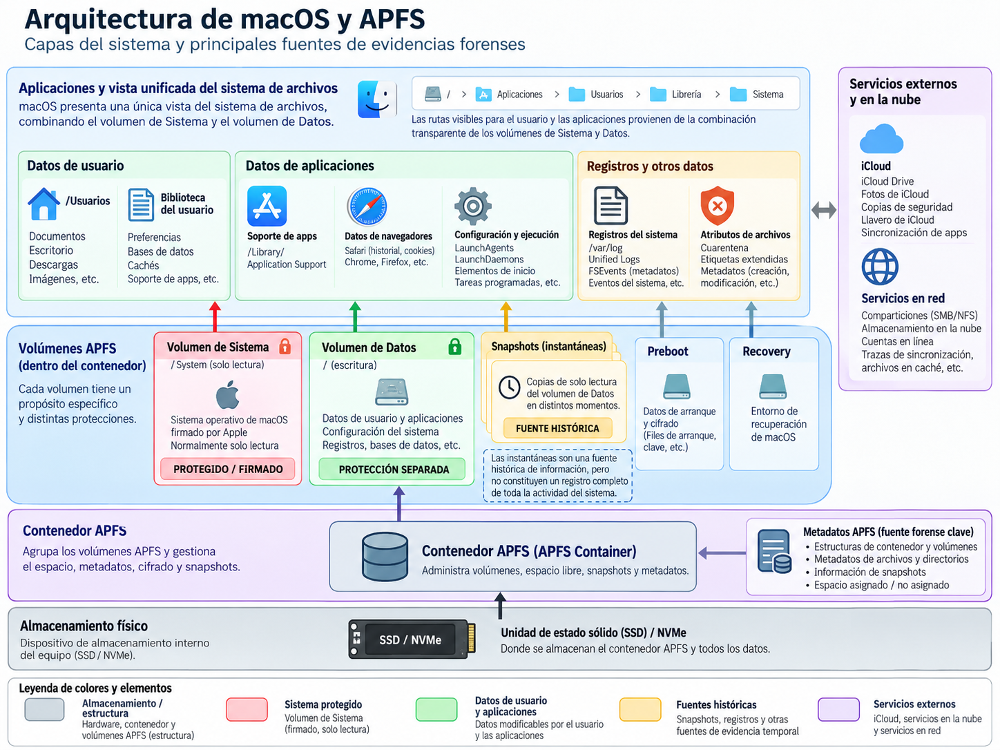
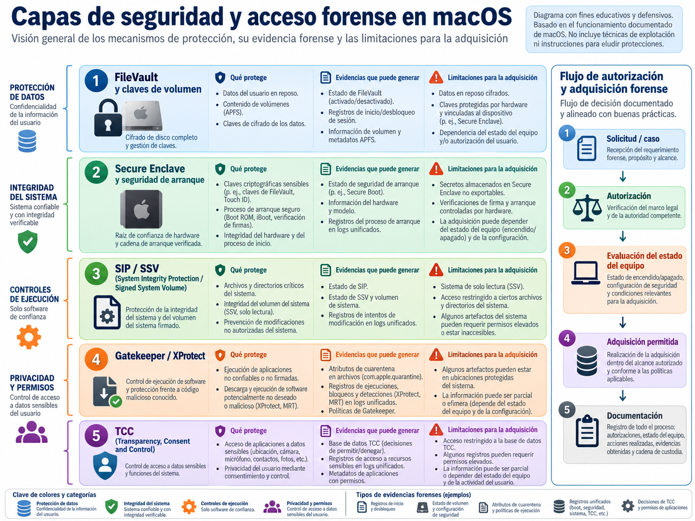
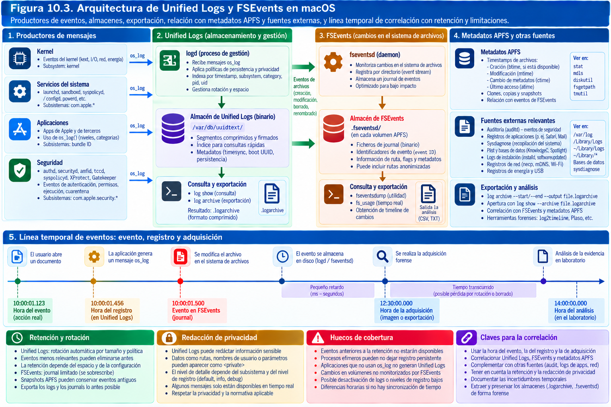
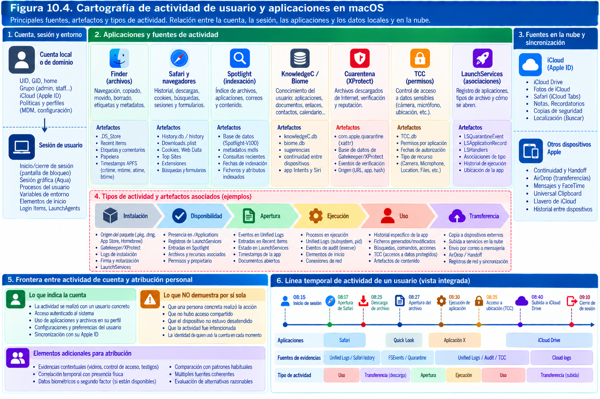
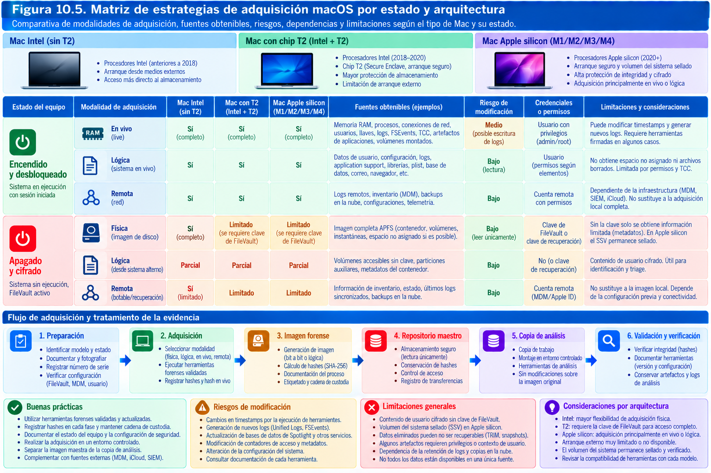
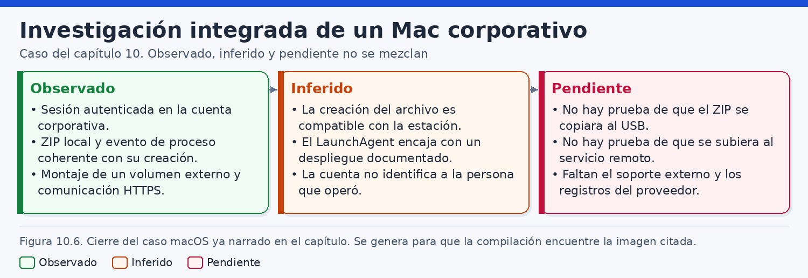

# Análisis forense de macOS

> "Damien’s ambivalence toward design showing here: He won’t allow decorators through the door unless they basically agree to not do that which they do, yet he holds on to this Mac for the way you can turn it upside down and remove its innards with a magic little aluminum handle."
>
> — William Gibson, Pattern Recognition (2003)

En una estación macOS aparentemente normal puede convivir una enorme diversidad de evidencias: metadatos de archivos, decisiones del sistema de protección de la privacidad, instantáneas APFS, rastros de descargas, servicios iniciados automáticamente y registros de una aplicación que ya no está instalada. Sin embargo, el hallazgo de uno de esos indicios rara vez basta para reconstruir lo ocurrido. El análisis forense exige comprender cómo se producen los datos, qué mecanismos determinan su conservación, qué derechos de acceso existen y qué hipótesis alternativas permanecen abiertas.

Los ordenadores Mac combinan una base Unix con tecnologías propias de Apple. Esa combinación puede inducir a dos errores opuestos. El primero consiste en tratar macOS como si fuera simplemente una distribución Linux con una interfaz gráfica distinta: las rutas, mecanismos de arranque, sistemas de auditoría, formatos de registros y protecciones de privacidad no funcionan igual. El segundo es asumir que la integración entre hardware y software hace que los artefactos tengan un significado inequívoco. Ni la sofisticación de APFS ni las protecciones del Secure Enclave eliminan los problemas de procedencia, retención, sincronización de relojes o atribución humana.

Este capítulo describe cómo investigar equipos macOS actuales y, cuando resulta pertinente, cómo interpretar vestigios de generaciones anteriores. Su foco es el análisis defensivo y la obtención legítima de evidencias en investigaciones judiciales, corporativas y de respuesta a incidentes. Los comandos son ejemplos de laboratorio y deben adaptarse a la versión, arquitectura, autorización y modalidad de adquisición del caso. No constituyen una invitación a debilitar protecciones del equipo investigado.

Las capacidades forenses evolucionan por versión. La arquitectura Intel convive todavía con equipos dotados del chip T2; los Mac con Apple silicon introducen vínculos más estrechos entre arranque, claves, almacenamiento interno y sistema operativo. No se debe trasladar automáticamente una receta de un equipo a otro. Antes de cualquier intervención conviene dejar constancia del modelo, identificador de hardware, arquitectura, versión y compilación de macOS, tipo de almacenamiento, configuración de cifrado, estado de encendido y condiciones de acceso.

La idea rectora es sencilla: **una observación técnica es una pieza de evidencia, no una conclusión completa sobre la conducta de una persona**. Un permiso TCC refleja una decisión de acceso; un evento FSEvents muestra actividad sobre un espacio de nombres; un historial de Safari puede sugerir una visita; un LaunchAgent puede estar preparado para ejecutarse. Las conclusiones se obtienen al correlacionar esos indicios, contrastar los resultados y reconocer explícitamente lo que permanece desconocido.

## Arquitectura del sistema y APFS

### macOS como sistema de múltiples capas

macOS incorpora componentes derivados de Unix, bibliotecas y servicios de Apple, un kernel denominado XNU, frameworks de aplicaciones, gestores de servicios, sistemas de permisos y un ecosistema de sincronización con otros dispositivos y con servicios remotos. Para el analista, esta arquitectura no es un conjunto de nombres que memorizar sino un mapa de lugares donde una acción puede dejar huella. El mismo archivo puede tener una entrada de directorio APFS, atributos extendidos, referencias en Spotlight, registros de una aplicación y una copia histórica en una instantánea.

Una reconstrucción útil distingue al menos cinco capas. En la primera está el hardware: procesador, controladores, almacenamiento, memoria, interfaces y mecanismos de seguridad. En la segunda aparecen los contenedores y volúmenes APFS, así como los elementos de arranque. En la tercera se encuentran los archivos y directorios del sistema y de los usuarios. La cuarta abarca bases de datos, registros, preferencias y mecanismos de ejecución. La quinta incluye identidades, nube, políticas corporativas, herramientas de seguridad y otros equipos que aportan contexto externo. Ninguna capa sustituye a las restantes; cada una responde preguntas distintas.

La arquitectura determina la estrategia de adquisición. Una imagen de bloques cifrados puede preservar fielmente una representación del medio sin proporcionar contenido inteligible; una extracción lógica de un volumen desbloqueado puede contener archivos valiosos pero no todos los metadatos de bajo nivel; una exportación de registros corporativos puede corroborar actividad asociada a una cuenta sin atribuirla directamente al propietario del Mac. De ahí que la cobertura de una adquisición deba describirse con precisión y no reducirse a la etiqueta «imagen completa».

La configuración de los sistemas de archivos se observa, dentro del alcance autorizado, mediante utilidades como `diskutil` y `mount`. Algunas consultas pueden ejecutarse en un Mac de análisis o sobre un equipo de prueba; en un equipo investigado encendido deben quedar registradas como intervenciones que podrían modificar su estado.

```bash
# Ejemplos orientativos en un Mac de laboratorio.
sw_vers
uname -m
system_profiler SPHardwareDataType

diskutil list
diskutil apfs list
mount
```

El resultado de `sw_vers` identifica la versión y compilación; `uname -m` distingue arquitecturas como `arm64` y `x86_64`; `system_profiler` ofrece un inventario más amplio. La salida de `diskutil apfs list` representa la visión lógica que ofrece el sistema en ese instante, no una certificación de la estructura física del almacenamiento ni de la completitud de la adquisición. Cuando un comando se ejecuta en el propio equipo intervenido se conserva también su salida original, momento, cuenta y efecto operativo previsto.

### El sistema de archivos APFS

APFS, *Apple File System*, es el sistema de archivos predominante de los Mac modernos. Fue diseñado para almacenar información en dispositivos de estado sólido y aporta funciones como instantáneas, clones, compartición de espacio entre volúmenes y estructuras de metadatos basadas en *copy-on-write*. Esta última técnica evita, en determinadas operaciones, sobrescribir in situ la versión anterior de una estructura antes de escribir la nueva. Por ello pueden existir relaciones entre estados históricos, bloques compartidos y referencias activas que no se corresponden con el modelo simplificado de «un archivo ocupa siempre una secuencia única de sectores».

Desde el punto de vista forense, un contenedor APFS puede alojar varios volúmenes que comparten un mismo conjunto de espacio disponible. Esto significa que las cifras de «espacio ocupado» de un volumen no siempre pueden sumarse como si fueran particiones tradicionales independientes. Los clones pueden compartir bloques hasta que uno de los objetos se modifica, y las instantáneas pueden mantener referenciados datos que ya no forman parte de la vista corriente del sistema de archivos. La aparente ausencia de un archivo en el volumen montado no implica, por tanto, que todas las representaciones de su contenido hayan desaparecido.

Una descripción simplificada de las capas es la siguiente:

1. **Dispositivo y esquema de particiones.** El almacenamiento presenta unidades lógicas y particiones que pueden contener estructuras APFS.
2. **Contenedor.** Gestiona un espacio común e incluye metadatos relativos a los volúmenes alojados.
3. **Volumen.** Presenta un sistema de archivos lógico con su contenido y su función dentro del sistema.
4. **Objetos.** Archivos, directorios, vínculos y estructuras internas que hacen posible localizar el contenido.
5. **Estados históricos.** Instantáneas y otros mecanismos que pueden conservar determinadas vistas anteriores, si están presentes.

La visión anterior resulta útil para orientarse, pero no es un dibujo de la distribución exacta de bytes en un medio. Los identificadores de contenedor, de volumen, de objeto y de instantánea cumplen funciones diferentes. Durante una investigación conviene conservarlos sin sustituirlos por nombres descriptivos ambiguos como «Macintosh HD», pues esa etiqueta puede coexistir con distintos volúmenes o cambiar.

Las particularidades de APFS hacen necesario comprobar que la herramienta seleccionada interpreta la variante del sistema de archivos y las funciones efectivamente usadas. Una herramienta puede enumerar archivos corrientes y fallar al procesar instantáneas, clones o atributos extendidos. Ese límite debe documentarse antes de concluir que un elemento no existe.

### Grupos de volúmenes: System y Data

En instalaciones modernas, macOS separa el sistema operativo de los datos modificables. El grupo de volúmenes del sistema suele incluir un volumen **System**, protegido y de solo lectura para las operaciones ordinarias, y un volumen **Data**, que contiene la información de usuario y otros datos que cambian durante el funcionamiento. Además pueden aparecer volúmenes con funciones como **Preboot**, **Recovery** y **VM**. Las relaciones concretas dependen de la instalación y deben comprobarse en cada caso.

Esta división puede resultar invisible para quien utiliza el Finder: el usuario ve un árbol de directorios integrado. Para ello intervienen mecanismos que permiten presentar rutas lógicas comunes, aunque los objetos pertenezcan a volúmenes distintos. En una adquisición, sin embargo, sí importa de qué volumen procede cada archivo. Capturar únicamente el volumen del sistema no equivale a preservar todos los documentos y artefactos del usuario; adquirir solo el volumen de datos puede impedir reconstruir con suficiente precisión el contexto de versión, instalación o arranque si no se ha documentado por otra vía.

El analista no debe confundir **ruta aparente**, **ruta física dentro de un volumen** y **origen de la adquisición**. Por ejemplo, una ruta bajo `/Users` visible desde un sistema arrancado puede corresponder al volumen Data, mientras que determinados componentes bajo `/System` pertenecen al sistema protegido. Los mecanismos de montaje y los enlaces asociados al grupo de volúmenes ayudan a explicar esa presentación conjunta.

Una comprobación preliminar, que no altera las protecciones, puede registrar:

```bash
diskutil apfs list

diskutil info /

diskutil info /System/Volumes/Data

# Mostrar montajes y opciones activas.
mount
```

En un laboratorio, el inventario debe asociar cada volumen a su UUID, papel, punto de montaje, estado de cifrado, instantáneas visibles y medio que lo alberga. No se deben interpretar esos campos de forma aislada: el volumen identificado por una ruta no siempre representa un dispositivo independiente.

### El volumen del sistema firmado y el estado de arranque

Desde macOS 11, el *Signed System Volume* (SSV) protege criptográficamente el contenido del sistema operativo y se apoya en instantáneas APFS. En una configuración normal, el arranque utiliza una instantánea verificada del volumen System. Este mecanismo permite establecer determinadas garantías sobre la integridad del contenido del sistema que Apple distribuye; no convierte en confiables los archivos de usuario ni demuestra que una investigación se haya realizado correctamente.

Hay dos implicaciones forenses principales. La primera es que las modificaciones persistentes maliciosas no deben buscarse únicamente en directorios clásicos del sistema: un adversario puede intentar operar en lugares modificables, configuraciones de arranque de aplicaciones, carpetas de usuario o componentes autorizados de terceros. La segunda es que no basta con observar un sistema aparentemente íntegro para descartar actividad previa. El SSV limita una clase de alteraciones, no todos los caminos para ejecutar software no deseado ni todas las acciones realizadas con credenciales legítimas.

La instantánea del sistema utilizada para arrancar y las instantáneas de datos que puedan existir tienen finalidades y coberturas distintas. También son distintas las instantáneas locales asociadas a ciertos procesos de copia de seguridad. Al documentarlas deben conservarse los identificadores y la finalidad de cada una en lugar de agruparlas bajo la palabra genérica «snapshot».

Se puede consultar el estado del sistema con utilidades oficiales y documentación de Apple, sin modificar la política de arranque. La verificación del estado debe contextualizarse con el hardware, versión, políticas instaladas y estado del equipo. Un entorno experimental que haya deshabilitado protecciones no debe utilizarse como patrón universal de comportamiento.

### Rutas lógicas y organización de datos

La organización de macOS combina ubicaciones de ámbito global y carpetas específicas de cada usuario. Para preparar una búsqueda se deben reconocer, entre otras, `/Applications`, `/Library`, `/System`, `/Users`, `/private/var`, `/private/etc` y las carpetas `Library` internas de los perfiles. La ruta `/var` suele resolver hacia `/private/var`; `/etc` apunta normalmente a `/private/etc`. Estas convenciones importan al comparar rutas entre un registro y una imagen montada.

La carpeta `~/Library` suele concentrar preferencias, bases de datos de aplicaciones, contenedores, cachés, estados guardados y configuraciones específicas de un usuario. No todos sus componentes significan actividad voluntaria. Los mecanismos de sincronización, actualizaciones, indexación y automatización pueden crear o modificar archivos sin una intervención consciente. En una investigación debe distinguirse el artefacto creado por la aplicación, el componente del sistema que lo actualiza y la acción humana que se desea probar.

Algunos programas operan en *sandboxes* y almacenan su información en subdirectorios de `~/Library/Containers` o en contenedores de grupo. Otros mantienen estructuras bajo `~/Library/Application Support` o bases de datos SQLite. La versión de la aplicación y su configuración suelen influir tanto como la versión de macOS. Por ello, una ruta recopilada de un artículo antiguo es una hipótesis de localización, no una garantía de presencia.

### Clones, instantáneas y espacio recuperable

El *copy-on-write* introduce un matiz importante: crear un clon de archivo puede no provocar inicialmente una duplicación física de todos sus bloques. Una herramienta de análisis que calcule únicamente el tamaño lógico podría sobreestimar el espacio físico utilizado. La operación contraria también es problemática: un bloque todavía referenciado por una instantánea puede seguir ocupando espacio aunque el archivo ya no aparezca en el estado corriente.

La recuperación debe contemplar varias vías. Una consiste en examinar metadatos y referencias activas de archivos. Otra aprovecha instantáneas todavía disponibles. Una tercera intenta examinar bloques no asignados cuando el acceso y el cifrado lo permiten. La cuarta recurre a copias externas, historiales de aplicaciones o servicios cloud. Estas vías no tienen las mismas garantías de nombre, ruta, integridad, atribución ni exhaustividad.

En SSD, las operaciones TRIM y el manejo interno del medio añaden incertidumbre. TRIM informa al dispositivo de que determinados bloques lógicos ya no contienen datos necesarios para el sistema de archivos, pero no permite establecer un instante universal e inmediato en el que todo contenido previo se vuelva irrecuperable. Su efecto depende de la cadena completa: macOS, APFS, controladora, cifrado, firmware, reutilización y condiciones de adquisición. No es riguroso prometer recuperación ni declararla imposible sin evaluar el caso.

### Qué revela y qué no revela la estructura APFS

APFS puede documentar que un objeto estaba presente en determinado estado del volumen, ofrecer metadatos relevantes o permitir localizar una versión anterior. Sin embargo, la existencia de un archivo no demuestra quién lo creó; una modificación puede proceder de sincronización o de procesos automatizados; una instantánea no equivale a un historial exhaustivo; y la falta de un archivo en la vista actual no certifica que nunca existiera. Además, un identificador de objeto, un nombre y una fecha pueden referirse a facetas diferentes de una misma historia.

El resultado sólido combina tres niveles: **estado observado** (qué representa la adquisición), **explicación técnica** (cómo pudo producirse) e **inferencia del caso** (qué significa para la pregunta investigada). Es esencial preservar el espacio entre esos niveles. La cadena de custodia y el hash del objeto adquirido aseguran controles sobre integridad documental, pero no transforman una inferencia débil en una observación directa.



### Estrategia de observación sin confundir capas

Ante un Mac, el investigador puede comenzar por una representación del hardware y pasar después a identificar la arquitectura lógica, los volúmenes y las fuentes relevantes. Esta secuencia es descriptiva, no obligatoria. Si existe riesgo de pérdida de una sesión desbloqueada, de información volátil o de registros de corta retención, el orden de intervención puede cambiar. La prioridad debe justificarse según preguntas, autorizaciones y consecuencias técnicas, no por una regla rígida basada en un manual.

La toma de notas resulta más útil cuando cada hallazgo se expresa con los siguientes elementos: identificador de fuente; ruta o entidad observada; versión del componente que la generó; instante y zona horaria; método de extracción; integridad verificable; significado técnico conocido; y preguntas pendientes. Este modelo permite que otro analista entienda por qué una lectura de APFS fue considerada pertinente y cómo se relaciona con las conclusiones.

Supongamos que se investiga un supuesto borrado de archivos comerciales de un MacBook. La enumeración del volumen Data revela que los documentos no están en su ubicación conocida. La primera conclusión defendible es limitada: «No se localizaron en la ruta examinada dentro de la adquisición y mediante el procedimiento descrito». Una instantánea puede mostrar versiones previas, un registro de sincronización puede reflejar un movimiento remoto y la Papelera puede contener un objeto relacionado. Solo después de correlacionar esas fuentes cabe hablar de una eliminación probable, de un movimiento o de una sincronización. La ausencia de un archivo no autoriza atribuir intencionalidad destructiva.

## Cifrado, instantáneas y protecciones

### FileVault y protección de datos en reposo

El cifrado es una de las grandes diferencias entre adquirir un Mac moderno y extraer sectores de un disco tradicional. FileVault protege el contenido de los volúmenes y utiliza mecanismos de control de claves ligados a la configuración del equipo. En Apple silicon y equipos con chip T2, la protección del almacenamiento interno se integra con capacidades hardware y con la jerarquía de claves del sistema. Una extracción física o de bloques puede ser técnicamente fiel y, sin embargo, no permitir leer los documentos cifrados.

La pregunta correcta no es únicamente «¿está activado FileVault?». Debe distinguirse si el volumen se encontraba bloqueado o desbloqueado; quién tenía autorización para facilitar claves o credenciales; si existen mecanismos de recuperación gestionados por una organización; si el equipo estaba encendido, suspendido o apagado; y qué modalidad de adquisición proporciona acceso al contenido. La misma decisión operativa puede tener consecuencias opuestas: apagar puede preservar una parte del estado físico, pero perder material de claves o sesiones; mantener un equipo encendido puede conservar acceso a archivos, a costa de que el sistema continúe modificándose.

En una investigación legítima se buscan vías de obtención autorizadas: colaboración del titular, claves de recuperación gestionadas por la empresa, credenciales facilitadas en el marco del encargo o exportaciones de aplicaciones y servicios. No existe una técnica universal para eludir el cifrado de todos los Mac modernos. Deshabilitar protecciones, alterar políticas de arranque o experimentar sobre el original suele ser una mala elección de preservación y puede exceder la autorización disponible.

No debe confundirse el cifrado del volumen Data con la integridad del volumen System. El SSV verifica contenido del sistema; FileVault protege datos en reposo. Se complementan parcialmente, pero responden amenazas distintas. Un equipo puede presentar un sistema firmado y tener archivos de usuario accesibles durante una sesión iniciada, o un sistema íntegro y un volumen Data bloqueado al examinador.

### Apple silicon, Secure Enclave y vínculo con el hardware

En los Mac con Apple silicon, funciones críticas de arranque y de protección de claves están integradas en el diseño del equipo. El Secure Enclave participa en la gestión de ciertos secretos y políticas que no deben tratarse como una simple contraseña almacenada en un fichero accesible. El desplazamiento de un medio de almacenamiento a otro equipo, cuando físicamente fuese viable, no garantiza disponer de las claves necesarias para interpretar sus datos.

La arquitectura condiciona los métodos tradicionales de laboratorio. Algunas herramientas de adquisición de épocas anteriores dependían de arrancar desde un medio externo, acceder directamente al dispositivo interno o cargar extensiones del kernel. Tales estrategias no pueden extrapolarse sin verificar las restricciones concretas de hardware y macOS. En ciertos modelos, el almacenamiento no puede extraerse como una unidad SATA o NVMe convencional y el acceso se encuentra vinculado al dispositivo.

La respuesta forense es planificar modalidades alternativas con sus coberturas: adquisición lógica autorizada, exportación de datos de usuario, recolección de artefactos en vivo, copia de un volumen accesible, preservación de copias cloud y registros de EDR o MDM. Cada método requiere documentar qué se obtuvo y qué áreas quedaron fuera. Los nombres comerciales de las herramientas no sustituyen ese inventario de alcance.

### SIP, SSV, Gatekeeper y otras capas de protección

*System Integrity Protection* (SIP) limita determinadas modificaciones incluso cuando un proceso dispone de privilegios elevados. El SSV ofrece integridad del volumen del sistema; Gatekeeper evalúa ciertos programas y procedencias; XProtect incorpora mecanismos antimalware; y las políticas de firma de código intervienen en la confianza del software. Estos mecanismos no son sinónimos y tampoco constituyen pruebas independientes de que el usuario no sufrió un compromiso.

Un resultado de Gatekeeper puede reflejar que un archivo fue evaluado bajo una política determinada, no necesariamente que su contenido se ejecutó posteriormente hasta completar una tarea. La presencia de una firma de código válida identifica una relación criptográfica con una identidad o paquete, no la bondad universal de todas las acciones. Una alerta de protección aporta un indicio, pero exige conocer su semántica, momento, objeto y resultado operativo.

Conviene recoger la configuración sin modificarla, utilizando, cuando corresponda y esté autorizado, comandos de solo consulta o datos procedentes de la gestión corporativa:

```bash
# Consultas en un Mac de laboratorio o bajo autorización.
csrutil status
spctl --status

# Información de firma de una aplicación de prueba.
codesign -dv --verbose=4 /Applications/Utilities/Terminal.app 2>&1

# Comprobación de evaluación de código: interpretar según versión.
spctl --assess --verbose /Applications/Utilities/Terminal.app
```

La salida de esos comandos requiere interpretación específica. Una evaluación solicitada por el propio analista no prueba que el sistema efectuase la misma evaluación en el pasado ni bajo la misma política. Se registra, por tanto, como **prueba realizada durante el análisis**, separada de **evento histórico investigado**.

### TCC: permisos de privacidad como evidencia contextual

El mecanismo de *Transparency, Consent, and Control* (TCC) controla accesos de aplicaciones a recursos y categorías de información sensibles, como cámara, micrófono, determinadas ubicaciones, accesibilidad, grabación de pantalla o acceso a áreas de archivos protegidas. Su estado puede aportar contexto sobre lo que una aplicación estaba autorizada a solicitar. Sin embargo, un permiso concedido no acredita por sí solo que el recurso se utilizara ni que se transfirieran datos fuera del equipo.

Entre las fuentes que suelen examinarse figuran las bases de datos TCC del sistema y de cada usuario, situadas en ubicaciones como `/Library/Application Support/com.apple.TCC/TCC.db` y `~/Library/Application Support/com.apple.TCC/TCC.db`. Su estructura es cambiante y debe comprobarse con un parser compatible con la versión. Las bases SQLite pueden disponer de archivos WAL y SHM; su extracción selectiva exige preservar el conjunto coherente y dejar constancia de si la base estaba abierta durante la adquisición.

Una fila relativa al permiso de accesibilidad para una aplicación desconocida puede elevar la prioridad del análisis, pero no basta para atribuir control remoto efectivo. Debe correlacionarse con la identidad firmante de la aplicación, los registros de TCC, eventos de ejecución, cambios de configuración, presencia de procesos y conexiones. Del mismo modo, una fila ausente no excluye todas las vías posibles de acceso: pueden intervenir exenciones, políticas gestionadas, cambios de versión o eliminaciones posteriores.

### Instantáneas APFS y copias históricas

Las instantáneas APFS representan estados lógicos del sistema de archivos asociados a un momento. Permiten que determinados bloques y metadatos continúen referenciados aunque la vista corriente haya cambiado. Esto puede ser decisivo para recuperar documentos, comparar configuraciones o estudiar cambios en un periodo cercano al incidente. No obstante, una instantánea no es un registro continuo de todas las operaciones y su existencia, cobertura y retención no pueden suponerse.

Las instantáneas del volumen System relacionadas con el arranque del SSV no son equivalentes a copias históricas del volumen Data. Tampoco una instantánea local es lo mismo que una copia externa de Time Machine. La primera depende del volumen y de su espacio; la segunda puede encontrarse en un destino distinto y seguir políticas de conservación separadas. Un plan forense debe enumerar cada fuente histórica concreta y vincularla al volumen correspondiente.

Los comandos siguientes son útiles en un entorno de ensayo:

```bash
# Identificar instantáneas APFS de un volumen concreto.
diskutil apfs listSnapshots /System/Volumes/Data

# Instantáneas locales visibles para Time Machine.
tmutil listlocalsnapshots /

# Inventario general del contenedor.
diskutil apfs list
```

No hay que crear ni eliminar instantáneas en la evidencia original para «facilitar» el examen. En un laboratorio de pruebas sí puede diseñarse una secuencia controlada para documentar qué estados persisten, qué archivos pueden volver a verse y qué marcas temporales conservan. El resultado de esa prueba debe asociarse a una versión y a un escenario concretos.

### Protección frente a acceso no autorizado y garantías del investigador

La protección que establece macOS persigue impedir lecturas o modificaciones indebidas. Un examinador autorizado no debe interpretar cualquier restricción como un obstáculo que pueda sortearse sin evaluación. Los derechos de acceso, la legitimidad de tratamiento y el principio de minimización siguen presentes incluso cuando la tecnología permitiría obtener más datos. El laboratorio debe aplicar permisos limitados, cifrado en reposo, registro de accesos y segregación entre copias maestras y de trabajo.

La integridad técnica de un fichero recolectado se comprueba, cuando el objeto es comparable, con un algoritmo criptográfico como SHA-256. El hash de un archivo exportado no tiene por qué coincidir con el de un contenedor o un archivo que incorpora metadatos adicionales. También debe anotarse si la exportación modificó atributos, marcas temporales o formatos. Una coincidencia de hash demuestra igualdad de contenido bajo la función calculada; no garantiza la autenticidad de su origen ni la legalidad o completitud de la adquisición.




### Decisiones de conservación ante estados diferentes

Un equipo apagado, bloqueado, iniciado con sesión activa o conectado a un servicio corporativo exige valoraciones diferentes. En un Mac apagado con volumen cifrado, quizá la opción menos destructiva sea asegurar el dispositivo, documentar su estado y gestionar la obtención legítima de claves. En una sesión activa autorizada, puede ser prioritario preservar registros volátiles y recopilar datos accesibles antes de una pérdida de sesión. En un entorno corporativo, quizás el proveedor MDM o EDR pueda aportar un historial útil aunque la estación ya no esté disponible.

El analista debe hacer explícitos los riesgos que acepta: modificación por funcionamiento del sistema, pérdida de material volátil, impacto operativo, posibilidad de sincronización remota, caducidad de registros y limitaciones legales. Es frecuente que no exista una opción perfecta. La calidad de la intervención depende de haber elegido un método razonable y documentado sus consecuencias, no de fingir que el original permaneció absolutamente inalterado mientras estuvo encendido.

### Un ejemplo de contradicción aparente

Imaginemos que una aplicación figura como aprobada para acceder a documentos y, al mismo tiempo, en una instantánea no se observan archivos recientes en su carpeta de trabajo. No hay contradicción necesaria. El permiso TCC habla de la posibilidad de acceso; la instantánea representa un estado del volumen; la aplicación podría haber leído un archivo sin copiarlo, podría haber usado datos de una ubicación sincronizada o podría no haberse ejecutado. Para resolverlo sería necesario buscar eventos de proceso, historiales de la aplicación y artefactos de red u otros sistemas. Esta separación entre capacidad, actividad y resultado se repetirá en las secciones siguientes.

## Unified Logs y FSEvents

### Del registro de texto al sistema unificado

Durante muchos años, los investigadores asociaron el análisis de Unix y de Mac a archivos de texto situados bajo `/var/log`. Esa imagen resulta incompleta en macOS moderno. El sistema de *Unified Logging* centraliza mensajes de distintos subsistemas y los conserva, según su nivel e importancia, en estructuras binarias y almacenes sujetos a políticas de retención. El registro puede proceder del kernel, un daemon, una aplicación, el sistema de seguridad, la interfaz gráfica o un componente de red. Parte de su contenido persiste; otra parte puede estar disponible únicamente en memoria o durante un intervalo limitado.

Esta arquitectura ofrece riqueza contextual y plantea problemas específicos. La fuente de información ya no es simplemente una línea de texto cuya ruta conocemos. El contenido puede necesitar decodificación y metadatos auxiliares para reconstruirse adecuadamente; ciertos argumentos se ocultan por privacidad; el filtrado depende de atributos como el proceso, el subsistema o la categoría; y el nivel de detalle efectivo cambia con configuraciones y versiones. Una búsqueda sin resultados puede significar que el evento no se registró, que expiró, que el filtro fue demasiado estricto o que partes del mensaje se ocultaron.

La documentación de Apple distingue niveles como `debug`, `info`, `default`, `error` y `fault`, con reglas de persistencia que no son idénticas. No se debe suponer que los mensajes de depuración sobreviven por defecto en el almacenamiento permanente. Asimismo, una captura realizada con una herramienta puede contener material que no aparecería en una consulta posterior, debido a la evolución del sistema o a una política de retención. La procedencia temporal de cada exportación es crucial.

### Estructura lógica de los mensajes

Un mensaje de Unified Logs puede incluir instante temporal, proceso productor, identificador de proceso, hilo, subsistema, categoría, tipo de mensaje y cuerpo textual o parámetros decodificados. Estos campos constituyen puntos de unión entre fuentes: un mensaje relativo a la evaluación de una aplicación puede relacionarse con su firma de código; un evento de conexión puede vincularse a un proceso; un aviso de permisos puede cotejarse con una entrada TCC.

La interpretación requiere reconocer que el proceso emisor no siempre es el proceso protagonista de la acción. Un daemon del sistema puede registrar lo que hizo otra aplicación; un servicio de sincronización puede trabajar por cuenta del usuario; y un componente de seguridad puede producir un mensaje al evaluar una solicitud sin que finalmente se complete la operación solicitada. Por eso conviene anotar en una ficha separada «componente que escribe el registro», «objeto afectado» y «acción que puede inferirse».

La línea temporal añade otra complicación. Aunque muchas entradas incluyen información de alta resolución, eso no garantiza exactitud absoluta frente a una fuente externa. El reloj puede haber estado desajustado, los registros pueden exportarse en distintas zonas horarias y los componentes pueden diferir en el momento en que consideran ocurrido un hecho. Siempre que sea posible, el análisis debe normalizar los tiempos a UTC, conservar el valor original y documentar incertidumbres, saltos de reloj y periodos de suspensión.

### Localización y conservación de Unified Logs

En instalaciones comunes, parte del almacén se sitúa bajo `/private/var/db/diagnostics` y áreas relacionadas como `uuidtext`. Estas rutas orientan la identificación, pero sus contenidos no deben copiarse parcialmente sin comprender las dependencias. En investigaciones prácticas se utiliza con frecuencia un archivo `.logarchive`, que agrupa datos necesarios para examinar los mensajes de forma coherente. Debe conservarse el archivo exportado original y verificarse su integridad, no únicamente los CSV o textos que generó un parser.

En una estación encendida y autorizada, el comando `log collect` puede recopilar registros en un archivo de análisis. Es una acción de recolección en vivo, no una adquisición neutral sin efectos: utiliza el sistema existente, consume recursos y puede generar actividad adicional. Se documenta el instante de inicio, los parámetros, el alcance temporal, la versión del sistema y las advertencias emitidas.

```bash
# Laboratorio: crear un archivo de registros unificados.
# El periodo efectivo disponible depende de la retención.
sudo log collect --last 2h --output /Volumes/DESTINO/LAB-UL-01.logarchive

# Consultar el archivo sin alterar el objeto maestro.
log show --archive /Volumes/TRABAJO/LAB-UL-01.logarchive \
    --style compact --info --last 1h

# Exportar resultados interpretados para revisión.
log show --archive /Volumes/TRABAJO/LAB-UL-01.logarchive \
    --style json --info > /Volumes/TRABAJO/unified-log.json
```

Los comandos anteriores se prueban en laboratorio antes de su adopción. El parámetro `--last` y las opciones exactas deben comprobarse en el manual de la versión utilizada. El archivo exportado no debe guardarse dentro de una carpeta del equipo investigado cuando ello introduzca escrituras evitables o exceda el alcance; se prioriza un destino autorizado y con capacidad suficiente. La salida JSON es un derivado, no un sustituto del `.logarchive`.

### Consultas mediante predicados

El filtrado permite reducir una masa de registros a eventos potencialmente relevantes. Se pueden usar predicados sobre proceso, subsistema, categoría y otras propiedades, pero deben entenderse como un criterio de búsqueda, no como una prueba de ausencia. Diferentes procesos pueden describir el mismo fenómeno con términos distintos; una actualización del sistema puede modificar nombres de componentes; y un predicado basado en texto puede quedar inutilizado cuando el contenido aparece redactado como `<private>`.

Un procedimiento razonable comienza con una consulta amplia en el intervalo definido, identifica productores de interés y después refina por componentes. Se conservan tanto la consulta como el número de resultados y los periodos efectivamente cubiertos. Cuando una búsqueda devuelve cero coincidencias, se comprueba de forma independiente que el archivo contiene eventos de la época investigada y que el subsistema esperado aparece en esa versión.

```bash
# Consultar entradas asociadas a un proceso en un archivo de trabajo.
log show --archive /Volumes/TRABAJO/LAB-UL-01.logarchive \
    --predicate 'process == "sshd"' --info --style compact

# Ejemplo de filtro por subsistema de privacidad.
log show --archive /Volumes/TRABAJO/LAB-UL-01.logarchive \
    --predicate 'subsystem == "com.apple.TCC"' --info --style compact

# Consultas sobre un sistema de pruebas vivo.
log show --last 30m --style compact \
    --predicate 'process == "sudo"'
```

Un mensaje atribuido a `sshd` podría reflejar una etapa de una autenticación remota. Para sostener la apertura de una sesión conviene buscar también el contexto de autenticación, las entradas asociadas y la actividad posterior. Una entrada de `sudo` puede registrar una elevación o solicitud, pero el resultado exacto depende del contenido del mensaje y del mecanismo de ejecución. De nuevo, no existe equivalencia automática entre «hay un mensaje» y «la acción se completó».

### Privacidad, redacción y vacío aparente de datos

Unified Logging incorpora mecanismos para limitar la exposición de valores sensibles. Los mensajes pueden mantener visibles cadenas estáticas mientras ocultan parámetros dinámicos como nombres, rutas o datos personales. Esta redacción protege la privacidad, pero reduce las posibilidades de reconstrucción. El examinador no debe completar imaginativamente campos ocultos ni tratarlos como si fueran información recuperada.

El indicador `<private>` no significa que el mismo valor no exista en ninguna otra fuente. Puede haber una referencia en una base de datos de la aplicación, en un archivo, en el historial del navegador o en registros de red. Sin embargo, el correlato debe hallarse y verificarse; la coincidencia aproximada de tiempo y contexto no autoriza escribir una ruta concreta donde la fuente original presenta un valor protegido.

La ausencia de mensajes esperados tampoco demuestra que se haya manipulado el registro. Hay explicaciones ordinarias: expiración por retención, nivel de log no persistente, falta de habilitación, filtros incompatibles, ausencia de actividad o una exportación incompleta. La hipótesis de manipulación exige indicadores positivos adicionales y la exclusión razonable de las alternativas inocuas.

### FSEvents: información sobre cambios del sistema de archivos

FSEvents es un mecanismo de notificación y seguimiento de cambios en jerarquías de directorios. Permite a componentes del sistema y aplicaciones conocer que algo cambió desde determinada referencia de evento. En contextos forenses resulta valioso porque puede conservar pistas sobre creación, eliminación, renombrado o modificación de objetos, dependiendo del tipo de evento y de las opciones con las que fue producido.

No debe describirse FSEvents como una grabación literal de todas las operaciones realizadas sobre todos los archivos. Los eventos pueden referirse a directorios, pueden agruparse, la granularidad depende de la implementación y existen situaciones en las que se pierden intervalos o se requiere reexaminar una jerarquía. La existencia de un cambio notificado no identifica de forma directa la aplicación o persona responsable. Asimismo, los registros persistidos no tienen necesariamente una marca temporal individual con la misma semántica que un evento del sistema unificado.

En un volumen, el almacén puede encontrarse en un directorio `.fseventsd`; la ruta concreta debe resolverse de acuerdo con el volumen y la versión de macOS. Es importante evitar un error habitual: interpretar automáticamente el momento de escritura del archivo que contiene múltiples eventos como la hora exacta de cada modificación que esos eventos describen. Las fechas de archivo, los identificadores de evento y la secuencia de acciones no son equivalentes.

### Identificadores, marcas de cambio y pérdidas de continuidad

Un registro FSEvents puede presentar identificadores que permiten ordenar observaciones dentro del contexto correspondiente. Estos identificadores no se sustituyen por una fecha inferida sin indicar el procedimiento. Si existe un salto o una discontinuidad en los datos, debe registrarse como una limitación de cobertura, no rellenarse por interpolación como si todas las operaciones intermedias fueran conocidas.

La técnica de reconstrucción puede apoyarse en tres conjuntos: la secuencia FSEvents, los metadatos APFS y los registros de aplicaciones. Supongamos que una secuencia señala actividad en una carpeta de documentos, y el estado actual muestra que cierto archivo no existe. Es posible formular la hipótesis de una eliminación, pero también deben valorarse un movimiento, la sincronización, una sustitución atómica, una acción automatizada o una interpretación demasiado amplia de un evento de directorio. El análisis de versiones anteriores y de las operaciones registradas por la aplicación puede inclinar la balanza.

Conviene que los informes distingan **cambio observado en el espacio de nombres**, **operación concreta inferida**, **intervalo temporal estimado** y **actor no identificado**. Este desglose impide convertir un indicador de mantenimiento del sistema en una acusación sobre el usuario.

### Comparación entre FSEvents, APFS y Unified Logs

Aunque las tres fuentes hablan del comportamiento de un Mac, responden preguntas diferentes. APFS representa estructuras y estados de archivos; FSEvents registra indicaciones de cambios en las jerarquías observadas; Unified Logs recoge mensajes de los componentes que deciden registrar ciertas operaciones. Un registro de red adicional puede mostrar comunicación; un producto EDR puede asociar operaciones a procesos. Es precisamente la combinación de esas perspectivas la que permite construir una inferencia sólida.

| Fuente | Observación habitual | Fortaleza | Límite de interpretación |
|---|---|---|---|
| APFS actual | Archivos, metadatos, estructura | Estado del volumen adquirido | No es una historia completa |
| Instantánea APFS | Estado anterior disponible | Comparación de versiones | Cobertura y momento específicos |
| FSEvents | Cambios de jerarquía | Secuencias de cambio | No atribuye automáticamente autor ni tiempo exacto |
| Unified Logs | Mensajes de procesos y servicios | Contexto operativo | Redacción, filtros, retención y semántica del productor |
| EDR / Endpoint Security | Acciones observadas por el producto | Posible vínculo con proceso e identidad | Depende de despliegue, políticas y retención |
| Copia cloud / aplicación | Versiones y operaciones de servicio | Contexto remoto | Puede referirse a otra cuenta o dispositivo |

La tabla es un mapa de capacidades típicas, no una garantía uniforme. Una herramienta de análisis que muestre filas sin conservar el objeto original ni la versión de su parser puede introducir sesgos. Siempre se verifica si la herramienta interpreta correctamente el formato presente en la evidencia.

### Diseño de una cronología compuesta

La reconstrucción temporal exige conservar el valor original y su semántica. Un instante extraído de un mensaje de Unified Logs, una marca de modificación APFS y un identificador FSEvents no deben fusionarse como si fueran medidas idénticas. Una buena línea temporal identifica el productor, la zona horaria, la resolución, posibles desplazamientos del reloj y la confianza en la correspondencia entre fuente y acción.

Por ejemplo, una estación puede mostrar una entrada de aplicación a las 09:14:11, un cambio APFS en la misma carpeta a las 09:14:12 y un archivo de almacenamiento de FSEvents cuya modificación se produjo a las 09:15. No significa necesariamente que FSEvents registrase una tercera acción a las 09:15. Puede estar reflejando la persistencia posterior de eventos ocurridos antes. Una cronología que no explicase esa diferencia sugeriría un orden falso.

En investigaciones reales conviene construir dos representaciones complementarias: una tabla de **observaciones brutas** y una cronología de **hechos técnicos interpretados**. La primera retiene rutas, mensajes, valores y referencias verificables; la segunda incluye hipótesis, intervalos y limitaciones. La transición entre una y otra debe poder auditarse.

### Ejemplo metodológico: una carpeta que desaparece

Un responsable afirma que una carpeta de contratos dejó de estar disponible al finalizar la jornada. Se recibe una adquisición lógica del volumen Data y una exportación de registros. La carpeta no existe en su ruta habitual. FSEvents indica cambios en el árbol contenedor; Unified Logs contiene actividad de un servicio de sincronización; una instantánea conserva parte del contenido y el proveedor cloud registra una operación de movimiento.

El examen debería determinar si el movimiento se efectuó en el Mac o llegó mediante sincronización. Se comparan identificadores de objetos, rutas, versiones, marcas de tiempo, cuenta de servicio y actividad del cliente. Aunque el proveedor muestre una acción autenticada, debe comprobarse el dispositivo que la originó. Si las operaciones aparecen bajo la misma identidad compartida entre varias estaciones, la atribución al propietario del Mac será menos sólida.

Un informe técnicamente proporcionado podría afirmar: «En la ventana examinada se observaron cambios en la jerarquía local coherentes con la sincronización de un movimiento registrado por el servicio remoto. No se dispone de evidencia suficiente para identificar a la persona que inició la operación ni para excluir el uso de otro dispositivo asociado a la cuenta». Esta redacción puede ser menos contundente que una acusación, pero es más defendible.



### Verificación cruzada y conservación de resultados negativos

El trabajo no termina cuando se encuentra una coincidencia llamativa. Es necesario buscar contradicciones: un servicio puede aparecer activo en una fecha distinta, un registro puede pertenecer a una cuenta no relacionada o un archivo puede proceder de la restauración de una instantánea. Las búsquedas negativas también deben conservarse, junto con su predicado, rango temporal, fuente examinada y cobertura comprobada.

Un informe que documenta únicamente las coincidencias favorables a una hipótesis impide valorar el peso relativo de otras explicaciones. La reproducibilidad requiere guardar la consulta original y los resultados, incluso cuando no aparece el identificador buscado. Los procedimientos de automatización pueden ayudar, siempre que preserven versiones de herramientas, formatos de salida y registros de errores.

### El valor de las fuentes externas para completar lagunas

Los Mac corporativos suelen integrarse con IdP, MDM, EDR, servidores de correo, VPN, proxies y herramientas de almacenamiento remoto. Estos sistemas pueden aportar eventos que el almacenamiento local no conserva o que no pueden recopilarse debido al cifrado. La coordinación de fuentes requiere autorización específica, identificación de administradores competentes, límites temporales y seguimiento de solicitudes.

Si los registros locales se perdieron tras un reinicio, el EDR podría conservar telemetría de procesos, o un proxy registrar una conexión. Pero tampoco estas fuentes son completas por definición. Puede haber agentes desinstalados, políticas de exclusión, eventos perdidos durante desconexiones o discrepancias en la interpretación del usuario. La buena práctica consiste en representar cada fuente con su **ventana de observación**, **campo de cobertura** y **puntos ciegos**, antes de introducir sus datos en una cronología unificada.

## Actividad de usuarios y aplicaciones

### Identidades humanas, cuentas locales e identidades remotas

En macOS, el nombre visible de una cuenta, su identificador local, las credenciales del llavero, la cuenta de Apple, el usuario de un servicio corporativo y la sesión de una aplicación no son entidades equivalentes. Una persona puede utilizar varias cuentas; una cuenta puede ser compartida; y una aplicación puede conservar una sesión iniciada que continúa produciendo datos sin interacción manual. La investigación debe separar esas capas de identidad.

Se pueden estudiar datos de cuentas y grupos, carpetas personales y preferencias mediante herramientas propias del sistema o parsers aplicados sobre una adquisición. En un Mac de laboratorio, comandos como `id`, `dscl` y `stat` ayudan a comprender las relaciones entre identificadores; sobre una evidencia real puede resultar preferible la extracción fuera de línea de los archivos y bases pertinentes, para no generar nuevas acciones sobre el equipo intervenido.

```bash
# Reconocimiento de identidades en entorno de laboratorio.
id
id -Gn

dscl . -list /Users UniqueID

# Inspección de metadatos del directorio personal.
stat -x "$HOME"
```

El identificador de usuario (UID) asocia procesos y archivos con una identidad del sistema, pero no prueba quién estaba físicamente ante el teclado. Una sesión remota o una automatización puede usar la misma cuenta. Para atribución personal deben buscarse factores adicionales: autenticación multifactor, dispositivo de origen, registros de pantalla o sesión gestionados legalmente, acciones interactivas, declaraciones y contexto operativo.

### Finder y actividad documental

Finder registra información relativa a navegación, presentación de carpetas y objetos recientes. Archivos de preferencias, listas de elementos recientes y componentes de la interfaz pueden sugerir que un documento o ubicación era conocido para una cuenta. No todos estos artefactos indican apertura efectiva del contenido: algunos reflejan presentación de una carpeta, una vista previa, indexación o una acción del sistema.

El análisis distingue «objeto enumerado», «objeto presentado», «referencia reciente», «archivo abierto por una aplicación» y «contenido leído o transferido». Cada nivel requiere una justificación propia. Una entrada de lista reciente sin artefactos complementarios no basta para demostrar que un usuario examinó conscientemente el documento entero. Tampoco la ausencia en la lista demuestra que no lo abrió: las aplicaciones difieren en sus mecanismos de persistencia y pueden borrar o actualizar historiales.

Entre las fuentes útiles se encuentran ciertos elementos de `~/Library/Preferences`, datos de aplicaciones y estructuras de historial bajo `~/Library/Application Support`. Sus nombres y ubicaciones cambian según macOS, por lo que es preferible localizar primero la aplicación, su contenedor y los artefactos que la versión investigada realmente produce.

### LaunchServices y asociaciones de aplicaciones

LaunchServices mantiene información necesaria para asociar tipos de archivo, aplicaciones y mecanismos de apertura. Algunas de sus bases o cachés pueden ayudar a comprender qué aplicaciones estaban registradas o se utilizaban para abrir determinados tipos de contenido. Es un error tratar cualquier referencia como prueba independiente de ejecución. Una aplicación puede estar registrada sin haberse abierto en el periodo relevante, y una asociación puede proceder de una instalación.

Una comprobación fiable correlaciona la presencia de LaunchServices con registros de ejecución, historial de la aplicación, archivos abiertos recientemente y contexto del usuario. Cuando exista evidencia de instalación y no de uso, esa distinción debe aparecer en la conclusión. La función del parser tampoco debe inferirse solo por su nombre: algunas herramientas reconstruyen registros de aplicaciones disponibles, otras extraen historial y otras muestran únicamente metadatos de registro.

### Navegadores y descargas

Safari, Chrome, Firefox y otros navegadores mantienen historiales y bases de datos que pueden contener URLs, marcas temporales, descargas, cookies, estados de sesión o preferencias. Los formatos varían por versión y producto. Safari puede almacenar datos en SQLite y en directorios vinculados a su contenedor; los navegadores basados en Chromium utilizan normalmente perfiles propios. La presencia de una URL en una base local debe interpretarse según el tipo de registro: historial de navegación, redirección, descarga, elemento sincronizado o recurso precargado no significan lo mismo.

Una investigación de descarga debe distinguir al menos: solicitud HTTP, transferencia de bytes, creación local de fichero, apertura, ejecución y posible movimiento posterior. El historial puede aportar una URL de origen; el archivo descargado puede conservar un atributo de cuarentena; FSEvents puede señalar cambios de ruta; y Unified Logs puede contener decisiones de seguridad. La presencia conjunta robustece la reconstrucción, pero la identidad de quien ejecutó cada paso no se deduce automáticamente de esos datos.

Los historiales pueden estar sincronizados entre dispositivos y cuentas. Un registro de navegación asociado a un perfil de usuario del Mac no siempre demuestra que la interacción original tuvo lugar en ese Mac. Es preciso identificar campos de procedencia, sincronización, dispositivos relacionados y registros de red cuando estén disponibles.

### Atributos extendidos y cuarentena

macOS permite asociar atributos extendidos a archivos. Entre los más relevantes se encuentra `com.apple.quarantine`, que puede aparecer en contenido descargado por aplicaciones que participan en el mecanismo de cuarentena. Su presencia puede aportar contexto sobre cómo llegó un fichero, la aplicación mediadora o determinados identificadores de procedencia. No todos los programas establecen ese atributo ni todas las formas de copia lo conservan.

```bash
# Lectura de atributos extendidos en archivos de prueba.
ls -le@ /Volumes/TRABAJO/muestra.app
xattr -l /Volumes/TRABAJO/muestra.app
xattr -p com.apple.quarantine /Volumes/TRABAJO/muestra.app

# Metadatos básicos sin modificar el fichero de prueba.
stat -x /Volumes/TRABAJO/muestra.app
```

La lectura del atributo debe realizarse sobre una copia autorizada, evitando comandos que lo modifiquen o eliminen. Una cadena de cuarentena no equivale a un log de navegación exhaustivo ni prueba que el archivo se ejecutase. Puede servir para relacionarlo con una descarga, que después habrá que verificar con la aplicación, el sistema y, en su caso, registros externos.

Además, la conservación de atributos extendidos depende del método de exportación y del sistema de archivos de destino. Si se copian documentos a un formato que no preserva todos los atributos de macOS, se pierde contexto. El procedimiento de adquisición debe indicar qué conserva y qué transforma; una carpeta exportada no debe recibir la etiqueta de copia forense completa si ha descartado atributos relevantes.

### Spotlight y metadatos de búsqueda

Spotlight permite localizar contenidos e indexar metadatos para facilitar búsquedas. Algunas propiedades pueden incluir información sobre tipo de archivo, fechas, autor, aplicación o uso, según extractor, configuración y versión. El índice no es una grabación completa y su contenido puede actualizarse sin interacción directa del usuario. Su valor reside en aportar caminos de búsqueda y posibles referencias que después deben verificarse contra los objetos originales.

```bash
# Consultas de demostración sobre archivos de laboratorio.
mdls /Volumes/TRABAJO/documento-prueba.pdf

# Ejemplo de búsqueda Spotlight en un volumen de prueba indexado.
mdfind -onlyin /Volumes/TRABAJO 'kMDItemFSName == "*.pdf"'
```

Un resultado de `mdls` refleja atributos accesibles mediante la capa Spotlight y no necesariamente todos los metadatos nativos de APFS. Si una propiedad aparece como desconocida o vacía, no puede sustituirse por una interpretación especulativa. Si una búsqueda no encuentra un objeto, deben comprobarse el estado del índice y la cobertura de la adquisición.

### KnowledgeC, CoreDuet y Biome

Los subsistemas de conocimiento contextual y actividad pueden ofrecer indicios acerca de uso de aplicaciones, periodos de actividad, estado de pantalla, bloqueo u otros fenómenos. Entre las fuentes estudiadas por analistas se encuentran bases de datos relacionadas con CoreDuet y KnowledgeC, y mecanismos más recientes como Biome. Su estructura, disponibilidad y granularidad pueden cambiar considerablemente entre versiones.

La mayor dificultad no es localizar una base de datos sino interpretar el flujo que representa. Un intervalo asociado a una aplicación puede indicar que estuvo en primer plano o que un servicio notificó actividad, sin demostrar que alguien realizó una operación específica. Un evento de desbloqueo tampoco confirma la identidad física de quien estaba presente. La asociación con una persona depende de autenticación, contexto de sesión y otras evidencias.

Al extraer bases SQLite se debe conservar el conjunto coherente de base, WAL y SHM cuando corresponda. Si una aplicación o servicio estaba activo, la copia selectiva puede capturar un estado inconsistente. En estos casos puede resultar apropiada una instantánea o un procedimiento específico validado, siempre que sea factible y esté autorizado. Se conservará la evidencia original y se trabajará sobre copias verificadas.

### Notas, correo, mensajes y aplicaciones de productividad

Los equipos Mac concentran comunicaciones, documentos y aplicaciones personales o corporativas. Correo, mensajería, notas, calendarios y herramientas de colaboración pueden mantener bases de datos, adjuntos, cachés, registros y copias sincronizadas. Su relevancia depende de la pregunta investigada, no de la facilidad técnica para extraerlos. Las aplicaciones pueden contener información de terceros no relacionada con el caso, por lo que las restricciones de acceso y la minimización deben formar parte del diseño del examen.

Una copia local de un mensaje no permite concluir automáticamente que el destinatario lo leyó. Un archivo adjunto puede haber sido descargado por un proceso de sincronización; una conversación puede contener marcas de lectura propagadas desde otro dispositivo; una aplicación puede conservar borradores no enviados. Es necesario diferenciar creación, recepción, sincronización, presentación y acción efectiva.

Las comunicaciones protegidas por cifrado o almacenadas en servicios remotos añaden dependencias. Una adquisición lógica de un Mac desbloqueado puede aportar vistas locales y tokens de sesión, pero no garantiza el acceso legítimo a todo el historial remoto ni autoriza utilizar credenciales recuperadas para acceder a otros sistemas. Las solicitudes a proveedores y administradores deben gestionarse conforme al alcance legal y organizativo establecido.

### Dispositivos externos y conexiones

La conexión de memorias USB, discos, teléfonos y unidades de red puede dejar rastros en volúmenes montados, metadatos, preferencias, Unified Logs, FSEvents y aplicaciones de gestión de dispositivos. No existe un único artefacto universal que demuestre todas las conexiones para todas las versiones de macOS. El investigador debe combinar fuentes, identificar dispositivos mediante datos suficientemente específicos y conservar los intervalos de incertidumbre.

Conectar un dispositivo no prueba que se copiaran documentos; abrir una carpeta del dispositivo no demuestra que se copiara su contenido; una operación de escritura observada no identifica necesariamente el archivo completo transferido. Para sostener una copia es preferible encontrar rastros coherentes de origen y destino, tamaños y hashes comparables, registros de la aplicación utilizada o telemetría de endpoint.

Los dispositivos de red y el almacenamiento cloud requieren una cautela adicional. Un archivo puede aparecer localmente por sincronización desde otro dispositivo, y una conexión a un dominio de almacenamiento no confirma por sí sola una carga de datos. Las conclusiones deben distinguir **presencia**, **acceso**, **transferencia probable** y **transferencia completa corroborada**.

### Ejecución de aplicaciones y mecanismos de arranque

macOS usa `launchd` para gestionar servicios y agentes. Los archivos `.plist` asociados a LaunchAgents y LaunchDaemons pueden definir qué ejecutar, con qué parámetros y bajo qué condiciones. Entre las ubicaciones habituales figuran `/Library/LaunchAgents`, `/Library/LaunchDaemons` y `~/Library/LaunchAgents`, junto con componentes del sistema o mecanismos modernos de ítems de inicio. La aparición de una propiedad como `RunAtLoad` refleja intención o condición de configuración, pero no es prueba automática de ejecución efectiva.

```bash
# Lectura de un plist previamente adquirido.
plutil -p /Volumes/TRABAJO/LaunchAgents/com.example.helper.plist

# En un Mac de pruebas: consultar dominios del gestor.
launchctl print system
launchctl print gui/$(id -u)
```

Para analizar la persistencia se relacionan configuración, habilitación, activación observada y efecto. Un LaunchAgent presente puede no estar cargado; uno cargado puede haber fallado; y uno ejecutado puede no haber realizado la función sospechada. La correlación con Unified Logs, procesos en vivo, atributos del binario, firmas de código y conexiones de red permite discriminar estas posibilidades.

El mismo criterio se aplica a elementos de inicio, extensiones y perfiles de configuración. Una instalación no demuestra actividad; una preferencia no acredita necesariamente una transición de estado; y un proceso activo no revela por sí solo la totalidad de las acciones que realizó antes de la captura.

### Tiempos de actividad, reposo y sincronización

Los Mac portátiles alternan suspensión, reanudación, cambios de red, sincronización con iCloud y uso de periféricos. Estas condiciones afectan tanto la generación como la interpretación de marcas temporales. Un periodo sin registros no demuestra inactividad humana si la retención es incompleta, pero tampoco debe explicarse automáticamente por suspensión sin indicios que la sostengan.

Una cronología defendible puede incluir el estado de alimentación, cambios de red, eventos de sesión, actividad de aplicaciones y sincronización remota. Debe conservar la diferencia entre el instante que marca la aplicación y el momento en que el servicio remoto registra la operación. Los relojes de servidores y clientes pueden no coincidir exactamente; las bases de datos pueden utilizar épocas temporales distintas; y algunas marcas representan última actualización del registro en vez de ocurrencia de la acción.

### Atribución responsable de actividad

Es tentador convertir referencias a `~/Library` en afirmaciones sobre el usuario propietario de ese perfil. Esa inferencia suele ser excesiva. Un servicio puede actuar dentro del contexto de la cuenta; una sesión puede quedar abierta y ser utilizada por un tercero; y una aplicación puede recibir cambios sincronizados desde otro dispositivo. En investigaciones corporativas, las cuentas pueden ser compartidas o los equipos usados por varias personas.

Una hipótesis de atribución personal gana fuerza cuando coinciden registros de autenticación individual, desbloqueo, sesión, actividad del proceso, documentos abiertos, interacción en aplicaciones y evidencia externa independiente. Incluso entonces debe valorarse la posibilidad de control remoto, automatización o credenciales comprometidas. El papel del analista es indicar qué vínculos se sostienen, no llenar las lagunas con certeza retórica.



### Ejemplo de actividad documental aparentemente contradictoria

Un usuario afirma no haber abierto una hoja de cálculo confidencial. El archivo aparece en una lista de recientes, el directorio que lo contiene figura en un historial de Finder y un componente de sincronización lo actualizó esa tarde. Ninguno de los tres indicios prueba por sí solo una lectura consciente. Si existe una entrada específica de la aplicación ofimática sobre apertura del documento, la hipótesis gana fuerza, pero debe evaluarse si se produjo durante una restauración, una vista previa o una automatización.

La conclusión puede separar tres planos: el sistema conocía la existencia del objeto; determinada aplicación tuvo una referencia o acceso; y la identidad humana del operador sigue pendiente. Esta forma de informar no disminuye la utilidad forense: evita afirmar más de lo que la evidencia permite y facilita identificar la siguiente fuente que debe solicitarse.

## Artefactos relevantes y limitaciones de adquisición

### Elegir la adquisición según el caso

La obtención de evidencias en macOS no admite una receta única. El equipo puede estar apagado y cifrado, encendido y desbloqueado, gestionado por una organización, conectado a recursos externos, o ser un modelo que restringe el acceso directo a su almacenamiento interno. La primera decisión consiste en definir qué preguntas deben responderse y qué evidencias pueden preservarse legítimamente sin producir una pérdida desproporcionada de información o afectar servicios críticos.

Se distinguen varias estrategias complementarias:

- **Adquisición física o de bloques:** reproduce sectores o bloques lógicos accesibles, con las limitaciones derivadas de cifrado, interfaces y hardware.
- **Adquisición lógica:** recupera archivos y estructuras visibles mediante una vista autorizada del sistema de archivos, con una cobertura que puede excluir contenido no asignado, determinadas instantáneas y metadatos especiales.
- **Recopilación selectiva de artefactos:** conserva registros, preferencias, bases de datos, configuraciones y otros elementos relevantes, normalmente con menor impacto y cobertura más estrecha.
- **Adquisición en vivo:** utiliza capacidades del sistema arrancado para obtener información que podría perderse al apagar, sabiendo que el funcionamiento normal modifica el estado.
- **Recolección remota:** solicita o exporta información desde EDR, MDM, IdP, almacenamiento, correo y otras fuentes del entorno, sometida a autorizaciones y retención propias.

Una colección selectiva puede ser adecuada para responder rápidamente a una alerta, pero no debe presentarse como sustituto universal de una adquisición integral. Una imagen de bloques puede ser técnicamente completa dentro de su espacio direccionable y seguir sin aportar información sobre cuentas cloud, sesiones expiradas o memoria. Lo esencial es describir con exactitud el objeto obtenido.

### Estado del equipo y orden de volatilidad

En un Mac encendido pueden encontrarse procesos, conexiones, sesiones y claves disponibles que no estarán accesibles tras apagar. Al mismo tiempo, mantenerlo en funcionamiento permite que cambien logs, cachés, marcas temporales, archivos temporales y datos sincronizados. La ponderación entre conservación de volatilidad y minimización de alteraciones depende de los hechos y de la autorización. Un orden de volatilidad es una guía razonada, no un mandato que haga correctas todas las capturas en vivo.

El analista debe tomar nota del estado inicial visible: pantalla activa o bloqueada; usuario conectado; aplicaciones abiertas; interfaces de red; alimentación y batería; periféricos; indicios de cifrado; y posibles procesos de sincronización. Esta información se documenta con fotografías y notas antes de intervenir, siempre que sea seguro y esté permitido. No se intenta desbloquear repetidamente el equipo sin autorización ni se introducen contraseñas especulativas.

Las recomendaciones de SWGDE advierten de los riesgos particulares de la captura de memoria en Mac. Determinadas técnicas pueden provocar inestabilidad o reinicio, especialmente si dependen de acceso a componentes del sistema restringidos por hardware o por el kernel. Por ello, no es responsable indicar que «siempre se capture primero la RAM» como si se tratase de una operación neutra. Debe comprobarse la compatibilidad de herramienta, versión y modelo, y valorar las consecuencias de perder la sesión activa.

### Mac Intel, chip T2 y Apple silicon

En Mac Intel antiguos puede haber modalidades de adquisición tradicionales que no estén disponibles en generaciones recientes. En equipos con T2 y Apple silicon, las restricciones de arranque y cifrado están más integradas en el hardware. El acceso directo al almacenamiento puede ser inviable o insuficiente; incluso si se obtiene una representación de bloques, puede permanecer cifrada. Es fundamental documentar el tipo de equipo en vez de hablar genéricamente de «un Mac».

El modo de disco de destino (*Target Disk Mode*) y las funciones de compartir disco disponibles en determinados modelos no son equivalentes en todas las generaciones. Su disponibilidad, comportamiento, requisitos de autenticación y exposición de volúmenes han cambiado. No se debe conectar un Mac moderno suponiendo que aparecerá un disco crudo idéntico al de un soporte USB convencional. El procedimiento depende de hardware, versión del sistema y política de arranque.

También deben distinguirse las funciones de recuperación o restauración de firmware de las de adquisición forense. La existencia de un modo DFU no significa que permita extraer una imagen descifrada del almacenamiento. Utilizar funciones de restauración sin comprender sus efectos podría alterar o eliminar información. Las operaciones de mantenimiento y recuperación no sustituyen a un procedimiento de conservación de evidencias.

### Cobertura del volumen Data y evidencia fuera de su alcance

Cuando la adquisición se efectúa sobre un volumen desbloqueado, suele ser posible recuperar documentos, preferencias, bases de datos y gran parte de los registros visibles. Pero el alcance debe describirse. Es posible que no se conserven todos los datos no asignados, algunas instantáneas, el contenido de otros volúmenes, archivos protegidos por permisos especiales o información de procesos ya terminados. Una exportación lógica puede transformar marcas temporales, atributos extendidos o estructuras de enlaces.

El informe de adquisición debería contestar, para cada artefacto importante: ¿qué volumen lo contenía?, ¿qué cuenta o privilegio permitió leerlo?, ¿se copió el fichero original con sus metadatos?, ¿se preservaron atributos extendidos y recursos auxiliares?, ¿había una base SQLite activa?, ¿se incluyeron instantáneas?, ¿qué errores se registraron? Si alguna respuesta es desconocida, debe figurar como tal.

No basta con enumerar carpetas y comparar tamaños. Un enlace simbólico puede apuntar fuera del conjunto copiado; un archivo puede compartir bloques con otro; una aplicación puede mantener datos en un contenedor específico; y el propio sistema puede sustituir o actualizar archivos mientras se ejecuta la recopilación. La cobertura requiere pruebas con datos conocidos y revisión de errores, no solo la ausencia de una excepción en la terminal.

### Preservación de bases de datos SQLite y archivos auxiliares

Muchas aplicaciones de macOS almacenan información en SQLite. Una base en modo WAL puede utilizar archivos adicionales que contienen transacciones pendientes de consolidación; por tanto, copiar únicamente el archivo principal puede producir una vista incompleta. En un sistema vivo, además, varios procesos pueden modificar el conjunto durante la copia.

En escenarios controlados puede emplearse un mecanismo coherente de instantánea, exportación específica de la aplicación o un procedimiento de adquisición validado. Sobre una copia adquirida, las herramientas SQLite permiten consultar el contenido sin alterar la evidencia maestra. Se recomienda preservar tanto la forma binaria original como cualquier exportación de tablas, incluyendo esquema, versión del parser y consultas.

```bash
# En una copia de laboratorio, solo lectura cuando sea compatible.
sqlite3 'file:/Volumes/TRABAJO/History.db?mode=ro' '.tables'

# Consultas estructurales que no necesitan modificar la base.
sqlite3 'file:/Volumes/TRABAJO/History.db?mode=ro' \
    'SELECT name FROM sqlite_master WHERE type="table";'
```

Estos comandos son ilustrativos. La apertura de una base aislada sin sus archivos WAL puede dar una visión incorrecta, aunque la consulta SQL sea de solo lectura. El analista debe verificar la coherencia de los artefactos y la modalidad de apertura de su biblioteca SQLite, y registrar cualquier recuperación o consolidación que realice en una copia de trabajo.

### Imágenes DMG y formatos forenses

Los formatos nativos de imagen de disco en macOS, como DMG y variantes dispersas, pueden resultar prácticos para preservar determinadas estructuras del sistema y examinarlas con utilidades de Apple. En otros entornos se utilizan RAW, E01/Ex01 o AFF4, según la herramienta, el objeto adquirido y la interoperabilidad requerida. Ningún formato conserva mágicamente información que la modalidad de captura no obtuvo.

Es indispensable distinguir una imagen de bloques de una imagen creada a partir de una carpeta o de un conjunto exportado de archivos. Ambos objetos pueden almacenarse en contenedores similares, pero su cobertura probatoria difiere. También debe indicarse si se adquirió un volumen descifrado o una representación cifrada, porque su contenido y los hashes calculados no son intercambiables.

La recomendación práctica es elegir el formato después de definir las necesidades de análisis y transferencia. Un laboratorio mixto Windows/Linux/macOS necesita comprobar cómo sus herramientas interpretan atributos extendidos, enlaces, identificadores, instantáneas y metadatos de APFS. Si una aplicación convierte los datos a un formato intermedio, se conserva el original y se registra la transformación.

### Integridad de adquisiciones y objetos comparables

El hash SHA-256 permite verificar que dos representaciones de bytes son iguales cuando se calcula sobre objetos comparables. Si se toma un hash del flujo de datos de un volumen y otro del archivo DMG que lo contiene, no debe esperarse coincidencia: el contenedor puede incorporar cabeceras, estructuras y metadatos. De igual manera, un archivo exportado con modificaciones legítimas de formato no tiene por qué coincidir con la versión original.

El procedimiento identifica inequívocamente cada objeto: dispositivo, adquisición, contenedor, segmento, copia de referencia y copia de trabajo. Se registran algoritmo, herramienta, instante, resultado y errores. Si se realiza una copia exacta de un objeto digital completo, sus hashes deben coincidir; si se comparan datos reconstituidos con los datos de origen, debe acreditarse que representan exactamente el mismo flujo.

```bash
# Calcular el hash de un objeto digital concreto.
shasum -a 256 /Volumes/TRABAJO/evidencia.dmg

# Conservar también tamaño y ruta del objeto.
stat -f '%N %z bytes' /Volumes/TRABAJO/evidencia.dmg
```

Una coincidencia verifica integridad relativa, no origen auténtico, completitud ni legalidad. Y una discrepancia debe investigarse: podrían haberse comparado objetos no equivalentes, producirse una transformación documentada o existir una corrupción real. No se debe eliminar la primera versión para «arreglar» el expediente; se conserva y se incorpora la evidencia del incidente de adquisición.

### Herramientas especializadas y control de versiones

Entre las herramientas que pueden utilizarse en un laboratorio macOS figuran utilidades del propio sistema (`diskutil`, `hdiutil`, `log`, `plutil`, `sqlite3`, `xattr`), programas de adquisición y triage como Aftermath, recolectores multiplataforma como UAC y parsers especializados como `mac_apt`. Existen también suites comerciales con capacidades diversas para APFS, artefactos de aplicación, cadenas de custodia y generación de informes.

La selección no debe establecerse como una jerarquía comercial. Importa comprobar funciones específicas: versión de macOS admitida; acceso a la fuente; conservación de metadatos; interpretación de APFS; soporte de instantáneas; tratamiento de WAL; decodificación de Unified Logs; y transparencia ante errores o datos omitidos. Una herramienta actualizada puede resolver problemas de versiones anteriores y también introducir regresiones; debe validarse sobre muestras de resultado conocido antes de su uso probatorio.

Una buena prueba de validación incluye archivos creados y borrados, versiones de una base SQLite, un LaunchAgent benigno, una descarga con cuarentena, una instantánea, cambios de permisos TCC en un Mac de pruebas y periodos de actividad con tiempos conocidos. El investigador compara el resultado de la herramienta con la verdad preparada y documenta aciertos, omisiones y falsos positivos. Estos ensayos se conservan para revisiones posteriores.

### Endpoint Security, MDM y herramientas corporativas

La integración empresarial puede proporcionar fuentes inaccesibles desde una adquisición local tardía. Los sistemas EDR basados en Endpoint Security pueden observar ciertas acciones de procesos, operaciones de archivos, montajes o comunicaciones, según el producto, su configuración y la ventana de retención. Un MDM puede informar de configuración, inventario y estado de gestión, sin que ello signifique que registre cada documento abierto o todos los procesos ejecutados.

Es preciso verificar cuándo se instaló el agente, qué permisos y políticas tenía, cuándo se comunicó por última vez con el servidor y cómo presenta las marcas temporales. Un evento de telemetría puede ser una observación del sensor y no un registro generado por macOS de forma nativa. La diferencia importa al explicar la procedencia y fiabilidad. También puede haber periodos desconectados o alertas agregadas que resumen múltiples eventos.

Los registros de proveedor y los datos locales deben preservarse separadamente, con identificadores y comprobaciones de integridad propios. Una exportación de consola realizada el lunes no equivale necesariamente a una adquisición del estado existente el viernes anterior. La retención y el momento de generación condicionan qué conclusiones negativas son válidas.

### Persistencia: configuración, habilitación y efecto

Los mecanismos de persistencia en macOS abarcan servicios `launchd`, ítems de inicio, componentes de aplicaciones, perfiles de configuración, extensiones y automatizaciones. Un investigador puede detectar un `.plist` sospechoso y atribuirle inmediatamente ejecución persistente. Sin embargo, debe distinguir cuatro niveles: archivo de configuración presente, servicio habilitado, activación observada y efecto producido por el proceso.

Para una unidad `launchd`, la documentación puede comprender nombre, dominio, ubicación, propietario, contenido del plist, binario invocado, argumentos, firma, marcas temporales, estado de registro, logs de lanzamiento y evidencia de proceso. Un fichero colocado en una carpeta conocida puede permanecer inactivo; una ejecución puede fallar; y un nombre con apariencia legítima puede corresponder a una aplicación autorizada o a un imitador.

Los investigadores deben tener en cuenta *drop-ins* funcionales o mecanismos equivalentes de configuración gestionada, políticas que alteren el comportamiento del agente y rutas de ejecución definidas indirectamente. La atribución de una entrada a una persona precisa datos de instalación, identidad de sesión y eventos concretos. La detección de una configuración anómala suele justificar análisis adicional, no una conclusión definitiva de compromiso.

### Contraste con amenazas, alertas y firmas

Los motores de protección del sistema y los productos externos pueden identificar software sospechoso mediante firmas, reputación o comportamientos. Un hallazgo de XProtect o de un EDR puede servir para orientar la búsqueda de archivos, procesos y conexiones, pero debe documentarse la alerta real y su resultado. No se debe suponer que una detección implique ejecución, ni que la ausencia de detección implique benignidad.

La investigación puede evaluar identidad y firma del binario, fecha de descarga, pertenencia a un paquete, ruta de ejecución, persistencia, conexiones y efectos. Un hash de muestra ayuda a identificar exactamente el fichero examinado, pero varias versiones pueden compartir nombre o icono. Para concluir que una aplicación hizo algo, se necesita enlazar su proceso y el intervalo de actividad con fuentes observadas, no solo clasificar el archivo.

### Limitaciones habituales de una adquisición forense de Mac

Las principales limitaciones aparecen en varios grupos. La primera es **criptográfica**: no obtener claves de un volumen protegido. La segunda es **arquitectónica**: acceso restringido al medio, a firmware o a memoria. La tercera es **lógica**: una exportación que no incluye todo el contenido o los metadatos. La cuarta es **temporal**: registros expirados, instantáneas eliminadas y datos volátiles perdidos. La quinta es **interpretativa**: herramientas que no soportan un formato nuevo o una semántica mal comprendida. Finalmente existe una limitación **jurídica**: algunas fuentes no pueden examinarse sin autorización adicional.

Cada limitación requiere expresarse en términos concretos. «No se encontraron conexiones a este servicio en el logarchive entre las 10:00 y las 11:00» describe una búsqueda. «No existieron conexiones» solo estaría justificado si la cobertura y la naturaleza de las fuentes permitiesen una afirmación de ese alcance, algo poco frecuente en una estación aislada. El lenguaje de las conclusiones debe reflejar esas diferencias.

### Cadena de custodia digital y minimización

La evidencia obtenida en macOS puede contener comunicaciones privadas, cuentas de terceros, datos personales y secretos empresariales. La custodia debe evitar la proliferación de copias sin control y limitar el análisis a los objetivos autorizados. Se recomienda separar repositorio maestro, copia de referencia y copia de trabajo, registrar los accesos y proteger los derivados con cifrado, permisos y medidas de retención adecuadas.

Los resultados intermedios —tablas exportadas, capturas, historiales reconstruidos, listas de procesos— son nuevos objetos que necesitan identificación y procedencia. Debe existir una relación explícita entre cada fila utilizada en el informe y la evidencia original de la que deriva. Si el parser agrega valores o traduce una época temporal, se conservan su versión y parámetros para permitir reproducir el resultado.



### Una hoja de adquisición suficientemente descriptiva

Una ficha operativa debe poder reconstruir la decisión de adquisición meses después. Conviene recoger: encargo y autorización; identificador de caso; fecha de intervención con zona; modelo y arquitectura; número de serie cuando corresponda; versión y compilación; volúmenes identificados; estado FileVault y sesión; herramientas con versión; método; artefactos seleccionados; acciones realizadas y su orden; errores; hashes; transferencias; y firmas de responsabilidad.

No se trata de generar papeleo por costumbre, sino de conservar información que desaparece con rapidez de la memoria profesional del equipo investigador. Una nota como «copiado el Mac» resulta inútil para saber si se recopilaron instantáneas, bases SQLite con WAL o registros anteriores al incidente. Una anotación como «adquisición lógica autorizada del volumen Data desbloqueado; excluidos los datos no asignados y volúmenes no montados; exportación de Unified Logs correspondiente a la retención efectiva disponible» describe mucho mejor qué puede sostenerse después.

## Caso práctico: investigación de actividad sospechosa en un Mac corporativo

### Encargo, hechos conocidos y preguntas

La empresa ficticia Litoral Analytics detecta una alerta de su sistema de seguridad relacionada con un MacBook corporativo, identificado como `MAC-LAB-17`. El equipo utiliza Apple silicon y una versión moderna de macOS; dispone de FileVault, está integrado en la gestión corporativa y tiene un cliente de almacenamiento en la nube. En una jornada laboral aparecen referencias a un archivo comprimido de información comercial, un dispositivo externo y conexiones a un dominio que no figura entre los servicios habituales de la organización.

La dirección solicita investigar si se preparó información sensible, si se produjo una copia a soporte USB o una subida a un servicio remoto y si las acciones pueden relacionarse con una persona concreta. También quiere saber si se instaló un mecanismo de persistencia y si corresponde iniciar actuaciones de respuesta adicionales. Se descarta de partida una búsqueda general sobre todos los datos personales del usuario: el alcance se limita a la ventana temporal investigada, los activos y los artefactos pertinentes.

Se recogen tres restricciones. La investigación corporativa dispone de autorización escrita y validación de proporcionalidad, pero no autoriza acceder a cuentas personales externas. El equipo sigue siendo necesario para una actividad de negocio, por lo que el aislamiento debe coordinarse. Y la alerta inicial no proporciona el contenido de ninguna transferencia: ofrece solamente indicadores de proceso, destino y volumen agregado de conexión.

Las preguntas técnicas se formularán sin dar por probadas las hipótesis:

1. ¿Se creó en el Mac un archivo comprimido relacionado con documentos comerciales?
2. ¿Qué aplicaciones y procesos aparecen asociados a su preparación?
3. ¿Se conectó un dispositivo externo durante el intervalo relevante?
4. ¿Qué evidencia permite distinguir conexión del USB de copia efectiva de archivos?
5. ¿Existen comunicaciones a un dominio externo y qué puede inferirse de ellas?
6. ¿Qué mecanismos de inicio automático estaban configurados y cuáles llegaron a ejecutarse?
7. ¿Qué identidades, sesiones y dispositivos remotos podrían explicar las acciones?
8. ¿Qué fuentes adicionales serían necesarias para confirmar o descartar exfiltración?

### Plan de preservación y delimitación

El equipo de respuesta clasifica las fuentes por pérdida probable, valor investigativo, impacto de intervención y autorización. Se solicita conservación de los registros del EDR y del proxy, así como de los registros del servicio corporativo de almacenamiento, antes de que expiren. Se documenta el estado visible del Mac y se coordina un periodo de intervención con el responsable del servicio. Las acciones remotas de bloqueo o aislamiento quedan sometidas al plan de respuesta y se registran por separado de los hechos investigados.

El Mac se encuentra encendido con una sesión autorizada activa. La organización facilita el acceso legítimo a los datos corporativos necesarios. Dado el riesgo de perder el estado del volumen y registros volátiles al apagar, se decide una recolección selectiva inicial y después una adquisición de mayor alcance compatible con el equipo. No se realizan experimentos de extracción de RAM incompatibles con la arquitectura ni se modifican ajustes de SIP, políticas de arranque o TCC para ampliar artificialmente el acceso.

Se asignan identificadores ficticios a los objetos: `OBJ-MAC-17` para el equipo; `ACQ-10-01` para la adquisición lógica; `UL-10-01` para la exportación Unified Logs; `EDR-10-01` para registros del agente; `CLOUD-10-01` para la exportación del servicio corporativo; y `FW-10-01` para las entradas relevantes del firewall. Cada objeto se registra con procedencia, responsables, fecha, método y verificaciones. Las referencias de ejemplo no son hashes reales y, por tanto, no deben tratarse como resultados periciales auténticos.

### Escenario reproducible y cronología de referencia

Para que el ejemplo pueda analizarse como una investigación completa sin acceder a datos personales reales, se prepara un conjunto de evidencias sintéticas. Las horas son ilustrativas y se expresan en UTC una vez normalizadas, aunque las fuentes originales pueden haber utilizado otras épocas o zonas.

| Hora UTC | Observación o intervención | Fuente ilustrativa | Estado inicial |
|---|---|---|---|
| 08:42:10 | Autenticación de la cuenta corporativa | IdP / EDR | Observado |
| 08:50:24 | Aparición de una descarga de herramienta | Navegador / cuarentena | Observado |
| 09:03:12 | Referencia a un ejecutable en un directorio de usuario | APFS / registro de aplicación | Observado |
| 09:06:40 | Creación de un archivo `.zip` | APFS / EDR | Observado |
| 09:11:30 | Montaje de un volumen externo | Unified Logs / metadatos de volumen | Observado |
| 09:14:00–09:16:30 | Cambios en archivos de carpeta local | FSEvents / APFS | Observado, con incertidumbre |
| 09:18:22 | Comunicación HTTPS hacia dominio externo | Proxy / firewall | Observado |
| 09:26:15 | Alerta de actividad anómala | EDR / SIEM | Observado |
| 09:31:00 | Inicio de medidas de conservación | Ticket / registros de administración | Intervención |
| 09:38:00 | Restricción de comunicación autorizada | Consola EDR / firewall | Intervención |
| 09:45:00 | Recolección de registros | Logarchive / exportaciones | Intervención |
| 10:10:00 | Adquisición lógica autorizada | Registro de adquisición | Intervención |
| 11:05:00 | Verificación de objetos exportados | Manifiesto SHA-256 | Intervención |

Los intervalos de FSEvents no deben interpretarse como fechas propias de cada evento sin validar la semántica de la fuente. Por la misma razón, una diferencia de segundos entre la creación del ZIP y un mensaje de un servicio no prueba automáticamente causalidad. La cronología de **hechos investigados** se mantiene separada de la de **respuestas y adquisiciones**; de lo contrario, las actividades del equipo forense podrían confundirse con las del usuario.

### La primera hipótesis: preparación de documentos

La adquisición contiene un archivo `revision-comercial.zip` en un directorio de usuario. El parser de APFS identifica tamaño y marcas temporales; una entrada de telemetría indica que un proceso de compresión escribió un objeto con esa ruta; y un análisis en la copia de trabajo recupera una estructura ZIP válida. Se calcula el hash SHA-256 de esa versión del archivo y se relaciona con sus metadatos y el objeto de adquisición.

No obstante, la presencia de un ZIP no equivale a una extracción de información. Se identifican los documentos incluidos y se verifica que corresponden a los archivos del expediente, sin incorporar material ajeno al alcance. Algunos nombres coinciden con documentos comerciales sensibles, pero se comprueba el contenido y las versiones para descartar archivos ficticios o duplicados. También se evalúa si la creación pudo responder a una copia de seguridad o una operación de trabajo autorizada.

La conclusión provisional es: «Se ha localizado un archivo comprimido que contiene copias de documentos del conjunto investigado, y la telemetría disponible es coherente con una operación de creación durante el intervalo señalado». La conclusión no contiene todavía las expresiones «robo», «exfiltración» o «acción personal del titular».

### La segunda hipótesis: copia a USB

Durante la ventana investigada aparece un volumen externo. La información de montaje, identificadores y eventos del sistema permite sostener que macOS reconoció un dispositivo conectado. Sin embargo, la conexión por sí sola no prueba transferencia de documentos. Es necesario buscar trazas de escritura hacia el volumen de destino, actividad de aplicaciones y, de ser posible, una adquisición autorizada del propio dispositivo.

La evidencia disponible muestra referencias a una carpeta montada y modificaciones en rutas locales, pero no incluye una imagen del dispositivo externo. Tampoco hay un registro de EDR que identifique de manera concluyente la escritura del ZIP en ese volumen. Por tanto, se mantiene abierta la hipótesis de copia, junto a explicaciones alternativas: conexión de un periférico no utilizado para transferencia, consulta de archivos del dispositivo o almacenamiento de otros elementos no relacionados.

Se solicita preservar el USB si todavía se encuentra bajo control de la organización y existe base para ello. En caso de obtenerlo, se examinarían contenido, metadatos, fechas, hashes, identificadores de volumen y posibles archivos eliminados. Una coincidencia entre el hash del ZIP local y el de un archivo en el USB acreditaría igualdad de bytes de esos objetos, pero no probaría por sí sola quién realizó la copia ni mediante qué secuencia de operaciones.

### La tercera hipótesis: subida a un servicio remoto

El firewall identifica una conexión HTTPS saliente desde el Mac a un dominio externo después de la creación del ZIP. La dirección y el intervalo temporal son consistentes con la posibilidad de una subida, pero un flujo cifrado puede transportar solicitudes inocuas, autenticación, telemetría, navegación o contenidos diferentes. Sin visibilidad del protocolo de aplicación, del tamaño útil transmitido o de registros del proveedor, el mero destino no basta para probar exfiltración.

Se compara la telemetría local con el proxy corporativo, los registros de resolución DNS, los datos del EDR y las exportaciones del servicio de almacenamiento autorizado. La fuente corporativa muestra actividad de sincronización en otra aplicación, pero no una subida del archivo `revision-comercial.zip` al dominio investigado. Se evitan inferencias negativas absolutas porque el servicio externo no está dentro del ámbito administrado por la empresa y pueden existir ventanas de retención incompletas.

La conclusión correcta distingue: **conexión observada**, **hipótesis de transferencia** y **transferencia de contenidos no acreditada**. Si el equipo obtuviera después evidencia de carga del ZIP con un hash o identificador correspondiente, la conclusión podría revisarse, documentando de qué fuente procede la nueva información y con qué garantías se obtuvo.

### La cuarta hipótesis: persistencia o servicio legítimo

Entre los archivos de usuario se identifica un LaunchAgent llamado `com.litoral.sync-helper.plist`. El nombre guarda semejanza con servicios habituales de la organización, pero su presencia no demuestra legitimidad ni malicia. Se inspecciona la definición del servicio, el ejecutable referenciado, su firma, procedencia, hash y posibles modificaciones. También se comprueba si la unidad estaba habilitada y si existe un registro de activación durante el periodo.

El análisis revela una firma de código correspondiente a una herramienta interna distribuida por TI, junto con un ticket de despliegue anterior al incidente. Existen eventos compatibles con su ejecución, pero no se observa relación técnica suficiente entre este agente y el archivo comprimido. La hipótesis de persistencia maliciosa pierde fuerza; no obstante, la conclusión se limita a este conjunto de evidencias y no declara que todos los mecanismos de persistencia hayan sido exhaustivamente descartados.

Se conserva la documentación del hallazgo y de la comprobación, incluso aunque la interpretación final resulte inocua. Los resultados negativos y las hipótesis descartadas son parte del expediente y permiten explicar por qué el equipo investigador no incluyó ese agente entre las causas del incidente.

### Correlación temporal con Unified Logs y FSEvents

El equipo reconstruye un intervalo de actividad de dos horas. La exportación `.logarchive` contiene entradas relevantes de varios componentes; las bases de datos del navegador sugieren una descarga anterior a la creación del ZIP; los atributos de cuarentena aportan una posible relación con una aplicación concreta; y FSEvents indica modificaciones de la jerarquía donde se encuentra el archivo comprimido.

En la cronología interpretada se distingue entre marcas exactas procedentes de registros que las incorporan y periodos estimados a partir de fuentes de granularidad diferente. Las horas de los archivos de almacenamiento de FSEvents se anotan como marcas del contenedor de registros cuando no se dispone de un instante individual fiable. Si dos intervalos se solapan, no se impone un orden absoluto por su sola apariencia gráfica.

La reconstrucción admite que una operación de sincronización pudo modificar objetos después de la acción inicial. También considera la posibilidad de que parte de las referencias de Safari procedan de sincronización desde otro dispositivo. Para atribuir una descarga a la estación se buscan evidencias locales adicionales y, si corresponde, metadatos del servicio remoto.

### Una matriz de evidencia y alcance de conclusiones

El informe intermedio utiliza categorías diferenciadas: observado, inferido razonablemente y pendiente. Así se evita mezclar las pruebas obtenidas con las explicaciones todavía abiertas.

| Afirmación propuesta | Datos observados | Interpretación admisible | Pendiente o limitación |
|---|---|---|---|
| Se utilizó una cuenta corporativa | Inicio de sesión en IdP y telemetría de estación | Sesión autenticada vinculada a la cuenta | Identidad física del operador |
| Se preparó un archivo ZIP | Objeto válido, metadatos y evento de proceso | Creación local coherente con la evidencia | Motivo de creación |
| Se conectó un USB | Registros de montaje y datos del volumen | Conexión/montaje del dispositivo | Escrituras de archivos concretos |
| Se copió el ZIP al USB | Sin trazas suficientes de contenido en destino | Hipótesis plausible, no confirmada | Imagen del USB y eventos de escritura |
| Hubo conexión externa | Firewall, DNS y registros de proceso | Comunicación de red | Contenido transferido |
| Se subió el ZIP | Sin confirmación en registros disponibles | No acreditado | Registros autorizados de proveedor y destino |
| Existía un LaunchAgent | `.plist`, binario, registro de despliegue | Servicio configurado y ejecución compatible | Relación causal con los archivos |
| Actuó el propietario del Mac | Cuenta y perfil asociados | Actividad bajo contexto de cuenta | Control remoto, sesión compartida y otros operadores |

Ninguna celda de la matriz debe convertirse en un porcentaje de certeza arbitrario. Si se utilizan categorías cualitativas, sus criterios se definen. La fuerza de un hallazgo no depende del número de filas coincidentes cuando todas derivan de una misma fuente o de una única interpretación automatizada. Se valora la independencia y calidad de la corroboración.

### Conclusiones técnicas provisionales

La investigación permite sostener que el equipo conservaba un ZIP relacionado con los documentos examinados y que existen indicios técnicos consistentes con su creación local. También consta la conexión de un volumen externo y una comunicación HTTPS a un dominio externo en la ventana relevante. Las fuentes examinadas no acreditan de manera suficiente que el ZIP se copiase al dispositivo USB ni que su contenido se transfiriese al servicio remoto. Tampoco identifican con certeza a la persona que ejecutó las acciones observadas.

El LaunchAgent investigado dispone de una explicación documentada de despliegue y no presenta, con las evidencias disponibles, un vínculo corroborado con la actividad sospechosa. Este resultado no equivale a afirmar la ausencia total de persistencia maliciosa en el sistema: expresa el alcance del examen practicado.

En consecuencia, la empresa puede decidir medidas proporcionadas de respuesta o diligencias adicionales, pero un informe forense responsable no debe presentar la transferencia como un hecho probado. Las posibles siguientes actuaciones incluyen adquirir el dispositivo externo, conservar registros de red de mayor detalle, solicitar información autorizada al proveedor de destino y examinar sesiones remotas o conexiones de la cuenta desde otros dispositivos.

### Comunicación a distintos destinatarios

El informe para el responsable de seguridad debe comunicar la secuencia, los riesgos, las medidas de contención y lo que aún necesita comprobarse. El informe pericial o dirigido a una autoridad requiere además metodología, autorizaciones, fuentes, hashes, herramientas, criterios de interpretación y límites probatorios explícitos. Ambos pueden partir de las mismas observaciones técnicas, pero no necesitan el mismo nivel de detalle operativo.

Una redacción ejecutiva admisible sería: «Se ha localizado un archivo comprimido de contenido corporativo en el equipo; hubo conexión de un dispositivo extraíble y comunicación con un destino externo. No se ha demostrado, con la evidencia disponible, la transferencia del archivo a esos destinos. Se recomiendan preservaciones y verificaciones adicionales antes de adoptar conclusiones de atribución». La claridad no exige simplificar los hechos hasta convertirlos en certezas no justificadas.

### Revisión independiente y reproducibilidad

Un segundo analista examina el manifiesto de adquisición, las versiones de herramientas, los hashes y una selección de observaciones decisivas. Repite las consultas utilizadas para relacionar el ZIP con los registros y revisa las conclusiones negativas sobre el USB y el cloud. Si obtiene un resultado diferente, no sobrescribe los anteriores: registra la discrepancia, investiga la causa y conserva las dos ejecuciones vinculadas al expediente.

La revisión también comprueba que no se hayan tratado atributos extendidos como pruebas de ejecución, que los mensajes privados de Unified Logs no se hayan completado mediante suposiciones y que las fechas de FSEvents no se hayan presentado con una precisión inexistente. Esta verificación metodológica es tan importante como reproducir un hash.



### Lecciones metodológicas del caso

El ejemplo muestra que una investigación macOS se beneficia de combinar fuentes locales y externas, pero también que una abundancia de registros no garantiza respuestas completas. Los mecanismos de protección del sistema condicionan la adquisición; las instantáneas amplían parcialmente la perspectiva histórica; Unified Logs y FSEvents aportan contextos diferentes; y la actividad de aplicaciones requiere interpretar bases, permisos y procesos. El trabajo consiste en enlazar estos elementos sin eliminar las incertidumbres.

La principal lección no es qué comando ejecutar para encontrar más datos, sino cómo evitar tres confusiones: **capacidad frente a uso**, **uso de una cuenta frente a actuación personal** y **conexión de red frente a transferencia acreditada**. Cuando una fuente solo permite sostener el primer nivel, el investigador no debe ascender al tercero sin corroboración independiente.

### Reproducción del análisis sin actuar sobre el original

La revisión de los hallazgos debe poder efectuarse sin reiniciar la máquina investigada ni repetir operaciones sobre su volumen Data. El laboratorio prepara un directorio de caso en una ubicación controlada con tres conjuntos independientes: objetos adquiridos y bloqueados para escritura, copias de análisis y derivados. Las consultas a archivos SQLite y Unified Logs se realizan sobre las segundas. Los resultados se escriben en una carpeta distinta de los datos examinados, con identificadores de ejecución que nunca se reutilizan.

El manifiesto del caso puede representarse con un archivo YAML o JSON que consigne el identificador, la procedencia, la fecha de adquisición, el hash de cada objeto binario, la herramienta y su versión, y la relación entre la evidencia original y las salidas. Los formatos estructurados facilitan automatización y revisión, pero no suprimen la necesidad de notas narrativas. Un valor de integridad calculado sobre el `logarchive` no debe compararse con el hash del JSON exportado de ese mismo archivo: los dos objetos contienen secuencias de bytes diferentes aunque estén relacionados.

Una estructura ilustrativa sería:

```text
caso-MAC-LAB-17/
├── manifiestos/
│   ├── inventario.json
│   ├── adquisiciones.csv
│   └── herramientas-versiones.txt
├── evidencias-maestras/       # restringidas y sin modificaciones
│   ├── ACQ-10-01/
│   ├── UL-10-01.logarchive/
│   └── FW-10-01.csv
├── referencia/                # copias de verificación
├── trabajo/
│   ├── extracciones/
│   ├── consultas/
│   └── cronologia/
├── validacion/
│   ├── pruebas-previas/
│   └── cotejo-independiente/
└── informes/
    ├── incidencias.md
    └── hallazgos.md
```

La estructura es lógica: no especifica permisos reales ni pretende que una carpeta cuyo nombre dice «sin modificaciones» sea por ello inmutable. El administrador del laboratorio debe implementar controles efectivos —permisos, almacenamiento apropiado, auditoría, cifrado y copias de seguridad— y comprobarlos antes de admitir evidencias. Del mismo modo, una redundancia RAID no sustituye a un backup, y un backup no convierte una copia en inmutable.

### Del dato bruto a un hallazgo revisable

Tomemos como ejemplo la afirmación «se creó un ZIP que contiene documentos corporativos». Un segundo analista necesitará recuperar al menos cuatro referencias: el objeto ZIP y su hash, los metadatos APFS sobre la ruta, el evento o conjunto de eventos de proceso y el procedimiento que relacionó ambos. La lectura de cada fuente puede generar un derivado; ese derivado necesita un identificador y una versión de herramienta. La documentación de la inferencia debe mencionar expresamente que la asociación entre proceso y archivo depende de que la telemetría cubra la operación.

El proceso de revisión comprende varias pruebas. Primero, comparar el hash de la copia de referencia con el del objeto adquirido que realmente representa. Segundo, ejecutar de nuevo los parsers sobre una copia de trabajo y cotejar recuentos y campos críticos. Tercero, repetir las búsquedas temporales conservando ventanas suficientemente amplias para observar posibles desfases. Cuarto, revisar por separado los artefactos que no respaldan la hipótesis inicial. Quinto, contrastar el resultado con las fuentes remotas siempre que exista autorización.

Un dato que contradice una hipótesis no debe desaparecer del informe de trabajo. Si los registros del servicio cloud sitúan la actividad en otro dispositivo o muestran un historial de sincronización anterior, esa observación puede modificar de forma material la atribución. Igualmente, una prueba que revele que el parser de FSEvents interpretó como momento de evento la fecha del fichero contenedor obliga a corregir la cronología sin destruir la versión anterior.

La siguiente tabla resume cómo redactar una afirmación de forma auditada:

| Nivel | Ejemplo | Soporte necesario |
|---|---|---|
| Dato | «Existe `revision-comercial.zip` en la copia adquirida» | Ruta, identificación del objeto, hash y método de extracción |
| Hallazgo técnico | «La creación del ZIP es coherente con un evento de proceso» | Evento de ejecución, escritura o archivo, tiempo y cotejo |
| Hipótesis | «Pudo prepararse para su transferencia» | Contexto, secuencia y alternativas consideradas |
| Conclusión negativa delimitada | «No se ha acreditado su carga a un servicio externo» | Fuentes consultadas, retención y cobertura de las búsquedas |
| Conclusión no justificable | «El titular exfiltró el ZIP» | La evidencia disponible no proporciona corroboración suficiente |

Esta separación no impide emitir conclusiones firmes cuando existen pruebas sólidas. Impide que una conclusión se presente como observación directa sin mostrar el trayecto técnico que la sustenta.

### Ensayo de laboratorio para comprobar límites de las fuentes

Antes de utilizar una combinación de artefactos para interpretar conductas, el laboratorio puede construir un caso sintético en un Mac de pruebas. Se crea un documento ficticio, se descarga un segundo archivo con un navegador, se comprime una copia de ambos, se abre un dispositivo USB de laboratorio, se conecta a un servicio remoto controlado y se generan intencionadamente eventos de actividad y reposo. En cada paso se registra la hora observada por un reloj de referencia, la cuenta utilizada y la operación ejecutada.

El conjunto debe incluir **controles negativos**. Por ejemplo, conectar un USB sin escribir ningún archivo; mostrar un documento en Finder sin abrirlo; crear una configuración de LaunchAgent sin habilitarla; conceder permiso de acceso a una aplicación sin usar el recurso; y generar una conexión HTTPS que no transporte el documento de prueba. Estos casos negativos comprueban si las reglas analíticas producen inferencias falsas, que suelen ser tan importantes como los aciertos.

Terminada la actividad, el laboratorio puede obtener una adquisición lógica, exportar los Unified Logs disponibles e intentar reconstruir el escenario sin mirar inicialmente el guion de verdad conocida. Se comparan después los resultados: qué hechos se recuperaron, cuáles faltaron, qué marcas temporales fueron interpretadas erróneamente, qué operaciones produjeron artefactos parecidos y qué fuentes permitieron separar los casos. Se documentan las limitaciones por versión de macOS y por configuración de herramientas.

No debe trasladarse la tasa de éxito de un único Mac de ensayo a todos los equipos Apple. Las políticas de logging, las funciones habilitadas, el hardware, el tiempo transcurrido y el uso real de la estación cambian la probabilidad de conservación. La utilidad del experimento reside en validar un procedimiento acotado y enseñar al equipo a reconocer sus puntos ciegos.

### Cierre documental y conservación de la incertidumbre

Una investigación puede cerrarse con información incompleta y, aun así, tener un resultado profesional útil. El expediente debe indicar si las fuentes pendientes se solicitaron, fueron inaccesibles o quedaron fuera de alcance. Debe registrar también qué eventos de respuesta modificaron potencialmente la escena y qué nuevas versiones de análisis fueron necesarias para corregir resultados.

Las incertidumbres no deben ocultarse en un anexo técnico al que nadie acude. Si la cuestión principal era una posible extracción de información, la conclusión ejecutiva debe reflejar de manera explícita que la conexión USB y la comunicación de red no prueban transferencia completa. Si el caso se reabre, las evidencias y sus derivados deben permitir reproducir las observaciones anteriores sin depender de la memoria del analista original.

## Conclusión

El análisis forense de macOS exige comprender su arquitectura integrada. APFS proporciona un modelo de almacenamiento con contenedores, volúmenes, clones e instantáneas; FileVault, Secure Enclave, SIP y SSV establecen condiciones de seguridad que alteran las posibilidades de adquisición; y los sistemas de registro, permisos y aplicaciones producen evidencias con semánticas distintas. La interpretación de esos elementos no puede separarse de la versión del sistema ni del estado en que se encontraba el equipo.

Las técnicas más útiles son las que hacen explícita su cobertura. Una exportación selectiva bien documentada puede responder con más rigor a una pregunta concreta que una imagen cuyo cifrado o estructura no se ha interpretado. De igual forma, la correlación de un evento de proceso, una marca APFS y un registro remoto puede sustentar mejor un hecho que una larga colección de artefactos aislados.

La cadena de custodia, la integridad de las copias y la reproducibilidad son condiciones necesarias, pero no suficientes. Para que un resultado sea defendible hay que saber qué se observó, qué inferencia se realizó, cuáles son sus alternativas y qué evidencia falta. El laboratorio debe conservar no solo hallazgos positivos, sino también las búsquedas negativas, las discrepancias y las decisiones que limitaron la adquisición.

En última instancia, investigar un Mac consiste en reconstruir una historia técnica que puede ser incompleta. La calidad profesional se reconoce por la precisión con que se describen sus fragmentos y, especialmente, por la disciplina de no afirmar aquello que las fuentes todavía no permiten demostrar.

## Referencias y lecturas recomendadas

Las referencias siguientes son materiales normativos, documentación técnica y recursos especializados. Se recomienda consultar siempre su versión vigente antes de emplear procedimientos en un caso real, porque macOS, los formatos y las protecciones del hardware cambian entre versiones.

1. **Apple Platform Security.** *Role of Apple File System.* Apple. <https://support.apple.com/guide/security-pdf/role-of-apple-file-system-seca6147599e/web>.
2. **Apple Platform Security.** *Seguridad del volumen del sistema firmado.* Apple. <https://support.apple.com/es-es/guide/security/secd698747c9/web>.
3. **Apple Platform Security.** *Volume encryption with FileVault in macOS.* Apple. <https://support.apple.com/es-es/guide/security-pdf/sec4c6dc1b6e/web>.
4. **Apple Developer.** *Logging.* <https://developer.apple.com/documentation/os/logging/>.
5. **Apple Developer.** *Viewing Log Messages.* <https://developer.apple.com/documentation/os/viewing-log-messages>.
6. **Apple Developer.** *Generating Log Messages from Your Code.* <https://developer.apple.com/documentation/os/generating-log-messages-from-your-code>.
7. **Apple Developer.** *OSLog.* <https://developer.apple.com/documentation/OSLog>.
8. **Apple Developer.** *File System Events.* <https://developer.apple.com/documentation/coreservices/file_system_events>.
9. **Apple Developer.** *Endpoint Security.* <https://developer.apple.com/documentation/endpointsecurity>.
10. **Apple Developer.** *Files and directories.* <https://developer.apple.com/documentation/technologyoverviews/files-and-directories>.
11. **Apple Developer.** *Apple File System Guide* (documentación histórica, con advertencia de retirada). <https://developer.apple.com/library/archive/documentation/FileManagement/Conceptual/APFS_Guide/Introduction/Introduction.html>.
12. **Apple Developer.** *Apple File System Features* (documentación histórica). <https://developer.apple.com/library/archive/documentation/FileManagement/Conceptual/APFS_Guide/Features/Features.html>.
13. **Apple Developer.** *Apple Archive* y preservación de atributos. <https://developer.apple.com/documentation/applearchive>.
14. **SWGDE.** *Best Practices for Apple macOS Forensic Acquisition*, documento 23-F-005, versión 1.1, 15 de marzo de 2024. <https://www.swgde.org/documents/published-complete-listing/23-f-005-swgde-best-practices-apple-macos-forensic-acquisition/>.
15. **NIST.** *Guide to Integrating Forensic Techniques into Incident Response*, SP 800-86. <https://csrc.nist.gov/pubs/sp/800/86/final>.
16. **NIST.** *Computer Forensics Tool Testing (CFTT).* <https://www.nist.gov/itl/ssd/software-quality-group/computer-forensics-tool-testing-program-cftt>.
17. **Apple.** Páginas de manual de macOS (`man diskutil`, `man hdiutil`, `man log`, `man tmutil`, `man launchctl`, `man plutil`, `man xattr`) de la versión instalada.
18. **mac_apt.** Proyecto de análisis de artefactos de macOS; consultar la documentación y las versiones del repositorio oficial antes de utilizarlo. <https://github.com/ydkhatri/mac_apt>.
19. **Aftermath.** Herramienta de adquisición y triaje forense de macOS; verificar compatibilidad y cambios en la documentación oficial. <https://github.com/jamf/aftermath>.
20. **UAC.** *Unix-like Artifacts Collector.* <https://github.com/tclahr/uac>.
21. **The Sleuth Kit y Autopsy.** Herramientas de examen forense cuya cobertura concreta sobre APFS debe validarse para la versión utilizada. <https://www.sleuthkit.org/>.

### Nota sobre la reproducibilidad de los ejemplos

Los nombres de equipos, identidades, dominios, archivos, identificadores y horas del caso práctico son ficticios. Ningún listado ilustrativo se presenta como una salida real obtenida de una máquina investigada. Las rutas corresponden a ubicaciones habituales o posibles, sujetas a comprobación. Antes de aplicar los comandos debe revisarse su disponibilidad y sintaxis en la versión concreta de macOS, realizar pruebas controladas y documentar las autorizaciones y el efecto de la intervención.
