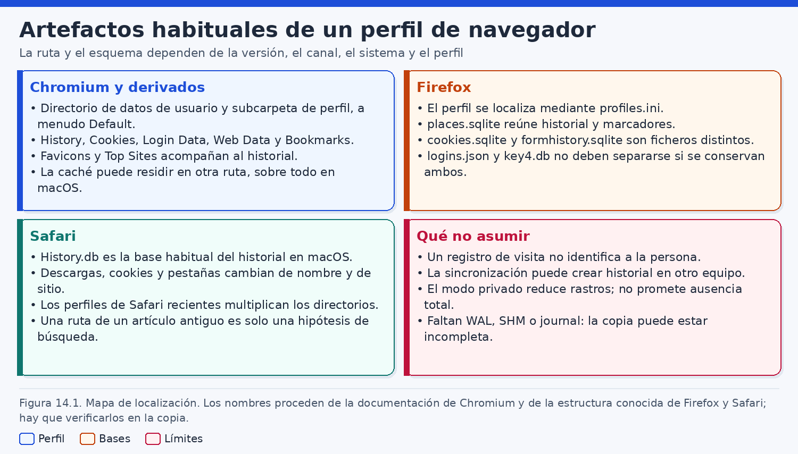
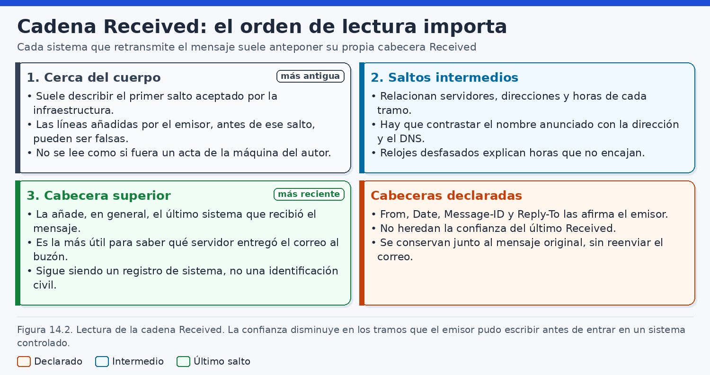
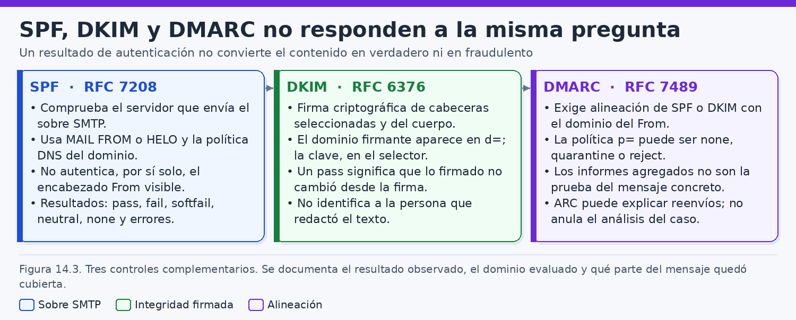
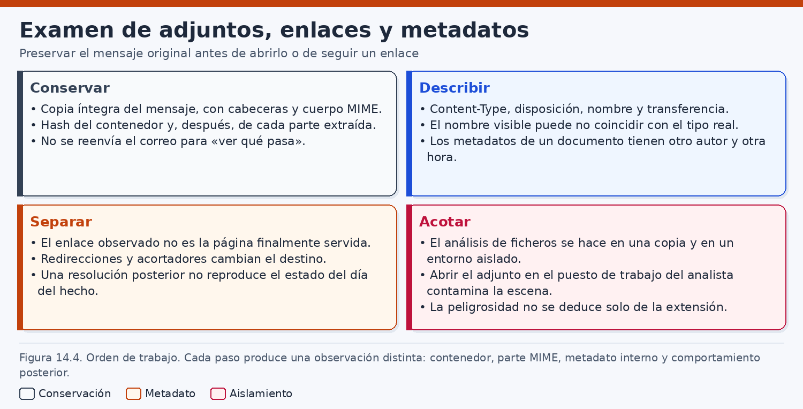
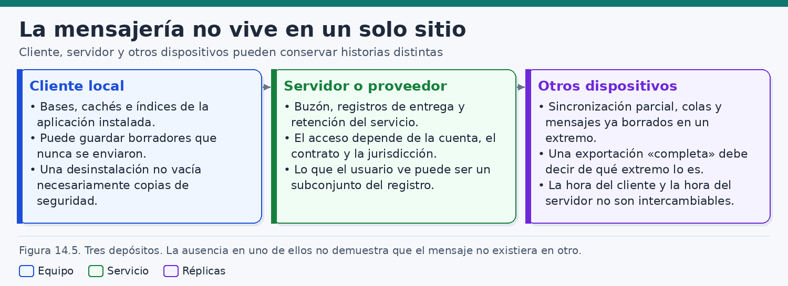
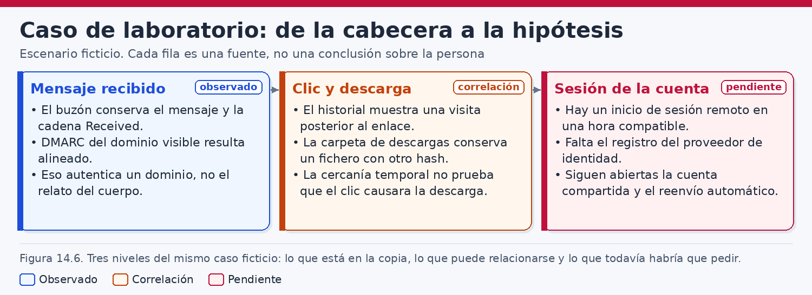

# Navegadores, correo electrónico y aplicaciones

> *Una visita registrada, un mensaje aceptado y un resultado de autenticación son observaciones de sistemas distintos. Ninguna de ellas, aislada, identifica a quien estuvo delante de la pantalla ni acredita que el contenido sea verdadero.*

## Introducción

Los navegadores, el correo electrónico y las aplicaciones de uso diario concentran una parte muy visible de la actividad de un puesto de trabajo. En ellos aparecen direcciones consultadas, mensajes recibidos, documentos adjuntos, conversaciones y preferencias. Por esa visibilidad se les pide a menudo que respondan a una pregunta que excede su alcance: quién hizo qué, con qué intención y con qué conocimiento. El análisis forense de estas fuentes empieza por rebajar esa expectativa. Un perfil de navegador conserva lo que ese programa escribió en un directorio. Un buzón conserva lo que un servidor o un cliente almacenó como mensaje. Una aplicación de mensajería puede guardar una copia local, una caché o únicamente un identificador opaco. Cada uno de esos objetos tiene una semántica propia, una retención propia y un reloj propio.

Conviene separar desde el primer momento tres planos. La **observación** es lo que se puede mostrar en la copia: una fila en una base de datos, una cabecera, un fichero, una marca temporal del sistema de archivos. La **inferencia técnica** es la lectura de esa observación según el funcionamiento del programa y de la versión concreta: por ejemplo, que un valor numérico representa una hora si, y solo si, la época utilizada es la que esa versión documenta. La **hipótesis** es una explicación que todavía admite alternativas: que la visita la provocó una persona determinada, que el mensaje es fraudulento, que el reenvío fue un trámite ordinario o que la cuenta era compartida. Confundir los tres planos produce informes que suenan precisos y no se pueden sostener.

Las versiones cambian nombres, esquemas y el sentido de los campos. Una ruta documentada puede estar redirigida por una directiva, por otro perfil o por un canal que no es el estable. Este capítulo describe el examen sobre copias y en laboratorio. No promete que una orden signifique lo mismo en cualquier instalación, ni describe cómo descifrar contraseñas, eludir cifrados, fabricar un mensaje engañoso o ejecutar un adjunto. El adjunto no se abre en el puesto del analista. Los ejemplos se prueban sobre copias. Los nombres, dominios, direcciones y horas del caso son ficticios.

El recorrido sigue ese orden. Primero se localizan los perfiles y se lee el historial sin convertir una fila en una persona. Después se separan el mensaje, el sobre y la cadena `Received`, con el salto de confianza bien marcado. SPF, DKIM, DMARC y ARC se tratan como comprobaciones distintas. Los adjuntos y los enlaces se examinan sin abrirlos ni visitarlos desde el puesto del analista, y los metadatos internos de un documento se contrastan con las horas de la copia en disco. La mensajería se sitúa entre el cliente, el servidor y los demás dispositivos. El cierre es un correo sospechoso en un buzón corporativo ficticio, con hipótesis de suplantación, de reenvío legítimo y de cuenta compartida. El historial puede mostrar una visita de un perfil. Atribuir el clic a una persona exige otras fuentes.

## 1. Historiales y artefactos de navegadores

### 1.1. Perfil, cuenta y persona

Un navegador organiza sus datos en perfiles. El perfil es un directorio, o un conjunto de directorios, donde el programa guarda historial, marcadores, preferencias y otros estados. La cuenta con la que alguien inicia sesión en el sistema operativo es otra cosa: es la identidad bajo la cual el equipo permitió usar ese directorio. La persona es una tercera noción, que no aparece como campo fiable dentro de la base de datos del historial. En un puesto de uso individual y bien custodiado, la inferencia de que el titular habitual utilizó el perfil puede ser razonable y, aun así, debe presentarse como inferencia. En un mostrador, una sala compartida o un buzón funcional, esa inferencia se debilita hasta quedar en hipótesis.

En un mismo equipo conviven a menudo varios navegadores y, dentro de cada uno, varios perfiles. Una visita de uno no informa de los demás. El inventario localiza esos directorios en la copia, anota la cuenta del sistema a la que pertenecen y registra la versión si puede leerse sin ejecutar el programa. Abrir el navegador en el equipo investigado para ver el historial en pantalla escribe en el perfil y no es el procedimiento de examen. Si el perfil replica el historial entre equipos, una fila puede haber nacido en otro dispositivo. Algunas versiones traen campos que ayudan a distinguir ese origen; se comprueban en el esquema y en la documentación de la versión. Mientras no se haga esa comprobación, tratar cada fila como un gesto local del teclado es una hipótesis.

### 1.2. Google Chrome y el directorio de datos de usuario

Chrome guarda el perfil dentro del directorio de datos de usuario. La documentación del proyecto Chromium describe las ubicaciones habituales de la variante estable. En Windows esa ruta es `%LOCALAPPDATA%\Google\Chrome\User Data`. En Linux es `~/.config/google-chrome`. En macOS es `~/Library/Application Support/Google/Chrome`. El perfil inicial suele llamarse `Default`. Junto a él pueden aparecer otros, con nombres del tipo que el programa asigne en esa versión. La página interna `chrome://version` muestra, en un navegador en ejecución, el valor Profile Path. Esa consulta es útil en un equipo de laboratorio o cuando el encargo autoriza una comprobación en vivo; sobre una imagen, la ruta se determina por los directorios presentes, no por abrir Chrome en el original.

Esas rutas orientan y no cierran el inventario: los canales de prueba, las compilaciones corporativas, otros derivados y una directiva de la organización usan directorios distintos. Se registra la ruta hallada y cuántos perfiles hay. En macOS, la caché puede residir bajo `Library/Caches`, fuera de Application Support. Darla por ausente tras mirar solo el perfil es un error de alcance.

Los nombres de fichero que el código público del proyecto ha utilizado para piezas centrales del perfil incluyen `History`, `Favicons` y `Top Sites`. En las copias de trabajo también son habituales, y deben verificarse, `Cookies`, `Login Data`, `Web Data` y `Bookmarks`. El primero de esos grupos y varios de los segundos son bases SQLite en las versiones corrientes; `Bookmarks` se ha distribuido a menudo como un fichero de texto estructurado, no como una base relacional. La afirmación segura es la que sigue a la identificación del formato en la copia: cabecera, extensión acompañante y, si es SQLite, esquema. Un nombre conocido no dispensa de esa comprobación, porque el esquema cambia.

La figura 14.1 reúne el mapa de artefactos que conviene esperar en un perfil, sin convertir el mapa en un inventario cerrado de todas las versiones.



### 1.3. Microsoft Edge y otros derivados

El Edge actual se basa en Chromium. En Windows estable, el directorio de datos de usuario habitual es `%LOCALAPPDATA%\Microsoft\Edge\User Data`. La analogía con Chrome ayuda a orientarse: también allí suele haber un perfil `Default` y ficheros de historial, cookies y datos de inicio de sesión cuyos nombres deben confirmarse en la copia. La analogía no autoriza a copiar conclusiones de un producto al otro. Las directivas, la sincronización y los componentes añadidos por el fabricante pueden cambiar qué se escribe y durante cuánto tiempo.

En otros sistemas, la ruta de Edge se documenta tal como aparece en la evidencia: no se copia la de Chrome ni se inventa a partir de un recuerdo. Si ambos navegadores conviven, se examinan los dos. Una ausencia en un perfil no cubre la navegación privada, ni otro equipo, ni un derivado distinto cuyo esquema no se haya abierto. Reutilizar una consulta de Chrome sin leer el esquema de esa copia es un error de método: la columna puede haber cambiado de nombre o de unidad de tiempo.

### 1.4. Firefox: localizar el perfil y separar los ficheros

En Firefox, el perfil se localiza mediante `profiles.ini`. Ese fichero indica qué directorios de perfil existen y cuál está marcado como predeterminado. La carpeta que lo contiene depende del sistema operativo y de la versión; no conviene memorizar una sola ruta y omitir el resto. En la copia se busca `profiles.ini`, se leen las entradas y se acude a los directorios que señala. El nombre de cada directorio de perfil suele incluir un componente aleatorio y un sufijo que ha variado con las ramas del producto. Adivinar el sufijo no sustituye la lectura del fichero.

Dentro del perfil, `places.sqlite` concentra historial y marcadores. `moz_places` y `moz_historyvisits` son nombres históricos: se verifican en el esquema antes de citarlos. Las cookies van en `cookies.sqlite`. El historial de formularios, si existe, va en `formhistory.sqlite`. Las credenciales se reparten en piezas como `logins.json` y `key4.db`, distintas del historial. Copiar solo `places.sqlite` no responde a una pregunta sobre sesiones o formularios. Las contraseñas no se leen en claro sin el almacén de claves del perfil y el contexto del usuario. Este capítulo no describe ese descifrado. Si el encargo pide saber si había credenciales guardadas, la observación admisible es la existencia del fichero y los metadatos no secretos que la versión permita justificar.

La hora de visita se ha almacenado, en el campo asociado a `visit_date`, como microsegundos desde la época Unix, es decir, desde el 1 de enero de 1970 en UTC. Es una convención habitual, no una ley del formato. Se comprueba en la versión y, cuando sea posible, contra un acontecimiento de hora conocida. Aplicar a Firefox la conversión de Chrome, o al revés, desplaza las visitas de forma grosera. Ese desplazamiento es una señal de error del analista, no un indicio de manipulación del reloj.

### 1.5. Safari

En Safari, `History.db` es la base habitual del historial en macOS. El resto de las rutas depende de la versión y de los perfiles. No hay una ruta única válida para todas las versiones, y no debe inventarse. El examen localiza en la copia la base que corresponda a la versión instalada y documenta la que analiza. La sincronización entre dispositivos de la misma cuenta puede hacer que una entrada del escritorio proceda de otro aparato. Hasta comprobar lo que esa versión registra, y hasta que el encargo incluya los demás dispositivos, la redacción habla del perfil adquirido.

### 1.6. Qué se puede pedir a cada artefacto

Cada fichero responde a una pregunta distinta. El historial habla de visitas que el programa decidió registrar. Las cookies hablan de estado guardado para un sitio, que puede sobrevivir a la sesión o llegar por sincronización, no de que una persona se autenticara en un instante. Los marcadores fechan una decisión de conservar una dirección, no cada uso. La caché puede existir sin fila de historial, y al revés. `Web Data` y el historial de formularios, si están, pueden contener texto introducido; `Login Data` puede existir sin que de él se siga la contraseña en claro. `Favicons` y `Top Sites` son auxiliares. El almacenamiento local, las bases de aplicaciones web y la restauración de sesión pueden no ser SQLite: el formato se identifica antes de usar `sqlite3`. La navegación privada cambia lo que se escribe, según la versión. Una fila ausente en `History` o en `places.sqlite` se informa con el alcance de la copia. Decir que nadie consultó la dirección invierte la observación.

### 1.7. Copiar una base SQLite junto con su WAL o su journal

SQLite puede acompañar el fichero principal con un registro de escritura anticipada y un fichero de memoria compartida, de nombres habituales `*-wal` y `*-shm`, o con un journal de reversión. El modo se comprueba. Copiar solo el archivo principal puede perder transacciones recientes, a menudo las visitas que el caso pregunta. La copia de trabajo sale de una imagen o de una extracción ya adquirida, no del perfil mientras el navegador lo tiene abierto: interrogarlo en vivo escribe y compite con el programa. El fichero principal y sus acompañantes viajan juntos, con los nombres que la biblioteca espera. Separar el WAL equivale a no haberlo copiado.

La copia se abre sin escribir. Una consulta descuidada puede fusionar el registro anticipado y confundir los derivados aunque la imagen de origen siga intacta. Se anota el modo de solo lectura de la versión de `sqlite3` utilizada. Si el modo no es WAL, se busca el journal. La cabecera del formato reconoce la base y no valida el reloj ni el sentido de las filas. Se conserva el hash de la base, del acompañante y del resultado.

### 1.8. Épocas de tiempo que hay que verificar

Las horas de visita de Chrome se almacenan habitualmente como microsegundos transcurridos desde el 1 de enero de 1601 en UTC. Las de Firefox, en el campo de fecha de visita ya citado, se han almacenado en microsegundos desde la época Unix. Las dos convenciones son hechos de ingeniería que este libro toma como punto de partida y que el analista verifica en la versión que tiene entre manos. Verificar no es una fórmula de cortesía. Es la diferencia entre una cronología y un desplazamiento de siglos.

La comprobación consiste en convertir un valor bruto y confrontarlo con una hora independiente. Si el resultado cae en el siglo XVII, antes de la instalación o varios años en el futuro, falla la conversión antes que el usuario. El mínimo y el máximo de la columna deben caber en la vida del perfil. La marca del fichero `History` en el sistema de archivos es otra pregunta: dice cuándo el sistema de archivos registró un cambio de ese fichero, no la hora de cada visita. The Sleuth Kit, sobre la imagen, lee esas marcas; SQL lee las internas. Las dos salidas se archivan aparte. Si el reloj del equipo estaba desplazado, todas las visitas heredan el error. El informe conserva el desfase como incertidumbre y no reescribe la base para que encaje con el correo.

### 1.9. Consultas de laboratorio sobre una copia

Las órdenes siguientes ilustran el trabajo sobre una copia de laboratorio. No se ejecutan sobre el perfil original, no actualizan la base y no extraen contraseñas. Los nombres de tablas y de columnas son los habituales en versiones ampliamente difundidas; el primer paso obligatorio es leer el esquema real. Si el esquema difiere, la consulta se reescribe y la diferencia se anota. Un `LIMIT` mantiene el ejemplo dentro de un tamaño revisable. El informe no se construye con una muestra accidental: una vez confirmado el esquema, la extracción pertinente se define por el intervalo y por la pregunta del caso.

```bash
# Copia de trabajo tomada de la imagen. Incluye WAL y SHM si existían.
# La URI de solo lectura pretende no fusionar el WAL ni modificar la copia.
ls -l "/caso/trabajo/chrome-default/History" \
      "/caso/trabajo/chrome-default/History-wal" \
      "/caso/trabajo/chrome-default/History-shm"

sqlite3 "file:/caso/trabajo/chrome-default/History?mode=ro" ".schema"
sqlite3 "file:/caso/trabajo/chrome-default/History?mode=ro" "PRAGMA journal_mode;"

# Ejemplo ilustrativo. Confírmense tablas, columnas y época en esta versión.
# 11644473600 es el desplazamiento habitual entre 1601-01-01 y la época Unix;
# se valida con un acontecimiento de hora conocida antes de fiarse de la serie.
sqlite3 "file:/caso/trabajo/chrome-default/History?mode=ro" "
SELECT visits.id,
       datetime(visits.visit_time/1000000 - 11644473600, 'unixepoch') AS visita_utc,
       urls.url
FROM visits
JOIN urls ON urls.id = visits.url
ORDER BY visits.visit_time DESC
LIMIT 20;
"
```

La consulta de Firefox sigue el mismo criterio de copia y de esquema. La conversión de tiempo no se reutiliza.

```bash
sqlite3 "file:/caso/trabajo/firefox-perfil/places.sqlite?mode=ro" ".schema"

# Nombres históricos. Si .schema no muestra estas tablas o esta columna, no se inventan.
sqlite3 "file:/caso/trabajo/firefox-perfil/places.sqlite?mode=ro" "
SELECT moz_historyvisits.id,
       datetime(moz_historyvisits.visit_date/1000000, 'unixepoch') AS visita_utc,
       moz_places.url
FROM moz_historyvisits
JOIN moz_places ON moz_places.id = moz_historyvisits.place_id
ORDER BY moz_historyvisits.visit_date DESC
LIMIT 20;
"
```

Sobre `Login Data`, `logins.json` o `key4.db` basta con identificar el fichero, su hash y, si es una base, el esquema. No se seleccionan columnas de secretos. Una columna de contraseña no demuestra que el valor esté en claro; en las versiones habituales no lo está, y este capítulo no describe cómo descifrarlo. `sqlite3` tampoco atribuye la fila a una persona, ni traduce un entero de transición a la palabra «clic» sin la tabla de esa versión, ni recupera visitas que ya no estén en la base ni en el WAL copiado. El derivado se guarda con la versión de la herramienta, la ruta, el hash de entrada y el texto de la consulta. Si una repetición difiere, se revisa primero el método: WAL no copiado, apertura en escritura, época equivocada u otro perfil.

### 1.10. Descargas, marcadores, caché y huecos

La tabla de descargas, si el esquema la contiene, anota lo que el navegador registró de una transferencia. El fichero puede haberse movido o no haber llegado a escribirse, y un documento en la carpeta de descargas puede carecer de fila si entró por otro programa. Los marcadores fechan, como mucho, la entrada según los campos y la época, que también se verifica. La caché, a veces fuera del perfil —en macOS, bajo `Library/Caches`—, conserva recursos, no una narración de la sesión. Un intervalo sin filas es un límite de esa base: inactividad, otro perfil, retención o un fallo de la copia siguen abiertos. La frase justa es que, en ese fichero, no hay filas para el intervalo.

### 1.11. Redacción que el historial sí soporta

Con el perfil localizado, la base copiada con sus acompañantes, el esquema leído y la época comprobada, cabe decir: en esta copia hay una visita a esta dirección y el valor, convertido con la época verificada, cae en este instante UTC. Si la sincronización estaba activa y el origen no se distingue, se dice también. El nombre de quien tuvo el teclado queda fuera. Acercar la visita a un correo exige el correo, la misma dirección y relojes comparables. La coincidencia hace plausible la relación. El clic, el marcador, la escritura manual o el otro dispositivo siguen como hipótesis.

## 2. Análisis forense de correo electrónico y cabeceras

### 2.1. El mensaje, el sobre y el buzón

El correo que el analista lee en una exportación no es una sola cosa. El formato de los mensajes de Internet, descrito en el RFC 5322, organiza el contenido en cabeceras y cuerpo. El protocolo de transporte SMTP, descrito en el RFC 5321, lleva ese contenido dentro de un sobre: un remitente de sobre, asociado a `MAIL FROM` o, en su caso, al identificador de sesión `HELO` o `EHLO`, y uno o varios destinatarios de sobre asociados a `RCPT TO`. El buzón es el almacén donde un servidor o un cliente guarda el mensaje, a menudo acompañado de marcas que no forman parte del mensaje original: leído, respondido, borrado, carpeta.

Las tres capas se citan por separado. El `From` visible es una cabecera. El remitente de sobre puede ser otro, y muchas copias del mensaje ni siquiera incluyen el sobre: vive en el registro del filtro o del servidor, si ese registro entra en el encargo. El buzón aporta la copia almacenada y marcas como leído o carpeta, que no forman parte del RFC 5322. Un mismo mensaje lógico puede existir en el buzón de destino, en enviados, en una cola y en la caché del cliente, y cada copia puede haber ganado o perdido cabeceras. Se identifica la procedencia. Si el encargo no cubre el puesto del remitente externo, no se rellena ese hueco con una suposición.

### 2.2. Dónde está el correo que se analiza

El servidor de la organización, el cliente instalado en el puesto y el correo consultado a través del navegador son fuentes distintas. El servidor puede conservar mensajes que el cliente nunca descargó, y el cliente puede conservar una caché de mensajes que el servidor ya no muestra en el mismo estado. El correo web, por su parte, deja en el navegador huellas de acceso a un sitio, no el cuerpo de cada mensaje. Una visita a la dirección del correo web no reproduce el RFC 5322. Confundir el historial de esa visita con el contenido del buzón es cruzar el apartado anterior con este sin haber adquirido la fuente que responde a la pregunta.

Los formatos locales dependen del cliente y de la versión. Se identifican en la copia. Importa qué se adquirió: una exportación del servidor, el perfil del cliente, o ambas cosas. Las horas del fichero `.eml` suelen ser las de la extracción. Las que importan al relato son las cabeceras y el registro del servidor. Un indicador de leído pertenece al almacén que lo escribió: no demuestra que se leyera el cuerpo, que se activara un enlace ni qué persona de una cuenta compartida lo abrió. El correo arrastra datos de terceros. El encargo, el periodo y las carpetas se delimitan antes de exportar en masa. La guía NIST SP 800-86 sitúa la recogida dentro de un proceso con alcance, y las publicaciones de SWGDE insisten en conservar la evidencia y poder explicar su procedencia.

### 2.3. La cadena Received

Cada sistema que participa en el transporte suele anteponer una cabecera `Received` al mensaje. El RFC 5321 define esa traza. Por la costumbre de anteponer, la línea superior suele ser la más reciente y la inferior, la más antigua. «Suele» no es un adorno. Un mensaje malformado, una pasarela que reordena o una copia pegada a mano pueden romper la expectativa. La lectura empieza por identificar qué sistema añadió cada línea, no por numerarlas de arriba abajo y dar el número por una cronología ya demostrada.

Una línea típica indica de qué equipo se recibió el mensaje, qué equipo lo anotó, el protocolo, un identificador y una fecha. Esa fecha es el reloj de quien escribe la línea; dos saltos pueden discrepar sin que uno sea falso. El identificador permite buscar la transacción en el registro del servidor, si existe. La IP que anota un servidor de confianza es una observación de ese servidor. La que solo aparece en una línea anterior puede ser una afirmación de quien la escribió. La cadena se lee desde el último salto de confianza hacia atrás. Al cruzar ese límite, las líneas se transcriben como texto del mensaje y no como telemetría propia. La figura 14.2 separa la cadena escrita de las cabeceras que el emisor puede declarar.



### 2.4. Cabecera declarada y salto de confianza

`From`, `Date`, `Message-ID`, `Subject`, `Reply-To` y el nombre visible del remitente son afirmaciones de quien compuso el mensaje, o de un programa que lo hizo en su nombre. El RFC 5322 les da forma. No les da veracidad. Un `Message-ID` bien formado no demuestra unicidad en el mundo ni autoría humana. Un `Date` futuro o atrasado puede deberse a un reloj, a una zona horaria mal declarada o a una composición deliberada. `Reply-To` puede señalar una dirección distinta de `From` por un motivo legítimo de operación o por un motivo que conviene investigar. La discrepancia es un hecho. Su explicación es una hipótesis.

El salto de confianza es el primer sistema cuya observación el analista puede usar: normalmente, el registro o la cabecera `Received` que añadió el correo de la propia organización o el filtro que esa organización opera, siempre que la copia del mensaje provenga de ese entorno y no de un reenvío no controlado. Todo lo que el mensaje ya traía escrito antes de ese salto, incluidas unas líneas `Received` que simulan servidores del supuesto proveedor, pudo ser colocado por el emisor. Esas líneas se conservan en la transcripción porque forman parte del mensaje. No se citan como «el mensaje pasó por el servidor del proveedor» si el único testimonio es una cabecera previa al salto de confianza.

La cadena se transcribe entera y, línea a línea, se separa lo que escribió un sistema de confianza de lo declarado. Una IP previa al salto no entra en la cronología. La que anota el filtro sí puede entrar, con la salvedad de su reloj y de si está viendo el origen real o un equilibrador. El reenvío suele crear un mensaje nuevo: el anterior viaja citado o como `message/rfc822`, y esas cabeceras internas son cuerpo, no saltos del segundo envío.

### 2.5. Lectura de un ejemplar de laboratorio

El bloque siguiente es ficticio y está abreviado. Sirve para fijar el método, no como firma de un incidente real. El orden es el del mensaje: arriba, lo más reciente.

```text
Received: from filtro.litoral.example (filtro.litoral.example [192.0.2.10])
    by buzon.litoral.example with ESMTPS id litoral-88421
    for <tramites@litoral.example>; Wed, 11 Mar 2026 08:41:02 +0000
Received: from mx.example (mx.example [198.51.100.23])
    by filtro.litoral.example with ESMTPS id filtro-44190
    for <tramites@litoral.example>; Wed, 11 Mar 2026 08:41:01 +0000
Received: from correo.norteatlantic.example (correo.norteatlantic.example [198.51.100.80])
    by mx.example with ESMTPS id ajena-009
    for <tramites@litoral.example>; Wed, 11 Mar 2026 09:40:58 +0100
From: Norte Atlántico Facturación <facturas@norteatlantic.example>
Date: Wed, 11 Mar 2026 09:40:12 +0100
Message-ID: <20260311.1148@norteatlantic.example>
To: tramites@litoral.example
Subject: Confirmación de factura 2026-1148
Reply-To: facturas@norteatlantic.example
```

En el ejemplo, `filtro.litoral.example` y `buzon.litoral.example` son sistemas propios, y el registro del filtro confirma la sesión desde `198.51.100.23`. Esas dos líneas `Received` son observaciones suyas, sujetas a sus relojes. La tercera, que cita `correo.norteatlantic.example` y `198.51.100.80`, es anterior al salto: se transcribe y no se promueve a hecho. `From`, `Date` y `Message-ID` siguen declarados. Las 09:40 con una hora de desplazamiento encajan con las 08:41 UTC, y eso muestra compatibilidad de relojes, no autoría. El `MAIL FROM`, si el filtro lo conservó, se anota aparte. Saber si el servidor estaba autorizado es una pregunta de SPF, y se responde solo con el resultado que el filtro guardó entonces. Al cerrar, todavía no consta que el cuerpo esté íntegro, que el texto sea verdadero o que lo escribiera una persona.

## 3. SPF, DKIM, DMARC y trazabilidad de mensajes

### 3.1. Cuatro mecanismos y cuatro preguntas

SPF, DKIM, DMARC y ARC aparecen juntos en los resultados de los filtros y a menudo se resumen en una sola palabra: el mensaje «pasó» o «no pasó». Esa palabra borra la diferencia que el analista necesita. Cada mecanismo responde a una pregunta definida en su especificación. Aplicar la respuesta a otra pregunta produce una atribución que el protocolo no hizo.

SPF, en el RFC 7208, evalúa si el servidor que presenta el mensaje está autorizado a hacerlo para la identidad de sobre que se comprueba, vinculada a `MAIL FROM` o a `HELO`/`EHLO`. DKIM, en el RFC 6376, comprueba una firma digital sobre un conjunto elegido de cabeceras y sobre el cuerpo. DMARC, en el RFC 7489, observa si SPF o DKIM se alinean con el dominio del `From` visible y aplica la política que ese dominio publica. ARC, en el RFC 8617, encadena resultados de autenticación a través de intermediarios que, de otro modo, romperían la relación entre el emisor inicial y el receptor final. La figura 14.3 insiste en que el cuadro no se lee como cuatro maneras de decir lo mismo.



Los resultados que el filtro escribió en el momento de la recepción son la evidencia primaria. Repetir la consulta DNS meses después puede devolver una política o una clave distintas. Esa repetición es un experimento sobre el estado actual de la DNS, no una reproducción del juicio que el filtro hizo entonces. Si se hace, se etiqueta como experimento y no se sustituye el resultado contemporáneo. Si el resultado contemporáneo no se conservó, el hueco se declara. No se fabrica un `pass` retrospectivo porque «el dominio, hoy, lo permitiría».

### 3.2. SPF y el servidor del sobre

SPF no autentica, por sí solo, la cabecera `From` que ve la persona. Autentica una decisión sobre el servidor y la identidad de sobre. Un mensaje puede presentar un `From` de un dominio y un `MAIL FROM` de otro. El resultado de SPF se predica del que el verificador utilizó, que debe constar en el registro del filtro. Sin ese dato, «SPF correcto» es una frase incompleta.

Los resultados previstos son `none`, `neutral`, `pass`, `fail`, `softfail`, `temperror` y `permerror`. `none` indica ausencia de política utilizable. `neutral` es una declaración explícita de neutralidad. `pass` indica servidor autorizado según la política recuperada. `fail` indica que no lo estaba. `softfail` es un fallo débil, en los términos de la política, y no equivale a `pass` ni a `fail`. `temperror` es un fallo temporal de la evaluación, a menudo de DNS. `permerror` es un error permanente, por ejemplo una política que el verificador no interpreta. Un error temporal no es una exculpación, ni un error permanente es por sí solo una suplantación.

La autorización la publica el dominio. Un tercero incluido en la política, un servidor ya autorizado que haya sido comprometido o el titular de un dominio propio pueden obtener `pass` en la pregunta del sobre mientras el `From` visible dice otra cosa. La alineación con ese `From` es trabajo de DMARC. Junto al resultado se anotan el dominio evaluado, la IP que el verificador tomó como origen y la hora. Un `fail` tras un reenvío automático puede describir el reenvío y no el mensaje original; se contrasta con los intermediarios.

### 3.3. DKIM: dominio firmante, selector y cuerpo cubierto

DKIM firma, con la clave que el dominio publica para un selector, un conjunto de cabeceras y el cuerpo, según las reglas de canonicalización de la especificación. En la firma aparecen, entre otros datos, el dominio firmante (`d=`) y el selector (`s=`), que indica qué clave pública debe recuperarse. Un `pass` significa que el verificador pudo comprobar la firma sobre lo que la firma cubría, con la clave que obtuvo en ese momento. No significa que todas las cabeceras visibles estuvieran cubiertas. Las que queden fuera pueden haber cambiado sin invalidar la firma.

El informe identifica `d=`, el selector y, si la firma está en la copia, qué campos cubría y si el cuerpo entraba. Una cabecera fuera de la lista puede cambiar sin romperla. Un `pass` con el cuerpo cubierto es una inferencia de integridad en el momento de la verificación: control de la clave, no identidad de una persona ni veracidad del texto. Las claves rotan. No encontrar hoy el selector no borra un `pass` contemporáneo de un sistema de confianza, ni una clave vigente hoy crea un `pass` de ayer que nadie anotó. Un `fail` puede venir de una lista que añade un pie, de un intermediario que reescribe una cabecera cubierta o de una alteración maliciosa. El resultado no elige la causa.

### 3.4. DMARC: alineación y política publicada

DMARC toma el dominio del `From` visible y pregunta si SPF o DKIM, además de haber producido un resultado aprovechable, se alinean con ese dominio. La alineación puede ser estricta o relajada, según publique el dominio. En el modo relajado, un subdominio puede alinearse con el dominio organizativo; en el estricto, se exige una coincidencia más cerrada, en los términos que el RFC 7489 y la implementación del verificador definan. El analista registra el modo que el verificador aplicó. Recalcular la alineación «a ojo» a partir del nombre del dominio es una aproximación que el informe no debe presentar como el resultado oficial.

La política se expresa con `p=none`, `p=quarantine` o `p=reject`: no actuar por razón de DMARC, tratar en cuarentena o rechazar. Dice qué pedía el dominio del `From` ante un fallo. No dice qué hizo el receptor, que puede desviarse. Evaluación y entrega son hechos distintos. Un `pass` acerca la comprobación al `From` visible y no habla de la verdad del contenido ni de una persona: un emisor autorizado puede enviar un engaño aunque la política sea `p=reject`. Un `fail` indica que ni SPF ni DKIM quedaron alineados como se exigía, y también aparece en reenvíos, listas y errores de DNS. Un error temporal no se redacta como un `fail` limpio.

### 3.5. ARC y los intermediarios

ARC existe porque los intermediarios legítimos —listas, reenvíos, filtros que modifican el mensaje— pueden invalidar SPF o DKIM antes de que el destino final evalúe DMARC. El mecanismo encadena conjuntos de resultados. En cada instancia, un intermediario puede sellar los resultados de autenticación que él observó, de modo que un salto posterior vea qué se había comprobado antes de la modificación. Las cabeceras de sellado, de firma del mensaje en la cadena y de resultados autenticados forman parte de esa construcción, tal como las define el RFC 8617.

El sello merece la confianza de quien lo aplicó. El del filtro propio, en una copia de ese entorno, conserva el cálculo del filtro. El de un intermediario desconocido solo vale lo que valga ese intermediario. ARC no vuelve verdadero un contenido ni alinea un `From` que ningún mecanismo alineó. Se anota el número de instancias, el sistema que parece haber añadido cada una y el resultado del verificador final. Un `pass` que solo vive dentro de un sello de un tercero no contrastado no se trata como cálculo del filtro propio.

### 3.6. Qué no prueba un pass

Un `pass` de SPF, de DKIM, de DMARC o de ARC acredita que la comprobación de ese mecanismo tuvo éxito en las condiciones del verificador que la anotó. No prueba que el contenido sea verdadero: una factura inventada, firmada con una clave legítima comprometida o autorizada por un SPF amplio, obtiene el mismo resultado que una factura real. No prueba que una persona concreta escribiera el texto, que el nombre visible sea un empleado, que el enlace sea benigno ni que el adjunto carezca de contenido activo. No prueba que el destinatario lo leyera o activara un enlace, porque la autenticación ocurre en el transporte. No prueba que una revalidación posterior repita el resultado, ni que las cabeceras excluidas de DKIM hayan quedado intactas.

Un `fail` prueba el fallo de esa comprobación. Hay fraudes que fallan estas pruebas y correos legítimos que fallan por el tránsito. La suplantación por falsificación de cabeceras —un sentido estrecho de phishing— se debilita cuando DMARC alinea un `pass` con el dominio del `From` y DKIM cubría el cuerpo relevante. Sigue abierta la hipótesis de que un emisor autorizado envió un engaño o de que un tercero usaba la cuenta. Conviene partir así la palabra y asignar hechos a cada posibilidad.

### 3.7. Cómo se leen los resultados en el laboratorio

El lugar natural de los resultados es el registro del filtro o la cabecera que ese filtro añadió al mensaje que él almacenó. Esa cabecera es, a su vez, una afirmación del filtro. Es útil cuando la copia viene del almacén de confianza. Es fácil de falsificar si se toma de un mensaje que un tercero reenvió ya con el texto pegado. Se aplica el mismo salto de confianza del apartado anterior: un bloque de resultados escrito antes de entrar en la organización no es el cálculo de la organización.

En el laboratorio se lee el registro. Reenviar el ejemplar a un comprobador público divulga datos y juzga la DNS de hoy, no la del día del mensaje. Una redacción ajustada diría: el filtro anotó `spf=pass` para el dominio de sobre, `dkim=pass` con el `d=` correspondiente y `dmarc=pass` para el `From`, con la política que él registró, por ejemplo `p=reject`. En esas condiciones, la falsificación simple del origen queda mal apoyada y el cuerpo firmado se liga a quien controlaba la clave. La veracidad, la persona y el clic posterior siguen fuera.

## 4. Adjuntos, enlaces y metadatos

### 4.1. MIME: el cuerpo también tiene estructura

El cuerpo de un mensaje puede ser un texto simple o una estructura MIME, definida de forma principal en el RFC 2045. MIME permite varias partes: una alternativa en texto plano y otra en HTML, un adjunto, un mensaje reenviado encapsulado. Cada parte lleva sus cabeceras, entre ellas `Content-Type` y, con frecuencia, `Content-Disposition`, cuya semántica de presentación recoge el RFC 2183. `inline` y `attachment` orientan al cliente sobre si debe mostrar la parte en línea o tratarla como adjunto. Orientan al cliente. No describen la seguridad del contenido.

La codificación de transferencia —quoted-printable, base64 y las demás— es una representación, no un cifrado. Decodificarla en la copia recupera octetos y no debe entregar el resultado a una aplicación ofimática. El derivado se guarda con su hash. El texto plano y el HTML pueden divergir: se muestran los dos. Sin saber qué cliente se usó, no se afirma cuál de las dos partes vio la persona.

### 4.2. El nombre mostrado y el tipo declarado

El nombre de fichero que `Content-Disposition` o el tipo MIME presentan puede no coincidir con el tipo del contenido. Un nombre terminado en `.pdf` puede acompañar a un `Content-Type` distinto, y un `Content-Type` de documento puede acompañar a octetos que no comienzan por la firma habitual de ese formato. Las tres piezas —nombre, tipo declarado y firma de formato— se comparan. La discrepancia es un hallazgo. La coincidencia solo muestra coherencia de esas señales, no bondad del fichero.

El nombre se transcribe como está en la cabecera, incluidas dobles extensiones y caracteres especiales. No se «corrige» para que el puesto lo abra con el programa esperado. El tipo se contrasta con una utilidad que lea la cabecera binaria y no lance el documento. Un adjunto `message/rfc822` es un mensaje encapsulado: sus cabeceras se leen con el método del apartado 2 y siguen siendo contenido del mensaje exterior.

### 4.3. No abrir el adjunto en el puesto del analista

El puesto del analista no es un entorno de detonación. Abrir ahí un documento con un procesador de textos, una hoja de cálculo o un visor que interprete contenido activo puede ejecutar código, conectar con la red o contaminar el equipo desde el que se supone que se examina la evidencia. El examen descrito en este capítulo es estático y se hace sobre una copia: identificación del tipo por la firma, hash, inventario de partes MIME, extracción de metadatos con herramientas que no entreguen el fichero a la aplicación que lo creó y lectura de cadenas o de estructura solo en la medida en que la herramienta no active el contenido.

Saber qué haría el fichero al abrirse exige un laboratorio aislado, una copia, ausencia de credenciales del analista y autorización expresa. No se reenvía el adjunto a un buzón personal ni se sube a un servicio ajeno al encargo. Un indicador estático de macros o de secuencias de comandos permite decir que el fichero contiene ese mecanismo, no que se ejecutara en el puesto investigado. La coherencia de un PDF —nombre, tipo y firma— no cambia el cauce: el hash se calcula antes de cualquier transformación y, si una herramienta reescribe el fichero, eso es un derivado.

### 4.4. Enlaces: lo que el mensaje contiene y lo que el navegador visitó

Un enlace en la parte HTML es una dirección escrita en el mensaje, a menudo distinta del texto que el cliente muestra. Las dos cadenas se extraen del fuente. Si el texto visible dice un dominio y el destino señala otro, la diferencia se transcribe. Esa diferencia es relevante para la hipótesis de engaño y, a la vez, puede darse por otras causas de composición. No se visita el destino desde el puesto del analista. La visita puede revelar la investigación, dejar un rastro en el sitio y, si el recurso es activo, ejecutar contenido en un equipo que no está preparado para ello.

La dirección del mensaje y la del historial pueden coincidir o separarse por una redirección, por una ruta posterior o por una visita sin relación. La coincidencia exacta, en una ventana compatible, refuerza la relación y no identifica quién activó nada ni convierte la fila en un clic. Un campo de transición solo se lee con la documentación de esa versión. El HTML se examina en el fuente: algunos clientes cargan recursos remotos y pueden avisar a un servidor de que el mensaje se abrió. Si el analista lo abre en un cliente conectado, ese aviso es del laboratorio y entra en la cronología como tal. Un acortador, si el encargo pide resolverlo, se resuelve aislado y se fecha. Sin esa resolución no se inventan saltos intermedios.

### 4.5. Metadatos internos y marcas de la copia en disco

Un documento puede llevar en su interior un autor, un último editor y unas horas de creación o de modificación escritas por la aplicación que lo generó. Esos campos son afirmaciones de esa aplicación, heredadas a menudo de una plantilla. No son las marcas temporales del sistema de archivos. La copia extraída del mensaje, además, recibe con frecuencia las horas de la extracción: el instante en que el analista materializó el fichero en el directorio de trabajo. Usar esa hora como fecha de la factura, o usar el autor interno como la persona que envió el correo, cruza tres relojes y tres autores posibles.

Las marcas del almacén en la imagen, no las del derivado extraído, se leen con la herramienta adecuada al sistema de archivos. The Sleuth Kit inspecciona esos metadatos sin abrir el documento. Pueden acercarse a la entrega o a una compactación posterior del buzón, y no se traducen a «el usuario guardó el PDF a esta hora». El autor y la hora internos se citan como metadatos del documento. La hora `Received` del salto de confianza se cita como dato del mensaje. La hora del derivado es un dato de la extracción y se queda en el cuaderno. Un autor de plantilla y una creación interna anterior en días a la recepción son compatibles con un documento reutilizado por el emisor legítimo y con uno reutilizado en un envío engañoso. El dato no elige.

La figura 14.4 ordena este examen: primero la estructura y el tipo, después el enlace como texto, después los metadatos internos frente a los del disco, siempre sin abrir el adjunto en el puesto de análisis.



## 5. Artefactos de aplicaciones y mensajería

### 5.1. La aplicación como productora de artefactos locales

Las aplicaciones de escritorio y las que viven dentro del navegador dejan configuración, cachés, bases locales, registros propios y ficheros temporales. El esquema lo fija el fabricante y cambia con la versión: una tabla descrita hace años puede no estar en la copia. El método repite el de los navegadores. Se localiza el directorio de esa instalación, se identifica el formato, se copia la base con su WAL o su journal y se lee el esquema antes de citar una columna. No hay un catálogo cerrado de rutas de mensajería. Cambian con el sistema, con el empaquetado y con la política de la organización. El inventario se hace sobre la copia. Si la aplicación no está, los restos pueden haber desaparecido, quedar residuales o no haber existido nunca porque el uso fue en otro dispositivo. Esas tres posibilidades se distinguen con la imagen, no con una instalación de referencia.

Parte de esos datos son personales y ajenos al incidente. El encargo limita cuentas e intervalos. Extraer toda la base porque es SQLite amplía el tratamiento sin mejorar la pregunta. NIST SP 800-86 sitúa el examen en un proceso con objetivo, y las orientaciones de SWGDE piden el mismo cuidado al conservar y documentar la evidencia digital.

### 5.2. Cliente local y servidor

En la mensajería, el cliente y el servidor no son dos vistas de la misma historia. El cliente conserva lo que esa instalación descargó o generó, con la retención y el cifrado de la versión. El servidor conserva lo que el servicio retuvo, que puede ser más largo, más corto o inaccesible. Un mensaje solo en el servidor encaja con un cliente que no sincronizó. Uno solo en el cliente encaja con un borrador, con una caché de algo ya retirado o con una exportación incompleta. Ninguna de esas lecturas se elige por ser la más grave.

La figura 14.5 coloca juntas las tres fuentes: el programa del puesto, el servicio y los demás dispositivos con sesión. Quitar una y responder igual es el error del apartado.



Las horas del cliente siguen el reloj del equipo; las del servidor, el del servicio y la semántica de la exportación. Un desfase se declara. No se reescriben las horas locales para fabricar simultaneidad. La exportación corporativa, con su procedimiento, es distinta del fichero copiado a un dispositivo externo y del pantallazo, que muestra lo que se vio o se compuso y no sustituye al almacén.

Muchas aplicaciones cifran la base local, la cuenta o el transporte. Son capas distintas. El fichero puede estar íntegro e ilegible. Preservarlo, calcular su hash y documentar que no hay clave es un resultado completo. Este capítulo no describe un método para leer cualquier almacén cifrado ni para eludir la protección. Si la organización custodia la clave y el encargo cubre su uso, el descifrado se documenta como operación autorizada y el producto es un derivado. Ese escenario no se presume.

### 5.3. Otros dispositivos y sesiones abiertas

La misma cuenta puede estar en un ordenador, un teléfono y una sesión web. Un envío de la cuenta no identifica el aparato si la exportación no trae un identificador de dispositivo fiable, y el aparato no identifica a la persona si es compartido o si la sesión fue usada por un tercero. Esa última posibilidad necesita indicios; no se afirma por lo incómodo del mensaje ni se descarta por la confianza en el titular. Mientras el teléfono no esté en la evidencia, el puesto no cubre lo que la cuenta hizo en otros equipos: ni se le atribuye cada envío, ni se concluye que la cuenta no envió lo que el puesto no muestra.

La sincronización escribe en local actividad nacida en otro sitio y puede cambiar marcas temporales sin que nadie tocara ese teclado. Si la versión no distingue lo local de lo replicado, la limitación se escribe. No se inventa un campo ausente del esquema ni se ignora uno que la documentación explica. El cierre de sesión, el cambio de contraseña y la revocación de un cliente son hechos del servicio, visibles si el registro entra en el encargo. Una visita del navegador a la mensajería web indica que el perfil cargó esa dirección. No entrega la conversación ni la lista de dispositivos.

### 5.4. Cuentas compartidas, reenvíos automáticos y varias personas

Los buzones funcionales y las cuentas de puesto compartidas anclan el artefacto a la cuenta, no al nombre civil. Un parte de presencia o la costumbre de quién se sienta por las mañanas pueden fundar una hipótesis. No convierten la fila en una identificación. Las reglas de reenvío automático copian, reenvían o responden sin un gesto de esa mañana; se comprueban en la configuración adquirida y, si existe, en el registro del servidor. Quien creó la regla puede no ser quien estaba delante del puesto. En un canal de equipo, la copia local demuestra como mucho recepción o caché en esa instalación, no una lectura humana. Una notificación del sistema, si se conserva, es otra fuente y tampoco equivale a haber leído el hilo.

### 5.5. Correlación con el navegador y con el correo

Un correo con un enlace, una visita minutos después y un aviso de mensajería que dice «mira el correo» son compatibles con una sola secuencia humana y con un puesto compartido en el que distintas personas, una redirección o una sincronización producen el mismo dibujo. Se ordenan los hechos. La causa y la identidad se reservan a lo que discrimine. Las anclas útiles son la dirección exacta, el identificador del mensaje, la cuenta y el perfil, no la frase «a media mañana hubo actividad». Si la visita precede al mensaje una vez normalizados los relojes, la hipótesis de que esa visita fue el clic de ese correo queda en dificultades. El orden elimina historias. No confirma la que queda.

Los restos de una aplicación web en el perfil pueden contener fragmentos de mensajería o de correo web. Si son opacos, se preservan. Si son legibles, son datos de ese perfil, no una exportación del servicio. Al cerrar, lo sostenible es concreto: estos ficheros, estas filas leídas en solo lectura con su WAL y según el esquema de la versión, y, si existe, esta exportación del servidor. La cuenta es individual o compartida según el inventario de identidades. La ausencia de la aplicación en el puesto no absuelve a la cuenta en el servidor, y su presencia no prueba que cada mensaje saliera de ese teclado. Un almacén ilegible limita el conocimiento y no se rellena con la narración más sospechosa.

## 6. Investigación práctica de un correo sospechoso

### 6.1. Planteamiento del caso, que es ficticio

Litoral Distribución es una empresa inventada para este ejercicio. Su dominio de correo es `litoral.example`. El buzón `tramites@litoral.example` es funcional: lo consultan las personas del grupo de administración, no es un buzón personal. El puesto `PC-ADM-07` utiliza la cuenta de dominio `puesto.adm07`, también compartida. El inventario interno, que es una fuente administrativa, enumera a tres empleados con acceso habitual al buzón y al puesto: Marta Soler, Hugo Beltrán y Nuria Campos. Ninguno de esos nombres, ni las direcciones, ni las horas, procede de un incidente real.

La dirección de la empresa pide al equipo forense que aclare un aviso interno. Alguien ha dicho que Marta Soler hizo clic en un enlace fraudulento. El aviso se apoya en dos hechos que la organización cree relacionados. El primero: esa mañana llegó a `tramites@` un mensaje que parecía de Norte Atlántico Suministros, proveedor ficticio con dominio `norteatlantic.example`, con un enlace y un PDF. El segundo: en Chrome, en `PC-ADM-07`, hay una visita a una dirección del mismo proveedor. Se pide decir si el mensaje era una suplantación, si era un trámite legítimo —incluido un reenvío— y si el clic puede atribuirse a Marta.

Ninguna de esas preguntas se responde con una sola fuente. Las horas son ilustrativas, ya en UTC, y las direcciones IP pertenecen a rangos de documentación.

### 6.2. Alcance, autorización y preservación

El encargo cubre el buzón `tramites@` durante el 11 de marzo de 2026, el registro del filtro `filtro.litoral.example` para las sesiones de ese día relacionadas con ese buzón, y la imagen del disco de `PC-ADM-07`. No cubre los buzones personales de los tres empleados, ni el teléfono de nadie, ni los sistemas de Norte Atlántico. Ampliar el alcance exigiría una decisión distinta, porque aparecería correo y actividad ajenos a la pregunta. El equipo anota esa limitación al principio, no como excusa final.

La imagen sigue el procedimiento de adquisición ya fijado. El buzón se exporta desde el servidor, no mediante un reenvío a una cuenta del analista. El filtro entrega sus registros, no una captura de pantalla. Cada objeto lleva identificador, hash y procedencia. SWGDE y la guía NIST SP 800-86 recuerdan el método: preservar, documentar y examinar sobre copias. Nadie abre el PDF en el puesto del analista ni en `PC-ADM-07`, y nadie visita el enlace desde el equipo de análisis. El historial se consulta en la copia de `History`, con su WAL, en solo lectura.

### 6.3. Inventario de la evidencia

| Identificador | Objeto | Procedencia | Límite que se acepta |
|---|---|---|---|
| `BUZ-14-01` | Exportación del buzón `tramites@litoral.example` | Servidor corporativo, 11 de marzo | No incluye buzones personales |
| `FIL-14-02` | Registro del filtro para las sesiones del caso | `filtro.litoral.example` | Lo que el filtro estuvo configurado para guardar |
| `IMG-14-03` | Imagen de disco de `PC-ADM-07` | Adquisición del puesto | Estado en el momento de la imagen; no es la memoria |
| `CHR-14-04` | Perfil Chrome `Default`, con `History`, WAL y SHM | Extraído de `IMG-14-03` | No incluye otros perfiles ni otros navegadores si no se inventarían |
| `INV-14-05` | Inventario de cuentas compartidas y grupo del buzón | Administración interna | Fuente administrativa, no observación del puesto |
| `SES-14-06` | Registro de sesión hacia `puesto.adm07` | Bastión interno | Identifica un equipo de origen, no una persona |
| `META-14-07` | Derivado estático del adjunto y sus metadatos internos | Copia de laboratorio, sin apertura | No demuestra ejecución ni autoría humana |

En la imagen, Chrome aparece en la ruta habitual de Windows del usuario `puesto.adm07`. No hay perfil de Firefox ni de Edge con actividad ese día; Safari no corresponde a este sistema. Si apareciera otro perfil, habría que revisar lo que dependa de un historial único. La cuenta y el buzón constan como compartidos. Eso no prueba que las tres personas los usaran esa mañana. Prueba que el diseño no es nominativo.

### 6.4. El mensaje exterior y el salto de confianza

En `BUZ-14-01` el mensaje relevante lleva, a efectos del ejercicio, el identificador interno `MSG-1148`. El `From` declarado es `Norte Atlántico Facturación <facturas@norteatlantic.example>`. El `To` es `tramites@litoral.example`. El `Date` declarado es el 11 de marzo de 2026 a las 09:40 con desplazamiento de una hora, compatible con las 08:40 UTC. El `Message-ID` declarado tiene forma de identificador del dominio del proveedor. `Reply-To` coincide, en este ejemplar, con `From`. Nada de eso se da por autenticado en este subapartado.

La cadena `Received`, leída con el criterio del apartado 2, contiene una línea añadida por `buzon.litoral.example` y otra por `filtro.litoral.example`. El filtro anota como origen de la conexión la dirección de documentación `198.51.100.23` a las 08:41:01 UTC. El registro `FIL-14-02` muestra la misma sesión, el mismo identificador y un `MAIL FROM` de `facturas@norteatlantic.example`. Por debajo de ese salto hay una línea `Received` que cita un equipo del proveedor y otra dirección. Esa línea se transcribe y no se trata como observación propia. El salto de confianza queda fijado en el filtro.

`MSG-1155`, a las 08:43 UTC, sale de `contabilidad@litoral.example` y encapsula el anterior como `message/rfc822`. Hace verosímil un trámite interno. Sus cabeceras exteriores son de la casa; las del proveedor, dentro de la parte, no son saltos nuevos del filtro. `MSG-1160`, a las 08:52 UTC, declara `facturas@norteatlantico.example`, dominio que imita al proveedor, y el filtro lo cuarentena. Explica el susto inicial y no es el mensaje cuya dirección aparece en el historial. Los tres se mantienen separados.

### 6.5. Resultados de autenticación que el filtro sí calculó

`FIL-14-02` anota, para la sesión de `MSG-1148`, `spf=pass` sobre el `MAIL FROM` del dominio `norteatlantic.example`, `dkim=pass` con `d=norteatlantic.example` y un selector ficticio `s2026`, y `dmarc=pass` alineado con el `From` de ese dominio. La política que el filtro registró era `p=reject`. El cuerpo HTML y el adjunto estaban, según la lista de la firma que el filtro conservó en su registro, cubiertos por DKIM. Esta última cláusula importa: el `pass` de integridad alcanza a lo que la firma cubría, no a cualquier texto que alguien recuerde haber visto en pantalla.

La falsificación simple de `MSG-1148`, sin control del correo del proveedor, queda mal apoyada. Quien controlaba la clave y el servidor autorizado está en el origen técnico del contenido firmado. Eso no identifica a una persona del proveedor, no demuestra que la factura exista y no descarta un uso indebido de una cuenta autorizada.

Para `MSG-1160`, el filtro anota `dmarc=fail` respecto del dominio imitado. SPF da `pass` para el dominio del sobre, que es el del propio imitador. SPF ha respondido a la pregunta del sobre; DMARC, a la del `From` visible. La cuarentena es una acción del filtro. La imitación del dominio es un indicio fuerte de engaño en ese tercer mensaje, no una prueba de intención por sí sola. `MSG-1155` se acepta, en el ejercicio, como correo interno de `contabilidad@litoral.example`. No se mezcla con el DMARC del proveedor: son dos envíos. Cuál de los dos explica la visita sigue abierto. El resultado que entra en la cronología es el del filtro a las 08:41 UTC. No se revalida DKIM contra una DNS posterior.

### 6.6. El adjunto y el enlace, sin abrirlos

`MSG-1148` es `multipart/mixed`. Una parte es HTML. Otra declara `Content-Disposition: attachment`, nombre `Factura-2026-1148.pdf` y `Content-Type: application/pdf`. En la copia de laboratorio, la firma binaria del derivado comienza por la marca habitual de PDF y es coherente con el tipo declarado. El nombre y el tipo, en este ejemplar, no discrepan. Esa coherencia se anota. No autoriza a abrir el PDF en el puesto del analista.

Los metadatos internos, leídos sin ejecutar el documento, indican un autor `Plantilla NA` y una creación del 1 de marzo de 2026, diez días antes de la recepción. No son el nombre de Marta ni el de un empleado del proveedor. Las marcas del derivado en el laboratorio son las de la extracción y se quedan en el cuaderno. Las del almacén del buzón, leídas con The Sleuth Kit cuando el almacén es un fichero, se acercan en el ejercicio a las 08:41 UTC. Creación interna, recepción SMTP y extracción no se promedian.

El HTML muestra el texto «portal de proveedores» y el destino `https://portal.norteatlantic.example/facturas/2026-1148`. No se visita desde el puesto de análisis. `MSG-1160` contiene otro destino, en un dominio que imita al portal; los dos URL no se mezclan. Las fuentes del encargo no registran que el visor de PDF del puesto abriera el fichero. Se afirma esa ausencia en lo adquirido, no una negativa universal sobre otros equipos.

### 6.7. El historial de Chrome y la cuenta del puesto

En `CHR-14-04`, `History` se copia con `History-wal` y `History-shm`. `.schema`, en solo lectura, confirma las tablas habituales de esta ficción. La época —microsegundos desde el 1 de enero de 1601 UTC— se contrasta con una visita de laboratorio de hora conocida antes de leer el caso. Hay una visita a `https://portal.norteatlantic.example/facturas/2026-1148` a las 08:44:11 UTC, idéntica al enlace de `MSG-1148`, y otra seis segundos después a una ruta `/descarga` que el mensaje no contiene. Un campo de transición, si aparece, no se traduce aquí a «clic». La tabla de descargas no tiene, en el intervalo, una descarga completada de esas direcciones. La copia tampoco distingue si las visitas nacieron en otro dispositivo: la ausencia de ese campo no demuestra que fueran locales.

La cuenta del perfil es `puesto.adm07`. `SES-14-06` muestra una sesión desde `SALA-02`, ordenador de reuniones, entre las 08:20 y las 09:05 UTC. El parte sitúa a Marta en el mostrador y a Hugo en la sala: son documentos administrativos. Elegir el parte y callar la sesión ocultaría una hipótesis. No hay imagen de `SALA-02` ni acceso físico, y el registro no detalla si la sesión mostraba el escritorio de `PC-ADM-07`. No se completa con una suposición.

### 6.8. Cronología mínima

| Hora (UTC) | Observación | Fuente | Lectura que sí está justificada |
|---|---|---|---|
| 08:41:01 | El filtro acepta la sesión desde `198.51.100.23` y anota SPF, DKIM y DMARC en `pass` para `norteatlantic.example` | `FIL-14-02` | Recepción y autenticación del mecanismo; no veracidad ni persona |
| 08:41:02 | `MSG-1148` queda en `tramites@` | `BUZ-14-01` | El buzón funcional contiene el mensaje |
| 08:43:10 | `MSG-1155`, reenvío interno desde `contabilidad@`, encapsula el anterior | `BUZ-14-01` | Hay un trámite interno posterior; no identifica quién lo leyó |
| 08:44:11 | Visita del perfil Chrome a la URL exacta del enlace | `CHR-14-04` | El perfil registró la visita; no identifica el gesto ni la persona |
| 08:44:17 | Segunda visita, ruta `/descarga`, no presente en el mensaje | `CHR-14-04` | Actividad posterior del perfil en ese sitio |
| 08:20–09:05 | Sesión de `puesto.adm07` desde `SALA-02` | `SES-14-06` | Cuenta compartida en uso remoto; equipo de origen, no persona |
| 08:52:40 | `MSG-1160` del dominio imitador, DMARC `fail`, cuarentena | `FIL-14-02` | Otro mensaje, otra suerte de autenticación; no es la URL visitada |
| Después | Extracción del PDF y lectura estática de metadatos | `META-14-07` | Actuación de laboratorio; autor interno `Plantilla NA`, creación interna anterior |

### 6.9. Tres hipótesis que el encargo sí puede contrastar

La primera hipótesis es la suplantación por falsificación del origen: un mensaje que finge ser el proveedor. Predice un fallo de alineación, un enlace fuera de lo firmado o un tipo que no coincide con el nombre. `MSG-1148` va en contra: DKIM y DMARC dan `pass`, y la URL visitada es la de ese mensaje, no la del imitador de las 08:52. La falsificación simple queda debilitada. Sigue abierta la variante de un emisor autorizado, o de una clave o una cuenta del proveedor usadas por un tercero: esa variante predice precisamente un `pass` y exige una fuente del proveedor que el encargo no tiene. `MSG-1160` demuestra que la imitación de dominio sí ocurrió en otro mensaje, apartado por el filtro y no visitado en el historial adquirido.

La segunda hipótesis es el trámite legítimo, reenvío interno incluido. `MSG-1155` muestra circulación interior y `MSG-1148` es compatible con un envío autorizado. Faltan la confirmación del proveedor y el asiento contable, así que la hipótesis queda abierta y no nombra a quien activó el enlace. La tercera es la cuenta compartida, independiente de que el mensaje sea bueno o malo: aunque la visita fuera un clic, el perfil es `puesto.adm07`, el buzón es funcional y la sesión desde `SALA-02` impide atar la franja a un puesto nominativo. El parte que sitúa a Marta en el mostrador no está en `History`.

Esas hipótesis se combinan. Un envío legítimo puede coincidir con una visita de Hugo, de Nuria o de quien usara la sala. Un uso indebido de la cuenta del proveedor puede coincidir con alguien del grupo que creyó ver una factura. También pueden ser dos hechos próximos y poco relacionados. La ruta `/descarga`, ausente del mensaje, no demuestra qué se guardó.

| Hipótesis | Lo que la favorece | Lo que la frena o la deja corta | Estado en este encargo |
|---|---|---|---|
| Falsificación simple del origen de `MSG-1148` | Existía esa mañana un imitador, `MSG-1160` | `pass` de SPF, DKIM y DMARC; la URL visitada es la del mensaje autenticado | Mal apoyada para `MSG-1148` |
| Emisor autorizado con contenido engañoso o cuenta de proveedor usada por un tercero | Un `pass` es compatible con esa variante | No hay fuente del proveedor ni prueba de veracidad o de falsedad del cuerpo | Abierta |
| Trámite legítimo y reenvío interno | Autenticación alineada; `MSG-1155` encapsula el mensaje | Falta confirmación negocial; el reenvío no identifica al lector | Abierta y plausible |
| El clic fue de Marta Soler | El parte la sitúa en el mostrador | Cuenta y buzón compartidos; sesión desde `SALA-02`; el historial no nombra personas | No se sostiene con el historial |

La figura 14.6 reúne el caso como mapa de trabajo: el mensaje, el filtro, el perfil y las hipótesis que quedan cuando se niega el atajo de nombrar a una persona.



### 6.10. Procedimiento reproducible sobre copias

Las órdenes siguientes son de laboratorio, sobre las copias del caso ficticio. No abren el adjunto, no visitan el enlace y no descifran credenciales. Los nombres de tablas se vuelven a comprobar con `.schema` aunque el ejercicio ya los haya usado una vez: el hábito forma parte del método.

```bash
# Metadatos de sistema de archivos del fichero de historial en la imagen.
# El número de inodo es ilustrativo; en un caso real sale del listado de la imagen.
istat /caso/imagenes/IMG-14-03.raw 58211

# Historial: esquema, modo de journal y visitas del intervalo, en solo lectura.
sqlite3 "file:/caso/trabajo/CHR-14-04/History?mode=ro" ".schema"
sqlite3 "file:/caso/trabajo/CHR-14-04/History?mode=ro" "
SELECT visits.id,
       datetime(visits.visit_time/1000000 - 11644473600, 'unixepoch') AS visita_utc,
       urls.url
FROM visits
JOIN urls ON urls.id = visits.url
WHERE datetime(visits.visit_time/1000000 - 11644473600, 'unixepoch')
      BETWEEN '2026-03-11 08:30:00' AND '2026-03-11 09:10:00'
ORDER BY visits.visit_time;
"

# El adjunto ya extraído por un medio que no lo ejecuta. Solo tipo y hash.
file /caso/trabajo/META-14-07/Factura-2026-1148.pdf
sha256sum /caso/trabajo/META-14-07/Factura-2026-1148.pdf
```

`file` y el hash no leen el PDF como factura. `istat` no lee el autor interno. La consulta no puede nombrar a Marta porque la base no la nombra. Si el resultado cambiara al repetir la orden, se revisaría primero el WAL y la época. Las cabeceras se extraen como texto, sin un cliente que cargue recursos remotos. SPF, DKIM y DMARC se copian del filtro. `MSG-1160` se guarda aparte para no mezclar sus URL con las del mensaje autenticado.

### 6.11. Conclusión del caso, sin atribuir el clic a una persona

Un cierre defendible, proporcionado a las fuentes del encargo, puede formularse así:

> El 11 de marzo de 2026, el filtro de Litoral aceptó una sesión dirigida a `tramites@litoral.example` y anotó resultados `pass` de SPF, DKIM y DMARC para el dominio `norteatlantic.example`, con el cuerpo relevante cubierto por la firma según el registro del filtro. El buzón funcional conservó ese mensaje y, minutos después, un reenvío interno que lo encapsulaba. Otro mensaje, de un dominio que imitaba al proveedor, recibió un `fail` de DMARC y fue apartado; la dirección visitada no es la de ese imitador. El perfil Chrome de la cuenta compartida `puesto.adm07` en `PC-ADM-07` registra, a las 08:44 UTC, una visita a la dirección exacta del enlace del mensaje autenticado y, segundos después, una segunda visita a otra ruta del mismo sitio. En esa franja existía una sesión de la misma cuenta desde `SALA-02`. El adjunto declara ser un PDF, la firma binaria es coherente y los metadatos internos hablan de una plantilla y de una creación anterior, distinta de la hora de recepción y de la hora de extracción. Nada de lo adquirido identifica a la persona que utilizó el perfil. El historial, por sí solo, no atribuye el clic a Marta Soler ni a ningún otro empleado.

La falsificación simple queda débil, el emisor autorizado y el trámite legítimo siguen abiertos, y la atribución individual se rechaza. Rechazarla no afirma que Marta estuviera fuera del edificio. Afirma que quién activó el enlace, si alguien lo activó, no lo contesta `History`. Una imagen de `SALA-02`, un acceso físico o la confirmación del proveedor podrían cambiar una frase concreta, y el cambio se escribiría citando la fuente nueva. Hasta entonces, nombrar a una persona completa el relato del aviso interno con algo que la evidencia no da.

### 6.12. Fuentes pendientes y criterio de cierre

Siguen fuera del encargo la confirmación del proveedor sobre la factura `2026-1148`, el asiento contable, la imagen de `SALA-02`, el tipo de sesión remota, los accesos físicos y la sincronización de Chrome. Cada una podría discriminar una hipótesis. Ninguna de las fuentes ya adquiridas autoriza a adelantar su resultado. También queda fuera la prueba dinámica del PDF y la visita al portal, que exigirían aislamiento y otra autorización. Puede recomendarse, como mejora y no como hecho del incidente, reducir las cuentas compartidas cuando haga falta un nombre y conservar en el filtro el resultado de autenticación junto a los campos firmados. El navegador registró una visita de un perfil; el filtro, un `pass`; el documento, un autor interno distinto de las horas del disco. Con eso se informa. No se señala a una persona por el parte de la mañana.

## Conclusiones

Los historiales, los buzones y los almacenes de las aplicaciones responden cuando la pregunta respeta su semántica. Chrome, Edge, Firefox y Safari guardan perfiles en rutas habituales que la copia debe confirmar. Las bases SQLite se copian con el registro de escritura anticipada o el journal. Las épocas de Chrome y de Firefox se verifican y no se intercambian. La consulta de laboratorio lee el esquema, abre en solo lectura y no descifra contraseñas. El resultado es una visita de un perfil, o su ausencia en la copia, no el nombre de quien estaba sentado.

El mensaje, el sobre SMTP y el estado del buzón son fuentes distintas. La cadena `Received` se lee desde el salto de confianza; `From`, `Date` y `Message-ID` siguen siendo declaraciones mientras otra cosa no las respalde. SPF autoriza un servidor para una identidad de sobre. DKIM liga una clave a unas cabeceras y a un cuerpo. DMARC alinea esos resultados con el `From` y publica una política. ARC arrastra resultados a través de intermediarios, con la confianza limitada a quien sella. Un `pass` cierra la pregunta del mecanismo: no vuelve verdadero el contenido, no identifica al autor material y no demuestra un clic.

Los adjuntos se describen por MIME, nombre, tipo y firma, y no se abren en el puesto del analista. Los enlaces se leen en el fuente y se contrastan con el historial sin visitarlos desde el equipo de análisis. El autor y la hora internos de un documento no son las marcas de la copia en disco. En la mensajería, cliente, servidor y demás dispositivos se inventarían por separado; el cifrado que no se puede leer se documenta, y la cuenta compartida no se convierte en persona por costumbre.

En el caso ficticio hubo un mensaje autenticado, un reenvío interno, un imitador que no fue la dirección visitada y una visita en el Chrome de una cuenta compartida. La falsificación simple queda debilitada. El trámite legítimo y el uso indebido de un emisor autorizado siguen abiertos. Atribuir el clic a una empleada a partir del historial se rechaza. Una ausencia en un perfil no es una ausencia en el mundo.

## Referencias técnicas y lecturas recomendadas

Las referencias permiten comprobar la semántica de los mecanismos citados. La documentación de un proyecto puede corresponder a una versión posterior a la del caso. Antes de interpretar un perfil, una base o un resultado de autenticación se contrasta la versión efectivamente adquirida. Las guías generales no sustituyen la autorización del encargo ni la validación de las herramientas en el laboratorio.

1. **Chromium.** *User Data Directory*, ubicación del directorio de datos de usuario y del perfil: <https://chromium.googlesource.com/chromium/src/+/HEAD/docs/user_data_dir.md>.
2. **SQLite.** *The SQLite Database File Format*, estructura del fichero de base de datos: <https://www.sqlite.org/fileformat.html>.
3. **SQLite.** *Write-Ahead Logging*, modo WAL y ficheros acompañantes: <https://www.sqlite.org/wal.html>.
4. **IETF.** *Simple Mail Transfer Protocol*, RFC 5321, transporte SMTP, sobre y traza `Received`: <https://www.rfc-editor.org/rfc/rfc5321>.
5. **IETF.** *Internet Message Format*, RFC 5322, cabeceras y cuerpo del mensaje: <https://www.rfc-editor.org/rfc/rfc5322>.
6. **IETF.** *Multipurpose Internet Mail Extensions (MIME) Part One: Format of Internet Message Bodies*, RFC 2045: <https://www.rfc-editor.org/rfc/rfc2045>.
7. **IETF.** *Communicating Presentation Information in Internet Messages: The Content-Disposition Header Field*, RFC 2183: <https://www.rfc-editor.org/rfc/rfc2183>.
8. **IETF.** *Sender Policy Framework (SPF) for Authorizing Use of Domains in Email*, RFC 7208: <https://www.rfc-editor.org/rfc/rfc7208>.
9. **IETF.** *DomainKeys Identified Mail (DKIM) Signatures*, RFC 6376: <https://www.rfc-editor.org/rfc/rfc6376>.
10. **IETF.** *Domain-based Message Authentication, Reporting, and Conformance (DMARC)*, RFC 7489: <https://www.rfc-editor.org/rfc/rfc7489>.
11. **IETF.** *The Authenticated Received Chain (ARC) Protocol*, RFC 8617: <https://www.rfc-editor.org/rfc/rfc8617>.
12. **NIST.** *Guide to Integrating Forensic Techniques into Incident Response*, SP 800-86: <https://csrc.nist.gov/pubs/sp/800/86/final>.
13. **SWGDE.** Publicaciones de buenas prácticas sobre evidencia digital: <https://www.swgde.org/documents/>.
14. **The Sleuth Kit.** Herramientas y documentación para imágenes, sistemas de archivos y metadatos: <https://www.sleuthkit.org/>.

### Nota sobre la reproducibilidad de los ejemplos

Los nombres del caso son ficticios. Las rutas son habituales y deben comprobarse. Los comandos se prueban en laboratorio.
