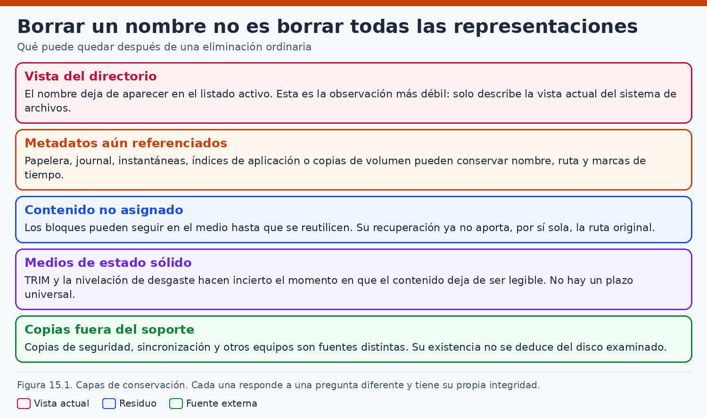
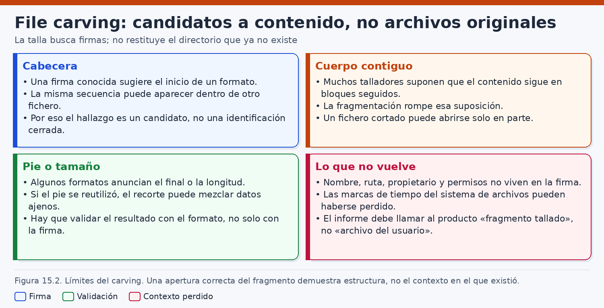
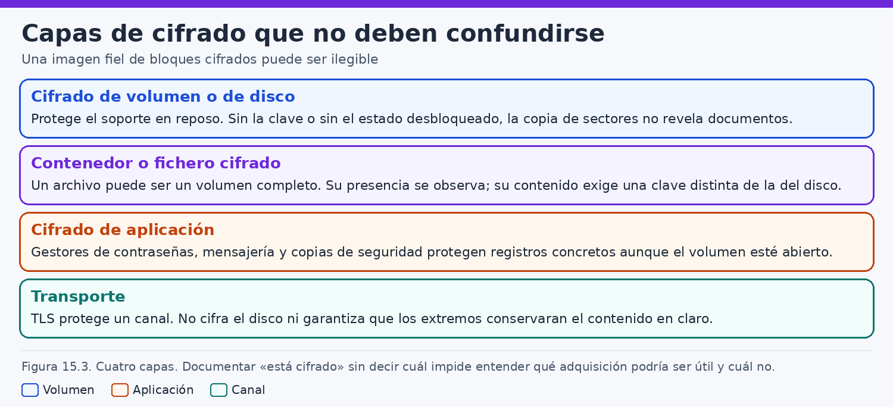
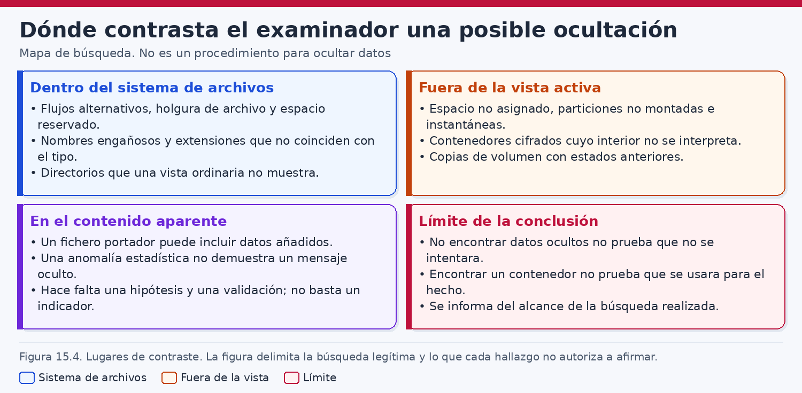
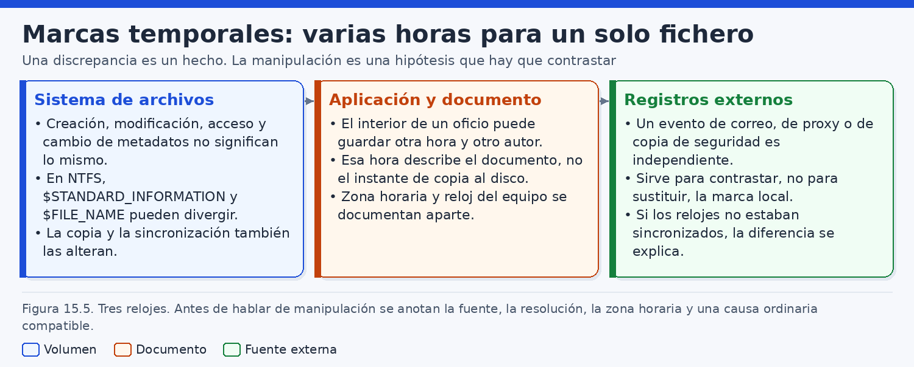
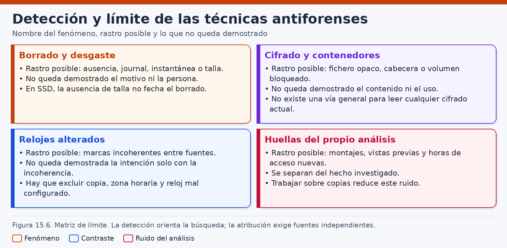

# Datos borrados, cifrado y técnicas antiforenses

> *Una ausencia, un volumen ilegible o una marca discordante describen el estado de una fuente. La intención de quien pudo provocarlos solo se sostiene cuando otras observaciones reducen las explicaciones ordinarias.*

## Introducción

Cuando un nombre deja de aparecer en una carpeta, el lenguaje cotidiano dice que el fichero «se ha borrado». En una investigación esa frase mezcla operaciones que no tienen el mismo efecto ni la misma fuerza probatoria. Quitar una entrada de directorio, enviar un objeto a la papelera, conservar una versión en una instantánea, liberar clústeres, descartar bloques en un SSD o destruir la clave de un volumen cifrado pueden producir, ante quien mira la vista actual, un resultado parecido: el documento ya no se abre desde la ruta esperada. El trabajo del analista consiste en separar esos estados, decir cuál se ha observado y cuál permanece como hipótesis.

Este capítulo trata tres familias de problemas que suelen llegar juntas al laboratorio. La primera es la recuperación de información que ya no figura como fichero activo: borrado lógico, papeleras, instantáneas, espacio no asignado, holgura y particularidades de la memoria flash. La segunda es el cifrado, entendido como un conjunto de capas —volumen, contenedor, aplicación y transporte— que pueden dejar una adquisición íntegra y, a la vez, ilegible. La tercera es el conjunto de condiciones que reducen la capacidad de interpretar una fuente: ocultación, discrepancia de marcas temporales y otras técnicas antiforenses. En los tres casos el objetivo es el mismo: reconocer el fenómeno, acotar lo que una herramienta puede afirmar y evitar que una laguna técnica se convierta en un relato sobre la intención de una persona.

La exposición es defensiva. Describe cómo se examina una copia, cómo se contrasta una hipótesis y dónde se detiene una conclusión. No es una guía para borrar soportes, fabricar mensajes ocultos, depositar datos en estructuras poco visibles, alterar marcas de tiempo ni eludir un cifrado. Nombrar TRIM, la holgura, un contenedor cifrado o una discrepancia entre atributos NTFS sirve para interpretar lo que el examinador encuentra. El modo de producir esos efectos queda fuera del capítulo.

El hilo conductor es un caso ficticio, la cooperativa Litoral Norte, cuyo dominio de ejemplo es `litoral.example`. El 20 de marzo de 2026 la secretaría comunica que `acta-junta-2026-03.docx` ya no aparece en `D:\Repositorio\Actas\` de la estación `LN-CONT-04`, usada con la cuenta `m.riera`. Se conservan una imagen lógica del volumen de datos, una imagen de bloques del mismo disco, una instantánea de volumen, una copia lógica del servidor `archivos.litoral.example` y una base del cliente de sincronización. Ningún nombre, hora o identificador de este relato procede de un expediente real. Las horas se expresan en UTC después de una normalización ilustrativa; en un caso verdadero habría que documentar la zona, el reloj y el margen de cada fuente.

Como en los capítulos anteriores, se distingue la **observación** de la **inferencia técnica** y de la **hipótesis**. Ver que un nombre no está en el directorio actual es una observación. Inferir que los clústeres asociados quedaron libres es ya una lectura de las estructuras del sistema de archivos, válida solo si la herramienta y el offset son los correctos. Sostener que una persona borró el acta para impedir una revisión es una hipótesis sobre conducta, y exige fuentes que la ausencia, por sí sola, no contiene. El cifrado recibe el mismo trato: constatar que un volumen está cifrado no demuestra que se cifrara para obstaculizar una investigación. Puede ser la configuración ordinaria del equipo.

Las herramientas que aparecen más adelante —`fsstat` y, de forma conceptual, `fls` e `icat` del Sleuth Kit, `sqlite3` sobre copias, o PhotoRec como ejemplo público de *file carving*— cambian de versión y de cobertura. Conviene comprobar en la documentación vigente qué sistema de archivos interpretan, qué opciones se usaron y si el resultado ha sido contrastado con otra fuente. El programa de pruebas de herramientas del NIST (CFTT) y las guías del Scientific Working Group on Digital Evidence (SWGDE) recuerdan que la confianza en un resultado depende del método, no del nombre comercial del programa. Una orden de este capítulo es un ejemplo de laboratorio sobre copias. No autoriza a intervenir el sistema de otra persona ni a ejecutar reparaciones sobre la evidencia maestra.

## 1. Borrado de información y recuperación

### 1.1. Un mismo verbo para operaciones distintas

En la interfaz, borrar es dejar de ver un objeto en su sitio. Por debajo, el sistema puede cambiar un puntero, mover el objeto a una carpeta de retención, marcar espacio como disponible o pedir al dispositivo que descarte bloques. Antes de buscar bytes residuales hay que clasificar qué operación se está investigando.

Conviene fijar cinco situaciones que el informe no debe fundir en una sola frase.

La primera es el **borrado lógico**. Desaparece o queda marcada como no asignada una entrada de directorio, un registro de fichero o un enlace, y el mapa de asignación puede declarar libres las unidades que el objeto ocupaba. El contenido puede seguir en esas unidades hasta que se reutilicen. La segunda es la **papelera** o un mecanismo equivalente de la interfaz: el objeto cambia de ruta y, a menudo, conserva un registro del nombre anterior. Sigue asignado. La tercera es la **instantánea** o cualquier copia histórica del volumen: la vista actual puede no mostrar el fichero y una vista anterior sí. La cuarta es el **espacio no asignado**, que es una categoría del mapa actual, no un archivo de restos. La quinta es el comportamiento del **SSD** y de otras memorias flash, en las que TRIM, la nivelación de desgaste y la recolección interna hacen incierto el momento en que un bloque lógico deja de devolver el contenido anterior.

Estas cinco situaciones pueden coincidir en el mismo expediente. En Litoral Norte, el acta falta en la carpeta actual, podría haber pasado por una papelera, podría subsistir en la instantánea del 12 de marzo y podría haber dejado, o no, bytes en espacio no asignado de un SSD. Tratarlas como una sola búsqueda «de borrados» produce un resultado opaco: o se anuncia una recuperación que no se ha validado, o se anuncia una ausencia que solo cubre la vista que se abrió primero.

La publicación NIST SP 800-88 Rev. 1, sobre saneamiento de soportes, utiliza un vocabulario todavía más estricto. Distingue objetivos de saneamiento —hacer impracticable la recuperación con distintos niveles de esfuerzo— y recuerda que la técnica depende del tipo de medio. El borrado ordinario de un fichero no es un saneamiento. Cuando una organización afirma que un disco «fue saneado», el analista busca el registro de esa operación, el procedimiento aplicado y la verificación prevista por su propia política. No deduce el saneamiento del hecho de que una carpeta esté vacía. El detalle operativo de cada técnica se consulta en la revisión vigente de esa guía; este capítulo no lo reproduce.

### 1.2. Borrado lógico: la referencia y el contenido

En un sistema de archivos, un fichero activo es una relación entre un nombre, unos metadatos y unas unidades de asignación. El borrado lógico rompe o invalida parte de esa relación. Según el formato, puede disminuir un contador de enlaces, marcar un registro como no usado, anular una entrada de directorio o actualizar un mapa de bits. Lo que no puede darse por hecho es la suerte inmediata de los bytes que el objeto contenía.

Si las referencias sobreviven, la recuperación por metadatos puede reconstruir nombre, tamaño, marcas y, cuando los punteros siguen siendo coherentes, el contenido. Si el registro se reutiliza para otro fichero, el nombre antiguo puede perderse o mezclarse con una asignación nueva. Si solo queda el contenido sin metadatos, el problema pasa al *carving*, que se trata en el apartado siguiente. Entre ambos extremos hay resultados parciales: un nombre residual con clústeres ya ocupados por otra cosa, o unos clústeres intactos con un nombre que la herramienta ya no asocia.

En el caso ficticio, una búsqueda del nombre `acta-junta-2026-03.docx` en la vista activa de `D:\Repositorio\Actas\` no devuelve el objeto. Una segunda consulta, orientada a entradas que la herramienta marca como no asignadas, muestra un registro residual con un nombre compatible y una secuencia de asignación que la propia herramienta señala como reutilizada en parte. Esa pareja de observaciones permite afirmar que existió una referencia de nombre y que el contenido actual de esas unidades no puede tratarse como el documento íntegro. No permite afirmar cuándo se invalidó la referencia, qué cuenta lo hizo ni si el motivo fue una decisión de la secretaría, un cliente de sincronización o otro proceso.

### 1.3. La papelera conserva otro tipo de rastro

La papelera de reciclaje, la papelera de un entorno de escritorio y las papeleras internas de algunas aplicaciones no liberan necesariamente el contenido. Lo trasladan a una ubicación de retención y, en muchos diseños, guardan el nombre o la ruta anterior. En volúmenes NTFS actuales es habitual un directorio de papelera por volumen, con información asociada a la cuenta. El formato de esos registros cambia entre versiones de Windows y debe comprobarse; el capítulo de Windows ya advirtió que una entrada de papelera es una fuente valiosa y no una garantía de fichero íntegro.

Un servidor sin sesión gráfica puede no tener papelera alguna: el proceso que borra un fichero de `/srv` no pasa por el gesto del escritorio. La ausencia de papelera, en ese contexto, describe la interfaz que no intervino. Vaciar la papelera, cuando existe, es un segundo acontecimiento. Genera, si el sistema lo registra, otro cambio de asignación, distinto del envío a la papelera. Un informe que diga «se borró el 11 de marzo» debe precisar si esa fecha es la del movimiento a la papelera, la del vaciado o la marca de modificación del documento, que puede ser anterior a ambas.

En `LN-CONT-04` la papelera del volumen de datos no contiene, en la copia examinada, un registro con el nombre del acta. La observación es compatible con varias hipótesis: el fichero no pasó por la papelera, pasó y la papelera se vació, la cuenta que lo eliminó es otra y se consultó la papelera equivocada, o la herramienta no interpretó el formato de esa versión. La comprobación correcta enumera las papeleras del volumen, asocia cada una a la cuenta cuando el formato lo permite y deja constancia del alcance. Afirmar que «alguien eludió la papelera para no dejar rastro» añade una intención que esta sola observación no sostiene. Muchas aplicaciones y muchos clientes de sincronización eliminan ficheros sin usar la papelera del escritorio.

### 1.4. Instantáneas: la vista actual no es la única vista

Una instantánea es una representación del volumen en un momento anterior, mantenida por el sistema de archivos, por un gestor de volúmenes o por un hipervisor. Mientras existe, puede hacer alcanzables ficheros que la vista montada ya no muestra. El mecanismo concreto varía. Las copias de sombra de Windows, las instantáneas APFS, las de Btrfs o las de un gestor de volúmenes lógicos no se leen con la misma herramienta ni garantizan la misma retención. Algunas son puntuales, otras se rotan, y una política puede haber borrado precisamente la instantánea que interesaba.

En el caso, la instantánea conservada tiene una marca de creación el 12 de marzo de 2026 a las 06:40 UTC. Dentro de ella, `acta-junta-2026-03.docx` aparece bajo la ruta equivalente a `D:\Repositorio\Actas\`, con un tamaño de 184320 bytes. El hash del contenido extraído de esa instantánea se calcula sobre el derivado, en el laboratorio, y se conserva junto al identificador de la instantánea. La estación examinada el 20 de marzo ya no muestra ese nombre en la carpeta. Hay, por tanto, dos estados documentados y un intervalo entre ambos del que esta pareja de fuentes no cuenta todos los pasos.

Ese intervalo es el lugar de las hipótesis que el apartado 6 contrastará con detalle. Una es el borrado voluntario por parte de quien usaba la cuenta. Otra es que el cliente de sincronización retirara la copia local al cambiar el estado del elemento en el servidor. Las dos predicen el mismo par de observaciones: presente en la instantánea, ausente en la vista actual. Hace falta otra fuente para separarlas. La instantánea, por sí sola, no elige.

También puede ocurrir lo contrario de lo que el encargo sugiere. El fichero sigue en el volumen con otro nombre, o en otra carpeta, y la instantánea solo demuestra que el 12 de marzo estaba en la ruta antigua. Por eso el examen de la instantánea no sustituye una búsqueda del nombre y del hash en la vista actual completa. En Litoral Norte esa búsqueda, sobre la copia lógica, no localiza otro objeto con el mismo hash en el volumen de la estación. El servidor de ficheros sí conserva una copia de igual hash en otra ruta. El dato se anota aquí y se interpreta cuando haya contexto de sincronización, no antes.

### 1.5. Espacio no asignado y holgura

El espacio no asignado es el conjunto de unidades que el mapa vigente no atribuye a objetos activos. Puede contener restos de ficheros anteriores, restos de otro sistema de archivos, ceros escritos por el propio sistema o ceros devueltos por el dispositivo. Llamarlo «espacio libre» describe la disponibilidad lógica, no el historial de los bytes.

La holgura, o *slack*, es otra región. Es la diferencia, cuando existe y la adquisición la expone, entre el final lógico de un fichero y el final de la unidad de asignación que lo contiene. No es espacio no asignado del volumen. Su contenido depende de cómo escribe el sistema, de si el soporte es un disco tradicional o una memoria flash y de si la imagen obtenida muestra esos bytes o una representación ya filtrada. Una holgura llena de ceros puede ser el comportamiento normal de esa configuración. Una holgura con datos puede ser un resto de una asignación anterior. En ninguno de los dos casos el hallazgo prueba, sin más, que alguien escondiera información ahí.

Si la imagen de trabajo es la copia lógica del volumen desbloqueado, el mapa de no asignados es el de ese sistema de archivos. La imagen de bloques cifrados todavía no muestra ese mapa.

### 1.6. El SSD no ofrece un plazo universal

En un disco de estado sólido, el sistema puede comunicar que ciertos bloques lógicos ya no se necesitan. Esa comunicación —TRIM u órdenes equivalentes de descarte— permite al dispositivo reorganizar sus páginas físicas. La nivelación de desgaste reparte las escrituras y la recolección interna puede borrar páginas en un momento que la interfaz lógica no anuncia. El resultado forense es una incertidumbre de calendario: no hay un plazo general a partir del cual un fichero eliminado deje de ser legible, ni un plazo durante el cual deba seguir estándolo.

No hay una regla que obligue a conservar lo eliminado hasta la siguiente escritura, ni otra que haga desaparecer el contenido en el acto del TRIM. Lo que el analista describe es lo que la interfaz devolvió: sectores con datos, con ceros o ilegibles. Unos ceros en clústeres no asignados son compatibles con un descarte ya procesado, con una escritura de ceros, con relleno de la imagen o con un fichero disperso. SP 800-88 Rev. 1 recuerda que el saneamiento de memorias flash no se comporta como el de los medios magnéticos y que la verificación forma parte del proceso. Una ausencia de datos recuperables se predica de la interfaz y del método. En `LN-CONT-04` parte del espacio no asignado devuelve ceros y el expediente no contiene un registro de saneamiento. El analista documenta ambas cosas. No concluye que alguien hubiera limpiado el disco para impedir la lectura del acta.

La figura 15.1 resume esta relación entre la operación observable y lo que todavía puede quedar. Sirve como recordatorio de alcance: cada fila exige su propia comprobación, y un resultado negativo en una fila no cierra las demás.



### 1.7. Lectura de estructuras en el laboratorio

Cuando existe una imagen de un sistema de archivos que la herramienta sabe interpretar, el primer paso es identificar el volumen, leer sus parámetros y solo después enumerar objetos. The Sleuth Kit ofrece utilidades clásicas para ese recorrido. Qué versión de NTFS, de ext4 o de otro formato entiende cada orden se comprueba en la documentación instalada y, si el caso lo requiere, frente a los ensayos del CFTT.

La orden `fsstat` describe el sistema de archivos que la herramienta reconoce en un offset de la imagen. Sirve para fijar el tipo, los tamaños de unidad y las incoherencias que el propio programa reporte. No certifica que la imagen esté completa ni que el offset sea el de la partición correcta: eso se contrasta con la tabla de particiones y con el registro de adquisición. `fls` enumera nombres según las estructuras de directorio. Con las opciones adecuadas puede incluir entradas que la herramienta considera eliminadas. Esa lista no es el censo histórico de todo lo que alguna vez hubo en el volumen. `icat` extrae el contenido asociado a un identificador de metadatos ya elegido. El identificador procede de la enumeración anterior; reutilizar el número de otro caso es un error de método.

En el laboratorio, y solo sobre la copia de trabajo, un esquema ilustrativo sería el siguiente. Los números de offset e identificador pertenecen al ejemplo, no a una imagen real:

```bash
# Copia de laboratorio. El offset se contrasta con la tabla de particiones.
fsstat -o 2048 /caso/imagenes/ln-cont-04-logica.raw

# Enumeración conceptual: fls lee directorios de esa copia, no del equipo original.
# fls -r -o 2048 /caso/imagenes/ln-cont-04-logica.raw

# icat solo después de anotar el identificador que la enumeración haya mostrado.
# icat -o 2048 /caso/imagenes/ln-cont-04-logica.raw 84521 > /caso/derivados/candidato.bin
```

Si `fsstat` advierte de un sistema de archivos inesperado, se revisa el offset antes de interpretar nombres. Si la copia de trabajo es ya un árbol de ficheros, y no una imagen de bloques, estas utilidades pueden no servir: se documenta entonces la pérdida de espacio no asignado, holgura y entradas residuales. La misma disciplina vale para la base del cliente de sincronización. Copiar solo el fichero principal puede dejar fuera el `-wal` y el `-shm`. La vista que abre `sqlite3` puede no incluir la última transacción. El formato y el WAL están documentados por el proyecto SQLite; el esquema de cada aplicación se inspecciona en la copia.

```bash
# Se trabaja con la copia y con sus auxiliares, si existen.
ls -l /caso/copias/sync/estado.sqlite*

sqlite3 /caso/copias/sync/estado.sqlite ".schema"
sqlite3 /caso/copias/sync/estado.sqlite "PRAGMA integrity_check;"
sqlite3 /caso/copias/sync/estado.sqlite "SELECT name FROM sqlite_master WHERE type='table';"
```

Estas consultas muestran la estructura y una comprobación de integridad. No recuperan por sí solas lo que la aplicación ya no presenta ni demuestran que una fila describa una acción humana. Si faltó el `-wal`, el resultado se etiqueta como incompleto. Abrir la base original puede incorporar el diario al fichero principal y alterar la evidencia.

### 1.8. Qué puede decirse al cerrar el apartado

El inventario de esta primera clasificación cabe en una tabla. Falta correlacionar la sincronización y decidir qué hipótesis sobreviven.

| Estado examinado | Observación en el ejemplo | Qué no queda demostrado |
|---|---|---|
| Vista actual | El nombre no está en la carpeta esperada | Que el contenido se destruyera |
| Referencia residual | Hay una entrada no asignada, con asignación reutilizada en parte | La cuenta, la hora exacta o el motivo |
| Papelera | No aparece el nombre en la papelera consultada | Que se eludiera a propósito |
| Instantánea del 12 de marzo | El objeto está, con hash de laboratorio | Que no hubiera versiones intermedias |
| SSD y no asignados | Parte de las unidades libres devuelven ceros | Un saneamiento ni una intención |

La tabla evita que una sola celda ocupe el lugar de las demás. Una recuperación posterior, por la instantánea o por el servidor, será la de un objeto situado en una fuente concreta.

## 2. Técnicas de file carving

### 2.1. Qué busca el carving y qué deja fuera

El *file carving*, o recuperación por firmas, localiza candidatos a fichero cuando las estructuras de directorio no bastan o no existen. El procedimiento se apoya en regularidades del formato: una cabecera, a veces un cierre, una longitud declarada en los primeros campos o una estructura interna que permite comprobar si los bytes siguientes son coherentes. El resultado es un objeto recortado a partir de una región de la imagen. No es, por ese solo hecho, el fichero que un usuario guardó con un nombre y una ruta.

Esta diferencia condiciona el lenguaje del informe. Un candidato puede describirse como una secuencia de bytes, a partir de un desplazamiento, compatible con un formato hasta donde la validación haya llegado. Llamarlo «el acta que se borró el día 19» añade el nombre, la fecha y la acción, tres datos que el método no proporciona. Si más tarde el hash del candidato coincide con el del objeto extraído de la instantánea, la coincidencia es una observación nueva. Hasta entonces siguen abiertas dos líneas: la de los metadatos y la de las firmas. El método es ruidoso: las mismas secuencias aparecen dentro de otros ficheros, en datos comprimidos y en bloques que nunca fueron un documento autónomo. La fragmentación corta el candidato o le añade bytes vecinos.

NIST SP 800-86, al integrar las técnicas forenses en la respuesta a incidentes, insiste en documentar el proceso y en conocer el alcance de cada herramienta. Aplicado al *carving*, ese consejo se traduce en guardar la versión del programa, las firmas habilitadas, la región examinada, el criterio de tamaño máximo y el directorio de salida. Sin esos datos, un revisor no puede saber si la ausencia de un tipo de fichero se debe al soporte o a una opción que dejó ese tipo fuera de la búsqueda.

### 2.2. PhotoRec como ejemplo público

PhotoRec, mantenido por CGSecurity, es un ejemplo público y muy extendido de esta familia de herramientas. Recorre una imagen o un dispositivo en busca de firmas conocidas y escribe candidatos en un directorio de recuperación. Los nombres de salida son generados por la herramienta. No son los nombres originales. La documentación del proyecto describe el comportamiento general y la lista de formatos que cada versión declara reconocer. Esa lista cambia. Afirmar que «PhotoRec recupera documentos de oficina» sin citar la versión es una promesa que el laboratorio todavía no ha comprobado.

En un caso real, PhotoRec se ejecuta sobre una copia o sobre una imagen, con salida en un directorio nuevo del puesto de análisis, nunca sobre el soporte original. La invocación concreta —qué partición, qué tipos de fichero, qué opciones de fragmentación— se toma de la ayuda de la versión instalada y se archiva junto con el registro de ejecución. Este capítulo no fija una línea de órdenes: una opción memorizada de una versión anterior puede significar otra cosa, o no existir, en la versión siguiente. Lo que sí debe quedar escrito es qué se pidió y qué salió.

PhotoRec no reconstruye la ruta, el propietario ni la marca temporal del sistema de archivos. Si el examinador necesita esos elementos, tiene que obtenerlos de otra fuente: la entrada de directorio, la instantánea, el diario del sistema de archivos o el servidor. Un JPEG extraído por firma puede ser una fotografía que alguien guardó, una miniatura incrustada en un documento, un recurso de una aplicación o un falso positivo cuya cabecera coincidió por azar. El fichero de salida no trae consigo la respuesta.

En el laboratorio de Litoral Norte se reserva un fragmento de la imagen lógica, ya verificado, para una pasada de PhotoRec limitada a unos tipos de formato. El propósito didáctico de esa pasada no es «encontrar el acta a cualquier precio». El acta, si está íntegra, ya se ha leído desde la instantánea por metadatos, que es un método más rico. La pasada sirve para ver qué más hay en las regiones no asignadas y para practicar la clasificación de candidatos. Mezclar en un solo anexo, sin etiquetas, los objetos de la instantánea y los candidatos de PhotoRec haría indistinguibles dos calidades de evidencia muy diferentes.

### 2.3. Falsos positivos y recortes incompletos

Un falso positivo, en este contexto, es un candidato que la herramienta presenta como fichero de un tipo y que no lo es, o que lo es solo como fragmento incrustado en otra cosa. Los documentos de oficina modernos son contenedores. Dentro pueden viajar imágenes, miniaturas y objetos incrustados con sus propias cabeceras. Un *carving* que busque JPEG encontrará esas cabeceras y escribirá ficheros de imagen. La observación «hay candidatos JPEG en el espacio no asignado» es correcta. La inferencia «el usuario guardó esas fotografías como ficheros» no lo es, mientras no se descarte que proceden de un documento, de una caché o de un recurso de programa.

El caso ficticio produce exactamente ese equívoco si se lee deprisa. PhotoRec escribe varias salidas con extensión de imagen. Dos de ellas, abiertas con un visor que no ejecuta contenido activo, muestran páginas reducidas del propio acta y de un anexo. Su resolución y su encuadre son los de una miniatura, no los de una fotografía tomada con una cámara. Otras salidas no se abren: la cabecera está, y a los pocos kilobytes el formato deja de ser coherente. Son recortes incompletos. Una más se abre y muestra una fotografía de un puerto, sin metadatos de origen fiables y sin una ruta que la vincule a la carpeta de actas. Puede ser un resto real de una imagen borrada, un recurso o una coincidencia. Permanece como candidato no atribuido.

La fragmentación agrava el problema. Si el fichero no ocupaba unidades contiguas, un *carving* secuencial puede detenerse en el primer hueco, incorporar el bloque siguiente de otro objeto o generar varios candidatos que son trozos del mismo documento. Algunas herramientas intentan seguir estructuras internas para saltar la fragmentación. Ese intento es una heurística. Debe constar como tal, con los desplazamientos que se tomaron de metadatos y los que se eligieron por conjetura. Un documento que «se abre» puede estar mostrando solo la parte que el programa tolera, rellenando o ignorando el resto. La prueba de apertura no equivale a integridad.

Conviene clasificar cada salida antes de citarla:

| Clase | Criterio mínimo en el laboratorio | Ejemplo del caso | Uso prudente en el informe |
|---|---|---|---|
| Coincidencia de hash con una fuente mejor | Mismo hash que el objeto de la instantánea o del servidor | No se da en los JPEG de miniatura | Corrobora contenido ya identificado |
| Candidato íntegro de formato | Estructura interna coherente y fin esperado | Ninguno de los recortes rotos | «Candidato validado», sin ruta inventada |
| Fragmento incrustado | Cabecera dentro de un contenedor conocido | Miniaturas del acta | No es un fichero de usuario autónomo |
| Recorte incompleto | Cabecera reconocible y cuerpo incoherente | Varias salidas de PhotoRec | Se conserva el offset; no se da por leído |
| No atribuido | Se abre o se valida, sin origen | Fotografía del puerto | Hipótesis abierta |

Promover todas las filas a «fotografías recuperadas del disco de la secretaría» borraría precisamente la clasificación. Si dos analistas discuten una fila, la duda queda en las notas.

### 2.4. Validar sin reparar la evidencia

La validación se hace sobre copias y produce derivados. Identificar el formato, comprobar longitudes y anotar errores son operaciones de lectura. Reparar un contenedor o dejar que una aplicación «arregle» el fichero al abrirlo crea una versión nueva: su hash identifica el derivado, no los bytes de la imagen. Los candidatos pueden contener contenido activo; la apertura, si hace falta, se registra en un entorno acorde con la política del laboratorio. PhotoRec y una segunda herramienta pueden extraer los mismos bytes con nombres distintos. El repositorio guarda ambos, con su desplazamiento. Un hash idéntico demuestra igualdad de esos bytes, no la historia que los llevó a dos sitios.

La figura 15.2 recoge el límite que este apartado quiere fijar: el *carving* amplía la búsqueda y, al mismo tiempo, empobrece el contexto. Cada candidato necesita una validación y una procedencia antes de entrar en una conclusión.



### 2.5. Firmas dentro de bases y diarios

No todo el contenido residual tiene forma de fichero con cabecera clásica. SQLite organiza los datos en páginas. Un registro que la aplicación ya no muestra puede haber dejado huella en páginas libres, en espacio no usado dentro de una página o en el fichero `-wal`, que acumula transacciones todavía no incorporadas al fichero principal. El proyecto SQLite documenta el formato del fichero y el modo WAL. Esa documentación permite entender por qué copiar solo el archivo principal es una adquisición incompleta. No convierte al analista en poseedor de un método universal para «leer lo borrado» de cualquier base: el esquema es de la aplicación, las páginas pueden estar reutilizadas y la herramienta concreta debe validarse.

En el caso, la base `estado.sqlite` del cliente de sincronización se copia junto con su `-wal`. `sqlite3` muestra el esquema de esa copia. El analista no supone nombres de tablas de un producto comercial. Lee los que hay. En esta aplicación ficticia, el esquema contiene una tabla de elementos con una ruta local y un literal de estado. Una fila asocia la ruta antigua del acta con un estado que los propios literales de esa versión describen como elemento presente en el remoto y ausente como copia local completa. La lectura es una inferencia técnica apoyada en el esquema observado. Otra versión del cliente podría usar otros campos, y un revisor tiene que poder repetir `.schema` sobre la misma copia.

Un registro visible en esa tabla es el estado que la aplicación todavía presenta. Un resto en una página libre sería otra cosa, de relación más débil con lo que alguien vio. Este capítulo se queda en la distinción y no describe cómo recorrer páginas libres ni cómo reconstruir celdas. Una cadena con el nombre del acta, hallada en un contenedor, demuestra que el nombre estaba en esa región. Espera al contraste con la instantánea, el servidor y la base. No demuestra por sí sola un documento íntegro.

### 2.6. Cómo se cita un candidato

Una cita reproducible incluye el identificador de la imagen, el desplazamiento, la longitud, la herramienta y la versión, las opciones, el hash, la clase de la tabla y el motivo. Una miniatura se relaciona con el documento que la contiene. Un recorte indica hasta dónde la estructura era coherente. Un candidato no atribuido no recibe ruta ni autor.

PhotoRec puede devolver miles de candidatos. En Litoral Norte la pregunta es la suerte del acta, no un inventario de toda la estación. Un filtrado por hashes ya conocidos o por tipos de formato es legítimo si se declara. La lista de lo examinado y de lo dejado fuera forma parte del método que SP 800-86 pide documentar. Cuando el volumen está cifrado, el *carving* de la imagen de bloques puede no ver cabeceras porque está mirando la capa equivocada, no porque el documento se haya borrado.

## 3. Cifrado de discos, archivos y aplicaciones

### 3.1. Capas que no se sustituyen

El cifrado no es un estado único del disco. En un mismo expediente pueden superponerse cuatro capas, y cada una responde a una pregunta distinta.

La capa de **volumen** protege una partición o un conjunto de particiones. Quien no dispone de la clave ve bloques que no forman un sistema de archivos interpretable. BitLocker, FileVault y LUKS son tres realizaciones habituales de esta capa, en Windows, macOS y Linux. La capa de **contenedor o de fichero** cifra un archivo o un paquete que, visto desde el volumen ya abierto, sigue siendo opaco: un contenedor cifrado dentro de un disco que, por lo demás, se lee con normalidad. La capa de **aplicación** cifra el almacén de un programa —a menudo una base— con claves ligadas a esa aplicación, a la cuenta o al dispositivo. El volumen puede estar en claro y la base seguir siendo ilegible. La capa de **transporte**, de la que TLS es el ejemplo corriente, protege la comunicación entre dos sistemas. No cifra el disco en reposo. Un disco descifrado no revela, por ello, el contenido de las sesiones TLS pasadas. Una captura de red cifrada no revela, por ello, los ficheros que había en el volumen.

Confundir las capas produce dos errores. El primero es dar por perdido un dato que sí está en otra capa: el acta ilegible en la imagen de bloques de BitLocker puede estar en claro en la copia lógica o en el servidor. El segundo es dar por leído un dato que sigue cifrado: abrir el volumen no abre el contenedor, ni la base de la aplicación, ni el tráfico TLS. El informe nombra la capa de cada afirmación. No existe un método general para leer cualquier cifrado actual, y este apartado no describe cómo eludir ninguna de esas capas.

La figura 15.3 ordena esas capas para el examinador. Cada una puede estar presente o ausente en el caso, y la ausencia de una no dice nada sobre las otras.



### 3.2. BitLocker, FileVault y LUKS como cifrado de volumen

BitLocker es el cifrado de volumen documentado por Microsoft para Windows. Puede proteger el volumen del sistema y volúmenes de datos. Los protectores —el modo concreto en que se guarda el acceso a la clave— dependen de la configuración: pueden intervenir el módulo de plataforma del equipo, un PIN, una clave de recuperación custodiada por la organización u otras combinaciones que la documentación vigente enumera. El analista no necesita reproducir esa lista de memoria. Necesita registrar, en el caso, si el volumen estaba cifrado y en qué forma llegó al laboratorio.

FileVault es el cifrado de volumen de macOS, descrito en la guía de seguridad de la plataforma de Apple. Está ligado al arranque y a las cuentas de una manera que esa guía explica y que cambia con el hardware y con la versión del sistema. Una copia de seguridad no es una imagen del volumen, y una imagen de bloques cifrada no es un árbol de ficheros. Quien reciba un Mac debe anotar el modelo, la versión y si la adquisición se hizo con el volumen desbloqueado o se limita al texto cifrado. El detalle se contrasta con la edición vigente de la guía, en español o en inglés, porque los apartados se reorganizan.

LUKS es el formato habitual de cifrado de volumen en Linux. Un volumen LUKS presenta una cabecera reconocible y una carga cifrada. Reconocer la cabecera en una copia permite afirmar que hay un volumen de ese tipo. No permite leer la carga. Abrirla exige una credencial de la que el caso puede disponer por un cauce legítimo —la entrega por el administrador, una clave custodiada, una sesión ya desbloqueada— o puede no disponer. Este capítulo no explica cómo probar claves, cómo manipular la cabecera ni cómo extraer material criptográfico del equipo.

Las tres comparten una consecuencia: una imagen de bloques puede ser íntegra, verificada por hash, y aun así ilegible. El hash demuestra que la copia no ha cambiado. No demuestra que los ficheros se puedan interpretar. Esa imagen se describe como representación cifrada conservada. El análisis de ficheros, si existe, se apoya en otra adquisición, obtenida con el volumen desbloqueado, con autorización y con constancia del efecto de esa sesión.

En Litoral Norte se dan los dos objetos. La imagen de bloques de `LN-CONT-04` verifica bien y no muestra un sistema de archivos NTFS: el volumen de datos está protegido con BitLocker. La imagen lógica se obtuvo en una sesión autorizada, con el volumen desbloqueado, y es la que permite ver carpetas, la papelera, la instantánea accesible desde esa sesión y el espacio no asignado que el sistema descifrado expone. Son evidencias distintas. Un hallazgo en la imagen lógica no se atribuye a la imagen de bloques, y la integridad de la imagen de bloques no se presenta como integridad del árbol de ficheros ya interpretado.

El servidor `archivos.litoral.example` usa LUKS en el volumen que aloja `/srv/actas`. El laboratorio no recibe la carga cifrada. Recibe una copia lógica, preparada por la administración, del árbol ya descifrado, con su propio hash y su acta de entrega. Si esa copia omitiera instantáneas, espacio no asignado o ficheros no incluidos, el examen no puede completarlos sobre un texto cifrado que no se interpreta. FileVault no aparece en los soportes de este caso; se cita para fijar la misma capa en macOS, con la guía de Apple como referencia de comportamiento y sin trasladar a un Mac futuro el modo de adquisición de la estación Windows.

### 3.3. El contenedor cifrado y el fichero que no se interpreta

Dentro de un volumen ya legible puede haber un fichero que ninguna herramienta de formato ordinario reconoce. Una explicación es el contenedor cifrado: un archivo cuyo contenido es opaco por diseño y que se abre con una clave distinta de la del volumen. Otras explicaciones, que conviene agotar antes, son un formato poco común, un fichero truncado, un fichero comprimido con un método que la herramienta no tiene y un fichero dañado. La opacidad no selecciona sola la explicación del contenedor.

Lo observable es el tamaño, la ruta, las marcas y el hecho de que la herramienta de firmas no identifique el tipo, o lo haga con baja confianza. Una entropía alta es compatible con el cifrado y también con la compresión. No es un dictamen de contenedor. Si no hay cabecera conocida, el analista dice que el objeto no se interpreta con las herramientas usadas. No dice que alguien lo cifró para ocultarlo. Este capítulo no describe cómo derivar o probar una clave. Si la clave llega por un cauce autorizado, el descifrado se hace sobre una copia y el resultado es un derivado con su hash. Si no llega, el objeto queda como no interpretado.

En la estación de Litoral Norte hay un fichero, `notas-privadas.db`, en el perfil de la cuenta `m.riera`. Los primeros bytes no son la cabecera de SQLite en claro que documenta el formato oficial (`SQLite format 3`). `sqlite3` no lo abre como base legible. La hipótesis de cifrado de aplicación, que el apartado siguiente precisa, es plausible. La hipótesis de contenedor cifrado genérico también lo es. La hipótesis de fichero truncado o de otro formato no se ha cerrado. No hay autorización ni clave para ir más allá. El informe lo incluye como objeto no interpretado, fuera de la línea principal del acta, para que nadie lo confunda con una base de sincronización leída.

### 3.4. El cifrado de aplicación es otra capa

Muchas aplicaciones protegen sus propios almacenes. El volumen descifrado muestra el fichero, y el fichero no muestra los registros. Las claves pueden depender del usuario del sistema, de un secreto de la aplicación o de un componente de hardware. El esquema, cuando el fichero sí es una base en claro, se consulta con `.schema` porque cambia entre versiones. Cuando el fichero no es una base en claro, forzar su lectura queda fuera del método de este libro.

La imagen lógica de `LN-CONT-04` contiene el perfil, el cliente de sincronización y `notas-privadas.db`. La base de sincronización se lee, con las cautelas del WAL. La otra no. Decir que se analizó «todo el disco descifrado» solo sería verdad en la capa de volumen. Que una aplicación cifre su base es, en muchos productos, el comportamiento de serie, y no señala que la cuenta ocultara el acta. Si hiciera falta ese contenido, el camino es una exportación, una clave custodiada o una sesión autorizada. Ninguna vía se sustituye por un atajo criptográfico.

### 3.5. TLS no es cifrado de disco

TLS protege el canal entre extremos. Un registro de firewall o de proxy que anota una conexión hacia `sync.litoral.example` en el puerto 443 puede permitir afirmar que hubo tráfico con ese destino, en una ventana temporal, con unos contadores si la fuente los guarda. No permite afirmar qué fichero se transfirió. El contenido de aplicación viaja dentro del canal. La imagen del disco, aunque esté descifrada, conserva como mucho lo que el cliente almacenó en reposo: colas, cachés, bases de estado, ficheros ya escritos. Puede no conservar el cuerpo de la sesión.

En el caso, el perímetro registra conexiones de `LN-CONT-04` hacia `sync.litoral.example:443` el 19 de marzo por la tarde. La hora se toma del reloj del cortafuegos, normalizada a UTC con el offset que la exportación declara. Esas conexiones pueden ser coherentes con una sincronización, y el apartado 6 las usará para eso. No autorizan a decir que el acta «viajó cifrado y por tanto se exfiltró». Quien lee el acta en la instantánea no ha leído las sesiones TLS, y quien obtiene el fichero en el servidor ha conseguido una observación de extremo, no una visión del canal. Un certificado o un nombre de servidor dicen algo del extremo. No dicen que una persona pulsara un botón. No hay en este capítulo un procedimiento para reconstruir el texto en claro de la captura.

### 3.6. Qué anota el examinador en cada capa

Antes de pasar a la ocultación, conviene fijar una ficha mínima por cada material cifrado del expediente. La ficha de Litoral Norte, reducida al ejemplo, podría leerse así.

| Objeto | Capa | Qué se observa | Qué se pudo leer | Dependencia |
|---|---|---|---|---|
| Imagen de bloques de `LN-CONT-04` | Volumen, BitLocker | Hash íntegro; no hay NTFS interpretable | El contenido de ficheros no se lee en esta copia | Conservación del texto cifrado |
| Imagen lógica de la misma estación | Volumen ya desbloqueado | NTFS, instantánea, papelera | Ficheros en claro de esa adquisición | Sesión autorizada; no incluye lo que el SSD no expuso |
| Copia de `/srv/actas` | Volumen LUKS, no examinado en directo | Árbol entregado por administración | El acta de igual hash en otra ruta | Alcance de lo que la copia lógica incluye |
| `notas-privadas.db` | Aplicación o contenedor, sin resolver | Sin cabecera SQLite en claro | No interpretado | Clave no disponible |
| Conexiones al puerto 443 | Transporte TLS | Destino, ventana, contadores | No el cuerpo de la sesión | Reloj del perímetro |

«El disco estaba cifrado» solo es verdad en la primera fila. «Se leyó el acta» es verdad en la instantánea y en la copia del servidor, con hashes que se comparan. Una hipótesis que necesite `notas-privadas.db` o el cuerpo TLS está fuera de alcance y debe decirlo. La custodia de claves, cuando existe, es una cuestión de autorización. Anotar que la organización guarda claves de recuperación de BitLocker no es describir cómo extraerlas del equipo. Si se solicitan, se solicitan por el procedimiento que corresponda, se usan sobre la copia y no se incorporan al informe en claro. FileVault y LUKS merecen la misma reserva.

## 4. Ocultación de información

### 4.1. La ocultación es una hipótesis, no un tipo de fichero

Ocultar, en el sentido de este apartado, significa colocar información de modo que la vista habitual no la muestre, o hacerla pasar por otra cosa. El examinador se encuentra a veces con indicios compatibles con esa idea: un listado que no coincide con otro, un fichero opaco, un resto en una zona poco revisada, una herramienta que no enseña todo lo que el formato permite guardar. Esos indicios justifican una segunda lectura. No justifican, al primer vistazo, la conclusión de que alguien ocultó pruebas.

Los sistemas apartan datos de manera ordinaria: un formato incrusta recursos, una base reserva páginas, un cliente de sincronización sustituye el fichero local por una referencia remota, una cuarentena o una copia de seguridad escriben donde el usuario no mira, y una herramienta incompleta omite estructuras que otra sí lee. El trabajo consiste en localizar el contraste que separa la omisión de la herramienta, el comportamiento del sistema y una ocultación deliberada.

Este apartado explica dónde mirar y cómo limitar la frase del informe. No explica cómo construir un escondite: ni esteganografía, ni uso de flujos alternativos para depositar datos, ni aprovechamiento de la holgura, ni preparación de un contenedor para que parezca inocuo. Nombrar el fenómeno sirve para reconocerlo si aparece y para no verlo donde solo hay una explicación corriente.

### 4.2. Dónde contrasta el examinador

El contraste útil compara dos representaciones que deberían coincidir si la hipótesis de partida fuera cierta. Si el explorador de ficheros y una herramienta forense discrepan, se anota qué opción, qué versión y qué tipo de objeto cubre cada una. Si la vista actual y la instantánea discrepan, ya se ha visto en el apartado 1 que la discrepancia puede ser un borrado, un traslado o una sincronización. Si el tamaño lógico y el contenido interpretable discrepan, cabe un fichero disperso, un formato que no se ha identificado o un contenedor opaco. Si dos copias del mismo expediente, hechas con distintos programas, no contienen los mismos objetos, la primera pregunta es el alcance de cada copia, no la mala fe.

La figura 15.4 sitúa esos contrastes en el método del examinador. No es un mapa de escondites. Es un recordatorio de que la ocultación se argumenta cuando un contraste sobrevive a las explicaciones de cobertura, de formato y de funcionamiento normal.



En la práctica, el examinador deja constancia de cuatro preguntas, en este orden. Qué vista produjo la ausencia. Qué otra vista, herramienta o fuente se usó como contraste. Qué explicaciones ordinarias predicen la misma diferencia. Qué quedaría por obtener si esas explicaciones no bastan. Saltar a la cuarta convierte un límite de la primera herramienta en un juicio sobre una persona.

NTFS puede asociar a un fichero, además del contenido principal, flujos con nombre. Algunas aplicaciones y el propio sistema los usan. El ejemplo ya citado en el capítulo de Windows, `Zone.Identifier`, puede guardar una marca de zona sobre el origen atribuido a un fichero descargado. Su presencia no prueba qué navegador lo descargó. Su ausencia no prueba que no hubiera descarga. Y un flujo que una herramienta no muestra puede deberse a que esa herramienta no enumera flujos, no a que alguien lo creara para esconder un documento. El contraste correcto es repetir el inventario con una utilidad que declare soporte de flujos, en la versión probada, y comparar. Si aparece un flujo no explicado por el uso conocido del sistema, se describe su nombre, su tamaño y su hash, y se investiga el origen. Este libro no indica cómo crear esos flujos ni cómo escribir en ellos.

La holgura y el espacio no asignado, ya delimitados, son la otra región que a veces se presenta como «lugar de ocultación». El examinador puede incluirlas en el alcance cuando la imagen las contenga y la pregunta del caso lo justifique. Encontrar datos allí es compatible con un resto de asignación anterior y, en hipótesis separada, con una escritura deliberada en esa zona. Separarlas exige contexto: si los bytes son el final reconocible de un fichero que ocupó antes esa unidad, la explicación residual es la primera que hay que agotar. No se ofrece aquí un modo de escribir en la holgura.

### 4.3. Esteganografía: el límite de la detección

La esteganografía designa, en este contexto, la inserción de información en un soporte que conserva una apariencia ordinaria, a menudo un medio visual o un documento. El examinador debe saber que el fenómeno existe y que su detección es incompleta. No debe tratar un resultado negativo como prueba de que no hay nada oculto, ni un resultado positivo de una utilidad concreta como prueba de un mensaje y de una intención.

Una utilidad de detección cubre los métodos que declara, en la versión que se ejecutó, con los parámetros que se anotaron. Un resultado negativo se escribe así: con esa utilidad, esa versión y ese alcance no se obtuvo un indicio. Otros métodos quedan fuera. Un resultado positivo, o una anomalía estadística, es una observación compatible con un método de ocultación y también con la compresión, con un formato ya procesado, con una miniatura generada por una aplicación o con un falso positivo de la propia prueba. Sin una validación independiente del contenido que se supone oculto, la anomalía no se convierte en un mensaje recuperado.

En Litoral Norte no hay encargo de búsqueda esteganográfica. Las imágenes de PhotoRec ya se clasificaron como miniaturas, recortes o candidatos no atribuidos. Reabrirlas como «posibles portadoras» cambiaría la pregunta y exigiría autorización y una herramienta validada para ese fin. No se describe ningún procedimiento de construcción ni de extracción de un mensaje insertado.

### 4.4. El contenedor opaco y las explicaciones ordinarias

El contenedor cifrado, tratado como capa en el apartado 3, reaparece aquí como hipótesis de ocultación. Conviene no duplicar la ficha técnica. La pregunta nueva es de interpretación. Un fichero opaco en el perfil de `m.riera` puede ser el almacén cifrado de una aplicación de notas, el comportamiento previsto de ese programa, un formato que el laboratorio no tiene registrado o, en hipótesis más cargada, un contenedor colocado para sustraer información al examen. Las observaciones disponibles —ausencia de cabecera SQLite, imposibilidad de abrirlo con la herramienta usada— sostienen la opacidad. No ordenan las hipótesis por grado de mala fe.

Las explicaciones ordinarias se enumeran antes de cerrar, porque son las que el examinador tiene que haber considerado por escrito. Formatos que la primera herramienta no conoce. Ficheros truncados por una copia incompleta. Compresión. Bases con páginas libres que una búsqueda de cadenas presenta como «contenido oculto» cuando son restos de la propia estructura. Referencias de sincronización que muestran un nombre y no el cuerpo. Recursos incrustados que el *carving* promovió a ficheros. Copias de trabajo del propio laboratorio, si alguien analizó el original por error. Cada una predice una diferencia entre vistas. Si la diferencia observada encaja con una de ellas, la hipótesis de ocultación deliberada pierde apoyo, aunque no quede refutada en abstracto.

El informe puede decir: «no se ha identificado, en las vistas contrastadas, una estructura cuya mejor explicación sea la ocultación deliberada del acta». Esa frase respeta el alcance. El acta está ausente de una carpeta y presente en una instantánea y en el servidor. Llamar ocultación a esa ausencia confunde este apartado con el primero.

### 4.5. Qué queda anotado

En el caso se contrastaron la vista de directorio, la herramienta de sistemas de archivos, la papelera, la instantánea, la copia del servidor y la base del cliente. Las discrepancias se explican, de momento, por el cambio de estado del fichero y por los límites del SSD y del *carving*. `notas-privadas.db` sigue sin interpretarse y no se usa como prueba de ocultación del acta. No se ejecutó una búsqueda esteganográfica. Si la herramienta de inventario no enumera flujos con nombre, esa carencia se anota como límite de cobertura. Reconocer una posible ocultación es saber qué contraste falta. Limitar la conclusión es no llenar ese hueco con un motivo.

## 5. Manipulación de evidencias y marcas temporales

### 5.1. La marca pertenece a una capa

Una marca temporal dice que una estructura registró un valor. No dice, sin más, que una persona hiciera algo a esa hora. El capítulo de discos ya separó el tiempo almacenado, el tiempo mostrado y la zona horaria, y advirtió de que una incongruencia puede nacer de una copia, de una restauración, de una sincronización o de una alteración deliberada. Aquí se concreta esa advertencia en la procedencia de la marca y en el ejemplo NTFS que más a menudo se sobreinterpreta.

Cada capa escribe sus propios relojes. El sistema de archivos actualiza campos cuando crea un nombre, cuando escribe contenido o cuando cambia metadatos, según reglas que no son iguales en NTFS, ext4 o APFS. La aplicación escribe fechas dentro del documento. El correo o el diario de un servicio escriben la hora de su propio reloj. La instantánea tiene la hora de creación de la instantánea, distinta de la hora de modificación del fichero que contiene. El perímetro marca la conexión con el reloj del cortafuegos. El laboratorio, al copiar un objeto al directorio de trabajo, crea marcas nuevas que son del derivado.

La figura 15.5 reúne esas procedencias. Mezclarlas en una sola columna «hora del hecho» produce secuencias falsas. El remedio es conservar, junto a cada hora crítica, la fuente, el campo y la conversión.



### 5.2. Dos atributos NTFS que no cuentan la misma historia

En NTFS, un registro de fichero puede incluir el atributo `$STANDARD_INFORMATION` y uno o más atributos `$FILE_NAME`. Ambos pueden almacenar marcas de creación, modificación, cambio de metadatos y acceso. No se actualizan en las mismas operaciones. `$STANDARD_INFORMATION` es el que muchas interfaces muestran al usuario y el que numerosas operaciones ordinarias modifican. `$FILE_NAME` está ligado al nombre dentro del directorio y cambia en operaciones que afectan a esa entrada, como la creación del nombre o ciertos renombrados. Una modificación de contenido puede quedar reflejada en un atributo y no en el otro.

De esa diferencia nace una tentación interpretativa: si las marcas no coinciden, alguien las manipuló. La tentación es un atajo. El propio sistema, al copiar, al restaurar, al extraer de un archivo comprimido o al sincronizar, puede dejar los dos atributos en desacuerdo. El capítulo de Windows lo formula con la brevedad necesaria: una diferencia entre ambos no es, por sí sola, prueba de manipulación de fechas. Este apartado desarrolla el motivo y el modo de documentarlo, sin convertir la diferencia en una receta para alterarla. No se describen llamadas, utilidades ni pasos para fijar una marca a un valor elegido.

Lo que el examinador anota es concreto. Para el fichero que importa, registra los valores de `$STANDARD_INFORMATION` y de `$FILE_NAME`, con la resolución y la zona que la herramienta aplica, y la versión de la herramienta. Si hay más de un `$FILE_NAME` —un nombre corto y un nombre largo, por ejemplo— no los funde. Después busca una operación documentada que prediga justamente ese desacuerdo: una copia, una descarga, una restauración desde la instantánea, una extracción, un movimiento entre volúmenes. Si esa operación consta, la discrepancia deja de ser un indicio autónomo de manipulación. Si no consta, la discrepancia sigue abierta y se contrasta con otras fuentes, como el diario de cambios del volumen cuando exista y cubra la ventana, los registros de la aplicación o la comparación entre la instantánea y la vista actual.

### 5.3. La copia también fabrica la discrepancia

Conviene verlo en el caso, porque el ejemplo es el argumento. Un analista, en una exploración temprana que el laboratorio no debería repetir sobre el original, copió el acta desde la instantánea a una carpeta de trabajo de la estación de análisis. En esa copia de trabajo, la marca de creación que muestra la interfaz es la hora de la copia, el 20 de marzo por la mañana, y la marca de modificación del contenido se parece a la del fichero de origen, el 11 de marzo a las 16:22 UTC. Los atributos internos NTFS de la copia de trabajo, leídos con una herramienta que distingue `$STANDARD_INFORMATION` de `$FILE_NAME`, no coinciden entre sí. Nada de eso indica que el acta se falsificara el 11 de marzo. Indica que una copia no transporta todas las marcas por igual y que el derivado tiene historia propia.

El error sería citar las marcas de la carpeta de trabajo como si fueran las del volumen de `LN-CONT-04`. El hash del contenido puede coincidir y, aun así, las marcas no ser las de la evidencia. Por eso el hash se calcula sobre bytes, y las marcas se citan solo desde la imagen o la instantánea, identificando el campo. La copia de trabajo se etiqueta como derivado.

En el propio volumen de la estación hay otro documento, `anexo-fotos.docx`, todavía asignado. Sus marcas de `$FILE_NAME` sitúan la creación del nombre en el volumen en una fecha posterior a la marca de modificación de contenido que guarda `$STANDARD_INFORMATION`. El patrón es compatible con una copia de un fichero que ya tenía una fecha de modificación, traído desde otro volumen o desde un archivo comprimido. También sería compatible, en abstracto, con una alteración selectiva de un atributo. Lo que inclina la lectura no es una regla mágica del desfase, sino el contexto: el anexo aparece en una carpeta de materiales recibidos, la instantánea del 12 de marzo ya lo contiene con el mismo hash, y no hay una pregunta del caso que dependa de afirmar una manipulación. Se documenta el desacuerdo y la explicación de copia. No se eleva a hallazgo de falsificación.

Si el desacuerdo apareciera en el único rastro de un fichero decisivo, sin copia que lo explique, seguiría como anomalía abierta y se contrastaría con el diario de cambios, la papelera o el servidor. La anomalía sola no lleva el verbo «manipuló». Quien examina también puede crear marcas si monta con escritura, repara el sistema de archivos o deja que una aplicación actualice el acceso. Esas marcas se previenen trabajando sobre copias y se declaran si ocurrieron.

### 5.4. Horas del caso que no hablan de lo mismo

La lista siguiente es ilustrativa y ya está en UTC. El margen de cada reloj no se ha medido en este relato; en un expediente real habría que estimarlo antes de ordenar hechos separados por pocos minutos.

| Momento (UTC) | Campo y fuente | Qué describe | Qué no describe |
|---|---|---|---|
| 11 de marzo, 16:22 | Modificación de contenido del acta en la instantánea | Valor del campo en esa representación | La hora en que una persona terminó de redactar |
| 12 de marzo, 06:40 | Creación de la instantánea | Cuándo se fijó esa vista | Cada escritura anterior del acta |
| 19 de marzo, tarde | Conexión a `sync.litoral.example:443` | Tráfico observado por el perímetro | El cuerpo de la sesión TLS |
| 19 de marzo, 18:05 | Estado en la base del cliente y ruta en el servidor | Lectura de esas dos fuentes, si sus relojes se validan | La mano que ordenó el cambio |
| 20 de marzo, mañana | Marcas de la copia de trabajo del laboratorio | Historia del derivado | El volumen original |
| 20 de marzo | Ausencia en la carpeta actual | Estado en el momento de la imagen lógica | El instante exacto de la desaparición |

La fila de las 18:05 exige reserva. La copia del servidor muestra el acta bajo `/srv/actas/2026/` con el mismo hash que la instantánea, y la base del cliente, leída con su `-wal`, asocia la ruta local antigua a un estado remoto. Esas horas solo valen si cada una sale de su campo y el reloj se ha comprobado. Unos minutos de diferencia entre servidor y estación pueden ser deriva, retardo del cliente o una zona mal convertida. La fecha interna del documento, si el formato la trae, viaja con el contenido y puede venir de una plantilla. El `ctime` de un inodo en el servidor, si la copia lógica lo conservó, habla del cambio de estado de ese inodo, no de la redacción del texto. Compararlo con `$STANDARD_INFORMATION` es un contraste de dos historias. Fundirlos en «la hora en que se borró» mezcla procedencias.

### 5.5. Manipulación de la evidencia y manipulación del relato

También hay una manipulación del relato: seleccionar la marca favorable y callar la procedencia. Las alteraciones materiales —un reloj cambiado, un fichero sustituido, un registro rotado que se presenta como vacío, un examen que escribió en la copia— se tratan con el mismo esquema. Se observa la incongruencia, se buscan las causas ordinarias y, solo si no alcanzan, se deja abierta la hipótesis de alteración deliberada. Este capítulo no enseña a cambiar un reloj ni a reescribir un atributo. En el caso, las marcas discordantes se explican por la copia de trabajo y por la llegada del anexo. La pregunta que sigue es otra: por qué el nombre falta el 20 de marzo si el contenido seguía en la instantánea y en el servidor. El apartado siguiente la cierra hasta donde las fuentes dan.

## 6. Detección y límites técnicos de las técnicas antiforenses

### 6.1. Qué se puede detectar y qué solo se puede acotar

Se llama aquí técnica antiforense a cualquier condición que reduzca la capacidad de interpretar una fuente: un borrado, un descarte TRIM, un volumen cifrado, un contenedor opaco, una marca que no significa lo que la interfaz sugiere, una herramienta que no ve una estructura, un registro que ya no cubre la ventana. Algunas de esas condiciones son configuraciones legítimas. BitLocker en un equipo de la cooperativa puede ser una política, no un obstáculo levantado al saberse investigados. Un SSD que devuelve ceros puede estar aplicando una función prevista por el fabricante. El adjetivo no acredita la intención. Acredita el efecto sobre el examen: hay una pregunta que esa fuente no responde.

Detectar, entonces, no es descubrir la culpa. Es advertir el efecto y medirlo. El examinador detecta que la imagen de bloques no se interpreta, y acota el análisis a la imagen lógica. Detecta que PhotoRec no devuelve nombres, y acota cada candidato a su desplazamiento. Detecta que dos atributos de tiempo discrepan, y acota la discrepancia a las operaciones que saben producirla, entre ellas la copia. Detecta que la base de sincronización y la carpeta actual no cuentan la misma historia, y acota las hipótesis a las que esa diferencia predice. En todos los casos la detección es el principio del límite, no su sustitución por una frase más fuerte.

La figura 15.6 fija esa pareja. A un lado, lo que el método puede poner de manifiesto. Al otro, la conclusión que ese manifiesto no autoriza.



Un hueco en un registro puede ser rotación, como el `auth.log` del capítulo de Linux que parecía borrado y estaba comprimido. Una herramienta que no lista flujos puede estar cumpliendo su especificación. Una entropía alta puede ser compresión. Un fichero ausente puede ser un marcador de sincronización. Una marca antigua puede ser una copia. La señal se anota junto a la explicación ordinaria. Si una fuente independiente desmiente esa explicación, la hipótesis de interferencia gana apoyo. Mientras tanto, la señal es una tarea pendiente.

El CFTT publica ensayos de herramientas. Consultarlo evita tratar como infalible un programa no probado, en esa versión, para el sistema de archivos, las instantáneas o el *carving* del caso. Si no hay ensayo, el laboratorio valida con un conjunto conocido o contrasta con una segunda herramienta, y dice cuál de las dos cosas hizo. Las publicaciones del SWGDE sirven como lista de comprobación —alcance, versión, límites—, no como catálogo de detecciones garantizadas. `fsstat`, `fls` e `icat` se fían solo cuando la versión interpreta ese sistema de archivos y el offset es el del volumen. `sqlite3` se valida con los auxiliares presentes, con `.schema` de esa copia y con `PRAGMA integrity_check` archivado. Una base que no se abre puede estar cifrada por la aplicación, truncada o ser de otra versión. El mensaje de error no es un diagnóstico de ocultación.

### 6.2. El acta que falta: hechos que las fuentes sí sostienen

El inventario ya está repartido en los apartados anteriores. Conviene repetirlo solo como lista de trabajo, sin añadir intención. El nombre falta en la carpeta el 20 de marzo. Hay un residual no válido como documento íntegro. La papelera consultada no lo contiene. La instantánea del 12 de marzo y el servidor conservan el mismo hash. La base del cliente, con su `-wal`, describe un estado remoto. Hubo TLS hacia el servicio, sin cuerpo. Parte del SSD devuelve ceros y no hay registro de saneamiento. PhotoRec no sustituye al acta de la instantánea. `notas-privadas.db` no se interpreta. Las discrepancias de marcas se explican por copias. Lo que sigue es el contraste.

### 6.3. Borrado voluntario frente a sincronización

La hipótesis de **borrado voluntario** sostiene que alguien, con la cuenta o con acceso a la sesión, eliminó el acta de la estación después de la instantánea del 12 de marzo para que no se viera en la carpeta. Predice una ausencia en la vista actual, una posible entrada residual, y —si la operación pasó por la papelera y esta no se vació— un registro de papelera. No predice, por sí sola, que el servidor conserve el mismo hash ni que el cliente describa un estado remoto. Esos hechos no la refutan: quien borra en local puede haber copiado antes al servidor, o el servidor puede haber recibido el fichero por otro camino. La hipótesis queda debilitada si la base del cliente y la ruta del servidor encajan con el comportamiento documentado del cliente de sincronización, y si no aparece un acto de borrado distinto de ese comportamiento. En el material del ejemplo, la papelera no corrobora un envío a la papelera. Tampoco hay un diario de cambios que cubra toda la ventana y muestre una eliminación atribuida a una sesión interactiva. La hipótesis no está probada. Sigue siendo posible en el hueco que las fuentes no cubren.

La hipótesis de **sincronización** sostiene que el cliente retiró o dejó de materializar la copia local cuando el elemento pasó a estar en el servidor, quizá tras un traslado a la carpeta anual. Predice exactamente la pareja que se observa: presente en la instantánea del 12 de marzo, ausente como fichero completo el 20 de marzo, presente en el servidor con el mismo hash, y una fila de estado en la base local. También predice tráfico con el servicio en una ventana compatible, y el perímetro lo tiene, aunque TLS impida ver el cuerpo. Predice, además, que la eliminación local puede no pasar por la papelera, porque muchos clientes borran por su cuenta. El hecho de que la papelera no contenga el nombre encaja con esta hipótesis mejor que con un borrado manual que hubiera usado la papelera, y no distingue un borrado manual que tampoco la usara.

Las dos hipótesis pueden ser verdaderas a la vez en un sentido que el informe debe vigilar. Una persona pudo mover el acta en la interfaz del servidor, o en el cliente, con la voluntad de archivarla, y el cliente pudo entonces borrar la copia local como efecto de la sincronización. «Voluntario» y «sincronización» no son siempre relatos opuestos. Son opuestos cuando «voluntario» significa una destrucción para impedir el acceso y «sincronización» significa una retención en otro sitio. En el caso, el contenido no se ha perdido: hay copia en la instantánea y copia en el servidor, con el mismo hash. Esa observación pesa contra la idea de destrucción del documento y a favor de un cambio de ubicación. No identifica quién inició el traslado ni con qué propósito administrativo.

Otras hipótesis merecen una línea para no olvidarlas. El **renombrado o el movimiento interno** predecía otro nombre o otra carpeta en el mismo volumen, con el mismo hash. La búsqueda en la copia lógica no lo encuentra. Queda debilitada, no elevada a imposibilidad absoluta si la imagen lógica hubiera excluido alguna ruta. El **fallo de la primera vista** predecía que el fichero siguiera asignado y que solo la carpeta esperada se hubiera mirado mal. La enumeración del volumen lo debilita. La **reutilización casual de la entrada**, sin relación con el cliente, predecía un residual y no predecía el estado remoto ni la copia del servidor. Esos dos datos le quitan fuerza. La **limpieza o el saneamiento del SSD** predecía un registro de saneamiento o, al menos, un patrón más amplio que la desaparición de un nombre concreto que sigue viviendo en el servidor. No hay ese registro, y el documento sigue existiendo en otras fuentes. Los ceros del espacio no asignado se quedan en la incertidumbre del TRIM, no en esta hipótesis.

| Hipótesis | Qué encaja | Qué falta o qué le resta fuerza | Estado en el ejemplo |
|---|---|---|---|
| Borrado voluntario para impedir el acceso | Ausencia local, posible residual | El hash sigue en el servidor y en la instantánea; no hay papelera ni diario de sesión | Posible en un hueco; mal apoyada como destrucción |
| Sincronización o traslado con efecto local | Instantánea, servidor, estado de la base, TLS sin cuerpo, papelera vacía de ese nombre | Identidad de quien inició el traslado; reloj fino entre fuentes | Mejor apoyada para explicar la ausencia local |
| Renombrado dentro del volumen | Habría otro camino con el mismo hash | No aparece en la copia lógica examinada | Debilitada |
| Saneamiento del SSD | Ceros en parte del espacio libre | Sin registro de saneamiento; el acta se lee por otras vías | No sostenida |
| Ocultación en contenedor o esteganografía | `notas-privadas.db` es opaco; hay candidatos de *carving* | La opacidad no se ha ligado al acta; las imágenes se clasifican de otro modo | No sostenida para el acta |

### 6.4. Redacción que respeta el límite

Un párrafo defendible, dirigido a quien encargó la consulta, podría decir lo siguiente.

> En la estación examinada, el acta no forma parte de la carpeta actual. Una instantánea del 12 de marzo y una copia del servidor conservan un documento del mismo hash. La base del cliente de sincronización, en la copia analizada, describe la ruta local antigua como elemento remoto. El tráfico TLS hacia el servicio de sincronización es compatible en el tiempo, sin que se conozca su contenido. Estas observaciones se explican de forma coherente por un traslado o un cambio de estado de sincronización, que puede incluir el borrado local del fichero como efecto del cliente. No identifican a la persona que inició el cambio ni permiten afirmar que el documento se destruyera o se ocultara. La imagen de bloques cifrada no se ha interpretado. Parte del espacio no asignado del SSD no ha devuelto contenido residual útil, sin que ello constituya un saneamiento documentado.

Ese párrafo usa el hash, la fuente y el límite. Si un registro posterior del servidor, obtenido por un cauce autorizado, mostrara qué cuenta de `litoral.example` ordenó el traslado, la frase sobre la identidad se revisaría con esa fuente, sin reescribir en silencio lo ya dicho. Si el registro ha rotado, la identidad sigue fuera de alcance. La rotación es un límite de retención; no se convierte sola en técnica antiforense. Tampoco cabe decir que «el cifrado impidió conocer la verdad»: el volumen se leyó por la imagen lógica, la aplicación dejó opaco un fichero que no era el acta, y TLS ocultó un cuerpo que no hacía falta para comparar hashes.

### 6.5. Cierre del método

Cuando el efecto se explica por la sincronización, por TRIM, por un BitLocker de serie o por una copia que desalineó dos atributos, el informe dice esa explicación. Insistir en la sospecha después de que otra hipótesis prediga mejor los hechos no añade prudencia. Las herramientas se citan con versión: `fsstat` y `sqlite3` sobre copias, `fls` e `icat` solo con identificador y offset contrastados, PhotoRec como origen de candidatos y no de nombres. BitLocker, FileVault y LUKS se citan como capa de volumen, con la adquisición que realmente se leyó. El expediente de ejemplo se cierra con el acta localizada en dos fuentes y con la ausencia local mejor explicada por la sincronización que por una destrucción. Siguen abiertas la identidad de quien pudo iniciar el traslado, el cuerpo TLS, `notas-privadas.db` y los clústeres que el SSD devolvió a cero. Ninguna de esas puertas se empuja con una intención que las fuentes no dicen.

## Conclusiones

El borrado, el cifrado y las técnicas antiforenses se examinan con la misma separación entre observación, inferencia e hipótesis. Quitar un nombre, enviarlo a la papelera, conservarlo en una instantánea, liberar espacio o descartar bloques en un SSD son estados distintos. El primero que se mira no anula los otros. El *file carving*, del que PhotoRec es un ejemplo público, aporta candidatos por firmas, con falsos positivos, recortes y sin la ruta original. Un hash compartido con una fuente mejor puede promover un candidato. La apertura en un visor, por sí sola, no lo hace.

El cifrado se declara por capas. BitLocker, FileVault y LUKS protegen volúmenes; una imagen de bloques puede ser íntegra e ilegible. El contenedor y el cifrado de aplicación pueden dejar opaco un fichero dentro de un volumen ya abierto. TLS protege el tránsito y no el reposo. No hay en este capítulo un método general para atravesar esas capas. Lo que no se ha leído se inventaría como no leído.

La ocultación y la manipulación de marcas se reconocen por contrastes, no por la primera anomalía. Los flujos con nombre, la holgura, la esteganografía y el contenedor opaco tienen explicaciones ordinarias y límites de detección que el informe debe pronunciar. En NTFS, el desacuerdo entre `$STANDARD_INFORMATION` y `$FILE_NAME` también lo produce una copia. Tratarlo como prueba autosuficiente de una fecha falsificada repite, en el terreno temporal, el error de tratar toda ausencia como destrucción.

El caso ficticio de Litoral Norte muestra el criterio de cierre. El acta falta en la carpeta actual, permanece en una instantánea y en el servidor, y el cliente de sincronización ofrece una explicación coherente de esa diferencia. La hipótesis de borrado voluntario orientado a destruir el documento queda peor apoyada que la de un traslado con efecto local. La identidad de quien inició el cambio no está resuelta. Esa resolución pendiente es un resultado válido. Un informe que la sustituyera por una intención no observada habría fallado precisamente en el punto que estas técnicas ponen a prueba: saber parar donde las fuentes paran.

## Referencias técnicas y lecturas recomendadas

Las fuentes siguientes permiten contrastar las definiciones y los límites usados en el capítulo. Las herramientas, los formatos y las guías se consultan en su versión vigente. Ninguna referencia sustituye la validación en el laboratorio ni amplía la autorización del caso.

1. NIST. *Guidelines for Media Sanitization*, Special Publication 800-88, Revisión 1. <https://csrc.nist.gov/pubs/sp/800/88/r1/final>.
2. NIST. *Guide to Integrating Forensic Techniques into Incident Response*, Special Publication 800-86. <https://csrc.nist.gov/pubs/sp/800/86/final>.
3. NIST. *Computer Forensics Tool Testing Program (CFTT).* <https://www.nist.gov/itl/ssd/software-quality-group/computer-forensics-tool-testing-program-cftt>.
4. SWGDE. Documentos publicados de buenas prácticas sobre adquisición, examen y presentación. <https://www.swgde.org/documents/>.
5. CGSecurity. *PhotoRec.* <https://www.cgsecurity.org/wiki/PhotoRec>.
6. Microsoft. *BitLocker.* <https://learn.microsoft.com/en-us/windows/security/operating-system-security/data-protection/bitlocker/>.
7. Apple. *Apple Platform Security.* <https://support.apple.com/guide/security/welcome/web>.
8. Apple. *Apple Platform Security*, edición en español. <https://support.apple.com/es-es/guide/security/welcome/web>.
9. SQLite. *The SQLite Database File Format.* <https://www.sqlite.org/fileformat.html>.
10. SQLite. *Write-Ahead Logging.* <https://www.sqlite.org/wal.html>.
11. The Sleuth Kit. Documentación del proyecto y de sus utilidades. <https://www.sleuthkit.org/>.

### Nota sobre la reproducibilidad de los ejemplos

Los nombres del caso son ficticios. Las rutas son habituales y deben comprobarse. Los comandos se prueban en laboratorio.
