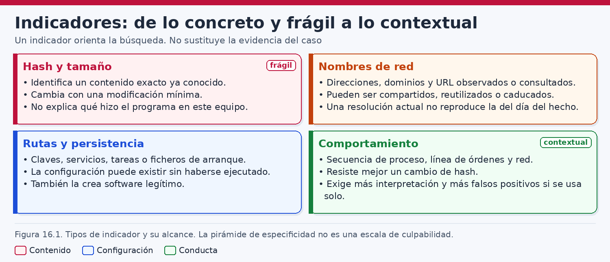
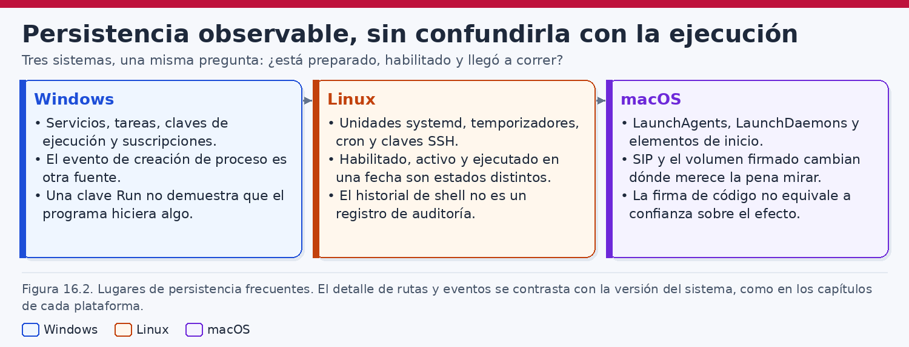
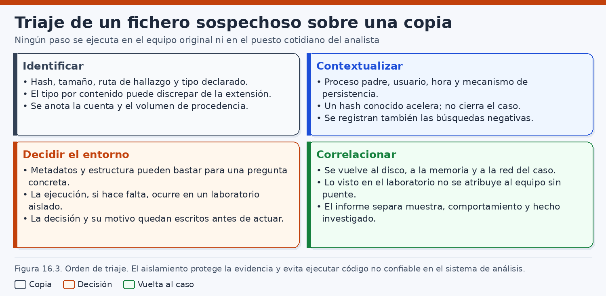
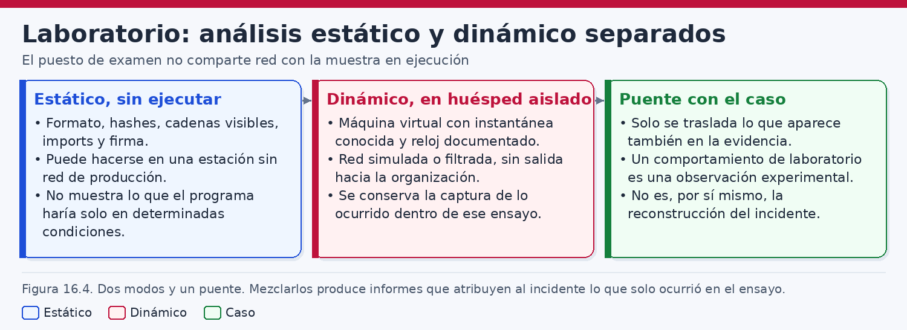
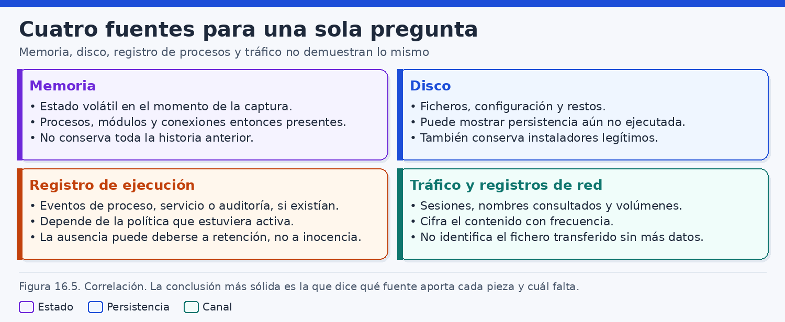
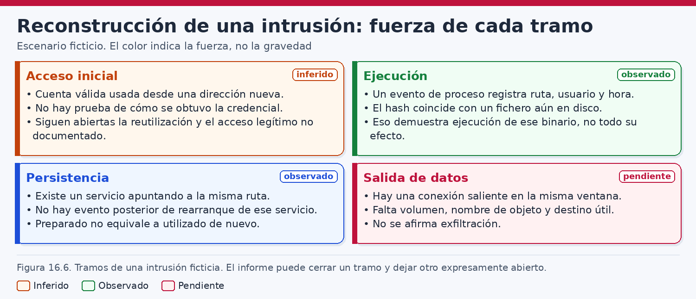

# Análisis forense de sistemas comprometidos y malware

> *Un indicador orienta la búsqueda, pero no cierra el caso. Conviene separar lo observado, lo inferido y lo que la evidencia todavía no alcanza.*

## Introducción

Cuando un equipo entra en una investigación porque una alerta lo señala, el primer riesgo no suele ser la ausencia de vocabulario, sino la facilidad con que un nombre ocupa el lugar de la prueba. Un hash compartido, una tarea recién creada, un proceso poco habitual o una conexión hacia un destino desconocido pueden ser observaciones auténticas y, aun así, resultar insuficientes para afirmar que una persona concreta entró en el sistema, que un programa realizó la función que se teme o que salió información de la organización. El análisis de un sistema presuntamente comprometido exige precisamente esa contención: nombrar lo que se ve, declarar la inferencia que se propone y dejar escrito el tramo que las fuentes no sostienen.

Este capítulo aborda el examen defensivo de equipos en los que se sospecha actividad no autorizada o programas maliciosos. Malware designa aquí un programa cuya función resulta adversa al interés legítimo del sistema. La etiqueta no se deduce del nombre, de la carpeta ni de la alerta. El mismo ejecutable puede resultar una herramienta mal inventariada, un componente dañado o un uso abusivo. La calificación depende de las observaciones, del contexto autorizado y de las hipótesis que sobreviven al contraste.

La exposición es metodológica y defensiva. Describe cómo se reconocen indicadores, cómo se separan la ejecución y la persistencia, cómo se tria un fichero sobre una copia, cómo se organizan un examen estático y un examen dinámico en un laboratorio aislado, y cómo se correlacionan memoria, disco, procesos y tráfico. No contiene código de programas maliciosos, secuencias de instrucciones de máquina, reglas para explotar una vulnerabilidad, parámetros de un canal de mando ni procedimientos para ocultar un implante. Esas omisiones son parte del método. Un libro de análisis forense enseña a interpretar evidencias obtenidas de forma legítima; no adiestra en la construcción de la conducta que se investiga.

Las herramientas que aparecen —Sysmon, Volatility, Velociraptor, utilidades de resumen criptográfico, identificación de tipo y lectura de cadenas— se tratan como instrumentos con condiciones de uso. Sus versiones cambian, sus resultados dependen de la captura y de la configuración, y ninguna de ellas resuelve por sí sola una intrusión. Cuando un ejemplo muestra una orden, la orden se entiende de laboratorio o sobre copias de trabajo. No autoriza a intervenir un sistema ajeno, a ejecutar un espécimen en el puesto donde se custodia la evidencia ni a tratar la salida de un programa como si fuera una conclusión.

El hilo que recorre el capítulo es la diferencia de fuerza entre cuatro preguntas. La primera pregunta si hubo un acceso y, en caso afirmativo, con qué base se afirma. La segunda pregunta si un programa se ejecutó. La tercera pregunta si quedó dispuesto un mecanismo capaz de volver a lanzarlo y si ese mecanismo llegó a activarse. La cuarta pregunta si salieron datos. Confundirlas produce informes en los que una tarea programada «demuestra» una exfiltración, o en los que una conexión «demuestra» la identidad de quien estaba ante el teclado. El caso ficticio del final, construido en torno a la organización imaginaria Litoral Logística y al dominio `litoral.example`, obliga a mantener esas cuatro preguntas separadas: el acceso se infiere, la ejecución se observa, la persistencia se observa y la exfiltración no se afirma.

Aquí no se repite el mapa de artefactos de cada sistema. Se usa lo imprescindible: qué fuente puede demostrar una ejecución, qué fuente solo demuestra una configuración, qué sensor existía porque alguien lo desplegó y qué silencio se debe a una política o a una retención. Una cuenta, un identificador de sesión y un proceso pueden coincidir sin que el analista haya visto quién operaba el teclado.

## 1. Indicadores de compromiso

### 1.1. Una pista con alcance, no un veredicto

Un indicador de compromiso es un dato que permite reconocer, buscar o priorizar una actividad relevante para un incidente. Puede ser el resumen criptográfico de un fichero, una dirección, un nombre de dominio, una ruta, un argumento, una clave de registro, una línea de una unidad de servicio o una relación entre varios de esos elementos. Su función operativa es reducir el espacio de búsqueda. Su función forense es servir de puente hacia una fuente que pueda examinarse, conservarse y explicarse. La evidencia es el objeto o el registro del que el indicador se extrajo, con su procedencia, su momento, la herramienta y el método. Un hash circulado en un aviso orienta. El mismo hash, recalculado sobre una copia custodiada y unido a una ruta y a un evento, puede citarse en un informe, con sus límites.

Conviene no confundir el indicador con la explicación. Que un dominio «sea un indicador» no dice si el equipo lo resolvió, si un proceso conectó, si salieron datos de negocio o si ese día lo usaba un servicio legítimo. Para cada indicador se anota qué se observó, en qué fuente, qué alcance temporal tiene y qué pregunta deja abierta. La figura 16.1 ordena los tipos según ese alcance. Un hash muy específico puede no aparecer si el fichero cambió un byte, y un comportamiento descrito de forma amplia puede aparecer cada día en la administración ordinaria.



### 1.2. Cuatro familias, cuatro fragilidades

Para este capítulo bastan cuatro familias, porque cada una se rompe de un modo distinto. El hash fija unos bytes. La red fija, si la fuente es fiable, un flujo, una resolución o un destino. La ruta fija un lugar en un espacio de nombres. El comportamiento fija una relación entre acciones. La fragilidad del hash es la variación del contenido; la de la red, la rotación y el uso compartido; la de la ruta, el renombrado y la frecuencia de ciertas carpetas; la del comportamiento, la ambigüedad y el sensor que debía ver la relación.

«Se encontró el indicador» puede significar un hash coincidente, una ruta vacía, un dominio en caché o una regla disparada por un administrador. Hace falta el identificador literal, la fuente y la comparación, y conservar el objeto que corresponda: el fichero, el registro con su reloj, la ruta ocupada por un contenido o la regla vigente en aquella fecha.

### 1.3. El hash: exactitud alta y alcance estrecho

Un resumen como SHA-256 permite afirmar que dos secuencias de bytes coinciden o que no coinciden, con la solidez del algoritmo y del procedimiento. Sirve para relacionar un fichero del disco con el citado por un evento, con una cuarentena o con una copia de laboratorio, y para detectar que el objeto cambió entre dos adquisiciones. No declara que el contenido sea malicioso. El mismo resumen puede corresponder a una herramienta de administración, a una biblioteca o a un programa adverso. La malicia, si llega a sostenerse, saldrá de la función observada, del contexto y de las autorizaciones.

Recompilar, reempaquetar o alterar un byte produce otro resumen. La búsqueda por hash encuentra un espécimen conocido y falla ante una variante. La coincidencia no dice si el fichero se ejecutó, y un evento de ejecución puede sobrevivir al borrado posterior del fichero. El informe dice qué bytes se resumieron, con qué implementación y sobre qué copia, y separa el hash recibido de un tercero del recalculado en el laboratorio. El valor didáctico del caso no corresponde a un espécimen real.

### 1.4. La red: un destino en un momento, no una identidad

Un indicador de red puede ser una dirección, un nombre, un puerto, un certificado, una URL o un patrón de flujo. Su valor depende de la fuente. Un cortafuegos puede mostrar que un equipo interno abrió una conexión. Un proxy puede añadir un nombre si la política lo conservaba. Un agente de puesto puede asociar la conexión a un proceso si esa clase de evento estaba habilitada. Una captura puede aportar metadatos y, solo con contenido legible y autorización, una parte de la carga. Ninguna de esas fuentes está garantizada por el mero hecho de que la red existiera.

La fragilidad es estructural y temporal. Las direcciones se reasignan, un nombre puede cambiar de destino, un alojamiento compartido reúne a muchos clientes y una traducción de direcciones funde varios equipos internos. El puerto 443 lo usan actualizaciones legítimas y programas no autorizados. Una dirección no identifica a una persona, un nombre no identifica el contenido y un puerto habitual no clasifica la conducta. Fuera de la ventana en la que una fuente concreta registró un flujo, con su reloj y su vínculo a un proceso o a una cuenta, el mismo destino puede ser irrelevante.

Conviene separar tres afirmaciones que las alertas suelen fundir. Se observó un intento o una conexión. El flujo transportó un volumen medido de bytes. Esos bytes eran datos de la organización que salieron sin autorización. La primera puede apoyarse en un registro de red. La segunda exige contadores, una captura o un proxy que los conserve. La tercera exige contenido o un efecto sobre ficheros. Detenerse en la primera es el punto hasta el que llega una evidencia de red sin contenido.

### 1.5. La ruta: un lugar en un espacio de nombres

Una ruta como `C:\ProgramData\Litoral\revision\revisa.exe`, `/usr/local/libexec/health-sync.sh` o `~/Library/LaunchAgents/com.litoral.ejemplo.plist` se busca con las herramientas ordinarias y, como identificador de un programa, es débil. El mismo nombre puede ocultar contenidos distintos y un contenido puede ocupar varias rutas. Los directorios temporales, los perfiles, `ProgramData`, `/tmp` o las bibliotecas de usuario son lugares de trabajo legítimo: una búsqueda por ruta produce allí muchas coincidencias sin significado. Si el indicador es demasiado concreto, desaparece al copiar o renombrar el fichero. Si es demasiado genérico, aparece en equipos ajenos al caso. La ruta útil, en un equipo determinado, localiza un objeto que luego se contrasta con hash, firma, metadatos y eventos, y se acompaña de la vista en la que se encontró: copia montada, adquisición lógica, evento de proceso o inventario de un agente.

La ruta no prueba ejecución ni autoría. Un ejecutable en disco demuestra presencia en esa adquisición. No demuestra un doble clic, un servicio que lo lanzara ni que el resultado fuera el que el nombre sugiere. `revisa.exe` puede ser descriptivo, engañoso o heredado de una plantilla. En sistemas con enlaces, instantáneas y unidades de red, la ruta de la copia montada puede no ser el espacio de nombres que veía el usuario. El análisis sigue hacia el contenido, hacia la configuración que referencia la ruta y hacia los registros de proceso.

### 1.6. El comportamiento: más resistente al renombrado y más fácil de malinterpretar

Un indicador de comportamiento describe una relación: un proceso crea una tarea y abre una conexión, o una unidad nueva apunta fuera del inventario. Puede sobrevivir a un cambio de hash y de ruta. Su debilidad es la vaguedad de la frase o de la regla. «Persistencia mediante tarea programada» no es un hecho. Los hechos serían la definición, un evento de creación si la política lo permitía, un registro de ejecución y un proceso con la imagen lanzada. Si falta un eslabón, queda hipótesis. Una unidad `systemd` o un LaunchAgent son capacidad configurada. Que «se mantenga tras el reinicio» solo se observa con una activación posterior, o se declara que no consta.

Las detecciones de un EDR —detección y respuesta en el puesto— y las reglas de una plataforma de correlación son comportamiento implementado en software. Priorizan. No reemplazan los eventos subyacentes. El nombre comercial de una detección, o el de una familia asignado por un motor, es una clasificación del fabricante en una versión de sus reglas: se documenta el producto, la versión y el texto, y se contrasta con hash, ruta y registros. El comportamiento depende además de que alguien estuviera mirando. Si el sensor de procesos no estaba desplegado, no se inventa el proceso padre. Si la auditoría de tareas estaba apagada, no se inventa el momento de la creación a partir de una fecha de fichero que puede proceder de una copia.

### 1.7. Caducidad, compartición y falsos positivos

Los indicadores envejecen de forma desigual. Un hash sigue identificando esos bytes años después. Una dirección puede dejar de tener relación con el caso en horas. Una ruta genérica nunca fue específica. Una regla de comportamiento queda obsoleta cuando una actualización legítima reproduce un patrón que el mes anterior era raro. Un indicador recibido de fuera se fecha: emisor, incidente, confianza declarada y plazo razonable de búsqueda. Esa caducidad es una decisión de trabajo. Buscar durante un año una dirección efímera inunda el análisis. Dejar de comparar un hash en las copias ya adquiridas no tiene justificación parecida: sigue siendo una comparación exacta sobre esos soportes.

El uso compartido produce falsos positivos honestos. Un dominio de nube, un relé de correo, una ruta instalada en toda la plantilla o el hash de una herramienta de soporte firmada aparecerán en equipos sanos. El remedio es añadir un discriminante —firma, ruta completa, proceso padre, cuenta, hora y desviación respecto de la línea de base—, no forzar la coincidencia. También existe el falso negativo sin borrado: el sensor no cubría el sistema, la retención se agotó, el fichero era una variante, la ruta no es la de esa versión o el equipo estaba fuera de alcance. «En las fuentes examinadas no aparecieron estas coincidencias» respeta el alcance. «No hay compromiso» lo oculta.

### 1.8. ATT&CK como vocabulario, no como prueba

MITRE ATT&CK ofrece un vocabulario de tácticas y técnicas: acceso inicial, ejecución, persistencia, movimiento lateral, exfiltración y otras. Una tarea, un servicio, una unidad `systemd` o un LaunchAgent pueden nombrarse con la técnica que el marco les asocia en la versión consultada. El identificador se comprueba en la documentación vigente. Ese uso no aumenta la fuerza de la prueba. ATT&CK no es un sensor: no estuvo en el equipo y no vio el proceso. Escribir que un hallazgo «es una técnica del marco» no demuestra que se completara ni que un grupo la empleara aquí. Cabe decir que una definición es compatible con una técnica de persistencia. No cabe decir que el marco confirma la intrusión.

Conviene citar la fecha de consulta y tratar la atribución a un grupo como hipótesis externa, con su fuente, solo si el caso la usa de verdad. Una técnica tan común como la tarea programada discrimina poco: la usan la administración y los abusos. Las tácticas sugieren un orden didáctico, no la cronología del caso. Puede haber persistencia sin acceso inicial identificado, una ejecución única sin persistencia y un flujo sin exfiltración. Completar la cadena hasta el último tramo es leer el marco como un guion. Bien usado, es una lista de preguntas que la evidencia puede dejar sin respuesta.

### 1.9. De la alerta al encargo forense

La SP 800-61, revisión 2, sitúa la detección y el análisis entre las fases de la respuesta, y recuerda que la contención convive con la necesidad de entender qué ocurrió. La SP 800-86 pide integrar la técnica forense: recoger de forma planificada, documentar la procedencia y no reducir el análisis a una impresión del sistema en marcha. No fijan las herramientas de un año. La alerta abre el encargo. Las preguntas útiles son cerradas: si el hash está en las copias, qué eventos muestran la ejecución cuando la política los generaba, si la tarea llegó a correr y qué campos conserva la fuente de red. «¿Estamos comprometidos?» no dice qué observación la respondería.

La memoria y las conexiones pueden perderse al reiniciar; el disco conserva mejor ficheros y configuración. Si se contiene antes de adquirir, el informe separa los efectos de la respuesta. SWGDE pide procedimientos repetibles y herramientas usadas dentro de sus límites. El programa CFTT somete herramientas forenses a pruebas publicadas. Ninguno convierte en infalible el programa que lee un evento o un volcado: hacen falta versión, datos de entrada, salida bruta e interpretación.

## 2. Evidencias de ejecución y persistencia

### 2.1. Cuatro estados que no se heredan

Ante un programa sospechoso, el analista puede encontrarse cuatro estados distintos. El fichero está presente en un soporte. Una configuración lo referencia como algo que podría ejecutarse más adelante. Una fuente registra que un proceso llegó a crearse. Una fuente posterior muestra el efecto de esa ejecución: un fichero escrito, una conexión, un error, un cambio de una política. Cada estado tiene sus artefactos. Ninguno se deduce del anterior con carácter general.

La presencia se apoya en el sistema de archivos, en una cuarentena o en una copia lógica, siempre que la adquisición cubra esa ruta. La configuración se apoya en servicios, tareas, unidades, crontabs, agentes de arranque, claves de inicio de sesión y mecanismos equivalentes. La ejecución se apoya en registros de creación de procesos, en artefactos del sistema que documentan un lanzamiento, en diarios de un servicio o en una observación de memoria contemporánea al proceso. El efecto se apoya en el cambio concreto que se atribuye al proceso, y esa atribución exige un vínculo, no una mera sucesión temporal.

Decir «había persistencia» sin decir cuál de estos estados se observó deja el informe en un término de seguridad que el destinatario entenderá como «el atacante sigue dentro». A veces la configuración existe y no hay prueba de activación. A veces hubo una ejecución única y no quedó un mecanismo de repetición. A veces el mecanismo se activó y falló. El lenguaje preciso —presente, configurado, ejecutado, con efecto observado— es más largo y es el que se puede defender.

La figura 16.2 insiste en esa separación. La persistencia observable es la configuración que puede examinarse. La ejecución es otro conjunto de hechos. Dibujarlas en el mismo cuadro sin distinguirlas invita a leer una unidad habilitada, una tarea creada o un LaunchAgent en disco como si el programa ya hubiera corrido cada vez que el sistema arrancó.

### 2.2. Windows: servicios y tareas, en el nivel de la prueba

En Windows, un servicio es una configuración que el gestor de servicios puede arrancar, a menudo sin que una persona abra una sesión interactiva. La definición incluye un nombre, una ruta de imagen, una cuenta de ejecución y un modo de inicio. Encontrar la definición en el registro del sistema, o un evento de creación del servicio, demuestra que la configuración estuvo registrada en esa fuente. No demuestra que el servicio llegara a estado de ejecución, que el binario terminara con éxito ni que la ruta siguiera apuntando al mismo contenido días después. El estado que muestra una consulta en vivo es el estado del momento de la consulta.

Una tarea separa desencadenador, cuenta y acción. La definición suele estar en ficheros del directorio de tareas y en metadatos asociados. Puede haber un evento de creación si la auditoría lo permite, y un registro de que la acción empezó o terminó, con un código que se lee según la versión y el proveedor. Una definición sin eventos de ejecución es persistencia configurada. Un evento sin la definición puede indicar eliminación posterior, otra vista del sistema o una lectura equivocada. Las dos piezas no se intercambian.

Las claves de ejecución al inicio de sesión —las ubicaciones de Run y mecanismos vecinos— también son configuración. Un valor con una ruta indica que, si el componente que lee esas claves actúa al abrir la sesión, intentará lanzar algo. Hace falta la sesión, el componente y, para afirmar ejecución, una fuente que haya visto el proceso. Lo mismo cabe decir de carpetas de inicio y de otros puntos de arranque: se enumeran cuando la hipótesis lo pide, se documentan con ruta y contenido, y no se convierten en malicia por estar en una lista de persistencia.

Sysmon, de Microsoft Sysinternals, puede registrar creación de procesos, conexiones y otras clases de hechos, solo si está instalado y solo para lo que su configuración incluye. Un evento de creación con ruta, identificadores, proceso padre y, si la directiva lo pide, hash y línea de órdenes es una evidencia de ejecución directa. Su ausencia puede significar que el proceso no existió o que Sysmon no debía registrarlo. La configuración vigente en las fechas del caso —no el ejemplo del fabricante— forma parte de la evidencia. La documentación dice qué puede registrar cada versión; no certifica lo que un dominio habilitó.

La auditoría de seguridad sigue la misma lógica. El evento de creación de proceso, o el de creación de una tarea, aparece si la subcategoría estaba activa. Una directiva puede haber cambiado antes, durante o después del incidente. Interpretar un silencio exige conocer la política de aquel intervalo o reconocer que se desconoce. Un salto en los identificadores, un borrado del registro o un servicio detenido se investigan; no se traducen solos a una ocultación deliberada.

### 2.3. Linux: unidades y cron como capacidad

En Linux, `systemd` puede expresar persistencia mediante servicios, temporizadores, sockets y unidades de ruta, además de configuraciones de usuario. El fichero de unidad, sus fragmentos en directorios de complemento y los enlaces que lo habilitan muestran qué se pretendía arrancar y en qué orden relativo. Una unidad habilitada no es una unidad que haya corrido en una fecha. Una unidad activa en una consulta en vivo no reconstruye sus activaciones pasadas. El diario del servicio, si se conservaba, y la auditoría del núcleo, si había reglas, son las fuentes que pueden acercarse a la ejecución. Ambas dependen de la política: un sistema mínimo puede no conservar diario persistente y puede no tener `auditd` instalado.

Cron y mecanismos vecinos expresan una intención periódica. La línea de un crontab indica una programación y una orden. No acredita cada disparo. El servicio puede estar parado, la sintaxis puede haber fallado, la zona horaria puede haber desplazado la ejecución y el registro de cron puede no incluir el detalle necesario. Como en Windows, la prueba de ejecución se busca en el registro de la activación y en el efecto, no en la elegancia de la programación.

Hay persistencia sin un demonio nuevo: una clave autorizada, un script de inicio de shell o un temporizador de usuario. Enumerarlos todos produce ruido. El criterio sigue siendo el disparador escrito, la acción, la identidad y la fuente que mostraría la activación. El diario, cuando existe, es una observación parcial; la configuración, una capacidad.

### 2.4. macOS: agentes de arranque

En macOS, `launchd` carga agentes y demonios descritos en ficheros de propiedades. Entre las ubicaciones habituales de terceros están `/Library/LaunchAgents`, `/Library/LaunchDaemons` y `~/Library/LaunchAgents`, además de mecanismos que cambian con la versión. Un plist puede indicar programa, argumentos y condiciones como ejecutarse al cargarse: eso es configuración. La carga, el fallo y la repetición se buscan en registros unificados y en evidencias de proceso. La guía de seguridad de Apple ayuda a situar firmas y políticas de la plataforma, y no convierte cada plist en una ejecución probada.

La firma, habitual en Apple y presente en Windows mediante Authenticode, es otro plano. Un binario firmado no queda aprobado solo por la firma, y uno sin firma no queda condenado: muchos utilitarios internos no se firman. Se anota el estado —válida, inválida, ausente o no comprobable— y se lee con la línea de base. En los tres sistemas el mecanismo legítimo y el abusivo comparten tecnología. El hallazgo no es «hay un servicio». Es una diferencia respecto del inventario, un momento, un contenido y, solo si la fuente alcanza, una activación.

### 2.5. Configurado no es ejecutado

Una tarea desconocida no autoriza a escribir que el programa «se ejecutaba cada hora». El desencadenador es una intención. Entre ella y la ejecución se interponen el servicio del programador, la cuenta, las condiciones, los errores de ruta y la posibilidad de que aún no haya llegado la hora. Afirmar la corrida a partir del reloj del analista completa el relato. El sentido inverso también importa: una ejecución observada puede ser única y no dejar servicio ni tarea. Tratarla como persistencia establecida infla el incidente. Contener por prudencia operativa no convierte la prudencia en certeza histórica.

Cuando coexisten las dos pruebas —la definición y una activación registrada— la persistencia puede describirse como observada en ese tramo, con el alcance de las fuentes. «Observada» no significa «se activó en todos los reinicios desde una fecha». Significa que hay evidencia de la configuración y evidencia de al menos una activación identificada. Las activaciones no registradas se cuentan como desconocidas, no como ocurridas.

La misma frase sirve para un Run de Windows, un temporizador de `systemd`, una línea de cron y un LaunchAgent. Si solo consta el fichero de configuración, el informe dice que el mecanismo estaba configurado y que la ejecución no aparece en las fuentes revisadas. El juicio de que «podría ejecutarse mañana» es gestión del riesgo y se separa del juicio histórico.

### 2.6. Líneas de base y cuentas de servicio

La persistencia abusiva imita a la administración. Un inventario o una directiva permiten decir que algo no estaba en el canal de cambio conocido, no que lo introdujo un intruso: pudo improvisarlo un técnico, instalarlo un proveedor o crearlo una directiva posterior a la imagen de referencia. Una cuenta de copias puede lanzar la tarea de siempre o una acción nueva. Se comparan ruta, hash y hora con la definición conocida; si no se recuperó, la comparación queda pendiente. La tarea `RevisionAuxiliar` suena interna a propósito: ni el prefijo ni `ProgramData` la absuelven o la condenan.

### 2.7. Fuerza del hallazgo de ejecución y de persistencia

| Estado | Qué se observa | Qué puede afirmarse | Qué permanece abierto |
|---|---|---|---|
| Fichero presente | Ruta, hash, metadatos en la copia | El objeto estaba en esa vista | Quién lo copió y si se ejecutó |
| Servicio, tarea, unidad, cron o LaunchAgent definidos | Texto de la configuración y su ubicación | Existía una capacidad de arranque | Si llegó a activarse |
| Evento de creación de proceso o diario de activación | Proceso, hora, cuenta, imagen, según la fuente | Hubo una ejecución registrada | Si el registro es completo y cuál fue el efecto |
| Hash del evento igual al hash del fichero | Coincidencia calculada | La imagen citada y el fichero coinciden en contenido | Qué ocurrió en ejecuciones no registradas |
| Configuración de Sysmon o de auditoría recuperada | Reglas y subcategorías de un momento | Qué clases de hechos podían registrarse | Los hechos anteriores al despliegue del sensor |
| Efecto en disco o en red vinculado al proceso | Escritura o flujo asociados por identificador | Un efecto concreto de esa ejecución | El contenido no visto y las demás ejecuciones |

La tabla no puntúa el incidente. Evita que un estado preste su fuerza al estado vecino. Un fichero presente más una tarea definida autorizan una preocupación operativa y un plan de búsqueda de ejecuciones. No autorizan, sin más filas, a redactar que el programa «llevaba días exfiltrando información cada hora».



## 3. Análisis básico de archivos sospechosos

### 3.1. La copia es el objeto de trabajo

El triaje de un fichero sospechoso empieza por no ejecutarlo en el sistema que lo custodia. El puesto del analista guarda copias, notas, claves de cifrado del caso y herramientas. Lanzar allí un programa desconocido mezcla el caso con el laboratorio y puede alterar precisamente las evidencias que se pretendía conservar. El objeto de trabajo es una copia obtenida de la evidencia, verificada por hash contra el original adquirido, y tratada como derivada: se anota de qué soporte sale, quién la extrae y con qué herramienta.

La figura 16.3 resume ese triaje sobre la copia. El orden no es un ritual. Primero se fija la identidad del objeto mediante hash. Después se identifica el tipo por el contenido, no por la extensión. Después se consulta la firma de código si el formato la admite y la herramienta del laboratorio sabe leerla. Después se revisan cadenas visibles y metadatos superficiales. Cada paso produce una nota reproducible. Ningún paso exige abrir el fichero en un depurador ni «ver qué hace» lanzándolo.

Si el fichero vive en un volumen cifrado, el triaje depende de que la adquisición haya permitido leerlo. Un volumen protegido con BitLocker, por ejemplo, puede haberse copiado como imagen de bloques cifrados o como sistema de archivos ya accesible, según el método y las claves disponibles de forma legítima. La imagen cifrada puede ser íntegra y, al mismo tiempo, inútil para calcular el hash del ejecutable interno. El informe distingue esas situaciones. No existe, y este capítulo no insinúa, un procedimiento general para leer cualquier volumen cifrado.

### 3.2. Procedencia y hash antes de opinar

Antes de discutir si el fichero es interesante, se escribe de dónde salió. Ruta completa en la vista analizada, nombre, tamaño, marcas temporales con el significado que ese sistema de archivos les dé, identificador de la evidencia madre y hash de la copia de trabajo. Si el evento de proceso también trae un hash, se compara y se registra el resultado de la comparación, incluida la posibilidad de que el algoritmo o el conjunto de bytes no sean los mismos. Sysmon, cuando está configurado para hashear, puede usar algoritmos distintos según la directiva. Dar por hecho que «el hash de Sysmon» es SHA-256 del fichero completo es un supuesto que se comprueba en la configuración recuperada.

Las marcas temporales se conservan con el significado que les da el sistema de archivos: pueden reflejar copia, restauración o un ajuste. Una marca de compilación en la cabecera, cuando el formato la tiene, es un metadato de calidad variable, no la hora en que una persona compiló el programa. El hash se recalcula en el laboratorio aunque ya conste en la cadena de custodia. Si los valores divergen, el triaje se detiene hasta saber qué objeto es cuál.

### 3.3. Tipo, extensión y firma de contenido

La extensión es una etiqueta del nombre. El tipo que interesa al triaje es el que se desprende de la estructura: un ejecutable Windows, un script de texto, un documento con macros, un archivo comprimido, una imagen de disco, un plist, una unidad `systemd` en texto. Las utilidades clásicas de identificación por contenido, usadas sobre la copia, permiten documentar esa clasificación y su incertidumbre. Un resultado «datos» o una clasificación genérica no se fuerza. Se reconoce el límite y se conserva el fichero para un examen que sepa leer ese formato.

La discrepancia entre extensión y contenido es un dato, no un veredicto. Hay instaladores legítimos que se presentan con extensiones poco habituales y hay cambios de nombre inocentes. También hay documentos que contienen código de automatización. El triaje los separa para decidir el siguiente examen seguro: lectura estática de un script como texto, análisis de un documento en un visor que no active contenido activo, o examen de un ejecutable sin lanzarlo. Activar macros «para ver» en el puesto de análisis es ejecución. Pertenece, si se autoriza, al laboratorio aislado del apartado siguiente, no a esta mesa de triaje.

Los contenedores se tratan por capas. El hash del contenedor no identifica a los miembros. Extraerlos crea copias derivadas, con sus hash, en un directorio de trabajo y sin abrirlos por asociación de fichero. En esta fase se inventaría el contenedor.

### 3.4. Firma de código

Cuando el formato incorpora firma, la herramienta del laboratorio indica si valida, quién figura como firmante y qué cadena pudo comprobarse. El material de confianza tiene fecha: validar hoy una firma de hace un año no reproduce la revocación de entonces. Si no se comprobó, no se escribe que el fichero «no está firmado». Una firma válida dice que alguien con la clave correspondiente firmó esos bytes según el material usado. No dice quién lo ejecutó ni si la organización lo había aprobado. Una firma ausente es frecuente en utilitarios internos y pesa menos que el contraste con el inventario. En Linux la firma embebida no es la norma de todos los binarios: se aplica el mecanismo que el objeto tiene.

### 3.5. Cadenas visibles, sin volcar el binario

Las cadenas legibles son material de triaje: rutas, nombres, mensajes, versiones. También hay restos irrelevantes, texto aparente en datos comprimidos y cadenas de bibliotecas legítimas. Leerlas es un examen estático. No se vuelca el binario ni se pegan páginas de salida. Se citan solo las cadenas que el informe necesita, con el contexto mínimo para encontrarlas en la misma copia. No se reproducen bloques ejecutables, codificaciones de instrucciones ni configuraciones de un canal de mando. Una cadena que parece un destino es un texto dentro del fichero, no una conexión ocurrida.

La extracción tiene sesgos. Un texto en UTF-16 no aparece si solo se mira ASCII, y un texto cifrado no aparece como frase. La ausencia de un nombre no demuestra que el programa no pueda comunicarse, y la presencia no demuestra que esa comunicación ocurriera en el equipo del caso. El hallazgo se etiqueta como estático y orienta la búsqueda en DNS, proxy y eventos de red.

En el ejemplo de laboratorio, la operación se limita a generar un derivado de texto a partir de la copia y a revisarlo fuera del flujo de ejecución:

```bash
# Laboratorio. La copia no se ejecuta. El derivado puede contener datos sensibles.
sha256sum /caso/copias/revisa.exe > /caso/derivados/revisa.sha256
file /caso/copias/revisa.exe
strings -a -n 8 /caso/copias/revisa.exe > /caso/derivados/revisa.cadenas.txt
```

Esas órdenes no interpretan el fichero. `file` puede equivocarse o quedar en una clase genérica. `strings` no entiende el formato. El analista lee el derivado con criterio y no convierte cada URL aparente en un indicador de infraestructura activa. La versión de las utilidades se anota, porque el resultado de identificación cambia con ellas.

### 3.6. Empaquetado, instaladores y límites del triaje básico

Algunos ejecutables llegan envueltos: instaladores, empaquetadores comerciales o capas que dificultan la lectura estática del código. El triaje básico reconoce el límite. Se documenta que el contenido útil no es legible con las herramientas ordinarias de tipo, firma y cadenas, y se decide si el caso justifica un examen más profundo en un entorno aislado. Este capítulo no describe cómo deshacer un empaquetador concreto. Esa omisión evita convertir el texto en un procedimiento de manipulación del espécimen. Basta saber que la opacidad estática no es prueba de conducta adversa —hay protectores comerciales legítimos— y que tampoco es una razón para ejecutarlo en un equipo de producción «a ver si muestra el contenido».

Los scripts y los documentos se leen como texto o como estructura, con un analizador que no active el contenido. Se cita lo necesario para la pregunta del caso y no se reproducen secretos ni instrucciones que permitan repetir un abuso. Si el texto está ofuscado, se describe el límite y no se convierte el informe en una receta de desofuscación. La ficha de triaje cierra con identidad, tipo, firma, cadenas ya filtradas, relación con una ruta o un evento, y la decisión: correlacionar, ampliar el estático, pasar al laboratorio aislado o dejar el objeto en reserva. También dice lo que no se hizo. No ejecutarlo evita que alguien suponga un comportamiento dinámico que no se observó.

### 3.7. Custodia del espécimen y minimización

Un fichero sospechoso sigue siendo evidencia y, a menudo, contiene datos de la organización o datos personales que no son el programa. Tratarlo como un trofeo que se copia a carpetas compartidas, se envía a servicios públicos de análisis o se adjunta a un ticket abierto rompe la minimización y puede romper la cadena de custodia. Si se solicita una opinión externa, se define qué se envía, con qué autorización y qué se hace con el resultado. El hash puede bastar para preguntar a un proveedor si lo tiene clasificado. Enviar el fichero entero es otra decisión.

La cuarentena de un antivirus es una fuente. Puede conservar el espécimen, la ruta, la hora de la detección y el nombre que el motor asignó, y puede haber modificado el fichero original. Se distingue la hora de la detección de la hora de la actividad. El nombre de familia es una clasificación de tercero, fechada con la versión del motor. La copia de trabajo y los derivados entran en el expediente con sus hash, de modo que otro revisor repita la lectura sin tocar el original. Esa repetibilidad es la que SWGDE pide al procedimiento y la que el programa CFTT aplica, en otra escala, a las herramientas.



## 4. Análisis estático y dinámico en entornos seguros

### 4.1. Dos exámenes, dos preguntas

El análisis estático pregunta qué puede decirse del objeto sin ejecutarlo. El análisis dinámico pregunta qué hace ese objeto cuando se ejecuta en un entorno preparado para observarlo. Las respuestas no se sustituyen. Un estático puede mostrar un nombre de host incrustado y no decir si el programa llega a conectarse. Un dinámico puede mostrar una conexión en el laboratorio y no decir si esa conexión ocurrió el día del incidente, con la configuración y la red de entonces. La figura 16.4 los mantiene separados a propósito. Fusionarlos en «el malware hace X» traslada al pasado del caso un comportamiento visto en un banco de pruebas, o atribuye al banco de pruebas una intención leída en una cadena.

La decisión de pasar al dinámico no es automática porque el fichero sea un ejecutable. Tiene coste, riesgo y una autorización específica. Muchas preguntas de un incidente se responden con disco, eventos y red, sin lanzar nada. El dinámico se reserva para lo que esas fuentes no pueden resolver y que la ejecución controlada sí podría ilustrar: por ejemplo, si un binario opaco intenta resolver un nombre que el estático no muestra en claro, o si al arrancar escribe una configuración que en el caso real aparece como fichero huérfano. Aun entonces, el resultado del laboratorio es un resultado de laboratorio.

### 4.2. Qué abarca el estático y qué deja fuera

El estático permanece en lo que no ejecuta el objeto: hash, tipo, firma, cadenas visibles, estructura de alto nivel y comparación con el software conocido de la organización. No incluye el volcado de un binario real, el listado de instrucciones ni la reconstrucción de una rutina de comunicación. Cuando un caso exige ese encargo, tiene su propio método y sus revisores. Un manual general que reprodujera el volcado enseñaría el programa, no la pericia.

Lo que el estático puede asentar es modesto: formato, firma ausente o no válida con el material usado, y un nombre como `relay.example` entre las cadenas filtradas. Eso no convierte el nombre en un servidor de mando ni en una conexión ocurrida. Si el hash y la firma coinciden con el instalador que sistemas publica, el estático favorece un binario conocido y deja abierta la pregunta del uso. Las cadenas no ven lo cifrado y un empaquetado opaco detiene la lectura antes de la función.

### 4.3. El laboratorio dinámico: instantánea y sin salida a la red de la organización

Cuando se autoriza la ejecución, el sistema es una máquina virtual o un equipo dedicado, sin cuentas del caso, sin documentos de la organización y sin confianza con el dominio investigado. Antes se toma una instantánea del estado limpio. Durante la ejecución no hay ruta hacia la red de la organización: ni nombres internos, ni controladores, ni servidores de ficheros. Si hay alguna red, es un segmento de laboratorio que no reenvía y no vuelve al puesto del analista. La instantánea permite repetir la observación y volver al estado limpio. El virtualizador —QEMU es una opción documentada, no la única— se identifica con su versión. Lo exigible es poder restaurar, y dejar constancia de haberlo hecho.

El aislamiento se comprueba. Una máquina virtual con puente hacia la red corporativa, o con carpetas compartidas hacia el puesto donde están las evidencias, no está aislada. El expediente anota la interfaz, el DNS, la prueba de que no había ruta a la organización y quién autorizó la ejecución. Ejecutar el espécimen «un momento» en el portátil de análisis, aunque se desconecte la red, carece de instantánea fiable y mezcla el caso con las herramientas. Ese atajo contamina; no es el laboratorio de este apartado.

### 4.4. Qué se registra de la ejecución controlada

Dentro del laboratorio se observan efectos de alto nivel: si el proceso arranca y termina, si crea ficheros en el sistema de prueba, si intenta resolver nombres o abrir conexiones en el segmento aislado y qué ocurre cuando esa red no responde. Los registros y la captura del segmento aislado son derivados del experimento, etiquetados con la hora del laboratorio y la instantánea restaurada. No son evidencias del equipo investigado.

El experimento no completa la infraestructura que el programa parezca esperar. No se monta un servicio que imite un canal de mando, no se entregan credenciales de la organización y no se estimula el espécimen para obtener un efecto más vistoso. Si no hace nada visible, ese es el resultado, y las lecturas —condición ausente, entorno distinto, copia incompleta o sospecha excesiva— permanecen abiertas. El reloj del laboratorio no se traslada al caso. Una resolución a los pocos segundos de arrancar en la prueba no demuestra que en `CONT-04` ocurriera, ni cuándo. El laboratorio muestra una capacidad compatible; los registros del puesto, si existen, muestran hechos.

En el caso ficticio, restaurada la instantánea, la copia arranca, escribe un registro breve en el perfil de laboratorio e intenta resolver `relay.example`. El DNS del aislado no reenvía y no contesta. No hay datos de Litoral en esa máquina, así que no hay exfiltración que observar. El derivado se conserva, se restaura la instantánea y el límite queda escrito: el experimento muestra un intento de resolución del nombre ya visto en las cadenas, en un entorno sin salida. No muestra qué se transmitió en la organización.

### 4.5. Por qué el dinámico y el caso pueden divergir

El entorno cambia el camino: privilegios, directorios, red, idioma o la presencia de un hipervisor. Un «no conectó» en el laboratorio no borra un evento real del puesto, y un intento de resolución en la prueba no crea el evento histórico que los registros no tengan. Por eso los dos informes no se funden.

La ventana de observación se escribe. Lo que no ocurrió dentro de ella es «no observado en la ventana». Hay copias que no deben ejecutarse: datos especialmente protegidos que la ejecución mostraría, o ausencia de autorización. La negativa se documenta y el caso sigue por el estático, los eventos y la red. Muchos encargos se cierran, en lo forense, sin dinámico.

### 4.6. Informes separados y revisión

El informe del estático y el informe del dinámico llevan identificadores distintos. Cada uno cita la copia usada, el hash, las herramientas, las versiones y los límites. El informe del caso, más adelante, puede mencionarlos con una frase de enlace: «el estático encontró el nombre; el dinámico aislado mostró un intento de resolución de ese nombre; los registros del puesto muestran una conexión a una dirección que no se ha podido resolver históricamente hacia ese nombre». El enlace deja visibles las costuras. Esas costuras son la calidad del trabajo.

Un segundo analista repite el estático sobre la misma copia. Repite el dinámico solo si se conservaron la definición de la máquina, la instantánea y el aislamiento. Si la instantánea no existe, el dinámico es una observación histórica, no un experimento repetible, y se declara así. El entorno contaminado vuelve al estado limpio restaurando la instantánea. Las copias del espécimen y los derivados siguen en el almacén de evidencias, fuera de la máquina de ejecución.



## 5. Correlación entre memoria, disco, procesos y tráfico

### 5.1. Cuatro planos que no comparten reloj ni cobertura

Una intrusión, o la sospecha de ella, deja restos de naturaleza distinta. El disco conserva ficheros y configuración con la durabilidad del almacenamiento y con los límites de lo que se adquirió. La memoria conserva, en el instante de la captura, estructuras que el sistema usaba para procesos, conexiones y módulos, y las pierde al apagar. Los procesos son, según la fuente, una observación en vivo, un evento histórico o una entrada de una lista en un volcado. El tráfico es un registro de red que puede no saber qué proceso lo causó. La figura 16.5 los presenta juntos porque el caso los necesita juntos, y el texto los mantiene separados porque cada uno puede faltar sin que los otros dejen de ser ciertos.

No hay un reloj común. El disco usa las marcas de su sistema de archivos; los eventos, el reloj del sistema más la zona que aplique el visor; la memoria, la hora de la adquisición; el cortafuegos puede estar en UTC mientras el puesto está en hora peninsular. Un desfase de una hora inventa una causalidad o destruye una coincidencia. Tampoco hay una cobertura común: disco sin memoria, Sysmon de procesos sin red, un flujo de perímetro que la traducción de direcciones no atribuye al puesto, un proceso en memoria cuyo ejecutable ya no está en la ruta declarada. Correlacionar es nombrar el plano que se tiene y el que falta. Rellenar huecos con la historia completa es una redacción prematura.

### 5.2. Disco y procesos históricos

En el disco están el fichero, la configuración y los registros que el sistema escribió. Es el plano más fácil de repetir y el más fácil de confundir con la actividad: un ejecutable puede no haberse lanzado, una tarea puede no haber corrido y un registro rotado deja el disco «completo» con un relato corto. Para situar el objeto en una imagen sin montarla en escritura, un conjunto como The Sleuth Kit lee metadatos del sistema de archivos. El sistema y la versión de la herramienta se comprueban: la cobertura no es universal.

Los procesos históricos viven en eventos —Sysmon, auditoría, diario de `systemd`, registros de macOS, un EDR— si la política los generó. Se unen al fichero por ruta, hash y tiempo. Si los hash difieren, hay un cambio, una ruta reutilizada o dos objetos. Si el fichero ya no está, la ejecución registrada no se anula: queda sin objeto que triar.

La lista de procesos de un equipo encendido vale en el instante de la consulta y altera el sistema. Se conserva con su hora y no se trata como historia del mes anterior: un proceso ausente puede haber terminado hace minutos o hace semanas.

### 5.3. Memoria y Volatility: captura, perfil y símbolos

Volatility, de la Volatility Foundation, examina capturas de memoria. Depende de que la captura sea legible y de que existan símbolos adecuados a esa versión del núcleo o a ese build de Windows. En el flujo más antiguo se hablaba de perfiles: cambia el nombre, no la dependencia. Sin símbolos o perfil compatibles, un resultado vacío o llamativo puede ser un fallo de interpretación. No hay una orden que, sobre cualquier volcado, enumere la intrusión. Cada complemento —identificar el sistema, listar procesos, leer estructuras de red— responde a una pregunta y puede fallar por separado.

La captura manda tanto como los símbolos. Una memoria posterior a un reinicio no contiene los procesos anteriores. Una adquisición incompleta o un volcado cuyo método no se documentó no equivale a una captura íntegra, aunque la herramienta lo abra. Se anotan el método, el tamaño, el hash del volcado y la versión de Volatility. Si la identificación del sistema falla, el paso siguiente es conseguir los símbolos de esa versión por un medio legítimo y repetirla. No es concluir sobre procesos que la herramienta todavía no puede leer.

Cuando la identificación tiene éxito, la lista de procesos es la de aquel instante, dentro de lo que el complemento sabe leer. Un proceso ausente no contradice un evento de horas antes. Un proceso presente no demuestra desde cuándo corre, salvo que la estructura aporte un tiempo comprensible. Las estructuras de red en memoria, si se recuperan, describen un estado, no el historial de conexiones cerradas. Un hallazgo se acepta cuando la identificación es coherente, el complemento responde a la pregunta, la salida se conserva en bruto y, si es posible, se contrasta con disco o con eventos. El nombre de la herramienta no valida el resultado de esta captura: es la misma cautela que el programa CFTT aplica a otras herramientas forenses.

Una invocación de laboratorio, limitada a identificar el sistema de una captura ya obtenida, ilustra el tono y no el alcance:

```bash
# Sobre la copia de la captura. Identifica el sistema si hay símbolos compatibles.
# No enumera actividad maliciosa y no corrige una adquisición deficiente.
python3 -m volatility3 -f /caso/memoria/cont-04.raw windows.info
```

La forma de invocar Volatility cambia con la instalación y la versión. Si esta orden no existe en el laboratorio, no se improvisa un alias: se documenta el ejecutable real y se lee su ayuda. Si la orden falla por símbolos, el fallo es el resultado de esa fase, y se anota literalmente. Seguir analizando como si la identificación hubiera salido bien es el error que este apartado quiere evitar.

### 5.4. Tráfico y vínculo con el proceso

El tráfico aporta el plano que disco y memoria no sustituyen: lo que una fuente de red registró entre equipos. Para el compromiso, las preguntas son concretas. ¿Qué fuente cubre la ventana? ¿Ve la dirección interna o solo la dirección traducida? ¿Conserva bytes, duración, nombre consultado, solo la IP y el puerto? ¿Puede unirse a un proceso?

La unión al proceso es un privilegio de ciertas fuentes, no una propiedad del paquete. Sysmon, si el evento de conexión estaba habilitado, puede registrar que un identificador de proceso y una ruta abrieron una conexión hacia una dirección y un puerto. Un agente EDR puede hacer algo parecido con otra semántica. Un cortafuegos de perímetro normalmente no sabe el nombre del ejecutable. Un registro de flujo de un conmutador tampoco. Correlacionar por tiempo y por dirección es entonces una inferencia: compatible, no identificada. Cuantos más equipos compartan la misma salida, más débil es la inferencia.

Una conexión al puerto 443, vista como flujo, no entrega el cuerpo. Sin proxy, contadores o un descifrado autorizado, no se lee qué se transmitió ni se estima un volumen típico. La exfiltración queda como hipótesis que el flujo no confirma y que tampoco refuta. Si no hay DNS histórico, un nombre extraído por cadenas y una IP del cortafuegos no se unen porque «encajen». Pedir esa resolución es la diligencia siguiente; mientras no vuelve, el puente no es un hecho.

### 5.5. Recogidas dirigidas y Velociraptor

No siempre se obtiene primero una imagen. Una recogida dirigida puede pedir a un agente ya instalado un conjunto de ficheros, eventos o inventarios. Velociraptor es una plataforma pública de ese estilo: artefactos, clientes y resultados, con modos que la documentación describe y que cambian de versión. Sirve si el cliente pudo ejecutar la recogida, si se conserva la definición del artefacto y no solo su nombre, y si se recuerda que el derivado sale de un sistema encendido.

Un resultado que muestra tareas o un hash es parcial: no es una imagen, no ve lo que el artefacto no pidió y no demuestra que el agente fuera inmune a quien tenía privilegios sobre él. Si hay imagen, se contrastan el hash, la definición de la tarea y el rango temporal. Si solo hay recogida, el alcance es el del artefacto y del momento en que el cliente respondió.

Otras plataformas de EDR plantean el mismo esquema. Se conserva el artefacto, la versión del agente y las dos horas —servidor y puesto— y no se reescribe el resultado con un lenguaje más fuerte que los campos. Un campo vacío puede significar que el artefacto no lo rellena.

### 5.6. Una correlación mínima, sin cerrar el relato

En abstracto, el conjunto defendible es este. En disco hay un ejecutable y una definición de tarea. En eventos, una creación de proceso cuya ruta y cuyo hash coinciden, y una conexión atribuida a ese proceso por el identificador que Sysmon permite seguir. En el perímetro, un flujo compatible hacia el mismo destino, sin contenido. En memoria, capturada tras un reinicio, el proceso ya no está. El nombre visto en el estático no tiene todavía una resolución histórica que lo una a la dirección. La ejecución y, si consta la activación, la persistencia están observadas. La exfiltración no se afirma y el acceso inicial no sale de esta correlación. ATT&CK puede nombrar el tramo de ejecución porque hay un proceso; no rellena el de exfiltración.

### 5.7. Relojes, reinicios y la cronología de la respuesta

Toda correlación se acompaña de la cronología de la respuesta: alerta, aislamiento, reinicio, captura de memoria, adquisición del disco y, si existió, ejecución en el laboratorio. Esos actos explican ausencias. Un reinicio explica una memoria sin el proceso; un aislamiento, el fin de los flujos; una cuarentena, que el fichero ya no esté en la ruta original. Mezclar las dos cronologías hace que la respuesta parezca conducta del incidente.

El margen de reloj se escribe con el control que el caso tenga. Si no hay control, la zona se normaliza a UTC y el error queda desconocido: las ventanas de pocos segundos se interpretan con cautela. Cuando un plano contradice a otro —hash distinto, tarea con error y proceso creado, flujo de Sysmon invisible para el cortafuegos— se conserva la contradicción. Resolverla puede exigir otra fuente o terminar en un límite. Las dos salidas son resultados forenses.



## 6. Reconstrucción de una intrusión

### 6.1. Un caso ficticio y una pregunta de fuerza

Litoral Logística es una organización imaginaria. Su dominio de ejemplo es `litoral.example`. El puesto `CONT-04.litoral.example` lo usa la cuenta `m.riera`. Sistemas usa, entre otras, la cuenta `j.soler`. Ninguna de estas personas existe. Las direcciones del relato son de documentación o nombres reservados: no se buscan como infraestructura real ni se copian a una sonda. El caso enseña la diferencia de fuerza que la figura 16.6 resume: acceso inferido, ejecución observada, persistencia observada, exfiltración no afirmada.

El encargo llega el 13 de marzo de 2026. Sistemas ha aislado el puesto tras una alerta genérica del EDR y lo ha reiniciado antes de avisar al análisis. La memoria verá el estado posterior al reinicio. Los hechos del día 12, si se conservan, vivirán en disco y en los registros que la política hubiera generado. La pregunta no es qué grupo actuó. Es qué puede afirmarse, con las copias disponibles, sobre el acceso, la ejecución, la persistencia y una posible salida de datos entre el 12 y el 13 de marzo. Las horas se normalizan a UTC. El puesto figuraba en hora peninsular y el 12 de marzo de 2026 la península seguía en UTC+1; esa afirmación se comprueba en la imagen y no se importa de memoria si el caso real fuera otro.

### 6.2. Alcance y lo que la respuesta ya cambió

El alcance comprende la imagen del volumen, legible en el momento de la adquisición, los registros de eventos de esa imagen, la configuración de Sysmon hallada en el puesto, una captura de memoria posterior al reinicio y el cortafuegos de perímetro de la ventana. No comprende el proveedor de identidad, el DNS corporativo ni el puesto de `j.soler`. Esas ausencias son diligencias, no hechos negativos.

La cronología de la respuesta queda aparte. El 13 de marzo, a las 07:50 UTC, el EDR alerta sobre `CONT-04`. A las 08:10 UTC se aísla el puesto. A las 08:25 UTC un técnico lo reinicia. A las 08:40 UTC se captura la memoria y después se adquiere el disco. Nada de eso limpia el incidente ni demuestra que el reinicio fuera una maniobra del programa. Es una intervención. La configuración de Sysmon recuperada habilitaba la creación de procesos con SHA-256 y las conexiones asociadas al proceso, y no las consultas DNS. La directiva de auditoría conservada con la imagen permitía registrar la creación de tareas. Esos dos documentos explican qué podía verse. En este relato existen en `CONT-04`; no hay que suponerlos en el resto de la organización.

### 6.3. Inventario mínimo

| Objeto | Papel en el caso | Límite declarado |
|---|---|---|
| Imagen de `CONT-04` | Disco y registros locales | Estado posterior a la contención y al reinicio |
| `C:\ProgramData\Litoral\revision\revisa.exe` | Fichero examinado en copia | El nombre no describe la función |
| Tarea `\Litoral\RevisionAuxiliar` | Definición de persistencia | La programación no equivale a cada disparo |
| Sysmon operativo exportado | Ejecución y conexión del proceso | Solo las clases habilitadas en la configuración |
| Canal de seguridad y canal del programador | Sesión, creación de la tarea, activación | Dependen de la política y de la retención |
| Memoria de las 08:40 UTC del día 13 | Estado posterior al reinicio | No contiene el proceso del día 12 |
| Cortafuegos de perímetro | Flujo compatible en la ventana | Sin contenido y sin nombre de proceso |
| Estático y dinámico de laboratorio | Capacidad de la copia, en aislado | No son eventos de `CONT-04` |

El hash anotado para `revisa.exe` es un marcador didáctico, no el resumen de un programa real: `111122223333444455556666777788889999aaaabbbbccccddddeeeeffff0000`. El ejercicio da por hecho que ese valor coincide con el campo del evento, para poder hablar de la unión sin fingir un espécimen. El triaje, sobre la copia y sin ejecución, clasifica el objeto como ejecutable Windows, sin firma que valide en el material del laboratorio, y con `relay.example` entre las cadenas filtradas. No se vuelca el binario ni aparece una segunda etapa extraíble.

### 6.4. El acceso queda como inferencia

En el canal de seguridad hay un inicio correcto de `m.riera`, interactivo local, a las 07:58 UTC del 12 de marzo. La dirección de origen viene vacía, como es habitual en ese tipo. No aparece un inicio remoto ni una serie de fallos de credencial en la ventana previa. El proveedor de identidad, que podría situar la cuenta en otros servicios, está fuera de alcance.

A las 09:16 UTC se crea `\Litoral\RevisionAuxiliar`. A las 09:17 UTC `revisa.exe` aparece en la misma cuenta, y el identificador de inicio del proceso coincide con el de las 07:58 UTC. Eso une la ejecución a la sesión local. No dice quién estaba ante el teclado. Llamarlo acceso de un intruso junta la sesión, el fichero ausente del inventario y la falta de un cambio autorizado. Puede ser verdad y no está observado como vector: no hay uso remoto de la credencial. También puede ser la propia cuenta o un administrador en el puesto. Que la titular no reconozca el fichero es contexto testimonial, fuera de las observaciones técnicas. ATT&CK nombra el acceso inicial y no añade el registro que falta. El tramo queda como acceso inferido.

### 6.5. La ejecución sí se observa

El evento de creación de proceso de Sysmon, a las 09:17:11 UTC, cita la ruta `C:\ProgramData\Litoral\revision\revisa.exe`, la cuenta `m.riera`, un padre coherente con el programador de tareas y el hash que el laboratorio empareja con la copia. El hash está en el evento porque la directiva pedía SHA-256. Si esa opción hubiera estado apagada, la unión sería solo por ruta y por tiempo. El canal del programador muestra, en el mismo minuto, el inicio de la acción y una finalización cuyo código se transcribe del evento. Un código de éxito del programador significa que la acción se dio por terminada, no que salieran datos ni que el programa hiciera lo que su nombre sugiere. Prefetch contiene una entrada compatible con el ejecutable en la ventana. Corrobora el lanzamiento, con los límites de ese artefacto, y no hace falta para sostenerlo: dentro de su política, Sysmon basta.

La ejecución observada es una: a las 09:17 UTC el proceso se creó en ese puesto, desde esa tarea, con ese contenido. El desencadenador es periódico; los eventos conservados no muestran más activaciones antes del aislamiento. Las demás quedan no observadas. En un servidor Linux el papel análogo lo habría hecho un diario de `systemd`, si existía y persistía. En macOS, registros unificados y evidencias de proceso. El caso vive en Windows porque es allí donde las fuentes ficticias alcanzan. Sin el sensor correspondiente no se copia este párrafo con otros nombres de ruta.

### 6.6. La persistencia observada, y una configuración que no está

La persistencia de este caso es la tarea `\Litoral\RevisionAuxiliar`: definición en el directorio de tareas, evento de creación a las 09:16 UTC compatible con la directiva, y activación a las 09:17 UTC enlazada con el proceso. Definición más una activación: el tramo se observa para ese mecanismo y esa corrida. No se extrapola a meses de residencia. La fecha observada es esa mañana.

No aparece un valor Run del perfil de `m.riera` que apunte al mismo ejecutable, dentro de las colmenas y rutas revisadas. Eso no prueba que no exista otro mecanismo no buscado, y evita escribir que «había varias persistencias». Tampoco aparece un servicio nuevo que apunte a `revisa.exe` en la colmena de sistema ni en los eventos de creación de servicio de la retención disponible. El inventario menciona, en un Mac de `j.soler` que no se adquiere, un LaunchAgent de copia aprobado. Si solo se viera el plist, sería configuración: sin registros de ejecución no se promovería a activación, y este encargo no lo necesita para sus cuatro tramos.

La administración ordinaria sigue viva porque el mecanismo es lícito. Debilitan esa hipótesis, sin matarla, la falta de firma, la ausencia del hash en el repositorio entregado y el nombre `relay.example`, ajeno a los destinos de actualización documentados. La mantiene un posible paquete interno sin firma y mal inventariado. La persistencia observada demuestra la tarea y una corrida, no el motivo.

### 6.7. La salida de red no se afirma como exfiltración

Sysmon registra, a las 09:17:20 UTC, una conexión de ese proceso hacia `203.0.113.90` en el puerto TCP 443. La dirección es de documentación y ocupa el lugar de un destino público. El identificador de proceso une la conexión a `revisa.exe` porque la clase de evento estaba habilitada. El analista transcribe el campo de estado —intento o conexión— sin adornarlo. El perímetro muestra, con un desfase de reloj no medido, un flujo desde la dirección traducida del segmento de `CONT-04` hacia el mismo destino y puerto. La exportación no trae bytes de aplicación, URL ni cuerpo. Como el DNS no está adquirido y Sysmon no registraba consultas, `relay.example` no queda unido a `203.0.113.90`. Unirlos es una inferencia pendiente de la resolución histórica.

El laboratorio aislado, como experimento aparte, restaura una instantánea sin datos de Litoral y sin ruta a la red de la organización. La copia arranca, intenta resolver `relay.example` y el resolutor, que no reenvía, no contesta. Se restaura la instantánea. El experimento muestra que la copia puede intentar ese nombre en esas condiciones. No mide datos de la organización: no los tenía y la red no era la del caso. Pegarlo como si el cortafuegos hubiera visto el nombre sería un error.

La exfiltración no se afirma. No hay un fichero de negocio vinculado al proceso, ni un volumen, ni un contenido. Hay una conexión atribuida y un flujo de perímetro compatible. En vocabulario ATT&CK el tramo queda sin prueba suficiente: nombrarlo en una matriz no lo demuestra. Sigue abierta tanto la hipótesis de una salida de datos como la de una comprobación inocua o un destino mal puesto en una herramienta interna. El caso no necesita escoger.

### 6.8. Memoria, disco y tráfico en este relato

La memoria de las 08:40 UTC del día 13 se examina con Volatility 3. La primera identificación falla: faltan los símbolos de ese build. El fallo no se lee como memoria vacía. Se obtienen, por el cauce legítimo del laboratorio, los símbolos del build leído en el disco y se repite la identificación. Solo entonces la lista de procesos es utilizable, y en ella no está `revisa.exe`. Es coherente con el reinicio de las 08:25 UTC y no debilita el Sysmon del día anterior. La memoria posterior a la respuesta no sustituye a los registros, y no hubo una orden que lo resolviera todo.

El disco aporta fichero, tarea y registros. El puesto aporta la conexión del proceso. El perímetro aporta compatibilidad, no contenido. Esa unión corta basta para la figura 16.6. Alargarla con un movimiento lateral no visto o con credenciales no registradas sería literatura. Velociraptor no es fuente de este relato. Una recogida anterior al reinicio habría podido ver el proceso aún en marcha, y no se hizo: no se finge su resultado. Habría dependido del agente, del artefacto y de llegar a tiempo.

### 6.9. Hipótesis rivales

| Hipótesis | Encaja con | La debilita | Estado |
|---|---|---|---|
| H1. Despliegue interno no inventariado, ejecutado en la sesión de `m.riera` | Tarea con nombre interno; una sola activación observada | Sin firma, fuera del repositorio entregado, nombre `relay.example` no documentado | Abierta |
| H2. Uso no autorizado de la sesión o de la cuenta, con ejecución y persistencia observadas | Fichero y tarea no inventariados; conexión no explicada por el inventario | El vector de acceso no está observado; no hay exfiltración probada | Compatible; incompleta |
| H3. El flujo de red no pertenece al proceso | El perímetro solo ve la dirección traducida | Sysmon une el proceso, la hora y el destino en el puesto | Menos plausible para el flujo del puesto; el contenido sigue desconocido |
| H4. Error de telemetría o de reloj que une hechos distintos | Siempre posible si el desfase es grande | Coincidencia de hash, de identificador de sesión y de tarea en fuentes distintas | Poco apoyada; no descartada por un control de reloj que no consta |

H2 es la que un informe precipitado escribiría como única. Aquí es compatible con lo observado e insuficiente en el acceso y en la exfiltración. H1 no está falsada: el repositorio puede estar incompleto y un paquete interno puede no firmarse. Lo que más discrimina es el inventario de cambios, el DNS histórico y el proveedor de identidad, con el hash delante, no una ejecución más en el laboratorio. Tampoco hace falta postular un borrado de registros: los canales de la mañana conservan los eventos, y lo que falta —vector, DNS, contenido— son fuentes que no tenían por qué registrarlo. El reinicio explica la memoria y consta en la cronología de respuesta. Atribuirlo a quien creó la tarea choca con esa cronología.

### 6.10. Qué se puede leer en voz alta

Un cierre proporcionado al encargo diría lo siguiente.

> En `CONT-04.litoral.example`, el 12 de marzo de 2026, se observó una sesión interactiva local de la cuenta `m.riera` y, dentro de esa sesión, la creación de la tarea `\Litoral\RevisionAuxiliar` y al menos una ejecución de `C:\ProgramData\Litoral\revision\revisa.exe`, con hash coincidente entre el fichero adquirido y el evento de Sysmon habilitado en el puesto. El mismo proceso aparece asociado a una conexión hacia `203.0.113.90` en el puerto 443, compatible con un flujo de perímetro sin contenido ni volumen de aplicación. No consta en las fuentes del encargo el medio por el que se inició el uso de la cuenta más allá del inicio de sesión local, ni un vínculo entre el nombre `relay.example` hallado en el análisis estático y esa dirección, ni una salida de datos de negocio. El acceso no autorizado permanece como inferencia. La exfiltración no se afirma.

Ese párrafo es la figura 16.6 en prosa. La sesión, la tarea, el proceso y la conexión del puesto son observaciones, con la política que las hizo posibles. El acceso no autorizado y la salida de datos no se cuelan por aposición. Aislar, cambiar credenciales o buscar el mismo hash en otros puestos puede hacerse por gestión de riesgo sin reescribir el párrafo en tono de certeza. Un puesto donde el hash coincida se analiza con el mismo esquema: podría ser el mismo paquete interno. Un puesto sin coincidencia queda sin esa coincidencia en las fuentes consultadas, no declarado limpio.

### 6.11. Fuentes pendientes y criterio para revisar el juicio

Tres fuentes pueden mover los tramos débiles. El DNS histórico puede unir o separar `relay.example` y `203.0.113.90`; si los une, el destino gana apoyo y la exfiltración sigue sin afirmarse mientras no haya contenido o un efecto sobre ficheros. El proveedor de identidad puede mostrar un uso remoto de `m.riera` o dejar el uso en el puesto; solo lo primero saca al acceso de la mera sesión local. El inventario de cambios puede identificar el hash como despliegue y convertir H1 en explicación de trabajo, sin borrar la ejecución ni la persistencia: serían las de una herramienta interna.

Mientras no lleguen, no se rellena el hueco. Sí está justificado retirar la tarea y el fichero del puesto, conservar las copias y buscar el hash con un procedimiento repetible. La retirada es respuesta: se anota la hora para no confundirla con una desaparición del día 12. Si una fuente nueva contradice el hash o la hora, se revisa el tramo afectado y se conserva la versión anterior del juicio. Esa corrección es la repetibilidad que SWGDE pide y la cautela de la SP 800-86: una conclusión pequeña que sobreviva a la exportación siguiente vale más que una historia completa que esa exportación desmonte.

La figura 16.6 cierra con la jerarquía visible. Acceso inferido. Ejecución observada. Persistencia observada. Exfiltración no afirmada. El orden de la figura es el de la fuerza, no el del reloj. Mantenerlo evita que el tramo más débil se beneficie del más fuerte por compartir párrafo.



## Conclusiones

El examen de un sistema presuntamente comprometido se sostiene sobre indicadores de alcance desigual. El hash identifica bytes y se rompe con una variante. La red identifica un destino o un flujo y se rompe con la infraestructura compartida, la traducción de direcciones y la ausencia de contenido. La ruta localiza un objeto y se confunde con lugares legítimos. El comportamiento sobrevive mejor al cambio de forma y depende de una regla, de un sensor y de una redacción que puede ser más ancha que los hechos.

La ejecución y la persistencia se demuestran por separado. Servicios, tareas, unidades `systemd`, cron y LaunchAgents son capacidades de administración cotidiana. Verlos configurados afirma una configuración. Verlos ejecutados exige un diario, un evento o un canal que solo existen si la política, el producto y la retención los quisieron. Sysmon y la auditoría nativa ilustran esa dependencia: un silencio sin política conocida no prueba ausencia ni borrado.

El fichero se tria en copia, con hash, tipo, firma y cadenas visibles, sin ejecutarlo donde se custodia la evidencia y sin volcar un binario. El estático se queda en ese examen. El dinámico, si se autoriza, ocurre en un laboratorio con instantánea restaurable y sin ruta hacia la red de la organización; describe la copia en ese banco, no el incidente. Volatility lee una captura cuando el formato y los símbolos o el perfil encajan, y no ofrece una orden universal. Velociraptor aporta lo que el artefacto pidió mientras el cliente respondió. El tráfico sin contenido no se promociona a exfiltración.

El caso de Litoral Logística deja el criterio en una frase. Se afirma la ejecución porque un evento habilitado y el fichero coinciden. Se afirma la persistencia porque la tarea está definida y una activación consta. Se infiere el acceso porque la sesión local no muestra el vector ni la persona. No se afirma la exfiltración porque la conexión no enseña qué salió. ATT&CK nombra esos tramos y recuerda los que faltan. No los rellena. Cambia el artefacto cuando cambie el soporte; no debería cambiar la fuerza con la que el analista acepta decirlo.

## Referencias técnicas y lecturas recomendadas

Las obras y proyectos siguientes permiten contrastar el marco de respuesta, el papel de la prueba forense, el vocabulario de técnicas y las herramientas citadas. Las versiones cambian. Antes de interpretar un evento, un volcado o un artefacto de recogida se consulta la documentación de la versión usada en el caso. Ninguna referencia sustituye la autorización del encargo ni la comprobación sobre las copias.

1. **NIST.** *Guide to Integrating Forensic Techniques into Incident Response*, Special Publication 800-86: <https://csrc.nist.gov/pubs/sp/800/86/final>.
2. **NIST.** *Computer Security Incident Handling Guide*, Special Publication 800-61, Revision 2: <https://csrc.nist.gov/pubs/sp/800/61/r2/final>.
3. **NIST.** Computer Forensics Tool Testing Program (CFTT), pruebas y materiales sobre herramientas forenses: <https://www.nist.gov/itl/ssd/software-quality-group/computer-forensics-tool-testing-program-cftt>.
4. **SWGDE.** Documentos de buenas prácticas sobre evidencia digital, incluido el análisis y la presentación de resultados: <https://www.swgde.org/documents/>.
5. **MITRE.** ATT&CK, marco de tácticas y técnicas para describir actividad adversa como vocabulario, no como sensor del caso: <https://attack.mitre.org/>.
6. **Microsoft.** Sysmon, documentación de la telemetría de sistema y de los eventos que una configuración puede habilitar: <https://learn.microsoft.com/en-us/sysinternals/downloads/sysmon>.
7. **Volatility Foundation.** Proyecto Volatility para el análisis de capturas de memoria y sus condiciones de símbolos o perfiles: <https://volatilityfoundation.org/>.
8. **Velociraptor.** Documentación de la plataforma de recogida y de sus artefactos, sujetos a la versión desplegada: <https://docs.velociraptor.app/>.
9. **The Sleuth Kit.** Herramientas y documentación para examinar sistemas de archivos e imágenes y situar un fichero en una copia: <https://www.sleuthkit.org/>.
10. **QEMU.** Documentación del virtualizador, útil para entender instantáneas de un laboratorio aislado y sus límites de versión: <https://www.qemu.org/docs/master/system/images.html>.
11. **Microsoft.** Descripción de BitLocker y de la protección de volúmenes, relevante cuando la imagen cifrada condiciona el acceso al fichero: <https://learn.microsoft.com/en-us/windows/security/operating-system-security/data-protection/bitlocker/>.
12. **Apple.** *Apple Platform Security*, guía de la plataforma en cuyo modelo se inscriben firmas, políticas y servicios de arranque: <https://support.apple.com/es-es/guide/security/welcome/web>.

### Nota sobre la reproducibilidad de los ejemplos

Los nombres del caso son ficticios. Las rutas son habituales y deben comprobarse. Los comandos se prueban en laboratorio. El resumen hexadecimal atribuido a `revisa.exe`, las direcciones de documentación y el nombre `relay.example` son marcadores didácticos: no identifican un programa ni una infraestructura reales, y no deben reutilizarse como indicadores operativos.
