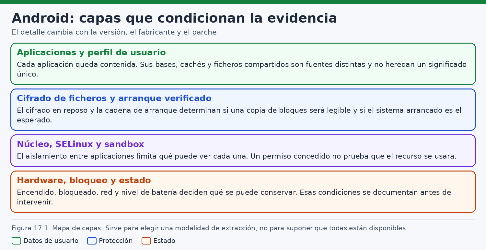
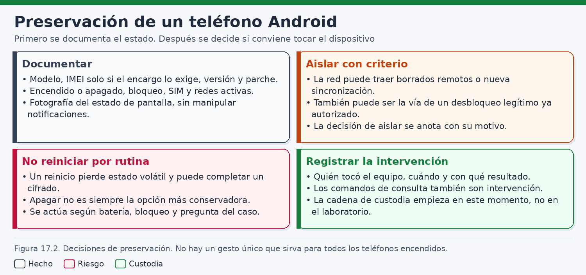
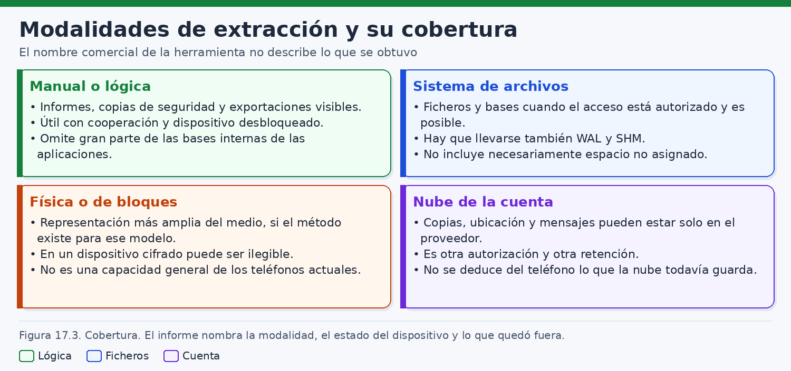
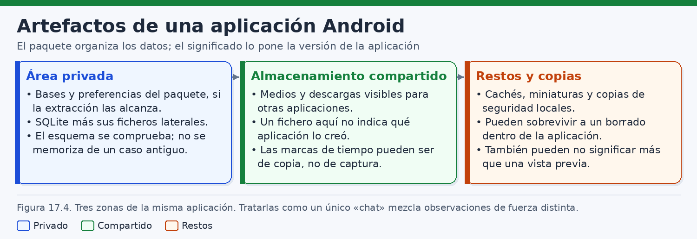
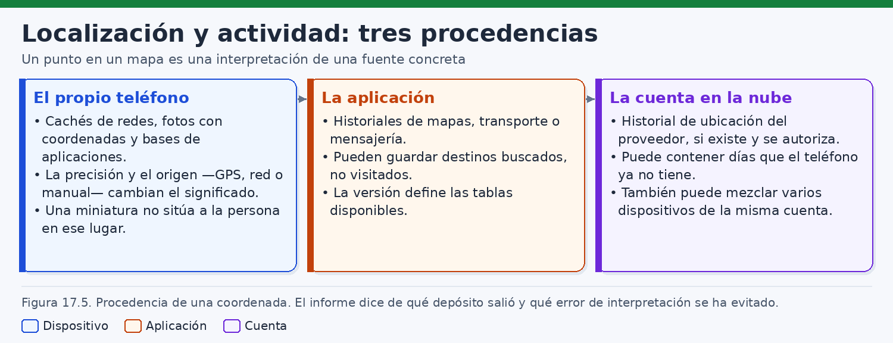
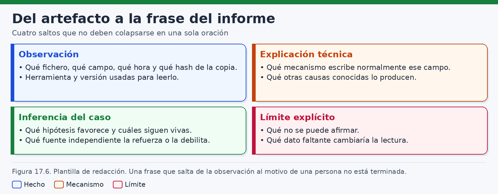

# Análisis forense de dispositivos Android

> *El dato que un teléfono puede mostrar depende de la capa que aún guarda la clave; lo que el analista puede afirmar depende de la capa que produjo el dato y de las que guardaron silencio.*

## Introducción

Un teléfono Android concentra, en un objeto que cabe en un bolsillo, rastros de comunicaciones, fotografías, cuentas, redes, permisos y políticas de empresa. Esa concentración invita a tratar el aparato como si fuera un diario completo de la persona que lo lleva. La experiencia del laboratorio enseña otra cosa. Cada rastro nace en una capa distinta, se conserva según reglas distintas y responde a una pregunta distinta. Un mensaje afirma un texto. Una coordenada sitúa una medición. Un permiso registra una decisión del sistema. Ninguno de esos tres objetos, por sí solo, reconstruye la mañana de una persona.

Android es una plataforma abierta en su código de referencia y, a la vez, un conjunto de productos desiguales. El proyecto publica el sistema base, el modelo de seguridad y el cifrado. Los fabricantes añaden interfaz, servicios, controladores y, a veces, su propia aplicación de mensajes. Las versiones conviven durante años. Un parche cambia la superficie sin cambiar el número de la caja. El análisis empieza por el ejemplar: modelo, versión, nivel de parche, estado de bloqueo, red y batería. Una receta de otro terminal se comprueba antes de aplicarse.

Este capítulo describe cómo preservar, extraer e interpretar, con autorización, las evidencias de un Android actual. El foco es defensivo: investigaciones judiciales, corporativas y de respuesta a incidentes. Los ejemplos de órdenes corresponden al laboratorio o a una intervención expresamente autorizada. La conexión a un teléfono altera su estado. Nada de lo que sigue autoriza a intervenir el aparato de un tercero, ni guía para eludir el bloqueo, obtener privilegios que el sistema no concede o leer un cifrado vigente saltándose sus claves.

La idea que organiza el capítulo es metodológica. La **observación** describe un artefacto localizado: ruta o fuente, identificador, valor y momento de la copia. La **explicación** recuerda el mecanismo que, en esa versión, puede producir ese valor. La **inferencia** propone una relación técnica entre artefactos, con el grado de apoyo que esos artefactos dan. El **límite** deja escrito lo que permanece abierto: otra persona, otro dispositivo, otro intervalo, otra cuenta. Las cuatro piezas se redactan por separado. Mezclarlas en una sola frase es la vía más corta hacia un informe que afirma más de lo que la copia contiene.

El capítulo termina con un caso ficticio. Un teléfono corporativo de la empresa Litoral Logística se examina con la cooperación de su usuaria, desbloqueado y bajo autorización de la organización. Hay un mensaje de la cuenta de trabajo y una fotografía con coordenadas. El encargo pregunta si esa persona estuvo toda la mañana en las instalaciones de un cliente. El desarrollo sirve para ensayar la plantilla de redacción y para mostrar por qué esos dos indicios no cubren el intervalo ni identifican a quien sostenía el aparato. Los nombres, dominios, identificadores y horas son inventados.

Conviene situar el alcance frente a dos expectativas frecuentes. La primera espera que toda adquisición «completa» entregue los archivos en claro. En un dispositivo moderno con cifrado basado en ficheros, una copia de bloques puede ser íntegra y seguir siendo ilegible: los sectores contienen texto cifrado y las claves permanecen vinculadas al hardware y a la credencial. La segunda espera que la extracción física sea una capacidad ordinaria, disponible para cualquier modelo. No lo es. Depende del controlador, de la herramienta, de la versión y del modo en que el cifrado ata las claves al aparato. El informe describe la cobertura real, no la etiqueta comercial.

## 1. Arquitectura y mecanismos de seguridad

### 1.1. Una plataforma, muchas construcciones

Android designa, en el trabajo forense, una familia de sistemas que comparten un diseño y se separan en los detalles que importan a la evidencia. El código de referencia describe el kernel, el entorno de ejecución, el marco y los servicios de seguridad. Cada producto añade controladores, aplicaciones preinstaladas y, a veces, un almacén de mensajes distinto. Dos aparatos con el mismo número de versión pueden diferir en el parche, en el cifrado efectivo y en la aplicación que gestiona los SMS.

Tratar el teléfono como «un Linux con pantalla» aprovecha solo una parte del mapa. El kernel es Linux y algunos conceptos —usuarios, permisos discretionales, SELinux— se reconocen. El espacio de usuario no es el de un servidor. Las aplicaciones se instalan como paquetes, se ejecutan en un entorno de ejecución propio, se aíslan por usuario de aplicación y hablan entre sí mediante componentes del marco. Los registros que un administrador buscaría en un diario de servicio pueden no existir, o existir en bases de datos privadas de cada aplicación. Las rutas clásicas del escritorio no se trasladan.

### 1.2. Capas que condicionan lo que se puede leer

Una reconstrucción útil separa capas. Cada una deja un tipo de huella y cada una puede faltar en la copia que el laboratorio tiene realmente.

En la capa de hardware están el procesador, el almacenamiento, la radio y el entorno donde el sistema guarda claves. En la de arranque, el cargador y la cadena de verificación. En la de núcleo, el cifrado del almacenamiento y el control de acceso obligatorio. En la de marco, usuarios, perfiles, permisos y copias de seguridad. En la de aplicaciones, bases y ficheros de cada programa. En la de cuentas y consola, servidores que no residen en el teléfono aunque se consulten desde él.

La figura 17.1 ordena esas capas según su efecto sobre la evidencia. Leerla como una pila decorativa sería un error de método. La pila explica por qué una copia puede ser fiel e inútil a la vez, y por qué un dato de la nube no hereda automáticamente la hora del reloj del teléfono.



La consecuencia práctica es de cobertura. Una exportación lógica obtiene lo que el marco entrega en ese estado de desbloqueo. Una copia de archivos privados exige facultad real para leerlos. Una copia de bloques conserva sectores, que en un aparato actual suelen ser texto cifrado. Una exportación de la consola conserva lo que la política registró en el servidor, con su retención. El informe nombra la capa de cada objeto. Si dos capas discrepan, la discrepancia se conserva.

### 1.3. Arranque verificado

El arranque verificado comprueba, mediante firmas, que el software de arranque y las particiones protegidas corresponden a una cadena que el dispositivo acepta. Cada etapa comprueba la siguiente antes de cederle el control. Particiones de sistema pueden quedar protegidas por un mecanismo de integridad frente a modificaciones. El dato de usuario no es una partición firmada en ese sentido: se protege sobre todo mediante cifrado y controles de acceso. Residir en el teléfono no convierte una fotografía en un objeto auténtico.

Para el analista, el arranque verificado es contexto. Si la cadena está bloqueada y la verificación se cumple, aumenta la confianza en los binarios de sistema a través de los cuales se lee el aparato. Esa confianza no alcanza, por sí sola, a lo que las aplicaciones escriben ni a lo que una cuenta sube a un servidor. Si el estado indica un cargador desbloqueado o una verificación fallida, baja la confianza en los binarios y en las lecturas hechas a través de ellos. El hallazgo se documenta. Puede tener una causa administrativa anterior al caso, así que no se convierte solo en prueba de una manipulación concreta.

Algunas propiedades distinguen el estado del arranque con valores habituales en la documentación (`green`, `yellow`, `orange` y `red` han aparecido en implementaciones del arranque verificado). El significado exacto se lee en la documentación de la versión. La propiedad la emite el sistema en ejecución: si la cadena ya no se cumple, la propiedad merece menos confianza. El estado se anota junto con el modo en que se observó: pantalla de aviso, lectura autorizada o dato del administrador del parque. Este capítulo no describe cómo se desbloquea un cargador ni cómo se sustituye el sistema.

### 1.4. Cifrado basado en ficheros

El cifrado basado en ficheros es el mecanismo que condiciona hoy la lectura de un Android moderno. Frente al cifrado de disco completo, que trataba el volumen de datos como una unidad y exigía la credencial en un momento temprano del arranque, el cifrado por fichero permite que el aparato arranque hasta la pantalla de bloqueo y mantenga disponible una parte del almacenamiento. La documentación de cifrado del proyecto separa dos clases de almacenamiento.

El almacenamiento cifrado del dispositivo queda disponible después de arrancar y antes del desbloqueo. Ahí pueden residir datos que el sistema necesita y ciertos datos de aplicaciones marcados para el arranque directo. El almacenamiento cifrado con la credencial queda disponible cuando el usuario autentica, con patrón, PIN, contraseña o el desbloqueo biométrico asociado. Las aplicaciones ordinarias guardan ahí lo privado. Después de un reinicio, y hasta ese desbloqueo, ese espacio no está disponible. La literatura nombra esos momentos como estado anterior al primer desbloqueo y estado posterior al primer desbloqueo.

Las claves no viajan en claro dentro de una copia de sectores. Están vinculadas al aparato, mediante el almacén de claves respaldado por hardware, y, para el almacenamiento de la credencial, a un secreto en el que interviene lo que el usuario conoce. Puede existir además cifrado de metadatos, de modo que nombres y estructuras tampoco aparezcan en claro. Una copia de bloques puede ser bit a bit fiel al soporte y, aun así, ilegible. El hash acredita que los sectores no se alteraron después de copiarlos. No acredita que puedan abrirse en otro equipo. No hay un método general para leer cualquier cifrado actual, y este capítulo no describe forma alguna de eludirlo.

El tipo de cifrado que el propio sistema declara —por fichero o por bloque, cifrado o no— es una observación del ejemplar. Se comprueba en la versión. Un valor de cifrado por fichero explica por qué el plan privilegia una extracción mientras el almacenamiento de la credencial está disponible, con autorización y constancia. También explica por qué apagar el teléfono para «congelarlo», reflejo heredado del disco de un ordenador, puede cerrar la capa que hacía legibles los ficheros.

### 1.5. SELinux

Android ejecuta SELinux en modo impositivo. Además de los permisos discretionales de usuario y grupo, el núcleo aplica una política obligatoria: cada proceso lleva un dominio y cada objeto un contexto, y la política dice qué operaciones están permitidas entre ellos. Una aplicación no lee el directorio privado de otra por el hecho de que un permiso de Unix parezca amplio, ni la sesión ordinaria de depuración se convierte en propietaria de los datos de todas las aplicaciones.

El interés forense es doble. El aislamiento no queda solo en la capa de aplicaciones: el núcleo lo sostiene. Y, cuando una herramienta afirma haber leído directorios privados, el informe explica con qué facultad ocurrió. Esa facultad puede ser un mecanismo previsto —una copia de seguridad que la aplicación permite, una exportación del perfil administrado— o puede no existir para ese modelo. Comprobar que la política está en modo impositivo documenta el contexto. Una desviación sería un hallazgo de configuración. Este capítulo no enseña a relajar la política.

### 1.6. Aislamiento de aplicaciones, perfiles y almacenamiento

Cada aplicación se instala, en el caso habitual, con un usuario de sistema propio. Su directorio privado —bajo rutas que han sido `/data/data` y `/data/user/<id>` según versión y usuario— queda reservado a ese usuario y a los componentes de sistema que la política autoriza. Comparten usuario solo construcciones excepcionales, más propias de componentes del sistema que de aplicaciones ordinarias. El analista no supone un directorio compartido entre dos paquetes porque ambos pertenezcan a la misma empresa.

El almacenamiento compartido —fotografías, descargas, documentos de la galería— sigue otra regla. Las versiones actuales limitan el ámbito: una aplicación ve su zona y necesita permisos o un selector para el resto. La ruta del almacenamiento emulado depende del usuario y de la versión. En un perfil de trabajo, aplicaciones y a menudo medios son distintos de los del perfil personal del mismo aparato. Una fotografía de un perfil y un mensaje del otro no son, por estar en el mismo teléfono, episodios del mismo uso.

### 1.7. Permisos: la concesión no es el uso

Los permisos median qué puede hacer una aplicación. Unos se conceden en la instalación. Otros, los llamados peligrosos —ubicación precisa, contactos, micrófono, cámara, SMS, entre ellos—, exigen una decisión del usuario en tiempo de ejecución, y el sistema puede además limitar si la ubicación es precisa o aproximada y si el acceso vale siempre o solo mientras la aplicación está en uso. Hay permisos especiales con flujos propios. El analista se atiene a la taxonomía de la versión que examina.

La concesión queda registrada en el estado del gestor de paquetes. Es una observación de política: en un momento dado, el sistema permitió a ese paquete una capacidad. No es una observación de uso. La aplicación puede tener la ubicación concedida y no haber pedido una posición, o no tenerla y aun así guardar una coordenada llegada dentro de una fotografía compartida. El estado copiado es el del momento de la copia, no la historia completa de las decisiones.

## 2. Preservación del dispositivo

### 2.1. Un objeto encendido sigue escribiendo

Un teléfono encendido no es un disco en reposo. Las aplicaciones reciben mensajes, las radios cambian de celda, la consola de empresa puede ordenar un bloqueo o un borrado, la batería baja y el sistema puede reiniciarse. La memoria conserva material de sesión que desaparece al perder la alimentación. El almacenamiento cifrado con la credencial permanece utilizable mientras el aparato no vuelva al estado anterior al primer desbloqueo. Cada minuto de espera es, por tanto, una decisión de preservación, no un tiempo neutro.

El orden de volatilidad orienta sin volverse una secuencia rígida. Se pierden antes las sesiones de radio, lo aún no escrito en memoria y la disponibilidad de las claves de la credencial. Los ficheros ya almacenados duran más, y también cambian si una aplicación sigue sincronizando. La nube y la consola pueden conservar un estado que el teléfono está a punto de dejar de reflejar. SP 800-86 aporta el marco para documentar acciones que modifican el sistema. SP 800-101 Rev. 1 desarrolla preservación y adquisición en el ámbito móvil. Ambas son referencias de método: sus descripciones de aparatos pertenecen a su fecha y no sustituyen la documentación vigente de Android.

### 2.2. Hechos que la ficha debe contener

La ficha inicial fija el ejemplar y el estado en que se recibe. Sin ella, las lecturas posteriores flotan. Conviene registrarla antes de conectar cables de datos y antes de abrir aplicaciones. Abrir una conversación puede marcar mensajes como leídos. Conectar un cable puede iniciar carga y, si la depuración está autorizada en el aparato, una sesión que el sistema anotará.

Los mínimos de la ficha son el modelo, la versión, el nivel de parche, el estado de bloqueo, el estado de red y la batería. Según el caso se añaden el identificador de inventario, los perfiles visibles, si la depuración por USB ya estaba activa, la hora del teléfono frente a la del analista y la asociación a una consola de empresa. Los identificadores de línea y de aparato son datos personales: se recogen en la medida del encargo y se protegen en el informe.

| Dato | Para qué se usa | Precaución |
|---|---|---|
| Fabricante y modelo | Elegir documentación y saber qué extracciones son verosímiles | Puede haber variantes con el mismo nombre comercial |
| Versión de Android y nivel de API | Situar permisos, almacenamiento y cifrado | El número de versión no recoge por sí solo el nivel de parche |
| Nivel de parche | Acotar correcciones de seguridad conocidas | No demuestra por sí solo la integridad del aparato |
| Estado de bloqueo | Decidir si el almacenamiento de la credencial está disponible | Anotar si el bloqueo existe y si ahora está desbloqueado, y quién lo desbloqueó |
| Red | Decidir el aislamiento y explicar sincronizaciones posteriores | La red del momento de la ficha no es la red de la mañana investigada |
| Batería y si carga | Evitar un apagado no decidido | Un cable de carga puede ser también un cable de datos |
| Perfiles y cuentas visibles | No mezclar espacios de trabajo y personales | La lista completa puede estar fuera de una extracción lógica |
| Hora del teléfono | Correlacionar más adelante | Se compara con una referencia externa; no se «corrige» el reloj del original |

La figura 17.2 reúne esa preservación como una secuencia de observaciones y de decisiones, no como una lista de herramientas. El orden importa menos que la constancia de cada paso: qué se vio, qué se decidió y por qué motivo.



Cuando el teléfono llega desbloqueado, se anota quién lo desbloqueó, ante quién y a qué hora. El analista no necesita conocer el PIN. Pedir que se le dicte la credencial amplía el secreto sin necesidad y crea un riesgo de custodia distinto del encargo. Si hace falta volver a desbloquear más tarde, se acuerda un procedimiento con la persona o con la organización, y se documenta cada desbloqueo como una intervención.

### 2.3. Bloqueo, primer desbloqueo y reinicio

Conviene separar tres hechos que el lenguaje cotidiano junta. El primero: el aparato tiene bloqueo configurado. El segundo: en este instante la pantalla está desbloqueada y el almacenamiento de la credencial está disponible. El tercero: desde el último arranque, alguien ya autenticó, o todavía no. Un teléfono puede tener PIN y estar ahora mismo desbloqueado. Si se reinicia, volverá a exigir la credencial y, hasta entonces, una extracción no verá el almacenamiento cifrado con ella.

Apagar no es un reflejo. Reduce cambios y, con cifrado por fichero, puede volver ilegible lo que el encargo necesita hasta un desbloqueo legítimo posterior. Mantenerlo encendido conserva esa disponibilidad y acepta que el sistema siga vivo. Las dos opciones se defienden si se escribe cuál se tomó. Si la pantalla ya estaba bloqueada y nadie va a desbloquearla por una vía legítima, el plan asume que el almacenamiento de la credencial no formará parte de la copia. Este capítulo no contiene un procedimiento de elusión del bloqueo.

La vía legítima, cuando el aparato está bloqueado y los datos de la credencial importan, es la cooperación de quien puede desbloquear, una previsión corporativa ya existente o una resolución que ampare un mecanismo lícito. La cooperación se documenta como un acto de esa persona: hora, presente, alcance de lo que acepta. Un desbloqueo hecho por el usuario no equivale a que el usuario haya sido la única persona con acceso durante los hechos investigados. Solo equivale a que, en el momento de la diligencia, alguien con la credencial abrió el aparato.

### 2.4. Decidir el aislamiento de red y escribir el motivo

Aislar la radio es una decisión, no un ceremonial automático. Hay motivos sólidos para hacerlo. Una consola de empresa puede borrar o bloquear el teléfono en remoto. La cuenta asociada a servicios del fabricante puede ofrecer un bloqueo o un borrado a distancia. Una aplicación de mensajería abierta a la red sigue recibiendo mensajes, y cada llegada modifica bases de datos, notificaciones y a veces el estado de lectura. Una sincronización puede sustituir ficheros locales por la versión del servidor, o subir al servidor un cambio que la preservación quería mantener solo en el aparato.

Hay motivos sólidos para no aislar, o para retrasar el aislamiento. Algunas políticas tratan la pérdida de contacto como un incidente y disparan ellas mismas un borrado o un bloqueo: aislar sin preguntar a quien administra la flota puede destruir lo que se quería conservar. Hay encargos, pocos y muy delimitados, en los que la autorización consiste precisamente en observar qué llega. Y el propio gesto de activar el modo avión es una intervención: cambia ajustes, puede quedar anotado y altera la escena que se pretendía congelar.

La práctica que este capítulo recomienda es explícita. Se identifica si existe administración remota. Se pregunta, cuando el caso es corporativo y la pregunta es lícita, si la pérdida de conectividad provoca un borrado automático. Se elige una medida proporcionada: desactivar redes, modo avión, bolsa apantallada, retirada de la tarjeta SIM, o una combinación. Se escribe el motivo en el momento de la decisión, no al redactar el informe días después. La frase mínima contiene la hora, la medida, la razón y la fuente de esa razón.

### 2.5. Batería, alimentación y sesión de datos

La batería se anota al recibir el aparato y se vigila. Un apagado por agotamiento no es una decisión: es una consecuencia, y puede devolver el teléfono al estado anterior al primer desbloqueo. Conviene alimentarlo. Conviene, al mismo tiempo, no confundir alimentar con abrir una sesión de datos. Muchos cables hacen las dos cosas. Una sesión de datos puede despertar el sistema, cargar el registro de batería, proponer una autorización de depuración y, si esa autorización ya existía, permitir órdenes que modifican el aparato.

Si en la fase de preservación solo se busca mantener la carga, se elige un método que no inicie datos y se escribe cuál fue. Si más tarde, con autorización, se abre una sesión para extraer, esa apertura es un acto nuevo, con su hora. La batería durante el aislamiento importa especialmente dentro de una bolsa apantallada, donde la carga es más incómoda y el aparato sigue consumiendo. Perder el teléfono por no haber planificado la alimentación es un fallo de preservación, aunque todas las decisiones de red hayan sido correctas.

### 2.6. Custodia mientras el sistema sigue en marcha

La cadena de custodia de un teléfono encendido registra transferencias, lugar de conservación, estado de la radio, intervenciones y alimentación. Un precinto tradicional no puede sellar un objeto que alguien debe seguir observando para que no se apague. Se sustituye por un registro más fino: quién lo custodia en cada tramo, qué se le hizo y qué hash podrán calcularse más adelante sobre los ficheros ya extraídos, no sobre «el teléfono entero», porque un sistema encendido no tiene un único hash estable.

Las copias se identifican en cuanto existen. Cada fichero extraído lleva origen, ruta de extracción, tamaño, hash y herramienta. El aparato original, si debe conservarse encendido, no se usa como estación de análisis. Las consultas inevitables se anotan como intervenciones. Las búsquedas reiteradas se hacen sobre copias. Abrir una base de datos viva en el propio teléfono, con una herramienta que escribe un diario o fuerza un checkpoint, puede alterar la evidencia que se quería leer. Ese riesgo se retoma al hablar de SQLite. En la preservación basta la regla de no analizar sobre el original.

## 3. Técnicas de extracción de datos

### 3.1. La etiqueta no es la cobertura

Las herramientas comerciales nombran modalidades —lógica, de sistema de archivos, física— con criterios que no siempre coinciden entre fabricantes. Dos productos pueden llamar «física» a operaciones muy distintas, y el mismo producto puede cambiar de una versión a la siguiente qué rutas extrae de un modelo concreto. El informe que se limita a repetir la etiqueta no permite que otro perito sepa qué preguntas están contestadas.

La figura 17.3 contrasta las modalidades por lo que pueden contener, no por su prestigio. La lectura correcta de esa figura es una pregunta de encargo: ¿hace falta el texto de un mensaje que el servidor de la empresa ya conserva, hace falta el fichero de una fotografía del almacenamiento compartido, hace falta una base privada que la extracción no alcanzó, hace falta el espacio no asignado? Cada respuesta selecciona una modalidad y, con la misma fuerza, declara las demás como no realizadas.



El programa de pruebas de herramientas forenses del NIST (CFTT) publica especificaciones y resultados para determinadas funciones. Sirve para saber si una capacidad fue ensayada con un método público. No todas las funciones de móvil tienen allí un ensayo del modelo del caso. Si no lo hay, el laboratorio puede probar con datos conocidos en un aparato de versión próxima y debe decir que el modelo investigado no es idéntico. SWGDE mantiene documentos de buenas prácticas de adquisición, análisis e informe. Orientan el método; no vuelven legible un sector cifrado ni amplían la autorización.

### 3.2. Extracción manual y extracción lógica

La extracción manual observa el aparato por su interfaz: pantalla, fotografías de esa pantalla, exportaciones que el usuario dispara desde un menú. Cabe cuando el encargo es estrecho y la autorización la cubre. Como copia es pobre: depende de lo que alguien navegue y modifica el estado. Abrir un chat puede marcar mensajes como leídos y consumir notificaciones. Si se usa, se anota cada pantalla. Las capturas hechas por un tercero antes de la diligencia son piezas distintas, de autenticidad más débil.

La extracción lógica usa interfaces que el sistema o las aplicaciones exponen: proveedores de contenidos, transferencia de medios, copias de seguridad que las aplicaciones permiten, exportaciones de consola. Obtiene objetos seleccionados —contactos, llamadas, mensajería que el proveedor entrega, medios compartidos— según herramienta, versión y desbloqueo. No obtiene el directorio privado de cada aplicación por el solo hecho de llamarse lógica. Muchas aplicaciones de mensajería no participan en la copia de seguridad del sistema. Una extracción lógica correcta puede no contener la conversación del encargo. Eso es cobertura, y el informe la describe. Lo entregado puede ser una vista —un contacto agregado, un hilo resumido— y no la base interna.

### 3.3. Extracción de sistema de archivos

La extracción de sistema de archivos pretende copiar ficheros y directorios, incluidos, cuando de verdad se alcanzan, los directorios privados de las aplicaciones, con sus bases de datos y sus ficheros auxiliares. No pretende, en la definición que aquí se usa, el espacio no asignado de la memoria flash ni una imagen sector a sector. Su valor está en leer estructuras con nombre, metadatos de fichero y bases SQLite completas, siempre que los auxiliares de esas bases viajen con ellas.

Esa modalidad solo existe si la facultad de lectura existió. El desbloqueo de la pantalla no la concede por sí solo. La sesión ordinaria de depuración, confinada por SELinux y por su usuario, suele leer propiedades y zonas del almacenamiento compartido, y suele no poder leer `/data/data` ni el directorio privado de otra aplicación. La cooperación desbloquea la credencial; no convierte la sesión en propietaria de todos los paquetes. El informe dice qué rutas se listaron y cuáles respondieron con rechazo. El rechazo es un dato de cobertura.

### 3.4. Copia de bloques y el alcance real de la extracción física

La copia de bloques lee sectores del almacenamiento. En un disco de ordenador sin cifrado, esa copia permite reconstruir particiones, espacio no asignado y ficheros borrados a nivel de sistema de archivos. En un Android moderno el mismo gesto tropieza con dos límites distintos, y conviene no confundirlos.

El primer límite es de capacidad. Obtener los sectores exige un medio que el modelo permita y que la herramienta soporte para ese controlador y esa versión. El almacenamiento de los teléfonos actuales suele ir soldado. El soporte es parcial, va por generaciones y cambia con el sistema. Una función llamada «extracción física» puede no existir para el modelo, puede fallar o puede entregar algo distinto de lo que el menú sugiere. La extracción física no es una capacidad general del laboratorio. Afirmarla sin una copia identificada, con hash y con el soporte descrito, es afirmar una etiqueta.

El segundo límite aparece cuando la copia de sectores se consigue. Con cifrado basado en ficheros, y más aún si hay cifrado de metadatos, los sectores son texto cifrado. La copia puede verificarse y seguir siendo opaca fuera del propio teléfono, porque las claves siguen vinculadas al hardware y, para el espacio de la credencial, a la autenticación del usuario. Una imagen íntegra e ilegible es un resultado honesto. Las técnicas invasivas sobre el circuito de memoria, citadas en la literatura y en SP 800-101 Rev. 1 como posibilidad según el modelo, no se desarrollan aquí. Aunque obtuvieran los bloques, el cifrado actual podría dejarlos ilegibles. Copiar y poder leer son preguntas separadas.

En un teléfono reciente, cifrado por fichero, con el almacenamiento de la credencial disponible por un desbloqueo legítimo, la vía que suele responder al encargo es una extracción lógica o de ficheros en ese estado, más las fuentes externas. Si el encargo exige espacio no asignado y no hay un método validado que entregue bloques en claro para ese modelo, el informe deja esa pregunta sin cobertura.

### 3.5. La cuenta en la nube como fuente distinta

La cuenta es otra escena. El servidor de correo, la consola que administra el parque, el respaldo que una aplicación guarda en la nube del proveedor y el historial asociado a una cuenta de servicios no son carpetas del teléfono. Viven en infraestructuras de terceros o de la propia organización, con retención, reloj, titular y vía de acceso propios. Pedirlos puede ser necesario y, a la vez, exigir una autorización distinta de la que permitió examinar el aparato. Examinarlos no «completa» la extracción del teléfono: responde a otras preguntas y deja otras sin responder.

NIST IR 8006 identificó 62 retos de la forense en la nube y los agrupó en nueve categorías, entre ellas arquitectura, recogida, análisis, roles y marco legal. Este capítulo no repite el catálogo. El dato puede estar replicado, la retención puede no coincidir con la del teléfono y la hora del servidor no es la de la pantalla. SP 800-201, de julio de 2024, sitúa la preparación forense de esos entornos: lo obtenible depende de lo que la organización haya preparado y de lo que el servicio registre.

En un teléfono esta separación se ve con claridad. Una conversación puede estar en el servidor de la empresa y no en la copia lógica, porque la aplicación no permitió copia de seguridad y la extracción no alcanzó su directorio privado. Un historial de ubicaciones de la cuenta puede existir aunque el teléfono no guarde un rastro continuo, o no existir porque nadie lo activó. Un respaldo en la nube puede ser de otro día, de otro aparato de la misma cuenta, y puede estar cifrado. Cada objeto entra en el inventario con su identificador. La ilegibilidad de un respaldo cifrado se reporta como límite; este capítulo no explica cómo obtener esas claves.

La consola de administración añade eventos de inventario, de políticas y, a veces, de comprobación del dispositivo: hora, identificadores y a veces una dirección de red de origen. Esos eventos demuestran lo que la consola guardó. Una dirección de origen es un punto de salida de red. Se convierte en lugar geográfico solo si la arquitectura lo permite y alguien lo documenta. Varios aparatos pueden compartir la salida de una sede. Un túnel puede hacer aparecer la sede aunque el aparato esté fuera. Esas alternativas se escriben cuando la arquitectura no las cierra.

### 3.6. Consultas con adb: laboratorio o autorización, y efecto sobre el estado

Android Debug Bridge es el puente de depuración documentado para comunicar un equipo con un aparato. Permite, si la depuración ya está admitida y el teléfono está desbloqueado en la medida que la orden exija, leer propiedades y copiar lo que la sesión confinada puede leer. También cambia el aparato: la conexión USB puede despertarlo, iniciar la carga y dejar rastro; la primera autorización de una clave de depuración escribe una decisión de confianza; una orden de shell arranca un intérprete. Las órdenes que borran buffers o cambian ajustes no forman parte de ningún ejemplo de este capítulo. Las de consulta se prueban antes en un aparato de laboratorio y, si se ejecutan sobre el original, se registran como intervención: hora, operador, cable, orden y salida.

El bloque siguiente es un ejemplo de consulta, no un guion para un teléfono ajeno. En el laboratorio se ejecuta sobre un aparato de prueba. Sobre un aparato del caso, solo con autorización expresa, y sabiendo que la sesión ya altera el estado aunque las órdenes sean de lectura.

```bash
# Laboratorio, o teléfono del caso con autorización registrada.
# La conexión y estas consultas pueden modificar registros y energía.
adb devices -l
adb shell getprop ro.product.manufacturer
adb shell getprop ro.product.model
adb shell getprop ro.build.version.release
adb shell getprop ro.build.version.sdk
adb shell getprop ro.build.version.security_patch
adb shell getprop ro.build.fingerprint
adb shell getprop ro.boot.verifiedbootstate
adb shell getprop ro.crypto.state
adb shell getprop ro.crypto.type
adb shell getenforce
adb shell date
```

La salida de `getprop` es la declaración del sistema en ejecución sobre fabricante, modelo, versión, parche, huella de compilación, estado de arranque verificado y forma de cifrado. `getenforce` indica el modo de SELinux que esa sesión observa. `date` muestra el reloj del aparato, que se compara con la referencia del laboratorio. Las cadenas se guardan tal como salieron y se contrastan con la documentación de la versión. Si el arranque verificado no sostiene la confianza en el sistema, la propia salida hereda esa reserva.

`adb` no es, en este uso, una extracción universal. La cuenta de la sesión no lee los directorios privados de las aplicaciones. Copiar el almacenamiento compartido, cuando la versión lo permite a esa cuenta, es una extracción parcial que se lista directorio a directorio. Los mecanismos históricos de copia de seguridad asociados a la depuración han cambiado según la versión; se consultan en la documentación vigente y no se improvisan sobre el original. Lo que la orden no pudo leer se anota como no leído. No se insiste con variantes para ampliar privilegios: quedan fuera del capítulo.

### 3.7. Integridad de lo extraído y pruebas con datos conocidos

Cada producto de la extracción —fichero, exportación de consola, captura de pantalla, nota de una propiedad— recibe identificador, hora de obtención, herramienta y versión, y un hash cuando el objeto es estático. El hash se calcula sobre la copia conservada. Recalcularlo comprueba que la copia no cambió después; no comprueba que la herramienta copió todo lo que el encargo imaginaba, ni que el teléfono estaba íntegro en el sentido de «sin malware», ni que el texto de un mensaje es verdadero en el mundo.

## 4. Artefactos de aplicaciones y comunicaciones

### 4.1. Zonas de datos de una aplicación

Una aplicación Android no guarda «sus datos» en un solo cajón. La figura 17.4 separa zonas que el analista suele encontrar, cuando la extracción llega a ellas, y que significan cosas distintas.



La zona privada del paquete contiene bases, preferencias y ficheros que otras aplicaciones no leen. Es la de mayor valor para ese programa y la que más a menudo queda fuera de una extracción lógica. La zona externa específica, bajo el almacenamiento compartido y el nombre del paquete, puede contener medios propios. El almacenamiento compartido general puede contener ficheros visibles para varias aplicaciones si el ámbito lo permite. Los proveedores del sistema guardan contactos, llamadas o mensajes de telefonía fuera del paquete con el que el usuario los mira. La cuenta y el servidor guardan lo sincronizado, con la retención del proveedor.

La versión del paquete —nombre, código y nombre de versión, si constan en el gestor de paquetes— se anota antes de interpretar la base. Un cambio de versión cambia el esquema. La marca de si el paquete permite copia de seguridad explica, a veces, por qué la extracción lógica trajo o no trajo ese paquete. Es una propiedad de la aplicación, no una valoración moral sobre si «se escondió». Muchas aplicaciones la desactivan como diseño ordinario.

### 4.2. Mensajería del sistema: sin un esquema único

Los SMS y MMS han vivido, en muchas versiones, en bases del proveedor de telefonía, con nombres de fichero y de tablas que circularon durante años. Esos nombres son una pista de búsqueda, no un contrato. El fabricante puede sustituir la aplicación de mensajes. RCS, mensajería sobre datos, no tiene por qué ser una fila más de la tabla histórica de SMS. Por eso este capítulo no fija un esquema de SMS válido para todas las versiones. El esquema se lee en la copia, se archiva y se citan columnas vistas en esa pieza.

Algunas distinciones sobreviven al cambio de esquema porque dependen del papel del dato. El cuerpo es texto de quien escribe: puede ser falso, anticipado o escrito por otra persona con acceso a la cuenta o al aparato. El identificador de origen o destino es un número o una dirección, relacionable con la agenda, y todavía no es una identidad civil. La hora suele exigir comprobar la escala —en muchas versiones ha sido milisegundos desde la época Unix— y puede reflejar el aparato, el centro de servicio o ambos. El estado de lectura cambia al abrir la conversación, también si la abre el analista. La fecha de un hilo suele seguir al último movimiento y no fecha cada texto.

### 4.3. Aplicaciones de conversación y esquemas que cambian

Las aplicaciones de conversación mantienen sus propias bases, casi siempre SQLite, más carpetas de medios y, a menudo, un respaldo en la nube. El esquema cambia con la versión del paquete. Fijar un único esquema de WhatsApp, o de cualquier otra aplicación, válido para todas las versiones produce citas de columnas que la copia no tiene. El método es el del apartado anterior: versión del paquete, esquema leído en la copia, ficheros hermanos y medios asociados por los identificadores de esa versión.

WhatsApp ilustra el método, no un esquema canónico. Ha sido habitual encontrar bases de mensajes y de contactos en el directorio privado, medios en zonas que han cambiado con el almacenamiento de ámbito limitado, y copias de seguridad cifradas cuyo formato también ha cambiado. Esos lugares se buscan en la extracción concreta. Si la base o el respaldo están cifrados, la copia puede ser íntegra e ilegible. Este capítulo no describe cómo obtener esas claves. Los medios pueden existir aunque la base no se lea, y la base puede citar un medio que no se descargó: son piezas distintas. No hay un esquema de WhatsApp válido para todas las versiones.

### 4.4. Llamadas, contactos y correo

El registro de llamadas, cuando la extracción lo incluye, anota comunicaciones del proveedor de telefonía: sentido, número, duración, hora. Es una anotación del teléfono. No identifica a quien lo sostuvo, ni el lugar, ni lo hablado. La duración se lee con las reglas de esa versión. El número se cruza con la agenda, cuya etiqueta es un texto guardado por alguien y puede estar equivocada. El cruce hereda la calidad de la agenda.

Los contactos suelen existir en más de una capa: contactos en bruto llegados de una cuenta, un contacto agregado que el sistema compone para mostrarlo, y copias en aplicaciones. Modificar un contacto en una cuenta puede cambiar lo que el teléfono muestra sin que el usuario haya editado nada esa mañana. Para atribuir un nombre a un número, el informe dice de qué capa salió el nombre y en qué fecha se copió esa capa. Varias cuentas pueden alimentar la misma agenda. El perfil de trabajo puede tener otra.

El correo en el teléfono es una caché del buzón que vive en el servidor. El cliente puede no haber descargado el cuerpo, o puede mostrar una hora de recepción distinta de la de envío. Tratar esa vista como si fuera el buzón completo repite el error de tratar la extracción lógica como si fuera el directorio privado. El almacén del dispositivo y el del proveedor son fuentes distintas.

### 4.5. Fotografías, adjuntos y cachés

Una fotografía es un fichero. Puede vivir en la carpeta de la cámara, en una descarga, en el almacén de una conversación o en una caché. El mismo contenido byte a byte puede aparecer en dos zonas por una exportación, por una recepción o por una miniatura. El hash identifica el contenido. La ruta y el perfil de usuario identifican el lugar. Son datos distintos: el mismo hash en dos rutas significa dos ubicaciones del mismo contenido, no dos actos de captura.

Los metadatos internos, cuando existen, los escribe quien generó el fichero: a menudo la cámara, a veces otra aplicación que los conservó o los recortó. Una imagen recibida por mensajería puede haber perdido las coordenadas o conservarlas. Una imagen reenviada puede describir el lugar de una captura anterior. El nombre que parece una fecha es, en muchas cámaras, una cadena generada por el mismo reloj que los metadatos: no es una segunda medición independiente. Se contrasta con los metadatos, no se suma a ellos como si fueran dos relojes. Una miniatura en caché demuestra que algún componente generó una vista previa, no que una persona abriera la imagen a esa hora, y su fecha no tiene por qué ser la de la captura.

## 5. Bases de datos, geolocalización y actividad del usuario

### 5.1. SQLite, el registro por adelantado y la memoria compartida

Buena parte de los artefactos de aplicación y de los proveedores del sistema se guardan en SQLite. El formato del fichero principal está documentado y puede leerse con herramientas ordinarias. Esa comodidad esconde dos riesgos. El esquema no es estable entre versiones, de modo que los nombres de tablas se leen en la copia y no se importan de un caso anterior. Y el fichero principal puede no contener las últimas transacciones comprometidas.

Cuando la base opera con registro por adelantado (WAL), las páginas confirmadas recientemente viven en un fichero hermano de sufijo `-wal`, hasta que un checkpoint las incorpora al principal. Un tercer fichero, de sufijo `-shm`, coordina el acceso concurrente. Copiar solo el principal puede perder transacciones que todavía están en el WAL: en una conversación, a menudo los mensajes del día. El `-shm` no es un segundo diario completo; participa en la vista coherente de una base que estaba en uso. Se copian los tres cuando existan, más el diario de retroceso si la base usa ese modo, y se anota cuáles faltaban.

```bash
# Laboratorio, sobre copias. No ejecutar contra el teléfono.
# mode=ro e immutable=1 reducen el riesgo de escribir en la copia.
# El nombre es genérico: el esquema real se lee aquí y se archiva.
ls -l telefonia.db telefonia.db-wal telefonia.db-shm
sqlite3 "file:telefonia.db?mode=ro&immutable=1" ".schema"
```

La orden `.schema` produce la estructura de esa copia. Se guarda en el anexo. Las consultas del informe se escriben después de leerla, se conservan y se repiten en la revisión. Una consulta que supone una columna inexistente es un error de método, no un hallazgo negativo. Una hora en milisegundos, en segundos o en texto no se adivina por el nombre del campo: se contrasta con el formato SQLite y, si existe, con una fila de significado horario independiente.

### 5.2. Tres procedencias de una coordenada

Una coordenada en un expediente de teléfono parece, a simple vista, «dónde estaba la persona». Casi nunca es eso. La figura 17.5 separa tres procedencias que se citan por su nombre cada vez que un informe menciona un punto en el mapa.



La primera es la localización del teléfono: una estimación a partir del satélite, de las redes móviles, de las inalámbricas o de una combinación, guardada por algún componente. Tiene hora, precisión y origen cuando esos campos existen. Describe el aparato, no a quien pudiera llevarlo. Una serie densa, con precisión y reloj controlados, sostiene un desplazamiento. Un solo punto sostiene un instante. Un hueco entre dos puntos no se rellena con una recta: el aparato pudo quedarse quieto, perder la radio o moverse sin que nadie lo registrara. Que el teléfono tenga receptor de satélite no implica un registro continuo en todas las versiones y políticas.

La segunda es la localización de la aplicación: un valor que ese programa almacenó. Puede ser una posición pedida al sistema, el resultado de una búsqueda de un lugar al que nadie fue, la coordenada incrustada en una fotografía en el momento de la captura, o un lugar recibido dentro de un mensaje. Cada mecanismo, si deja rastro, lo deja con un contexto distinto. Citar «la aplicación tenía una coordenada» sin decir cuál fue el mecanismo convierte un dato de programa en un dato de presencia. Los campos se leen en la copia de esa versión.

La tercera es la localización de la cuenta: un historial asociado a la identidad en un servicio, a menudo en la nube, a menudo fusionando varios aparatos, con retención y consentimiento propios. Un punto puede haberlo generado otro teléfono de la misma cuenta. Puede no existir si el servicio no estaba activado. Pedirlo es otra diligencia. No encontrarlo en el teléfono no lo borra. No tener autorización para pedirlo obliga a decir que esa procedencia no se examinó, que es distinto de decir que no hay ubicación.

Las tres procedencias pueden coincidir y pueden contradecirse. La contradicción se conserva: se comprueba si son el mismo aparato, la misma cuenta, el mismo reloj y la misma clase de evento. La precisión también se conserva. Un radio de decenas o cientos de metros no distingue un portal de otro. Una dirección IP de salida de una sede, que a veces se presenta como localización, no es ninguna de las tres procedencias: es un dato de red y se etiqueta como tal.

### 5.3. Actividad, cuentas y huecos

Junto a mensajes y coordenadas, el sistema puede conservar indicios de actividad: estadísticas de uso de aplicaciones, historial reciente de notificaciones, eventos de encendido, redes recordadas, dispositivos emparejados. Todos dependen de la versión, de la política y de que la extracción los haya alcanzado. Todos tienen retención corta o irregular. Sirven para corroborar que un paquete estuvo activo en una ventana, cuando el registro es de esa clase, y sirven mal para afirmar lo contrario a partir de un silencio.

Las cuentas añaden otra capa. Que una cuenta de trabajo esté en el perfil de trabajo demuestra un alta, no una actividad continua. Que envíe un mensaje demuestra un envío de esa cuenta y, si el servidor lo registra, del cliente que el servidor vio. Varias personas pueden conocer la credencial. Un aparato desbloqueado sobre una mesa puede usarlo otra persona. Atribuir el hecho a una persona exige corroboración fuera del teléfono: control de acceso, declaración, registros de la sede o cámaras obtenidas de forma legítima.

Los huecos se redactan con la misma seriedad que los hallazgos. «No hay puntos entre las 09:22 y las 11:07 en el material examinado» es una observación sobre el material. «El aparato no se movió» sería una inferencia que ese hueco no sostiene. «La persona estuvo en el cliente» sería una hipótesis de encargo, que puede seguir siendo compatible con los datos y, a la vez, no estar demostrada por ellos. La diferencia entre compatible y demostrado es el núcleo del apartado 6.

### 5.4. Reloj, zona horaria y correlación

Las horas de un teléfono llegan mezcladas. El reloj de pared del sistema puede estar en hora de red o en hora puesta a mano. La zona horaria puede haber cambiado en un viaje. Un metadato de fotografía puede guardar hora local con desplazamiento, hora local sin desplazamiento, o ambos en campos distintos. Un servidor de empresa puede registrar UTC. Una consola puede mostrar la zona del administrador que exporta, no la del aparato. Comparar dos horas sin convertirlas a una escala común, y sin decir cuál es, fabrica contradicciones y coartadas.

Durante la preservación se anota la hora del aparato frente a una referencia de confianza, y la zona configurada en ese instante. Esa diferencia sirve para leer las horas que el propio aparato escribió. No se aplica a ciegas a las horas que escribió un servidor. Cada fuente lleva en el informe su escala original y la escala normalizada. Si la diferencia era de minutos, una inferencia que depende de segundos se debilita o se abandona. Si no se pudo leer el reloj del aparato, las horas locales quedan con esa reserva.

## 6. Interpretación de evidencias e informe

### 6.1. Observación, explicación, inferencia y límite

El informe forense no es un volcado de herramientas ni un relato de lo que debió de ocurrir. Es un texto en el que cada afirmación de hecho señala su fuente, y cada paso más allá del hecho declara su naturaleza. La figura 17.6 resume el camino desde el artefacto hasta la frase que puede sostenerse. El camino tiene cuatro planos.



La observación dice qué hay en una pieza identificada: identificador, ruta o sistema de origen, hash si existe, herramienta y valor almacenado. «La cuenta envió un mensaje a las 09:14 cuyo cuerpo es el siguiente» puede ser una observación si el servidor lo registra y se cita el registro. «La empleada avisó de que ya había llegado» atribuye el texto a una persona y lo da por verdadero: ya no es observación.

La explicación dice cómo esa clase de artefacto llega a existir en esa versión. Es conocimiento técnico, contrastado con la documentación, no un hecho del caso. «El cuerpo es texto que el cliente envía y el servidor conserva con su hora de recepción» permite entender la fila. No demuestra qué ocurrió el martes.

La inferencia une observaciones y explicaciones para proponer un hecho técnico más amplio, con un puente visible: qué se comparó y qué tendría que ser falso para que la inferencia cayera. «El identificador de instalación del envío coincide con el que la consola atribuye a este teléfono» es una inferencia sobre el aparato, fuerte solo si ese campo significa la instalación en esa versión.

El límite dice qué no se sigue, junto a cada inferencia que alguien podría estirar. El límite de un mensaje es que el texto puede ser falso, que la cuenta no es la persona y que un instante no cubre una mañana. El de una coordenada es su procedencia, su precisión y el hecho de que un punto no es un trayecto. El de un permiso es que la concesión no es el uso.

Una plantilla breve obliga a no fundir los planos:

| Plano | Pregunta | Forma de la frase |
|---|---|---|
| Observación | ¿Qué valor hay, en qué pieza, obtenida cómo? | «En [pieza], el campo [nombre] vale [valor], leído con [herramienta].» |
| Explicación | ¿Qué mecanismo de esta versión escribe ese campo? | «En esta versión, ese campo lo produce [mecanismo].» |
| Inferencia | ¿Qué hecho técnico adicional sostienen las piezas? | «De esas observaciones se sigue [hecho], en la medida en que [puente].» |
| Límite | ¿Qué pregunta del encargo sigue abierta? | «Estas piezas no establecen [lo que el encargo quería dar por hecho].» |

Los apartados siguientes aplican la plantilla a un caso ficticio pequeño. El exceso no necesita un asunto largo: basta con dos indicios vistosos y un intervalo que nadie midió.

### 6.2. Encargo ficticio: el teléfono de Litoral Logística

Los hechos de esta sección son ficticios. No describen a ninguna persona ni a ninguna empresa reales.

Litoral Logística, dominio `litoral.example`, entrega teléfonos administrados a operaciones. El 18 de marzo de 2026, a las 10:22, hora de Madrid, Inés Calderón entrega el teléfono de inventario LL-MOV-2041. Está presente Helena Rius, responsable jurídica. El encargo escrito pregunta si Inés permaneció en las instalaciones de Conservas Balma —avenida de la Dársena 40, Valencia, dirección inventada— durante toda la mañana del martes 17 de marzo de 2026, entre las 08:30 y las 13:30. Un responsable cree que sí, por un mensaje y una fotografía. Inés sostiene que la visita fue breve. El laboratorio no parte de ninguna de las dos versiones como hecho.

El aparato llega encendido. Lo desbloquea Inés; el PIN no se comunica. La ficha, leída en los ajustes y contrastada en una sesión autorizada, registra Android 14, parche 2026-02-01, bloqueo configurado y en ese momento desbloqueado, batería al 61 %, Wi-Fi de la sede y datos móviles activos. Hay perfil de trabajo. La depuración USB ya estaba habilitada por la política de la flota; el administrador lo certifica. La sesión del día 18 se anota como intervención que altera el estado.

A las 10:31, tras fotografiar la barra de estado y sin abrir conversaciones, se activan el modo avión y la desconexión de redes. El motivo en el acta es evitar un borrado remoto y que la mensajería siguiera recibiendo datos. El administrador ha confirmado por escrito que la consola no borra por silencio y ha suspendido el borrado remoto sobre LL-MOV-2041. No se apaga el teléfono, para conservar el estado posterior al primer desbloqueo. Alimentación y sesión de datos quedan separadas hasta la extracción prevista.

### 6.3. Qué se obtuvo y qué quedó fuera

La extracción responde a la pregunta, no a la idea de llevarse el teléfono entero.

La vía manual se limita a las fotografías de la barra de estado. No se recorren chats. Las capturas que el responsable dice haber hecho la víspera se inventarían como piezas aportadas y no sostienen el hallazgo.

La sesión autorizada de depuración lee las propiedades del apartado 3.6 y copia el almacenamiento compartido que esa sesión puede leer. El ensayo previo se hizo en un aparato de laboratorio de generación próxima, no idéntico. Las propiedades declaran cifrado por fichero y un arranque verificado coherente con la cadena satisfecha. Esa declaración es del sistema en ejecución.

Una herramienta lógica, identificada en el expediente por nombre y versión, obtiene llamadas, contactos y el proveedor de telefonía que la interfaz expone. El esquema de esa base se lee en la copia y se archiva. No se reutiliza un esquema genérico de SMS. En ese material no hay un mensaje de la mañana del 17 que responda al encargo. El silencio se circunscribe a lo extraído.

El directorio privado de la aplicación interna `com.litoral.marea`, en el perfil de trabajo, no es legible con la sesión de depuración. La aplicación no participa en la copia de seguridad. No se buscan privilegios que el sistema no concede. La base local queda fuera de cobertura.

No se realiza copia de bloques. El aparato declara cifrado por fichero, el laboratorio no tiene un método validado que entregue sectores en claro para ese modelo, y unos sectores cifrados no responderían a la pregunta. La extracción física no se presenta como una capacidad disponible que se hubiera dejado de usar: en este ejemplar el laboratorio no puede darla por existente.

El mensaje está en el servidor de Marea, en `litoral.example`, exportado bajo el mismo encargo, con hash y con la zona horaria documentada. La consola exporta las comprobaciones de LL-MOV-2041. No hay mandato para historiales de cuentas personales, y la cuenta de trabajo no tiene un producto de historial de ubicaciones. La localización de la cuenta consta como no examinada, no como ausencia de la persona.

### 6.4. El mensaje de las 09:14

El servidor de Marea conserva un registro del 17 de marzo de 2026, 09:14:22, hora de Madrid, origen `icalderon@litoral.example`, destino el grupo «Operaciones-Valencia», cuerpo: «Ya estoy en el cliente». Incluye un identificador de instalación que coincide con el que la consola atribuye a Marea en LL-MOV-2041. La comparación —dos cadenas iguales, fuentes distintas— queda archivada.

Observación: el servidor guarda ese envío, esa hora, ese cuerpo y ese identificador. Explicación: según la documentación de la versión desplegada en la empresa, el cuerpo es texto del cliente, la hora es la de recepción en el servidor y el identificador distingue una instalación, no una persona. Inferencia: el envío está asociado a la instalación de Marea en LL-MOV-2041. Caería si el campo significara otra cosa en esa versión.

Límite: el cuerpo es una afirmación de quien escribió y puede ser anticipada o falsa. El registro no contiene una coordenada. No demuestra que Inés sostuviera el teléfono, ni que el aparato estuviera en la avenida de la Dársena, ni qué ocurrió a las 08:30, a las 10:30 o a las 13:30. La base local no está en la extracción y no se inventa a partir del servidor.

### 6.5. La fotografía de las 09:22

En el almacenamiento compartido del usuario principal, en la ruta verificada en el listado `DCIM/Camera/IMG_20260317_092207.jpg`, hay un fichero con hash en el anexo. Los metadatos, leídos con una herramienta identificada, incluyen hora original 2026-03-17 09:22:07 con desplazamiento +01:00, un modelo de captura coherente con la cámara que el sistema declara, y coordenadas con precisión de 18 metros. En un mapa general caen en el área portuaria de Valencia, compatibles con el entorno de la dirección inventada del cliente y demasiado amplias para una puerta. Helena Rius declara que la escena es el muelle de Balma. Esa identificación es testifical, no un resultado del EXIF.

Observación: el fichero, en esa zona y ese perfil, contiene esos metadatos. Explicación: la cámara de esta generación escribe, cuando la política lo permite en el disparo, la hora del reloj del teléfono y una estimación de posición. El nombre del fichero sigue ese mismo reloj, de modo que nombre y hora interna no son dos mediciones independientes. La coordenada es localización de la aplicación de cámara en el instante de la captura: no es un historial del sistema ni un historial de la cuenta. Inferencia: cabe sostener que este aparato capturó la imagen hacia las 09:22, hora de Madrid, desde un punto de ese radio de 18 metros, si se acepta la confianza que el arranque verificado permite y no aparecen indicios de posición simulada en lo examinado. El edificio se identifica por el testimonio.

Límites. El punto dice dónde estimó la cámara al disparar, no cuánto tiempo permaneció el aparato allí, ni quién lo sostenía. No cubre de las 08:30 a las 13:30. El fichero vive en el almacenamiento del usuario principal y Marea en el perfil de trabajo: son zonas distintas. El permiso de ubicación de la cámara, leído el día 18, no prueba el disparo del día 17. El disparo se prueba por el fichero. El reloj del teléfono el día 18 difería en menos de un minuto de la referencia del laboratorio, con zona Europe/Madrid y hora de red. Sirve como indicio de sincronización, no como el error exacto de las 09:22 del día anterior. Para una pregunta planteada en horas, un minuto no cambia el resultado.

### 6.6. Las otras marcas y la mañana que no reconstruyen

La consola registra una comprobación a las 08:41:06 del 17 de marzo, dispositivo LL-MOV-2041, dirección de origen coincidente con la salida a Internet de la sede, calle de los Astilleros, según el inventario de red de la empresa. No hay coordenada ni nombre de red inalámbrica en los campos exportados. El administrador declara que estos terminales no usan un túnel para hablar con la consola. Esa declaración es arquitectura aportada por la empresa, no una medición del laboratorio.

Observación: la consola vio al dispositivo a esa hora desde esa dirección. Inferencia, si la arquitectura es la declarada: el teléfono salía por la sede a las 08:41. Límite: no es una coordenada; un túnel no declarado haría caer la inferencia de presencia en la sede; la dirección no sitúa a una persona en un despacho. Con esa reserva, el evento pesa contra la idea de que el aparato llevara ya en el cliente desde las 08:30 sin interrupción.

A las 11:07:40 hay otra comprobación, desde una dirección de operador, sin celda. El aparato tenía camino de red móvil. Esa dirección no sitúa el muelle ni la sede. Entre ambas comprobaciones no hay otra. El administrador indica un intervalo de política de una a dos horas, sin alarma por un hueco así. El hueco encaja con la política. No se lee como apagado, ni como ocultación, ni como estancia en un lugar.

El registro de llamadas del teléfono tiene una salida a las 10:02:11, duración 3 minutos y 40 segundos, al número ficticio 960 000 142. La agenda del perfil de trabajo lo etiqueta como centralita de Conservas Balma. El proveedor anotó la llamada y alguien guardó esa etiqueta. La etiqueta puede estar mal. No hay audio. No hay coordenadas ni identidad de quien sostuvo el aparato. Llamar a la centralita es compatible con estar en el cliente, de camino o en cualquier lugar con cobertura.

No hay una serie de localizaciones del teléfono en el material examinado: el almacén privado de los servicios de ubicación no entró en la extracción. El informe afirma que la copia no contiene ese almacén, no que el teléfono careciera de posiciones. La única coordenada disponible es la de la fotografía. La localización de la cuenta no se examinó.

| Instante | Fuente | Qué se observa | Qué no se extiende |
|---|---|---|---|
| 08:30 | — | Sin pieza de esa hora | El inicio del intervalo pedido no tiene medición |
| 08:41:06 | Consola de empresa | Comprobación desde la IP de la sede | No es una coordenada; depende de la arquitectura de red |
| 09:14:22 | Servidor de Marea | Texto «Ya estoy en el cliente» desde la instalación del teléfono | El texto es una afirmación; no hay posición |
| 09:22:07 | Fotografía en el perfil principal | Coordenada de cámara, radio 18 m, área portuaria | Un instante, no una estancia; no identifica a quien sostiene el aparato |
| 10:02:11 | Registro de llamadas | Llamada saliente al número etiquetado como Balma | Sin lugar y sin locutor |
| 11:07:40 | Consola de empresa | Comprobación desde IP de operador | Sin posición fina |
| 11:07–13:30 | — | Sin otra pieza de presencia | El final del intervalo pedido no tiene medición |

El encargo pedía una permanencia continua de una persona entre las 08:30 y las 13:30. Las piezas cubren instantes del aparato. Una de ellas apunta a la salida de red de la sede, no al cliente.

### 6.7. Hipótesis rivales y la frase que sí puede escribirse

Las hipótesis se escriben como alternativas con predicciones.

La primera es la del responsable: Inés estuvo en Balma toda la mañana pedida. Para demostrarla con estas piezas harían falta señales de presencia del aparato en el cliente desde las 08:30 hasta las 13:30 y un puente hasta la persona. Hay un texto a las 09:14, un punto de cámara a las 09:22 y una llamada sin lugar a las 10:02. En sentido contrario, con la reserva de arquitectura, está la salida por la sede a las 08:41. La hipótesis puede seguir siendo verdadera en los tramos sin datos y, a la vez, no estar demostrada. «Toda la mañana» queda sin apoyo.

La segunda es una visita breve alrededor de las 09:22, con el aparato saliendo por la sede a las 08:41 y en un lugar no determinado a las 11:07. Es compatible con la fotografía, con el mensaje leído como texto de quien escribe y con la llamada. No está demostrada como trayecto: no hay puntos intermedios. Sigue siendo hipótesis, no el relato del informe.

La tercera: otra persona usó el teléfono desbloqueado. El identificador ata el mensaje a ese aparato, y la fotografía ata la captura a ese aparato. Ninguna pieza identifica la mano. Cerrarla exigiría fuentes ajenas al teléfono.

> El 17 de marzo de 2026, el servidor de la aplicación Marea registró a las 09:14:22, hora de Madrid, un mensaje de la cuenta `icalderon@litoral.example` cuyo cuerpo dice «Ya estoy en el cliente», asociado al identificador de instalación que la consola atribuye al teléfono LL-MOV-2041. En ese teléfono, en el almacenamiento compartido del usuario principal, hay una fotografía con hora de cámara 09:22:07 y una coordenada de precisión 18 metros en el área portuaria de Valencia. La consola registró una comprobación del mismo teléfono a las 08:41 desde la dirección de salida de la sede y otra a las 11:07 desde una dirección de operador, sin coordenadas. El registro de llamadas contiene una llamada saliente a las 10:02 al número etiquetado en la agenda como centralita del cliente. Este conjunto es compatible con que el aparato estuviera en esa área portuaria en el instante de la fotografía. No identifica a la persona que lo sostenía. No cubre de forma continua el intervalo de las 08:30 a las 13:30. No demuestra que Inés Calderón permaneciera toda esa mañana en las instalaciones de Conservas Balma.

La oración que empieza por «Este conjunto es compatible» es la inferencia más alta que las piezas aguantan, seguida de lo que no establece. Un hueco demuestra ausencia de medición. No demuestra ausencia de la persona, ni autoriza la frase de la presencia continua.

### 6.8. Pendientes, revisión y forma del informe

Otras fuentes podrían cambiar el grado de conocimiento, y el encargo no las trajo. Los controles de acceso de la sede y del cliente, pedidos por vía lícita, hablarían de personas. Los registros del operador, con su autorización, podrían situar la línea en celdas, con una precisión distinta de los 18 metros de la cámara. El directorio privado de Marea solo entraría si apareciera una facultad legítima de leerlo. Un historial de cuenta de otro servicio exigiría otro mandato y seguiría siendo otra procedencia. Enumerar pendientes impide que el silencio de una fuente no pedida parezca un resultado.

Una segunda lectura comprueba que las horas comparten escala, que el mensaje y la fotografía no se funden en un solo perfil, que el esquema de telefonía es el de la copia y que sus ficheros hermanos viajaron con ella, que «estuvo toda la mañana» no aparece como conclusión, y que el aislamiento de las 10:31 del día 18, con su motivo, no se cuela en la cronología del día 17.

El cuerpo del informe lleva el mandato, la ficha de preservación, las decisiones que alteraron el estado, el inventario con hashes, las herramientas, la cobertura que no se alcanzó, los hallazgos en los cuatro planos, las hipótesis y las fuentes pendientes. La plantilla se aplica a los hallazgos centrales. En este caso ficticio la mañana de la persona no quedó demostrada, y los instantes del aparato sí quedaron acotados. Esa respuesta es un resultado completo.

## Conclusiones

El análisis forense de un Android actual es un ejercicio de capas. El arranque verificado condiciona la confianza en los binarios a través de los cuales se lee el aparato. El cifrado basado en ficheros condiciona qué está disponible antes y después del primer desbloqueo, y explica por qué una copia de bloques puede conservarse con un hash impecable y seguir siendo ilegible fuera del teléfono. SELinux y el aislamiento por usuario de aplicación explican por qué una sesión ordinaria no ve los directorios privados. Los permisos explican capacidades concedidas, que no equivalen a usos. Los perfiles de trabajo separan zonas que el lenguaje cotidiano llama «el teléfono de esta persona» como si fueran una sola.

Preservar ese objeto exige una ficha mínima —modelo, versión, parche, bloqueo, red y batería— y una decisión explícita sobre la radio, con el motivo escrito al tomarla. Apagar, aislar o mantener la conexión son opciones con efectos distintos sobre el borrado remoto, sobre las bases que siguen recibiendo mensajes y sobre la disponibilidad del almacenamiento de la credencial. Alimentar el aparato y abrir una sesión de datos son decisiones distintas. La sesión de depuración, incluso para leer propiedades, altera el estado y solo cabe en el laboratorio o bajo autorización registrada.

Extraer es describir cobertura. La extracción manual observa y modifica. La lógica obtiene lo que las interfaces entregan. La de sistema de archivos llega tan lejos como la facultad real de lectura, que el desbloqueo de pantalla no concede por sí solo. La copia de bloques choca con el soporte del modelo y con el cifrado; la extracción física no es una capacidad general. La cuenta, el servidor y la consola son fuentes distintas, con otra autorización, otro reloj y otra retención. SP 800-86 y SP 800-101 Rev. 1 sostienen el método y, en el detalle de los aparatos, pertenecen a su fecha. La documentación vigente de Android y la de la herramienta mandan sobre el ejemplar. CFTT y SWGDE ayudan a no confundir una etiqueta comercial con una capacidad ensayada.

Dentro de lo extraído, las bases SQLite se copian con su registro por adelantado y su fichero de memoria compartida cuando existen, y se leen en copia y en solo lectura. No hay un esquema de SMS ni de aplicaciones de mensajería que valga para todas las versiones: el esquema se lee en la pieza. Una coordenada se etiqueta como localización del teléfono, de la aplicación o de la cuenta antes de dibujarla en un mapa. Un punto no es una mañana. Un hueco en las mediciones no es un relato de quietud ni de ausencia.

El caso ficticio de Litoral Logística concentra esas cautelas en un teléfono corporativo desbloqueado con cooperación. El mensaje de las 09:14 y la fotografía de las 09:22 son observaciones sólidas sobre una cuenta, una instalación y un instante de la cámara. Juntas, y junto con la consola y el registro de llamadas, no sitúan a una persona en el cliente durante toda la mañana pedida. El informe que lo dice con la plantilla de observación, explicación, inferencia y límite está terminado. El informe que convierte esos dos indicios en una presencia continua todavía no ha empezado a analizar.

En el capítulo siguiente se abordará iOS, con otro vínculo entre el cifrado y el hardware y con otra noción de copia de seguridad. Cambiarán los artefactos. No cambiará la obligación de nombrar la capa, la cobertura y el límite de cada frase.

## Referencias técnicas y lecturas recomendadas

Las referencias siguientes permiten contrastar el diseño de la plataforma, el método forense y el formato de las bases. La documentación de Android y de las herramientas cambia con las versiones. La guía de dispositivos móviles del NIST y la guía de integración de técnicas forenses describen principios de preservación y de informe; sus detalles de aparato corresponden a la fecha de cada publicación y no sustituyen la documentación vigente del sistema examinado. Antes de citar un campo concreto se comprueba en la copia y en la versión del caso.

1. **Android Open Source Project.** *Android Security* (visión de la seguridad de la plataforma, incluido el modelo de aislamiento y los mecanismos de arranque): <https://source.android.com/docs/security>.
2. **Android Open Source Project.** *Encryption* (cifrado basado en ficheros, arranque directo y almacenamiento asociado a la credencial): <https://source.android.com/docs/security/features/encryption>.
3. **Android Developers.** *Android Debug Bridge (adb)* (puente de depuración, órdenes y efectos de la conexión): <https://developer.android.com/tools/adb>.
4. **NIST.** *Guidelines on Mobile Device Forensics*, SP 800-101 Rev. 1 (preservación, aislamiento, modalidades de adquisición y documentación en dispositivos móviles): <https://csrc.nist.gov/pubs/sp/800/101/r1/final>.
5. **NIST.** *Guide to Integrating Forensic Techniques into Incident Response*, SP 800-86 (marco de recogida, examen, análisis e informe, y registro de las acciones que modifican el sistema): <https://csrc.nist.gov/pubs/sp/800/86/final>.
6. **NIST.** *NIST Cloud Computing Forensic Science Challenges*, IR 8006 (retos de la forense en la nube, útiles al tratar la cuenta y la consola como fuentes distintas del aparato): <https://csrc.nist.gov/pubs/ir/8006/final>.
7. **NIST.** *NIST Cloud Computing Forensic Reference Architecture*, SP 800-201 (julio de 2024; preparación forense de entornos en la nube): <https://csrc.nist.gov/pubs/sp/800/201/final> y <https://doi.org/10.6028/NIST.SP.800-201>.
8. **SQLite.** *Write-Ahead Logging* (modo WAL, fichero de registro por adelantado y checkpoint): <https://www.sqlite.org/wal.html>.
9. **SQLite.** *The SQLite Database File Format* (estructura del fichero principal; el esquema concreto de cada aplicación se lee en la copia): <https://www.sqlite.org/fileformat.html>.
10. **SWGDE.** *Documents* (buenas prácticas de adquisición, análisis, validación e informe de evidencia digital): <https://www.swgde.org/documents/>.
11. **NIST.** *Computer Forensics Tool Testing Program (CFTT)* (especificaciones y ensayos públicos de herramientas forenses, cuando existen para la función utilizada): <https://www.nist.gov/itl/ssd/software-quality-group/computer-forensics-tool-testing-program-cftt>.

### Nota sobre la reproducibilidad de los ejemplos

Los nombres del caso son ficticios. Las rutas son habituales y deben comprobarse. Los comandos se prueban en laboratorio.
