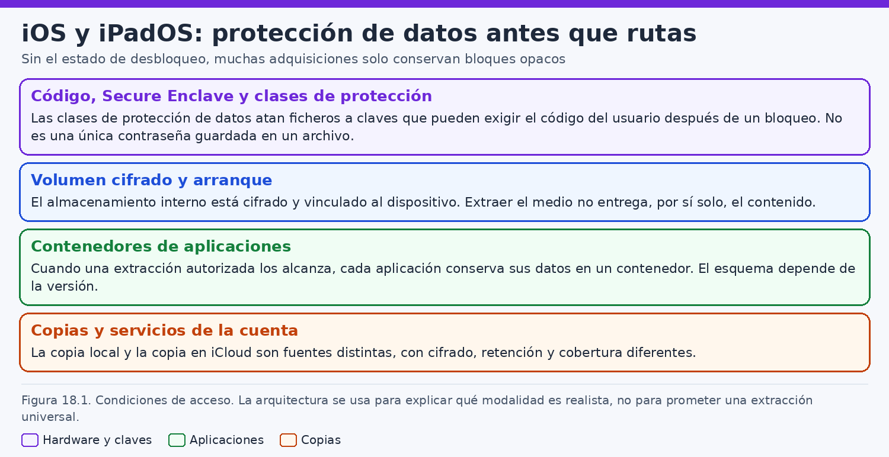
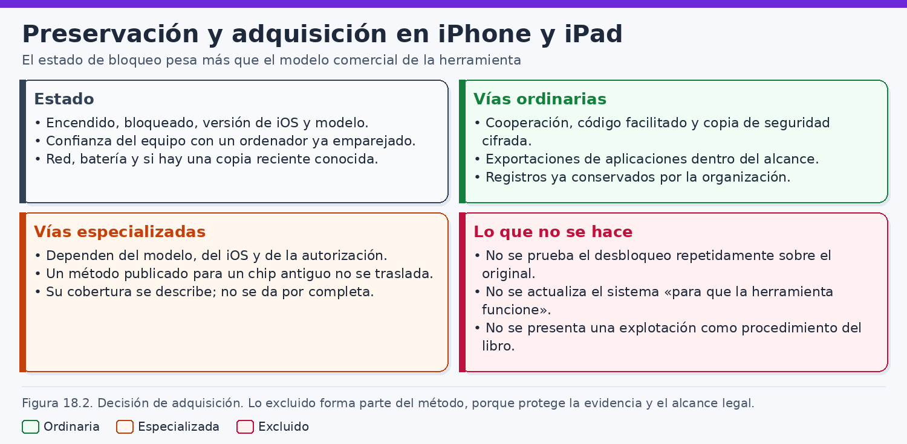
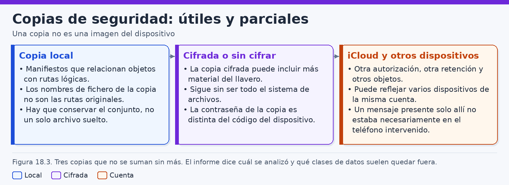
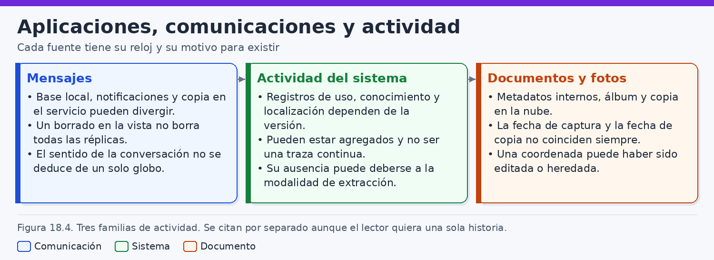
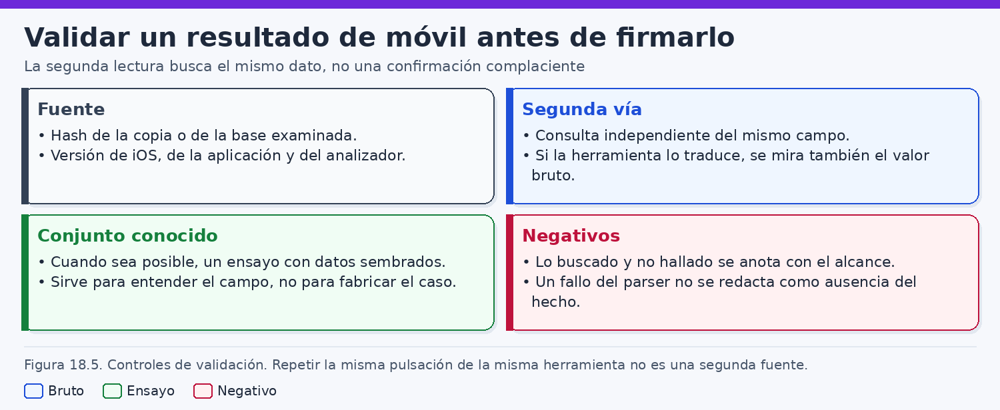
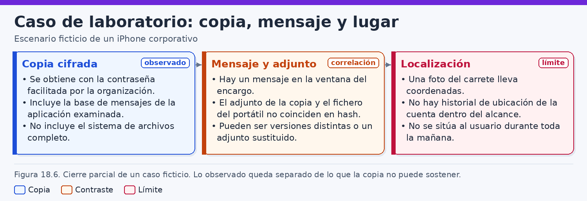

# Análisis forense de dispositivos iOS y iPadOS

> *El manifiesto nombra lo que la copia alcanzó a guardar; el código, la contraseña de esa copia y el lugar de una fotografía contestan preguntas que el manifiesto no puede cerrar.*

## Introducción

Un iPhone o un iPad concentra mensajes, fotografías, documentos y rastros de actividad en un objeto cifrado y conectado. Esa concentración invita a tratarlo como archivador completo de una persona. El análisis forense exige lo contrario: situar cada objeto en la arquitectura que lo protege, en el estado en que pudo adquirirse y en la familia de evidencia a la que pertenece. Una fila de mensajes, los bytes de un adjunto y una coordenada no dicen lo mismo, no cubren el mismo intervalo y no identifican por sí solos a quien sostenía el aparato.

iOS y iPadOS comparten un cifrado ligado al hardware, un coprocesador de claves y clases de protección que condicionan qué datos están disponibles según el dispositivo esté recién arrancado, bloqueado o desbloqueado. La referencia de esa arquitectura es *Apple Platform Security*. Este capítulo usa sus conceptos y remite a la edición vigente para nombres, condiciones y excepciones. Una lista memorizada de un año anterior puede describir mal el teléfono que está sobre la mesa.

En muchos encargos legítimos el laboratorio no recibe una imagen de bloques, sino una copia de seguridad o el resultado de una interfaz documentada. Esas vías son útiles y parciales. Una copia cifrada puede conservar elementos que una copia sin cifrar no incluye del mismo modo, y seguir sin ser el sistema de archivos. Los nombres internos de la copia clásica no son las rutas que el usuario veía: el manifiesto relaciona cada objeto con un dominio y una ruta lógica. La contraseña que abre la copia no es el código que abre el dispositivo. iCloud es otra fuente, con otra autorización.

El capítulo distingue **observación**, **inferencia técnica** e **hipótesis**. Que la copia contenga una base es un hecho de la adquisición. Que una fila enlace un identificador con una ruta es una lectura del manifiesto, válida si el esquema se ha comprobado. Sostener que una persona envió un documento para sustraer información, o que pasó toda la mañana en un lugar porque una fotografía lleva coordenadas, es una hipótesis. No se promociona a hecho porque una herramienta la haya rotulado con un verbo de acción.

Los ejemplos se ejecutan en laboratorio o sobre copias de trabajo. No autorizan a conectar un dispositivo ajeno, a ensayar códigos ni a eludir la protección. No se describe el *jailbreak*, ni el método publicado asociado a un chip antiguo, ni ningún procedimiento de explotación o de fuerza contra el código. Aquel método no se traslada a los dispositivos actuales, y este libro no lo convierte en procedimiento. Si una adquisición no alcanza un dato, el resultado profesional es documentar el hueco.

El caso final es ficticio. Litoral Asesoría Técnica conserva una copia cifrada de un iPhone corporativo. Hay un mensaje con un adjunto cuyo resumen criptográfico no coincide con el del fichero homónimo del portátil. Una fotografía con coordenadas se presenta como si situara a la persona asignataria durante toda la mañana. El trabajo separa esas tres piezas, las valida y dice qué sostienen. Nombres, dominios, horas y resúmenes son de laboratorio narrativo.

## 1. Arquitectura y protección de datos

### 1.1. Una versión concreta, no un teléfono genérico

iOS y iPadOS pertenecen a la misma familia de diseño. El iPad no es un iPhone de pantalla grande en todas sus consecuencias, ni tampoco otro sistema con otro cifrado. Comparten la protección de datos que documenta Apple, el aislamiento de las aplicaciones y el Secure Enclave en el hardware que lo incorpora. Se diferencian en el uso: el iPad admite con más naturalidad almacenamiento externo, varias ventanas y, en organizaciones, modalidades compartidas en las que el aparato no equivale a una sola persona. Aplicar el mismo esquema sin anotar modelo, versión y modo de uso produce atribuciones falsas en los dos sentidos.

La arquitectura es un mapa de condiciones de acceso. Una ruta de mensajes puede estar en la literatura y faltar en la copia. Una base de actividad puede existir en el dispositivo y no haber entrado en el volcado. El primer dato es el alcance de lo adquirido. El segundo, la versión. El tercero, el estado de bloqueo en el momento de la obtención. Sin esos tres, una ruta bien escrita en un manual es una conjetura.

Conviene anotar el modelo, el identificador que la interfaz muestre, la versión y la compilación, la capacidad, si el aparato está supervisado, si tiene código y si la pantalla estaba bloqueada tras un arranque reciente o después de al menos un desbloqueo. Esos datos determinan qué clases podían estar disponibles y qué promesas de una herramienta son plausibles. El precio o el prestigio de la herramienta no amplían las claves que el hardware no entrega.

El nombre del dispositivo y el número de línea que una propiedad de la copia muestre son atributos almacenados. El nombre lo elige quien configura el aparato. La línea puede cambiar, y un terminal puede tener más de una. Sirven para correlacionar inventarios. No identifican a una persona ni prueban un uso continuo. La persona, la cuenta de la organización, la cuenta de Apple y el aparato son cuatro referentes. El expediente gana claridad cuando no los funde.

### 1.2. Cifrado ligado al hardware

Apple documenta un almacenamiento cifrado con claves vinculadas al propio aparato. El vínculo importa más que el nombre comercial de la función. Los datos en reposo no quedan como un volumen que baste copiar bloque a bloque para leerlo en el laboratorio. Una clave de dispositivo, fundida en el hardware y no disponible como fichero que el analista pueda archivar, participa en la protección. Una representación bruta del medio, aunque alguien la obtuviera, no sería por sí misma una imagen inteligible. Este capítulo no describe cómo extraer el componente de almacenamiento ni cómo atacar ese vínculo. Registra el límite y trabaja con vías que sí puede explicar.

Conviene separar dos frases que suelen pronunciarse juntas. «El soporte está íntegro» habla de si los bytes adquiridos son los que se pretendía copiar. «El contenido es legible» habla de si existen claves y un estado que permitan interpretarlo. Puede conservarse una copia lógica verificada y faltar categorías enteras. Puede existir cifrado del medio y, además, una protección por fichero que depende del código. La integridad no llena los huecos de cobertura.

El sistema de archivos pertenece a la familia APFS. Ese parentesco con los Mac ayuda cuando de verdad se examina un sistema de archivos. En la mayoría de las copias de iPhone y iPad el analista no recibe el contenedor, ni el espacio no asignado, ni una imagen de bloques. Recibe objetos que un mecanismo de copia decidió incluir. Interpretarlos como imagen APFS completa es un error de capa.

Las aplicaciones viven en contenedores, con un identificador de paquete y con los datos que cada una escribió. El contenedor no es el registro de toda la conducta dentro de la aplicación. Mensajería, correo o almacenamiento pueden residir en un servicio del desarrollador, mientras el teléfono guarda una sesión o un caché. El aislamiento explica por qué aparece una carpeta. No explica por qué falta una conversación que el usuario veía gracias a la nube.

### 1.3. El Secure Enclave

El Secure Enclave es un subsistema separado del procesador de aplicaciones. Apple lo describe como un componente que protege claves, con arranque y memoria propios, en el hardware que la guía enumera. Para quien investiga, explica por qué ciertas claves no se exportan, por qué un código no se comprueba como si fuera la contraseña de un archivo comprimido y por qué el secreto de hardware permanece unido a ese ejemplar.

El identificador único del aparato participa en la derivación de claves. No es una cadena pensada para que el software la lea y la pegue en el informe. El material criptográfico de un dispositivo no se reutiliza en otro. Copiar datos cifrados a un segundo teléfono no los vuelve legibles. Conocer el código por una vía legítima tampoco bastaría para descifrar, fuera del enclave que debe evaluarlo, una extracción arrebatada al hardware. La comprobación del código y las esperas entre fallos son funciones del Secure Enclave.

El original no es un lugar donde ensayar códigos. Además del problema de autorización y de la alteración de la escena, la configuración puede borrar la información tras intentos fallidos. El número, las esperas y el comportamiento exacto dependen de la versión y de los ajustes, y se consultan en la guía antes de cualquier decisión de custodia. La regla de trabajo es anterior al detalle: no se fuerza el código, no se describen ataques de diccionario y no se presenta el enclave como un obstáculo que el laboratorio deba romper. Si el código no llega por una entrega voluntaria y autorizada, se documenta qué adquisiciones siguen abiertas y cuáles quedan cerradas.

La biometría —Touch ID o Face ID, según el modelo— no convierte el rostro o la huella en una contraseña legible en una fotografía. Apple describe esos mecanismos como una autorización para que el Secure Enclave use material derivado del código, bajo una política. Un desbloqueo biométrico observado por un testigo es contexto: hora y fuente. No es una clave exportable, no reconstruye el código y no demuestra por sí solo la identidad civil de quien se puso delante del sensor. Demuestra, como máximo, que el sensor aceptó una muestra en ese instante, si esa aceptación está bien observada.

Otras funciones —pagos, ciertos ítems del llavero, clases de datos exigentes— se apoyan en el mismo principio de no exportación. Puede haber rastro de que una función estaba configurada y no estar el secreto que protegía. Esa ausencia es coherente con la arquitectura. Llamarla borrado u ocultación, sin una prueba específica, confunde el diseño del fabricante con una maniobra de la persona investigada.

### 1.4. Clases de protección de datos

Sobre el cifrado del dispositivo, Apple define clases de protección para ficheros. Cada fichero se protege con material propio, envuelto con una clave de clase. La clase decide en qué estado la clave está disponible para el sistema. El concepto que hay que retener, antes que una tabla memorizada, es este: hay datos que exigen el código y dejan de estar disponibles poco después del bloqueo; hay datos que, una vez desbloqueado el aparato tras el arranque, siguen disponibles aunque la pantalla vuelva a bloquearse, hasta el reinicio; hay datos que el sistema puede seguir escribiendo en ciertas condiciones con el aparato bloqueado; y hay datos protegidos por el secreto de hardware aun cuando no dependan del código.

Esas diferencias explican por qué dos adquisiciones del mismo iPhone, con la misma herramienta, divergen si una se hizo tras un reinicio y la otra después de un desbloqueo. La pantalla apagada no informa por sí sola de cuál es el estado. Un aparato bloqueado que ya se desbloqueó desde el último arranque conserva, para el sistema, clases que uno recién arrancado todavía no ha liberado. En la literatura esos estados se nombran a menudo como anterior y posterior al primer desbloqueo. Este libro prefiere describirlos en castellano y exigir que el acta diga qué se observó.

La clase por defecto de gran parte de los datos de usuario, según la documentación de Apple, permanece disponible después del primer desbloqueo y a través de bloqueos posteriores, hasta el reinicio. Por eso apagar el teléfono «para congelar la escena» puede cerrar, de cara a una copia posterior, la información que el encargo necesitaba. La decisión de reiniciar, apagar o mantener la alimentación es una decisión de preservación. Se justifica en el acta. No es un gesto neutro.

Hay ficheros cuya clase vuelve a exigir el código cuando la pantalla se bloquea. Su ausencia en una extracción hecha con el dispositivo bloqueado no demuestra que el usuario los eliminara. Demuestra que la adquisición no los contiene. Inferir el motivo exige conocer la clase, el estado y la política de la herramienta. Si la clase no se ha comprobado para esa versión, la inferencia se detiene.

El llavero usa condiciones de accesibilidad distintas de las clases de los ficheros. Algunos ítems pueden entrar en una copia cifrada. Otros quedan marcados para no salir del dispositivo. Otros no abandonan el Secure Enclave. Confundir las dos listas lleva a pedir a una copia un secreto que el formato no transporta. La enumeración vigente —nombres, excepciones y el momento en que una clave se descarta— está en *Apple Platform Security*, en la edición de la versión examinada. Este capítulo no fija una lista cerrada para todas las generaciones: Apple puede añadir condiciones o cambiar plazos. Una tabla copiada de memoria quedaría entonces como una afirmación falsa con apariencia oficial.

Cuando haga falta decidir si un fichero podía estar legible, el camino es identificar la versión, localizar en la guía la clase que esa versión asigna a ese tipo de dato, contrastar el estado documentado y solo entonces interpretar presencia o ausencia. Si la guía y la copia no cierran la clase, el informe lo dice. Inventar la clase para completar el párrafo es peor que dejar el hueco.

### 1.5. Código, bloqueo y cuentas

El código desbloquea el aparato y participa, junto con el secreto de hardware, en ciertas clases. La biometría puede evitar teclearlo en el uso diario, dentro de las reglas de Apple, y no lo sustituye en la arquitectura. El código no es la contraseña de la cuenta de Apple, ni la de una red, ni la de una copia de seguridad. Cada secreto abre una puerta. Si el código se entrega al laboratorio con base legal y por quien puede comunicarlo, se documenta quién lo aportó, cuándo, para qué operación y qué se evitó hacer con él. Pegarlo en un informe de amplia difusión falla la minimización.

«Bloqueado», en el lenguaje ordinario, significa que la pantalla exige autenticación. En el de la protección de datos hace falta un segundo dato: si desde el último arranque hubo un desbloqueo. También se anota si el aparato estaba apagado o en la pantalla de desbloqueo posterior a un reinicio. Esas situaciones se parecen en una fotografía de la mesa y se separan en cuanto a claves.

La cuenta de Apple vincula copias en iCloud, fotos, mensajería, localización y bloqueo de activación. Una cuenta de organización puede imponer políticas distintas de las de una cuenta personal. El identificador del ajuste no prueba quién conocía la contraseña ni quién desbloqueó el teléfono esa mañana. Varias personas pueden conocer un código corporativo mal custodiado. Una persona puede usar varias cuentas. Igualar cuenta, código y biografía construye una atribución que la arquitectura no concede.

El bloqueo de activación y la localización del aparato importan a la custodia. Un dispositivo en línea puede recibir un borrado ligado a la cuenta o a la gestión empresarial. Un aparato que se restaura sin las credenciales adecuadas puede quedar inutilizable para una adquisición posterior. Esas son razones para planificar la conservación antes de conectarlo a una red, no razones para describir cómo saltarse el bloqueo.

### 1.6. Qué puede afirmarse

De la arquitectura se siguen unas pocas afirmaciones sólidas. El contenido en reposo está cifrado de un modo ligado al dispositivo. Parte de los datos de usuario depende del código y del estado de desbloqueo. El Secure Enclave no entrega sus secretos en una copia y limita la comprobación del código. Las aplicaciones están separadas. Una copia es un subconjunto lógico. Cualquier técnica que prometa «todo el sistema de archivos» en un modelo reciente tiene que explicar, con la versión del producto y el estado del aparato, de dónde salen las claves. Si no puede, la promesa no entra en el informe como hecho.

También se siguen límites de alcance. Un fichero ausente de la copia no ha sido, solo por eso, borrado por el usuario. Un secreto que no está en el llavero exportado no ha quedado, solo por eso, inexistente. Obtener lo que el diseño entrega a un ordenador de confianza es una adquisición, no una derrota de la protección.

La figura 18.1 sitúa este orden: primero la protección de datos, después las rutas. Los apartados siguientes describen qué puede pedirse sin contradecir la arquitectura, separan mensajes, actividad y fotografías, y exigen una segunda lectura del valor bruto.



Cuando la versión exacta no esté identificada, el analista puede explicar el concepto de clases, el papel del enclave y la diferencia entre copia y sistema de archivos. No puede atribuir a un fichero concreto una clase, un plazo o una exclusión sin la guía aplicable y sin el objeto real. «Pendiente de versión y de la guía aplicable» es un resultado. En un iPad de aula o de mostrador, además, el uso compartido debilita la atribución antes de abrir la primera conversación: la protección sigue siendo la de Apple, y el aparato puede haber sido desbloqueado por turnos.

## 2. Preservación y adquisición

### 2.1. El estado es parte de la escena

En un iPhone encendido, la alimentación, el bloqueo y la conectividad son evidencia y son la condición de la evidencia futura. Apagar, reiniciar, conectar a una red conocida o dejar el aparato con cobertura modifica lo que podrá adquirirse. NIST, en la guía de integración de técnicas forenses en la respuesta a incidentes y en la guía de forense de móviles, insiste en documentar, acotar la recogida y saber qué se altera al recoger. La guía de móviles es anterior a varias generaciones de iOS. Sirve como método —identificar, aislar con criterio, adquirir, verificar, informar del límite— y no como receta de botones para un modelo actual. Citarla no dispensa de añadir la versión del dispositivo y el comportamiento observado.

La primera anotación de campo lleva hora: encendido o apagado, pantalla bloqueada o no, modo avión, batería, cualquier aviso de borrado. No se manipula el aparato para descubrir más iconos antes de decidir. Cada deslizamiento puede actualizar bases y marcas de tiempo. Si una persona desbloquea el dispositivo con su código o con biometría, bajo autorización, ese acto es una intervención: quién, a qué hora y qué apareció después.

Antes de un cable se fija la identidad externa. Un número de inventario no es un número de serie. El de una hoja de compra se contrasta, cuando sea posible, con el que el dispositivo muestra por una vía autorizada. Las discrepancias se conservan. Se documenta quién entregó el aparato, con qué autorización, si es corporativo o personal, si ya existe una copia hecha por el departamento técnico y qué preguntas debe responder la adquisición. No todas exigen el mismo alcance ni el mismo riesgo de alteración. Los accesorios se inventarían aparte y no se conectan para ver si sincronizan: esa prueba crea tráfico en los dos extremos.

### 2.2. Red, alimentación y reinicio

Un dispositivo en línea puede recibir mensajes, actualizarse o aceptar un borrado remoto de la cuenta o de la flota. Aislar las radios es una medida habitual. También tiene coste: algunas comprobaciones esperan un entorno concreto, y un aparato sin red no se comporta como el aparato en uso. La decisión —modo avión, entorno sin cobertura u otra forma de aislamiento— se escribe con su motivo.

La alimentación forma parte de la misma decisión. Un teléfono que se apaga por batería puede arrancar después en un estado anterior al primer desbloqueo. Si el código no va a estar disponible, ese apagado cierra clases que hasta entonces una copia podía alcanzar. Mantener la carga, con cable y fuente controlados, conserva a veces la posibilidad de una copia útil. La hora de conexión se anota. El ordenador receptor se prepara antes del primer contacto: hora comprobada, espacio, herramienta identificada por versión y sin emparejamientos de otros casos. Conectar mientras se discute invierte el orden seguro.

Reiniciar «para dejarlo limpio» devuelve el aparato al estado en el que las clases del primer desbloqueo no están disponibles. Si alguien ya lo reinició antes de la entrega, el acta recoge el antecedente y el laboratorio trabaja con el estado real. Pedir a la persona que desbloquee puede ser legítimo cuando hay autorización y cooperación. Esa petición no se convierte en una serie de intentos ni en la recogida de un código para reutilizarlo fuera del encargo.

### 2.3. Confianza del ordenador

Cuando un ordenador se conecta por primera vez, el dispositivo pregunta si debe confiar en él. Aceptar crea un emparejamiento. A partir de ahí, el ordenador puede usar servicios que el aparato niega a un extraño, dentro de lo que la versión permita. La confianza no abre todas las clases, no descifra el Secure Enclave y no equivale a conocer el código. Es una autorización local, revocable, almacenada en los dos extremos. En el ordenador queda un registro cuya carpeta ha cambiado con las versiones del sistema de escritorio. Se localiza en la versión concreta. No se memoriza una ruta única para todos los macOS y todos los Windows.

Un emparejamiento en un ordenador de la oficina permite inferir, con matices, que en algún momento se aceptó la confianza entre ese par. No identifica quién pulsó el botón, ni prueba que la relación siguiera vigente, ni autoriza a usar ese ordenador como consola de extracción. Un emparejamiento antiguo en el puesto de laboratorio es, además, un riesgo de contaminación. El puesto se limpia, se documenta y se dedica al caso.

La confianza tampoco sustituye a la contraseña de una copia cifrada. El ordenador emparejado puede iniciar la copia y encontrarse con un secreto que nadie en la sala conoce. Ahí se detiene la obtención. No empieza un ensayo de contraseñas, que este libro no describe. Si la organización custodia la contraseña de las copias de flota en un gestor de secretos, su entrega es otro eslabón: quién la extrajo, con qué ticket y para qué copia.

Si el dispositivo pregunta y no hay una persona autorizada a responder, la adquisición por esa vía no sigue. El informe puede decir: no se estableció confianza; la copia en vivo no se obtuvo; se preservó el aparato en el estado observado. Esa frase es un resultado completo de una diligencia negativa.

### 2.4. Vías que el laboratorio puede explicar

Este libro admite las vías que pueden describirse sin explotación: la copia autorizada, la exportación que una interfaz documentada entrega cuando hay confianza y estado suficiente, la copia ya hecha por la organización y las fuentes externas —inventario de gestión, registros de cuenta cuando la ley lo permita, otros equipos—. Cada una tiene un alcance distinto. El informe nombra la vía real y evita el título «extracción completa», que el lector no técnico entiende como «todo lo que hubo en el teléfono».

Una copia local hecha desde un ordenador de confianza es una adquisición lógica. Contiene lo que el mecanismo incluye para esa versión y ese cifrado. No contiene el espacio no asignado, no garantiza todas las aplicaciones y no reproduce la memoria. Puede ser, con todo, la mejor fuente disponible para mensajes y ficheros que sí entran en el formato. Llamarla parcial fija el valor de un hallazgo y el valor de una ausencia. No la desprecia.

Las herramientas, comerciales o libres, que implementan protocolos de dispositivo pueden ahorrar pasos y añadir interpretación. Su uso es legítimo cuando la licencia, la autorización y la validación acompañan al caso. Su salida es un derivado. El objeto de origen se conserva al lado. La versión se anota porque el mismo nombre, un mes después, puede cambiar de analizador, de cobertura o de presentación de las fechas.

Han circulado técnicas asociadas a generaciones antiguas de chips. No se explican aquí: ni pasos, ni útiles, ni condiciones de éxito. Un método publicado para un chip antiguo no se traslada a los dispositivos actuales. El modelo, la revisión del silicio y la versión del sistema cambian las condiciones, y una nota antigua no es una capacidad presente del laboratorio. Este libro no lo convierte en procedimiento. Si el aparato es reciente y la vía explicable es la copia o la cooperación de quien conoce el código, el plan se ajusta a esa vía.

Tampoco se describe fuerza contra el código, contra la contraseña de la copia o contra la cuenta. Si esos secretos se obtienen, es porque quien puede entregarlos lo hace bajo la autorización, o porque ya obran en poder legítimo de la organización. El laboratorio verifica que el secreto abre el objeto previsto, registra el uso y no lo reutiliza.

### 2.5. Flota, supervisión y acta

En un dispositivo corporativo aparecen la supervisión, la inscripción en el programa de la organización y la gestión de flota. Permiten imponer perfiles, inventariar y, según la configuración, restringir funciones o provocar un borrado. El inventario puede confirmar serie, versión y cuenta asignada en una fecha. No demuestra qué persona llevaba el teléfono. El borrado de gestión puede destruir la escena si el aparato sigue alcanzable. Coordinarse con quien administra la flota forma parte de la preservación.

A menudo el laboratorio recibe la copia ya hecha. Eso no excusa de preguntar desde qué puesto, con qué herramienta, si había confianza, si el dispositivo estaba desbloqueado, qué versión se declaró, dónde quedó la contraseña y qué hash se calculó al entregar. Una copia aparecida en una carpeta de red, sin acta, es un objeto de autenticidad pendiente. El iPad de la misma cuenta, el portátil y la nube son otros objetos. El caso mostrará el coste de dar por visto el puesto de trabajo mirando solo el teléfono: dos PDF pueden compartir nombre y no compartir un byte, y un iPad no adquirido puede ser el origen de un mensaje que la copia del iPhone solo refleja por sincronización.

La figura 18.2 reúne el criterio para iPhone y iPad. El acta debe permitir reconstruir el orden: estado observado, decisión sobre red y alimentación, confianza, vía, secreto usado si lo hubo, versión de la herramienta e identificadores de los objetos.



Cada objeto recibe un identificador de caso, distinto del nombre comercial y del nombre puesto en Ajustes. El hash se calcula con un algoritmo explícito, sobre los bytes que se conservarán, y se guarda la herramienta y la versión. Resumir una carpeta descomprimida y compararlo con el archivo comprimido que entregó sistemas es comparar cosas distintas. Si la copia tarda, el dispositivo sigue encendido y conectado: las marcas posteriores al inicio pueden ser efecto de la propia copia, de una aplicación activa o de un mensaje llegado antes del aislamiento. Se anotan inicio y fin. Un fallo a medias se documenta con el mensaje literal de la herramienta. No se reintenta en bucle contra el original. La copia de trabajo se saca de la maestra y es la que se abre en el examen.

La adquisición queda descrita con frases comprobables: aparato, estado, vía, qué se incluyó, qué se sabe excluido, qué secreto se usó y qué no se intentó. Entre lo no intentado debe poder leerse, cuando sea el caso, que no hubo ensayos de código, ni modificación del sistema, ni explotación. Las fuentes que se decidieron no pedir —cuenta de iCloud, iPad, portátil, gestión, copia del día anterior— se listan. No pedirlas puede ser proporcional. Omitir que existen impide entender el hueco.

## 3. Copias de seguridad y sus limitaciones

### 3.1. Objetos opacos y manifiesto

La copia local clásica —durante años asociada a iTunes y hoy iniciada desde Finder en macOS, o desde la aplicación que Apple ofrezca en otros sistemas— es un directorio de objetos más unos ficheros de descripción. Los nombres internos no son las rutas del usuario. En el formato clásico suelen ser identificadores opacos, a menudo un resumen del dominio y de la ruta, que no se leen a simple vista. Buscar un fichero llamado `sms.db` dentro de la carpeta es un método erróneo. Que ese nombre no aparezca no significa que no haya mensajes.

El manifiesto relaciona cada objeto con su dominio y su ruta lógica. En el formato habitual es una base SQLite, junto a listas de propiedades con datos del dispositivo y del estado de la copia. Los nombres de esos ficheros y el esquema se comprueban en la copia real. Han sido estables durante periodos largos y no por ello se citan de memoria sin abrir el esquema. Un cambio de formato convierte una consulta memorizada en una ausencia ficticia.

Los dominios agrupan las rutas: hogar del sistema, aplicaciones, fototeca y los que la versión incluya. La ruta lógica es relativa al dominio. Juntas reconstruyen una localización lógica, que explica el papel del fichero y no prueba que la copia haya traído todo el directorio. De un mismo directorio pueden entrar unos ficheros y no otros, por exclusiones del mecanismo o porque la aplicación marcó datos que no desea volcar.

La inferencia correcta, con el esquema comprobado, tiene esta forma: el objeto con este identificador está relacionado por el manifiesto con este dominio y esta ruta. La observación es la fila y el hash del objeto. El manifiesto no es un historial de uso. Es un índice de la copia.

### 3.2. Cifrada, sin cifrar y contraseña distinta del código

La copia puede estar cifrada o no. Apple documenta que el cifrado amplía lo que el volcado puede incluir, en particular ciertos ítems del llavero, y protege el contenido en el ordenador que lo almacena. Una copia sin cifrar deja más material en claro y omite categorías que la cifrada sí puede transportar. Ninguna de las dos es una imagen del sistema. Ninguna contiene los secretos que no salen del Secure Enclave ni los ítems marcados para permanecer solo en el dispositivo. La guía vigente dice qué puede entrar. El manifiesto de esta copia dice qué entró.

Quien custodia copias sin cifrar custodia mensajes, contactos y fotografías en claro. El acceso se registra igual que con cualquier evidencia sensible. La copia cifrada exige su contraseña para que el contenido sea inteligible. Sin ella pueden conservarse los bytes y describir el contenedor. No pueden leerse las bases. Presentar esa conservación como un análisis de mensajes hecho es un informe ficticio. Obtener la contraseña por una vía legítima, o concluir que el contenido permanece inaccesible, son los dos cierres posibles. No hay aquí un procedimiento para recuperarla por fuerza.

La contraseña de la copia se elige al activar ese cifrado. Protege la copia. El código del dispositivo desbloquea el aparato y participa en las clases. Son secretos distintos, creados en momentos distintos y custodiados a menudo por personas distintas. Conocer el código no revela la contraseña de la copia. Conocer la contraseña de la copia no desbloquea el teléfono. Una frase del encargo que diga «tenemos la clave del iPhone» se devuelve hasta que se aclare cuál de las dos es.

En la flota, el área de seguridad puede custodiar la contraseña de las copias sin custodiar el código de cada empleado. El laboratorio usa la primera para leer la copia y no la convierte en medio de desbloqueo. Si ambos secretos coincidieran por reutilización humana, el informe puede notarlo como hecho de gestión, una vez comprobado, sin convertir la reutilización en técnica. Tampoco coinciden necesariamente con la contraseña de la cuenta de Apple. Abrir la copia local no inicia sesión en la cuenta. Iniciar sesión, cuando está autorizado, no descifra una copia local cuya contraseña se desconoce.

El acta separa tres datos: si esta copia está cifrada, si se dispone de la contraseña y si esa contraseña estaba bajo custodia corporativa o la aportó una persona. Esos tres deciden el alcance del análisis.

### 3.3. Leer el manifiesto en una copia de trabajo

La copia maestra permanece intacta. Se trabaja sobre una copia de la copia. Antes de dar por buena una ruta se lee el esquema. El patrón siguiente es de laboratorio, no un script universal: si la copia está cifrada, el descifrado previo usa la herramienta y la contraseña autorizadas; los nombres de tabla se confirman porque pueden variar.

```bash
# Laboratorio. COPIA DE TRABAJO ya descifrada con la contraseña
# custodiada. No es el original del dispositivo.
sqlite3 /caso/IOS-LAB-18/trabajo/Manifest.db ".schema"
```

Solo después se piden filas. Un patrón habitual selecciona identificador, dominio y ruta, y filtra por el nombre lógico, no por el nombre opaco del objeto en disco.

```sql
-- Ilustrativo. Se ejecuta si .schema muestra estas columnas.
SELECT fileID, domain, relativePath
FROM Files
WHERE relativePath LIKE '%sms.db%';
```

Cuando el patrón encaja, el objeto se copia a un derivado con nombre comprensible, se resume y se enlaza al identificador de origen. Si no hay filas, la conclusión intermedia es que, con ese filtro y ese esquema, el manifiesto no muestra esa ruta. Se revisan dominios, se comprueba que la base sea la ya descifrada y se registra la búsqueda negativa. Aún no puede decirse que el dispositivo no tuviera mensajes: la copia puede excluirlos, el nombre lógico puede ser otro, o la conversación puede vivir en un servicio de sincronización.

Las listas de propiedades suelen aportar nombre de dispositivo y versión del momento de la copia. Se contrastan con el inventario físico. Una diferencia entre la versión de la copia y la anotada por el custodio es una incidencia: actualización intermedia, error de transcripción o copia de otro aparato. Se resuelve antes de citar la versión en el informe.

### 3.4. Válida y, aun así, parcial

«La copia terminó sin error» significa que la herramienta cerró su operación. No significa que todas las preguntas tengan respuesta dentro. Hay exclusiones de diseño y exclusiones de hecho: copia interrumpida, bloqueo durante el proceso, categoría desmarcada. El manifiesto lista rutas que tienen objeto. No dice qué existía fuera de esas rutas.

Algunas aplicaciones incluyen su base. Otras, solo configuración. Otras dejan la conversación en el servidor del desarrollador. El analista describe el dominio que el manifiesto contiene. Una captura de pantalla hecha a mano, si se admite, es otra evidencia, con su propia integridad, no un parche silencioso de la base.

Si el manifiesto lista la base SQLite y también sus ficheros de diario, llevarse solo el principal puede dejar fuera transacciones. Si no lista auxiliares, no se inventan: la copia trae la base en el estado en que el mecanismo la volcó. La figura 18.3 fija esta utilidad parcial. La copia del caso servirá para un mensaje, un adjunto y una fotografía, y no para la mañana entera, ni para el portátil, ni para la actividad de otro aparato de la misma cuenta.



### 3.5. iCloud, otro canal y otro corte

La copia en iCloud no es la copia local subida con otro nombre. Es un servicio distinto, con otra retención, otro cifrado y otra autorización. Acceder exige credenciales que la organización custodie legítimamente, cooperación de la titularidad o un requerimiento que la norma permita. Este capítulo no describe cómo entrar en una cuenta ajena, cómo recuperar una contraseña de Apple ni cómo eludir un segundo factor. Si la fuente no está autorizada, queda pendiente.

Las fotos en iCloud, el disco en iCloud y los mensajes en iCloud pueden hacer que el contenido canónico esté en el servicio y que la copia local venga incompleta porque el sistema ya cuenta con ese respaldo. Una copia local sin fototeca completa puede convivir con una cuenta llena de fotografías. Una base de mensajes en el teléfono puede no contener el historial que el usuario ve si la sincronización está activa. Se leen ajustes y fuentes. No se supone que la copia local sea el universo.

La protección avanzada de datos de iCloud, cuando la cuenta la tiene activa, cambia cuántas categorías quedan cifradas de extremo a extremo y qué puede aportar el proveedor. El nombre en la interfaz y la lista de categorías se leen en la documentación vigente y en el estado de la cuenta. El criterio basta: preguntar si está activa antes de esperar que un requerimiento devuelva lo mismo que en una cuenta que no la usa.

Una exportación de iCloud, si llega, es un objeto nuevo, con fecha de generación, alcance y hash. No se mezcla en la carpeta de la copia local sin un índice. Las fechas pueden solaparse y contradecirse por sincronización, zona horaria o versión. Un mensaje presente en la nube y ausente en la copia local admite sincronización selectiva, borrado posterior, exclusión del mecanismo o error de extracción. Elegir una explicación sin la segunda fuente es precipitado.

La copia tiene una hora de creación. Los objetos tienen las marcas del mecanismo y, dentro de las bases, las de la aplicación. Esas horas no se intercambian. Que la copia se hiciera el viernes no sitúa el mensaje el viernes. Que un fichero tenga una modificación antigua no prueba que el mensaje que lo adjuntaba sea igual de antiguo. El reloj del dispositivo, el del puesto que generó la copia y el del portátil pueden estar en zonas distintas. Se conservan las marcas en bruto y se anota la zona de presentación. Convertir todo en el primer paso, sin guardar el original, impide deshacer un error.

Las copias sucesivas son cortes distintos. Si la herramienta sustituye la anterior, quien llegue tarde solo verá el último. Coordinar la retención al principio evita descubrir que la copia anterior a una manipulación ya no existe. Si hay varias, cada una tiene hash y hora. Compararlas exige dos manifiestos.

Al cerrar el inventario puede afirmarse un conjunto pequeño: copia identificada, cifrada o no, abierta o no con una contraseña que no es el código, relacionada por el manifiesto desde identificadores opacos hasta rutas lógicas, con versión declarada, dominios presentes y búsquedas sin filas. Se sabe también lo que no puede responder: espacio no asignado, secretos que no viajan, servicios no incluidos y otros aparatos. Con eso puede empezar el análisis de aplicaciones.

## 4. Análisis de aplicaciones, comunicaciones y actividad

### 4.1. Tres familias

Los mensajes, la actividad del sistema y las fotografías se analizan por separado. Un mensaje es un registro de comunicaciones: texto o adjunto, identificadores de conversación, marcas propias y, a menudo, sincronización entre aparatos de la misma cuenta. Una fotografía es un objeto de la fototeca, o un fichero llegado por otra vía, con metadatos que pueden incluir un instante y unas coordenadas. La actividad —uso de aplicaciones, bloqueos, muestras de localización cuando existen— es una tercera escritura, con otra retención y otros huecos.

Sustituir una familia por otra produce conclusiones cómodas y falsas. El texto «estoy en el cliente» no es un punto de localización. El punto de una foto no confirma el envío de un acta. El intervalo en que la aplicación de mensajes estuvo en primer plano no revela la frase. La cronología puede reunir las tres y debe etiquetar la familia de cada fila. Quien lea ha de poder retirar una familia y ver qué queda de la afirmación. La figura 18.4 organiza ese criterio frente a las vistas que funden las tres en un solo verbo.



### 4.2. Mensajes, hilos y adjuntos

La aplicación de mensajes del sistema guarda, en muchas versiones, una base SQLite cuya ruta lógica habitual acaba en un nombre como `sms.db`. «Habitual» no es «universal». Primero se localiza la ruta en el manifiesto y se lista el esquema. Los nombres históricos de tablas —mensaje, contacto, conversación, adjunto y relaciones— orientan y se verifican. Una columna ausente no se rellena con el valor de otra versión.

Una fila es una observación: este identificador, este texto si la columna lo contiene, esta marca en bruto, este indicador de dirección si existe. La inferencia técnica enlaza la fila con un contacto y un hilo cuando las claves cuadran. La hipótesis de que una persona tecleó el texto exige más: quién podía usar el aparato, si la cuenta sincroniza entre dispositivos, qué significa en esta versión el indicador de dirección y si el registro pudo llegar por restauración. Ese indicador es un campo, no una declaración. Se cita el valor bruto y el significado que la versión acredita.

El texto afirma lo que afirma. Si dice que se adjunta el acta de la mañana, esa frase no es una pericia sobre el PDF. El adjunto es otra fila y, si la copia lo trajo, otros bytes. El nombre visible puede repetirse, truncarse o no coincidir con el tipo. Se resumen los bytes y, cuando hace falta, se observa la cabecera. Comparar nombres entre teléfono y portátil es una criba. Comparar resúmenes es la comprobación.

Los estados de entrega y de lectura hablan de lo que la aplicación guardó. Un acuse no prueba una lectura atenta. Su ausencia puede deberse al servicio, a la versión o a que no se conservó. Borrar una fila de SQLite no siempre borra al instante todo rastro en las páginas libres, y una copia puede no traer esas páginas en estado recuperable. Los candidatos se validan. No se afirma un texto borrado a partir de un fragmento ilegible, y no se describe ninguna forma de borrar mejor.

Las aplicaciones que no son la de mensajes del sistema —correo, mensajería de terceros, chats de una suite— son otras bases u otras ausencias. Se localizan por identificador de paquete. Su esquema lo decide el desarrollador y cambia con la versión de la aplicación, que no coincide siempre con la del sistema. Si el contenido no se volcó, la fuente siguiente puede ser el servidor, con otra autorización.

### 4.3. SQLite y el valor bruto del tiempo

SQLite es el formato práctico de mensajes, del manifiesto y de muchas otras bases. El proyecto documenta el formato de fichero y el diario de escritura previa. La base puede ir acompañada de un diario o de ficheros `-wal` y `-shm`. Copiar solo el principal mientras está activa puede perder transacciones aún no integradas. En una copia de seguridad, el mecanismo puede haber volcado la base ya consolidada. En una captura en caliente, los auxiliares pueden ser imprescindibles. El inventario dice cuál es el caso. Se trabaja sobre una copia, en un modo que no la escriba, y se anota la versión del cliente.

Las marcas temporales exigen abstención. En el ecosistema de Apple es habitual un entero contado desde una época distinta de la de Unix, y la unidad —segundo o una fracción menor— ha cambiado entre versiones de una misma base. Este libro no publica una fórmula única. Se lee el entero, se contrasta con un valor conocido en un dispositivo de laboratorio de la misma versión, o con la documentación de esa versión, y solo entonces se convierte. Una unidad errónea desplaza el acontecimiento y puede fabricar una coartada. Por eso la validación pide una segunda consulta del bruto, no de la fecha ya traducida.

Las consultas se guardan junto con el recuento de filas del entorno, no solo la fila estrella. Las vistas amables de una herramienta comercial son una pista y se contrastan con la tabla de origen. Si la herramienta no deja llegar a la tabla, el límite se declara y la afirmación se modera.

### 4.4. Fotografías y coordenadas

La fototeca puede contener capturas de cámara, pantallazos, descargas, elementos recibidos y objetos sincronizados. El origen, cuando la versión lo registra, es una afirmación del software. Se lee en bruto y se compara el fichero de imagen con la fila de la base. Una miniatura no sustituye al original ausente. El hash se calcula sobre el objeto que se va a citar.

Las coordenadas sitúan ese objeto en un instante, con la precisión que el registro traiga. Un campo de exactitud, si existe y se ha identificado, limita la lectura espacial. Un punto no es un recorrido. Una fotografía a las nueve y diecisiete no ocupa la mañana, no dice quién sostenía el aparato y no dice si la persona de la cuenta estaba en otro sitio con otro teléfono. Puede ser compatible con una presencia en ese minuto. La presencia continua necesita una serie, y la serie puede no existir.

Hay imágenes sin coordenadas. Esa ausencia no sitúa el aparato en un interior: solo dice que ese objeto no aporta coordenadas. Hay imágenes con coordenadas de otro dispositivo, llegadas por sincronización o por descarga. El origen se investiga antes de pintar un mapa. Si el informe incluye uno, indica qué objetos tienen punto, cuáles no y qué intervalo carece de muestras. La hora de la foto y la del mensaje que la reenvía pueden diferir, y cada copia puede tener un hash distinto. El objeto de la fototeca y el adjunto se resumen por separado aunque a la vista se parezcan. En el iPad, la misma nube puede convivir con un volcado local distinto: una imagen vista allí y ausente en la copia del iPhone es una pregunta, no todavía una contradicción.

### 4.5. Actividad del sistema y otros rastros

La actividad reúne usos que no son el texto ni el píxel. Según la versión, el dispositivo conserva intervalos de aplicaciones y, a veces, contexto de pantalla o de ubicación. Nombres conocidos en la literatura, entre ellos bases citadas como knowledgeC, aparecen en unas versiones y cambian en otras. El método es buscar en el manifiesto qué bases trae esta copia, abrir su esquema y describir los intervalos que contienen. Un intervalo de la aplicación de mensajes no dice qué conversación se abrió. Puede corroborar, si la semántica se ha comprobado, que el sistema anotó esa aplicación. Subir de ahí a «la persona leyó el chat del cliente» es el salto que hay que impedir.

Las muestras de localización del sistema, cuando la copia las incluye y los ajustes las generaban, son puntos con sus reglas de precisión y de retención. Pueden faltar en una copia que sí tiene fotos con coordenadas, o existir y contradecir el relato de una foto aislada. Su ausencia demuestra que esta adquisición no las trae o que la consulta no las encontró, no que el teléfono no registrara posición. Encendidos y desbloqueos, si hay fuente y está adquirida, acotan el estado y no identifican el dedo. En un código compartido, un desbloqueo acredita conocimiento del factor, no elige entre las personas que lo poseían.

El navegador puede dejar historial. El recordatorio aquí es de alcance: lo que no esté en la copia no se analiza como si estuviera, y una visita del teléfono no es la del portátil. La sincronización puede duplicar historiales y también hacer que el aparato guarde menos de lo que el usuario cree. Los documentos se identifican por hash, tamaño y cabecera. Dos actas con el mismo nombre son dos hipótesis de identidad hasta que los bytes coinciden. El correo del teléfono puede ser una ventana a un servidor: la copia sin buzón no prueba que el buzón no exista en el servicio.

### 4.6. Reloj y varios aparatos

Antes de alinear mensaje, foto y actividad se fija la zona de presentación y se conserva la marca bruta. Si una conversión no está comprobada, esa marca no entra en la cronología fina. Una cronología con un hueco honesto es preferible a una simétrica construida sobre una unidad adivinada.

La misma persona puede tener el iPhone, el iPad y el portátil con la sesión iniciada. Un mensaje de la copia del iPhone puede haberse compuesto en el iPad. Algunas versiones guardan indicios de origen. Si no están, la observación se queda así: la copia de este iPhone contiene la fila. La inferencia de que este aparato envió el texto no se concede sola. Puede afirmarse, cuando los datos lleguen validados, que la cuenta conservaba ese mensaje y esos bytes, que esos bytes no son los de otro equipo si los hashes difieren, y que una fotografía lleva unas coordenadas y un instante. Esas afirmaciones orientan una investigación interna sin disfrazarse de relato sobre la mañana de una persona.

La correlación útil tiene forma de tabla: hora bruta, hora presentada, familia, objeto, observación, inferencia permitida e hipótesis que todavía no se toca. Cuando las fuentes se contradicen, la contradicción es un hallazgo. Un texto que habla de toda la mañana y una serie que no la cubre no se resuelven eligiendo la fuente que confirma el encargo. Quizá el texto exagera. Quizá la serie está incompleta. Las dos posibilidades siguen abiertas. El analista no está obligado a cerrarlas para entregar un informe útil. Está obligado a no cerrarlas de más.

## 5. Validación de resultados

### 5.1. Una pantalla coherente puede ser falsa

Las herramientas presentan fechas convertidas, nombres resueltos y mapas pintados. Ese servicio concentra errores: una época mal elegida, un esquema leído con el analizador de la versión anterior o un adjunto extraído a medias producen una pantalla coherente y falsa. La validación permite que otra persona, con la misma copia y la misma sentencia, llegue al mismo valor.

NIST mantiene un programa de pruebas de herramientas forenses. Sus informes, cuando existen para un producto y una versión, documentan un comportamiento en aquellas condiciones. Un resultado favorable sobre otra versión no certifica la compilación del laboratorio. SWGDE publica prácticas de adquisición, análisis e informe que ayudan a fijar qué debe quedar escrito. Ninguna de las dos fuentes reemplaza la comprobación sobre los objetos del caso. La figura 18.5 condensa el gesto mínimo: volver al valor bruto, anotar la versión del analizador y conservar los negativos.



### 5.2. Segunda consulta del valor bruto

El valor bruto es el de la base o el fichero, antes de la traducción. En un mensaje suele ser el entero de la fecha, el identificador, el indicador de dirección, el texto y el identificador del adjunto. En un adjunto, los bytes y su longitud. En una fotografía, el fichero y los metadatos sin pasar por el mapa. La segunda consulta usa otro camino: otra sentencia sobre la copia de trabajo, otra herramienta que no comparta el mismo analizador, o un volcado del valor binario.

La coincidencia sostiene que el valor no es un artefacto de una sola interfaz. La discrepancia detiene el hallazgo. No se promedia. Se investiga qué camino convirtió, truncó o leyó un derivado antiguo. Si ninguno se explica, la afirmación no entra en el informe final. Conviene que la segunda consulta la haga otra persona, o la misma con una sentencia escrita antes de mirar otra vez la pantalla comercial. Repetir el mismo botón no es una segunda consulta. El cuaderno guarda la sentencia, la versión del cliente, el hash de la base y el valor obtenido.

```sql
-- Segunda lectura, sobre la COPIA de trabajo de la base de mensajes.
-- Identificadores del caso; las columnas se confirman con .schema.
SELECT rowid, date, is_from_me, text
FROM message
WHERE rowid = 1842;
```

El entero se transcribe tal cual. La fecha civil se anota al lado, marcada como derivada. Si más adelante se corrige la unidad, el entero sigue siendo verdadero y la fecha se versiona. Borrar la primera conversión para que no se note el error destruye la trazabilidad.

### 5.3. Versión del analizador

El analizador —el *parser*— es el componente que presenta un formato como filas, fechas y nombres. Puede ser el cliente SQLite, un módulo comercial, un script del laboratorio o una combinación. Cada uno tiene versión, y el informe la cita. «La herramienta X» no basta cuando X publica compilaciones frecuentes. La versión del sistema del dispositivo forma parte de la misma ficha. Un analizador escrito para una generación de la base de mensajes puede leer mal la siguiente y, aun así, mostrar filas. El síntoma a veces es una fecha en un siglo imposible, un campo desplazado o un tamaño que no cuadra con la longitud del valor. Esos síntomas se buscan.

Las herramientas se ensayan con un dispositivo de referencia y datos sintéticos: un mensaje a una hora anotada por un reloj independiente, una foto con coordenadas decididas de antemano, un adjunto de hash conocido. El desvío se corrige o la herramienta se aparta de esa tarea. Un ensayo en un iPhone del laboratorio no demuestra acierto en otro modelo o en otra versión menor. Los informes del programa de pruebas se leen por categorías: una herramienta puede acertar en un listado y fallar en los adjuntos. Si el caso depende de un hash, la validación se concentra ahí.

### 5.4. Negativos, derivados y alcance

Un negativo dice que una búsqueda, en un objeto, con un filtro, no devolvió filas o bytes. «No hay en esta copia otro adjunto con el hash del portátil» es preciso. «No existió otro acta» es una extrapolación. «No hay, en las bases de actividad incluidas, una serie de localización entre las ocho y las doce» es preciso. «No se movió del sitio» no lo es. Los negativos que afecten a las hipótesis se registran con sentencia, versión y objeto resumido. También es un resultado no haber podido validar: si no hay bruto accesible, el hallazgo queda marcado y no se presenta a un tercero con la fuerza de una fila reconsultada.

Cada transformación —descifrado autorizado, extracción según el manifiesto, exportación de un adjunto— produce un derivado con hash propio, enlazado al padre. Un revisor ha de poder ir del fichero citado al identificador del manifiesto y de ahí a la copia maestra. Los derivados no se guardan encima del maestro. Si una corrección cambia un resultado ya comunicado, se conservan las dos versiones y se explica la diferencia. La validación fortalece valores: este entero, estos bytes, esta ausencia en esta consulta. No fortalece por ósmosis las hipótesis vecinas. Un hash bien leído no prueba una finalidad. Una coordenada bien leída no prueba la mañana entera.

## 6. Caso práctico

### 6.1. El encargo, ficticio y separado en tres preguntas

El caso es ficticio. El 18 de septiembre de 2026, Litoral Asesoría Técnica, dominio `litoral.example`, encarga una revisión interna autorizada por su área jurídica. La dirección pregunta tres cosas: si desde el iPhone corporativo se envió el acta de la visita a Norte Industrial, si el PDF de ese envío es el mismo que está en el portátil de la cuenta y si una fotografía demuestra que Marta Soler permaneció en la sede del cliente durante toda la mañana del día 17. Personas, empresas y dominios son inventados. Las horas ordenan el método.

La cuenta `marta.soler@litoral.example` está asignada a un iPhone supervisado, a un iPad que este encargo no adquiere y a un portátil del que otro equipo entrega un solo fichero. El laboratorio recibe el dispositivo con el acta de sistemas, una copia cifrada hecha por ese equipo y el fichero del portátil con su resumen. No recibe el código del iPhone. Recibe, por el gestor de secretos y con un ticket, la contraseña de las copias de flota. No la usa para otra cosa ni la transcribe en el informe de dirección. La identifica como secreto de copia, ticket interno ficticio `ST-1842`.

Las tres preguntas no caben en un solo sí. La primera habla de un mensaje y de un adjunto. La segunda compara bytes. La tercera pide a una fotografía una cobertura que una fotografía no tiene.

### 6.2. La copia cifrada corporativa

El acta de sistemas, que el laboratorio contrasta y no reescribe, dice que el 18 de septiembre de 2026, a las 08:12 de Europe/Madrid, un puesto ya emparejado inició una copia cifrada. El aparato estaba encendido y se había desbloqueado esa mañana con la cooperación de la persona asignataria, a petición de la empresa y con constancia en el ticket. Después se aisló la red. La copia terminó a las 08:41. El puesto calculó un hash que el laboratorio verifica sobre el paquete recibido antes de hacer la copia de trabajo. Nadie ensayó códigos. No hubo modificación del sistema ni método de explotación.

El aparato es `IOS-LAB-18`. La copia es `BK-18-01`. El iPad `IPAD-LAB-18` queda fuera de alcance, con reserva de ampliar. El portátil aporta `LP-18-PDF`. Este capítulo no reabre esa adquisición: compara bytes. La versión que el acta y las propiedades de la copia declaran coincide; el relato no la extrapola a otras versiones. Si hubieran discrepado, el análisis se habría detenido en esa incidencia.

Sobre la copia de trabajo, descifrada con la contraseña de flota, el manifiesto relaciona un identificador opaco con la ruta lógica de la base de mensajes. El nombre del objeto en disco no contiene esa ruta. Buscar `sms.db` por nombre de fichero habría producido un falso negativo. Se extrae el derivado `MSG-18-DB`, se resume y se abre en lectura. El esquema se archiva. Una fila cae en la mañana del día 17. El entero bruto se transcribe. La conversión a las 09:41:22 de Europe/Madrid se hace después de comprobar la unidad en un dispositivo de laboratorio de la misma versión. La herramienta comercial muestra la misma hora. Se anotan las dos versiones de analizador.

El indicador de dirección, en bruto, corresponde en esta versión a un mensaje saliente de la cuenta. Eso no identifica el aparato que lo compuso. La base, en este ficticio, no ofrece un campo que el laboratorio haya podido verificar como distintivo entre iPhone y iPad. La observación queda así: la copia del iPhone contiene un mensaje saliente de la cuenta. Siguen abiertas la hipótesis de que se tecleó en el iPhone y la de que se sincronizó desde el iPad.

El texto inventado dice: «Adjunto el acta de la visita de esta mañana en Norte Industrial». Es contenido del mensaje. Afirma, como afirmación del emisor, que el adjunto es el acta y que la visita ocupó la mañana. No es un hecho sobre el PDF ni sobre la presencia física.

### 6.3. El adjunto cuyo hash no es el del portátil

La fila enlaza, por las tablas que el esquema confirma, con un adjunto de nombre visible `acta-visita-norte.pdf`. Los bytes están en la copia y se extraen a `ATT-18-01`. Dos cálculos independientes de SHA-256 coinciden. En el relato, ese valor de ejemplo —no una salida real— se etiqueta `H-ATT-18` y comienza por `9f3c1a77`. La longitud es 184320 bytes. La cabecera es coherente con un PDF, lo que identifica el tipo mejor que la extensión y no analiza el contenido del acta.

`LP-18-PDF` llega con el mismo nombre visible, 201114 bytes y un hash de ejemplo `H-LP-18` que comienza por `21ab84c0`. Las longitudes difieren. Los hashes, recalculados en el laboratorio sobre cada objeto, no coinciden. Los bytes de la copia y los bytes entregados como fichero del portátil no son el mismo objeto. Esa inferencia negativa es precisa: no son dos copias íntegras del mismo fichero.

El desacuerdo no elige la historia. Puede haber dos versiones de un trabajo, un documento distinto con el mismo nombre, un fichero generado en otro aparato y llegado por la cuenta, o una edición del portátil posterior al mensaje. Todas predicen hashes distintos. El desacuerdo elimina solo la identidad de los bytes. Una búsqueda registrada en lo revisado de `BK-18-01` no encuentra `H-LP-18`. El negativo tiene alcance: en esa revisión no está el PDF del portátil. No dice que faltara fuera de la copia, ni en el iPad, ni en un servicio en la nube.

La dirección preguntaba si «el» acta enviada es «el» acta del portátil. Si «el acta enviada» es `ATT-18-01`, no es `LP-18-PDF`. Cuál de los dos, si alguno, refleja la visita con fidelidad no sale de un hash. Sería otra pericia, de contenido y de historial, que este encargo no pide.

### 6.4. Una coordenada que no ocupa la mañana

El activo `FOTO-18-01`, tras la misma disciplina de bruto y de unidad, se presenta a las 09:17:06 del 17 de septiembre de 2026 en Europe/Madrid y lleva coordenadas. El expediente las etiqueta `P-NORTE` y las asocia, por un plano interno ficticio, al recinto del cliente. No son un domicilio real. El campo de origen que esta base usa, identificado en el esquema y leído en bruto, es compatible con una captura de cámara. Esa compatibilidad es una inferencia sobre un campo de aplicación, no una prueba de quién empuñaba el teléfono.

En la fototeca de la copia no hay otro activo con coordenadas entre las 08:00 y las 12:30. Las bases de actividad incluidas no contienen una serie de localización de ese intervalo. Otras bases que el laboratorio habría querido consultar no están en el manifiesto. La copia no sitúa el intervalo. No dice que el aparato permaneciera inmóvil ni que la persona estuviera, o no, en el recinto.

La fotografía, en el mejor de los casos, aporta un activo con coordenadas en un instante cercano a las nueve y diecisiete. El mensaje de las nueve cuarenta y uno afirma en su texto que la visita fue «de esta mañana». Texto y punto pertenecen a familias distintas y no se funden en una trayectoria. Entre ambos instantes, y en el resto de la ventana que la dirección llama mañana, no hay otro punto en la fuente adquirida. Una presencia continua predeciría más muestras. Esas muestras no están aquí. La hipótesis no queda demostrada ni refutada: el iPad no se miró y el servicio de localización de la cuenta no se pidió. Una afirmación sobre una persona, un intervalo y un lugar sigue a distancia de una observación sobre un aparato, un instante y un activo.

| Hora | Observación | Familia | Límite |
|---|---|---|---|
| 17 sep., 09:17:06 | `FOTO-18-01` en `P-NORTE` | Fotografía | Un instante, no la mañana |
| 17 sep., 09:41:22 | Mensaje saliente y texto del acta | Mensajes | No identifica el aparato físico |
| 17 sep., 09:41:22 | `ATT-18-01`, hash `H-ATT-18` | Bytes del adjunto | No es `LP-18-PDF` |
| 18 sep., 08:12–08:41 | Copia `BK-18-01` | Adquisición | No es imagen del sistema |
| 18 sep., después | `LP-18-PDF`, hash `H-LP-18` | Objeto externo | Sin hora de edición validada aquí |

La copia es de otro día y no se alinea con la visita. Al PDF del portátil no se le inventa una hora de modificación: este laboratorio no la ha validado. Si más adelante llegara una marca de sistema de archivos, sería una fuente nueva.

### 6.5. Hipótesis, validación y redacción

| Hipótesis | Predicción | Observación | Estado |
|---|---|---|---|
| Mismos bytes en teléfono y portátil | Hashes y tamaños iguales | Distintos, recalculados | Incompatible |
| Dos versiones de un trabajo | Parecido de contenido y historial | Solo se compararon bytes y nombres | Abierta, otro encargo |
| El mensaje se compuso en el iPad | Origen o copia del iPad | Sin origen de aparato verificado; iPad no adquirido | Abierta |
| El hash del adjunto es un fallo de extracción | Segunda lectura distinta | Dos lecturas coinciden; cabecera de PDF | Debilitada en `ATT-18-01` |
| La foto sitúa a la persona toda la mañana | Serie de 08:00 a 12:30 y atribución | Un punto; serie ausente en lo adquirido | No apoyada por esta copia |
| La foto no salió de la cámara de este aparato | Origen incompatible con captura | El campo leído es compatible | Menos plausible |

La figura 18.6 pone en la misma mesa la copia, el mensaje y el lugar, y ninguno sustituye a los otros. El lugar es un punto. El mensaje es una fila y un adjunto. La copia es el marco parcial.



La hora del mensaje queda defendida en la medida en que la unidad se comprobó y el entero bruto puede repetirse. El desacuerdo de hashes se apoya en dos cálculos del adjunto y en un recálculo de `LP-18-PDF`, no en el nombre compartido. El punto fotográfico se leyó en la base y en los metadatos del fichero; en el ficticio coinciden. El recuento de otras imágenes georreferenciadas en la ventana se repitió: cero filas, con la misma definición de ventana. Esos tres bloques no arrastran las hipótesis del iPad ni las de la mañana.

Una redacción defendible puede decir lo siguiente.

> La copia cifrada `BK-18-01`, obtenida el 18 de septiembre de 2026 desde un puesto de confianza con el dispositivo desbloqueado, contiene un mensaje saliente de la cuenta `marta.soler@litoral.example`, presentado a las 09:41:22 del día 17 en Europe/Madrid, y un PDF resumido en `H-ATT-18`. Esos bytes no coinciden con `LP-18-PDF`, resumido en `H-LP-18`. La copia contiene además una fotografía en el punto `P-NORTE`, presentada a las 09:17:06 del mismo día. No contiene, en las búsquedas documentadas, una serie que cubra la mañana, ni un campo verificado que separe el iPhone del iPad no adquirido como origen del mensaje. Estos hechos no establecen que los dos PDF sean versiones sucesivas de un mismo original, ni que una persona permaneciera en el recinto durante toda la mañana.

Si hace falta saber dónde se compuso el mensaje, la fuente pendiente es el iPad y, con autorización nueva, el servicio de la cuenta. Si hace falta el documento fiel, hace falta pericia de contenido. Si hace falta la mañana de una persona, esta copia no alcanza. Tampoco alcanzan los secretos del Secure Enclave, que no se pretendió leer, ni un método de chip antiguo, que no correspondía a este modelo. Los registros de gestión de un aparato supervisado podrían afinar el inventario; no se pidieron en este corte y no se citan como leídos.

El cierre devuelve el secreto al gestor, verifica de nuevo el hash maestro, guarda las sentencias junto a los derivados y escribe los negativos con su alcance. Apagar el teléfono después de asegurada la copia cambia el estado para una segunda adquisición y no cambia los bytes de `BK-18-01`. El acta lo dice.

Los atajos que este caso facilita son conocidos. Buscar mensajes por el nombre de fichero y concluir que no hay comunicaciones. Usar la contraseña de la copia en la pantalla de bloqueo. Dar por idénticos dos PDF que se llaman igual. Titular un mapa con el nombre de la persona y dejar que el título ocupe el intervalo que los datos no ocupan. Omitir la versión del analizador porque dos pantallas coincidían. Y cerrar en silencio el origen del mensaje solo porque el iPhone está en la mesa y el iPad no. Resistir ese último salto no debilita el hash ni la hora. Los deja en el nivel que les corresponde: una copia cifrada que contesta preguntas de bytes, un desacuerdo que impide llamar igual a dos ficheros por el nombre, y una coordenada que se niega a situar una mañana entera.

## Conclusiones

El análisis de iOS y iPadOS empieza por la protección de datos. El cifrado está ligado al hardware, el Secure Enclave custodia material que las copias no exportan y las clases hacen que el estado de bloqueo —en particular, si hubo un primer desbloqueo desde el arranque— condicione lo que el sistema puede entregar. Los nombres y los plazos se leen en la edición vigente de *Apple Platform Security*. El concepto estable es más simple que la tabla: hay datos que exigen el código tras el bloqueo, y una adquisición hecha sin ese estado no los vuelve presentes por insistencia.

La preservación trata el aparato encendido como una escena. La confianza del ordenador abre un emparejamiento, no el código y no todas las clases. La vía que este capítulo sabe explicar es la copia autorizada, las exportaciones documentadas y las fuentes de organización o de cuenta cuando la norma las permite. Un método publicado para un chip antiguo no se traslada a los dispositivos actuales y no se convierte aquí en procedimiento.

La copia es útil y parcial. La cifrada puede incluir más ítems del llavero que la que no lo está, y sigue sin ser el sistema de archivos. Su contraseña no es el código. Los nombres de fichero no son las rutas: el manifiesto los relaciona con dominios y rutas lógicas. iCloud es otra fuente. Mensajes, actividad y fotografías no se sustituyen. SQLite obliga a mirar el esquema, los auxiliares cuando existen y el entero de las fechas, cuya unidad se comprueba en la versión.

La validación pide una segunda consulta del valor bruto, la versión del analizador y negativos con alcance. Las pruebas de herramientas y las buenas prácticas publicadas orientan qué pedir. No absuelven de repetir la consulta sobre la copia del caso.

En Litoral, la copia cifrada contiene un mensaje y un PDF. El hash no es el del portátil. La fotografía sitúa un activo en un instante, y la copia no sitúa el resto de la mañana. Eso corrige un relato interno demasiado cerrado. No nombra el aparato de origen entre el iPhone y el iPad, no elige el documento verdadero y no describe el desplazamiento de una persona. El informe que lo dice con claridad es el que la arquitectura, la copia y las tres familias permiten firmar.

## Referencias técnicas y lecturas recomendadas

Las referencias permiten contrastar la arquitectura, el método de adquisición y el formato de las bases. La documentación de Apple se lee en la edición vigente: las clases, el alcance de las copias y los servicios de la cuenta cambian. Las guías del NIST aportan método y son anteriores a muchas versiones actuales de iOS y de iPadOS; no describen un modelo concreto.

1. **Apple.** *Apple Platform Security.* Arquitectura de seguridad de la plataforma, protección de datos y Secure Enclave: <https://support.apple.com/guide/security/welcome/web>.
2. **Apple.** *Seguridad de las plataformas de Apple.* Edición en español de la misma guía: <https://support.apple.com/es-es/guide/security/welcome/web>.
3. **NIST.** *Guidelines on Mobile Device Forensics*, Special Publication 800-101 Revision 1. Método de forense de dispositivos móviles; no sustituye la documentación actual del fabricante: <https://csrc.nist.gov/pubs/sp/800/101/r1/final>.
4. **NIST.** *Guide to Integrating Forensic Techniques into Incident Response*, Special Publication 800-86. Recogida, examen, análisis y comunicación: <https://csrc.nist.gov/pubs/sp/800/86/final>.
5. **SQLite Consortium.** *The SQLite Database File Format.* Formato de fichero y páginas: <https://www.sqlite.org/fileformat.html>.
6. **SQLite Consortium.** *Write-Ahead Logging.* Diario de escritura previa y ficheros auxiliares: <https://www.sqlite.org/wal.html>.
7. **SWGDE.** Publicaciones de buenas prácticas sobre evidencia digital, adquisición, análisis e informes: <https://www.swgde.org/documents/>.
8. **NIST.** *Computer Forensics Tool Testing Program* (CFTT). Pruebas de herramientas por producto y versión: <https://www.nist.gov/itl/ssd/software-quality-group/computer-forensics-tool-testing-program-cftt>.

### Nota sobre la reproducibilidad de los ejemplos

Los nombres del caso son ficticios. Las rutas son habituales y deben comprobarse. Los comandos se prueban en laboratorio.
