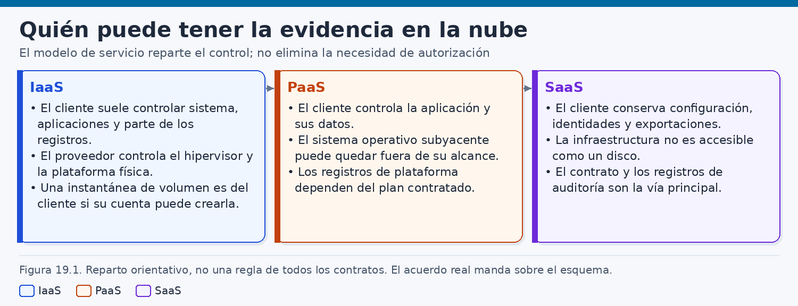
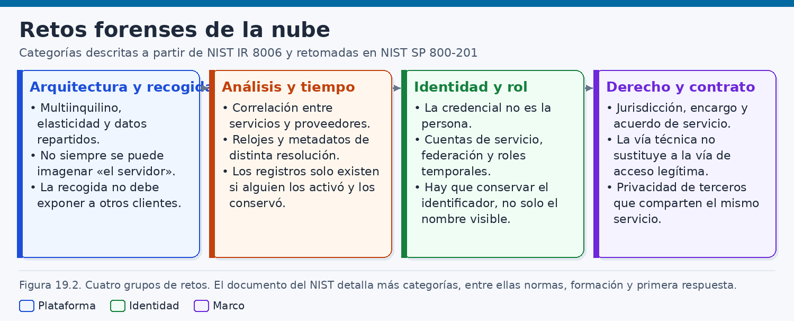
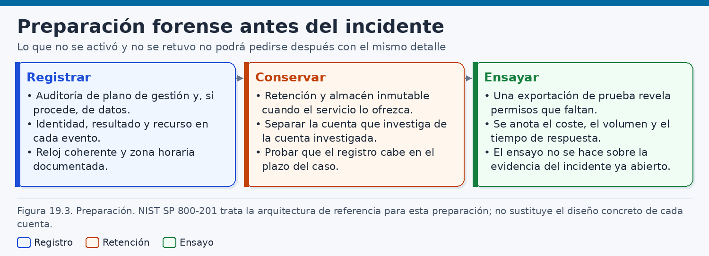
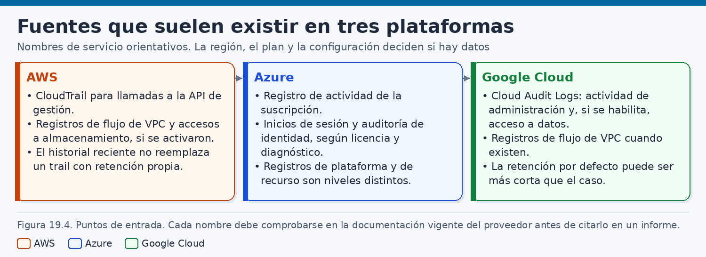
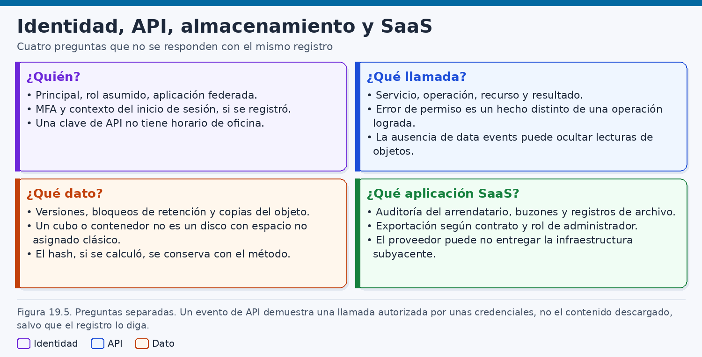
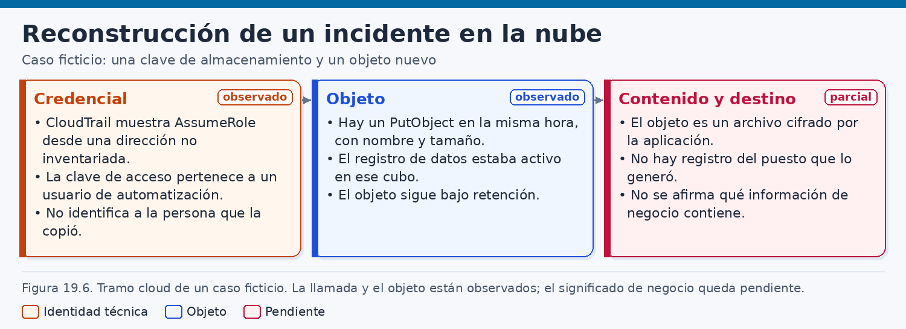
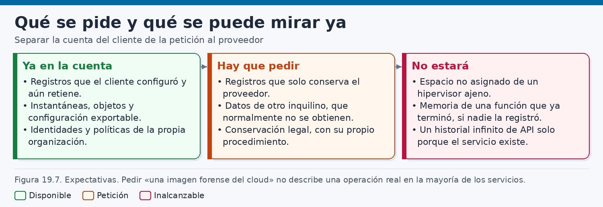

# Análisis forense en la nube

> *Una llamada registrada en la nube documenta un principal y una operación. La persona, el contenido de negocio y la intención quedan fuera de esa frase hasta que otras fuentes, y el encargo, permitan decir algo más.*

## Introducción

Cuando la actividad investigada ha ocurrido en un servicio de nube, la escena no se presenta como un ordenador que pueda apagarse y precintarse. El recurso afectado puede ser una cuenta, un proyecto, un cubo de objetos, una máquina que ya no existe o un registro que solo se generó porque alguien lo activó meses antes. La prueba, si existe, está repartida entre la organización que contrata el servicio y el proveedor que opera la infraestructura. Una parte es alcanzable con las credenciales del cliente. Otra solo aparece si el contrato, la configuración o un cauce jurídico la hacen disponible. Confundir ambas partes es el error del que parte casi todo lo demás.

Ese reparto cambia el gesto habitual del laboratorio. En un disco, el analista puede describir un soporte, una imagen y una cadena de custodia relativamente cerrada. En la nube, la unidad de trabajo suele ser una exportación: un conjunto de eventos de una interfaz de programación, una copia de un objeto, una política de acceso o un informe de inicio de sesión. Cada exportación tiene autor, filtro, intervalo, herramienta y huecos. Tratarla como si fuera la nube entera exagera lo que se ha visto. Tratarla como un pantallazo informal empobrece una evidencia que, bien documentada, puede ser muy sólida.

Sigue siendo necesario separar la **observación**, la **inferencia técnica** y la **hipótesis**. La observación es lo que un registro o un objeto muestran: a tal hora, el servicio anotó una operación con tal nombre, asociada a tal principal, y un objeto con tal clave estaba presente. La inferencia técnica es la relación que esas piezas sostienen: dos llamadas próximas, con el mismo identificador de sesión, resultan coherentes con una única secuencia. La hipótesis es una explicación todavía abierta: que la clave la usara una persona concreta, que el fichero contuviera un documento de negocio, que la dirección de origen identificara un lugar. Esas hipótesis pueden ser razonables y quedar sin apoyo suficiente. El informe debe poder decirlo sin convertir la cautela en vaguedad.

Hay un límite de lenguaje que conviene fijar desde el principio. **Una clave de interfaz, un rol o una cuenta de servicio no son una persona.** Identifican un medio técnico con el que el servicio aceptó una llamada. Varias personas pueden conocer ese medio. Una sola persona puede usar muchos. Un proceso automático puede usarlo sin que nadie esté delante en ese instante. El paso desde el principal hasta un nombre y un apellido exige otras fuentes —directorio de identidades, inventario de secretos, registros del sistema que guardaba la clave, autorización del encargo— y, cuando esas fuentes no llegan, el paso no se da.

El capítulo recorre los modelos, los retos agrupados por NIST, la preparación, las fuentes de AWS, Azure y Google Cloud, las identidades y el almacenamiento, la reconstrucción y un caso ficticio de Editorial Litoral (`litoral.example`). Se observan `AssumeRole` desde una dirección no inventariada y `PutObject` de un fichero cifrado por la aplicación. No se afirma el contenido ni la persona. Las órdenes son de laboratorio. No autorizan a consultar cuentas ajenas ni describen cómo eludir un cifrado.

## 1. Modelos y arquitecturas cloud

### 1.1. Una definición operativa

En una investigación, «nube» no es un sinónimo de internet ni de servidor ajeno. Es un modelo de uso de recursos, entregados por red, en el que la capacidad se solicita, se comparte y se mide. La publicación SP 800-145 de NIST, de septiembre de 2011, fijó la referencia común: cinco características esenciales, tres modelos de servicio y cuatro modelos de despliegue. No hace falta una cita larga. Hace falta entender qué le ocurre a la prueba cuando cada pieza es real.

El **autoservicio bajo demanda** permite crear y destruir recursos mediante una interfaz, con poca intervención humana del proveedor. Crear una máquina, asumir un rol o escribir un objeto son llamadas, y esas llamadas pueden ser la mejor evidencia disponible. También convierten la escena en algo efímero. La máquina que existía a las seis puede haber desaparecido a las siete por una política de escala, por una orden legítima o por una orden posterior del mismo principal. Llegar y no encontrar el servidor es una observación sobre el estado actual. Explicar la desaparición exige el registro de la llamada que la provocó, si ese registro se conservó.

La **amplitud de acceso por red** separa la operación del edificio de la organización. Una dirección de origen, cuando el registro la incluye, describe el extremo que el servicio vio, después de traducciones de direcciones, concentradores, proxies y salidas compartidas. Varias personas y varios procesos pueden presentarse con la misma dirección. Una persona puede presentarse con muchas. Geolocalizar esa dirección y convertir el resultado en un domicilio es una inferencia débil. Este capítulo no la trata como hallazgo.

La **puesta en común de recursos** reparte capacidad entre varios clientes sobre la misma infraestructura. Es la razón técnica de la minimización. El cliente dispone de recursos lógicos —cuentas, volúmenes, cubos, bases de datos— aislados de los demás por los mecanismos del proveedor. No dispone del anfitrión físico para llevárselo al laboratorio. Una imagen de ese anfitrión mezclaría datos de otros inquilinos. Aunque un cauce extraordinario alcanzara alguna telemetría interna, el alcance tendría que recortarse al cliente afectado.

La **elasticidad rápida** amplía o reduce la capacidad en plazos breves, a veces de forma automática. Un grupo de escalado puede retirar una instancia y crear otra con el mismo nombre lógico y otro identificador. Los registros que solo vivían en el disco retirado se pierden si no se enviaron a otro sitio. Las direcciones pueden reutilizarse. El nombre de una máquina es una etiqueta. El identificador que el proveedor asignó a esa encarnación es otro dato, y el informe debe usar este último.

El **servicio medido** controla y contabiliza el uso. La facturación y las métricas pueden corroborar que un recurso existió o que un volumen de datos salió de una cuenta. Su granularidad suele ser peor que la de un registro de auditoría: agregados por tiempo, por servicio o por tipo de uso. Pueden indicar que algo ocurrió en un intervalo del que ya no hay auditoría. No sustituyen esa auditoría y no deben inventarse sus campos. Se lee el informe que la cuenta ofrece y se describe su resolución. Ninguna de las cinco características autoriza a suponer que el proveedor lo guarda todo.

### 1.2. Tres modelos de servicio y cuatro de despliegue

Los tres modelos de servicio describen quién administra cada capa. Son un mapa orientativo. El contrato, el anexo de tratamiento, la región, el cifrado gestionado por el cliente y los productos intermedios pueden mover la frontera. Un mismo incidente puede atravesar los tres: una identidad en un directorio, una función en una plataforma y un objeto en un almacén.

En la **infraestructura como servicio** (IaaS), el cliente suele administrar el sistema operativo, las aplicaciones y los datos de sus máquinas, y configura la red lógica dentro de lo que el producto permite. El proveedor administra el hipervisor, la red física, los anfitriones y las instalaciones. El cliente puede llegar a tener un disco virtual y una instantánea, si actúa antes de que el disco se libere. No tiene, por ese solo hecho, los registros del hipervisor ni la traza con la que el proveedor aísla a los inquilinos. Una instantánea que nadie tomó no reaparece porque el modelo se llame infraestructura.

En la **plataforma como servicio** (PaaS), el cliente despliega código y datos sobre un entorno que no administra por debajo. Puede disponer de registros de aplicación si los configuró. El entorno de ejecución, el parcheo y los anfitriones quedan del lado del proveedor. A menudo no hay un disco de sistema que precintar. La pregunta útil es qué telemetría estaba activada y dónde se entregaba.

En el **software como servicio** (SaaS), el cliente usa una aplicación acabada y administra usuarios, permisos y los datos que introduce. La evidencia ordinaria es la que la consola exporta, si esas funciones existen en el contrato y estaban activadas. La evidencia extraordinaria es la que el proveedor solo entrega por su cauce legal. Un buzón exportado responde a preguntas de contenido. Un registro de auditoría responde a preguntas de acciones. Ninguno de los dos es el registro interno de la infraestructura.

Antes de escribir que algo corresponde al proveedor, el analista lee qué se contrató. La SP 800-145 sirve para nombrar el modelo. El expediente sirve para saber dónde quedó la prueba.

Los cuatro modelos de despliegue sitúan el servicio: nube pública, privada, comunitaria o híbrida. Que sea privada no abre la sala al analista si la opera un tercero. En la híbrida, la identidad, la credencial y el objeto pueden vivir en proveedores distintos, cada uno con su reloj y su retención.

### 1.3. Plano de control, plano de datos y sede de la prueba

Casi todos los servicios separan un **plano de control** y un **plano de datos**. El primero administra: crear, borrar, cambiar permisos, asumir un rol, activar un registro. El segundo es el uso ordinario: leer un objeto, escribir un fichero, consultar una tabla. La distinción importa porque muchos registros nacen activados para el control y apagados, o solo parcialmente encendidos, para los datos. Un cambio de administración puede verse aunque nadie haya pensado en forense. Una lectura o una escritura pueden ser invisibles si el registro de datos no se habilitó. La ausencia de eventos de lectura, donde esas lecturas no se registran, demuestra que la fuente no cubría la pregunta. El informe gana claridad cuando dice «no había cobertura», y reserva «no consta acceso» para el caso en que la cobertura existía y el evento no aparece.

La figura 19.1 ordena el reparto: la evidencia de un mismo hecho puede estar, a la vez, en la cuenta del cliente, en un proveedor de identidades, en el puesto o el servidor que inició la llamada, en un servicio intermedio y en el proveedor de infraestructura. Ninguna sede contiene la historia completa. Cada una contiene lo que su software decidió anotar y lo que su retención todavía conserva.



En la cuenta del cliente pueden obtenerse, si existen y si las credenciales alcanzan, las configuraciones, los objetos, los registros activados y las políticas de identidad de ese proveedor. En el directorio corporativo pueden constar inicios de sesión, segundos factores y cambios de grupo, que la nube verá ya resumidos en una credencial o en un rol asumido. En el puesto pueden quedar clientes de administración y secretos que no deberían haber estado allí: hallarlos es una observación sobre ese puesto, con la autorización que corresponda. En el proveedor de infraestructura quedan la operación del servicio y, a veces, registros que el cliente no extrae por sí mismo.

Cuando el dato nace en un dispositivo conectado y la copia útil está en la nube del fabricante, el aparato y ese servicio son fuentes distintas. El informe IR 8259 de NIST, de mayo de 2020, describe actividades fundacionales de ciberseguridad para esos fabricantes, incluidas las capacidades y la información que el cliente puede necesitar. Una telemetría en la nube no demuestra que el dispositivo registrara lo mismo en local, ni que el fabricante conserve el detalle el tiempo que el caso querría.

La cadena de custodia sigue ese mapa. Cada sede aporta un objeto con su identificador: una exportación, una copia, una configuración, una respuesta formal. No se fusionan en un único hash. El hash de una exportación fija los bytes exportados, no la completitud del servicio. El hash de un objeto fija los bytes almacenados, no su significado de negocio.

### 1.4. Responsabilidad compartida

Los grandes proveedores formulan, cada uno con su esquema, un modelo de **responsabilidad compartida**. La idea común se mantiene aunque cambien los dibujos comerciales. El proveedor responde de la seguridad de la nube que opera: instalaciones, hardware, hipervisor, red global y disponibilidad de la interfaz de administración. El cliente responde de la seguridad en la nube: datos, identidades, permisos, configuración, cifrado que decide aplicar y registros que decide activar. En infraestructura, el cliente asume además el sistema operativo de sus máquinas. En el software como servicio, esa carga se reduce y no desaparece: siguen siendo del cliente los usuarios, los permisos y el uso.

Para el analista, el modelo es una guía de expectativas. Si el registro de acceso a datos había que activarlo y nadie lo activó, echar de menos esos eventos en el proveedor es un mal diagnóstico. Si el cliente conservó sus registros y necesita saber si la plataforma sufrió un incidente propio, esa pregunta sí se dirige al proveedor, por el cauce del contrato y del derecho. El analista puede demostrar lo que las fuentes del cliente contienen y describir lo que se pidió y lo que llegó. No puede certificar, desde fuera, que la plataforma no guarda ninguna otra traza. La formulación precisa es otra: con las fuentes conservadas, consta esto; estas otras preguntas quedan fuera de cobertura.

El contrato puede mover la frontera. Una clave gestionada por el cliente, un registro reenviado a una cuenta separada, una región elegida o un anexo de retención cambian quién puede leer qué. El diagrama publicado en la web del proveedor es el punto de partida. La orden de servicio firmada es el punto de llegada.

## 2. Retos técnicos, organizativos y jurídicos

### 2.1. Sesenta y dos retos, nueve categorías

El informe IR 8006 de NIST, de agosto de 2020, *NIST Cloud Computing Forensic Science Challenges*, recogió el trabajo de su grupo sobre ciencia forense en la nube. Identificó **62 retos**, agrupados en **nueve categorías**: arquitectura, recogida, análisis, antiforense, primera respuesta, gestión de roles, legal, normas y formación. No corresponde inventariar aquí los sesenta y dos. Corresponde entender qué tipo de dificultad nombra cada categoría, porque la arquitectura de referencia posterior se apoya en ellas. Mitigar un reto no es disolverlo. Una organización puede estar bien preparada y, aun así, no poder leer un contenido cifrado por la aplicación, no poder atribuir una clave compartida a una persona o no poder obtener una traza que el proveedor no conserva para los clientes.

La figura 19.2 reúne esas clases tal como se presentan en un caso. Detrás de un registro ausente suele haber una decisión de arquitectura, un rol mal separado y una duda jurídica sobre hasta dónde se puede llegar.



### 2.2. Arquitectura, recogida y análisis

La categoría de **arquitectura** recuerda que el diseño decide qué evidencia puede existir: tenencia múltiple, elasticidad, dependencia del proveedor y segregación entre clientes. Un entorno sin registro de datos, con máquinas efímeras y con una sola cuenta cuyos administradores pueden borrar los registros, es pobre para investigar aunque sea cómodo para operar. El analista hereda esa arquitectura. Cuando llega después del incidente, no la redibuja con efecto retroactivo.

La **recogida** es, casi siempre, pedir a un software que construya una respuesta. Esa respuesta puede estar paginada, filtrada, truncada o retrasada. Una exportación que se detiene en la primera página es una recogida incompleta. La disciplina mínima anota el filtro, la cuenta o el proyecto, el intervalo, la herramienta y su versión, el número de eventos recibidos y cualquier aviso de truncamiento. El hash se calcula sobre lo recibido. La completitud se argumenta aparte, a partir de la cobertura conocida.

El **análisis** empieza cuando esas piezas están en el laboratorio. Hay que correlacionar relojes, principales y recursos sin convertir la proximidad temporal en una causa, y hay que volver al evento exportado cuando un panel resume demasiado. Un agregado de «accesos» puede ocultar si el evento era de control o de datos, si falló o tuvo éxito, si el principal era un rol o un usuario. Los esquemas cambian con el servicio y la versión. Este capítulo no fija una lista de campos ni una cifra de retención por defecto. Si un caso necesita una dirección, un identificador de sesión o un resultado, el analista comprueba que ese elemento está en la exportación y lo transcribe como figura. Si no está, lo dice.

### 2.3. Antiforense, primera respuesta y gestión de roles

La categoría **antiforense** debe nombrarse con cuidado. Hay condiciones que degradan la investigación: registros desactivados, trazas entregadas a un almacén que el mismo actor puede borrar, cifrado de aplicación que deja el objeto opaco, relojes desviados e identidades compartidas. El analista las trata como límites y como hipótesis que se contrastan con los eventos de administración —si alguien desactivó el registro, y cuándo— sin convertir el capítulo en un manual para producirlas. Detectar que un trail dejó de entregarse o que un cubo de registros perdió objetos es análisis defensivo. Explicar cómo ocultar una llamada queda fuera de este libro.

La **primera respuesta** choca con la velocidad del autoservicio. Las mismas interfaces que aíslan un recurso pueden destruirlo. Revocar una clave, apagar una máquina o rotar un secreto pueden ser contención legítima y, a la vez, alterar un estado todavía no copiado. La SP 800-61 Rev. 2 recuerda que la respuesta se prepara antes y que la detección y el análisis preceden a una contención pensada. En la práctica, el orden es conservar, contener y volver a exportar: la contención también genera llamadas, y esas llamadas no deben mezclarse con las del incidente.

La **gestión de roles** es el reto organizativo más cotidiano. Coinciden el administrador de la cuenta, el operador de guardia, el proveedor de identidades, el equipo de la aplicación, el proveedor de infraestructura, la asesoría y el analista. Un rol de investigación de solo lectura, distinto del rol investigado y del rol del día a día, evita recoger con la clave sospechosa y evita un permiso de borrado que el analista no debería usar. Si ese rol no existe cuando estalla el incidente, alguien lo improvisará, y la improvisación quedará registrada. Conviene que quede etiquetada como actuación de respuesta.

### 2.4. Jurisdicción, autoridad y otros inquilinos

La categoría **legal** no se resuelve desde el teclado. El analista no elige la jurisdicción. La describe para quien sí puede decidir: asesoría, autoridad o dirección. La sede de la empresa, la sede del proveedor, la entidad que firma, la región donde el servicio dice almacenar los datos, el lugar del analista y el lugar de las personas a las que los datos se refieren pueden no coincidir. Que un cubo esté en una región europea no vuelve irrelevante el derecho del país del proveedor. Que el proveedor sea una empresa de otro país no significa que el cliente carezca de copia: si activó sus registros, esa copia puede bastar y evitar un traslado innecesario.

La autoridad también se desdobla. Una cosa es el permiso interno para exportar registros de la propia organización. Otra es el título que haría falta para pedir al proveedor datos que el cliente no tiene, para examinar un puesto personal o para requerir a un tercero la titularidad de una dirección. El analista anota en qué título se apoya cada exportación. Si el título no alcanza, la fuente queda pendiente.

La tenencia múltiple impone un límite jurídico y técnico. **No se recogen datos de otros inquilinos.** El cliente no tiene acceso legítimo a ellos y una investigación no lo crea. Dentro del propio inquilino, la minimización sigue aplicándose. Si la pregunta es un cubo y una hora, exportar un año de todas las cuentas, o todos los buzones, amplía el tratamiento de datos personales sin necesidad. El filtro forma parte de la calidad forense. Un filtro estrecho y documentado permite defender el análisis.

Lo que el proveedor entregue por un cauce formal es un objeto distinto de la exportación del cliente: tiene remitente, fecha y alcance declarado. No se completa una exportación pegando fragmentos sin decir de dónde salió cada uno. Tampoco se supone que el proveedor conservará, para un juicio futuro, lo que el cliente decidió no registrar. Esa expectativa se comprueba en el contrato y en la respuesta que realmente se reciba.

### 2.5. Normas y formación

La categoría de **normas** señala la heterogeneidad. Cada proveedor y cada servicio usan nombres y consolas distintos. La SP 800-86, la SP 800-61 Rev. 2 y los documentos que SWGDE mantiene en su portal ayudan a no reinventar la cadena de custodia ni el informe. No unifican los registros. El portal reúne buenas prácticas que el laboratorio contrasta con su procedimiento vigente; no sustituye la lectura del evento concreto. La SP 800-201, que se verá a continuación, ordena la preparación a partir de estos retos. No impone un formato único de log.

La formación necesaria es la del libro: qué se observa, qué se infiere, qué cobertura había y qué quedó fuera. En los servicios preparados se puede saber qué operación quedó registrada y con qué principal. No cabe esperar una atribución universal ni la lectura de lo que la aplicación cifró.

## 3. Preparación forense y conservación de registros

### 3.1. La arquitectura de referencia de julio de 2024

En julio de 2024, NIST publicó la SP 800-201, *NIST Cloud Computing Forensic Reference Architecture*. Su objetivo es apoyar la **preparación forense**: la capacidad, decidida de antemano, de investigar después con un alcance conocido. La publicación se apoya en los retos del IR 8006. Ayuda a ver qué retos afectan al sistema de una organización, cuáles admiten una mitigación al menos parcial y cómo usaría un investigador esas mitigaciones. Se presenta como un método y como una implementación inicial que cada organización debe adaptar. No es un producto que deje el entorno listo para forense por el hecho de instalarse.

De esa arquitectura, este capítulo toma las consecuencias prácticas. Prepararse es decidir, antes del incidente, qué cuentas entran en el perímetro, qué categorías de registro están activas, dónde se almacenan, quién puede borrarlas, durante cuánto tiempo se conservan, cómo se interpretan los relojes, quién puede exportar y por qué cauce se hablará con el proveedor si la copia del cliente no basta. Esas decisiones se escriben, se prueban y se revisan cuando cambia la arquitectura. La figura 19.3 sitúa el trabajo en el tiempo correcto: antes del incidente, cuando todavía se puede elegir qué quedará registrado.



Sin registros activados, la recogida de la SP 800-86 no tiene objeto. Sin un rol separado, la contención y la conservación de la SP 800-61 Rev. 2 compiten por las mismas credenciales. La guía de respuesta a incidentes de AWS desarrolla esa lógica para su plataforma. Se lee como ayuda del fabricante, no como norma procesal ni como permiso para actuar en cuentas ajenas. Azure y Google Cloud publican orientaciones equivalentes en su documentación vigente. Las consolas cambian de nombre. La pregunta no cambia: si esta llamada ocurriera mañana, ¿la veríamos?

### 3.2. Qué tiene que estar decidido

Un inventario de preparación, reducido a lo que de verdad se usa, incluye el perímetro de cuentas, suscripciones y proyectos; las categorías de registro de cada servicio crítico, distinguiendo administración y acceso a datos; el lugar de entrega y quién puede borrarlo; la retención que la organización decidió, leída de la configuración y no recordada como cifra de fábrica; el rol de exportación, distinto de la clave del incidente; el cauce con el proveedor, con contrato, región y entidad firmante; y el inventario de direcciones de salida y de lugares donde viven los secretos.

Los registros de una cuenta no deberían poder ser destruidos por los principales que esa cuenta investiga. La pauta más sólida es entregarlos a otra cuenta o a otro proyecto, con escritura acotada a la entrega y lectura reservada al rol forense. Si la entrega permanece donde el rol investigado es administrador, la conservación es una esperanza. La retención tampoco se cita de memoria. Los valores por defecto cambian, dependen del producto y a veces del nivel de servicio. En el expediente figura el plazo configurado y la fecha en la que se comprobó. Un inventario de salidas desactualizado no prueba una intrusión cuando aparece una dirección nueva. Prueba que el inventario todavía no sirve para descartar un cambio legítimo. Sin inventario, ni siquiera puede formularse la pregunta.

### 3.3. El registro que solo existe si alguien lo activó

La preparación falla cuando se da por hecho un registro que el servicio no escribe hasta que se habilita. En AWS, CloudTrail puede mostrar llamadas de administración cuando existe un trail o dentro de la ventana del historial de eventos. Esa ventana no sustituye un trail con la retención que el caso necesita. Los eventos de datos —operaciones sobre objetos, por ejemplo— no están en todos los registros por defecto. Hay que habilitarlos en los recursos donde la pregunta futura sea quién leyó o escribió. Habilitarlos en todos los cubos puede ser desproporcionado. No habilitarlos en el cubo que guarda lo más sensible se paga con un informe mudo.

En Azure, el registro de actividad de la suscripción y los inicios de sesión de Entra ID son fuentes distintas. Prepararse es saber quién puede leer cada una y durante cuánto tiempo está accesible en ese inquilino, con el plazo leído de la configuración. Los registros de diagnóstico de los recursos críticos son otra familia, y solo sirven si se entregan a un espacio que la respuesta controla. En Google Cloud, Cloud Audit Logs separa la actividad de administración y el acceso a datos. El acceso a datos hay que habilitarlo. Otras categorías pueden existir; se comprueban en la documentación vigente del proyecto, no se dan por sabidas porque un libro las enumeró.

La misma lógica alcanza al software como servicio. La consola puede ofrecer auditoría de buzones o de administradores en un nivel de licencia distinto del contratado. La comprobación razonable es abrir la consola un día cualquiera y exportar un intervalo de prueba. Si la exportación falla, llega vacía o no distingue al administrador del usuario, el fallo es un hallazgo de preparación. Activar un registro tampoco basta: hay que ver dónde cae, si llega y si una identidad de prueba puede leerlo. Un trail que escribe en un cubo al que nadie entra el día del incidente está activado solo en el sentido administrativo.

### 3.4. Relojes, integridad y ensayo

Los grandes proveedores fechan las llamadas con su reloj, habitualmente en tiempo universal coordinado. Ese instante es la referencia de la llamada. No es el instante en que el evento llegó al almacén del cliente, ni el de la exportación, ni la hora local del puesto. Una línea temporal honesta puede tener tres horas para un solo hecho, y las tres se etiquetan. Si se incorpora un registro de una máquina virtual, entra un cuarto reloj, que puede estar desviado. No se corrige en silencio. Se declara el desplazamiento si se ha medido.

Algunos servicios ofrecen validación de integridad de los ficheros de registro, o un almacén que impide borrar durante un plazo. Son controles valiosos cuando están encendidos y alguien lo ha comprobado. Su ausencia no invalida un registro: sitúa la integridad en el hash del laboratorio, en la cuenta donde se guardó la copia y en la confianza de que la entrega no se interrumpió. Su presencia demuestra, dentro de lo que el control cubra, que aquellos ficheros no se alteraron después de sellados. No demuestra que el servicio registrara todas las operaciones, ni que el principal sea una persona.

La conservación de los objetos se decide igual. Un ciclo de vida puede expirar un objeto. Una escritura puede sustituirlo si no hay versiones. Una réplica en otra región puede ser la única copia y, a la vez, cambiar la jurisdicción. El analista lee esa configuración. No lamenta en abstracto que la nube borre: la plataforma ejecuta la política que estaba escrita.

El ensayo usa datos sintéticos: localizar la fuente de un `PutObject` de prueba, exportar, resumir y separar las llamadas del propio ensayo. Si para un cubo se exporta la identidad de toda la plantilla, el recorte está mal. Fecha, huecos y cambios se guardan con el inventario.

## 4. Investigación en AWS, Azure y Google Cloud

### 4.1. Una disciplina, tres familias de fuentes

AWS, Microsoft Azure y Google Cloud no registran igual ni nombran igual. La disciplina no cambia. Se identifica la cuenta, la suscripción o el proyecto. Se averigua qué categorías estaban activas. Se exporta un intervalo con un principal distinto del investigado. Se separan las operaciones de control, los inicios de sesión y los accesos a datos. Se conserva la configuración que explica la cobertura y se deja escrito lo que esa cobertura no puede responder. La figura 19.4 resume las fuentes habituales sin convertirlas en una promesa. Son habituales cuando la organización las ha puesto en marcha.



La orientación de cada proveedor se consulta en su documentación vigente. Para AWS, la guía de CloudTrail y la guía de respuesta a incidentes de seguridad. Para Azure, la documentación del registro de actividad y la de los inicios de sesión de Entra ID. Para Google Cloud, la de Cloud Audit Logs. Las pantallas cambian. Un procedimiento copiado de un libro sin comprobar la versión de la herramienta es un procedimiento frágil. Los ejemplos de este apartado son de laboratorio.

### 4.2. AWS: historial, trail y eventos de datos

CloudTrail registra llamadas de interfaz de administración de AWS. Tres matices se comprueban en cada cuenta. Una llamada de administración puede verse en el historial de eventos o en un trail. El historial cubre una ventana limitada, la que la documentación vigente atribuya en la fecha del caso, y no sustituye un trail conservado durante el plazo que la organización decidió. No se afirma aquí una cifra de días. Se mira qué intervalo devuelve la cuenta y se describe ese intervalo.

Un trail es una configuración. Puede afectar a una región o a varias, a una cuenta o a una organización, y puede entregar los eventos a un cubo o a otro almacén. El analista describe el trail que entregó la copia: nombre, ámbito, destino y si una validación de integridad de los ficheros estaba activa. Una consulta en la región equivocada puede devolver un conjunto vacío. Ese vacío significa vacío en esta consulta.

Los eventos de datos de objetos no están en todos los registros por defecto. Ver una escritura de objeto significa, salvo que otra fuente la haya anotado, que alguien habilitó esa cobertura para ese recurso. No verla obliga a preguntar si la cobertura existía antes de interpretar la ausencia. Otras fuentes —flujos de red, registros de acceso de un cubo, métricas— se incorporan solo cuando constan, con su esquema leído de la exportación.

En un puesto de laboratorio, y solo contra una cuenta autorizada, una comprobación de arranque puede parecerse a lo siguiente. La sintaxis se verifica con la versión instalada:

```bash
# Laboratorio o cuenta del encargo. No autoriza a consultar cuentas ajenas.
# El perfil y el nombre del trail son del ejemplo; se sustituyen por los del caso.
aws sts get-caller-identity --profile laboratorio-litoral

aws cloudtrail describe-trails --profile laboratorio-litoral

aws cloudtrail get-event-selectors \
  --profile laboratorio-litoral \
  --trail-name registro-organizacion
```

La primera orden documenta el principal con el que se mira, para no confundirlo con el principal investigado. La tercera pregunta qué selectores tiene un trail. El analista anota si entre ellos hay eventos de datos del recurso examinado. No supone el valor por defecto. La salida se guarda como evidencia de configuración, con la hora de la consulta.

El historial de eventos puede explorarse dentro de su ventana y de la región consultada:

```bash
# Solo eventos que el historial de esa región conserve.
# Los eventos de datos de objetos no deben esperarse aquí por sistema.
aws cloudtrail lookup-events \
  --profile laboratorio-litoral \
  --region eu-south-2 \
  --start-time 2026-03-04T06:30:00Z \
  --end-time 2026-03-04T07:00:00Z \
  --max-results 50
```

Si la pregunta versa sobre una escritura de objeto y el historial no la devuelve, el siguiente paso es ir a la copia del trail, si había eventos de datos, o declarar que no había cobertura. Sobre esa copia ya descargada, una coincidencia textual es solo una pista:

```bash
# Sobre la copia exportada. Una cadena hallada no interpreta el evento.
grep -F "AssumeRole" /caso/litoral/trail/*.json
```

Después se abre el evento, se lee el esquema que realmente trae y se transcriben los elementos presentes. Un filtro escrito contra un nombre de campo supuesto es una manera de perder eventos o de inventarlos.

### 4.3. Azure: el registro de actividad y los inicios de sesión

En Azure, el **registro de actividad** de la suscripción recoge operaciones del plano de control: creaciones, modificaciones, borrados y otras acciones de administración que el servicio anota. Muestra qué cambió en la infraestructura lógica y qué principal aparece asociado. No es el registro de los inicios de sesión de las personas.

Los **inicios de sesión de Microsoft Entra ID** son otra fuente. Documentan autenticaciones contra el directorio, en las categorías que el inquilino tenga habilitadas. Un inicio interactivo, uno no interactivo y el acceso de una aplicación pueden vivir en familias distintas. Los cambios del directorio —altas, concesiones de roles, consentimientos— pueden constituir todavía otra familia. Pedir «los logs de Azure» sin decir cuál de estas familias es pedir un objeto que no existe.

La correlación posible es limitada. El registro de actividad muestra una operación asociada a un identificador. El registro de Entra muestra, si la categoría existe, una autenticación de ese identificador en un intervalo próximo. La inferencia de que ambas piezas describen la misma secuencia es razonable cuando los identificadores coinciden y los relojes se han declarado. Sigue sin identificar a la persona que había delante del teclado, sobre todo si el principal es una aplicación. La retención visible en la consola puede no ser la del espacio al que un diagnóstico reenvía los eventos. Se documentan las dos, si existen, y se analiza la que cubre el intervalo. No se traslada a este libro una cifra por defecto.

Una consulta de laboratorio, sobre una suscripción autorizada, ilustra la acotación. La orden se comprueba con la ayuda de la versión instalada:

```bash
# Suscripción de laboratorio. La sintaxis de la CLI cambia; se verifica con la ayuda vigente.
az monitor activity-log list \
  --start-time 2026-03-04T06:30:00Z \
  --end-time 2026-03-04T07:00:00Z \
  --offset 0 \
  --max-events 50
```

La salida se conserva entera. Los inicios de sesión de Entra se exportan por el mecanismo que la documentación vigente indique y se guardan como evidencia separada, con su propio identificador.

### 4.4. Google Cloud: administración y acceso a datos

Cloud Audit Logs es la familia de auditoría de Google Cloud. Para este capítulo bastan dos distinciones, que el analista vuelve a leer si la consola ha cambiado. La **actividad de administración** recoge operaciones de control. El **acceso a datos** recoge accesos de los servicios que lo soportan, y hay que habilitarlo. Si no se habilitó, las lecturas y escrituras de datos pueden no estar en la auditoría aunque la actividad de administración sea completa dentro de su ámbito.

El ámbito se anota con el mismo cuidado. Un proyecto, una carpeta y una organización no son el mismo contenedor. La exportación a un cubo de conservación, si existe, puede tener una retención distinta de la vista de la consola. Se analiza la copia cuya retención cubre la pregunta y se declara cuál es. El esquema se lee del evento exportado. Se transcriben la operación, el recurso, el principal, la hora que el servicio asigna y, si figuran, el resultado y la dirección. Lo que no figura se omite.

## 5. Identidades, API, almacenamiento y servicios SaaS

### 5.1. El principal no es una persona

La figura 19.5 junta cuatro sitios que se confunden con facilidad. La identidad con la que el servicio autorizó una llamada, la interfaz que la transportó, el objeto almacenado y la aplicación que el usuario cree estar usando son capas distintas. Un informe que dice «el usuario subió el fichero» ha saltado de capa sin decirlo.



Un **principal** es la entidad técnica a la que el proveedor asocia la llamada. Puede ser un usuario del directorio del proveedor, un usuario federado, un rol, una sesión de rol, una cuenta de servicio, una aplicación o una clave. La observación llega hasta «la llamada figura asociada a este principal». La inferencia de que ese principal estaba en manos de tal equipo necesita el inventario de secretos. La hipótesis de que una persona concreta lo usó en ese minuto necesita todavía un inicio de sesión, un puesto o un testigo, y la autorización para mirarlos. Sin ese eslabón, el informe se detiene en el principal y explica por qué se detiene.

Un mismo rol admite muchas sesiones, y una clave de larga duración puede estar en un gestor de secretos, en la integración continua y en un portátil. Esas presentaciones se mantienen separadas hasta que un identificador común las una. Un usuario de servicio como `svc-archivo-lote` no se diseñó como identidad personal.

### 5.2. Claves, roles, federación y sesiones

Las claves de larga duración se copian con facilidad. El registro de su uso demuestra uso, no custodia. El identificador de la clave, si el evento lo trae, se transcribe. Se comprueba cuántas claves tiene ese usuario y cuál está activa. Se busca si el gestor de secretos anotó quién pudo leerla. Si ese registro no existe, la lista de personas con acceso posible permanece como contexto organizativo, no como hallazgo de la llamada.

Los roles y las credenciales temporales cambian el dibujo. Alguien o algo llama a una interfaz de asunción, presenta un principal de origen y recibe credenciales de corta vida. La llamada de asunción y las llamadas hechas con la sesión son eventos distintos. Pueden coincidir en un identificador de sesión. Cuando coinciden, la inferencia de una misma secuencia es fuerte. Cuando el segundo registro no existe porque el acceso a datos no se registraba, queda la asunción y no queda la prueba de lo que la sesión hizo después. El nombre de sesión lo elige, en muchos diseños, quien llama. Puede informar del trabajo habitual y puede imitarse. Un nombre igual al del trabajo legítimo es compatible con ese trabajo y con un cliente que copió el nombre. No es un documento de identidad.

La federación añade el directorio de origen. El proveedor de nube ve un principal federado o un rol asumido a partir de una afirmación. El directorio puede haber visto un inicio de sesión, un segundo factor y un puesto. Correlacionar ambos lados es el camino hacia una persona, y solo cuando el encargo autoriza a leer el directorio. Que el directorio haya emitido una afirmación aceptada no prueba el contenido de negocio de lo que luego se escribió, ni que quien inició sesión sea el titular habitual del puesto. Los segundos factores se anotan si el evento de autenticación los menciona. Si no los menciona, no se deduce su ausencia: el esquema puede no incluir ese dato. Las claves de interfaz no se comportan como una contraseña de consola.

Antes de contener se exporta el estado que la contención va a cambiar: claves activas, la información de último uso que el servicio ofrezca y la política de confianza. Esa información es estado vivo. Si se rota primero y se mira después, el estado describe la respuesta, no el incidente.

### 5.3. La interfaz como escena

La consola web, el proceso automático y la herramienta de línea de órdenes son clientes. El registro, cuando existe, anota la llamada que el servicio aceptó, no la intención de quien pulsó un botón. Un asistente gráfico puede producir varias llamadas. Un fallo puede producir una llamada denegada que, si se registró, demuestra un intento asociado a un principal. La recogida tiene paginación, límites de tamaño, retrasos de entrega y consultas que solo miran una región. El acta incluye esos parámetros. «Exportamos CloudTrail» no significa nada operativo. Exportar los ficheros de un trail nombrado, de una cuenta, un intervalo y una herramienta, con el resumen en la ficha, sí puede revisarlo otra persona.

El rol forense también queda registrado. Si lee un objeto en un cubo con eventos de datos activos, esa lectura aparecerá. Lo sano no es esconder ese rol, sino usar un principal reconocible y marcar el inicio de la intervención. A partir de esa marca, sus llamadas se explican como actuación del encargo.

### 5.4. Objetos, versiones y cifrado

Un almacén de objetos no es el sistema de ficheros de un ordenador. Hay una clave, que es un nombre elegido por quien llama; unos bytes; y metadatos que el servicio guarda. Puede haber versiones, réplicas y un cifrado de la plataforma, con clave del proveedor o del cliente. Puede haber, además, un cifrado previo de la aplicación, que el servicio no entiende.

La clave del objeto es una etiqueta. Si se llama `nota-cierre.bin`, alguien o algo eligió ese texto. La etiqueta puede describir el contenido y puede no describirlo. El tamaño es una observación. Un resumen calculado en el laboratorio identifica los bytes copiados. No identifica el documento en claro si esos bytes son un contenedor cifrado. Algunos servicios devuelven una etiqueta de integridad que depende del modo de carga. No debe darse por hecho que sea un resumen criptográfico simple del contenido. Se copia tal como llega, y el hash forense se calcula sobre la copia de laboratorio. Son dos datos.

El cifrado se declara por capas. Si la configuración del cubo no muestra cifrado de plataforma, esa es la observación de configuración. No significa que los bytes sean legibles. Si la aplicación cifra antes de enviar, el servicio puede guardar opacidad sin saberlo. El analista describe tamaño, hora y hash. No afirma el contenido de negocio y no hay en este libro un procedimiento para obtener el claro. Con versionado, una escritura nueva puede dejar la anterior todavía direccionable. Sin versionado, una escritura sobre la misma clave sustituye, y el objeto previo puede no conservarse. Un ciclo de vida que expira objetos puede explicar una ausencia mejor que una hipótesis de borrado manual. Se lee la regla vigente.

### 5.5. Software como servicio

En el software como servicio, la unidad de contratación es la aplicación: correo, ficheros compartidos, mensajería o repositorio. El administrador suele poder exportar, dentro de lo contratado, contenido y auditoría. Esas dos exportaciones responden a preguntas distintas y se custodian por separado. El detalle de cada producto cambia y no se inventa desde aquí. El método es estable: identificar el inquilino, comprobar qué auditoría incluye el contrato y si estaba activada, exportar el ámbito mínimo —un buzón, un sitio, un conjunto de cuentas— y leer el esquema real antes de afirmar que no hubo descargas o que hubo un reenvío.

Un encargo sobre un cubo no autoriza a leer el correo de la plantilla. Si más adelante una hipótesis señala un buzón, la ampliación se autoriza y se acota. No se piden datos de otros inquilinos. La figura 19.5 recuerda no buscar en el almacén lo que está en el directorio, ni en el directorio el claro del objeto.

## 6. Reconstrucción de incidentes

### 6.1. Preguntas antes que herramientas

Reconstruir es ordenar observaciones para responder al encargo, no volcar eventos hasta que una historia parezca cerrada. Las preguntas útiles son concretas. Qué operaciones registra esta cuenta en este intervalo. Qué principal aparece. Qué recurso se escribió. Qué cobertura había para el plano de datos. Qué configuración de identidad permite la llamada. Qué fuentes, fuera de la cuenta, harían falta para ir más lejos. «¿Quién robó el archivo y por qué?» puede ser el motivo de la llamada al analista. No es el primer filtro de la exportación.

La SP 800-86, la SP 800-61 Rev. 2 y la guía de respuesta a incidentes de AWS ordenan el trabajo. No sustituyen el criterio sobre lo que un evento demuestra. Antes de la herramienta se fijan el intervalo, las cuentas y la hipótesis ordinaria: el trabajo programado, desde su salida habitual. Una dirección nueva puede ser un fallo del inventario.

### 6.2. Líneas temporales y alcance de una llamada

Una línea temporal de nube es una tabla con procedencia. Cada fila declara la hora, la zona, la fuente, el identificador de la evidencia y la observación, en el vocabulario del registro. La inferencia y la hipótesis van aparte. Lo habitual es trabajar en tiempo universal y decirlo. El instante de la llamada, el de la entrega del registro y el de la exportación permanecen distinguibles. Un desfase de minutos entre la llamada y la aparición del fichero de registro es normal en muchos diseños. No es, por sí solo, una manipulación.

La ordenación no es causalidad. El vínculo se argumenta con un identificador compartido: la misma sesión, la misma clave, el mismo recurso, el mismo identificador de solicitud si el evento lo trae y se ha comprobado qué es. Si el vínculo es solo temporal, se presenta como proximidad. Los huecos se dibujan en la misma línea. Un intervalo sin eventos de datos, donde esos eventos no estaban activos, es ausencia de cobertura. Un intervalo sin eventos de administración, en un trail que sí los entrega y no muestra interrupción, es otra frase: dentro de esa cobertura, no constan llamadas de ese tipo.

Una llamada bien conservada demuestra la operación, el principal, el recurso y la hora que el servicio anotó, y la dirección o la sesión si el evento las trae. No demuestra la persona, la intención, el claro de un objeto cifrado por la aplicación ni lo ocurrido fuera de cobertura.

### 6.3. Hipótesis, conservación y cadena de custodia

Las hipótesis se escriben en paralelo. Si dos siguen compatibles con los mismos hechos, el informe no elige la más grave. Suelen convivir el trabajo desde una salida no inventariada, el uso del secreto por quien podía leerlo, una copia previa de la clave y un objeto cuyo claro no se lee.

La conservación precede a la contención, salvo riesgo que obligue a revocar un secreto de inmediato. Se anota qué se copió, qué no llegó a copiarse y qué llamadas añadió la respuesta. Exportación, configuración, objeto autorizado, hashes, principal forense y horas forman el mínimo.

Una exportación es un objeto digital nuevo. Nace en la consulta, aunque describa hechos anteriores. Recibe un identificador distinto del de la cuenta y del objeto almacenado. Se anotan el autor, la herramienta y la versión, el filtro, el intervalo, la cuenta de origen y el resumen criptográfico. Una segunda exportación del mismo intervalo es otro objeto. Cuando el proveedor entrega por un cauce formal registros que el cliente no tenía, esa entrega lleva otro identificador y no se trocea para pegarla en la copia del cliente.

La presentación cierra la reconstrucción: qué se preguntó, qué se conservó, qué se observó, qué se infiere, qué hipótesis siguen abiertas y qué no se pudo saber. Una reconstrucción que deja la persona y el contenido sin determinar puede estar terminada.

## 7. Caso práctico en un entorno cloud

### 7.1. El encargo, la organización y los límites

Editorial Litoral es una organización ficticia. Su dominio de ejemplo es `litoral.example`. No debe buscarse en un registro mercantil ni asociarse a personas reales. El 4 de marzo de 2026, el responsable de operaciones pide, a través de la asesoría jurídica interna, que se determine qué operaciones quedaron registradas en la cuenta de archivo durante la madrugada, si se escribió un objeto concreto y qué puede decirse, con las fuentes disponibles, del principal que aparece en esas operaciones. El encargo, redactado así, no pide el nombre de un empleado. El analista copia esa redacción al inicio del acta para no sustituirla, a mitad del trabajo, por una pregunta más dramática.

La cuenta de archivo tiene el identificador ficticio `710448219365` y el alias `archivo-litoral`. Los registros de organización se entregan en otra cuenta, `710448219880`, alias `registros-litoral`. El cubo afectado se llama `archivo-litoral-casos` y reside en la región `eu-south-2`. El trail que se examinará se llama `registro-organizacion`. Entrega eventos de administración de la organización y, además, eventos de datos del cubo `archivo-litoral-casos`. No entrega eventos de datos de los demás cubos de la cuenta. Esa asimetría consta en los selectores leídos durante la preparación y se vuelve a leer el día del examen. Es una cobertura parcial, conocida, no una sorpresa que se pueda maquillar.

El rol `archivo-escritura` puede escribir en ese cubo. Su política de confianza, exportada con el identificador `CFG-CL-01`, permite asumirlo al usuario de IAM `svc-archivo-lote`, de la misma cuenta. Ese usuario es de servicio. Tiene una clave de acceso activa, cuyo identificador ficticio se anotará como `AKIAEJEMPLOLITORAL01`. No hay, en el diseño, un inicio de sesión humano asociado a ese usuario. El trabajo ordinario lo ejecuta un sistema de integración continua que lee el secreto e invoca la asunción del rol.

El inventario de direcciones de salida, `INV-CL-01`, actualizado el 2 de marzo de 2026 según su portada, recoge tres direcciones de documentación, usadas aquí como direcciones ficticias del caso: `198.51.100.8`, traducida como salida de la oficina; `198.51.100.24`, atribuida al sistema de integración; y `192.0.2.15`, atribuida al concentrador de la red privada virtual. La dirección `203.0.113.44` no figura. El inventario es un documento interno. Puede estar incompleto. Su fecha se cita para que nadie lo trate como un oráculo.

La figura 19.6 acompaña la reconstrucción de este incidente ficticio: dos llamadas, un objeto y varias sedes de evidencia que no dicen lo mismo.



### 7.2. Qué se conserva antes de interpretar

La intervención empieza a las 09:05 UTC del 4 de marzo de 2026, con el principal de solo lectura `forense-lectura`, distinto de `svc-archivo-lote` y sin permiso de borrado sobre la cuenta de registros. La primera acción no es desactivar la clave. Es copiar.

Se exportan los ficheros del trail correspondientes al intervalo 06:00–08:00 UTC, más un margen de contexto desde las 02:00 UTC para ver el trabajo ordinario de esa madrugada. La exportación se guarda fuera de la cuenta investigada, en el soporte de laboratorio del encargo, con identificador `LOG-CL-01`. Se anota la herramienta, la versión y el filtro. Se calcula el resumen SHA-256 de la exportación y se escribe en la ficha. No se publica aquí un valor hexadecimal: un resumen de ejemplo podría confundirse con el de un caso real, y al laboratorio le basta el que consta en su acta.

Se lee de nuevo la configuración del trail y de los selectores (`CFG-CL-02`). Se confirma que los eventos de datos del cubo examinado estaban incluidos y que la validación de integridad de los ficheros de log figuraba activa en esa configuración. Se conservan las salidas de esas consultas. Se lee la configuración del cubo (`CFG-CL-03`): el versionado no está habilitado; no hay una regla de ciclo de vida que expire objetos en un plazo breve; no hay réplica a otra región; la configuración no muestra cifrado de plataforma aplicado por el servicio. Esta última observación se limita a lo que la configuración dice. No califica el contenido.

Se localiza el objeto `expedientes/2026/03/nota-cierre.bin`. Una consulta de metadatos muestra que está presente, que el servicio informa de un tamaño de 1 843 200 bytes y que no aparece un indicador de cifrado de plataforma en los metadatos devueltos. A continuación se autoriza la copia del cuerpo porque el objeto es la pieza escrita y conviene fijar sus bytes. La copia se identifica como `OBJ-CL-02`. El SHA-256 se calcula en el laboratorio sobre esa copia. La descarga, hecha con `forense-lectura` sobre un cubo con eventos de datos activos, quedará a su vez registrada. Se anota la hora, 09:18 UTC, para restarla de la línea del incidente.

En el puesto de laboratorio, sobre la copia ya obtenida y no sobre una cuenta ajena, el gesto es el ordinario:

```bash
# Copia ya descargada al laboratorio. No descifra ni interpreta el contenido.
sha256sum /caso/litoral/objetos/nota-cierre.bin
stat /caso/litoral/objetos/nota-cierre.bin
```

Una consulta de metadatos, si vuelve a hacer falta y la autorización sigue vigente, se parece a esta. La salida real se archiva; no se sustituye por un esquema supuesto:

```bash
# Cuenta del encargo. Registra metadatos que el servicio devuelve, no el contenido de negocio.
aws s3api head-object \
  --profile laboratorio-litoral \
  --bucket archivo-litoral-casos \
  --key expedientes/2026/03/nota-cierre.bin
```

Solo después de estas copias se plantea la contención. La asesoría y operaciones deciden desactivar la clave `AKIAEJEMPLOLITORAL01` a las 09:40 UTC, con un rol de respuesta. Esa desactivación es un hecho de respuesta. Quedará, si la cobertura de administración se mantiene, como una llamada posterior, asociada al rol de respuesta, y así se etiquetará. El «último uso» que muestre la consola después de las 09:40 ya no describe solo el incidente.

### 7.3. Las dos llamadas

En `LOG-CL-01` constan, para el cubo y el intervalo que interesan, dos llamadas que el acta transcribe como observaciones. Los nombres de operación son los de la interfaz. El resto se formula con el contenido que los eventos traen, sin elevar un esquema de un libro a la categoría de hecho.

A las **06:41:18 UTC**, el trail registra una operación `AssumeRole`. El principal de origen que el evento asocia es el usuario `svc-archivo-lote`, con la clave `AKIAEJEMPLOLITORAL01`. La dirección de origen que figura en el evento es `203.0.113.44`. El rol asumido es `archivo-escritura`. El nombre de sesión que acompaña a la llamada es `lote-marzo`. El evento, en la copia examinada, no presenta la llamada como un inicio de sesión de consola con segundo factor. Eso encaja con el diseño de una clave de interfaz; no se adorna con un factor que el evento no trae.

A las **06:41:27 UTC**, el trail registra una operación `PutObject` sobre el cubo `archivo-litoral-casos` y la clave de objeto `expedientes/2026/03/nota-cierre.bin`. El principal que el evento asocia es el rol `archivo-escritura`. El nombre de sesión que muestra este segundo evento es también `lote-marzo`. El identificador de sesión que muestran ambos eventos coincide en la copia examinada. El resultado que el evento de escritura indica es de éxito. Entre las 06:00 y las 08:00 UTC no aparece, en los eventos de datos de ese cubo, un borrado posterior de esa clave. Entre la escritura y la consulta de las 09:18 UTC, la búsqueda del mismo trail no muestra un `DeleteObject` de esa clave. El objeto sigue presente.

La inferencia técnica, separada de la observación, es esta. La coincidencia del identificador de sesión, del rol y del nombre de sesión, con nueve segundos de diferencia y un resultado de éxito, es coherente con que la sesión creada por esa asunción de rol realizara esa escritura. Es una inferencia sobre la secuencia técnica. No añade un autor humano. No lee el objeto.

Se compara con la rutina observada en el mismo trail, desde las 02:00 UTC y, por el margen exportado, en madrugadas recientes conservadas. En esos días, el mismo usuario asume el mismo rol desde `198.51.100.24`, con el nombre de sesión `lote-marzo`, en torno a las 02:10 UTC, y escribe objetos bajo claves del tipo `expedientes/2026/03/lote-diario-` seguidas de una fecha. La hora 06:41 y la dirección `203.0.113.44` se apartan de ese patrón. El nombre de sesión no se aparta. El apartamiento y la coincidencia se cuentan los dos. Contar solo el apartamiento empuja a la intrusión. Contar solo la coincidencia empuja a la rutina. Las dos lecturas prematuras sobran.

La dirección `203.0.113.44` se trata como un dato de red no inventariado. No se geolocaliza en el informe, no se convierte en un país de origen «probable» y no se atribuye a un abonado. Quien pudiera decir qué cliente usaba esa dirección en ese minuto, si alguien puede decirlo, no es el proveedor de la cuenta de archivo por el mero hecho de haberla visto en un log. Sería el operador de esa dirección, por un cauce que la asesoría valorará si llega a hacer falta. En el estado actual del encargo, esa gestión no está hecha y no se anticipa su resultado.

### 7.4. El objeto, sin contenido de negocio

El objeto `OBJ-CL-02` es la copia de laboratorio de `expedientes/2026/03/nota-cierre.bin`. Mide 1 843 200 bytes. Su resumen SHA-256 identifica la copia. La clave del objeto es una etiqueta elegida por el cliente de la llamada. El equipo de la aplicación, preguntado por operaciones, explica que su publicador cifra los ficheros antes de enviarlos y que el sufijo `.bin` corresponde a ese contenedor. Esa explicación es contexto aportado por el equipo. No es una inspección del claro. El analista no dispone, en el encargo, de un procedimiento de descifrado, y no lo improvisa. Observa un contenedor opaco, un tamaño y un hash.

La falta de cifrado de plataforma no convierte los bytes en texto claro. El tamaño, parecido al de los lotes diarios, no identifica un documento. Sin versionado y sin una escritura anterior de esa clave en el trail, no consta un objeto previo. La copia y el hash fijan los bytes; no dicen el contenido de negocio.

### 7.5. Hipótesis que siguen abiertas

Las hipótesis se mantienen en paralelo. Ninguna se adopta por ser la más inquietante.

La **primera** dice que el trabajo automático usó la clave desde una salida nueva, todavía no inventariada. La reforzarían un cambio de dirección del sistema de integración, un fallo del concentrador o un registro de ese sistema que muestre una ejecución a las 06:41 UTC con el mismo secreto. La debilitaría un registro fiable del sistema de integración que muestre que ningún trabajo se ejecutó a esa hora, unido a un inventario de salidas que sí estuviera completo y no contuviera `203.0.113.44`. Hoy ese registro de integración no ha llegado. La hipótesis sigue abierta. La hora, distinta de las 02:10 habituales, la hace menos cómoda, no la elimina: un planificador retrasado existe.

La **segunda** atribuye el uso a alguien con acceso legítimo al secreto, fuera del trabajo programado. El registro de accesos al secreto se ha pedido y no ha llegado. Mientras tanto, un organigrama no es una prueba.

La **tercera** supone una copia de la clave salida del cauce previsto y usada desde `203.0.113.44`. No hay hallazgo de esa copia ni una custodia que la excluya.

La **cuarta**, un inicio de sesión federado, queda apartada para este hecho: la política de confianza y el evento asocian la llamada al usuario de servicio y a su clave, no a una federación.

Otras tres hipótesis no añaden un autor. La del contenido se detiene en el nombre `nota-cierre`: sugiere un documento y no lo demuestra, así que no se afirma la exfiltración de un texto concreto. La de cobertura recuerda que, fuera de `archivo-litoral-casos`, los eventos de datos no estaban activos: otras escrituras no constan y no se niegan. La del inventario dice que `203.0.113.44` podría ser una salida legítima no apuntada. Se parece a la primera y depende de la calidad de `INV-CL-01`, que no prueba su propia exhaustividad.

### 7.6. Qué ya está en la cuenta y qué hay que pedir

La figura 19.7 separa las dos cestas. Confundirlas lleva o a pedir al proveedor lo que el cliente ya tiene, o a dar por visto lo que todavía está en otro sistema.



**Ya está**, y forma parte del acta. La exportación `LOG-CL-01` del trail en el intervalo conservado. La configuración del trail, de los selectores, del cubo y de la política de confianza. La copia `OBJ-CL-02` y su resumen. La constancia del principal forense y de la hora de su intervención. El inventario `INV-CL-01`, con su fecha. La observación de que el versionado no estaba habilitado y de que la configuración examinada no muestra cifrado de plataforma. La desactivación posterior de la clave, etiquetada como respuesta.

**Hay que pedir**, fuera de lo que la cuenta ya dio. El registro del sistema de integración continua: ejecuciones alrededor de las 02:10 y de las 06:41, y accesos a la variable o al secreto donde residía la clave. El registro del gestor de secretos, si es otro componente, con el mismo recorte temporal y de identidad. Una comprobación, con el equipo de redes, de si `203.0.113.44` pudo ser una salida propia no inventariada; si la respuesta es negativa y la asesoría lo considera proporcionado, el cauce hacia el operador de esa dirección, no hacia el proveedor de nube por analogía. El directorio de identidades corporativo solo en la medida necesaria para descartar que alguien hubiera usado de forma interactiva un camino que, en este diseño, no es el de la llamada: una comprobación negativa corta, no una exportación de toda la plantilla.

**No hay que pedir** al proveedor una traza interna de estas dos llamadas: el cliente ya las tiene. Un requerimiento amplio rozaría datos de otros inquilinos. La siguiente prueba útil está en el sistema que guardaba el secreto.

No se piden los puestos de todo un equipo. Ninguna hipótesis viva señala todavía un puesto, sino un secreto de un trabajo. Si más adelante el gestor de secretos apuntara a un equipo concreto, la ampliación se autorizaría entonces.

En este encargo la prueba técnica de las dos llamadas y del objeto ya está del lado del cliente. Lo que falta vive en otro sistema del mismo cliente. La recogida se limitó a una cuenta, un cubo y pocas horas. No se exportó el año de auditoría, no se leyó el correo de `litoral.example` y no se pidieron datos de otros inquilinos. Las llamadas de `forense-lectura` se etiquetan como intervención.

### 7.7. Cómo puede redactarse el resultado

Un resultado provisional, fiel a lo observado, puede decir lo siguiente. El lector notará que no hay culpable, ni documento robado, ni país de origen.

El 4 de marzo de 2026, a las 06:41:18 UTC, el trail `registro-organizacion` conservado en `LOG-CL-01` registra una llamada `AssumeRole` asociada al usuario de IAM `svc-archivo-lote` y a la clave `AKIAEJEMPLOLITORAL01`, con la dirección de origen `203.0.113.44`, que no figura en el inventario `INV-CL-01` del 2 de marzo. El rol asumido es `archivo-escritura` y el nombre de sesión es `lote-marzo`. A las 06:41:27 UTC, el mismo trail registra una llamada `PutObject` de éxito, asociada a ese rol y a un identificador de sesión coincidente, sobre `expedientes/2026/03/nota-cierre.bin` en el cubo `archivo-litoral-casos`. El objeto estaba presente en el examen. La copia `OBJ-CL-02` mide 1 843 200 bytes y su resumen consta en el acta. La configuración examinada no muestra cifrado de plataforma. El equipo de la aplicación atribuye el contenedor a un cifrado previo de la propia aplicación. No se ha determinado el contenido en claro. No se ha determinado qué persona utilizó la clave. La dirección de origen permanece sin atribuir. Las hipótesis del trabajo automático con salida no inventariada, del uso del secreto por quien podía leerlo y de una copia previa de la clave siguen compatibles con los hechos. La hipótesis de un inicio de sesión federado no encaja con esta llamada. La cobertura de eventos de datos no se extiende a otros cubos.

Ese párrafo es un cierre defendible. Puede decepcionar a quien esperaba un nombre. La decepción no se cura añadiendo el nombre. Se cura, si el encargo continúa, con las fuentes que faltan, o se acepta, si el encargo se detiene aquí, como el límite real de la nube que esta organización preparó. Preparó lo suficiente para ver la llamada y el objeto. No preparó, o todavía no ha entregado al analista, lo suficiente para ver quién pudo leer el secreto a esa hora. Las dos frases describen el mismo caso sin contradecirse.

## Conclusiones

El análisis empieza por el reparto entre quien contrata y quien opera. La SP 800-145 ofrece la lengua común de características y modelos, y el contrato puede mover la frontera. La puesta en común de recursos impide llevarse el anfitrión físico. Los 62 retos del IR 8006, en nueve categorías, nombran el problema. La SP 800-201, de julio de 2024, los convierte en una arquitectura de referencia para la preparación, que cada organización adapta.

Adaptar la SP 800-201 supone inventariar cuentas, activar el acceso a datos donde la pregunta futura lo necesite, entregar los registros fuera del alcance del principal investigado y leer la retención en la configuración, no en la memoria. CloudTrail no se agota en el historial de eventos. El registro de actividad de Azure no es el inicio de sesión de Entra ID. En Google Cloud, el acceso a datos hay que habilitarlo.

Una clave o un rol no son una persona. En Editorial Litoral se observan la llamada y el objeto, se infiere la sesión y no se afirma ni la persona ni el claro. Preparar el próximo encargo consiste en activar los eventos de datos del cubo que importa, registrar quién lee el secreto, fechar el inventario de salidas y disponer de un rol forense que no pueda borrar.

## Referencias técnicas y lecturas recomendadas

Las referencias siguientes son fuentes institucionales para ampliar los conceptos del capítulo. Las descripciones se han mantenido en el nivel necesario para situar cada documento. No sustituyen la versión vigente ni la lectura directa, y no reproducen su texto.

1. **NIST.** *The NIST Definition of Cloud Computing.* Special Publication 800-145, septiembre de 2011. <https://csrc.nist.gov/pubs/sp/800/145/final>
2. **NIST.** *NIST Cloud Computing Forensic Reference Architecture.* Special Publication 800-201, julio de 2024. <https://csrc.nist.gov/pubs/sp/800/201/final>
3. **NIST.** *NIST Cloud Computing Forensic Reference Architecture.* Special Publication 800-201, identificador digital de objeto. <https://doi.org/10.6028/NIST.SP.800-201>
4. **NIST.** *NIST Cloud Computing Forensic Science Challenges.* Internal Report 8006, agosto de 2020. <https://csrc.nist.gov/pubs/ir/8006/final>
5. **NIST.** *Foundational Cybersecurity Activities for IoT Device Manufacturers.* Internal Report 8259, mayo de 2020. <https://csrc.nist.gov/pubs/ir/8259/final>
6. **NIST.** *Guide to Integrating Forensic Techniques into Incident Response.* Special Publication 800-86, agosto de 2006. <https://csrc.nist.gov/pubs/sp/800/86/final>
7. **NIST.** *Computer Security Incident Handling Guide.* Special Publication 800-61 Revision 2, agosto de 2012. <https://csrc.nist.gov/pubs/sp/800/61/r2/final>
8. **SWGDE.** *Documents.* Portal de documentos publicados. <https://www.swgde.org/documents/>
9. **Amazon Web Services.** *AWS CloudTrail User Guide.* <https://docs.aws.amazon.com/awscloudtrail/latest/userguide/cloudtrail-user-guide.html>
10. **Amazon Web Services.** *AWS Security Incident Response Guide.* <https://docs.aws.amazon.com/whitepapers/latest/aws-security-incident-response-guide/welcome.html>
11. **Microsoft.** *Azure Monitor activity log.* <https://learn.microsoft.com/en-us/azure/azure-monitor/platform/activity-log>
12. **Microsoft.** *Learn about sign-in logs in Microsoft Entra ID.* <https://learn.microsoft.com/en-us/entra/identity/monitoring-health/concept-sign-ins>
13. **Google Cloud.** *Cloud Audit Logs overview.* <https://cloud.google.com/logging/docs/audit>

### Nota sobre la reproducibilidad de los ejemplos

Los nombres del caso son ficticios. Las rutas son habituales y deben comprobarse. Los comandos se prueban en laboratorio.
