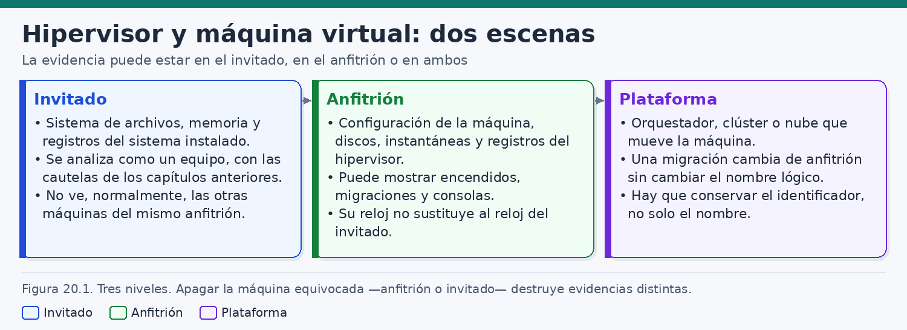
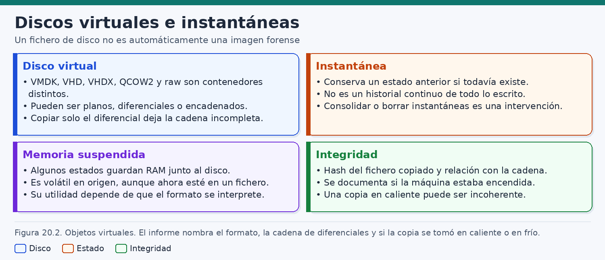
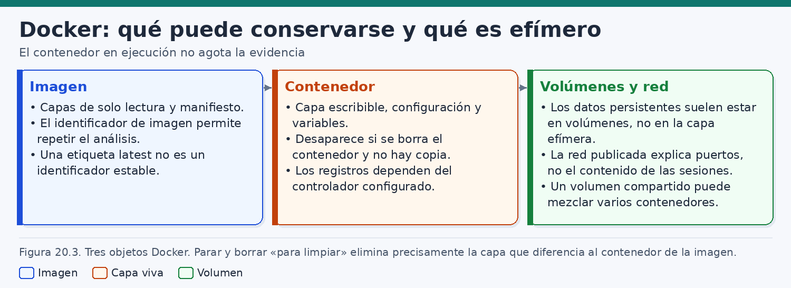
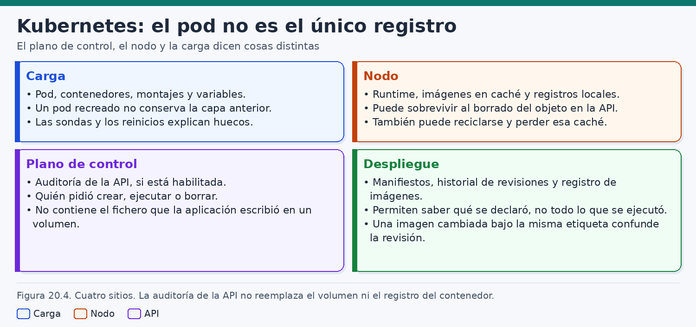
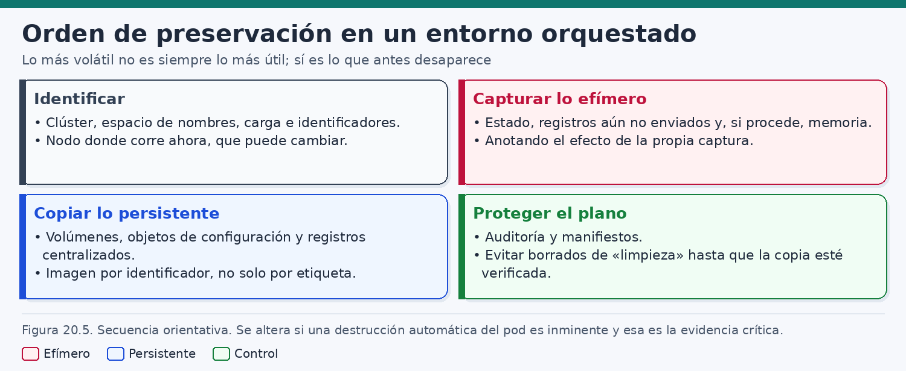
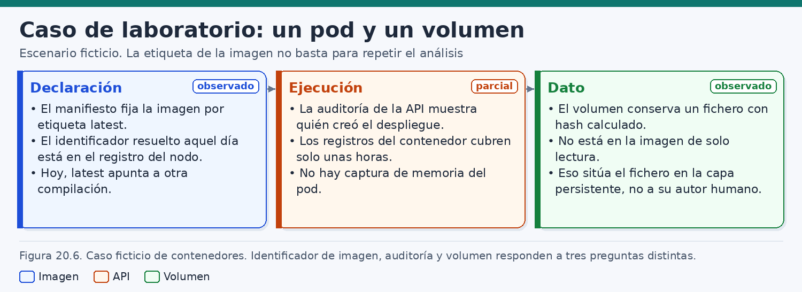

# Virtualización, contenedores y entornos orquestados

> *Quien apaga sin haber nombrado la escena conserva un disco y pierde un proceso, o al revés. El invitado, el anfitrión y el orquestador no se sustituyen entre sí.*

## Introducción

Los capítulos anteriores han tratado el disco, la memoria, los registros y el sistema operativo como si el equipo bajo examen fuese un ordenador con un soporte y un reloj. Esa abstracción sigue siendo útil, y deja de bastar cuando la carga vive dentro de otra máquina. Una máquina virtual es un equipo para quien la administra desde dentro y, a la vez, un conjunto de ficheros, procesos y registros para el sistema que la ejecuta. Un contenedor es un proceso con una vista recortada del árbol de ficheros, una imagen inmutable, una capa que desaparece al borrar y un volumen que puede sobrevivir. Un clúster añade una tercera escena: la de quien decide en qué nodo corre esa carga, con qué manifiesto y bajo qué cuenta de la API.

Este capítulo ordena el trabajo alrededor de esas tres escenas. El **invitado** es el sistema instalado en la máquina virtual, o el proceso y el sistema de archivos que ve el contenedor. El **anfitrión** es el hipervisor, el motor de contenedores o el nodo que materializa la ejecución. El **orquestador** es quien enciende, migra, despliega o recrea: una consola de virtualización, un plano de control de Kubernetes o el panel de un proveedor. La figura 20.1 reúne esa tercera escena bajo el nombre de plataforma. Un mismo nombre lógico puede permanecer mientras cambia el anfitrión. Un mismo fichero puede estar en el volumen y no en la imagen. Una misma cuenta puede haber creado un objeto de la API sin haber escrito el byte que ahora se discute.

La consecuencia práctica aparece antes de cualquier herramienta. Si la evidencia que importa está en caliente —memoria del invitado, capa escribible, registros aún no enviados, caché de una imagen en el nodo—, apagar el anfitrión la destruye junto con el estado del resto de cargas que ese anfitrión sostenga. Apagar solo el invitado destruye su memoria y sus sistemas de archivos efímeros, y deja en pie discos, instantáneas y registros del hipervisor. Las dos decisiones son intervenciones. El analista las toma después de decir qué escena contiene la pregunta.

El recorrido pasa por las máquinas virtuales, los discos y las instantáneas, Docker, Kubernetes y el orden de preservación. El caso final es ficticio: un manifiesto nombra una imagen por la etiqueta `latest`, el nodo conserva otro identificador, la auditoría de la API indica qué cuenta creó el despliegue y un fichero aparece solo en el volumen. Esas observaciones responden a preguntas distintas. En todo el texto se separan la **observación**, la **inferencia técnica** y la **hipótesis**. Las órdenes de ejemplo se ejecutan en laboratorio, sobre copias o sobre un clúster de prácticas. No autorizan a interrogar un clúster ajeno ni describen cómo salir de un contenedor. El aislamiento se estudia como límite de lo que cada escena puede ver. Las versiones cambian: un controlador de registros, una ruta de kubelet o el modo de nombrar una imagen pueden diferir del laboratorio en el que se redactó este capítulo. Donde se cita un comportamiento documentado, se cita para enseñar qué hay que comprobar.

## 1. Evidencias en hipervisores y máquinas virtuales

### 1.1. Tres escenas para un mismo nombre

Una investigación que empieza por «la máquina de pedidos» ya ha aceptado una ambigüedad. Ese nombre puede ser el hostname que el invitado anuncia, el nombre de inventario en el hipervisor o la etiqueta de una consola de nube. Antes de copiar nada, conviene escribir las tres escenas y lo que se espera de cada una.

El invitado arranca dentro de la máquina virtual. Tiene su sistema de archivos, su memoria, sus cuentas y sus registros, y se examina con los métodos ya vistos para ese sistema operativo, más las cautelas de este apartado. En condiciones normales no ve a las otras máquinas del mismo anfitrión: no comparte con ellas la tabla de procesos ni el árbol de directorios, salvo un disco compartido, una carpeta compartida o un canal entre invitados configurados a propósito.

El anfitrión ejecuta el hipervisor. Guarda la configuración de la máquina, los ficheros de disco, las instantáneas, los estados de memoria suspendida y los registros del propio hipervisor. Desde ahí puede observarse si la máquina figuraba encendida, si se migró, si alguien abrió una consola o si se creó una instantánea. El reloj del anfitrión ordena esos hechos. No sustituye al reloj del invitado.

La plataforma mueve la máquina cuando hay un clúster, una nube o un orquestador por encima de un solo anfitrión. Una migración en caliente cambia de anfitrión y puede dejar el nombre lógico intacto. El identificador de la instancia, el del hipervisor de origen, el de destino y la hora de la operación son datos de plataforma. Conservar solo el nombre impide saber en qué equipo estaba la carga cuando ocurrió el hecho.

La figura 20.1 resume las tres escenas y la advertencia que las acompaña: apagar la máquina equivocada —anfitrión o invitado— destruye evidencias distintas.



### 1.2. Qué puede observarse en cada escena

La tabla siguiente es una guía de cobertura, no un inventario cerrado. La columna de precaución importa más que la de ejemplos, porque los ejemplos dependen del producto y de la versión.

| Escena | Pregunta que puede ilustrar | Ejemplo de material | Precaución |
|---|---|---|---|
| Invitado | Qué había en el sistema de archivos y en los registros del sistema instalado | Disco del invitado, registros, memoria si se capturó | Se analiza como un equipo, con las cautelas de ese sistema operativo |
| Anfitrión | Cómo estaba definida la máquina y qué hizo el hipervisor | Configuración, discos, instantáneas, registros del hipervisor | Su reloj y sus identificadores no reemplazan a los del invitado |
| Plataforma | Quién pidió encender, migrar o redimensionar, y en qué anfitrión corría | Registro del orquestador, identificador de instancia, historial de migración | El nombre lógico puede sobrevivir a un cambio de anfitrión |

La precaución de cada fila se comprueba en el producto y en la versión. La tabla orienta la pregunta; no cierra el inventario ni promete que las tres escenas estén siempre al alcance.

### 1.3. El hipervisor como mecanismo, no como marca

El hipervisor presenta al invitado un hardware virtual y reparte el hardware real. Hay hipervisores que se apoyan en el equipo, con un sistema mínimo o con un núcleo que incorpora la virtualización, y hay hipervisores que son una aplicación más del sistema anfitrión. La distinción orienta la búsqueda. No sustituye la lectura de la versión instalada.

En el primer grupo aparecen, según la instalación, ESXi, Hyper-V, Xen o KVM. En el segundo, aplicaciones de escritorio que alojan máquinas sobre un sistema operativo general. QEMU puede emular o virtualizar, a menudo junto con KVM, y su documentación es la referencia para las imágenes que gestiona, en particular QCOW2. Libvirt y otras capas añaden definición, redes virtuales y registros propios. Nombrar la capa evita buscar en el invitado un registro de consola que solo existe en el gestor.

La configuración de la máquina es una fuente distinta del disco. Describe CPU virtual, memoria asignada, discos conectados, orden de arranque, adaptadores, UUID y nombre mostrado. Un UUID estable ayuda a correlacionar registros aunque alguien renombre la máquina. El nombre mostrado ayuda a hablar con quien operaba la plataforma. Citar uno por el otro mezcla un identificador técnico con una etiqueta editable.

Los agentes de invitado dejan un rastro que se interpreta con mesura. Que el agente esté instalado muestra una capacidad: el anfitrión pudo solicitar apagados ordenados, sincronización de hora o una congelación breve del sistema de archivos. No muestra que esa capacidad se usara en la hora que importa. El evento, si se conserva, estará en el registro del hipervisor o del agente.

### 1.4. El invitado se analiza como un equipo, con cautelas

Cuando el disco se ha extraído de forma íntegra y con la cadena completa, el sistema de archivos del invitado se examina como el de un ordenador del mismo sistema operativo. The Sleuth Kit y el resto del utillaje se aplican al derivado que el laboratorio sepa leer, normalmente una vista de bloques. Los capítulos de Windows, Linux y macOS siguen siendo el mapa de artefactos. Este capítulo añade lo que la virtualización cambia en la interpretación.

El hardware que el invitado enumera es virtual. Un número de serie, una dirección MAC o un modelo de firmware pueden ser estables y útiles, y pueden haber nacido en un fichero de configuración del anfitrión. El identificador es el que el invitado veía. Coincide o no con el que la configuración declaraba. No prueba, por sí solo, un equipo físico concreto.

Las excepciones se leen en la definición y no se suponen. Un disco marcado como compartido entre dos invitados mezcla escrituras de dos sistemas. Una carpeta compartida con el anfitrión hace que un fichero visible en el invitado resida en un path del anfitrión. Un canal de agente permite a un proceso del anfitrión pedir operaciones al invitado. Cada excepción cambia el lugar donde hay que preservar. Las marcas de fichero del invitado se leen en su escala de tiempo. Traducirlas a la escala del hipervisor exige un desfase medido, no un ajuste para que dos hechos queden alineados en la tabla.

### 1.5. El anfitrión registra encendidos, consolas y migraciones

El anfitrión es, con frecuencia, la única escena que puede decir si la máquina estaba encendida. Un corte brusco puede no dejar en el invitado un apagado bien escrito. El hipervisor puede haber anotado un corte, un apagado ordenado, un reinicio o una suspensión. Esas frases dependen del producto. El analista exporta el registro disponible, anota el intervalo que cubre y no rellena los huecos con la idea de que el encendido «siempre» se registra.

Abrir la consola gráfica o serie puede no dejar ninguna sesión en el invitado. Cuando el producto conserva el hecho, la observación posible es que una cuenta de la plataforma abrió la consola en un intervalo. Eso no transcribe las teclas, salvo un mecanismo de grabación verificado. El informe distingue el acceso a consola de la ejecución de una orden concreta.

La migración se lee en la plataforma y se refleja en el anfitrión de origen y en el de destino. El invitado puede notar solo una pausa, o no guardar nada interpretable. Después de migrar, el hostname sigue igual. Buscar «el servidor» por ese nombre en un solo anfitrión, una semana más tarde, puede llevar al equipo equivocado. El inventario incluye el identificador de la máquina, el anfitrión en el instante relevante, el anfitrión en el instante de la copia y la referencia al evento de migración, si existió. Los registros del anfitrión también rotan o viven en un colector remoto. Una ausencia de evento de consola se interpreta después de saber si ese tipo de evento se escribía y si el periodo preguntado sigue en la exportación.

### 1.6. La plataforma que mueve la máquina

Cuando varios anfitriones se administran juntos, aparece un registro de intenciones que no está dentro de ninguna máquina virtual. Una cuenta pidió crear la máquina, adjuntar un disco, tomar una instantánea o mover la carga. Esa petición puede quedar en la auditoría del gestor, en una tarea del proveedor o en un ticket. Es una observación sobre una cuenta y una operación. La hipótesis sobre qué persona estaba ante el teclado exige el mismo cuidado que en cualquier otro sistema de identidad: cuentas compartidas, tokens de automatización y administradores de plataforma producen la misma línea.

En una nube, esta escena es a menudo la única a la que el cliente accede. La instancia y los discos tienen identificadores del proveedor. Apagar la instancia desde la API pierde la memoria de esa instancia y no apaga el hipervisor del proveedor, al que el cliente no accede. El error simétrico dentro de una organización consiste en apagar el anfitrión físico porque «la máquina virtual ya está copiada»: se destruye la memoria del resto de invitados y puede interrumpirse una copia que todavía leía de ese anfitrión.

La plataforma puede reescribir el contexto del invitado en el primer arranque: nombre, usuario inicial, claves, direcciones. Esos datos acaban en ficheros del invitado y nacen de una orden de plataforma. Si el caso pregunta quién decidió el nombre o la clave inicial, la fuente está en la definición y en el registro de la plataforma, no solo en el sistema de archivos del invitado.

### 1.7. Apagar la máquina equivocada

Apagar el invitado elimina su memoria, los sistemas de archivos en RAM y las sesiones vivas. Conserva, si nadie los borra después, los discos, las instantáneas ya tomadas y los registros del hipervisor. Apagar el anfitrión elimina la memoria de todos los invitados en marcha, el estado del propio hipervisor y cualquier captura en caliente que aún no hubiera terminado. Si la pregunta depende de un proceso vivo, de una clave presente solo en memoria o de un contenedor cuya capa aún no se ha copiado, apagar el anfitrión sin haberlo decidido de forma expresa pierde la escena.

La decisión se escribe: qué escena contiene la evidencia crítica, qué se pierde al apagar el invitado, qué se pierde al apagar el anfitrión, quién autoriza, a qué hora y qué se habrá copiado antes. Cuando el anfitrión aloja cargas ajenas al caso, apagarlo sale del alcance. En un entorno con varios inquilinos, el disco físico puede contener máquinas que el encargo no cubre. La proporcionalidad forma parte de la preservación.

Suspender no es apagar y no es una instantánea de solo disco. Un estado suspendido puede guardar la memoria en un fichero. Ese fichero deja de ser volátil porque quedó escrito, y su utilidad depende de que el formato se interprete. Borrar el estado para liberar espacio durante la respuesta destruye esa oportunidad. Consolidar discos, borrar instantáneas o apagar son intervenciones: hora y efecto quedan en el registro.

### 1.8. Relojes, identificadores y correlación

Un caso de virtualización arrastra al menos dos relojes, y a menudo tres o cuatro: invitado, anfitrión, plataforma y almacenamiento. El informe elige una escala, lo habitual es UTC, y publica el desfase observado de cada fuente. Un desfase de segundos puede impedir afirmar que dos hechos fueron simultáneos. Un desfase de minutos puede invertir el orden aparente entre un fichero del invitado y un evento del hipervisor.

Si el invitado toma la hora del hipervisor, sus marcas pueden dar saltos en cada ajuste. Si usa otra referencia de red, puede ir por delante del registro local del anfitrión. Se documenta la configuración observada y el desfase medido en la adquisición. No se reescriben las marcas dentro de la copia para forzar un relato. Los identificadores viajan junto al nombre: máquina, disco, anfitrión, tarea de migración, nombre DNS y nombre de inventario pueden coincidir el día del diseño y divergir el día del incidente.

## 2. Discos virtuales, instantáneas y registros

### 2.1. El fichero de disco y la imagen forense

El disco de una máquina virtual suele presentarse como un fichero o como un grupo pequeño de ficheros. Esa presentación invita a tratarlo como si ya fuera una imagen forense. Una imagen forense documenta el método, el alcance, la coherencia y la integridad de lo copiado. Un fichero de disco virtual es el dato de trabajo del hipervisor. Puede ser plano, disperso, diferencial o miembro de una cadena. Puede haberse copiado con la máquina encendida. Puede depender de otro fichero que no está en la carpeta que alguien comprimió y envió.

La figura 20.2 separa el disco virtual, la instantánea, la memoria suspendida y la integridad. El pie fija el mínimo del informe: el formato, la cadena de diferenciales y si la copia se tomó en caliente o en frío.



### 2.2. Formatos que el informe debe nombrar

Cuatro familias cubren la mayor parte de los casos. No son intercambiables. El informe usa el nombre del formato observado.

| Formato | Dónde aparece con frecuencia | Qué debe quedar escrito |
|---|---|---|
| Raw | Exportaciones sencillas y derivados de laboratorio | Si es una secuencia de bloques y si el anfitrión lo almacenaba de forma dispersa |
| VMDK | Entornos VMware y exportaciones compatibles | Si es plano o disperso, monolítico o partido, y si el descriptor apunta a un padre |
| VHD y VHDX | Hyper-V y herramientas que adoptaron esos contenedores | Si es fijo, dinámico o diferencial, y cuál es el disco padre |
| QCOW2 | QEMU y gestiones que lo usan | Si declara una imagen de respaldo, instantáneas internas u otras opciones de esa versión |

Raw se acerca a la abstracción de secuencia de bloques. Aun así, el fichero puede ser disperso: el sistema de archivos del anfitrión no almacena los huecos, aunque la lectura lógica devuelva ceros. El hash que compara contenido es el de esa lectura lógica, calculado de forma documentada. El tamaño ocupado en disco es otro dato y no se presenta como tamaño del disco del invitado.

VMDK no es un solo diseño. Hay descriptores, extensiones planas, extensiones dispersas y discos partidos. El descriptor forma parte de la evidencia. Separarlo de los fragmentos, o renombrarlos, puede impedir la reconstrucción aunque los bytes sigan ahí. VHD y VHDX son formatos distintos. Llamar a uno con el nombre del otro abre el fichero con la expectativa equivocada.

QCOW2 es una de las imágenes que documenta el proyecto QEMU. Puede apuntar a una imagen de respaldo, de modo que el fichero reciente solo guarda lo que se desvió de esa base, y puede incorporar instantáneas internas. Si la versión y las opciones incluyen cifrado, una copia íntegra puede ser ilegible. La integridad del fichero no aporta la clave. Este capítulo no describe cómo eludirla. La tabla dice «con frecuencia»: el nombre se toma del fichero y de la configuración, no del hipervisor que el analista esperaba encontrar.

### 2.3. Discos planos, diferenciales y encadenados

Un disco plano contiene, con la salvedad de los huecos, la secuencia que el invitado utilizaba. Un disco diferencial, o un QCOW2 con imagen de respaldo, contiene el delta respecto de un padre. El invitado veía la composición de la cadena, no el delta aislado. Copiar solo el diferencial deja la cadena incompleta. Falta el padre, y a veces el padre del padre. El laboratorio puede no conseguir abrir el disco, o puede interpretar un sistema de archivos truncado y creer que el invitado estaba dañado.

Un ejemplo de laboratorio fija el hábito. `base-sistema.qcow2` guarda la instalación. `delta-datos.qcow2` declara esa base como respaldo. Si la carpeta que llega solo contiene el delta, la observación es que el padre no está. La inferencia es que no puede reconstruirse la vista del invitado. Se pide el padre, se verifican su hash y la relación declarada, y solo entonces se compone un derivado. Consolidar el original para simplificar es una intervención, no un paso de copia.

Si hace falta un raw para que The Sleuth Kit examine particiones, ese raw se genera desde las copias, con su identificador y su hash. Los miembros de la cadena se conservan. La herramienta y la versión se anotan, porque el soporte de cada formato no es uniforme. La inspección de una cadena QCOW2 se hace sobre la copia, nunca sobre el disco que un anfitrión todavía tiene abierto. La orden concreta se toma del manual local:

```bash
# Copia de laboratorio. No usar la ruta del disco que el hipervisor tiene abierto.
# Comprobar en el manual de qemu-img qué opción muestra la cadena de respaldo.
qemu-img info /caso/copias/delta-datos.qcow2
```

Si la salida declara una imagen de respaldo, ese path es una afirmación del fichero sobre dónde esperaba encontrar al padre. Puede ser una ruta del anfitrión original y no existir en el laboratorio. El padre se localiza por identificador y por hash. No se improvisa otro fichero que encaje en el path. Los descriptores VMDK y las relaciones padre-hijo de VHD y VHDX exigen el mismo cuidado con la herramienta del formato. Perder un fragmento de un disco partido es análogo a perder el padre: la cadena ya no está completa.

### 2.4. La instantánea como estado, no como historia continua

Una instantánea conserva un estado anterior si el objeto sigue existiendo. Ese estado puede incluir discos y, según el producto y las opciones, memoria o solo discos. Entre dos instantáneas, lo escrito y borrado puede no haber quedado en ninguna. La instantánea no es un historial continuo de todo lo escrito. Tres puntos —lunes, miércoles y viernes— permiten decir si un fichero está en esos estados. No permiten decir que nunca existió el martes.

Crear una instantánea es una operación del hipervisor. En muchos diseños, el disco activo pasa a ser un diferencial respecto del punto fijado. Borrar o consolidar reescribe esa relación. Limpiar instantáneas viejas para recuperar espacio, durante una respuesta, es una intervención sobre evidencia potencial. Si el servicio lo exige, se documenta qué se consolidó, con qué herramienta y qué cadena quedó.

### 2.5. Memoria suspendida y otros estados guardados

Algunos productos, al suspender o al incluir memoria en una instantánea, escriben la RAM del invitado en un fichero junto al disco. Esa memoria fue volátil y ahora está en un soporte. Su utilidad depende del formato y de la versión del invitado: núcleo, símbolos, estructura del fichero de estado. Un fallo de la herramienta de análisis no demuestra que la memoria no contuviera nada.

El disco, el fichero de memoria y la configuración son tres objetos. Hashear uno no acredita los otros. Si la memoria se capturó en un instante y el disco se copió horas después, el informe dice esa relación. Apagar no es suspender. Una instantánea sin memoria no contiene los procesos. Una copia en caliente de solo disco tampoco. Cuando el caso necesite la memoria y el producto no la haya guardado, la vía es una captura en vivo deliberada, con su impacto anotado, o la aceptación de que esa fuente no existe.

### 2.6. Integridad, copia en caliente y coherencia

La integridad de un disco virtual se documenta con tres datos que no deben colapsar en uno. El hash de cada fichero copiado, con algoritmo y herramienta. La relación de ese fichero con la cadena: padre, hijos, descriptor, fragmentos. La condición de la máquina: apagada, suspendida o encendida. Un hash correcto fija los bytes desde que se calculó. No prueba que, al leerlos, representaran un instante único del invitado.

Una copia en caliente puede ser incoherente. Si el invitado escribe mientras la copia lee, los primeros bloques y los últimos pueden pertenecer a momentos distintos. El sistema de archivos puede mostrar reparaciones o ficheros a medio escribir. Las bases de datos son especialmente sensibles. El laboratorio puede extraer información útil y debe decir que trabaja sobre un estado que quizá nunca existió como corte limpio.

La copia en frío, con el invitado apagado de forma ordenada, reduce ese problema y sacrifica la memoria. La suspensión puede ofrecer un término medio si el fichero de estado se conserva y se sabe leer. La instantánea del hipervisor con la máquina encendida suele ser más prudente que copiar a mano un fichero que QEMU o el hipervisor tiene abierto, y aun así puede ser solo coherente ante caída. Cuando el derivado raw se examina con The Sleuth Kit, su hash se guarda junto al de la cadena. Un examen limpio de un derivado no corrige una cadena a la que le faltaba el padre.

### 2.7. Registros del hipervisor junto al disco

El disco responde a qué bloques se conservaron. El registro del hipervisor responde a cuándo se creó una instantánea, qué cuenta la pidió, si la máquina se migró y si la copia se tomó en caliente. Sin el registro, el estado es mudo. Sin el disco, el registro puede demostrar una operación y no el contenido. La adquisición razonable pide los dos, más la configuración, y anota cuál faltó.

## 3. Análisis forense de Docker

### 3.1. Imagen, contenedor y volumen

Docker organiza el trabajo en objetos que no deben fundirse. La imagen está formada por capas de solo lectura y por un manifiesto. El contenedor añade una capa escribible, una configuración y un ciclo de vida. Los volúmenes y los montajes guardan datos fuera de esa capa. La red publicada explica qué puertos se expusieron. Ninguno de esos objetos basta, por sí solo, para reconstruir la actividad completa.

La documentación de almacenamiento describe el esquema de base: lo que un proceso escribe cae, por defecto, en la capa escribible situada encima de las capas inmutables. Esa capa es propia de ese contenedor. Cuando el contenedor se destruye, lo escrito ahí deja de persistir. Parar y borrar para limpiar elimina precisamente la capa que diferenciaba al contenedor de la imagen. Si nadie la copió, el laboratorio conserva la receta y pierde el rastro de lo que cambió en la ejecución.

La figura 20.3 coloca los tres objetos. La imagen permite repetir el análisis de lo inmutable cuando se conserva su identificador. El contenedor conserva la capa viva y desaparece con el borrado si no hay copia. Los volúmenes sostienen el dato persistente. Un volumen compartido puede mezclar escrituras de varios contenedores. La red publicada no sustituye el contenido de las sesiones.



Otros motores repiten ideas parecidas con nombres y rutas distintos. Un hallazgo descrito para el daemon Docker no se traslada por analogía. Se vuelve a leer la configuración del motor que había.

### 3.2. El identificador y la etiqueta latest

En el uso diario las imágenes se nombran con un repositorio y una etiqueta. `latest` es una etiqueta más. Designa el manifiesto al que el repositorio hace apuntar esa palabra en el momento de la consulta. Quien vuelva a descargar `latest` al día siguiente puede obtener otras capas. Una etiqueta no es un identificador estable, y `latest` es el caso más fácil de malinterpretar porque parece significar «la actual» sin decir respecto de qué instante.

El identificador que permite repetir el análisis es el que fija el contenido: el que el motor muestra para la imagen y, cuando existe, el resumen del manifiesto en el registro. Esos valores se parecen y no siempre son la misma cadena. Se anotan los que la herramienta muestre, con la versión del motor. «Se ejecutó una etiqueta» cita una declaración. «El contenedor inspeccionado refería este identificador» cita una observación del motor. Las dos frases pueden ser verdaderas y señalar contenidos distintos si la etiqueta se movió.

En el laboratorio, la consulta se hace contra un daemon de prácticas o contra una configuración exportada:

```bash
# Lectura en el Docker de prácticas del laboratorio.
# No es una orden para interrogar un daemon ajeno.
docker inspect --format 'Id={{.Id}} Image={{.Image}}' practica-api
```

La plantilla se comprueba con la versión instalada. Lo que se busca es el identificador del contenedor y el de la imagen a la que quedó unido.

### 3.3. Capas de solo lectura y capa escribible

Las capas de solo lectura explican el software que la imagen aportó. La capa escribible explica lo que ese contenedor alteró encima: ficheros creados, modificados u ocultos respecto de la imagen. Un fichero que se ve igual desde dentro del contenedor puede proceder de una capa u otra. Atribuir el cambio exige saber en qué capa está el byte.

La capa superior puede ocultar un fichero de la imagen sin borrarlo de esa imagen. Quien solo liste el árbol que ve el proceso dirá que el fichero no existe. Quien compare con las capas podrá decir que la imagen lo traía y el contenedor lo tapa. Son observaciones distintas. La segunda requiere acceso a las capas, no solo una sesión dentro del contenedor.

Las variables de entorno y la línea de órdenes forman parte de la configuración. A veces contienen secretos. Se preservan con el control de acceso de cualquier credencial y no se pegan en un informe de amplia difusión. Un secreto presente en la configuración demuestra exposición potencial a ese proceso. No demuestra que se usara ni ante qué destino.

Si la configuración muestra un contenedor privilegiado, capacidades añadidas o un montaje amplio del anfitrión, eso se registra como configuración observada: cambia lo que el proceso podía alcanzar. Interpretar ese alcance es trabajo defensivo. Este capítulo no describe técnicas para escapar del aislamiento.

### 3.4. Dónde busca el analista los bytes en el anfitrión

El daemon guarda imágenes y capas en un directorio de datos del anfitrión. La ruta por defecto puede cambiarse. El controlador de almacenamiento —en muchas instalaciones Linux ha sido habitual `overlay2`, y el valor se lee en el caso— determina cómo se apilan las capas. El informe nombra el controlador observado.

Copiar en caliente el directorio entero del daemon, mientras sigue escribiendo, puede dejar una copia incoherente. Si la decisión es conservar imágenes, se prefiere un mecanismo del propio motor para exportar por identificador, o una instantánea del almacenamiento tomada con criterio, y se documenta la vía. La exportación por identificador pide la imagen que el contenedor usaba, no la que la etiqueta nombra hoy. La capa escribible vive asociada a ese contenedor. Después del borrado, buscarla en el anfitrión sin copia previa es una hipótesis de recuperación residual, no una expectativa.

### 3.5. Registros según el controlador

`docker logs` muestra, en el caso que documenta Docker, la salida estándar y la salida de error del proceso principal. Una aplicación que escriba solo en un fichero interior no aparecerá en ese flujo, salvo que la imagen redirija el fichero hacia esas salidas. El vacío de `docker logs` no es, por sí solo, vacío de actividad.

El controlador de registro decide el destino del flujo: un fichero local, el diario del sistema, un servicio remoto o ningún destino conservado por el daemon. La documentación advierte un efecto práctico: si el controlador envía los registros a otro backend y el registro dual no está activo, `docker logs` puede no mostrar nada útil. El controlador efectivo se lee en la inspección del contenedor y en la configuración del daemon.

```bash
# Daemon de prácticas. Consulta de configuración, sin cambiar el contenedor.
docker inspect --format '{{.HostConfig.LogConfig.Type}}' practica-api
```

### 3.6. Volúmenes, montajes y datos persistentes

Los datos que deben sobrevivir al contenedor se colocan fuera de la capa escribible. El volumen lo gestiona el daemon: vive en el anfitrión y sigue disponible después de eliminar los contenedores que lo usaron. El montaje de tipo bind enlaza un path del anfitrión, de modo que procesos de fuera del daemon y procesos del contenedor pueden escribir el mismo sitio. El montaje tmpfs reside en memoria y se pierde al parar el contenedor o al reiniciar el anfitrión. Las versiones recientes añaden otras variantes; se comprueban en la documentación de la versión.

Desde dentro, un volumen y un bind parecen directorios. Borrar el contenedor no borra un volumen. Borrar el volumen es otra operación, y es la que destruye el dato persistente. Un volumen compartido mezcla autores técnicos. Qué contenedor escribió un fichero exige marcas de tiempo, ciclo de vida de cada contenedor y, si existen, registros del anfitrión. El identificador de usuario dentro del contenedor se lee con la correspondencia de usuarios, cuando exista: el uid 0 del contenedor puede no ser el uid 0 del anfitrión.

La documentación de Docker sitúa el acceso directo al directorio de volúmenes del daemon fuera del uso soportado. En una preservación conviene preferir una copia en el nivel del almacenamiento, o una exportación acordada, antes que reescribir el volumen con el daemon en marcha. Si la urgencia obliga a copiar los bytes de un path observado, se documenta la decisión, se hashea el resultado y se presenta como adquisición de ficheros del anfitrión, con su riesgo de coherencia.

### 3.7. La red publicada y el contenido que no explica

La configuración de red dice qué red interna usaba el contenedor y qué puertos se publicaron en el anfitrión. Un puerto publicado es una observación de configuración. No es el contenido de las sesiones. Para el contenido hacen falta capturas, registros de proxy o las fuentes del capítulo de red, con el límite del tráfico cifrado.

### 3.8. Qué se inventaría antes de parar o borrar

Antes de parar un contenedor en un caso real se deja constancia del identificador del contenedor, del identificador de la imagen, de las etiquetas solo como dato auxiliar, del controlador de registros, de los montajes y su tipo, de las variables y de la orden de arranque bajo custodia adecuada, de las redes y los puertos, de la hora del anfitrión y del estado de ejecución. Cada lectura se anota: la inspección también es actividad.

Parar no es borrar. Un contenedor parado puede conservar su capa hasta que alguien lo elimine. Los volúmenes sobreviven al borrado del contenedor y no sobreviven a su propia eliminación. Los registros locales dependen del controlador. No se limpia el daemon para dejar el anfitrión presentable hasta que la copia de la capa, de los registros y de los volúmenes relevantes esté verificada, o hasta que se haya decidido por escrito que esa escena no forma parte de la pregunta.

## 4. Investigación en Kubernetes

### 4.1. Cuatro sitios y tres preguntas

Kubernetes separa aún más las escenas. El pod es la carga: uno o varios contenedores que comparten red y volúmenes, con un ciclo de vida que el plano de control puede cortar y volver a crear. El nodo es el anfitrión: runtime, caché de imágenes y registros locales. El plano de control guarda el estado deseado y, si alguien lo configuró, la auditoría de la API. El despliegue declara cuántas réplicas se querían y qué imagen se nombró.

La figura 20.4 las dispone así. Un pod recreado no conserva la capa anterior. El nodo puede sobrevivir al borrado del objeto en la API y también puede reciclarse y perder la caché. La auditoría, si está habilitada, dice quién pidió crear, ejecutar o borrar, y no contiene el fichero que la aplicación escribió en un volumen. El despliegue muestra lo declarado. Una imagen cambiada bajo la misma etiqueta confunde la revisión.



Tres preguntas mantienen el orden. Qué se declaró. Qué llegó a ejecutarse en un nodo concreto, y qué cuenta pidió la operación. Dónde está el dato persistente. Un objeto Deployment no escribe en el volumen. Como mucho declara un pod que monta ese volumen. La frase «el despliegue escribió el fichero» suena técnica y no describe ningún mecanismo.

### 4.2. El pod, los reinicios y la capa que desaparece

Un pod nuevo recibe contenedores nuevos. La capa escribible del contenedor anterior no viaja al pod recreado. Los ficheros que solo vivían en esa capa se pierden con el contenedor, salvo copia previa. Un volumen `emptyDir` está ligado a la vida del pod. Un volumen persistente está pensado para sobrevivir al relevo. La diferencia decide dónde buscar.

El kubelet puede reiniciar un contenedor dentro del mismo pod cuando una sonda de vida falla. La documentación de registro indica que, por defecto, si un contenedor reinicia, el kubelet conserva uno terminado con sus registros, y que puede pedirse esa instancia anterior. «Anterior» significa un contenedor previo del mismo pod, no un pod que el despliegue ya eliminó. Un pod recreado tiene otra identidad. Su capa anterior ya no está.

Las sondas y los reinicios explican huecos: tiempos de arranque repetidos, registros partidos y, si la aplicación no cierra bien, ficheros a medio escribir en el volumen. El número de reinicios es un estado. La causa se busca en el evento y en el mensaje de la sonda. Los ConfigMap y los Secret montados forman parte de lo que el proceso pudo leer. El contenido sensible se custodia. Su presencia demuestra que el plano de control entregó ese objeto al pod, no que la aplicación lo transmitiera a un tercero.

### 4.3. El nodo: runtime, caché de imágenes y registros locales

El nodo ejecuta un runtime compatible con la interfaz de Kubernetes: a menudo containerd o CRI-O, a veces una integración con Docker según la época y la distribución. El nombre se comprueba. De él dependen el formato del identificador de imagen y la ruta de las capas. La caché del nodo puede conservar un identificador que el registro ya no ofrece bajo la misma etiqueta. Esa caché es, en muchos casos, la única copia de las capas que de verdad se ejecutaron.

La caché no es eterna. Un nodo reciclado, reinstalado o sustituido pierde las capas locales y los registros que no se hubieran enviado a otra parte. La figura 20.4 señala las dos posibilidades: el nodo puede conservar restos después del borrado en la API, y puede perderlos si él mismo desaparece. Se copia pronto lo que solo vive en el nodo.

La arquitectura de logging documenta una ubicación por defecto de los registros de contenedor bajo `/var/log/pods` en nodos Linux, modificable con `podLogsDir`, y una rotación con valores por defecto de tamaño y de número de ficheros que el kubelet del caso puede haber cambiado. `kubectl logs` devuelve el fichero actual, no necesariamente los ya rotados que aún estén en el directorio. Si el pod es expulsado, se retiran los contenedores y sus registros. En nodos Linux con systemd, kubelet y runtime escriben por defecto en el diario, que puede ser volátil si no hay persistencia. El nodo, además, puede ser a su vez una máquina virtual. Apagar el hipervisor que lo aloja apaga al resto de invitados. La decisión sigue la regla del apartado 1.

### 4.4. El plano de control y la auditoría de la API

La auditoría de Kubernetes es un registro cronológico, emitido en el servidor de API, de las peticiones de usuarios, aplicaciones y del propio plano de control. La documentación enumera las preguntas que puede contestar: qué ocurrió, cuándo, quién lo inició, sobre qué objeto, dónde se observó, desde dónde y hacia dónde. «Quién» es la identidad autenticada. Puede ser una persona, una cuenta de servicio o un token de integración.

La misma documentación fija el hecho que más a menudo se pasa por alto. La política se entrega al servidor de API en un fichero. Si ese parámetro se omite, no se registran eventos. La auditoría está desactivada salvo que el clúster la configure. Un clúster sin esa política puede no tener esta fuente. La ausencia de una línea no es ausencia de actividad. Es ausencia de registro.

Cuando la política existe, el nivel de cada regla decide el detalle. Los niveles documentados son `None`, `Metadata`, `Request` y `RequestResponse`. Metadata anota usuario, instante, recurso y verbo, sin el cuerpo. Request añade el cuerpo de la petición. Incluso un nivel con cuerpo mostrará lo que la petición contenía —a menudo la etiqueta de la imagen— y no el identificador que el nodo resolvió al descargarla. Los backends documentados son ficheros y webhooks, cada uno con su retención. En un clúster gestionado, el cliente puede no recibir el fichero del servidor de API. Pedir la auditoría sin decir el backend, el intervalo y el nivel deja la petición incompleta.

El almacén de estado del clúster, habitualmente etcd, guarda objetos, no el contenido de los volúmenes de aplicación. Una copia de ese almacén es material sensible y una intervención distinta, que solo se plantea con autorización y con el procedimiento de la versión. No es un atajo para leer el fichero del caso. Este capítulo no describe cómo extraer ni descifrar ese almacén.

### 4.5. Despliegues, revisiones y lo que se declaró

Un Deployment declara una plantilla de pod y un número de réplicas. El historial de revisiones, hasta el límite configurado, conserva plantillas anteriores. Sirve para ver qué se llegó a declarar. No prueba que cada revisión se ejecutara, ni que la etiqueta significara el mismo contenido durante toda la vida de la revisión. Si dos revisiones dicen `api:latest` y entre medias alguien movió la etiqueta en el registro, las dos pueden haber creado pods con capas distintas. El identificador real, si se conserva, está en el estado del contenedor o en la caché del nodo.

En el clúster de prácticas, una consulta de lectura obtiene el identificador que el pod publica. La sintaxis depende del runtime. Se copia tal como viene.

```bash
# Consulta de lectura sobre el clúster de prácticas, con el contexto de laboratorio ya seleccionado.
# No es una receta contra un clúster ajeno ni una orden de cambio.
kubectl get pod -n pedidos practica-api-0 -o jsonpath='{.status.containerStatuses[*].imageID}{"\n"}'
```

`kubectl get` y `kubectl logs` son observaciones cuando se usan, en este libro, sobre el clúster de prácticas. También son tráfico hacia la API. En un caso real se anotan la hora, la cuenta y el objeto. No se mezclan en el mismo guion con órdenes que borren pods o ejecuten procesos dentro del contenedor. Esas actuaciones, si la respuesta las exige, van en el registro de intervención.

### 4.6. Volúmenes persistentes y ficheros que la API no guarda

La reclamación de volumen expresa el deseo de un espacio de nombres de disponer de almacenamiento. El volumen persistente es el recurso. La clase de almacenamiento y la política de recuperación, leídas en el objeto, dicen qué ocurre con el backend si la reclamación se borra. Borrar el pod no borra por ello un volumen persistente. Borrar la reclamación puede borrar el backend si la política así lo declara. Se lee el objeto preservado.

El fichero escrito por la aplicación está en el backend: un disco, un volumen de red, un volumen de un proveedor. El plano de control guarda la referencia, el tamaño, el modo de acceso y el nombre. Una exportación completa de manifiestos no responde a si el fichero existía. Hace falta una copia del volumen. El modo de acceso importa para la atribución. Un volumen con varios escritores tiene más candidatos. La tabla de montajes es un instante, no una película.

Las marcas del fichero son las del sistema de archivos del volumen, que puede tener otro reloj. Un fichero anterior al pod que ahora lo monta es compatible con un escritor previo que ya no existe. Esa compatibilidad es una inferencia temporal, no la identidad del escritor.

### 4.7. Arquitectura de registros y huecos explicables

El camino más común es que la aplicación escriba por la salida estándar y la de error, que el runtime recoja ese flujo y que el kubelet lo exponga. Kubernetes documenta que eso no basta cuando el contenedor cae, el pod se expulsa o el nodo muere, y que no ofrece un almacén nativo de registro a nivel de clúster. Ese nivel, cuando existe, es un diseño añadido: un agente en cada nodo, un contenedor auxiliar que reenvía, o la propia aplicación enviando a un backend.

Sin ese diseño, la retención efectiva es la del nodo. Con agente, aparece una segunda copia, con otra hora de llegada, otro filtro y otra retención. Un hueco en `kubectl logs` puede convivir con líneas en el colector, puede ser un intervalo en el que el proceso no escribió, o puede ser el efecto de devolver solo el fichero no rotado. Los objetos Event de la API no son la auditoría. Su retención es breve y configurable. Sirven para un reinicio reciente. No sirven como crónica de la semana.

Las sondas, los despliegues que recrean pods y los nodos que desaparecen producen huecos aunque nadie borre registros a mano. El informe los explica como huecos de arquitectura cuando no se conservaba más, y como intervenciones cuando alguien borró pods o recicló nodos durante la respuesta.

### 4.8. Cuentas, controladores y personas

La identidad ante la API se expresa con usuarios, grupos y cuentas de servicio. Un controlador crea pods con su cuenta. Un flujo de integración puede usar un token. Una persona puede usar una configuración nominal. La auditoría, si el nivel basta, muestra esa identidad y a menudo una dirección de origen. Afirmar que la persona titular de un correo conoció el contenido de un volumen es una hipótesis.

## 5. Adquisición y preservación de evidencias

### 5.1. Una secuencia orientativa

El orden clásico de volatilidad sigue siendo la referencia de la guía del NIST para integrar técnicas forenses en la respuesta a incidentes. En un entorno orquestado hay que reescribirlo, porque lo más volátil no es siempre lo más útil: es lo que antes desaparece. Si la pregunta está en un volumen estable, copiar primero una memoria irrelevante retrasa la copia útil. Si un controlador va a destruir el pod y la capa escribible es la pregunta, esa capa pasa delante.

La figura 20.5 propone cuatro movimientos. Identificar clúster, espacio de nombres, carga, identificadores y nodo actual, que puede cambiar. Capturar lo efímero: estado, registros aún no enviados y, si procede, memoria, anotando el efecto de la propia captura. Copiar lo persistente: volúmenes, objetos de configuración, registros centralizados e imagen por identificador. Proteger el plano: auditoría y manifiestos, y evitar borrados de limpieza hasta que la copia esté verificada. La secuencia se altera si una destrucción automática del pod es inminente y esa es la evidencia crítica.



Identificar y capturar lo efímero puede exigir que el nodo siga encendido. Copiar un volumen puede hacerse con una instantánea de almacenamiento sin apagar el hipervisor que aloja a ese nodo y a otros invitados. Apagar el anfitrión al principio, para que nada cambie, mata lo efímero antes de capturarlo.

### 5.2. Identificar clúster, carga, nodo e identificadores

La identificación ya es preservación si se guarda fuera de la escena. Los datos mínimos son el nombre y el identificador del clúster si existen ambos, el espacio de nombres, el tipo y el nombre de la carga, el identificador del pod, el nodo actual, el identificador de imagen tal como lo muestra el runtime, las reclamaciones y su modo de acceso, y la cuenta con la que se observa.

El planificador puede mover la carga. Una segunda consulta puede devolver otro nodo si el pod murió y otro ocupó su lugar, con el mismo nombre de despliegue y otro nombre de pod. Se guardan el nombre del pod y su identificador interno. En máquinas virtuales, la ficha paralela incluye UUID, nombre de inventario, anfitrión, identificadores de cada disco, formato, cadena, instantáneas y fichero de memoria. Empezar por un VMDK suelto es la forma habitual de descubrir tarde que faltaba el padre.

### 5.3. Capturar lo efímero y anotar el efecto

Lo efímero incluye el estado de ejecución, los registros que aún no han salido del nodo, la capa escribible, los tmpfs, la memoria cuando la pregunta la exige, y las tablas de red y de montaje. Capturarlo altera la escena. Una consulta de registros genera una petición a la API. Un volcado de memoria consume recursos y puede escribir un fichero grande. La alteración no invalida la diligencia; la oculta si no se anota. El registro incluye hora, herramienta, versión, cuenta y efecto esperado.

La memoria se captura cuando el encargo lo justifica. El método pertenece al procedimiento validado en el laboratorio y al capítulo de memoria. Un volcado es un instante. Si no se autoriza, la omisión se escribe como límite. Cuando la destrucción del pod es inminente, se copia antes la capa y el registro local que vayan a desaparecer, y se deja constancia de que se alteró la secuencia de la figura 20.5 porque la alternativa era no tener esa evidencia.

### 5.4. Copiar volúmenes, imágenes y registros que sí persisten

Una instantánea del almacenamiento, si se entiende su coherencia, suele ser mejor que copiar ficheros desde un pod que sigue escribiendo. El resultado se hashea, se relaciona con el identificador del volumen y se etiqueta como copia en caliente o en frío. La imagen se conserva por identificador, desde la caché del nodo o desde el registro, diciendo cuál de las dos fuentes se usó. Conservar la etiqueta y no las capas deja el caso como un diferencial sin padre.

Los registros centralizados se exportan por el intervalo, con el nombre del colector, la consulta y la retención. Los objetos de configuración se exportan con hora. Un objeto vivo cambia: la exportación de las 10:20 no es la de las 18:00. Si alguien corrige el manifiesto durante la respuesta, las dos versiones importan y no se sobrescribe la primera.

### 5.5. Proteger manifiestos y auditoría frente a la limpieza

Borrar pods en error, relanzar despliegues, rotar nodos o aplicar retenciones de trabajos puede ser legítimo para el servicio y peligroso para el caso. Esos gestos esperan, cuando sea posible, a que la copia esté verificada. Proteger el plano significa exportar la auditoría disponible y los manifiestos, y acordar una ventana en la que la limpieza automática que afecte a los objetos del caso queda suspendida o al menos avisada.

Un fichero truncado, una instantánea a medias o una imagen a la que le falta una capa no están preservados porque alguien pulsara exportar. Se comprueba el hash y se repite la copia si falla, desde la fuente que todavía exista. Si la auditoría nunca se configuró, proteger el plano no la inventa. Se escribe que la cronología de la API no existe para el pasado, para no sugerir un silencio de los usuarios cuando lo que hubo fue un silencio de la configuración.

### 5.6. En frío, en caliente o en suspensión

Si la memoria no forma parte del encargo y el invitado puede detenerse, la copia en frío del disco, con la cadena completa, es la más cómoda de interpretar. Si la memoria importa, se captura antes de apagar, o se usa un estado suspendido que la incluya. Si el servicio no puede detenerse, se usa la instantánea del hipervisor, se documenta si hubo congelación del invitado y se trata el resultado como posiblemente incoherente para las aplicaciones.

En ninguno de esos caminos el primer paso es apagar el anfitrión porque el invitado ya está identificado. El anfitrión se apaga solo si la evidencia crítica está en su propio disco, la memoria de los invitados ya se resolvió y el alcance cubre a ese equipo. Si falta una condición, la decisión no está tomada y el anfitrión sigue encendido. Para contenedores, parar deja de haber proceso y puede dejar la capa hasta el borrado. Exportar la imagen por identificador no incluye la capa escribible ni el volumen. Cada objeto se copia por su vía. Copiar el disco entero del nodo es proporcionado cuando el nodo es del caso, y desproporcionado cuando ejecuta cargas de otros asuntos o de otros clientes.

### 5.7. Cadena de custodia de objetos virtuales

Un disco diferencial, su padre, el descriptor, el fichero de memoria, la exportación del pod, el fichero de auditoría, la instantánea del volumen y el derivado raw son ítems distintos. Cada uno lleva identificador, hash, herramienta, hora, escena de origen y relación con los demás. El hash del derivado no se anota en la ficha del original para que el expediente «cuadre».

La cuenta que exportó por API forma parte del método, igual que quien extrajo un disco. SWGDE publica prácticas de adquisición, validación e informe que encajan en el principio aunque el soporte sea un objeto de API: documentar el original, la copia, la herramienta y la comprobación. The Sleuth Kit entra cuando existe una vista de sistema de archivos que la versión sepa leer. El flujo de laboratorio examina el derivado, salvo que la versión documente el formato virtual y se haya verificado ese soporte. Los resultados se guardan como análisis, separados de la evidencia.

### 5.8. Alcance, otros inquilinos y preparación en la nube

Virtualización y nube se tocan en cuanto el anfitrión no es de quien investiga. SP 800-145 hace inteligible el reparto: el cliente dispone de las capacidades del servicio contratado y el proveedor retiene la pila inferior. En infraestructura como servicio, el cliente suele alcanzar la instancia y sus volúmenes por API, no el hipervisor. En una plataforma de contenedores gestionada, puede alcanzar la API de Kubernetes y no los nodos. Lo que el cliente no ve se pide como exportación de un tercero, con su cadena y sus límites.

SP 800-201, de julio de 2024, presenta la arquitectura de referencia del NIST para la preparación forense en la nube. Se apoya en el trabajo que identificó 62 retos en nueve categorías —arquitectura, recogida, análisis, antiforense, primera respuesta, gestión de roles, marco legal, normas y formación—, sin que este capítulo detalle cada uno. No hace falta reproducir el catálogo. Un clúster en infraestructura ajena hereda ese reparto. Quien no activó la auditoría, no envió los registros fuera del nodo y no guardó los identificadores de imagen llega al incidente sin esas escenas, aunque el volumen siga intacto.

## 6. Caso práctico

### 6.1. Encargo, hechos conocidos y preguntas

La Cooperativa Litoral Distribución, dominio `litoral.example`, opera un clúster propio llamado `cl-bahia`. El 12 de marzo de 2026, poco después de las 09:00 UTC, una analista ve en un volumen el fichero `salida/lote-20260312.csv`, que el grupo de datos no esperaba. Pide saber qué imagen se declaró, qué imagen se ejecutó, qué cuenta creó el despliegue `api-pedidos` y si el fichero forma parte de la imagen o del volumen. Nadie ha capturado memoria del pod. Los registros del contenedor cubren solo unas horas de esa mañana.

El caso es ficticio. Nombres, horas e identificadores no proceden de un incidente real. Los identificadores de imagen se abrevian a propósito: son etiquetas didácticas, no resúmenes calculados. El hash del fichero se cita como `HASH-VOL-01`, algoritmo SHA-256, igual que una ficha que no vuelca el valor completo en un manual.

La figura 20.6 separa el resultado en tres columnas. La declaración es observada: el manifiesto fija `latest`, el identificador resuelto aquel día está en el nodo y, días después, `latest` apunta a otra construcción. La ejecución queda parcial: la auditoría muestra quién creó el despliegue, los registros cubren unas horas y no hay memoria. El dato es observado: el volumen conserva el fichero con hash calculado, el fichero no está en la imagen de solo lectura, y eso sitúa el fichero en la capa persistente, no a su autor humano.



Responder las tres columnas con una sola frase —«Ana desplegó la imagen que escribió el fichero»— es el error que el ejercicio quiere hacer visible.

### 6.2. Tres escenas y la decisión de no apagar

El pod `api-pedidos-7c4d9f8b6-k2mnp` monta la reclamación `datos-pedidos` en `/datos`. El nodo `nodo-b3` guarda la caché y los registros locales. El plano de control de `cl-bahia` guarda objetos y auditoría. `nodo-b3` es, además, una máquina virtual del hipervisor `hv-norte-02`, que esa mañana ejecuta otros invitados fuera del alcance.

A las 09:20 UTC, operaciones propone apagar `hv-norte-02` para congelar el estado. La propuesta se rechaza por escrito. La evidencia en caliente está en el nodo: la caché de la imagen y los registros del contenedor, porque ese espacio de nombres no tiene agente de registro de clúster. Apagar el hipervisor destruiría esa escena y la memoria de invitados ajenos al caso. Tampoco se apaga `nodo-b3` ni se borra el pod para dejar el despliegue limpio. El encargo autoriza el espacio de nombres `pedidos`, la auditoría disponible, lo necesario del nodo para imagen y registros de ese pod, y el volumen. No autoriza los discos de los otros invitados ni sesiones interactivas dentro del contenedor.

No hay destrucción automática inminente del pod, así que no se altera el orden de la figura 20.5 por esa excepción. Se identifican clúster, pod, nodo, identificador de imagen y reclamación. Se capturan los registros locales y el estado. No se captura memoria; la omisión queda escrita. Se pide una instantánea del volumen y se exporta la imagen por el identificador visto en el nodo, sin volver a resolver la etiqueta. Se copian la auditoría y el objeto Deployment. Hasta verificar las copias, se suspende la tarea que borra pods terminados y recicla nodos. La instantánea del volumen es una copia con la aplicación en marcha, sin congelación de la aplicación. `HASH-VOL-01` se calcula sobre la copia.

### 6.3. Inventario

| ID | Objeto | Escena | Límite explícito |
|---|---|---|---|
| `K8S-LIT-01` | Deployment `api-pedidos` exportado a las 09:40 UTC | Plano de control | Estado en ese instante; la etiqueta puede moverse después |
| `AUD-LIT-02` | Auditoría de API, nivel Metadata | Plano de control | Sin cuerpo; no cubre escrituras al volumen |
| `NOD-LIT-03` | Estado del pod e `imageID` en `nodo-b3` | Nodo | Sintaxis del runtime; no es la etiqueta |
| `IMG-LIT-04` | Imagen exportada por identificador desde la caché | Nodo | Capas de solo lectura; sin capa escribible ni volumen |
| `LOG-LIT-05` | Registros del pod en el nodo | Nodo | Unas horas; no hay colector de clúster |
| `VOL-LIT-06` | Instantánea de `datos-pedidos` | Almacenamiento | En caliente respecto de la aplicación |
| `DEC-LIT-07` | Decisión de no apagar hipervisor ni nodo | Expediente | Escena que se quiso conservar |

No existe un ítem de memoria. La capa escribible se inspecciona lo bastante para ver que el fichero no vive en ella, y no se conserva íntegra: la pregunta, una vez identificado el volumen, no depende de esa capa. La elección queda anotada.

### 6.4. La declaración: latest en el manifiesto

`K8S-LIT-01` contiene, en la plantilla del contenedor, esta declaración ilustrativa:

```yaml
# Fragmento del objeto exportado. No es un manifiesto para aplicar.
image: registry.litoral.example/pedidos/api:latest
```

El Deployment, a las 09:40 UTC del 12 de marzo, nombraba esa etiqueta. No dice qué capas descargó el nodo a las 06:05 ni qué resolverá la etiqueta el 18 de marzo. Ese día, en el registro de prácticas que reproduce el caso —no en un registro ajeno—, `latest` apunta a otro identificador, abreviado `sha256:9aa1…c0d2`. La observación del día 18 no reescribe la del día 12. Explica por qué repetir el análisis descargando `latest` habría examinado otra construcción.

La auditoría no completa el dato. `AUD-LIT-02` está en nivel Metadata: el cuerpo con la cadena `image:` no se guardó. Aunque se hubiera guardado, habría contenido la etiqueta pedida en el manifiesto, no el identificador que el nodo resolvió después.

### 6.5. La ejecución: identificador en el nodo y cuenta que creó el despliegue

A las 09:32 UTC, con el pod todavía en `nodo-b3`, el estado del contenedor muestra un identificador del runtime, abreviado `sha256:4f8c…e4c1`. Se guarda en `NOD-LIT-03` y la imagen se exporta desde la caché a `IMG-LIT-04`. El caso tiene una sola réplica documentada. Otra réplica, en otro nodo, habría exigido su propio campo.

La auditoría conservada, simplificada y ficticia, cabe en los campos que el nivel Metadata permite discutir:

```text
stage: ResponseComplete
verb: create
user: ana.riera@litoral.example
source: 198.51.100.40
object: deployments/api-pedidos
namespace: pedidos
time: 2026-03-12T05:58:11Z
```

La dirección pertenece al rango de documentación y, en la ficción, es el ejecutor `publicador-ci`. La observación es que a las 05:58:11 UTC la API completó un `create` del Deployment presentado por `ana.riera@litoral.example` desde ese origen. La inferencia se detiene ahí, dentro de la confianza del servidor de API y de su reloj. La hipótesis de que Ana Riera pulsara un botón, o de que el ejecutor reutilice su token, queda abierta. El fichero del volumen no puede aparecer en este evento: escribir en un volumen no es un `create` del Deployment.

El desfase medido esa mañana entre el servidor de API y `nodo-b3` es inferior a un minuto. Las comparaciones usan UTC y arrastran ese margen. No se desplazan las marcas para cerrar el relato.

### 6.6. Registros de unas horas y ausencia de memoria

`LOG-LIT-05` cubre la salida estándar desde las 06:10 hasta las 09:40 UTC, aproximadamente. El pod figura creado a las 06:05. No hay ficheros rotados anteriores, no hay un contenedor previo del mismo pod cuyos registros pedir, y el pod anterior del despliegue, si existió, ya no está. No hay colector de clúster. La figura 20.6 llama parcial a la ejecución por esta cobertura y por la memoria ausente.

A las 06:22 una línea de aplicación dice que el proceso abrió `/datos/salida/lote-20260312.csv`. La observación es que la aplicación emitió esa frase. Es compatible con una lectura. No demuestra que el proceso creara el fichero, ni que el contenido coincidiera ya con `HASH-VOL-01`. No hay memoria con la que contrastar el proceso. Tampoco hay registro de contenedor a las 05:40, hora de modificación del fichero: este contenedor aún no había arrancado. El silencio es un hueco de cobertura.

### 6.7. El fichero que solo está en el volumen

En `VOL-LIT-06` el path está presente, con hash `HASH-VOL-01`. La marca de modificación, pasada a UTC con el desfase del almacenamiento, cae a las 05:40 del 12 de marzo. En las capas de `IMG-LIT-04` ese path no está. Tampoco está en la construcción a la que `latest` apunta el 18 de marzo, examinada en el laboratorio como `IMG-LIT-04B`. El fichero no viaja con ninguna de las dos imágenes.

La inferencia que resume la figura es esta: el fichero está en el volumen, no en la imagen de solo lectura que el nodo ejecutaba. El montaje muestra `/datos` respaldado por la reclamación. Un volumen no tiene autor humano. La marca 05:40 es anterior al arranque de las 06:05, fuera del margen de un minuto. Con los relojes medidos, el contenedor actual llega tarde para ser el creador y a tiempo para ser quien a las 06:22 registró una apertura.

La instantánea de almacenamiento del 11 de marzo no lista el fichero, y el registro facilitado no muestra una restauración el día 12. Eso debilita una restauración anotada ese día. No elimina una copia hecha por un canal que ese registro no ve. Entre el cierre del día 11 y las 05:40 del día 12 el fichero aparece, en una franja sin registro de contenedor conservado.

### 6.8. Cronología

Horas UTC ilustrativas, con el margen de reloj ya medido.

| Hora (UTC) | Observación | Fuente | Lectura y límite |
|---|---|---|---|
| 11 de marzo, cierre | El fichero no está en la instantánea diaria | Almacenamiento | Un estado; no es el historial del día 11 |
| 12 de marzo, 05:40 | Marca de modificación del fichero | `VOL-LIT-06` | Metadato; no identifica el proceso |
| 12 de marzo, 05:58 | `create` del Deployment por la cuenta de Ana | `AUD-LIT-02` | Cuenta y origen; sin cuerpo; no escribe el volumen |
| 12 de marzo, 06:05 | Arranque del pod en `nodo-b3` | Nodo y API | Este pod; no describe pods ya borrados |
| 12 de marzo, 06:10–09:40 | Registros del contenedor | `LOG-LIT-05` | Cobertura parcial |
| 12 de marzo, 06:22 | La aplicación registra que abre el fichero | `LOG-LIT-05` | Frase emitida por la aplicación |
| 12 de marzo, 09:20 | Se decide no apagar hipervisor ni nodo | `DEC-LIT-07` | Acto de respuesta |
| 12 de marzo, 09:32–09:50 | Exportaciones | Inventario | Preservación |
| 18 de marzo | `latest` resuelve otro identificador | Registro de laboratorio | Hecho posterior |

La fila de las 09:20 pertenece a la respuesta. No se lee como un cambio del volumen.

### 6.9. Hipótesis rivales

**H1. El pod actual creó el fichero.** Predeciría una marca no anterior al arranque. La marca 05:40 y el arranque a las 06:05 la debilitan para la creación. La línea de las 06:22 encaja con una apertura posterior. Con los relojes medidos, H1 no explica el nacimiento del fichero.

**H2. Una carga previa escribió en el volumen y el pod actual lo encontró.** Encaja con la marca, con la ausencia del fichero en la imagen y con el hueco de registros anterior a las 06:10. No nombra el proceso: la capa y los registros de ese escritor no se conservan. Es la hipótesis mejor alineada, y sigue siendo una hipótesis.

**H3. La titular de la cuenta es la autora del fichero.** Exigiría un nexo entre la cuenta y una escritura, y un orden en el que el `create` precediera al fichero. El orden observado es el inverso, y crear un Deployment no escribe el volumen. Se rechaza como autoría del CSV. Puede quedar como pregunta sobre quién usaba el token.

**H4. El fichero volvió por una restauración.** La instantánea del día 11 no lo contiene y no consta una restauración el día 12. Queda debilitada en la forma registrada. Una copia por otro canal se parece a H2: sigue haciendo falta el proceso.

**H5. Otro montaje escribió el fichero antes de la captura.** La reclamación, en el instante capturado, está montada por el pod del caso. Esa captura es posterior a las 05:40 y no es una película. H5 no tiene candidato positivo y no está cerrada para la franja anterior.

| Hipótesis | A favor | En contra o ausente | Estado |
|---|---|---|---|
| H1. Lo creó el pod actual | Apertura a las 06:22 | Marca anterior al arranque | Descartada para la creación, con el reloj medido |
| H2. Lo dejó una carga previa | Marca, volumen, ausencia en la imagen, hueco de logs | Sin capa ni registro del escritor | Mejor alineada; autor no identificado |
| H3. Lo escribió la titular de la cuenta | La cuenta creó el Deployment | El `create` es posterior; la API no escribe el volumen | Rechazada como autoría del fichero |
| H4. Restauración | Los volúmenes pueden restaurarse | Instantánea del día 11 sin el fichero; sin operación anotada | Debilitada en la forma registrada |
| H5. Otro montaje | La captura de montajes no es histórica | Sin candidato | Abierta, sin apoyo positivo |

H2 no se promociona a hecho. El expediente conserva H5 y la variante no registrada de H4. Los hechos son los de la figura: declaración, identificador del nodo, cuenta que creó el objeto, registros parciales, ausencia de memoria, fichero en el volumen con hash y ausente de las imágenes examinadas.

### 6.10. Qué puede afirmarse, y cómo se reproduce en prácticas

Puede afirmarse que el manifiesto conservado declaraba `registry.litoral.example/pedidos/api:latest`; que el contenedor en `nodo-b3` refería `sha256:4f8c…e4c1`; que el 18 de marzo la etiqueta resolvía otro identificador en el registro de laboratorio; que la auditoría Metadata registra el `create` por `ana.riera@litoral.example` desde `198.51.100.40` a las 05:58 UTC; y que el CSV está en la copia del volumen con `HASH-VOL-01` y no está en las capas examinadas.

No puede afirmarse que Ana Riera escribiera el fichero, ni que conociera su contenido, ni que el token lo usara ella esa mañana. No puede afirmarse qué proceso lo creó, ni el contenido de una memoria que no se capturó, ni que `latest` leída fuera de una fecha designe las capas de `IMG-LIT-04`. La cooperativa obtiene un resultado útil y proporcionado: el fichero no vino dentro de la imagen conservada, sobrevivió en el volumen, y el despliegue de las 05:58 no es, por el reloj, su creador.

El laboratorio reconstruye el esquema en un clúster de prácticas, con imágenes inocuas y con un fichero de ejemplo en un volumen. Las órdenes son de lectura sobre ese clúster. No son una receta contra `cl-bahia` ni contra un clúster ajeno. El contexto se comprueba antes.

```bash
# Clúster de prácticas. Comprobar el contexto antes de la consulta.
kubectl config current-context

# Etiqueta declarada e identificador que publica el runtime. La sintaxis depende del motor.
kubectl get pod -n pedidos practica-api-0 \
  -o jsonpath='{.spec.containers[*].image}{"\n"}{.status.containerStatuses[*].imageID}{"\n"}'
```

La primera línea muestra lo declarado. La segunda, el identificador resuelto. Si alguien mueve la etiqueta y repite solo la primera lectura, confunde un nombre flotante con un cambio del pod.

```bash
# Daemon de prácticas, no un nodo ajeno.
# Si el runtime no es Docker, se usa la herramienta de ese runtime y se anota la versión.
docker inspect --format 'imagen={{.Image}} controlador={{.HostConfig.LogConfig.Type}}' practica-api
```

Sobre la copia del volumen, nunca sobre el original, se calcula el hash y se contrasta la ausencia del path en un derivado de la imagen. Si el derivado salió de un QCOW2 u otro formato, The Sleuth Kit se aplica a la vista que la versión sepa leer, con su propio hash de derivado. El ejercicio está reproducido cuando dos personas, con las mismas copias, separan la etiqueta, el identificador, la cuenta del `create` y el hash del fichero, y ninguna afirma saber quién escribió el CSV.

La enseñanza cabe en la figura 20.6. Declaración, ejecución y dato se escriben con fuentes distintas y solo se juntan en la cronología, donde se ve que no cuentan la misma hora ni el mismo autor. Con auditoría Metadata, sin memoria, sin registro de clúster y sin la capa del pod anterior, hay preguntas que el expediente devuelve abiertas. Devolverlas abiertas es el resultado correcto.

## Conclusiones

Virtualizar y orquestar multiplica las escenas sin retirar las reglas de adquisición, integridad e interpretación. El invitado —máquina virtual o contenedor— se analiza con los métodos de su sistema. El anfitrión guarda definición, discos o capas, instantáneas y registros del mecanismo que ejecuta. El orquestador guarda decisiones de cuenta y de objeto cuando ese registro se activó, y puede mover la carga sin cambiar el nombre. Si la evidencia sigue en caliente y todavía no se ha decidido qué copiar, el anfitrión no se apaga: apagarlo destruye la memoria de todos los invitados y cualquier captura aún no terminada.

Los discos virtuales se nombran por formato —VMDK, VHD, VHDX, QCOW2 o raw—, por cadena y por el modo de copia. Un diferencial sin padre deja la cadena incompleta. Una instantánea conserva un estado, no un historial continuo de lo escrito y borrado entre medias. Una copia en caliente puede ser incoherente, y el hash fija los bytes obtenidos sin convertirlos en un corte limpio. La memoria suspendida solo sirve si el formato se interpreta.

En Docker, la imagen se cita por identificador, `latest` se trata como etiqueta móvil, los registros se buscan según el controlador y el dato duradero se busca en los volúmenes. Borrar el contenedor elimina la capa que lo distinguía de la imagen. En Kubernetes, la auditoría de la API no existe mientras no se configure; un pod recreado no conserva la capa anterior; el nodo puede guardar caché y registros que la API ya no muestra, y puede reciclarse y perderlos. El plano de control no contiene el fichero del volumen.

El caso de Litoral junta esas distinciones en un solo CSV. El manifiesto decía `latest`. El nodo había resuelto otro identificador. La cuenta creó el despliegue después de la marca del fichero. El fichero estaba en el volumen y no en la imagen. Cada frase apoya una decisión —repetir el análisis sobre el identificador correcto, no atribuir el fichero a la cuenta, no fiarse de una etiqueta descargada días después— y ninguna identifica al autor humano. La preparación reduce esos huecos cuando llega antes: identificadores fijos, auditoría con nivel y retención conocidos, registros que sobrevivan al nodo, y un procedimiento de instantánea que no empiece por apagar el hipervisor compartido.

## Referencias técnicas y lecturas recomendadas

Las referencias permiten comprobar la semántica de los mecanismos citados. Las versiones de QEMU, Docker, Kubernetes y de los hipervisores concretos cambian los valores por defecto, las rutas y el grado de soporte de cada formato. Antes de interpretar un artefacto se consulta la documentación de la versión en uso. Las guías de método no sustituyen la autorización del encargo ni la validación de la herramienta en el laboratorio.

1. **QEMU.** Documentación del proyecto, incluidas las imágenes que QEMU gestiona y las herramientas de inspección asociadas: <https://www.qemu.org/docs/master/system/images.html>.
2. **Docker.** *Storage*: persistencia en volúmenes, montajes y relación con la capa escribible del contenedor: <https://docs.docker.com/engine/storage/>.
3. **Docker.** Registros de contenedor, salida estándar y efecto del controlador de logging sobre lo que `docker logs` puede mostrar: <https://docs.docker.com/config/containers/logging/>.
4. **Kubernetes.** *Auditing*: política, niveles, backends y ausencia de registro cuando no se configura el fichero de política: <https://kubernetes.io/docs/tasks/debug/debug-cluster/audit/>.
5. **Kubernetes.** *Logging Architecture*: registros de pod, rotación en el nodo, `/var/log/pods` y registro a nivel de clúster: <https://kubernetes.io/docs/concepts/cluster-administration/logging/>.
6. **NIST.** *Guide to Integrating Forensic Techniques into Incident Response*, SP 800-86: <https://csrc.nist.gov/pubs/sp/800/86/final>.
7. **NIST.** *NIST Cloud Computing Forensic Reference Architecture*, SP 800-201 (julio de 2024): <https://csrc.nist.gov/pubs/sp/800/201/final> y <https://doi.org/10.6028/NIST.SP.800-201>.
8. **NIST.** *NIST Cloud Computing Forensic Science Challenges*, IR 8006: <https://csrc.nist.gov/pubs/ir/8006/final>.
9. **NIST.** *The NIST Definition of Cloud Computing*, SP 800-145: <https://csrc.nist.gov/pubs/sp/800/145/final>.
10. **SWGDE.** Documentos de buenas prácticas sobre adquisición, análisis, validación e informes de evidencia digital: <https://www.swgde.org/documents/>.
11. **The Sleuth Kit.** Herramientas y documentación para examinar sistemas de archivos e imágenes una vez que el disco virtual se ha presentado en una forma que la versión utilizada sepa leer: <https://www.sleuthkit.org/>.

### Nota sobre la reproducibilidad de los ejemplos

Los nombres del caso son ficticios. Las rutas son habituales y deben comprobarse. Los comandos se prueban en laboratorio, sobre copias o sobre un clúster de prácticas, y no autorizan a intervenir un hipervisor, un daemon o un clúster ajenos. Los identificadores de imagen abreviados y el identificador de hash `HASH-VOL-01` son recursos didácticos: en un expediente real se conservan el valor completo, la herramienta, la versión y el objeto exacto sobre el que se calcularon.
