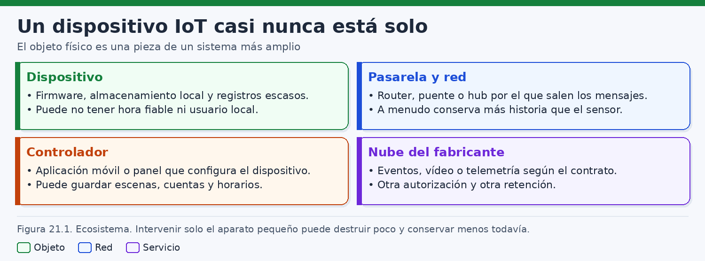
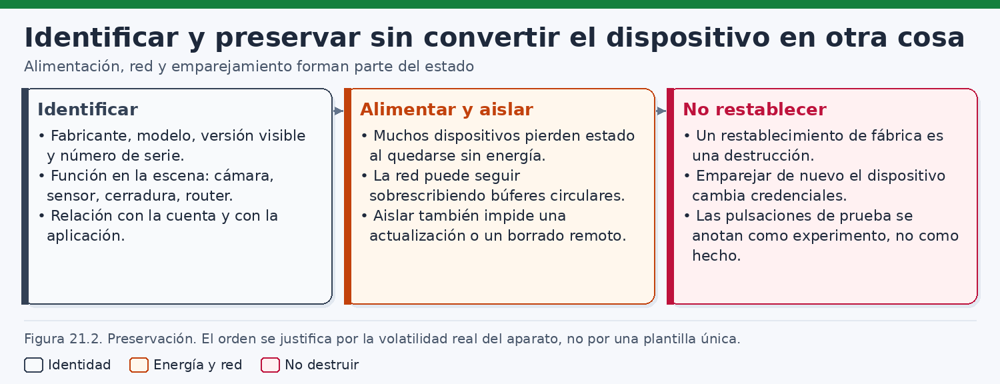
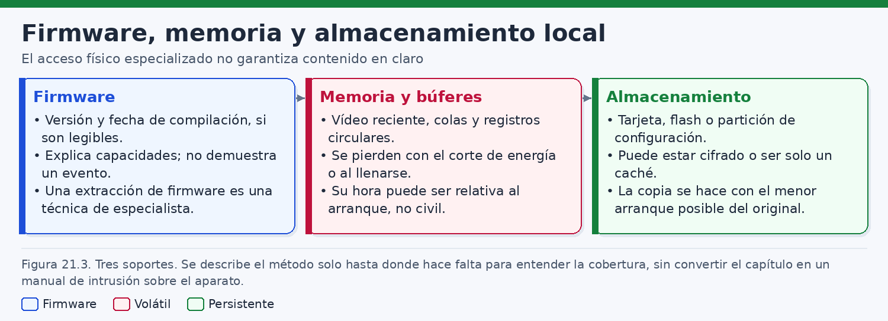
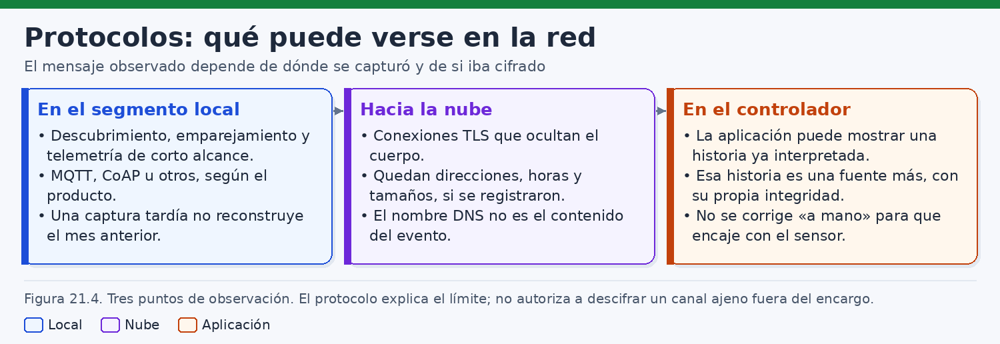
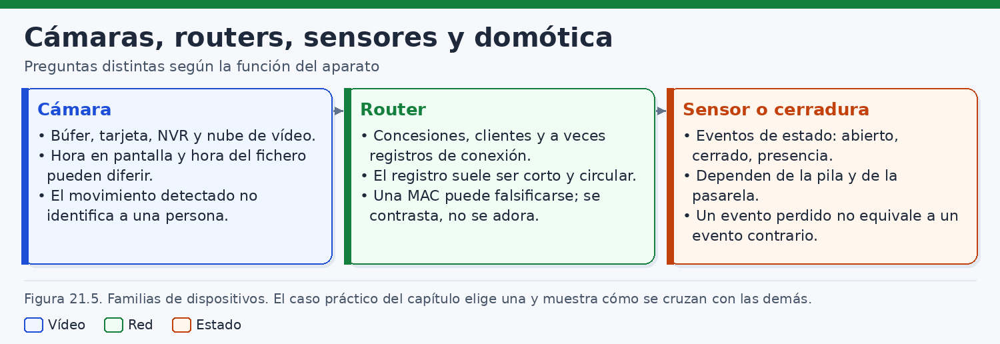
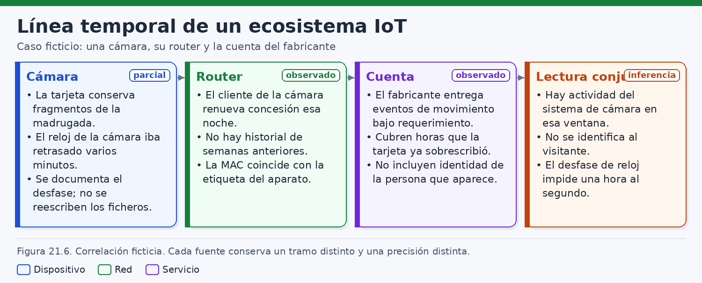
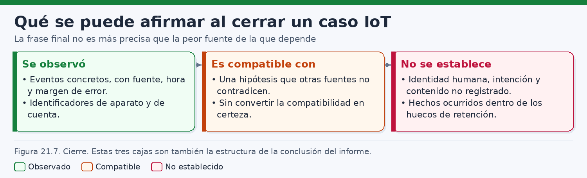

# Análisis forense de dispositivos IoT

> *Un dispositivo de la Internet de las cosas no es un testigo: es un conjunto de registros parciales repartidos entre el aparato, la red y la cuenta. La reconstrucción empieza por preguntar qué podía guardar cada fuente y qué reloj utilizó para fecharlo.*

## Introducción

Una cámara del recibidor, un router doméstico o un sensor de puerta pueden entrar en una investigación con la promesa de decir qué ocurrió. Conviene rebajar esa promesa antes de tocar nada. El aparato está diseñado para una función estrecha: detectar un cambio, encaminar tráfico, avisar a una cuenta o ejecutar una escena. Guarda lo que su diseño decidió guardar, durante el tiempo que su memoria y su política de sobrescritura se lo permiten, y lo fecha con el reloj que tiene a mano. El analista no hereda un relato. Hereda piezas sueltas y la obligación de separar la observación, la inferencia técnica y la hipótesis.

La Internet de las cosas —en adelante, IoT— agrupa aquí cámaras, videoporteros, routers, sensores, enchufes, centrales, asistentes y controladores. No comparten un sistema de ficheros, un formato de registro ni una retención. Dos cámaras de aspecto parecido pueden diferir en la tarjeta, en el modo de grabar y en el destino de los avisos. Tratar el IoT como si fuera un solo sistema operativo produce inventarios falsos y ausencias mal leídas.

El método de este capítulo examina el aparato y, sobre todo, el ecosistema del que depende. El dispositivo, la pasarela o el router, la aplicación del teléfono y la nube del fabricante son fuentes distintas. Una puede conservar un fragmento de vídeo; otra, una concesión de dirección de aquella noche; otra, un aviso ya clasificado por el fabricante; otra, nada, porque el búfer se perdió al cortar la energía o porque el canal hacia la nube iba cifrado. Hay que identificar cada fuente, preservarla sin restablecerla ni reconfigurarla, y reconstruir solo hasta donde las piezas alcancen.

NIST IR 8259 orienta al fabricante sobre actividades fundacionales de ciberseguridad del dispositivo. Sirve como mapa de capacidades que un diseño pudo haber previsto, no como manual forense ni como procedimiento de lectura. NIST SP 800-86 aporta el marco general de recogida, examen, análisis y presentación. Cuando el teléfono con la aplicación complementaria entra en el alcance, NIST SP 800-101 recuerda que ese equipo es un móvil, con sus propios límites, y que su guía no se traslada a la cámara o al sensor.

Los ejemplos de órdenes se ejecutan en laboratorio, sobre copias o en un banco de ensayo. No autorizan a intervenir la red, la cuenta o el aparato de un tercero. Los nombres del caso son ficticios. El hilo es el «piso Litoral»: una tarjeta con fragmentos, el reloj visible de la cámara retrasado respecto de otras fuentes, una concesión DHCP aún conservada aquella noche y eventos del fabricante que cubren horas ya sobrescritas en la tarjeta. El visitante, si lo hubo, no queda identificado. Las figuras 21.1 a 21.7 acompañan el argumento; cada una se comenta en su apartado.

## 1. Arquitectura y ecosistemas IoT

### 1.1. Un aparato concreto, no una categoría

Conviene empezar por el ejemplar, no por la etiqueta comercial. Un dispositivo IoT suele reunir un sensor o un actuador, un procesador modesto, memoria volátil, algún almacenamiento y una o varias interfaces. La función de producto condiciona qué datos tiene sentido conservar. Una bombilla puede no guardar nada en local si la lógica vive en un controlador. Una cámara puede escribir en una tarjeta y, a la vez, avisar a una cuenta. El análisis describe el ejemplar: modelo si consta, versión anunciada, interfaces visibles y fuentes que de verdad se han conservado.

La arquitectura interna no se deduce del aspecto. Hay aparatos con un sistema derivado de Linux y particiones reconocibles; otros ejecutan un sistema en tiempo real sin un árbol de ficheros familiar; otros obedecen a una pasarela y apenas tienen lógica propia. Una tarjeta extraíble puede imagearse con los métodos de disco ya estudiados. Un circuito soldado, sin un modo de almacenamiento documentado y expuesto, puede dejar la lectura del programa de base fuera del alcance ordinario del puesto. El informe gana claridad cuando dice qué capa se examinó y cuál quedó fuera. El mismo gesto físico puede dejar huella en el sensor, en la pasarela, en el teléfono y en la cuenta: son observaciones distintas, y una ausencia se anota con su contexto.

### 1.2. Cuatro lugares donde puede quedar un rastro

Un esquema útil, que la figura 21.1 resume, separa cuatro lugares. El primero es el aparato: memoria volátil, registros aún no volcados, almacenamiento local y el programa de base. El segundo es la red próxima: router, punto de acceso, pasarela o controlador, con direcciones, concesiones o mensajes de aplicación. El tercero es el equipo de usuario, casi siempre un teléfono con la aplicación, notificaciones y cachés. El cuarto es el servicio del fabricante o de un integrador: la cuenta y el histórico que esa cuenta muestre.



Estos lugares no se sustituyen. El aparato puede explicar funciones del producto y conservar un resto local. La red próxima puede decir que una estación obtuvo una dirección o abrió una sesión, sin mostrar el interior cifrado. El teléfono puede conservar un aviso que el aparato ya ha sobrescrito, recibido quizá con retraso. La cuenta puede listar eventos de horas de las que ya no queda fichero en la tarjeta, porque la retención de la nube y el búfer circular local obedecen a políticas distintas. Cada punto de la cronología debe nombrar su fuente.

La pasarela merece un comentario propio. En muchas viviendas el router es a la vez frontera, punto de acceso y el reloj más estable de la casa. En otras, un controlador habla con sensores que no usan la red Wi-Fi principal. Matter, el estándar de la Connectivity Standards Alliance para dispositivos domésticos sobre IP, es un ejemplo público: el evento puede vivir en el controlador o en la tela a la que el aparato fue incorporado, y no en el sensor. Un dispositivo sin histórico puede ser mudo y, aun así, haber dejado huella en quien lo gobernaba.

### 1.3. Identidades que no deben colapsarse

El ecosistema ofrece identificadores de naturaleza distinta. El número de serie y la MAC impresa en la etiqueta apuntan a un ejemplar o a una interfaz, si la etiqueta corresponde a ese aparato y si la dirección observada coincide. La MAC que aparece en un registro es un valor anunciado por una estación en un momento dado; el software puede presentar otro. La dirección IP es una asignación temporal. El nombre de red y el nombre de estación son cadenas configuradas por el cliente o por el administrador. La cuenta es una identidad de servicio, a menudo un correo, compartible entre varias personas. Ninguno de esos datos es, por sí solo, una persona.

Conviene fijar el vocabulario en el cuaderno. «El aparato cuya etiqueta muestra este serie» no es la misma frase que «la estación que usó esta MAC a esta hora», ni que «la cuenta que recibió este aviso». Unir dos frases exige un puente observado: por ejemplo, que la MAC del registro coincida con la de la etiqueta y que la concesión cubra el intervalo. Si el puente falta, las piezas quedan en columnas separadas. La cautela es la misma que separa, en un servidor, la cuenta autenticada del operador humano de la clave.

Las cuentas de hogar añaden otra dificultad. Varias personas pueden usar la misma aplicación, y una sesión puede seguir abierta en el teléfono de otra. Un aviso entregado a un móvil demuestra, como máximo, que esa aplicación o ese sistema de notificaciones retuvo un mensaje. No demuestra quién miró la pantalla ni quién estaba en la vivienda. Si el teléfono entra en el alcance, se adquiere como móvil. Si no entra, se anota como fuente no examinada, no como fuente vacía.

### 1.4. Capacidades de ciberseguridad y capacidad de prueba

NIST IR 8259, *Foundational Cybersecurity Activities for IoT Device Manufacturers*, se dirige a quien fabrica. Describe actividades para comprender el uso previsto, atender necesidades de ciberseguridad durante el ciclo de vida, comunicarlas al cliente y decidir qué capacidades tendrá el dispositivo. Entre las que ese enfoque invita a considerar están identificar el aparato, proteger la configuración y los datos, restringir el acceso lógico a las interfaces, actualizar el programa y poder informar de un estado de seguridad. El documento no define imágenes, no fija formatos de registro y no describe cómo leer el almacenamiento. No es un manual forense completo.

El marco evita dos excesos. El primero es suponer que todo aparato guarda un diario de seguridad consultable. Una capacidad recomendada a un fabricante puede no estar en el modelo de la estantería, o no dejar un fichero después de un corte de energía. El segundo es tratar la opacidad como anomalía del caso. Si el producto cifra el almacenamiento, exige una cuenta para mostrar el histórico o solo conserva eventos en la nube, eso puede ser el diseño, incluso alineado con la protección de datos que el marco considera. Para la prueba, la copia puede ser íntegra e ilegible, o el evento puede existir solo donde no hay acceso legítimo.

En el ejemplar se comprueba, con la documentación de esa versión, si identifica su interfaz, si exporta registros sin borrarlos, si el cifrado deja la imagen ilegible, si se actualiza por la red y si ofrece algún indicio de estado. Esas respuestas no se copian de la guía. SP 800-86, el programa CFTT y las prácticas de SWGDE completan el método —volatilidad, validación de herramientas, recogida— sin ocupar el lugar de IR 8259 ni autorizar la intervención.

### 1.5. Qué puede preguntarse a cada fuente

Antes de adquirir conviene escribir las preguntas y asignarlas. «¿Quién entró?» no es una pregunta que una cámara pueda cerrar. «¿Qué fragmentos conserva la tarjeta, y qué horas muestran la imagen y el fichero?» sí lo es. «¿El router conservaba aquella noche una concesión?» también. «¿La cuenta lista eventos de un intervalo que la tarjeta ya no contiene?» también. La identificación de un visitante no cabe, salvo que aparezca otra fuente suficiente, que este capítulo no dará por supuesta.

| Pregunta | Fuente que puede acercarse | Límite habitual |
|---|---|---|
| Qué funciones tenía el producto | Documentación, programa de base obtenido de forma ordinaria, configuración visible | El programa describe capacidades, no un acontecimiento |
| Qué vídeo o medición quedó en local | Tarjeta o almacenamiento copiado | Búfer circular, cifrado, fragmentos |
| Qué estación obtuvo dirección | Registro del router, si aún existe | Suele ser circular; la MAC puede no ser estable |
| Qué avisó la cuenta | Exportación o captura documentada de la cuenta | Reloj, clasificador y retención del servicio |
| Qué llegó al teléfono | El móvil, si el encargo lo incluye | Caché parcial; la guía de móviles no se traslada al IoT |
| Qué decía el mensaje de aplicación | Captura donde el protocolo vaya en claro, o registro del bróker o del controlador | Hacia la nube, TLS suele dejar solo metadatos de conexión |

La tabla es un freno. Si la pregunta exige el contenido de un canal TLS y solo hay una captura, sigue abierta. Si exige un vídeo que la tarjeta ya ha sobrescrito, el vídeo no reaparece por insistencia. La figura 21.1 evita buscar en el aparato un dato que solo pudo existir en la cuenta.

## 2. Identificación y preservación de dispositivos

### 2.1. Reconocer antes de desconectar

La preservación empieza por una identificación que otro analista pueda repetir. Se documentan el lugar, la posición, los cables, los testigos luminosos, lo que muestre una pantalla y la hora civil de esa observación, con su zona. Se fotografían la etiqueta, el serie, las direcciones impresas y el modelo. Esas fotografías fijan el contexto. No acreditan que el aparato funcionara de forma íntegra ni que la etiqueta sea exacta: una dirección impresa puede no ser la que el software anuncia. La figura 21.2 condensa esta fase: identificar y conservar sin reconfigurar el aparato.



Conviene inventariar también lo que rodea al aparato. El router, el controlador, los sensores, el teléfono que la persona titular señala como el de la aplicación, las tarjetas sueltas y las cuentas cuyo nombre aparezca en una pantalla. Cada uno recibe un identificador de objeto distinto del de la adquisición posterior. Un mismo número no debe servir para la cámara, para la imagen de su tarjeta y para la exportación de la cuenta.

La energía es un dato de la identificación. Un aparato enchufado no está en el mismo estado que uno apagado. Algunos conservan el reloj mientras tienen pila; otros, al volver a arrancar, muestran una hora de fábrica hasta que obtienen hora por la red. Anotar si estaba alimentado, si respondía y qué hora mostraba permite después explicar desfases. El fundamento jurídico del acceso a la vivienda, al router o a la cuenta queda fuera de este capítulo: el análisis no lo crea. Si el alcance cubre solo la tarjeta, el router no se explora porque esté al lado.

### 2.2. Energía, búferes y restablecimiento

El orden de volatilidad de SP 800-86 es un criterio, no una receta rígida. En estos aparatos lo más fugaz suele estar en la memoria de trabajo: el búfer de los segundos previos a un vídeo, colas aún no enviadas, la tabla de traducciones de un router y registros que solo viven en RAM. Ese material desaparece sin alimentación. No hay, en el funcionamiento ordinario, una copia de esos búferes. Esperarlos después de desenchufar es una expectativa infundada.

Dejar el aparato encendido y conectado tampoco es neutro. Puede seguir grabando encima de la tarjeta, rotar un registro circular, completar una actualización o sincronizar un borrado decidido desde la cuenta. Aislarlo de la red por un medio ya previsto en el procedimiento, documentado, reduce la influencia remota y mantiene la alimentación si el transformador sigue puesto. Desconectarlo elimina la influencia remota y también la RAM. Las dos decisiones alteran algo. Se registra la elegida, con la hora, el estado previo y el efecto esperado.

No corresponde a este capítulo describir un volcado de memoria por interfaces de depuración, ni la inducción de fallos sobre la alimentación, ni una lectura forzada del circuito. Esas vías no son una conservación ordinaria. Si el caso necesitara el contenido volátil y no existe un procedimiento ya autorizado y comprobado para ese modelo, el informe dice que el búfer no se conservó y por qué.

Tampoco se restablece de fábrica. El restablecimiento devuelve el aparato a un estado inicial y, en los diseños habituales, elimina o inutiliza configuración, cuentas vinculadas, grabaciones y registros locales. Se parece más a una operación de saneado, en el sentido en que SP 800-88 trata las acciones destinadas a que los datos dejen de estar disponibles, que a una medida de preservación. Pulsarlo para estabilizar el aparato, quitar una contraseña o facilitar el acceso destruye lo que la diligencia busca. Si alguien lo hubiera hecho antes de la llegada del analista, se documenta el relato y el estado resultante, y se asume que la configuración local puede haber quedado inutilizada. No se completa el proceso si ha quedado a medias.

### 2.3. Observar sin reconfigurar

Abrir la aplicación de administración no es inocuo. Muchas interfaces registran el acceso, ofrecen actualizar el programa o reescriben un fichero de estado. Se anota qué se pulsó, con qué cuenta y a qué hora. Cuando baste una fotografía de la pantalla que ya estaba encendida, es preferible a recorrer menús. Si hace falta una exportación prevista por el producto, el fichero resultante es un objeto nuevo, con hash, y se describe el camino lo bastante para entender qué se pidió. No se aprovecha la sesión para cambiar contraseñas, expulsar estaciones o sincronizar la hora del aparato investigado. Corregir el reloj destruye el desfase, y el desfase es evidencia.

La tarjeta extraíble, si el alcance la incluye, se identifica y se trata como soporte. En el laboratorio se trabaja con bloqueador de escritura o con un método equivalente ya validado, y se obtiene una imagen. El original no se monta en un ordenador que pueda reparar el sistema de ficheros. Montar para corregir, o reproducir el vídeo en el propio aparato, altera marcas de tiempo. La reproducción se hace desde la copia.

Los aparatos sin soporte extraíble se conservan precintados, a la espera de un método de lectura que el laboratorio domine para ese modelo. Abrir la carcasa porque el tornillo es visible no es un plan de adquisición. Si el almacenamiento está cifrado, la imagen que se obtenga puede ser íntegra y seguir siendo ilegible. No existe un procedimiento universal para leer cualquier protección actual, y este capítulo no lo insinúa. El informe dice si hay material en claro, solo bloques cifrados o si el soporte no se ha leído.

### 2.4. Copias, hashes y herramientas

Cada adquisición recibe identificador, fecha, herramienta y versión, persona que la realiza y hash. El hash acredita que la copia no cambió después de calcularse. No acredita que contenga todo el aparato ni todo el acontecimiento. Una imagen de tarjeta no incluye la RAM, ni la cuenta, ni las líneas que el búfer del router ya había expulsado. Esas fronteras se nombran con la misma precisión que el número de serie.

Las herramientas se comprueban para la función que se les pide. CFTT existe porque listar ficheros, recuperar una entrada borrada o interpretar una marca de tiempo depende del formato y de la versión. Una utilidad puede traducir una hora a la zona del puesto de análisis sin advertirlo. El cuaderno registra esa zona y, cuando la herramienta lo permite, el valor crudo junto a la hora convertida. Citar solo la cifra que mostró la interfaz impide luego explicar un desfase de diecisiete minutos.

Un ejemplo de comprobación, siempre sobre la copia. El desplazamiento de partición sale de la tabla de esta imagen; no se inventa.

```bash
# Laboratorio. La imagen es una copia; la tarjeta original no se monta.
sha256sum /caso/litoral/ADQ-IOT-SD-01.img
mmls /caso/litoral/ADQ-IOT-SD-01.img
```

`mmls`, de The Sleuth Kit, muestra la tabla que esa versión sepa interpretar. Si la salida es vacía o inverosímil, no se concluye que la tarjeta esté vacía: se concluye que hace falta otro método, y se anota el fallo. A partir del desplazamiento observado pueden listarse ficheros, de nuevo sobre la imagen. En tarjetas de consumo es frecuente un sistema de la familia FAT, aunque debe verificarse. Cuando FAT es el sistema presente, ciertas marcas tienen resolución de dos segundos y no guardan la zona dentro del campo. ExFAT y otros sistemas cambian ese detalle. Arrastrar la regla de uno al otro descoloca la cronología.

### 2.5. Fuentes asociadas y custodia

La cámara sin su router y sin su cuenta es una conservación incompleta, aunque la tarjeta esté bien imageada. Si el alcance lo permite, se preservan en la misma ventana el registro exportable del router, la configuración de hora que la interfaz muestre, la exportación de la cuenta y el estado del controlador. Esas exportaciones son objetos distintos, con su hash y su cadena. No se inicia sesión en la nube con una contraseña hallada en una nota. La contraseña se identifica, se custodia conforme al procedimiento del equipo y se usa solo si el encargo lo autoriza de forma expresa.

SWGDE insiste, en sus prácticas de recogida, en documentar el estado, reducir la alteración y poder explicar la procedencia. Aplicado aquí, incluye el transformador, la tarjeta y el precinto, y también la captura de la cuenta con la hora del ordenador desde el que se consultó. Una captura de pantalla es lo que el servicio quiso mostrar a esa cuenta en ese momento. Puede omitir eventos, filtrar por la aplicación y ordenar con la zona del navegador. Se conserva porque a veces es la única vista obtenible, y se describe con esas limitaciones.

El traslado evita nuevas conexiones: un aparato que enciende al enchufarse no viaja alimentado por descuido, y la pila de un sensor se anota porque al agotarse puede perder el reloj. La custodia registra cada transferencia y el hash verificado antes del análisis. La figura 21.2 recuerda que restablecer, actualizar, corregir la hora o montar en escritura borra las diferencias del caso.

## 3. Firmware, memoria, registros y almacenamiento

### 3.1. El programa de base explica capacidades

El firmware es el programa con el que el aparato arranca y cumple su función. Examinarlo puede servir para saber qué protocolos entiende el modelo, qué cadenas de registro trae, si prevé cifrado del almacenamiento o si distingue un reloj de pantalla de un reloj de fichero. Todo eso son capacidades. Un firmware no contiene la noche investigada ni nombra a quien cruzó un recibidor. «El producto podía registrar movimiento» no es «registró este movimiento».

La copia utilizable, sin manipular el circuito, es la que ya esté en un soporte adquirido por vías ordinarias, la que el fabricante publique como actualización o la que conste en documentación obtenible. Debe corresponder al modelo y, en lo posible, a la versión que el ejemplar anunciaba. Un firmware de otro lote explica un producto parecido, no el aparato del caso. La versión importa: un cambio menor puede alterar los nombres de fichero, la duración del vídeo previo al evento o el destino de los registros.

Queda fuera de este texto cualquier extracción del firmware por una interfaz serie de depuración, por inducción de fallos sobre la alimentación o el reloj del circuito, o por una lectura forzada del componente. No se describen pines, velocidades ni secuencias de arranque especiales. Si el ejemplar no ofrece un almacenamiento legible por los medios ordinarios, el límite se declara. Cuando sí hay una copia legítima, el examen es estático y en laboratorio. Las cadenas que hablen de movimiento o de red indican que el producto contempla esas nociones. No prueban que en la fecha del caso se emitiera un evento. La figura 21.3 sitúa el firmware junto a la memoria y al almacenamiento: primero qué podía hacer el aparato, después qué restos quedan.



### 3.2. Búferes que dependen de la energía

La memoria de trabajo alberga estado no consolidado. En una cámara es habitual un búfer circular de los instantes previos al disparo: el sensor escribe en RAM y solo vuelca a la tarjeta un tramo, con unos segundos anteriores y posteriores, cuando la lógica decide guardar. Si se corta la alimentación antes del volcado, ese tramo no llega al soporte. No queda un fichero a medio cerrar que el laboratorio pueda terminar. Lo mismo ocurre con colas de telemetría y con la tabla de conexiones de un router doméstico.

El informe tiene que distinguir cuatro situaciones que suenan parecidas: la cámara no estaba configurada para conservar el previo; el volcado no llegó a producirse; la tarjeta lo sobrescribió después; la adquisición no incluyó la RAM. Solo la configuración, el estado de energía en la escena y el contenido de la copia permiten acercarse a una de ellas. Si la energía ya se había perdido al llegar, la RAM no forma parte del material examinado y no se cita como si se hubiera buscado y estuviera vacía.

Apagar y encender para comprobar el arranque destruye ese estado y puede crear eventos nuevos: un rearranque, una reconexión, un ajuste de hora, una rotación de ficheros. Si el procedimiento exige esa prueba, se hace después de haber aceptado la pérdida de lo volátil, y los eventos posteriores se marcan como posteriores a la intervención. Tampoco debe esperarse un diario forense en RAM. La memoria existe para el funcionamiento. La enseñanza práctica es directa: los búferes se pierden sin energía, y quien corta la alimentación tiene que saber qué está descartando.

### 3.3. Registros locales y retención real

Los registros consolidados pueden vivir en almacenamiento persistente, en un anillo que a veces se vuelca, o solo en un servidor. El tamaño suele ser pequeño. Un anillo de pocas líneas, o una tarjeta que reutiliza el espacio de los vídeos antiguos, es coherente con un aparato encendido todo el año. Cuando el anillo se llena, lo antiguo deja de existir en ese soporte. La ausencia de una línea de la semana pasada es, primero, una observación sobre el anillo actual. Inferir que el evento no ocurrió exigiría conocer la tasa de eventos, el tamaño efectivo y si hubo reinicios. Esa demostración casi nunca está al alcance.

El detalle depende del producto: un testigo luminoso, un identificador con hora, o un modo de diagnóstico que solo estuvo activo un rato. Un registro parco puede ser el comportamiento de fábrica. IR 8259 no impone formato ni retención, y la parquedad no se trata como ocultación sin otros indicios.

Si el registro está en un fichero de la copia, se extrae y se calcula su hash. Si está solo en una pantalla, se fotografía o se exporta, y la fuente es la interfaz. Las horas se copian tal como figuran, con cualquier indicio de zona. Corregirlas en una copia de trabajo es aceptable si se conserva el campo original y el criterio. Corregirlas en el aparato elimina el hallazgo. Un desfase sistemático entre el registro local y el reloj del router es precisamente uno de los datos que el caso necesita.

### 3.4. Almacenamiento local y cifrado

El almacenamiento local puede ser una tarjeta extraíble, memoria soldada, particiones de un sistema embebido o casi nada. La tarjeta es la situación más favorable para un laboratorio que ya sepa adquirir discos. Aun así puede contener un sistema que la herramienta interprete a medias, vídeos incompletos, restos en el espacio no asignado y, en algunos productos, un contenedor cifrado. La memoria soldada puede existir y seguir siendo inaccesible sin un método que aquí no se ofrece. «No había almacenamiento» y «no supimos leerlo» son frases distintas y no deben mezclarse.

El cifrado puede afectar al soporte, a un fichero o solo al transporte hacia la nube. Son capas distintas. Una imagen de bloques cifrados puede verificarse por hash y no poder reproducirse. Un vídeo en claro en la tarjeta puede haber viajado después por un canal cifrado, de modo que la red no añade una segunda copia inteligible. No hay un método general para deshacer esas protecciones. Si la persona titular conserva una credencial y el encargo autoriza a usarla sobre una copia ya obtenida, se documenta qué clave, sobre qué copia y con qué resultado. Restablecer o reinstalar para obtener un sistema en claro destruye el material.

La sobrescritura es el otro límite, y no exige mala fe. Una cámara en continuo o por eventos reutiliza el espacio cuando la tarjeta se llena. Los ficheros más antiguos desaparecen del directorio. Parte del contenido puede permanecer como restos, sin un plazo universal a partir del cual sigan siendo legibles. En soportes de estado sólido, el funcionamiento interno del medio hace aún más incierto ese momento. El carving, del que PhotoRec es un ejemplo público, recupera candidatos por firmas. No recupera el nombre ni la ruta, y la fragmentación produce recortes y falsos positivos. Un fragmento sin cabecera útil no se convierte en la hora que falta para cerrar un hueco. La figura 21.3 debe leerse con esa reserva: el firmware dice qué clase de aparato era; la memoria se evapora sin energía; el almacenamiento puede estar cifrado, circular o fuera de la adquisición.

### 3.5. Leer la copia sin convertirla en el original

El laboratorio busca un inventario de la imagen, no una restauración del aparato. Interesan la tabla de particiones, el sistema de ficheros, los árboles de directorios, las marcas del directorio y del contenedor, los ficheros de configuración en claro y el espacio no asignado en la medida en que las herramientas sepan recorrerlo. Un listado de The Sleuth Kit está mediado por la versión y por el desplazamiento. Se guarda la salida con la orden y la versión. Si otra herramienta no coincide en las fechas, la discrepancia se investiga antes de elegir la cifra más cómoda para la hipótesis.

Los contenedores de vídeo añaden sus campos. Una herramienta puede mostrar una fecha de creación ya pasada a la zona del puesto. El campo crudo puede contar segundos desde un origen propio del formato, y hay productos que escriben ahí la hora local como si fuera universal. No se da por buena la primera conversión. Se anotan la herramienta, el campo, el valor mostrado y la hipótesis de zona. La hora incrustada en la imagen —los dígitos que forman parte de los píxeles— es otra fuente: se lee en el fotograma, no en el metadato. Que ambas discrepen es un hecho de ese clip. La causa es una inferencia, y el caso la desarrolla sin convertirla en una corrección automática de toda la tarjeta.

La reproducción se hace sobre la copia, con un programa que no escriba en ella. Volver a abrir el clip en el aparato original puede reindexar la tarjeta o seguir grabando. Si dos reproductores no coinciden, se documentan ambos antes de hablar de manipulación.

## 4. Redes, protocolos y servicios asociados

### 4.1. El lugar de la captura decide lo que se ve

Un protocolo no aparece entero en cualquier punto del camino. Cerca del aparato puede verse un intercambio local en claro, si el producto lo usa. En el router puede verse que existió una conexión —direcciones, puertos, horas, volúmenes— aunque el contenido vaya cifrado. En la cuenta puede verse el evento que el servicio guardó. Son tres observaciones legítimas y no equivalentes. La figura 21.4 ordena esa idea: lo que puede afirmarse del protocolo depende de dónde se capture.



El cuaderno no dice «se analizó el tráfico IoT». Dice desde qué punto se observó, con qué autorización, qué copia se conserva y qué campos eran visibles. Una captura de un puerto espejo en un banco de laboratorio ilustra el método y no sustituye la captura de la vivienda, que quizá no exista. Una exportación del router no es un fichero de paquetes. Un listado de la cuenta no es una captura. Unirlos es trabajo del apartado 6, después de haberlos descrito por separado.

En un ensayo, la captura mínima se limita a metadatos. No procede aquí descifrar el contenido.

```bash
# Banco de ensayo, interfaz de espejo. No es la red del caso.
tcpdump -n -i enp1s0 'tcp port 443'
```

La orden muestra direcciones, puertos y tiempos de un flujo. El puerto 443 es un ejemplo de TLS habitual. Los productos usan también otros puertos. Lo que el filtro excluyó se declara como no observado, no como inexistente.

### 4.2. MQTT, ejemplo público de publicación y suscripción

MQTT es un protocolo de mensajería publicado por OASIS. La versión 5.0 es la referencia documental de este capítulo; en los productos sigue siendo frecuente la 3.1.1. La versión efectiva se comprueba. El modelo es de publicación y suscripción: los clientes publican y se suscriben a temas a través de un bróker, que reparte. No tienen por qué hablar entre sí. El nombre del tema lo define el despliegue, no el estándar. Un sensor puede publicar el estado de una puerta; una aplicación puede suscribirse. Eso es una arquitectura posible, no una constante de todo aparato IoT.

El protocolo define niveles de entrega entre cliente y bróker. En términos prácticos, el nivel 0 no pide acuse, el nivel 1 contempla reentregas y el nivel 2 busca evitar duplicados entre esos dos extremos. Esas garantías son del canal MQTT. No demuestran que el hecho físico ocurriera ni que el bróker conservara el mensaje para un analista. Un mensaje retenido queda como último valor conocido de un tema: quien se suscriba después puede recibirlo sin que el acontecimiento sea contemporáneo de la suscripción. Un mensaje de última voluntad lo publica el bróker si la desconexión se trata como anómala. Es un texto configurado de antemano, no un diagnóstico de la caída.

En claro, una captura de laboratorio puede mostrar identificadores, temas y cargas, y por eso sirve para aprender el formato. En productos reales, el tramo hasta el bróker del fabricante viaja a menudo protegido por TLS. Entonces la captura en la vivienda muestra un flujo cifrado y, como mucho, metadatos del inicio. No muestra el tema ni la carga. Los registros del bróker, si el alcance permitiera obtenerlos, serían otra fuente. Este capítulo no describe cómo acceder a un bróker ajeno. Los puertos 1883 y 8883 son referencias habituales, en claro y con TLS, no una obligación. Ver tráfico hacia el 8883 no demuestra MQTT: demuestra un flujo hacia ese puerto.

### 4.3. CoAP, ejemplo público para nodos restringidos

CoAP, *Constrained Application Protocol*, está definido en el RFC 7252 para nodos y redes con pocos recursos. Su modelo recuerda al de HTTP: métodos como GET, POST, PUT y DELETE, y recursos identificados por un URI. El enlace que el RFC detalla de forma principal usa UDP. Los mensajes pueden ser confirmables o no. Un mensaje no confirmable puede perderse sin que el emisor lo sepa. Por eso, la ausencia de un mensaje CoAP en una captura no equivale con facilidad a la ausencia del hecho: pudo no enviarse, pudo perderse o pudo caer fuera del intervalo capturado.

El RFC prevé DTLS cuando el despliegue lo usa. Si el intercambio va protegido, se ven datagramas, direcciones, puertos y tiempos, no el método, ni el URI, ni la carga. Si va en claro, esos campos son lo que el emisor dijo, no la medición física en bruto. Un anuncio de temperatura o de estado es una afirmación del firmware. Puede ser correcta y puede proceder de un fallo, de una prueba o de una automatización.

Los puertos del RFC son un punto de partida, no un filtro universal: el protocolo real se comprueba en el producto, y se dice si la captura lo mostraba en claro o como flujo opaco. Buena parte del consumo no usa CoAP ni MQTT hacia la nube, sino un protocolo propio sobre TLS. Los dos ejemplos públicos enseñan el formato cuando es visible y evitan buscarlo donde el aparato nunca lo ha hablado.

### 4.4. El canal hacia la nube suele dejar metadatos

El patrón más frecuente en cámaras y dispositivos domésticos vinculados a un fabricante es una sesión saliente con TLS. El aparato se autentica según el diseño y envía mediciones, fragmentos o avisos. Quien capture en la red local, sin ser el extremo que termina el cifrado, no obtiene el vídeo ni el evento de aplicación. Obtiene metadatos de conexión: direcciones, puertos, instantes, tamaños y duración. Según la versión y las extensiones, el inicio puede incluir en claro el nombre del servidor —la indicación de nombre, o SNI— o puede no incluirlo. No debe afirmarse que el certificado era visible como si fuera siempre cierto: en TLS 1.3 el certificado viaja cifrado. Lo estable es que el contenido de aplicación no está en la captura pasiva.

Esos metadatos permiten inferencias modestas. Un flujo repetido hacia un mismo nombre es compatible con la sesión que el producto anuncia. Un silencio es compatible con un aparato apagado, sin ruta, o con una captura incompleta. Los tamaños no se traducen a «se subió un vídeo de una persona» sin una fuente que describa el contenido. La cuenta, si conserva un evento a una hora compatible, es esa fuente, y vive en otro lugar. La captura y la cuenta se correlacionan. No se sustituyen.

El nombre DNS, si la consulta quedó en claro y el router la guardó, indica un destino de aquella noche. Una consulta hecha días después desde el laboratorio no reconstruye esa resolución: las direcciones de los servicios cambian.

### 4.5. Matter, pasarelas y controladores

Matter organiza la comunicación doméstica sobre IP, con transportes como Ethernet, Wi-Fi o Thread según el producto. El comisionado asocia el aparato a una tela administrada por uno o varios controladores. El dato relevante es dónde pudo quedar el evento: en el sensor, que quizá no guarda histórico; en el controlador; en la aplicación que hizo el comisionado; o en un puente hacia la nube, que devuelve el problema al apartado anterior.

Una tela puede tener más de un administrador. Que un teléfono figure como controlador no señala a la única persona capaz de actuar. Las escenas pueden encender, apagar o registrar sin que nadie esté delante: un horario, otro sensor, una puesta de sol. El evento de un actuador observa que el controlador ordenó o anotó un cambio. La presencia humana es una hipótesis adicional. Matter no unifica por sí solo los relojes de todos los extremos. Cada uno puede estar sincronizado o no, y se comprueba en el ejemplar.

El router sigue importando aunque la vivienda use Matter. Algunos sensores hablan con el controlador por un enlace que el registro DHCP ni siquiera ve. Concluir que nadie entró en la red porque el router no muestra una MAC nueva puede ser cierto del Wi-Fi principal y falso del acontecimiento: el visitante pudo no asociarse, y un contacto pudo igualmente cambiar de estado. La figura 21.4 ayuda a no pedir a la captura lo que solo el controlador, la cuenta o la tarjeta podían saber.

### 4.6. Metadatos que el router sí suele poder ofrecer

Aunque el contenido vaya cifrado, el router doméstico es a menudo la mejor fuente de metadatos de la red próxima, con los límites del apartado 5. Puede conservar concesiones DHCP: una estación pidió dirección y el router dejó una línea con hora, MAC, dirección concedida y, a veces, un nombre que la estación envió. Puede conservar asociaciones al punto de acceso. Puede mostrar una tabla de traducciones que es volátil y que un reinicio vacía. Puede no conservar nada si el registro estaba en RAM y hubo un corte, o si el búfer circular ya avanzó.

Esos metadatos hablan de presencia en la red, no de identidad civil ni de contenido. Una concesión significa que el servidor completó un intercambio con quien presentó aquella MAC. El alcance de la radio puede incluir el rellano u otra vivienda. El nombre de equipo es una cadena del cliente: se transcribe y no se promociona a un titular sin una fuente que una la cadena, la MAC y un aparato físico en ese intervalo. La misma IP una hora después no prueba la misma estación, salvo que la concesión siga vigente y la MAC coincida. Una asociación inalámbrica no es una concesión: son líneas distintas y se citan con su verbo.

Si además hay captura, se compara solo el tramo común. Una captura con flujo TLS y un registro mudo suelen indicar que el router no escribía esas líneas. La figura 21.4 pide a cada punto solo lo que ese punto podía ver.

## 5. Cámaras, routers, sensores y dispositivos domóticos

### 5.1. La cámara: imagen, fichero y clasificador

La cámara parece ofrecer lo que se vio. En la práctica ofrece, cuando el diseño y la conservación lo permiten, ficheros o fragmentos, metadatos, una hora incrustada y, en la cuenta, eventos ya interpretados por el fabricante. La figura 21.5 agrupa cámaras, routers y sensores porque suelen convivir en una vivienda y porque sus relojes y sus retenciones no coinciden.



La hora incrustada y la hora del fichero son observaciones distintas. La primera está en los píxeles y refleja el reloj con el que el aparato compuso ese recuadro, a menudo interno, ajustado a mano o desfasado. La segunda sale del nombre, de una marca del sistema de ficheros o de un campo del contenedor, y puede seguir otra base, incluida la de un equipo que después copió o indexó el archivo. Hay que comprobarlo en cada clip. Un reproductor que ajusta la hora al abrir el vídeo no debe ser la única fuente de la cifra que llegue al informe. En el caso de este capítulo las dos horas no coinciden, y el desfase no se aplica en silencio a toda la tarjeta.

El contenido exige un vocabulario contenido. Puede observarse una figura, un cambio de luz, un animal o una escena en la que el detector disparó igualmente. Esa observación no identifica a una persona. La detección de movimiento no contiene un nombre ni una certeza que este capítulo pueda dar por válida. Aunque el fotograma sea nítido, pasar de «se ve una figura» a «era tal individuo» exige una pericia y una calidad que los encuadres domésticos a menudo no tienen: distancia, ángulo, duración y resolución lo impiden. Se describe lo visible y se detiene ahí.

Las etiquetas del fabricante —«movimiento», «persona», «vehículo»— son la salida de un clasificador. Se conservan como texto del servicio y se atribuyen a quien las emitió. Pueden coincidir con lo que se ve en el fragmento y pueden no coincidir. Un falso positivo ante una sombra forma parte del comportamiento esperable. La etiqueta no se cita como reconocimiento, y el clip no se descarta solo porque la etiqueta parezca exagerada: son dos piezas.

La modalidad de grabación cambia el significado de un hueco. En continuo, un vacío puede indicar un fallo o una sobrescritura aún no comprendida. Por eventos, la falta de fichero es compatible con un intervalo en el que la lógica no disparó, y también con eventos ya pisados o que solo vivieron en la nube. La configuración, si se pudo leer sin modificarla, ayuda a elegir. El audio, si el modelo lo graba, depende de su propio interruptor. No se asume que haya sonido, ni que el silencio del fichero sea el silencio de la habitación.

### 5.2. El router: un registro que se pisa y una MAC que se anuncia

El router es una fuente de metadatos y un mal archivo histórico. Muchos modelos guardan el registro en un búfer de tamaño fijo. Cuando se llena, las líneas viejas desaparecen. Si el búfer está en memoria, un corte lo vacía. La exportación de la diligencia es lo que aún no se había pisado. Llamarla «el registro» sin decir que es circular invita a leer la primera línea conservada como el origen de los tiempos de la vivienda. Esa línea marca el horizonte de esa copia.

La concesión DHCP de una noche, si aún está, es una observación valiosa y estrecha. Fija que, a la hora que el propio registro declara, el servidor entregó una dirección a una estación que usó una MAC y, en su caso, ofreció un nombre. La hora es la del router. Hay que anotar si la interfaz decía estar sincronizada y en qué zona, sabiendo que una casilla marcada es lo que la interfaz mostró, no una auditoría del protocolo de hora. Un desfase del router desplaza todas sus líneas respecto de la cámara y de la cuenta.

La MAC de esa línea puede falsificarse o, sin ánimo de engaño, sustituirse por otra elegida por software. Los teléfonos suelen usar direcciones locales a la red para reducir el seguimiento, y pueden cambiarlas. El bit de administración local —el segundo bit menos significativo del primer octeto— indica, cuando está activo, que la dirección no se presenta como identificador de fábrica. Ver el bit es una observación. Inferir que alguien la falsificó para ocultarse es una hipótesis más fuerte, y no la única: la privacidad del propio teléfono produce el mismo bit. A la inversa, una MAC con aspecto de fábrica puede haberse escrito a mano. La coincidencia con la etiqueta sigue siendo el mejor puente, y ata la concesión al aparato etiquetado, no a una persona.

El nombre de estación se transcribe tal cual. Si contiene un nombre de pila, no se da por identificado a su dueño: los nombres se copian, se heredan o se eligen con engaño. La IP concedida se reutiliza. El registro de asociaciones, si existe, habla del enlace de radio, que no es la concesión. Cada tipo de línea conserva su verbo en el informe.

### 5.3. Sensores: un contacto no es una identidad

Un sensor de apertura registra, cuando registra, el cambio de un contacto. No registra quién movió la hoja, ni si llegó a dejar paso, ni si el cambio lo causó una persona, un marco flojo o una prueba. Un infrarrojo de movimiento registra una variación en su campo, no una silueta identificable. Un termómetro registra una cifra dentro de su error y de su reloj. Tratar esas salidas como prueba de un visitante añade una hipótesis que el sensor no contiene.

La retención está muchas veces fuera del sensor. Los de pila envían el evento al controlador y no guardan un histórico. Si el mensaje se pierde y el diseño no lo retiene, no hay segunda copia en el sensor. El controlador puede guardar un diario breve, también circular. La cuenta puede guardar otra selección, de horas de las que el dispositivo local ya no tiene resto. Pedir el sensor físico pensando que dentro está la noche entera suele terminar en un objeto mudo y en un diario que estaba en otro sitio.

Una pila agotada deja de emitir. Ese silencio, o el aviso de batería si el producto lo tiene, no es un cierre de puerta ni una ausencia de personas. No se prueba el sensor abriendo de nuevo: cada prueba inserta eventos que luego hay que separar de la noche.

### 5.4. Domótica, escenas y el teléfono complementario

Enchufes, cerraduras, termostatos y bombillas actúan por una orden del momento o por una automatización. La segunda vía es la trampa. Una luz a las 23:00 puede obedecer a un horario. Una cerradura puede mostrar un cambio ordenado desde la cuenta, desde un teclado o desde una escena. El registro describe el actuador. El origen hay que leerlo en el campo que el producto reserve para ello, y ese campo puede faltar, decir «automatización» o nombrar una cuenta compartida. La cuenta no es la persona que tenía el teléfono en la mano.

Un evento de apertura en la aplicación puede corresponder a gestos distintos según el modelo. Sin la documentación de esa versión no se traduce a «entró alguien distinto del titular». El evento se cita en los términos del producto. Forzar la cerradura, probar combinaciones o restablecerla para emparejarla quedan fuera de la preservación: el restablecimiento borraría usuarios y diario.

Un asistente o una escena pueden generar una ráfaga de eventos que parece una visita y es una orden. La correlación del apartado siguiente evita narrarla como una presencia. El teléfono con la aplicación, si entra en el alcance, se analiza con SP 800-101: es un móvil, con bloqueo, cifrado y copias de seguridad, y la guía no se traslada a la cámara. Una miniatura o un aviso son una copia que la aplicación retuvo, a veces fechada en la descarga. Se contrastan con la tarjeta y con la cuenta.

### 5.5. Vocabulario al informar

Una prueba sencilla cierra el examen de estos aparatos. Cada frase que atribuya una acción a una persona se reescribe en términos de fuente. «Alguien entró a las 22:58» no supera la prueba. «La cuenta muestra un evento etiquetado como movimiento a las 22:58:40» sí puede superarla, si esa línea existe. «El router concedió una dirección a esta MAC, con este nombre de estación» también. «La imagen muestra una figura y la hora incrustada 22:41:06» también. La identificación no aparece porque ninguna de esas frases la contiene.

La figura 21.5 pide ese orden: observaciones por fuente y, solo después, la correlación. La etiqueta «persona» no se pega a una MAC salvo que los relojes alineados y un puente de identidades lo sostengan.

## 6. Reconstrucción de acontecimientos y líneas temporales

### 6.1. Alinear relojes antes de ordenar

Una línea temporal de IoT es una composición de relojes: el incrustado en la imagen, el del contenedor o del nombre, el del sistema de ficheros, el del router, el de la cuenta, el del controlador y el del teléfono. Pueden estar en zonas distintas, desviados minutos u horas, o saltar cuando un aparato obtiene hora de red después de haber vivido desfasado. Ordenar las cadenas por el orden de los dígitos que muestran es un error. Primero se declara la base —aquí, la hora civil con zona— y el criterio con el que cada fuente se traduce, si es que se traduce.

El criterio se apoya en anclas: acontecimientos que razonablemente son el mismo y aparecen en dos fuentes. Un corte de enlace que el router anota y que la cuenta refleja al reconectar la cámara puede servir. La ancla es una inferencia y se escribe con el margen observado. Si en un clip la hora incrustada y la del fichero difieren en diecisiete minutos, ese dato no se aplica en silencio a toda la tarjeta. Se comprueba si otros clips lo repiten. Si solo se ha examinado uno, la corrección se limita a ese clip.

SP 800-86 incluye la correlación, no solo la recogida. En IoT falla de formas previsibles: se resta un desfase dos veces, se olvida que un campo FAT no guarda zona, o se toma por hora de grabación la de modificación, alterada al copiar. Cada decisión va en una columna de incertidumbre.

Lo posterior a retirar la tarjeta o a exportar el router es actividad de la investigación. Se separa de la noche. El reloj del analista se documenta y no se impone al aparato para que las cifras cuadren.

### 6.2. Huecos y fuentes que no se solapan

El segundo trabajo es dibujar la cobertura, no solo los puntos con evento. Una tarjeta puede conservar fragmentos con nombre a partir de una hora y restos irreproducibles anteriores. Un registro circular puede empezar a media tarde. Una cuenta puede listar eventos desde antes que la tarjeta y callar la imagen que la tarjeta sí tiene. El solapamiento es parcial. Donde no hay solapamiento no hay contradicción: hay una pregunta que esa fuente no responde.

La sobrescritura explica muchos huecos sin una hipótesis de borrado malicioso. Si el espacio de los ficheros antiguos se ha reutilizado, los eventos de la cuenta que caen ahí no tendrán vídeo local aunque el servicio los recuerde. El carving sobre la copia puede localizar firmas huérfanas. Se inventarían con su posición en la imagen y su grado de reproducción. Si no llevan marca de tiempo fiable, no se les asigna la hora del aviso «porque encajaría». Encajar a posteriori mete la hipótesis dentro del dato.

También hay huecos de captura. Si nadie registró paquetes aquella noche, no existe esa fuente, y el registro del router no se reescribe para simularla. Si la cuenta solo exporta un plazo y el hecho es más antiguo, el límite es de retención: se comprueba en la documentación vigente y en lo que la interfaz diga, sin inventar una cifra. La línea temporal muestra barras de cobertura además de puntos. La figura 21.6, que el caso desarrolla, es de ese tipo: la cuenta cubre un tramo que la tarjeta ya no tiene; el reloj incrustado llega tarde respecto del fichero; la concesión DHCP cae en la noche sin coincidir con el clip principal.



### 6.3. De la correlación a la hipótesis

Cuando dos fuentes se solapan, la correlación puede ser fuerte, débil o nula. Es fuerte si un identificador estable une los registros y los relojes ya alineados sitúan el mismo hecho en una ventana pequeña. Es débil si solo coincide la hora aproximada. Es nula si, tras alinear, los sucesos quedan separados por un margen mayor que el desfase observado y no hay puente de identidades. La debilidad se dice en minutos, no se disimula con adverbios.

Las hipótesis se enumeran antes de preferir una. En una vivienda, el conjunto mínimo suele incluir: entró una persona distinta del titular; alguien con acceso ordinario produjo los eventos; una automatización o un fallo del detector los produjo sin entrada; los relojes crean una vecindad falsa; una MAC o un nombre no corresponden al aparato que sugieren; la sobrescritura impide comprobar en vídeo lo que la cuenta afirma. El caso recorre este conjunto. Ninguna hipótesis se elimina porque incomode, y ninguna se adopta porque cierre el relato.

La atribución a una persona exige un puente que el aparato no fabrica. Mientras no exista, el resultado es una cronología técnica y una lista de hipótesis abiertas. Un nombre añadido para cerrar el párrafo no mejora ese resultado.

### 6.4. Tabla de trabajo del piso Litoral

La tabla anticipa el caso ficticio del apartado 7. Las horas son de trabajo y enseñan el formato. No deben copiarse a otro encargo. La figura 21.6 las representa: cuenta, cámara y router no cubren el mismo intervalo ni usan el mismo reloj.

| Hora de trabajo | Fuente | Observación | Incertidumbre |
|---|---|---|---|
| 12 mar 2026, desde 18:02 | Router, primera línea | El búfer exportado no contiene nada anterior | Horizonte del registro, no de la vivienda |
| 12 mar 2026, 21:05 en adelante | Cuenta | Movimiento en horas sin fichero vigente | Reloj del servicio; etiqueta del clasificador |
| 12 mar 2026, 22:14:02 | Router, DHCP | Concesión a una MAC local y un nombre de estación | La MAC puede no ser estable; el nombre es del cliente |
| 12 mar 2026, desde ~22:33 | Tarjeta | Fragmentos con nombre; lo anterior, sobrescrito o resto | Campos del contenedor por contrastar |
| 12 mar 2026, 22:41:06 | Clip, imagen | Hora incrustada en los píxeles | Reloj de pantalla, en este clip |
| 12 mar 2026, 22:58:11 | Mismo clip, contenedor | Marca que muestra la herramienta | Conversión y zona documentadas en el caso |
| 12 mar 2026, 22:58:40 | Cuenta | Evento «movimiento», próximo al contenedor | No identifica a una persona |
| Noche del 12 al 13 | Todas | No hay puente hasta un individuo | El visitante no queda identificado |

La tabla es el artefacto de análisis. El relato no puede ser más fuerte que las celdas. Si una celda dice que el nombre de estación es una cadena del cliente, el párrafo no puede situar a esa persona en el recibidor. El apartado siguiente fija el encargo, las observaciones y el cierre.

## 7. Caso práctico de investigación IoT

### 7.1. Encargo ficticio y objetos

El caso es ficticio. No procede de una vivienda, un fabricante ni una persona reales. Nuria Soler, nombre inventado, pide documentar qué puede decirse de la noche del 12 al 13 de marzo de 2026 en el «piso Litoral». Refiere que alguien pudo entrar en el recibidor. Esa frase es el motivo del encargo, no un hecho de partida. El correo de la cuenta de la cámara es `nuria.soler@litoral.example`. La red observada se llama `Litoral-5G`. El servicio de avisos se designa como `avisos.example`.

El alcance incluye la cámara, su tarjeta, una exportación del registro del router y una exportación de la cuenta entregada por la titular. No incluye teléfonos ni un requerimiento al fabricante más allá de lo que la cuenta muestra. El controlador se fotografía; no se restablece ni se desempareja. El límite es deliberado: obliga a cerrar con fuentes incompletas y a usar el marco de móviles solo como contraste de lo que el teléfono habría podido aportar, no como una extracción que no se hizo.

`OBJ-IOT-CAM-01` es la cámara, hallada alimentada y con tarjeta insertada. `ADQ-IOT-SD-01` es la imagen de esa tarjeta, obtenida con bloqueador de escritura. `OBJ-IOT-RTR-01` es el router y `LOG-IOT-RTR-01` su exportación, tomada sin cambiar la hora ni las reglas. `LOG-IOT-NUBE-01` es la exportación de la cuenta. `OBJ-IOT-HUB-01` es el controlador y `OBJ-IOT-SEN-01` el contacto de la puerta. En este texto didáctico no se fingen hashes; en un encargo real cada copia los tendría.

En la escena, antes de retirar la tarjeta, se fotografía la hora de la vista en vivo y se anota el reloj del analista. Esa pareja es la primera pista de desfase. No se entra en el menú para sincronizar, no se pulsa el restablecimiento y no se acepta la actualización que la aplicación ofrece. Esas negativas forman parte del acta tanto como las copias.

### 7.2. Fragmentos y un reloj de imagen retrasado

`ADQ-IOT-SD-01` presenta, a juicio de la herramienta de laboratorio del ejemplo, una partición de la familia FAT. El informe real fijaría la versión y el tipo exacto. El árbol vigente no contiene una película continua. Contiene clips cortos, coherentes con la grabación por eventos que la interfaz mostraba y que se fotografió sin modificarla. El clip con nombre más antiguo aún en el directorio se sitúa, por la marca de contenedor, en la noche del 12 de marzo, poco después de las 22:33. Los directorios anteriores no están y el espacio aparece reutilizado. Es un búfer circular que ya ha avanzado.

Sobre la copia se prueba un carving de firmas. Aparecen restos compatibles con vídeo, incompletos, sin nombre fiable y sin una marca de tiempo defendible. Se inventarían y no se fechan por deducción. No rellenan el hueco anterior a las 22:33. No se repara el sistema de ficheros para recuperar el directorio: la reparación escribe, y en este material no aporta una cronología.

El clip A, reproducible desde la copia, muestra en los píxeles `22:41:06`. No muestra la fecha. La herramienta de contenedores, en el puesto con zona Europe/Madrid documentada, muestra `2026-03-12 22:58:11`. La diferencia es de diecisiete minutos y cinco segundos. Eso es aritmética entre dos observaciones del mismo fichero, no todavía una teoría general del aparato.

La inferencia, limitada al clip A y a las anclas que siguen, es que el reloj usado para incrustar la hora iba retrasado respecto de la marca de contenedor y de la cuenta. Es posible que la incrustación siga un reloj interno y el contenedor otra base. Por eso no se restan diecisiete minutos a todas las fuentes de la cámara. Quien lea solo la imagen situará el hecho antes de lo que sugieren el contenedor y la cuenta. En la ficción, dos clips más repetían un desfase del mismo orden y un cuarto no se pudo reproducir. La generalización se queda en los clips contrastados.

La imagen muestra una figura en el recibidor, de espaldas, breve y con resolución insuficiente para un rostro. Esa es la observación visual. No se afirma edad, sexo ni identidad. El movimiento disparó una grabación. El movimiento no identifica a una persona. No hay una segunda cámara, ni una calidad que lo permitiera. El visitante, como individuo nombrable, no sale de este fichero.

### 7.3. La concesión DHCP de aquella noche

`LOG-IOT-RTR-01` empieza, en lo conservado, el 12 de marzo a las 18:02, hora que la cabecera llamaba local. La interfaz mostraba un tiempo de funcionamiento de varios días, de modo que un reinicio justo a las 18:02 no es la explicación más sencilla; un búfer circular que ha ido pisando líneas encaja mejor. Sigue siendo una inferencia. Lo que no debe hacerse es tratar las 18:02 como la hora en que empezó la actividad de la casa. El registro es circular: su primera línea es el horizonte de la copia.

A las 22:14:02 hay una concesión de `192.168.1.43` a la MAC `02:7e:4c:11:90:ab`, con el nombre de estación `movil-Andres`. El primer octeto `02` tiene activo el bit de administración local: la dirección se presenta como elegida localmente, no como identificador de fábrica. Cabe que el software la generara, que sea la dirección privada de un teléfono en esa red, que sea un valor falsificado, o que el nombre lo eligiera alguien llamado Andrés, otra persona, o una configuración antigua. Andrés Vidal, vecino ficticio al que la titular alude, no queda identificado. La cadena contiene un nombre. La línea no contiene a la persona.

La concesión de las 22:14:02 no es simultánea al clip A. Hasta las 22:58 del contenedor median unos tres cuartos de hora, más de lo que el desfase de la imagen podría absorber, y ese desfase no es del router. Unirlas en «el móvil entró cuando la cámara grabó» comprime la noche. Lo defendible es más seco: aquella noche el registro aún conservaba esa concesión; el registro es circular; la MAC puede no corresponder a un único aparato a lo largo del tiempo; el nombre no acredita la identidad. La radio puede llegar al rellano. La concesión no sitúa a nadie dentro del recibidor.

Otra línea, a las 22:02, renueva la MAC impresa en la etiqueta de la cámara. El puente es aquí más sólido: las cadenas coinciden y la concesión cubre la noche. Aumenta la confianza en que la cámara estaba en esa red. No dice quién pasó por delante. La suplantación de esa MAC es posible en abstracto; la etiqueta y la presencia del aparato hacen de la propia cámara la explicación sencilla, sin convertirla en la única imaginable.

Esta exportación no dice si `movil-Andres` apareció otros días: el router no tenía registro remoto y nadie capturó la semana. La ausencia no se traduce a «no había estado nunca» ni a «estaba siempre».

### 7.4. Eventos del fabricante sobre horas ya sobrescritas

`LOG-IOT-NUBE-01` lista avisos entre las 21:05 y las 23:40 del 12 de marzo, en la zona que la exportación llama local. Hay entradas con el texto «movimiento» y dos con el texto «persona». Esas palabras son etiquetas del servicio. Una entrada de movimiento lleva las 22:58:40, a menos de un minuto de la marca de contenedor del clip A. La inferencia moderada es que el aviso y el clip se refieren al mismo disparo. La cuenta y el contenedor casan mejor entre sí que cualquiera de ellos con la hora incrustada 22:41:06. Quien mirara solo la pantalla de la cámara contaría el episodio diecisiete minutos antes. La figura 21.6 muestra ese escalón entre cámara, router y cuenta.

Los avisos desde las 21:05 hasta alrededor de las 22:33 caen en horas cuyos ficheros con nombre ya no están. La cuenta cubre un intervalo que la tarjeta ha perdido. No es posible reproducir desde la imagen el vídeo de esos avisos. Los restos del carving no se les asignan. El servicio afirma haber detectado movimiento; la tarjeta ya no conserva el clip. No puede describirse lo que se vería. La etiqueta «persona» de ese tramo temprano no se comprueba contra un fotograma local porque el fotograma vigente no existe. Confirmar el clasificador y dudarlo quedan, ahí, bloqueados por la misma falta.

La cuenta tampoco identifica al visitante. «Persona» no es un nombre. Aunque el clasificador hubiera acertado en el sentido débil de «había una figura humana», seguiría sin decir cuál. La exportación de la ficción no incluye un identificador de rostro. Incluye hora, etiqueta y un identificador de evento opaco, que se conserva por si una vía legítima pudiera ampliarlo. No se finge que ya se amplió.

El canal de aquella noche no se capturó. No hay paquetes que muestren la sesión hacia `avisos.example`. Por el diseño habitual, el aviso habría viajado cifrado y una captura solo habría dejado metadatos de conexión. Como la captura no existe, ni esos metadatos entran en la tabla. La cuenta es la fuente del texto del aviso porque la titular entregó lo que el servicio mostró, no porque se hubiera descifrado la red.

### 7.5. El contacto y las automatizaciones

El controlador mostraba un ciclo del contacto: abierto a las 22:56:02 y cerrado a las 22:56:40, hora del controlador. La interfaz decía estar sincronizada por red; esa casilla es una observación de la interfaz. El ciclo cae unos dos minutos antes de la marca 22:58:11 del clip A. Es posible que el cambio del contacto y el disparo de la cámara sean próximos, aceptados esos relojes. Encaja con alguien que abrió y cerró, y también con un contacto flojo, una prueba o una automatización. El diario no tiene un origen más preciso que el nombre del sensor. Aunque la puerta se moviera, el visitante sigue sin nombre, y la concesión de las 22:14 queda demasiado lejos para pegarla a este minuto.

La única automatización visible enciende una luz del recibidor al abrirse el contacto, todos los días. Eso explica que la luz no sea un segundo testigo independiente: es un efecto encadenado. Si la cámara etiquetó «persona» porque la luz cambió la escena, el clasificador estaría reaccionando a la propia domótica. Es una hipótesis alternativa. Sin el vídeo de otros eventos, no se contrasta.

### 7.6. Hipótesis que siguen abiertas

La primera: una persona distinta de Nuria entró entre las 22:56 y las 22:58 de esos relojes. Es compatible con el contacto, el clip A y el aviso de las 22:58:40. No está identificada. La MAC de las 22:14 y el nombre `movil-Andres` no se unen a este minuto. La entrada queda abierta en su forma débil y cerrada en la fuerte: no puede nombrarse al visitante.

La segunda: la titular u otra persona con acceso ordinario produjo el contacto y la figura. El material no distingue a Nuria de otra persona. El teléfono quedó fuera del alcance; de haberse incluido, SP 800-101 obligaría a tratarlo como móvil, y una notificación sería una copia más, no una identidad.

La tercera: no hubo entrada. El contacto falló y el clasificador marcó «persona» ante un cambio de luz. El clip A dificulta esta hipótesis en su forma extrema, porque en ese fragmento sí se observa una figura. No la elimina para los avisos sin vídeo, que pueden ser falsos positivos, visitas o pruebas. La sobrescritura impide elegir.

La cuarta: los relojes fabrican una coincidencia. Se ha procurado no alinear las 22:41 de la imagen con las 22:14 de la concesión. Quien lo hiciera crearía un relato erróneo. Si la herramienta hubiera interpretado mal la zona del contenedor, el emparejamiento con la cuenta tendría que rehacerse. Por eso el valor mostrado y la zona del puesto viajan juntos.

La quinta: la MAC de las 22:14 era una dirección privada o falsificada, y el nombre no aporta atribución. No hace falta probar el engaño para frenar la identificación: basta con que sea plausible. No se describe cómo falsificar una MAC. Se constata que el dato lo anuncia el cliente y que el bit local impide tratarlo como número de fábrica.

La sexta: alguien con la cuenta generó o consultó eventos desde fuera. La exportación ficticia no trae un diario de visualización. Mencionar la posibilidad evita convertir cada aviso en una presencia en el piso. Sin ese diario, la hipótesis ni se confirma ni se usa para tachar las demás.

### 7.7. Qué puede afirmarse al cerrar

La figura 21.7 cierra en los términos que las fuentes aguantan. No consiste en elegir la hipótesis más dramática ni en declarar el encargo imposible. Separa hechos, inferencias acotadas y lo que sigue abierto. Un revisor debe poder tachar una inferencia sin que el inventario de copias se venga abajo.



Puede afirmarse que la tarjeta fue copiada y contiene fragmentos por eventos, no la noche continua. En el clip A, la imagen muestra 22:41:06 y el contenedor, bajo la herramienta y la zona documentadas, 2026-03-12 22:58:11. La hora de pantalla y la del fichero no dicen lo mismo. El registro del router es circular, empieza a las 18:02 de ese día en lo conservado, y a las 22:14:02 concede dirección a la MAC `02:7e:4c:11:90:ab` con el nombre `movil-Andres`. La cuenta lista eventos desde las 21:05, con etiquetas «movimiento» y «persona», en un tramo del que la tarjeta ya no tiene los ficheros con nombre, y hay un movimiento a las 22:58:40 próximo al clip A. El controlador mostraba un ciclo del contacto a las 22:56:02 y 22:56:40. En el clip A se ve una figura no identificable.

No puede afirmarse la identidad del visitante, ni que `movil-Andres` sea Andrés Vidal, ni que esa estación estuviera en el recibidor, ni que la concesión y el clip sean el mismo episodio. No puede describirse el contenido visual de los avisos anteriores al horizonte de la tarjeta, ni darse por bueno el clasificador, ni reconstruirse el canal de red, que no se capturó y que hacia la nube habría dejado, en el caso general, metadatos TLS. No puede decirse qué contenía la RAM: los búferes dependientes de la energía no forman parte del material.

Un párrafo de cierre, del tipo que podría pasar a un informe, sería este.

> En el material examinado, la tarjeta de la cámara conserva fragmentos y no la noche entera. En el clip contrastado, la hora incrustada va retrasada unos diecisiete minutos respecto de la marca de contenedor y de un aviso de la cuenta a las 22:58:40. El router conservaba, en un registro circular, una concesión DHCP de las 22:14:02 a una MAC de administración local y al nombre `movil-Andres`, sin que esa línea identifique a una persona ni coincida con el minuto del clip. La cuenta lista eventos de horas ya sobrescritas en la tarjeta. El contacto muestra un ciclo próximo al clip, sin campo de identidad. Nada de lo anterior nombra al visitante.

La figura 21.7 defiende ese párrafo. Una fuente nueva se añadiría como objeto distinto, sin reescribir la hora incrustada para redondear el relato. Siguen pendientes el teléfono de la titular, un registro remoto que este router no tenía y el significado de la etiqueta «persona» en esa versión. El caso se cierra con fragmentos, reloj retrasado, concesión de aquella noche, eventos de nube sobre horas ya perdidas y un visitante sin identificar.

## Conclusiones

El análisis forense de dispositivos IoT es un análisis del ecosistema. El aparato, la pasarela o el router, la aplicación y la cuenta observan fragmentos distintos, los retienen con políticas distintas y los fechan con relojes distintos. Tomar una sola de esas fuentes por el relato completo produce identificaciones que el material no contiene.

En la escena se identifica la energía, se fotografían etiquetas y horas, y se copian soportes y registros sin cambiar la configuración. Restablecer de fábrica, actualizar o corregir el reloj destruye desfases y grabaciones. Cortar la energía apaga búferes que no llegaron al almacenamiento; dejar el aparato en línea permite que la tarjeta siga pisándose o que la nube mande. La decisión se documenta porque delimita lo que luego podrá decirse.

El programa de base, leído en una copia ordinaria o en una actualización pública del mismo modelo, informa de capacidades. No informa del acontecimiento de una noche. La memoria volátil no sobrevive sin energía. El almacenamiento puede estar cifrado, ser circular o quedar en fragmentos. La extracción por interfaces de depuración, por inducción de fallos o por lectura forzada del circuito no forma parte de este método.

MQTT y CoAP muestran qué se ve cuando el protocolo es visible, y qué garantías de entrega no prueban el hecho físico. El canal hacia la nube va a menudo con TLS y, en una captura pasiva, deja metadatos de conexión. En la cámara, la hora incrustada puede no ser la del fichero, y el movimiento no identifica a una persona. En el router, el registro suele ser circular y la MAC puede falsificarse o ser una dirección elegida por el cliente. Un contacto no nombra a quien lo accionó. El teléfono, si entra en el alcance, se examina como móvil.

La reconstrucción ordena relojes, dibuja coberturas y solo entonces enuncia hipótesis. El piso Litoral cierra con fragmentos en la tarjeta, el reloj de la cámara retrasado, una concesión DHCP de aquella noche, eventos del fabricante sobre horas ya sobrescritas y ningún puente hasta el visitante. NIST IR 8259 sigue siendo un marco de capacidades de ciberseguridad del dispositivo, no un manual de adquisición ni de cierre del caso. La calidad del trabajo se reconoce también en el nombre que el analista se abstiene de escribir.

## Referencias técnicas y lecturas recomendadas

Las referencias permiten comprobar el alcance de los marcos citados. Las guías del NIST y de SWGDE no autorizan por sí solas una intervención ni sustituyen la documentación del producto y de la versión. Los estándares describen el formato, no el significado forense de un mensaje concreto. Conviene consultar la edición vigente y contrastarla con el ejemplar.

1. **NIST.** *Foundational Cybersecurity Activities for IoT Device Manufacturers*, IR 8259. Actividades fundacionales para que el fabricante decida capacidades de ciberseguridad del dispositivo. No es un manual forense de adquisición ni de interpretación de registros: <https://csrc.nist.gov/pubs/ir/8259/final>.
2. **NIST.** *Guide to Integrating Forensic Techniques into Incident Response*, SP 800-86. Marco general de recogida, examen, análisis y presentación, útil para la volatilidad y la correlación: <https://csrc.nist.gov/pubs/sp/800/86/final>.
3. **NIST.** *Guidelines on Mobile Device Forensics*, SP 800-101 Revision 1. Guía de móviles, cuando el teléfono con la aplicación entra en el alcance. No es un procedimiento de extracción de cámaras, routers o sensores: <https://csrc.nist.gov/pubs/sp/800/101/r1/final>.
4. **NIST.** *Guidelines for Media Sanitization*, SP 800-88 Revision 1. Marco de saneado. Sitúa el restablecimiento y el borrado de usuario como operaciones destructivas, ajenas a la preservación: <https://csrc.nist.gov/pubs/sp/800/88/r1/final>.
5. **NIST, Computer Forensics Tool Testing Program (CFTT).** Programa de pruebas de herramientas. La idoneidad depende de la función, del formato y de la versión: <https://www.nist.gov/itl/ssd/software-quality-group/computer-forensics-tool-testing-program-cftt>.
6. **SWGDE.** Catálogo de documentos sobre recogida, preservación, adquisición, validación e informe. Conviene usar la edición vigente: <https://www.swgde.org/documents/>.
7. **IETF.** *The Constrained Application Protocol (CoAP)*, RFC 7252. Modelo de intercambio y enlace principal sobre UDP, con DTLS cuando se utiliza: <https://www.rfc-editor.org/rfc/rfc7252>.
8. **OASIS.** *MQTT Version 5.0*. Mensajería por publicación y suscripción. La versión desplegada en un producto puede ser anterior y debe comprobarse: <https://docs.oasis-open.org/mqtt/mqtt/v5.0/mqtt-v5.0.html>.
9. **Connectivity Standards Alliance.** Matter, estándar de conectividad doméstica sobre IP. El lugar del evento depende del controlador, de la tela y de los puentes hacia la nube: <https://csa-iot.org/all-solutions/matter/>.
10. **The Sleuth Kit.** Lectura de sistemas de ficheros e imágenes. Particiones y marcas de tiempo dependen de la versión y del sistema de la copia: <https://www.sleuthkit.org/>.
11. **CGSecurity.** PhotoRec, recuperación por firmas. Obtiene candidatos, no nombres ni rutas; los fragmentos incompletos exigen contraste: <https://www.cgsecurity.org/wiki/PhotoRec>.

### Nota sobre la reproducibilidad de los ejemplos

Los nombres del caso son ficticios. Las rutas son habituales y deben comprobarse. Los comandos se prueban en laboratorio.
