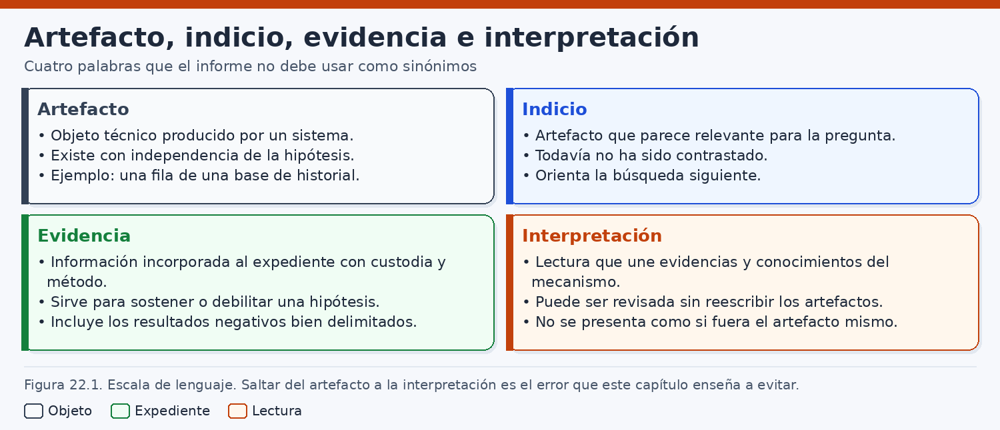
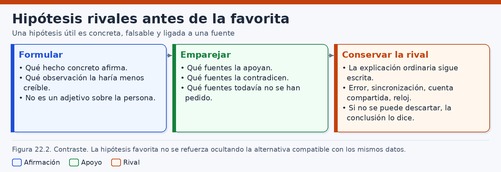
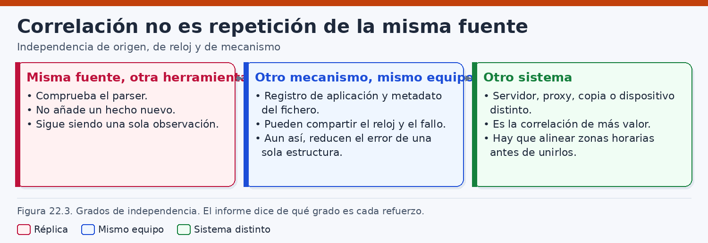
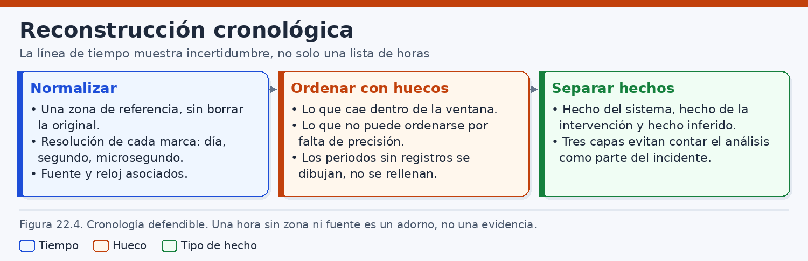
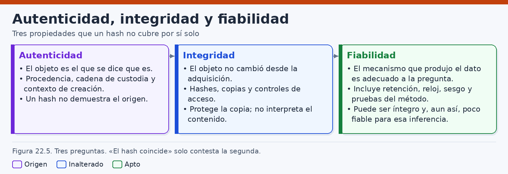
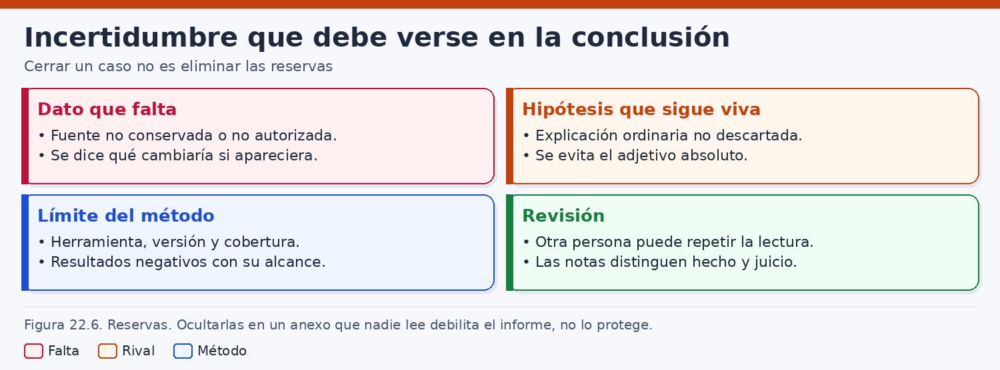

# Interpretación de evidencias y reconstrucción de los hechos

> *Quien interpreta debe poder señalar el artefacto, la pregunta y el salto que media entre ambos. Si ese salto no puede escribirse, todavía no hay una conclusión: hay un relato.*

## Introducción

Los capítulos anteriores han mostrado de dónde pueden salir los rastros: discos, sistemas operativos, memoria, registros, redes, aplicaciones, dispositivos móviles, servicios en la nube, máquinas virtuales y equipos especializados. Este capítulo no vuelve a describir esas fuentes. Empieza cuando el analista ya tiene copias, exportaciones o listados y debe decidir qué puede afirmar. El paso delicado no suele ser abrir una herramienta. Es escribir una frase que otro profesional pueda revisar sin adivinar qué se observó, qué se transformó y qué se infirió.

La interpretación es una actividad técnica, no un epílogo literario. Consiste en relacionar observaciones con el funcionamiento conocido de los sistemas, con el alcance de la adquisición y con hipótesis que puedan contrastarse. Una fila de un historial de navegación, un resumen criptográfico que coincide, un reloj adelantado o una operación hecha por una cuenta de servicio pueden ser materiales útiles. Ninguno de ellos, por el mero hecho de aparecer en un informe, responde a la pregunta de quién hizo qué, con qué propósito y en qué instante real. La cautela no consiste en vaciar el hallazgo de contenido. Consiste en conservar el dato en una forma que siga siendo comprobable cuando la primera explicación resulte incompleta.

Los ejemplos son ficticios y se bastan por sí mismos. Pertenecen a una organización imaginaria, Litoral Logística, con el dominio `litoral.example`. No continúan un caso de capítulos anteriores ni describen personas, equipos o incidentes reales. Aparecen cuatro materiales, siempre los mismos, para que el método se vea sin depender de un expediente previo: una fila de historial de navegación en un puesto llamado `LL-EST-014`; un resumen que coincide entre un documento local y un objeto remoto; un reloj de ese puesto adelantado respecto de una referencia en el momento de la adquisición; y una operación registrada a nombre de la cuenta de servicio `svc-sincro@litoral.example`. Los nombres, las horas y los identificadores están elegidos para poder comprobar la aritmética. No son datos de un cliente.

Conviene fijar desde el principio tres clases de enunciado que el resto del capítulo no mezclará. El **hecho del sistema** es lo que la fuente examinada contiene o registró, descrito con la semántica de esa fuente. El **hecho de la intervención** es lo que hicieron la adquisición, las herramientas o el analista: montar una copia, convertir una zona horaria, calcular un resumen, rotular una columna. El **hecho inferido** es la explicación que se propone a partir de los anteriores y que debe poder fallar si aparecen observaciones contrarias. Gran parte de las conclusiones indefendibles nacen de redactar un hecho inferido con la gramática de un hecho del sistema.

NIST SP 800-86, de 2006, sitúa este paso después del examen: el análisis relaciona fuentes y el informe declara límites. No es un manual de los formatos actuales. ISO/IEC 27041 e ISO/IEC 27042 orientan, por su función, la idoneidad del método y el análisis con rastro suficiente para una revisión. Este capítulo no las transcribe.

El recorrido es deliberadamente metodológico. Primero se separan artefacto, indicio, evidencia e interpretación. Después se escribe la hipótesis de manera falsable y se la enfrenta a rivales. Luego se mide la independencia real de las fuentes, se reconstruye el tiempo sin borrar la hora original y se distinguen integridad, autenticidad y fiabilidad. El cierre revisa una conclusión mal escrita y la reescribe. Las rutas de artefactos de Windows o de Linux quedan en sus capítulos: aquí importa cómo se escribe el salto, y una interpretación apoyada en una ruta memorizada envejece cuando cambia la versión.

## 1. Diferencia entre artefacto, indicio, evidencia e interpretación

### 1.1. Cuatro palabras que el informe suele fundir

Un informe gana claridad cuando cada sustantivo hace un trabajo distinto. **Artefacto**, **indicio**, **evidencia** e **interpretación** no son sinónimos de cortesía. Nombran momentos sucesivos de un razonamiento, y saltarse uno de ellos hace que el siguiente parezca más sólido de lo que es.

El artefacto es una estructura observable: un fichero, una fila, un evento exportado, un bloque, una entrada de registro, un objeto devuelto por una interfaz. Se puede describir sin decir todavía para qué pregunta sirve. El indicio es ese artefacto, o un conjunto pequeño de artefactos, cuando ya se ha juzgado pertinente para una pregunta del encargo. La evidencia, en el sentido metodológico de este capítulo, es el indicio incorporado al expediente con procedencia, identificación e información suficiente sobre su tratamiento. La interpretación es el significado que se le atribuye: un hallazgo técnico o una inferencia más amplia.

Esta escala no coincide siempre con el lenguaje procesal. En un procedimiento judicial, «prueba» puede designar lo que una autoridad admite y valora conforme a normas que el analista no dicta. Aquí se habla de evidencia digital como material técnico preparado para ser examinado. Calificarla jurídicamente queda fuera del método. La distinción, aun así, protege al perito: le impide presentar como hecho acreditado lo que solo es una lectura posible de un artefacto.

También conviene enlazar esta escala con otra que ya resulta familiar: dato observado, hallazgo e inferencia. El dato observado vive en el artefacto. El hallazgo es una interpretación técnica corta, pegada al mecanismo: «esta fila usa tal convención de tiempo», «estos dos objetos tienen los mismos bytes». La inferencia se aleja del mecanismo y propone un hecho del mundo: una persona descargó un documento, una cuenta de servicio actuó por encargo de alguien, un reloj permite ordenar dos eventos. Cuanto mayor es la distancia, más hipótesis rivales hay que escribir y más fuentes independientes hacen falta. La figura 22.1 resume ese recorrido. No es una máquina que convierta automáticamente un fichero en una conclusión; es un recordatorio de que cada peldaño exige una frase distinta.



### 1.2. El artefacto describe una estructura

Llamar artefacto a un objeto no le concede un móvil ni un autor. Significa que tiene una forma que se puede nombrar, localizar y, cuando el soporte lo permite, resumir. En el puesto ficticio `LL-EST-014` existe una copia de trabajo del fichero `History` de un perfil de Chromium. En las instalaciones estables de Chrome, el perfil suele residir en el directorio de datos de usuario y llamarse `Default`. En Windows, esa raíz habitual es `%LOCALAPPDATA%\Google\Chrome\User Data`. La ruta se comprueba en la copia y, si el sistema aún puede consultarse de forma autorizada, `chrome://version` muestra la ruta del perfil. El nombre `History` aparece en la documentación pública del almacenamiento de Chromium, junto con otros ficheros del perfil. Que el nombre sea el esperado no dispensa de identificar la copia concreta: volumen, ruta, tamaño y resumen de lo que realmente se adquirió.

El artefacto, en este ejemplo, no es la navegación de una empleada. Es un fichero de base de datos, a menudo SQLite, que puede ir acompañado de un fichero `-wal` y de otro `-shm`, o de un diario de transacciones. Copiar solo el fichero principal puede dejar fuera transacciones aún no integradas. Describir el artefacto obliga a decir si esos acompañantes se adquirieron. Una ficha mínima cabe en pocas líneas: identificador de la copia, ruta de origen, algoritmo y resumen, presencia o ausencia de `-wal` y `-shm`, herramienta y versión usadas en el inventario, y la advertencia de que el esquema se inspecciona en esa copia porque cambia entre versiones.

Sobre una copia de laboratorio, abierta de modo que el examen no la reescriba, el esquema se mira antes de interpretar columnas:

```bash
# Solo sobre la copia de trabajo, en solo lectura. No es el original.
sqlite3 "file:/caso/litoral/LL-EST-014/History?mode=ro" ".schema"
```

La orden no demuestra que nadie navegara. Demuestra que el analista puede ver las tablas y los campos que esa versión almacenó. Si un visor muestra «hora de descarga» y el esquema no contiene un campo con esa semántica, el rótulo pertenece a la herramienta, no al artefacto. Anotarlo ahora evita que, páginas más adelante, el rótulo se convierta en un hecho.

### 1.3. El indicio añade una pregunta

El indicio aparece cuando el artefacto se pone delante de una pregunta. En el ejemplo, la pregunta del encargo ficticio es estrecha: determinar si, el 12 de marzo de 2026, el puesto `LL-EST-014` conservaba rastros compatibles con el acceso a una URL concreta de `archivos.litoral.example` y con la presencia local de un documento llamado `contratos-litoral-2026.pdf`. Una fila cuya URL coincide con la del encargo es un indicio. Una fila de otra semana, o de otro perfil, puede ser un artefacto correcto y no ser indicio de esa pregunta.

La pertinencia no es un grado de culpabilidad. Seleccionar un indicio es una decisión, y las decisiones se registran. Conviene anotar por qué se eligió, qué se dejó fuera y qué criterio de búsqueda se usó. Si se buscó el nombre del fichero y no un identificador estable, el indicio depende de ese nombre: un cambio de nombre, una copia con otro título o un objeto remoto sin nombre visible quedarían fuera de la criba. El silencio de la búsqueda sería entonces un límite del criterio, no una observación sobre el mundo.

También hay indicios que apuntan en direcciones incómodas. La existencia de una cuenta de servicio `svc-sincro@litoral.example`, documentada en el inventario de la organización ficticia como identidad de una tarea de sincronización, es un indicio para cualquier hipótesis que atribuya una escritura remota a una persona sentada ante el puesto. No es un indicio menor por el hecho de que complique el relato inicial. El analista que solo eleva a indicio lo que confirma la sospecha ya ha interpretado, aunque todavía no haya escrito la conclusión.

Un indicio puede ser negativo, y aun así debe formularse con cobertura. «No aparece la URL en las filas recuperadas de esta copia de `History`» es un indicio sobre esa copia y esa consulta. No es, por sí solo, un indicio de que la URL no se visitó. Para que la ausencia informe, hay que saber si el perfil es el único, si el historial conserva el periodo, si la herramienta leyó el fichero principal y el de escritura anticipada (WAL), y si la visita habría generado precisamente esa fila. Esas condiciones se declaran junto al indicio. Sin ellas, la frase negativa parece un hecho del sistema y es solo un resultado de búsqueda.

### 1.4. La evidencia añade procedencia y tratamiento

El indicio se convierte en evidencia metodológica cuando puede seguirse su camino: quién entregó la copia o bajo qué autorización se adquirió, qué identificador une la copia al puesto, qué se calculó y cuándo, qué transformaciones se aplicaron y dónde está el original de trabajo respecto de los derivados. NIST SP 800-86 recuerda que el resultado útil depende de documentar el proceso, no solo de mostrar el dato final. SWGDE, en sus documentos de examen y de elaboración de informes, insiste en la misma dirección práctica: el examen y la escritura del dictamen tienen que dejar suficiente información para que otro examinador entienda qué se hizo. La edición concreta se consulta en su repositorio, porque esos documentos se revisan.

En el ejemplo, la evidencia no es la captura de pantalla del visor. La captura puede ayudar a comunicar. La evidencia es la copia identificada del fichero, los acompañantes que formen parte del conjunto, el registro de la consulta y la nota de cómo se leyó cada campo. Si el visor se ejecutó sobre una copia y creó un `-wal` nuevo en el directorio de trabajo, ese `-wal` es un producto de la intervención. No se mezcla con los ficheros adquiridos ni se presenta como si el puesto lo hubiera generado el 12 de marzo.

### 1.5. La interpretación es un salto declarado

Interpretar es decir qué significa el material para la pregunta. El salto puede ser corto. «El entero almacenado en el campo de hora de visita, leído con la convención habitual de Chromium (microsegundos desde el 1 de enero de 1601 en tiempo universal coordinado, UTC), corresponde a las 08:14:03 UTC del 12 de marzo de 2026.» Eso es una interpretación técnica, porque aplica una convención que debe comprobarse en la versión y en el esquema. El salto puede ser largo. «Marta Rivas descargó el documento confidencial y lo exfiltró.» Entre una frase y otra hay cuentas, personas, acciones de descarga, transferencias y una intención. Cada una de esas palabras exige evidencia propia.

Una interpretación defendible tiene cuatro piezas visibles. La primera es el enunciado, concreto y en presente o pasado del mecanismo, no de la moral del caso. La segunda es el apoyo: qué artefactos, con qué identificadores, sostienen el enunciado. La tercera es la regla: qué conocimiento del sistema permite pasar del artefacto al enunciado, y dónde se ha comprobado. La cuarta es el límite: qué observaciones la harían retirar o bajar de nivel. Si falta la cuarta, la interpretación se parece a un eslogan. Si falta la tercera, se parece a una intuición. Si falta la segunda, se parece a un rumor técnico.

Conviene escribir las interpretaciones en una escala de fuerza y no comprimirla al final. Una escala sobria, suficiente para el trabajo diario, puede ser esta:

| Nivel | Qué se afirma | Ejemplo ficticio, todavía sin correlación |
|---|---|---|
| Descripción | Hay una estructura identificada | La copia de `History` contiene una fila con esa URL |
| Lectura técnica | Un campo significa lo que la convención de la versión dice | El entero de la fila convierte a 2026-03-12T08:14:03Z |
| Compatibilidad | El rastro es compatible con un mecanismo | Es compatible con una visita registrada por ese perfil |
| Corroboración | Otro mecanismo independiente converge | Hace falta una fuente que no sea el mismo fichero |
| Atribución personal | Una persona controló la acción | Hace falta algo más que el perfil y la cuenta |

Subir de fila sin material nuevo es el defecto que este capítulo quiere hacer visible. Bajar de fila cuando el material no llega es una conclusión, no una derrota. El informe puede decir, y a menudo debe decir, que el expediente alcanza la compatibilidad y no la atribución.

### 1.6. Hecho del sistema, hecho de la intervención y hecho inferido

Las cuatro palabras anteriores clasifican el material. Estas tres clasifican las frases. Un mismo párrafo puede contener las tres, siempre que no compartan el mismo verbo disfrazado.

El **hecho del sistema** se redacta como inventario. En el ejemplo: la copia identificada conserva el entero `13417776843000000` en el campo que el esquema de esa copia asocia a la hora de visita de la URL `https://archivos.litoral.example/interno/contratos-litoral-2026.pdf`. El entero es del ejemplo, calculado para que la convención habitual lo lleve a una hora exacta; en un caso real el entero se copia de la base, no de un libro. El hecho del sistema no dice «a las nueve y catorce de la mañana». Dice qué hay escrito y en qué unidad.

El **hecho de la intervención** se redacta como bitácora. Una herramienta, en un puesto de laboratorio configurado en `Europe/Madrid`, mostró `2026-03-12 09:14:03`. Otra herramienta, con la misma copia, mostró la misma hora local porque aplicó la misma zona de presentación. El analista calculó el correspondiente UTC sin corregir el reloj del equipo investigado y obtuvo `2026-03-12T08:14:03Z`. Esas tres oraciones describen el laboratorio. Si se omiten, el lector creerá que el puesto escribió «09:14» en hora peninsular y que dos programas lo comprobaron.

El **hecho inferido** se redacta como hipótesis o como conclusión limitada. «Esa marca es compatible con una visita del perfil en un instante que el reloj del puesto situaba en las 08:14:03 UTC» ya es una inferencia: supone la convención de tiempo, supone que la fila no fue importada por sincronización y deja fuera, de momento, el desfase del reloj. «La empleada descargó el PDF y lo subió» es una inferencia de otro tamaño. Puede escribirse como hipótesis de trabajo. No puede escribirse como hecho del sistema.

Esta separación se mantiene en las tablas de trabajo. Una columna guarda el literal, otra la transformación y otra la lectura. Si la hoja solo conserva la hora ya convertida, la intervención ha borrado el hecho del sistema.

Una fila de visita, leída así, sigue sin ser una descarga ni una persona ante el teclado. En el ejemplo, el entero `13417776843000000` convierte, por la convención habitual que habrá que confirmar en la versión, a `2026-03-12T08:14:03Z` según el reloj del puesto. Una herramienta en `Europe/Madrid` lo muestra como las 09:14:03 del 12 de marzo de 2026, fecha anterior al cambio de horario de verano. Canarias no comparte el desfase peninsular: la zona se nombra, no se resume como «horario peninsular». Si el visor rellena una columna «usuario» con el nombre de la carpeta del perfil, ese nombre es una inferencia de ubicación. La visita puede deberse a una sincronización del perfil, a más de una persona o a una acción del propio navegador. El indicio es la referencia temporal a la URL. La exfiltración, si se afirma, tendrá que venir de otra fuente.

## 2. Formulación y contraste de hipótesis

### 2.1. Una explicación que no puede fallar no orienta la búsqueda

Una hipótesis forense es una explicación provisional, escrita para poder ser contrastada. No es la sospecha del encargo, ni la intuición del analista, ni una conclusión a la que se llega por cansancio. Sirve si, de ser cierta, obliga a esperar observaciones concretas y, de ser falsa, deja alguna observación que resultaría incómoda. Cuando la frase sigue en pie pase lo que pase, no es una hipótesis. Es un relato inmune.

«Hubo una exfiltración el 12 de marzo» es inmune mientras no se diga qué rastro debería existir y cuál faltaría. Cualquier hallazgo se le puede añadir y cualquier ausencia se explica con un borrado, con un fallo de registro o con un canal desconocido. Esas salidas existen y a veces son reales. Usarlas de antemano, sin condición, impide que la explicación pierda. El analista puede reconocer canales desconocidos al final, como límite. No puede invocarlos al principio para proteger la frase.

La forma falsable exige un sujeto técnico, una acción, un objeto, un intervalo y una consecuencia observable condicionada por lo que se sabe del registro. El sujeto técnico no tiene por qué ser una persona. En muchos casos no debe serlo. «El perfil de Chromium del puesto `LL-EST-014` registró una visita» se puede contrastar con la base. «Marta Rivas quiso sacar el documento» no se contrasta con una fila. La intención, si alguna vez puede abordarse, llega después de haber fijado acciones de mecanismos, y a menudo no llega.

### 2.2. Anatomía de una hipótesis falsable

Una plantilla corta, usada con juicio, evita las frases inmunes:

> Si [mecanismo o identidad técnica] realizó [operación] sobre [objeto] en [intervalo], y si [condiciones de registro] se cumplían, entonces cabe esperar [observación] en [fuente]. Resultaría difícil de conciliar [observación contraria], salvo [excepción ya conocida y declarada].

Cada corchete se rellena con algo comprobable. El mecanismo puede ser un perfil, un proceso, una cuenta de servicio o un proveedor que registra una llamada. La operación se nombra con el verbo del sistema: registrar una visita, crear un objeto, autenticar, leer un fichero. El intervalo lleva zona horaria o se expresa en UTC, y se dice si es el tiempo del reloj de origen o el de una referencia. Las condiciones de registro son la parte que más a menudo se omite y la que decide si una ausencia significa algo.

Aplicada al ejemplo, una hipótesis sobre el historial queda así. Si el perfil examinado visitó esa URL en el intervalo que su propio reloj sitúa el 12 de marzo de 2026 por la mañana, y si ese perfil guarda las visitas en `History` con la convención habitual, entonces la copia que incluya el fichero principal y, si existía, el WAL debería contener una fila con esa URL y un entero de tiempo convertible a ese intervalo. Resultaría difícil de conciliar la ausencia de toda fila en un conjunto de adquisición completo y no recortado por la consulta, salvo que la versión no registre ese tipo de navegación, que el perfil no sea el que actuó o que la visita se hubiera depurado antes de la copia. Esas salvedades no se susurran: se comprueban en la medida de lo posible y, si no se pueden comprobar, se quedan como límite de la hipótesis, no como confirmación.

La hipótesis gemela sobre el documento local es otra frase, no un adorno de la anterior. Si el PDF que está en el puesto es byte a byte el objeto remoto, los resúmenes de esas dos secuencias de bytes coincidirán cuando se calculen sobre los mismos alcances. Resultaría difícil de conciliar una diferencia de resúmenes si de verdad se comparan los mismos bytes sin transformaciones de compresión, cifrado o empaquetado. La coincidencia, cuando se produce, confirma la igualdad de esas secuencias. No confirma que la visita del historial fuera la transferencia. Esa unión es una tercera hipótesis y necesita su propio puente: un mecanismo que enlace la visita, el fichero local y la escritura remota.

Conviene desconfiar de los verbos agregados. «Descargó y exfiltró» mete dos operaciones en una frase para que la evidencia de una contagie a la otra. Si solo hay historial, la hipótesis de visita puede sostenerse en su nivel y la de transferencia queda sin apoyar. Separarlas es más largo. También es lo que permite retirar una sin fingir que se cae la otra.

### 2.3. Predicciones antes de pedir el dato

La predicción no es un deseo. Es una lista de observaciones que, con el conocimiento actual del sistema, deberían aparecer, y otra lista de observaciones que dejarían la hipótesis en mala posición. Se escribe antes de abrir la fuente que debe decidir, cuando eso es posible. Si la fuente ya se abrió —ocurre a menudo, porque el indicio nace de una primera mirada—, se declara ese orden. «La hipótesis se formuló después de ver la fila y antes de pedir el registro del proveedor» es una frase honesta. «La hipótesis es independiente de los datos» sería falsa en ese caso.

Para la pregunta ficticia de Litoral, las predicciones caben en una tabla. No todas se podrán comprobar. La tabla sirve para no olvidar las que faltan.

| Hipótesis | Predicción favorable | Observación que la debilitaría | Condición para que el silencio importe |
|---|---|---|---|
| El perfil registró una visita a la URL | Fila en la copia completa de `History`, con tiempo convertible al intervalo | Ausencia de fila en copia completa, esquema comprobado y sin depuración conocida | Que la versión guarde ese tipo de visita y que el WAL, si existía, esté incluido |
| El PDF local y el objeto remoto son los mismos bytes | Mismo resumen criptográfico sobre ambos alcances | Resúmenes distintos sin una transformación que los explique | Que se haya resumido el mismo tipo de dato, no un contenedor distinto |
| La escritura remota la hizo la tarea de sincronización | El proveedor atribuye la operación a `svc-sincro` y existe configuración de esa tarea | La operación queda atribuida a una identidad interactiva, sin asunción del rol de servicio | Que el registro de datos del proveedor cubra el intervalo y el tipo de operación |
| Una persona concreta operó el teclado | Fuentes de sesión, presencia o testimonio que sitúen a esa persona en control del puesto | Actividad explicable por la cuenta de servicio sin sesión interactiva | Que existan fuentes de sesión; si no existen, la hipótesis no se promociona |

La última fila está escrita a propósito en un nivel que el material técnico habitual no alcanza. Mantenerla en la tabla impide que desaparezca por omisión y que, al redactar, se dé por cumplida. Una hipótesis que no se puede alimentar no se convierte en hecho. Se archiva como no contrastada.

### 2.4. Rivales que merecen el mismo formato

Las hipótesis rivales se escriben con la misma plantilla, no como una coletilla de «no se descarta un falso positivo». Un rival de paja, sin predicciones, solo decora la imparcialidad. Un rival serio obliga a buscar un dato que la hipótesis preferida no busca.

En el ejemplo hay al menos cuatro explicaciones compatibles con una primera lectura descuidada. H1: el perfil visitó la URL y esa visita guardó el PDF en el puesto. H2: el perfil visitó la URL, pero el PDF ya estaba o llegó por la tarea de sincronización. H3: no hubo visita humana; la fila procede de una sincronización del perfil desde otro dispositivo o de una acción del propio navegador. H4: la fila fue alterada después del hecho y antes de la adquisición, o durante una intervención mal documentada. H4 no se afirma por estilo conspirativo. Se mantiene porque la integridad de la copia, que se tratará más adelante, no responde a la pregunta de si el contenido ya era engañoso.

La figura 22.2 ordena estas rivales como caminos que comparten algunos indicios y se separan en las predicciones. El dibujo no demuestra cuál es la buena. Muestra que un indicio situado en el tramo común no elige camino.



Cuando dos rivales predicen el mismo dato, ese dato no las separa. La fila del historial es compatible con H1, H2 y H3. Contarla tres veces, una por cada hipótesis que no mata, no suma tres confirmaciones. Solo muestra que el dato está en el tramo común. El dato que importa es el que una hipótesis predice y la otra no.

### 2.5. La cuenta de servicio, escrita sin atajos

Las cuentas de servicio son un terreno fértil para el atajo. Tienen nombre de usuario, aparecen en registros de auditoría y, con frecuencia, realizan exactamente la operación que el encargo quiere atribuir a una persona: copiar, subir, borrar, sincronizar. En el ejemplo, el registro del proveedor —una exportación ficticia, limitada al intervalo y al repositorio de objetos— atribuye una creación del objeto `contratos-litoral-2026.pdf` a `svc-sincro@litoral.example`. El inventario dice que esa identidad la usa una tarea programada de sincronización documental. Nada en esa frase identifica a Marta Rivas. Nada demuestra tampoco que la tarea funcionara sola y sin abuso.

Las hipótesis, otra vez separadas, serían estas. Ha: la tarea programada, con su identidad, creó el objeto como parte de su función. Predice configuración de la tarea, registros locales del cliente de sincronización si existen, y ausencia de una identidad interactiva en esa llamada. Hb: alguien usó la credencial de `svc-sincro` fuera de la tarea. Predice un uso desde un origen o un programa que no coincide con el de la tarea, o un secreto compartido, o una asunción de rol desde una identidad humana, si el proveedor registra ese encadenamiento. Hc: la persona titular de una cuenta interactiva creó el objeto ella misma. Predice que el principal registrado sea esa identidad, no la de servicio. Si el principal es `svc-sincro`, Hc queda debilitada en la forma en que estaba escrita. No queda prohibida para siempre: podría reescribirse como «una persona disparó la tarea». Esa nueva frase es otra hipótesis, Hd, y predice un disparador: una sesión, una orden, un evento de la aplicación. Si no hay disparador conservado, Hd permanece abierta y sin apoyo, que es distinto de «acreditada».

El error de redacción consiste en llamar a `svc-sincro` «la cuenta de la empleada» porque la tarea sincroniza su carpeta. La carpeta puede ser el ámbito de la tarea. La identidad que el proveedor vio es la de la tarea. Entre el ámbito y la persona hay un salto de atribución. Se puede escribir: «la operación remota quedó registrada a nombre de la cuenta de servicio que la organización asocia a la sincronización del repositorio; no se ha identificado en esta exportación una identidad interactiva ni un disparador humano». Quien necesite la atribución personal sabe, al leerlo, que todavía no la tiene.

### 2.6. Debilitar no es lo mismo que refutar

El contraste rara vez produce una refutación de laboratorio, limpia y total. Produce debilitamientos. Conviene usar los verbos con esa escala, para no tratar una fuente incompleta como si fuera un experimento definitivo.

Una hipótesis queda **reforzada** cuando aparece una observación que ella predecía y que sus rivales serias no predecían. Queda **debilitada** cuando falta una observación que debía estar, en una fuente cuya cobertura se ha comprobado, o cuando aparece una observación que encaja mejor con una rival. Queda **no contrastada** cuando la fuente que podría decidir no se adquirió, no conserva el periodo o no registra la operación. Queda **refutada en su forma actual** cuando la observación contraria es incompatible con la frase tal como se escribió. La refutación de una forma no impide escribir otra forma más estrecha. Impide conservar la frase ancha como si nada hubiera pasado.

### 2.7. Un cuaderno breve, suficiente para revisar

El cuaderno de hipótesis no necesita un sistema complejo. Necesita sobrevivir a un cambio de analista y guardar la formulación original del encargo, aunque luego se demuestre que esa pregunta no tiene respuesta con el material. Una entrada por decisión basta:

| Campo | Contenido en el ejemplo ficticio |
|---|---|
| Identificador | H2, revisión 1 |
| Pregunta | ¿La creación del objeto remoto está ligada a la visita del perfil? |
| Enunciado | La tarea `svc-sincro` creó el objeto; la visita puede ser independiente |
| Escrito antes de | Pedir la exportación del proveedor y revisar la configuración de la tarea |
| Predicción | Principal de servicio; configuración presente; sin identidad interactiva en la llamada |
| Resultado | La exportación atribuye la llamada a `svc-sincro`. La configuración de la tarea no se ha recibido |
| Lectura | Compatible con H2 y con Hb. Hd no contrastada. H1 no apoyada por esta fuente |
| Límite | Un solo punto de medida del reloj; exportación sin eventos de datos adicionales |
| Siguiente paso | Pedir configuración de la tarea y aclarar si la exportación incluye el plano de datos |

## 3. Correlación de fuentes independientes

### 3.1. Independencia es una propiedad del mecanismo

Correlacionar es preguntar si dos observaciones, producidas por mecanismos distintos, encajan en una misma explicación mejor que en las rivales. No es sumar menciones del mismo hecho. Un panel, una alerta y un informe semanal pueden repetir una sola escritura de registro con tres tipografías. Las tres ayudan a encontrarla. No la confirman tres veces. La confirmación empieza cuando el segundo mecanismo habría podido discrepar y, aun así, converge.

La pregunta práctica, antes de contar fuentes en el informe, es esta: ¿podría la segunda estar equivocada mientras la primera sigue igual, o comparten el error? Si comparten el fichero, el reloj, la cuenta, el proceso que genera el evento o el proveedor que lo reformatea, el error común es posible. La correlación conserva valor descriptivo —ayuda a entender la cadena de tratamiento— y pierde valor corroborativo. Llamarla independencia porque intervienen dos productos comerciales confunde el mercado con la arquitectura.

### 3.2. Dos herramientas sobre el mismo fichero

Supongamos que el visor A y el programa B leen la copia de `History` y muestran la misma URL y la misma hora local. El acuerdo importa, y no por la razón que suele escribirse. Importa como comprobación de la lectura: dos implementaciones, o dos versiones, no han divergido al interpretar ese campo. Eso aumenta la confianza en el hecho de la intervención «la conversión de este entero es estable entre estas dos herramientas». No crea un segundo hecho del sistema. El sistema escribió la fila una vez.

El acuerdo tampoco cubre el error compartido. Si ambas herramientas aplican la zona del puesto de laboratorio, ambas mostrarán las 09:14 aunque el analista necesitara UTC. Si ambas ignoran el WAL, ambas pueden omitir la misma transacción. Si ambas confían en una biblioteca desactualizada, ambas pueden nombrar mal una columna. La repetición es entonces perfectamente estable y perfectamente insuficiente. Hace falta, para las lecturas que sostengan la conclusión, una comparación con el campo crudo: el entero, el esquema, y una conversión documentada que no dependa del rótulo del visor.

Cuando las herramientas discrepen, se conservan las dos salidas. Una puede estar mostrando la hora de visita y la otra la hora de una descarga, o una puede estar aplicando horario de verano por error de fecha. Elegir la que coincide con la hipótesis preferida, sin explicar la diferencia, convierte el contraste en un filtro. La discrepancia se resuelve volviendo al esquema y a la documentación de la versión. Si no se resuelve, las dos lecturas siguen en el expediente y la conclusión usa el nivel que sobrevive a ambas, a menudo un intervalo o una descripción más pobre. La pobreza, aquí, es exactitud.

### 3.3. Grados, no un interruptor

La independencia no es binaria. Entre «el mismo fichero» y «un sensor que no comparte nada» hay grados que la figura 22.3 deja ver como una escala, no como una medalla. Tratarla como interruptor empuja a inflar el recuento o a despreciar fuentes que, sin ser puras, aportan un mecanismo parcialmente distinto.



El grado bajo es el reempaquetado del mismo fichero, por ejemplo una tabla de valores separados por comas (CSV) salida del visor. Un grado intermedio es otro componente del mismo puesto, que comparte reloj y a menudo la cuenta. Un grado mayor es un equipo de red o el proveedor remoto. La hora que el cliente declara dentro de una petición no es el reloj del proveedor. La tabla siguiente se consulta antes de numerar fuentes en el informe.

| Pareja de materiales | Qué se comparte | Qué puede corroborarse | Qué no debe contarse |
|---|---|---|---|
| Visor A y programa B sobre el mismo `History` | Fichero, reloj de origen, esquema | Estabilidad de la lectura | Una segunda observación de la visita |
| `History` y CSV exportado de él | El mismo contenido, quizá filtrado | Fidelidad de la exportación, si se audita | Una fuente nueva |
| `History` y creación del PDF en el mismo puesto | Equipo y, a menudo, reloj | Compatibilidad local entre visita y fichero | Un testigo externo |
| `History` y proxy de la sede | Puede compartirse el servicio horario | Que una petición salió a la red | El contenido del documento |
| `History` y auditoría del proveedor | Muy poco, si se distinguen los relojes | Una acción remota y su principal | Que el principal sea la persona del perfil |
| Alerta, panel e incidencia creados del mismo evento | El generador | Que el equipo de operaciones lo vio | Tres corroboraciones |

El grado se juzga para una pregunta concreta. Dos programas bastan para comprobar si el entero se leyó bien, y no avanzan nada si la pregunta es quién envió el documento.

### 3.4. Claves de correlación y su alcance

Los mecanismos se enlazan con claves: una URL, un nombre de fichero, un resumen, un identificador de objeto, un principal, una dirección, un intervalo. Cada clave tiene alcance. Usarla fuera de ese alcance fabrica una correlación que el material no contiene.

El nombre `contratos-litoral-2026.pdf` enlaza mal si el objeto remoto puede renombrarse, si hay copias homónimas o si la URL no termina en ese nombre. El resumen criptográfico enlaza el contenido de dos secuencias de bytes, no sus historias. El principal `svc-sincro@litoral.example` enlaza la llamada con una identidad técnica registrada por el proveedor, no con la persona que administra la tarea, salvo que otra fuente muestre esa administración en ese momento. La dirección de red del puesto enlaza una observación de red con un equipo solo mientras la asignación sea la que dice el servicio que la concede, en ese intervalo, y mientras no haya traducción que esconda otros equipos detrás.

Cuando la clave es temporal, el alcance incluye la incertidumbre del reloj, que el apartado 4 desarrolla. Dos eventos a 83 segundos de distancia no quedan correlacionados por proximidad. La proximidad es compatible con una relación y compatible con dos actividades ajenas. La relación se afirma cuando hay una clave de identidad o de objeto, no cuando el calendario queda bonito.

Conviene escribir la clave en la frase de correlación, no darla por sabida. «Se correlacionan el historial y la nube» es inrevisable. «La URL de la fila y la clave del objeto remoto comparten el nombre del fichero; los resúmenes de bytes coinciden; los principales y los relojes no coinciden en un mismo mecanismo» dice qué clave se usó y cuáles no alcanzaron. La segunda frase permite discrepar. La primera solo permite asentir.

### 3.5. Un resumen que coincide

En el ejemplo, el PDF local y el objeto remoto producen el mismo resumen SHA-256 cuando se calcula sobre los bytes de cada copia de trabajo. El algoritmo se anota, las copias se identifican y el valor completo se guarda en el expediente. Aquí no hace falta reproducirlo. El hecho del sistema, en cada lado, es la secuencia de bytes. El hecho de la intervención es el cálculo. El hecho inferido, todavía modesto, es que esas dos secuencias coinciden con una confianza muy alta, la que corresponde a una función resumen criptográfica usada del modo previsto.

Esa coincidencia es una excelente clave de contenido. Cierra la hipótesis «son los mismos bytes» en la forma en que se escribió, siempre que nadie haya resumido un contenedor distinto por error: un PDF por un lado y un paquete cifrado o comprimido por el otro. La comprobación de alcance forma parte del cálculo, no es un formalismo. Resumir el fichero lógico y compararlo con el resumen de un objeto que incluye metadatos de envoltura produce una diferencia que no habla del documento.

La coincidencia no transporta el contexto. No dice que el puesto obtuviera el fichero desde esa URL, ni que el objeto se creara a partir del puesto, ni que la cuenta de servicio actuara bien o mal, ni que el contenido del PDF sea veraz. Dos copias idénticas pueden nacer de una plantilla común, de una copia de seguridad legítima o de una sincronización prevista por la propia organización. Por eso H2 puede aceptar el resumen compartido sin convertirse en H1. El resumen está en el tramo común de varias hipótesis de transferencia y también de una hipótesis de réplica legítima. Quien lo presente como prueba de la exfiltración ha usado una clave fuerte fuera de su alcance.

### 3.6. Correlación cuando el otro extremo está en la nube

El extremo remoto del ejemplo no es un segundo disco adquirido en el laboratorio. Es un registro que el proveedor conserva, selecciona y entrega según el servicio contratado, la configuración y la petición. NIST IR 8006 reunió decenas de retos del análisis forense en la nube —62, agrupados en nueve categorías: arquitectura, recogida, análisis, antiforense, primera respuesta, gestión de roles, aspectos legales, normas y formación— sin que este capítulo necesite inventariarlos uno a uno. NIST SP 800-201, de julio de 2024, propone una arquitectura de referencia para la preparación forense apoyada en esos retos. Para la correlación, la consecuencia práctica es directa: lo que se puede enlazar depende de decisiones de registro tomadas antes del incidente, y la ausencia de un plano de datos no se rellena con el plano de administración.

En los servicios habituales, las familias de registro no son intercambiables. Un historial de eventos de gestión no sustituye a un registro configurado con la retención que el caso pide, y los eventos de datos sobre objetos no están incluidos por defecto en todos los diseños. En una suscripción de tipo Azure, el registro de actividad y los inicios de sesión de la identidad son fuentes distintas. En un entorno de tipo Google Cloud, la actividad de administración y el acceso a datos se separan, y este último hay que habilitarlo. Nombrar estas familias no autoriza a inventar campos ni plazos. Autoriza a preguntar, en cada exportación, qué plano se recibió.

Aplicado a Litoral, la exportación ficticia muestra una creación atribuida a `svc-sincro` y no muestra, porque no se pidió o porque no estaba habilitado, el detalle de lectura posterior del objeto. Correlacionar esa exportación con el historial del puesto enlaza, como máximo, un nombre, un resumen y dos tiempos de relojes distintos. No enlaza la intención ni prueba que el navegador fuera el cliente que escribió el objeto. Si el cliente fue la tarea de sincronización, el historial puede ser contemporáneo y ajeno. La preparación forense que SP 800-201 sitúa en la arquitectura —identidades, registros de datos, retención, separación de funciones— es la que habría podido dejar el disparador de la tarea o no dejarlo. El analista describe la exportación recibida. La consola, la alerta y el fichero descargado por la misma interfaz de programación (API) pueden ser tres vistas de una canalización. Cuentan como una fuente de proveedor. No completa, con ninguna de ellas, la arquitectura que la organización no tenía.

## 4. Reconstrucción cronológica

### 4.1. Una línea de tiempo no es todavía un relato

Ordenar eventos es una condición de muchas explicaciones y no es la explicación. Una cronología muestra qué marcas temporales se conservan, con qué reloj, con qué resolución y con qué huecos. El relato empieza cuando se afirma que un evento hizo posible otro. Esa afirmación pide claves del apartado anterior, no solo una columna de horas bien alineada.

La figura 22.4 recoge el hábito que este apartado quiere fijar: la línea se dibuja con los huecos a la vista. Un hueco es un intervalo en el que esta investigación no tiene observación. No es un evento oculto, ni una prueba de borrado, ni un permiso para insertar el paso que la hipótesis preferida necesita. Si se rellena, el relleno se rotula como inferencia y se saca de la columna de hechos del sistema.



En el ejemplo hay tres marcas y un vacío. El proveedor registra una creación a las `2026-03-12T08:12:40Z`, hora del proveedor, con la semántica de «momento en que el servicio anotó la operación», que puede ser la recepción y no el inicio en el cliente. El entero del historial, convertido sin tocar el desfase, cae en `2026-03-12T08:14:03Z` del reloj del puesto. Entre medias, 83 segundos. No hay en el expediente ficticio un evento de proxy, ni un arranque de proceso, ni un disparador de la tarea. Ese vacío permanece en la línea. Ochenta y tres segundos de cercanía no cosen la visita con la creación.

### 4.2. Tres tiempos que no se sustituyen

Cada marca arrastra tres preguntas. Qué se almacenó. Qué muestra la herramienta. Qué instante del mundo se pretende reconstruir. Confundirlas produce cronologías precisas en apariencia y desplazadas en sustancia.

El **tiempo almacenado** es el literal: el entero `13417776843000000`, o la cadena que el proveedor escribió en su exportación, copiada tal cual, con su desplazamiento si lo trae. El **tiempo mostrado** es la presentación: `09:14:03` en `Europe/Madrid`, o una hora redondeada al minuto en un informe de consola. El **tiempo del hecho** es una inferencia sobre cuándo ocurrió la acción en una escala de referencia. A ese tercer tiempo solo se llega si se sabe qué evento dispara la marca —inicio, fin, recepción, escritura en disco, cierre del registro— y cómo estaba el reloj respecto de la referencia.

La convención habitual de las horas de visita de Chromium cuenta microsegundos desde el 1 de enero de 1601 en UTC. Aplicarla es un hecho de la intervención apoyado en una regla técnica que debe verificarse. El resultado, `2026-03-12T08:14:03Z`, sigue siendo la hora que el reloj del puesto hizo almacenar, expresada en UTC. No es todavía la hora de una referencia externa. Llamarla «UTC» sin más es correcto como etiqueta de la conversión y engañoso si el lector entiende «hora cierta». En la ficha, el rótulo ajustado es «UTC según el reloj de origen, sin corrección de desfase».

La misma separación vale para el proveedor. Su marca en `Z` es la hora que él almacenó. Suele estar mejor disciplinada que la de un puesto de oficina, y aun así se describe como hora del proveedor. Puede corresponder al momento de aceptar la llamada, no al momento en que el usuario eligió un fichero. Si el campo no documenta esa semántica, el analista no la inventa: deja la marca como «anotación del servicio» y baja la precisión de cualquier frase que hable de «la hora de la subida».

### 4.3. Normalizar sin borrar la hora original

Normalizar es añadir una columna comparable. No es reemplazar el original. La zona del laboratorio, el horario de verano y la prisa por «dejarlo todo en peninsular» son tres maneras habituales de perder la marca. El 12 de marzo de 2026, en la zona `Europe/Madrid`, el desfase legal es de una hora respecto de UTC, porque el horario de verano de la Unión Europea comienza el último domingo de marzo, que ese año es el día 29. `Atlantic/Canary` no comparte el desfase. Un analista que unifique «a horario peninsular» sin registrar la zona y la regla aplicada no podrá explicar, meses después, si restó una hora o dos.

La ficha de cada marca conserva, como mínimo, los elementos siguientes. El literal original. La unidad y la época, o la declaración de que vienen en una cadena con desplazamiento. La zona de presentación de la herramienta y la zona configurada en el sistema de origen, si se conoce. El instante en UTC sin corrección de reloj. El desfase conocido, el instante en que se midió y la fuente de la medida. El instante ajustado, si se calcula, con el rótulo de hipótesis. La incertidumbre residual. Y la clase de enunciado: sistema, intervención o inferencia.

Para el historial ficticio, la ficha queda así:

| Elemento | Contenido |
|---|---|
| Literal | `13417776843000000` |
| Regla aplicada | Microsegundos desde 1601-01-01 UTC, convención habitual de Chromium; comprobada para el ejemplo y pendiente de la versión en un caso real |
| Presentación de la herramienta | `2026-03-12 09:14:03` en `Europe/Madrid` |
| UTC sin corrección | `2026-03-12T08:14:03Z` (reloj de origen) |
| Desfase medido | El reloj del puesto adelantaba 4 min 12 s el 13 de marzo a las 18:02:00Z de la referencia |
| Ajuste retrospectivo | No aplicado a la línea principal. Como sensibilidad, restar 4 min 12 s situaría la marca en `2026-03-12T08:09:51Z` |
| Incertidumbre | El desfase en el momento de la visita no está medido |

La comprobación aritmética de la conversión, en el laboratorio y sin abrir la base, es pequeña y vale la pena archivarla junto a la ficha:

```bash
# Comprueba la conversión del entero ficticio. No escribe en la evidencia.
python3 - << 'PY'
from datetime import datetime, timezone
us = 13417776843000000
unix = us / 1_000_000 - 11644473600
print(datetime.fromtimestamp(unix, timezone.utc).strftime("%Y-%m-%dT%H:%M:%SZ"))
PY
```

El número `11644473600` es el desfase en segundos entre 1601-01-01 y 1970-01-01. Si la versión usara otra unidad, cambiaría la ficha y el literal permanecería: esa permanencia demuestra que la normalización no se ha comido el original.

### 4.4. El reloj desfasado

En la adquisición ficticia se comparó el reloj de `LL-EST-014` con una referencia. A las `2026-03-13T18:02:00Z`, el puesto mostraba las `19:06:12` con zona `+01`. Convertida esa lectura, el puesto creía que eran las `18:06:12Z`. Adelantaba cuatro minutos y doce segundos en ese instante. Es un hecho de la intervención sobre una medida, y es un hecho del sistema en cuanto al estado del reloj en la adquisición. No es una medida del reloj a las 08:14 del día anterior.

Los relojes se corrigen, se desplazan al suspender un equipo y se dejan llevar si el servicio horario no llega. Un solo punto no demuestra un desfase constante. Aplicarlo hacia atrás puede mejorar la cronología o puede inventar un orden. En el ejemplo, el orden cambia de signo. Sin ajuste, la marca del historial cae 83 segundos después de la creación anotada por el proveedor. Con el ajuste de cuatro minutos y doce segundos, cae en `08:09:51Z`, 169 segundos antes de esa creación. Las dos ordenaciones no pueden ser a la vez la línea principal. Como el desfase del día 12 no está medido, las dos son compatibles con lo que se sabe. La conclusión sobre el orden es que **no está determinado** dentro de esta incertidumbre.

Si se ofrece el ajuste, se ofrece como sensibilidad, con la condicional a la vista: «si el desfase hubiera sido entonces el de la adquisición, el orden se invertiría». Esa condicional no entra en la tabla de hechos, y no se elige solo porque ponga la visita antes de la subida.

### 4.5. Resolución, huecos y orden relativo

Dos marcas pueden ser verdaderas y seguir sin poder ordenarse. Una consola que redondea al minuto puede mostrar 08:12 tanto un evento de las 08:12:01 como otro de las 08:12:59. Compararlo con una marca de resolución de microsegundos exige llevar ambas a la resolución peor, no fingir que el minuto es un instante. En el ejemplo, si una tercera fuente solo dijera «08:12 hora del proveedor», no se podría colocar respecto de las 08:12:40. Se colocaría en un intervalo de un minuto y se vería si ese intervalo solapa la otra marca.

También hay solapes aparentes que nacen de semánticas distintas. Una marca de «visita» puede registrarse al empezar a cargar una página; una marca de «objeto creado» puede registrarse al cerrar la escritura. Aunque los relojes fueran perfectos, el orden de las marcas no sería automáticamente el orden de las decisiones humanas. Por eso la cronología anota, junto a cada punto, el tipo de marca. Una línea de horas desnudas parece más objetiva y es menos interpretable.

## 5. Evaluación de autenticidad, integridad y fiabilidad

### 5.1. Tres preguntas que no se heredan

Autenticidad, integridad y fiabilidad se escriben a menudo como si una sola comprobación las encendiera juntas. No se heredan. La figura 22.5 las separa porque cada una responde a una pregunta distinta, y un sí en una columna deja las otras en blanco hasta que se examinan.

La **integridad**, en el uso de este capítulo, se refiere a la estabilidad de un objeto identificado: si los bytes de la copia, de la exportación o del conjunto descrito siguen siendo los que se fijaron. La **autenticidad** se refiere a la procedencia: si el objeto es lo que se dice que es y si el camino desde el sistema de origen hasta el laboratorio está descrito con honestidad. La **fiabilidad** se refiere al mecanismo que produjo el contenido: si, cuando el sistema anotó una visita, una creación o un principal, ese mecanismo estaba en condiciones de anotar precisamente eso, y no otra cosa parecida.



Un historial puede estar íntegro como copia, proceder de verdad del puesto `LL-EST-014` y, aun así, ser un mal testigo de quién pulsó el enlace, si el perfil se sincroniza o si la fila no distingue visitas de cargas automáticas. Un objeto remoto puede tener un resumen estable y un principal fiable como identidad técnica, y ser auténtico como registro del proveedor, sin que su contenido PDF sea verdadero en el mundo: un contrato ficticio dentro del fichero seguiría teniendo el mismo hash. La veracidad del documento y la fiabilidad del registro son planos distintos. El método los mantiene separados para que el informe no compre los tres con el precio de uno.

### 5.2. El resumen demuestra estabilidad de lo copiado

Calcular SHA-256, u otra función resumen criptográfica adecuada, sobre una copia y obtener después el mismo valor es un fundamento sólido para afirmar que esos bytes no han cambiado de manera detectable entre los dos cálculos. El alcance se dice en la frase. El resumen de un PDF no cubre los metadatos del sistema de archivos que viven fuera del fichero. El resumen de una exportación no cubre los eventos que la consulta no pidió. El resumen de una imagen no dice nada de los sectores que no se pudieron leer, salvo que el formato de la imagen documente esos huecos y se hayan revisado. El resumen del fichero SQLite principal no cubre un `-wal` que no se incluyó en el cálculo. SQLite puede dejar transacciones en ese acompañante; copiar y resumir solo la base es compatible con una copia estable e incompleta.

En el ejemplo, tres cálculos distintos no deben fundirse. El primero fija la copia de `History` adquirida, y si el WAL viajó con ella se fija aparte o se documenta el conjunto. El segundo fija el PDF local. El tercero fija el objeto remoto. Que el segundo y el tercero coincidan entre sí habla de igualdad de contenido, como ya se vio. Que el primero coincida con el valor anotado en la adquisición habla de que la base no cambió durante el examen. Son integridad de objetos diferentes. Ninguno de los tres viaja hacia atrás hasta el momento de la visita para certificar que nadie modificó el historial antes de copiarlo.

La intervención puede romper la integridad que se pretende medir. Abrir la base en lectura-escritura puede crear un `-wal` y un `-shm` de laboratorio. Esos ficheros se segregan. El cálculo que importa se hizo sobre la copia identificada, antes del examen, y se repite sobre esa misma copia. Un resumen del directorio de trabajo después de que la herramienta lo haya poblado de derivados no es el resumen de la evidencia. Es el resumen de la evidencia mezclada con la intervención.

El programa de pruebas CFTT de NIST ofrece un marco para ensayar funciones de herramientas con resultados conocidos. No etiqueta una suite comercial como verdadera en general. Una función de copia o de resumen puede comportarse bien sobre un conjunto de ensayo y fallar ante un formato que el ensayo no cubría. Cuando la conclusión depende del resumen, el analista anota el algoritmo, la herramienta, la versión y qué se consideró el objeto de entrada. Si la función es crítica y no hay un ensayo cercano, se contrasta con una segunda implementación sobre los mismos bytes. Ese contraste, aquí sí, es independencia de cálculo, no una segunda fuente del hecho original.

### 5.3. El resumen no autentica el origen

La autenticidad pregunta de dónde sale el objeto y si es el que el informe nombra. Un hash idéntico entre la adquisición y el examen no responde a esa pregunta. Responde a que, sea cual sea el origen, lo recibido se ha mantenido. Si se copió el perfil equivocado, el hash fija el perfil equivocado con una pulcritud admirable. Si el proveedor entregó una exportación filtrada y se resumió el fichero de intercambio (JSON), el hash fija ese fichero, no la completitud del servicio.

Por eso la frase «la evidencia es auténtica porque el hash coincide» mezcla dos columnas de la figura 22.5. La coincidencia con el valor de adquisición apoya la integridad posterior de la copia. La autenticidad se apoya en otros hechos: identificación del puesto, ruta y perfil, correspondencia con el inventario, continuidad de la custodia, descripción de la consulta al proveedor y, cuando existe, una segunda vía de obtención que no pase por las mismas manos. Ninguna de esas vías se sustituye por la longitud del resumen.

Tampoco el parecido criptográfico prueba el relato de origen del contenido. Dos bytes iguales no arrastran el nombre de quien los creó ni el canal por el que viajaron. Ya se usó el resumen como clave de correlación, con su alcance. Aquí el mismo límite se enuncia desde la autenticidad: igualar el PDF local y el objeto remoto autentica que las copias examinadas coinciden, no que el origen humano sea la persona del encargo ni que el canal haya sido el navegador. H2 sobrevive a un hash perfecto. Esa supervivencia es la demostración de que la autenticidad del objeto y la historia de su llegada son afirmaciones distintas.

Cuando el origen es una exportación, la autenticidad incluye las transformaciones declaradas. Una consola que convierte horas, traduce nombres de campos o descarta nulos entrega un objeto distinto del registro interno. Puede ser una exportación auténtica de tal día, hecha con tal cuenta técnica, y no ser una imagen fiel del almacén. La ficha de filtros, paginación e intervalo forma parte de esa autenticidad. Sin ella, el JSON es un fichero íntegro de procedencia opaca.

### 5.4. El resumen no avala el mecanismo

La fiabilidad pregunta si el mecanismo merece la lectura que se le quiere dar. Un `History` íntegro y bien atribuido al puesto puede haber registrado la URL por una sincronización de perfil. El proveedor puede anotar con fiabilidad el principal `svc-sincro` y, al mismo tiempo, no anotar qué identidad humana asumió el rol, porque esa cadena no forma parte del evento conservado. El reloj puede estar íntegro en su error: guarda con mucha fidelidad una hora falsa. El hash de ese registro fiel certifica la copia del error. No corrige el error.

Valorar el mecanismo exige saber qué debía registrar, durante qué intervalo, con qué reloj y con qué posibilidades de escritura. ¿Quién puede insertar una fila o un evento? ¿La auditoría estaba habilitada? ¿El plano de datos formaba parte de la exportación? ¿La versión distingue una visita de una descarga? Si estas respuestas faltan, la fiabilidad no se presume alta por costumbre del producto. Se declara limitada y la interpretación baja al nivel que el mecanismo aguanta: «hay una fila», quizá «es compatible con», y no «la empleada descargó».

ISO/IEC 27041 orienta, por su función pública, a juzgar si el método es idóneo para la finalidad. Un visor excelente para extraer URL puede ser un método inadecuado para ordenar eventos entre zonas horarias si convierte en silencio a la zona del laboratorio. La idoneidad se mide contra la pregunta, no contra la fama de la herramienta. ISO/IEC 27042 orienta, también por su función, al análisis y la interpretación: continuidad, validez y un registro suficiente para que otro examinador repita el razonamiento. Este capítulo no finge una ficha de catálogo distinta del portal de ISO ni reproduce el articulado, sujeto a derechos de los editores. Usa esas dos funciones como lista de control. El método de normalización temporal del apartado 4 es idóneo para comparar marcas solo mientras conserva el literal. El método que deja únicamente «09:14 horario peninsular» no es idóneo para una pregunta de orden, aunque el visor sea cómodo.

SWGDE publica buenas prácticas de examen, de prueba de herramientas y de redacción que conviene leer en la edición vigente. Su utilidad aquí es operativa: el examen que sostiene una interpretación se documenta, y el escrito distingue resultados de opiniones. CFTT y esas guías no dispensan de la verificación sobre el material del caso. Un ensayo público no ha visto el fichero `History` de Litoral. Ver el esquema en la copia, repetir el cálculo del entero y conservar la salida discrepante, si la hay, es la verificación de esta ejecución. La validación del método y la verificación del caso se nombran las dos, para no dar por válida una ejecución solo porque el programa es conocido.

### 5.5. Una copia íntegra de un contenido engañoso

El caso peor para el redactor apresurado es el que está perfectamente custodiado y mal interpretado. El entero es el que era. El hash cuadra. La URL está. Y la frase sobre Marta Rivas sigue siendo un salto. La integridad ha hecho su trabajo: permite fiarse de que el salto no nace de una copia corrupta. También deja el salto a la vista, porque el revisor puede volver al literal.

Cabe, además, que el contenido se hubiera fabricado antes de la adquisición. Una fila insertada, un reloj atrasado a propósito, un objeto subido con una credencial ajena. Esas hipótesis se parecen a H4 y a Hb. No se adoptan sin indicios. Tampoco se cierran con el hash. Lo que se puede decir es más seco: no se observan, en la custodia posterior a la copia, alteraciones; no se ha examinado un mecanismo que impida alteraciones anteriores; por tanto la integridad acreditada empieza en la adquisición, no en el hecho investigado.

«La copia permanece íntegra respecto de la adquisición» es un hecho de la intervención. «La evidencia es íntegra, auténtica y fiable» junta tres preguntas en un eslogan. El apartado siguiente muestra ese eslogan ya crecido, y una reescritura que conserva los hechos.

## 6. Incertidumbre, límites y revisión de conclusiones

### 6.1. La incertidumbre se escribe en la frase que va a citarse

La incertidumbre que solo vive en el anexo no existe para quien lee el resumen. Los encargos se discuten con las frases cortas. Si la frase corta dice que la empleada exfiltró el documento a las 09:14, las fichas de reloj, de cuenta de servicio y de herramientas duplicadas no la corrigen: la adorna. La práctica de este apartado es meter en la frase principal el límite que puede cambiar la decisión. Los demás límites pueden ir detrás, ordenados, sin sustituir al primero.

La figura 22.6 pide exactamente eso: que la conclusión deje ver la incertidumbre, no que la esconda bajo un tono seguro. Un intervalo, un principal técnico, un «no determinado» sobre el orden o un «no contrastado» sobre la persona son resultados. Quien encargó el trabajo puede preferir una historia cerrada. El analista le debe una historia del tamaño de las fuentes.



Hay tres sitios donde el límite suele caerse. El título del apartado, que anuncia «la exfiltración» antes del análisis. El primer párrafo, que nombra a la persona. Y el cierre, que cambia «compatible con» por «acreditado». Revisar un borrador es leer esos tres sitios como si el resto del expediente no existiera, porque a menudo el resto no se leerá. Si ahí la incertidumbre desaparece, el borrador no está listo.

### 6.2. Límites de alcance, de fuente y de inferencia

No todos los límites se reparan con más trabajo de laboratorio, y conviene no tratarlos como una sola disculpa.

El **límite de alcance** aparece cuando una fuente no se pidió o no se podía pedir: falta la configuración de la tarea, falta el proxy, falta el otro dispositivo del perfil. Se repara ampliando el encargo, si está justificado, o se acepta y se baja la hipótesis a no contrastada. El **límite de fuente** aparece cuando la fuente existe y no registra lo que se querría: el evento de datos no estaba habilitado, el historial no distingue la descarga, el reloj solo se midió una vez. Más copias de la misma exportación no lo curan. El **límite de inferencia** aparece cuando los datos están y siguen siendo compatibles con dos hipótesis. Pedir que el analista se pronuncie no convierte el empate en una medida. Se pronuncia declarando el empate.

En el ejemplo, los tres están a la vez. No se recibió la configuración de `svc-sincro` (alcance). El desfase solo se midió en la adquisición (fuente, en el sentido de cobertura temporal del reloj). La visita y la creación remota siguen siendo compatibles con una tarea de sincronización y con otras lecturas (inferencia). El informe que funde los tres en «no se puede saber nada» regala lo que sí se sabe: hay una fila, hay un objeto, los bytes coinciden, el principal es la cuenta de servicio, el orden no está fijado. El informe que no menciona ninguno regala la cautela. Los dos son incompletos por exceso de simetría. La conclusión útil conserva los hechos y reparte los límites.

### 6.3. Una conclusión mal escrita

El texto siguiente es un borrador ficticio, compuesto para este capítulo con los materiales de Litoral. Concentra defectos que, separados, parecen menores.

> El 12 de marzo de 2026, a las 09:14, la empleada Marta Rivas descargó desde el ordenador de la oficina el documento confidencial `contratos-litoral-2026.pdf` y lo subió a un almacenamiento externo. Así lo demuestran el historial de navegación y dos herramientas forenses independientes que analizaron ese historial, la coincidencia del hash SHA-256 y el registro de la nube. La cuenta utilizada fue la suya. Las horas se unificaron en horario peninsular. La evidencia es íntegra y auténtica porque el hash de la copia coincide con el calculado en la adquisición. Queda acreditada la exfiltración.

La primera frase convierte en hecho del sistema una cadena de inferencias. «09:14» es una presentación en `Europe/Madrid`, no el literal ni la hora de referencia. «Empleada Marta Rivas» atribuye persona. «Descargó» eleva una fila de visita a una descarga no identificada en el esquema. «Lo subió» une la visita con la creación remota y elige un orden que el desfase deja sin determinar. «Confidencial» y «almacenamiento externo» añaden valoraciones que el material técnico de este ejemplo no contiene.

La segunda frase cuenta mal las fuentes. Dos herramientas sobre el mismo `History` son un contraste de lectura. El hash coincidente es una clave de contenido, no un testigo del canal. El registro de la nube, en la exportación recibida, atribuye la creación a `svc-sincro@litoral.example`, que no es «la cuenta de la empleada». Llamarla «la suya» borra el principal que debía estorbar.

La tercera frase presenta como diligencia una normalización destructiva. Unificar en horario peninsular, sin zona, sin literal y sin el desfase de cuatro minutos y doce segundos medido al día siguiente, impide revisar el orden. La cuarta frase usa el hash como certificado universal de integridad, autenticidad y, por el contexto, fiabilidad. La quinta resume la historia con un verbo de cierre, «queda acreditada», que ya no admite rivales.

El borrador es cómodo de leer precisamente porque ha eliminado H2, Hb, el hueco cronológico y la diferencia entre visita y descarga. Un revisor que solo tuviera este párrafo no podría reconstruir el entero, el principal ni la medida del reloj. La interpretación se ha comido los hechos de los que debía depender. Eso es lo contrario de un registro suficiente para el análisis.

### 6.4. Reescritura

La reescritura no compensa con adjetivos prudentes. Cambia los sujetos, separa los planos y deja la incertidumbre en las frases que se van a citar. Los nombres siguen siendo ficticios.

**Hechos del sistema.** La copia de `History` del perfil examinado en `LL-EST-014` contiene una fila cuya URL es `https://archivos.litoral.example/interno/contratos-litoral-2026.pdf` y cuyo entero de hora de visita es `13417776843000000`. Aplicada la convención habitual de Chromium, que debe confirmarse en la versión, ese entero corresponde a `2026-03-12T08:14:03Z` según el reloj del puesto. Una herramienta lo presentó como `2026-03-12 09:14:03` en `Europe/Madrid`. La exportación del proveedor anota, a las `2026-03-12T08:12:40Z` de su reloj, la creación de un objeto con el nombre del PDF, a cargo del principal `svc-sincro@litoral.example`. El resumen SHA-256 del PDF local y el del objeto remoto coinciden. El resumen de la copia de `History` coincide con el calculado en la adquisición.

**Hechos de la intervención.** Dos herramientas leyeron la misma copia; su acuerdo se refiere a la conversión, no a una segunda observación. La normalización a UTC se archivó junto al entero y no sustituye al entero. El 13 de marzo, a las 18:02:00Z de la referencia, el reloj del puesto adelantaba 4 min 12 s. Ese ajuste no se aplicó a la línea principal. Restarlo como sensibilidad situaría la visita en `2026-03-12T08:09:51Z` e invertiría el orden respecto de la creación remota. No hay medida del desfase el día 12. El esquema se inspeccionó en solo lectura sobre la copia; este texto no afirma que un campo de descarga acompañe a la fila.

**Hechos inferidos y límites.** La fila es compatible con una visita registrada por ese perfil, en la hora de su reloj, sin que se haya determinado si la fila implica una descarga ni quién controlaba el puesto. La igualdad de resúmenes acredita que las dos copias de contenido examinadas coinciden en bytes; no identifica el canal ni el autor. La creación remota está registrada a nombre de la cuenta de servicio de sincronización, no a nombre de una cuenta interactiva. El orden entre visita y creación no se establece dentro de la incertidumbre del reloj. No se recibió la configuración de la tarea, de modo que un disparo humano de esa tarea permanece no contrastado. No queda acreditada una exfiltración atribuible a una persona.

La conclusión que puede citarse es esta. En la mañana del 12 de marzo de 2026, el puesto `LL-EST-014` conserva una referencia de historial a la URL del documento y el proveedor conserva una creación del objeto homónimo por `svc-sincro@litoral.example`, con el mismo contenido en las copias comparadas. Las marcas distan 83 segundos en relojes distintos y su orden es indeterminado dada la única medida de desfase, tomada al día siguiente. El material no identifica a una persona ni demuestra que la visita fuera la transferencia. La copia del historial permanece íntegra respecto de la adquisición; esa integridad no autentica el origen de la fila ni la fiabilidad del historial como registro de una descarga humana.

### 6.5. Mantener, matizar o retirar

Después de reescribir, conviene decidir el estatuto de cada frase antigua en lugar de dejarlas en el resumen ejecutivo por inercia. Se **mantiene** lo que sigue siendo un hecho del sistema o de la intervención: existió la fila, existió la creación, los resúmenes de contenido coinciden, el resumen de la copia cuadra con la adquisición. Se **matiza** lo que era un salto parcialmente apoyado: la hora, que pasa de las 09:14 peninsulares a un literal con UTC de origen y un orden no determinado; la «cuenta», que pasa a ser la cuenta de servicio. Se **retira** lo que las rivales siguen explicando igual de bien o mejor con el material disponible: la identidad de Marta Rivas, el verbo «descargó y subió» como una sola acción, la independencia de las dos herramientas y el cierre «exfiltración acreditada».

Retirar una frase no obliga a borrarla del expediente. Se conserva el borrador y la ficha de hipótesis que muestra por qué se retiró. Así la revisión posterior ve que la atribución se consideró y no que se olvidó. Volver a introducirla exigirá material nuevo: un disparador de la tarea, una sesión, una medida del reloj en el intervalo, un campo de descarga identificado en el esquema, una fuente de red que no comparta el fichero. Mientras ese material no llegue, la versión matizada es la conclusión, no un borrador tímido de la versión fuerte.

La misma lista sirve cuando el revisor es otra persona. Puede preguntar, sin rehacer el laboratorio, si cada verbo del resumen tiene un literal, si alguna pareja de fuentes comparte fichero, si alguna hora carece de original, si algún principal se ha traducido a un nombre de pila y si el hash está usado como integridad de la copia o como certificado de origen. Si alguna respuesta falla, se vuelve al apartado correspondiente. El método cierra aquí el círculo: la interpretación se revisa con las mismas distinciones con las que se construyó.

## Conclusiones

Interpretar es escribir de forma revisable el salto entre un artefacto y una respuesta. El artefacto se describe, el indicio se elige con una pregunta, la evidencia se custodia con su procedencia y la interpretación se declara con la regla que la sostiene y con la observación que la haría caer. Fundir esas palabras ahorra espacio y dificulta la revisión. Separar el hecho del sistema, el hecho de la intervención y el hecho inferido devuelve a cada frase el verbo que le corresponde.

La hipótesis se redacta para poder fallar, y las rivales usan la misma plantilla. Una cuenta de servicio no se traduce al nombre del encargo. Dos herramientas sobre el mismo fichero cuentan como un contraste de lectura, y el grado de independencia se dice para la pregunta concreta.

La cronología normaliza sin borrar el literal, nombra la zona y no aplica hacia atrás un desfase medido en otro momento si esa aplicación cambia el orden. Cuando el orden se invierte dentro de la incertidumbre, el resultado es que el orden no está determinado. El resumen criptográfico fija la estabilidad de los bytes resumidos o la igualdad de dos contenidos. No autentica el origen, no identifica a una persona y no vuelve fiable un mecanismo que registra otra cosa de la que el informe quiere leer. La idoneidad del método se juzga contra la pregunta, y el análisis se deja en un estado en el que otro examinador pueda repetirlo.

El borrador que atribuía a una empleada la descarga y la subida a las 09:14 no necesitaba más adjetivos. Necesitaba otros sujetos. La reescritura conserva la fila, el objeto, el principal de servicio, la igualdad de contenido y la integridad de la copia desde la adquisición, y retira la persona, el canal único y el orden falso. Esa versión más corta en ambición es la que el material aguanta. El capítulo siguiente podrá ocuparse de cómo presentar este razonamiento a lectores distintos. Ningún formato de informe mejora una conclusión que ya ha borrado el literal, el principal o el hueco.

## Referencias técnicas y lecturas recomendadas

Las referencias siguientes son las que sostienen las funciones metodológicas usadas en el capítulo. Las normas y las guías se consultan en la edición vigente. Las descripciones de ISO/IEC 27041 e ISO/IEC 27042 se limitan a su función —idoneidad del método, y análisis e interpretación— y no reproducen su articulado. La ficha de cada norma se localiza en el portal de ISO; este capítulo no inventa una URL de ficha distinta de ese portal. Los documentos de herramientas y de formatos cambian con la versión: lo que aquí se da por convención habitual se comprueba sobre la copia.

1. NIST. *Guide to Integrating Forensic Techniques into Incident Response*, Special Publication 800-86: <https://csrc.nist.gov/pubs/sp/800/86/final>.
2. NIST. *Computer Forensics Tool Testing Program (CFTT)*: <https://www.nist.gov/itl/ssd/software-quality-group/computer-forensics-tool-testing-program-cftt>.
3. SWGDE. Documentos de buenas prácticas sobre evidencia digital, examen, pruebas de herramientas e informes: <https://www.swgde.org/documents/>.
4. ISO. Portal del organismo, para localizar ISO/IEC 27041 (idoneidad y adecuación del método de investigación) e ISO/IEC 27042 (análisis e interpretación de la evidencia digital): <https://www.iso.org>.
5. NIST. *NIST Cloud Computing Forensic Reference Architecture*, Special Publication 800-201 (julio de 2024): <https://csrc.nist.gov/pubs/sp/800/201/final> y <https://doi.org/10.6028/NIST.SP.800-201>.
6. NIST. *NIST Cloud Computing Forensic Science Challenges*, Internal Report 8006: <https://csrc.nist.gov/pubs/ir/8006/final>.
7. Chromium. *User Data Directory*, ubicación del perfil y de la ruta que muestra `chrome://version`: <https://chromium.googlesource.com/chromium/src/+/HEAD/docs/user_data_dir.md>.
8. Chromium. *User Data Storage*, ficheros del perfil, entre ellos `History`, y detalles de almacenamiento que deben verificarse en la versión: <https://chromium.googlesource.com/chromium/src/+/HEAD/docs/user_data_storage.md>.
9. SQLite. *Write-Ahead Logging*, ficheros `-wal` y `-shm` y el riesgo de leer solo la base principal: <https://www.sqlite.org/wal.html>.

### Nota sobre la reproducibilidad de los ejemplos

Los nombres del caso son ficticios. Las rutas son habituales y deben comprobarse. Los comandos se prueban en laboratorio. El entero de tiempo, las horas y el desfase del puesto `LL-EST-014` están calculados para que la aritmética del ejemplo pueda repetirse; no proceden de un equipo real. El esquema de cualquier base de historial se inspecciona en la copia examinada.
