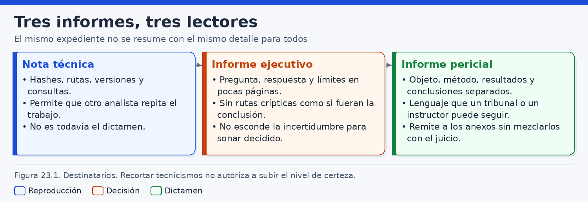
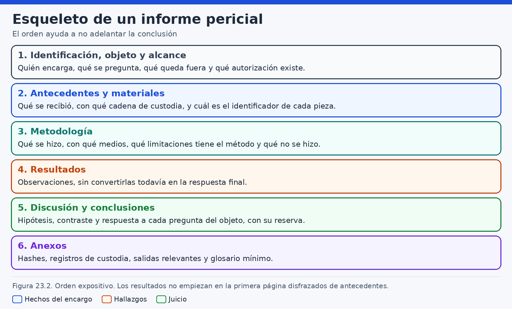
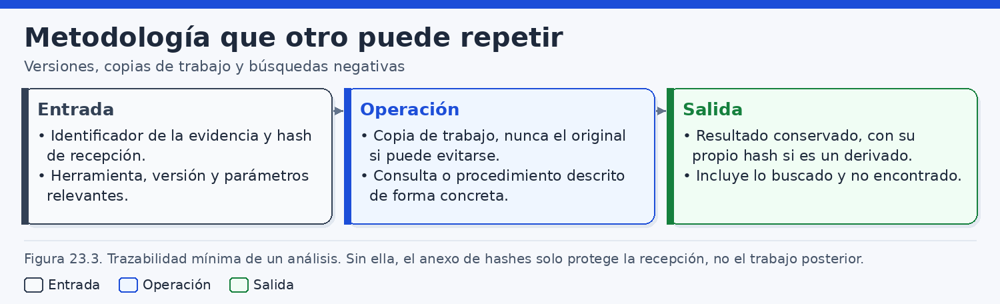
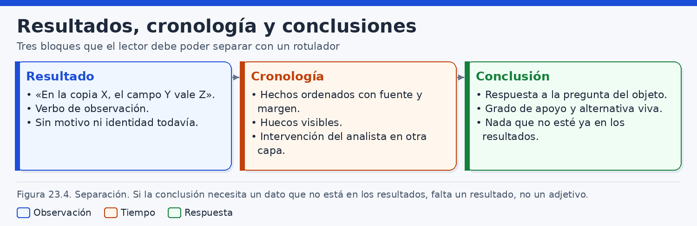
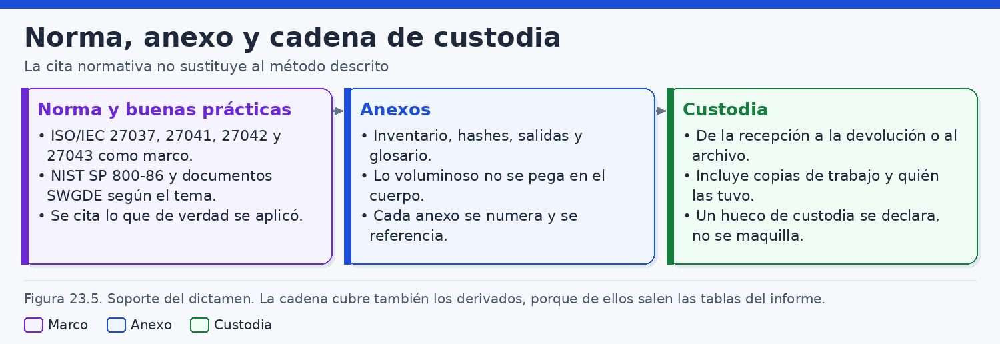
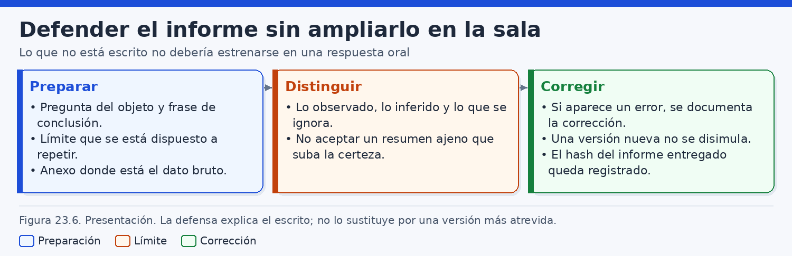

# Informes forenses y presentación de conclusiones

> *Un informe forense no aumenta la fuerza de la evidencia: la deja en el punto exacto en el que otra persona competente puede verla, compartirla o rechazarla.*

## Introducción

El análisis termina, para quien no estuvo en el laboratorio, cuando existe un documento. Las imágenes, los registros, las hojas de cálculo y las notas de trabajo pueden ser abundantes y, aun así, permanecer mudas para un juez, un abogado, un comité de dirección o un equipo de respuesta. El informe es el lugar donde el analista decide qué puede salir del laboratorio, con qué palabras y con qué techo de certeza. Esa decisión forma parte del método. Un examen cuidadoso se vuelve frágil si el texto mezcla lo observado con lo que alguien espera oír, y un texto prudente no compensa una adquisición mal descrita: solo puede contar, con precisión, hasta dónde llega lo que sí se hizo.

Este capítulo trata de esa escritura y de la presentación posterior. Distingue la nota técnica, el informe ejecutivo y el informe pericial, porque cada uno tiene un lector y un uso distintos. Recorre después el esqueleto de un informe que pueda defenderse: identificación, objeto, alcance, antecedentes, metodología, evidencias, resultados, cronología, conclusiones, normativa y anexos. La cadena de custodia no se detiene en el soporte original. Incluye las copias de trabajo, los subconjuntos filtrados, las capturas y el propio documento firmado. En la defensa oral, el perito explica lo escrito. Un hecho que no está en el informe no se estrena de palabra para cerrar un hueco incómodo.

A lo largo del libro se ha separado la **observación**, la **inferencia técnica** y la **hipótesis**. Esa separación tiene que sobrevivir a la redacción. Una observación describe un elemento situado: tal fichero, tal campo, tal marca, tal herramienta, tal copia. Una inferencia técnica aplica la semántica conocida de ese elemento y dice qué permite sostener. Una hipótesis propone una explicación que aún admite alternativas. El informe que colapsa los tres planos en una frase sobre la conducta de una persona aparenta una certeza que el laboratorio no obtuvo. El daño no es solo de estilo. Quien lee puede tomar una decisión —procesal, laboral, de contención— sobre un cimiento más alto que la evidencia.

Las normas técnicas ayudan a ordenar el trabajo y a explicarlo. ISO/IEC 27037, ISO/IEC 27041, ISO/IEC 27042, ISO/IEC 27043 y NIST SP 800-86 describen tramos distintos del proceso forense. Citarlas con provecho exige decir qué tramo aplicó este encargo. Invocar la familia entera, cuando solo se verificó una imagen ya entregada y se interpretaron dos artefactos, presenta como recorrido un proceso que no se ejecutó. Lo mismo ocurre con las guías de SWGDE y con los informes del programa de pruebas de herramientas CFTT: sirven para lo que de verdad se consultó y para la versión que de verdad se usó.

El capítulo evita el asesoramiento jurídico cerrado. El perito identifica la norma técnica aplicada al examen. El encuadre jurídico concreto —la forma del documento, su valor en el procedimiento, quién puede pedirlo o ampliarlo— depende del procedimiento y de quien dirige la causa. Un juzgado, un expediente laboral, un arbitraje o una investigación interna no imponen el mismo ritual. El analista debe reconocer ese límite y no rellenarlo con una receta legal propia.

El hilo de los ejemplos es un caso ficticio. Estudio Litoral, S. L., con dominio `litoral.example`, encarga saber si puede afirmarse que el fichero `proyectos/muelle-norte/contrato-muelle-norte.pdf` se copió desde el puesto `puesto-07.litoral.example` a un volumen externo en la noche del 12 al 13 de marzo de 2026. Los nombres, las cuentas y los identificadores son inventados. Las rutas de artefactos que se mencionan son habituales y deben comprobarse en la copia real de cada asunto. Las órdenes, cuando aparecen, se ejecutan en laboratorio sobre copias. No autorizan a intervenir sistemas ajenos.

## 1. Informes técnicos, ejecutivos y periciales

### 1.1. Tres documentos, tres usos

Un mismo examen puede producir tres documentos que se parecen y no sirven para lo mismo. La **nota técnica** guarda el taller para otro analista. El **informe ejecutivo** permite decidir una actuación con el techo de certeza ya fijado. El **informe pericial** responde a los extremos de un encargo y está escrito para leerse, y en su caso ratificarse, dentro de un procedimiento. Cambian el lector, el detalle y el daño que hace una frase ambigua.

El fallo habitual tiene dos direcciones. Entregar la nota de laboratorio a un consejo o a un juzgado deja rutas y dudas a medio resolver, y esconde la respuesta a las preguntas. Dejar que el resumen ejecutivo sustituya al pericial ahorra páginas y suele perder los huecos. La figura 23.1 ordena esa relación entre documento y lector.



Conviene acordar al inicio qué se va a emitir y quién lo recibe. Quien pide «algo breve para el lunes y el informe después» pide dos productos. El breve puede ser ejecutivo o una versión provisional del pericial, con fecha de corte y el mismo techo que el estado real del examen. Llamarlo informe definitivo, cuando faltan piezas anunciadas, traslada una clausura que el laboratorio no tiene.

| Documento | Lector principal | Qué debe poder hacer con el texto |
|---|---|---|
| Nota técnica | Otro analista del equipo | Repetir el examen, ver errores, versiones y preguntas abiertas |
| Informe ejecutivo | Quien debe decidir una actuación | Conocer qué puede afirmarse, qué no, y qué ampliación sigue abierta |
| Informe pericial | Quien valora la prueba en el cauce del procedimiento | Seguir extremos, método, resultados, huecos y anexos |

### 1.2. La nota técnica

La nota se identifica con el asunto, la fecha y la copia sobre la que se trabajó. Puede estar incompleta. En ella caben el nombre y la versión de la herramienta, los parámetros, los fallos, las rutas y las hipótesis que aún no deben subir al informe, incluidos los callejones: una consulta sin filas o una marca sin zona horaria. Ese material vale porque el pericial no puede arrastrar todo el taller.

En el caso ficticio de Estudio Litoral, la nota NT-LD-041 podría decir: «Sobre COPIA-LD-07, el analizador de dispositivos, en la versión anotada aquí, muestra una entrada con la serie LIT00981 a las 22:41:19 del 12 de marzo de 2026, según el reloj del puesto. Pendiente del pericial: dejar claro que esa entrada no registra la escritura del PDF. El inicio de sesión se queda en esta nota, como contexto, salvo que un extremo lo pida». El párrafo sirve al revisor. Como único texto de un pericial mezclaría un encargo de redacción con un hallazgo y adelantaría un hecho de sesión que quizá no deba promoverse.

La nota se conserva con el expediente y entra en la custodia cuando contiene extracciones o listas. No se envía al destinatario del pericial salvo que el encargo o quien dirige el procedimiento lo pida. Si se envía, se envía como material de trabajo.

### 1.3. El informe ejecutivo

El ejecutivo cabe en pocas páginas. Dice qué se preguntó, qué evidencias hubo, qué puede afirmarse, qué no puede afirmarse y qué decisión de alcance sigue abierta. Herramientas, listados y cadena de custodia se remiten al pericial con identificadores.

En Litoral, el ejecutivo diría en sustancia: hay una lectura del fichero asociada a la cuenta `m.salinas` y al puesto `puesto-07` a las 22:14, hora de Madrid, en una exportación entregada por el administrador; hay un volumen externo registrado en el puesto a las 22:41; lo examinado no contiene una escritura de ese fichero en el volumen; el volumen no se entregó. Pedirlo sería una ampliación. El detalle está en INF-LD-2026-041.

Ese texto ya permite decidir. No debe aconsejar, con apariencia de hallazgo, un despido o una querella. Esas frases cambian de plano y corresponden a otros profesionales, en el procedimiento que les sea propio. El ejecutivo puede describir consecuencias operativas que estén en su encargo —la cuenta sigue activa, la retención del servidor no la comprobó este gabinete— y separarlas de las conclusiones técnicas.

Cada frase del ejecutivo que describa un hecho señala un resultado del pericial. Si el resumen necesita una oración que el informe largo no sostiene, sobra la oración. Un ejecutivo anterior al cierre se marca como provisional y repite la fecha de corte.

### 1.4. El informe pericial

El pericial identifica a quien lo emite, el objeto, el alcance, los antecedentes, el método, las evidencias, los resultados, la cronología, las conclusiones y la normativa técnica aplicada. Los anexos sostienen el cuerpo: inventarios, resúmenes, extractos y cadena de custodia, incluidos los derivados. La claridad consiste en que un lector competente distinga lo observado de lo que se propone como explicación.

El perito no decide la culpa, la sanción ni la validez procesal de la prueba. Si el encargo pregunta «¿quién se llevó el contrato?», el informe lo traduce a extremos que la evidencia pueda abordar y declara qué parte queda fuera del alcance técnico. Hacer esa traducción al principio evita que la conclusión parezca contestar a la versión amplia de la pregunta.

El documento puede llamarse informe, dictamen o pericia, según el cauce. Este capítulo usa «informe pericial» para el género técnico. La forma, el momento de la ratificación y los requisitos de nombramiento dependen del procedimiento y de quien dirige la causa. El perito se informa de ese cauce con quien corresponda. No lo sustituye por una plantilla universal. El ejemplo de la sección 8 no añade certeza a la nota ni al ejecutivo: los ordena. Donde la nota decía «pendiente», el pericial cierra solo dos resultados y un hueco.

### 1.5. Un solo techo, y versiones que se puedan reconocer

Los tres documentos, si hablan del mismo hecho, comparten techo. La nota puede estar más abajo, porque aún duda. El ejecutivo puede omitir peldaños. Ninguno se sitúa por encima de los resultados. Conviene escribir las conclusiones del pericial antes del ejecutivo, y revisar la nota para que una hipótesis abierta no aparezca en un título fácil de copiar. «Entrada de dispositivo LIT00981» viaja mejor que «USB de la extracción». El orden inverso —redactar primero el verbo que la reunión necesita— es el modo en que la certeza sube sin evidencia nueva.

Un informe provisional se rotula como tal, lleva fecha de corte y dice qué cambiaría si llegara una pieza anunciada. El complementario declara qué versión sustituye y conserva la anterior. La ratificación, cuando el procedimiento la prevea, se refiere a una versión identificada. Un dato nuevo entra por complemento escrito, según disponga quien dirige la causa.

## 2. Identificación, objeto, alcance y antecedentes

### 2.1. Identificación del documento y de quien lo firma

El informe empieza por decir qué documento es. En la primera página constan el título, el identificador, la versión, la fecha de emisión, la fecha de corte, quien lo emite y el solicitante. La identificación profesional incluye la cualificación con la que se interviene y la relación con las partes, en los términos que el procedimiento exija: si el perito intervino antes, si depende del solicitante o si no concurre ninguna de esas circunstancias. Este capítulo no fija el formulario administrativo. Fija el contenido: el lector debe saber desde qué posición se escribe.

El fichero entregado también se identifica. Un PDF y un editable son dos objetos si sus bytes difieren. El ejemplar emitido lleva nombre y resumen criptográfico en el cuerpo o en el primer anexo. Las correcciones producen otro resumen. Parece un formalismo hasta que circulan dos PDF y alguien cita el párrafo que solo está en uno.

En el caso ficticio, el documento es INF-LD-2026-041, versión 1.0, fecha de corte el 20 de marzo de 2026 a las 18:00, hora peninsular. Lo emite Inés Calvo Ferreiro, del Gabinete Meridiano. El solicitante es Estudio Litoral, S. L. Esos datos van antes que el relato de la noche del contrato. Si el relato ocupara la portada, el lector lo recordaría y trataría el resto como confirmación.

### 2.2. El objeto son preguntas

El objeto son las preguntas que el encargo autoriza a contestar, redactadas de forma que al final se sepa si quedaron respondidas, respondidas en parte o abiertas. «Averiguar qué pasó con el contrato» admite casi cualquier búsqueda. Un objeto operable separa:

- P1. ¿La exportación examinada asocia la cuenta `m.salinas` y el puesto `puesto-07` a una lectura de `proyectos/muelle-norte/contrato-muelle-norte.pdf` dentro de la ventana?
- P2. ¿La imagen del puesto registra, dentro de la ventana, la conexión de un volumen externo, y con qué identificador?
- P3. ¿Esas evidencias permiten afirmar que el fichero se escribió en ese volumen?

La tercera pregunta anticipa el límite. Quien encargó el trabajo quizá preguntara «¿se lo llevó en un USB?». El perito recoge esa formulación entre los antecedentes y escribe, como objeto, las preguntas que el material permite abordar. La ventana va de las 18:00 del 12 de marzo de 2026 a las 08:00 del 13, hora de Madrid. «Afirmar la escritura» exigirá una observación de esa escritura en una evidencia del alcance, no la vecindad entre una lectura y una conexión.

La intención de una persona, la calificación jurídica y el contenido de una negociación se nombran como no incluidas cuando el solicitante las haya pronunciado. Si más adelante una autoridad las incorpora, el objeto se amplía por escrito.

### 2.3. Alcance: lo incluido y lo excluido

El alcance concreta fuentes, periodo y operaciones. En Litoral hay dos piezas: la imagen ADQ-LD-07 del volumen de sistema de `puesto-07`, entregada el 14 de marzo de 2026, y la exportación LOG-LD-07 de la auditoría de `archivo-01.litoral.example`, entregada el 15 de marzo por el administrador del solicitante. Las operaciones son verificar la integridad de lo recibido, examinar las copias y buscar dentro de la cuenta, la ruta y la ventana.

Lo excluido se escribe con el mismo cuidado: el volumen externo, el servidor en vivo, el correo, la nube, el teléfono y las entrevistas. Un lector que no vea esa lista puede interpretar el silencio sobre el correo como un examen de correo con resultado vacío. La frase ajustada es que el correo no se examinó.

El alcance dice también qué hizo un tercero. El gabinete puede verificar el resumen de lo entregado y examinar el contenido. No puede narrar la recogida en la escena como propia. Si el acta la describe, se cita como documento recibido. Un cambio de alcance —una referencia a un buzón, por ejemplo— autoriza a describir la referencia y a preguntar si el encargo crece. No autoriza a abrir el buzón. La pregunta y la respuesta forman parte del expediente.

### 2.4. Antecedentes que no se adoptan como hechos

Los antecedentes resumen el encargo, el relato, las actas y las explicaciones ajenas. Sirven para entender por qué se formularon esas preguntas. No se convierten en hechos del perito por estar al principio.

El relato recibido es: «Alguien se llevó el contrato en un USB la noche antes de la reunión». Se transcribe como relato. Al lado, el informe adopta solo lo que consta en documentos de encargo y entrega. La organización atribuye la cuenta `m.salinas` a una trabajadora llamada M. Salinas: eso permanece en antecedentes. Los resultados hablarán de la cuenta. Si el administrador explica que el campo `read` significa una lectura aceptada del objeto, la explicación se etiqueta como recibida. El método dirá si pudo contrastarse con documentación del producto.

Cada antecedente cita su documento. «Según el correo de encargo del 13 de marzo» es revisable. Si los antecedentes dan la sustracción por hecha, las conclusiones parecen un trámite.

### 2.5. El orden del esqueleto

Cada bloque prepara el siguiente. La identificación sitúa la versión. El objeto fija las preguntas. El alcance dice con qué material se contestan. Los antecedentes separan el relato. El método y las evidencias permiten entender de dónde saldrá cada resultado. Los resultados describen observaciones. La cronología las ordena y deja ver los huecos. Las conclusiones responden sin subir de plano. La normativa dice qué pautas se aplicaron. Los anexos y la custodia permiten comprobarlo. La figura 23.2 muestra ese recorrido.



Un recuadro inicial de «extracción acreditada» deshace el esqueleto: mucha gente lee solo el recuadro. Un resumen de apertura es aceptable si usa el techo de las conclusiones y remite a identificadores. Si una plantilla trae «hechos probados», el perito propone «hechos observados en las evidencias» cuando el cauce lo permita. En asuntos largos, el cuerpo cita el anexo y no duplica el listado.

## 3. Metodología y evidencias analizadas

### 3.1. A qué altura se cuenta el método

El método del pericial explica cómo se pasó de las preguntas a los resultados, con el detalle justo para que otra persona competente valore si el camino era apto. El manual de la herramienta y la transcripción de cada paso viven en la nota. En el pericial constan las operaciones, las copias, las conversiones de tiempo, los criterios de búsqueda y las comprobaciones.

En Litoral el método cabe en pocas decisiones. Se calculó el SHA-256 de la imagen y se comparó con el acta. Se trabajó sobre COPIA-LD-07 sin modificar lo recibido. Las marcas etiquetadas como UTC se convirtieron a hora de Madrid sumando una hora, porque el 12 y el 13 de marzo de 2026 la hora oficial peninsular era CET (UTC+1): el cambio de primavera cae ese año el 29 de marzo. Las marcas sin zona no se convierten. La búsqueda se limitó a la cuenta, a la ruta y a la ventana. El artefacto de dispositivos se describe por la ruta hallada en esa copia, sin presentarla como la única posible en cualquier Windows.

Esa altura permite discrepar: la conversión puede estar mal, el campo `read` puede no significar lo que dijo el administrador, la búsqueda puede haber dejado fuera un artefacto que sí estaba en el alcance. «Se analizó con herramientas forenses homologadas», sin nombre, versión y función, no informa. El método también escribe lo que se decidió no hacer cuando eso condiciona una conclusión. No abrir el volumen es una decisión de alcance. No traducir `read` como copia es una decisión de semántica.

### 3.2. Inventario de evidencias

Cada pieza lleva identificador, descripción, procedencia, fecha de recepción y resumen. El inventario distingue lo recibido, la copia de trabajo y los derivados. ADQ-LD-07 es la imagen. COPIA-LD-07 es la copia de examen. LOG-LD-07 es el export íntegro. DER-LD-07-FILTRO es el subconjunto de la cuenta y la ventana: otro fichero, otro resumen, con el criterio escrito al lado.

Sin inventario, «el log del servidor» puede ser el export, una hoja filtrada o una captura. La cita de un resultado señala pieza, localización y, si existe, el derivado del que se aisló el extracto. Una imagen de un volumen no es el puesto entero si había otros discos. Un CSV no es la auditoría completa: es el resultado de una consulta ajena, con sus filtros y sus columnas. En este export ficticio la cabecera trae `id`, `utc_time`, `account`, `host`, `action`, `path` y `result`. Esos nombres son de este fichero. En un caso real se leen de la cabecera recibida.

### 3.3. Herramientas, versiones y comprobaciones

Las herramientas se describen por nombre, versión y función. Las versiones cambian campos, zonas horarias y lo que un recuperador presenta como hallado. La nota puede añadir la orden, el puesto de análisis y el resumen del binario. Sobre copias de laboratorio, y nunca sobre un original ajeno, dos objetos distintos dejan dos resúmenes:

```bash
# Laboratorio. El export recibido y el subconjunto filtrado no comparten resumen.
sha256sum /caso/LD-041/recibido/LOG-LD-07.csv
sha256sum /caso/LD-041/derivados/DER-LD-07-FILTRO.csv
```

El segundo resumen documenta otro fichero. El criterio —cuenta `m.salinas` y ventana encargada— se escribe junto a él. Quien reciba solo el filtro no puede saber si la ausencia de escrituras estaba en el export o en el corte.

La confianza se apoya en comprobaciones. El programa CFTT del NIST publica pruebas para funciones y condiciones determinadas. Si existe una prueba de la misma familia, función y versión, se anota; una prueba sobre otra versión no valida la del caso. Si no la hay, el gabinete puede archivar una comprobación propia con material conocido —en Litoral, VAL-LD-07— que muestra lo que el procedimiento ve en esas condiciones, no en cualquier sistema. Un fallo de herramienta que obligue a repetir el examen con otra se escribe: ocultarlo deja sin explicación dos derivados.

### 3.4. La matriz de trazabilidad

La trazabilidad mínima une pregunta, evidencia, operación, resultado y conclusión. Impide conclusiones huérfanas y resultados que no responden a ningún extremo. La figura 23.3 recoge ese encadenamiento.



| Extremo | Evidencia | Operación | Resultado | Qué puede decir la conclusión |
|---|---|---|---|---|
| P1, lectura | LOG-LD-07 | Lectura del registro `id` 88421 y conversión UTC | R1 | El export asocia cuenta, puesto y lectura en ese instante |
| P2, volumen | ADQ-LD-07, vía COPIA-LD-07 | Examen del artefacto de dispositivos | R2 | Quedó registrada la conexión de un identificador, según el reloj del puesto |
| P3, escritura | Ambas, dentro del alcance | Búsqueda de una escritura del fichero en el volumen | Hueco | No hay base para afirmar la escritura ni para negarla de modo absoluto |

La última fila es parte de la matriz. El revisor, antes de emitir, comprueba que cada frase de las conclusiones señala una celda. Si no señala ninguna, se borra o baja a hipótesis. Una exploración que no alimenta ninguna pregunta puede vivir en la nota. Subirla al pericial ensancha el objeto sin decirlo.

### 3.5. Desviaciones y lo no examinado

Una desviación es una diferencia entre el plan y lo ocurrido: el export llegó tarde, el acta no traía resumen, una clave no pudo leerse. Se describe con su efecto. «La imagen llegó sin resumen previo» importa porque la integridad se ancla en el cálculo de la recepción, no en una comparación con origen.

Lo no examinado repite las exclusiones cuando el lector ya ha visto el método. Es el lugar para decir que no se tuvo el volumen LIT00981, que no se contrastó el reloj de `archivo-01` con una fuente externa y que la semántica de `read` descansa en la cabecera y en la explicación del administrador. Son condiciones de lectura de R1 y R2.

> **Principio de redacción:** cada frase de una conclusión señala el resultado que la sostiene, la evidencia de la que sale y el hueco que deja abierto.

Quien revisa busca identificadores. Donde no hay identificador, hay una opinión que todavía no se ha ganado un sitio en el informe.

## 4. Resultados, cronología y conclusiones

### 4.1. El resultado nombra una observación situada

Un resultado es una observación que ya pasó por el método. Tiene identificador, evidencia, localización, contenido y límite inmediato. No califica la conducta de una persona ni usa el verbo del relato si ese verbo no está en la evidencia.

R1 puede leerse así: en LOG-LD-07, el registro `id` `88421` contiene `utc_time` `2026-03-12T21:14:07Z`, `account` `m.salinas`, `host` `puesto-07`, `action` `read`, `path` `proyectos/muelle-norte/contrato-muelle-norte.pdf` y `result` `success`. Convertida la marca, son las 22:14:07 del 12 de marzo de 2026 en Madrid. El perito observa esos campos en el fichero recibido. No observa el servidor en marcha ni a quién estaba ante el teclado.

R2: en COPIA-LD-07, en la ruta que el anexo transcribe, consta un identificador que incluye la serie `LIT00981`, con marca 22:41:19 según el reloj del puesto y la zona configurada, que en la imagen es la de Madrid. Esa lectura de configuración es otra observación, sujeta a que el reloj estuviera ajustado. R2 no dice que el fichero viajara al volumen.

Dos resultados bastan para este objeto. Añadir un tercero «de contexto» es la vía por la que un inicio de sesión o un correo no encargado entran en la cronología y, desde allí, en el relato oral. El contexto que no responde a un extremo se queda en la nota, con una frase de método que avisa de su existencia. R1 depende de un export ajeno. R2 depende de una imagen ajena examinada en el gabinete. Ese límite aparece al presentar cada pieza y queda disponible para la conclusión.

### 4.2. Inferencia técnica e hipótesis

La inferencia técnica aplica la semántica conocida del artefacto y se marca como tal. Si la explicación del administrador, identificada en antecedentes, indica que `read` con `success` registra una lectura aceptada, el informe puede decir eso. Se detiene donde se detiene la semántica. Una lectura en un servidor de ficheros puede corresponder, según el producto, a una apertura, a una vista previa o al origen de una copia. Sin la documentación de esa versión, el perito no traduce `read` a «copia local completada».

La hipótesis se presenta como hipótesis. En este asunto hay al menos tres, abiertas en paralelo:

- H1. El fichero se escribió en el volumen `LIT00981` en algún momento no observado de la ventana.
- H2. La lectura fue una consulta y el volumen se conectó por un motivo distinto, no visto en las evidencias.
- H3. El campo `read`, o el artefacto de dispositivo, no describen la operación que el relato supone.

No es obligatorio elegir una para «concluir algo útil». La utilidad está en decir cuál quedaría contrastada con qué diligencia: el volumen, si se autoriza, para H1 y H2; la documentación del producto y una comprobación del reloj, para H3. Ordenarlas por «la más probable» sin un modelo simula una precisión que el expediente no tiene. Un adverbio como «muy probablemente copió» es ese modelo, escondido. La experiencia del perito sirve para elegir método y para reconocer límites. No sustituye la observación que falta.

### 4.3. La cronología y el hueco

La cronología ordena resultados. No crea hechos ni rellena intervalos con el verbo del relato. Cada fila lleva la marca, el reloj de origen, la fuente y la observación. R1 viaja convertido desde UTC con una regla escrita. R2 viaja en la hora del puesto. La cronología lo muestra. El hueco es una fila, no un silencio entre dos líneas. Si desde las 22:41:19 hasta las 08:00 del 13 de marzo lo examinado no contiene una escritura del fichero en el volumen, esa ausencia de observación se escribe. La figura 23.4 separa resultados, cronología y conclusiones.



Un hueco afirma que, en las fuentes y operaciones del alcance, no hay una observación de un tipo concreto. No afirma que no ocurriera nada fuera de ese alcance. Un vacío en el export puede deberse al filtro de origen, a que el producto no registra escrituras, a la retención o a que no hubo escritura. Si el perito no puede distinguirlos, dice «no hay observación en el export examinado» y no diagnostica un motivo único.

La conexión de las 22:41 no es un evento de escritura del PDF. Colocarla en la cronología responde a P2. Etiquetarla «extracción del contrato» convierte la tabla en un argumento. Si dos relojes discrepan, se conservan las dos marcas. Elegir la fuente que produce la historia más coherente con el relato cierra el hueco por estética.

### 4.4. Redactar la conclusión

Las conclusiones responden al objeto, después de los resultados y de la cronología. Cada una cita los identificadores y el límite que el lector necesita para no agrandarla al citarla sola.

Sobre P1, a partir de R1: el export asocia la cuenta, el puesto y una lectura aceptada a las 22:14:07, hora de Madrid. La asociación es del registro. No identifica a una persona. Sobre P2, a partir de R2: la imagen registra a las 22:41:19 la conexión del identificador que incluye `LIT00981`. Sobre P3, a partir del hueco: no hay observación de escritura en lo examinado, el volumen no estaba en el alcance, y el informe no afirma ni la copia ni su inexistencia demostrada. H1, H2 y H3 siguen abiertas.

Ese tercer párrafo es una conclusión completa. La suma «lectura más dispositivo cercano, luego copia» no está en ninguna celda. Escribirla para que el informe «sirva» sube la certeza por encima de R1 y R2. Numerar las conclusiones como las preguntas permite que un complemento sustituya solo P3. Los adjetivos de certeza global —«sin género de duda», «queda acreditado el apoderamiento»— anticipan un estándar de prueba que corresponde al procedimiento y a quien dirige la causa. El perito aporta el material ordenado.

### 4.5. Ausencia, resultado negativo y límite

Tres formulaciones no se intercambian. La ausencia de observación dice que la búsqueda descrita no halló el elemento. El resultado negativo dice que un artefacto esperado, en un sistema cuya configuración se comprobó y que debería haberlo generado, no aparece. El límite de examen dice que la fuente donde el elemento podría estar no se examinó, no se conservaba o no era legible.

En Litoral, P3 es un límite unido a una ausencia dentro de lo mirado. No es un resultado negativo sobre el volumen, porque el volumen no se tuvo. «No consta la copia», como si se hubiera mirado el USB y estuviera vacío, sería falso. «No puede afirmarse la copia a partir de lo examinado» es ajustado.

### 4.6. Formulaciones que suben la certeza sin evidencia nueva

Conviene leer las frases como serán citadas, fuera del párrafo que las rodea.

| Formulación | En qué plano acaba | Qué ocurre |
|---|---|---|
| «A las 22:41 el usuario extrajo el contrato» | Conducta | Funde R2, una persona no observada y un verbo que no está en el artefacto |
| «La empleada M. Salinas leyó el fichero» | Identidad | Promueve a resultado la atribución de la cuenta hecha por el solicitante |
| «Se produjo una copia no autorizada» | Calificación | Añade un juicio de autorización ajeno al encargo técnico |
| «No se copió el fichero» | Negación excesiva | Transforma un hueco de alcance en prueba de inexistencia |
| «El export contiene un registro de lectura aceptada a esa hora» | Observación situada | Cabe, referida al fichero recibido y no a una inspección directa del servidor |

La última fila muestra que el estilo puede ser firme cuando un tercero puede abrir el fichero y encontrar el campo. En la revisión se subrayan los verbos de acción humana y se exige el resultado que los sostiene. Si el verbo solo vive en el relato, vuelve a los antecedentes.

## 5. Normativa aplicable y referencias

### 5.1. Norma aplicada y encuadre jurídico

El apartado de normativa dice qué pautas técnicas se usaron. Es una identificación, no un sello. El perito nombra la norma, la edición consultada y el tramo que este encargo aplicó. «Conforme a la normativa internacional vigente» no identifica nada. Tampoco identifica citar cuatro normas cuando solo se verificó una imagen ya entregada y se leyeron dos artefactos.

El encuadre jurídico va por otro carril. El valor del documento, su forma procesal, quién designa al perito, cómo se ratifica y qué ocurre con un hallazgo casual dependen del procedimiento y de quien dirige la causa. El perito no los cierra con una interpretación propia presentada como norma técnica. Puede decir que el informe se emite en el cauce indicado por el solicitante o por el órgano, y remitir la forma a ese cauce. Este capítulo no ofrece un modelo de dictamen «válido ante los tribunales españoles». Ofrece un modelo revisable, que después habrá que encajar donde corresponda.

La ficha vigente de una norma ISO se comprueba en el portal de ISO, porque las ediciones se confirman, se revisan o se retiran. El informe anota la edición manejada y la fecha de consulta. No copia el texto de la norma.

### 5.2. ISO/IEC 27037, 27041, 27042 y 27043

Estas cuatro normas se citan a menudo juntas y cubren trabajos distintos.

**ISO/IEC 27037** orienta la identificación, la recogida, la adquisición y la preservación. Cabe citarla por la preservación cuando el perito recibe una imagen, verifica su resumen, custodia la copia y trabaja sin alterar lo recibido. Cabe citarla por la recogida cuando el perito hizo esa actividad y la documentó. En Litoral, el gabinete no adquirió el puesto. Citar 27037 en bloque atribuiría una recogida que, como mucho, consta en un acta ajena. Lo ajustado es el tramo de preservación e integridad. El acta del tercero se cita como acta, no se absorbe la norma.

**ISO/IEC 27041** orienta sobre la idoneidad y la adecuación del método a las preguntas. Aplicarla aquí significa dejar escrito por qué el método puede contestar a P1, P2 y P3, qué no puede contestar, y qué comprobación se hizo de la herramienta. No certifica el sistema de investigación de la empresa ni «la ciencia forense» en abstracto. Si esa idoneidad no se documentó, no hay nada que citar: conocer el número no aplica la norma.

**ISO/IEC 27042** trata el análisis y la interpretación. Es la referencia cuando el informe separa examen, resultados e interpretación, y escribe limitaciones. Citarla obliga a que esa separación exista. No cubre, por estar en la bibliografía, las técnicas de la norma que este asunto no usó.

**ISO/IEC 27043** presenta principios y procesos de la investigación de incidentes, incluida la preparación y la respuesta. Solo se cita en los tramos recorridos. Un gabinete que entra con la imagen ya hecha no aplica el modelo entero. Puede haber leído la norma para no desbordar su papel. Esa lectura no se declara como aplicación. El informe puede decir expresamente que 27043 no se cita como aplicada porque la preparación y la respuesta inicial quedaron fuera.

Las cuatro pueden aparecer en el mismo apartado si cada una lleva su tramo. La lista desnuda de números demuestra, sobre todo, que la bibliografía se copió de otro asunto.

### 5.3. NIST SP 800-86

NIST SP 800-86, *Guide to Integrating Forensic Techniques into Incident Response*, distingue recogida, examen, análisis e información de resultados. Es una referencia metodológica de 2006: no describe el comportamiento actual de una herramienta ni sustituye a normas posteriores. Se cita por las actividades realizadas.

En un examen de evidencias ya entregadas, lo citable suele ser examen, análisis e informe. La recogida no se cita como trabajo del perito si la hizo otra persona. El informe puede decir que las cautelas de recogida de la guía no fueron aplicadas por este gabinete, sin calificar por ello la actuación ajena. Calificarla exigiría haberla visto o disponer de documentación suficiente, y el juicio se limitaría a lo documentado.

SP 800-86 no convierte el pericial en un informe de respuesta a incidentes. Contención o lecciones aprendidas, si el perito no las ejecutó, no las firma; como mucho constan como antecedentes. Cuando el documento pedido sea el de la gestión del incidente, la referencia puede ser NIST SP 800-61 Rev. 2. Hechos y recomendaciones, si el encargo pide ambos, van en secciones distintas.

### 5.4. SWGDE, CFTT y las referencias del caso

SWGDE publica documentos de buenas prácticas sobre evidencia digital, cada uno con su versión, reunidos en su portal. Citar «SWGDE» a secas equivale a citar «la bibliografía». El informe nombra el documento consultado y la finalidad —por ejemplo, contrastar qué elementos de custodia convenía incluir— y no afirma conformidad con la colección entera. Si ningún documento concreto se aplicó, SWGDE no entra en la normativa del caso, aunque este libro lo recomiende como lectura.

El CFTT entra cuando se consultó una prueba pública para una función y una versión, o cuando hace falta explicar ese límite. «Herramienta certificada por NIST» es una fórmula que conviene retirar: el programa publica resultados de pruebas, y el salto a otra versión no es automático. La comprobación interna, con su identificador, puede ser la referencia principal del encargo, descrita como tal.

El resto de referencias del caso son las fuentes de semántica realmente usadas, por ejemplo la nota del administrador sobre un campo. La sección 8 cita los tramos de 27037, 27041, 27042 y SP 800-86 que ese encargo aplica, dice que 27043 no se cita como aplicada y no cita SP 800-201, porque no hubo nube. Explicar aquí esa guía no autoriza a copiarla dentro del dictamen.

## 6. Anexos, documentación y cadena de custodia

### 6.1. Cuerpo, anexo y nota de laboratorio

El cuerpo convence por el hilo. Los anexos permiten comprobarlo. La nota conserva lo que hace falta para repetir el examen y no para esa comprobación. Al cuerpo va la observación, el identificador, el límite y la respuesta. Al anexo, el extracto, la tabla de resúmenes, el acta, la matriz si no está arriba y la custodia. A la nota, las salidas completas, los ensayos fallidos y las hipótesis a medias.

Cada anexo se numera y se cita desde el cuerpo. Un anexo sin cita sobra o esconde un hecho que el cuerpo olvidó. Los anexos no estrenan un resultado que el cuerpo calle. Si un extracto muestra otra cuenta u otra hora, el cuerpo decide si eso es resultado, antecedente o dato fuera de alcance. La figura 23.5 reúne los tres apoyos de una comprobación: la norma que se dice aplicada, el anexo del extracto y la custodia que une el extracto con la pieza.



Junto a la salida nativa de una herramienta, cuando el destinatario no pueda abrirla, se entrega una representación en texto que conserve los campos citados. Esa representación es un derivado, con su resumen, y no sustituye a la pieza. El informe dice cuál de las dos es la evidencia.

### 6.2. Qué acredita un resumen criptográfico

SHA-256 identifica unos bytes. Permite comprobar que el fichero de hoy es el recibido, o que la copia de trabajo no se apartó de la imagen en los bytes cubiertos. No acredita que el contenido sea verdadero, que la adquisición fuera completa ni que el relato sea correcto. Un export mal filtrado en origen puede tener un resumen perfecto y un alcance pobre. El informe no dice «resumen verificado, luego el registro es fiable». Dice si el valor coincide con el acta o si se calculó en la recepción porque no había valor previo.

El resumen de un contenedor no es el del volumen reensamblado, si son distintos. El de un CSV no es el de una hoja que reordenó columnas. Cada fila de la tabla indica identificador, algoritmo, valor, fecha y sobre qué bytes se calculó. En este capítulo los valores del caso se abrevian y son ficticios. En un informe real van completos.

El PDF emitido lleva su propio resumen, en el acta de emisión o por un canal distinto del envío. Quien dirige la causa dirá si además hace falta una firma determinada. El perito cumple ese cauce y conserva la identidad técnica del fichero.

### 6.3. Cadena de custodia de los derivados

La cadena registra quién tuvo la evidencia, cuándo y para qué, desde la recepción —o desde la adquisición, si la hizo el mismo equipo— hasta la conservación posterior. Una cadena que solo sigue el disco original deja sin historia los objetos que el informe cita. Los derivados entran en la misma disciplina.

Un derivado es cualquier objeto nuevo: copia de trabajo, filtro, colmena extraída, cronología volcada a una hoja, captura, traducción, PDF del informe. Lleva el vínculo con el padre y su propio resumen. DER-LD-07-CAP, la captura de la clave donde aparece `LIT00981`, muestra lo que el analista encuadró. Puede recortar contexto. Por eso R2 cita la ruta en la copia y ofrece la captura como ayuda. La custodia de la captura anota la sesión, la herramienta y la pieza madre.

El filtro es el derivado que más se escapa. Si se extravía LOG-LD-07, nadie puede comprobar si la ausencia de escrituras estaba en el export o en el criterio. «Filtrado relevante» no es verificable. «Filas con `account` igual a `m.salinas` y marca dentro de la ventana del método» sí lo es. La hoja donde se ordenó la cronología puede introducir un error de orden o una zona de la aplicación ofimática. La cronología del informe se contrasta con los campos de origen. La hoja se archiva con su resumen.

El informe y sus versiones son derivados del expediente. La cadena lista INF-LD-2026-041 versión 1.0, su resumen, la fecha y el destinatario. Una versión 1.1 entra como objeto nuevo que sustituye párrafos concretos. Entregar el filtro llamándolo «el log del servidor» rompe la cadena en la puerta de salida, aunque los resúmenes internos estén bien.

### 6.4. Cuando el anexo es de nube

Algunos encargos incluyen exportaciones de un proveedor. El perito casi nunca observa el servicio: observa un fichero que alguien generó. El anexo identifica el servicio tal como conste, la cuenta o el arrendatario si aparece, la identidad usada, el intervalo, los filtros, el formato y las advertencias del propio fichero. No se inventan campos. No se supone una retención de un número de días que el caso no fija.

NIST IR 8006 reunió retos del análisis forense en la nube: el informe habla de 62 retos en nueve categorías, entre ellas arquitectura, recogida, análisis, roles, normas y formación. Este capítulo no reproduce el catálogo. Si el encargo tropieza con un reto, el anexo lo describe en concreto. Por ejemplo: la exportación la generó un rol de administración y el perito no pudo comprobar si ese rol veía todos los tipos de evento, o los eventos de acceso a datos no venían en el fichero y no se afirma que estuvieran activados.

NIST SP 800-201, de julio de 2024, es la arquitectura de referencia para esa preparación y se apoya en los retos de IR 8006. Se cita cuando el encargo incluye la preparación o cuando el anexo explica qué habría permitido conservar una fuente ya perdida. Citarla en un examen como el de Litoral, limitado a un puesto y a un servidor de ficheros, ampliaría el encargo. Si no quedó fichero de la consola, no hay anexo de contenido: hay una diligencia con hora e identidad. La hoja filtrada, la captura y el CSV original siguen siendo objetos distintos.

### 6.5. Confidencialidad al entregar

Los anexos concentran dato personal y material que no responde al objeto. Entregar la imagen entera en un enlace amplio invierte la minimización que el cuerpo ya fijó. Cuando el procedimiento exija depositar la imagen en una sede, se hace por ese cauce, y el informe dice dónde queda y quién puede autorizar un acceso nuevo. Las capturas se tratan para no mostrar a terceros irrelevantes, siempre que el recorte no altere el campo citado. El recorte es un derivado y se declara. Si pudiera leerse como una ocultación, la captura íntegra permanece en el gabinete, bajo el acceso del encargo.

La nota, con sus hipótesis abiertas, no acompaña al ejemplar de amplia circulación salvo petición de quien dirige el procedimiento. Conservarla en el gabinete, y no difundirla, evita que una hipótesis abandonada se lea en la sala como si fuera un resultado.

## 7. Presentación y defensa de un informe pericial

### 7.1. La exposición sale del texto

Cuando el informe se explica en voz alta —una ratificación, una reunión con el solicitante, una sesión entre peritos—, el recorrido sigue el documento. Se comprueba que la sala tiene la versión que se va a defender. Se leen las preguntas, el alcance, dos o tres resultados por su identificador, el hueco y las conclusiones tal como están escritas. Las diapositivas, si se usan, son citas. Una diapositiva que resume R1 con otras palabras será lo que se discuta, y esa diapositiva no tiene custodia. La figura 23.6 fija el criterio: defender es recorrer lo escrito, sin ampliarlo de palabra.



Conviene ensayar las preguntas incómodas y corregir antes de la sesión cualquier párrafo que, leído en voz alta, suene más alto que la matriz. El perito lleva el informe. Una hora dicha de memoria, distinta de la escrita, abre una contradicción innecesaria.

### 7.2. Hechos que no están escritos

En la defensa no se estrenan hechos que no estén en la versión ratificada. La regla cubre el recuerdo tardío, el detalle que vive solo en la nota y la hipótesis dicha con tono de resultado. Si el hecho importa, entra por un complemento, con evidencia, método y sitio en la matriz. Quien dirige la causa decide si se admite. El perito no lo adelanta de palabra para no dejar la sala en silencio.

En Litoral, la nota describe artefactos de inicio de sesión anteriores a la lectura. El pericial no los eleva a resultado. La pregunta «¿a qué hora inició sesión M. Salinas?» recibe una respuesta contenida: el informe no fija esa hora ni identifica a una persona ante el equipo; la nota recoge un contexto que no forma parte de las conclusiones; si debe pasar al informe, se escribirá, previa la ampliación que corresponda. Enunciar la hora, aunque conste en la nota, la convierte en testimonio nuevo respecto del documento ratificado.

Lo mismo vale para un segundo dispositivo visto y no citado. «Eso no está en el informe» es una respuesta completa. El temor a parecer evasivo empuja a completar, y el completado es el estreno del hecho. Hay un matiz que no rompe la regla: rehacer en la sala una conversión cuyos números y cuya regla ya están escritos no añade un hecho. Aplica el método. Si al hacerlo aparece un error, se reconoce y, si cambia algo citable, se corrige por escrito.

### 7.3. Preguntas que piden más certeza

Buena parte de las preguntas buscan subir un peldaño. «¿Fue ella?» pide pasar de la cuenta a la persona. «¿Entonces lo copió en esos minutos?» pide pasar del hueco a H1. «Con su experiencia, ¿lo daría por seguro?» pide sustituir la observación ausente por la biografía del perito. A la primera se responde que el informe asocia una cuenta, en un export, a una lectura, y que la atribución a una persona está en los antecedentes. A la segunda, que la escritura no está observada y que H1 sigue abierta junto a H2 y H3. A la tercera, que la experiencia se usó para el método y los límites, que están descritos, y no aporta una observación de este puesto.

Tampoco se contesta un porcentaje con otro más bajo. El informe no asigna probabilidades numéricas porque no hay un modelo que las produzca. «Un treinta por ciento», dicho para parecer prudente, quedaría en el acta tan infundado como un setenta. Si alguien resume «usted concluye que no hubo copia», se corrige la cita: P3 dice que no puede afirmarse la escritura a partir de lo examinado y que el volumen no se examinó. Corregir una cita excesiva, al alza o a la baja, es parte de la defensa.

### 7.4. Errores y aclaraciones

Negar un error ya visto daña más que el error. Si es una errata que el propio texto permite resolver —un identificador mal copiado que el anexo repite bien—, se señalan los dos lugares y, si la errata puede citarse sola, conviene un complemento breve. Si el error cambia una marca o una conclusión, la corrección se escribe. En la sala no se arregla una zona horaria dudosa con un recuerdo de «cómo suelen venir» los export de un producto. O la regla está en el método y se aplica, o hace falta un trabajo nuevo sobre la cabecera, y ese trabajo se documenta.

Las aclaraciones que no añaden hechos sí caben: qué es un SHA-256, qué diferencia la imagen del filtro, por qué un hueco no es una prueba de inexistencia. La aclaración cita el apartado. Un ejemplo de otro asunto se marca como ejemplo y no se mezcla con Litoral. Si la otra parte aporta el volumen en la mesa, el perito no lo incorpora desde la mano. Lo identifica como material nuevo y reserva la valoración a un complemento con custodia. Opinar sin examen produce una frase que el acta atribuirá al perito y que no tiene método.

### 7.5. Distintas salas, el mismo informe

Cambia el vocabulario. No cambia el techo. En una junta, la presión es subir la certeza porque se pide una recomendación y no un identificador. El perito puede recomendar una actuación que esté en su encargo —preservar el volumen, no reutilizar el puesto— y mantener P3 en su sitio. «Yo actuaría como si la copia hubiera ocurrido» solo podría decirse etiquetada como gestión de riesgo, y aun así arrastra un malentendido. Mejor: la copia no está observada; el riesgo de que H1 sea cierta no está cerrado; la diligencia que lo contrastaría es examinar el volumen, si se autoriza.

En la ratificación, el perito confirma que el documento es suyo y que las conclusiones son las escritas. Las formas de ese acto dependen del procedimiento y de quien dirige la causa. No se usan como excusa para tapar el hueco con un relato continuo, más fácil de escuchar y peor de defender cuando el acta recoja el relato y no la tabla. Al terminar, el gabinete archiva qué versión se defendió, ante quién, y si quedó comprometido un complemento. La defensa pasa a ser antecedente de la versión siguiente, no un expediente oral paralelo.

## 8. Ejemplo completo comentado

### 8.1. Cómo leer el ejemplo

Lo que sigue es un informe pericial breve, ficticio, del asunto Estudio Litoral. No es una plantilla para copiar en cualquier procedimiento. Muestra el tamaño de las frases cuando el encargo se mantiene en tres preguntas, dos piezas y un hueco. Después de cada bloque, un párrafo en cursiva, al margen del texto del informe, explica por qué el bloque ocupa ese lugar y qué se perdería si se moviera o si se le añadiera certeza.

El informe cita solo los tramos de norma que este encargo aplicó. La cadena de custodia del anexo incluye los derivados, no solo la imagen. Los nombres de personas, el dominio `litoral.example`, los identificadores y los resúmenes abreviados son inventados. Las rutas de registro que el caso sitúa en la imagen son del tipo que suele encontrarse en equipos Windows y deben comprobarse en cada copia; aquí se dan por halladas en la imagen ficticia, no por universales.

### 8.2. Identificación

> **INF-LD-2026-041, versión 1.0.** Informe pericial sobre el examen de la imagen ADQ-LD-07 y de la exportación LOG-LD-07. Fecha de emisión y fecha de corte: 20 de marzo de 2026, 18:00, hora oficial de la España peninsular. Emite Inés Calvo Ferreiro, Gabinete Meridiano, a solicitud de Estudio Litoral, S. L. La cualificación profesional y la declaración de relación con las partes figurarían en el anexo A; en este ejemplo didáctico se omiten. Quien suscribe no depende orgánicamente del solicitante. El fichero emitido se identifica en el anexo de custodia con su resumen SHA-256. Este texto es la versión 1.0 y no sustituye a ningún informe anterior.

*Al margen.* La identificación va primero para fijar la versión y la fecha de corte. Un correo del 21 de marzo no puede leerse como si ya estuviera valorado. Los datos profesionales van al anexo A. El relato del USB, si abriera el documento, haría de portada y de conclusión anticipada.

### 8.3. Objeto

> El encargo escrito ENC-LD-041 pide determinar si puede afirmarse que el fichero `proyectos/muelle-norte/contrato-muelle-norte.pdf`, residente en el servidor `archivo-01.litoral.example`, fue copiado desde el puesto `puesto-07.litoral.example` a un volumen de almacenamiento externo entre las 18:00 del 12 de marzo de 2026 y las 08:00 del 13 de marzo de 2026, hora de Madrid.
>
> El objeto técnico de este informe son tres preguntas:
>
> P1. ¿La exportación examinada asocia la cuenta `m.salinas` y el puesto `puesto-07` a una lectura de ese fichero dentro de la ventana?
>
> P2. ¿La imagen examinada del puesto registra, dentro de la ventana, la conexión de un volumen externo, y con qué identificador observado?
>
> P3. ¿Las evidencias del alcance permiten afirmar que el fichero se escribió en ese volumen?
>
> Quedan fuera del objeto la identificación de la persona que pudiera estar ante el puesto, la intención con la que se actuó y la calificación jurídica de los hechos. Esas cuestiones podrán valorarse en el procedimiento con el conjunto de la prueba. Este informe no las resuelve.

*Al margen.* El objeto precede al alcance y a los antecedentes para que las preguntas manden sobre la historia. Traducir el encargo a P1, P2 y P3 evita un sí o un no obligatorios sobre la copia. Dejar fuera la identidad, la intención y la calificación jurídica impide resolverlas de tapadillo en la conclusión. Aquí todavía no caben normas ni herramientas: aún no se ha dicho con qué piezas se trabaja.

### 8.4. Alcance

> Se examinaron dos piezas. ADQ-LD-07 es la imagen del volumen de sistema del puesto `puesto-07`, recibida el 14 de marzo de 2026 con acta de entrega. LOG-LD-07 es una exportación en CSV de auditoría del servidor de ficheros, recibida el 15 de marzo de 2026 de manos del administrador designado por el solicitante, referida a la cuenta `m.salinas` y a la ventana del encargo. El examen se hizo sobre la copia de trabajo COPIA-LD-07 y sobre el fichero LOG-LD-07, sin modificar los originales recibidos.
>
> No se examinó el volumen externo, ni el servidor en vivo, ni el correo, ni servicios en la nube, ni teléfonos, ni se entrevistó a persona alguna. La recogida de la imagen y la generación del export las realizó un tercero. Este gabinete no las presenció. La ventana no se amplió para buscar hechos nuevos; solo se leyó en la imagen la configuración de zona horaria necesaria para interpretar las marcas del puesto.

*Al margen.* El alcance sigue al objeto porque cada exclusión limita una pregunta, sobre todo P3, antes de que un resultado invite a estirarla. Separar lo examinado por el gabinete de lo recogido por un tercero prepara la cita recortada de ISO/IEC 27037. Excluir la nube impide citar después una guía de preparación en la nube. Unas exclusiones escritas tras las conclusiones parecerían excusas.

### 8.5. Antecedentes

> El solicitante manifestó, en el correo de encargo del 13 de marzo de 2026, que «alguien se llevó el contrato en un USB la noche antes de la reunión». Esa manifestación es el motivo del encargo. No es un hecho observado por el perito.
>
> El solicitante atribuye la cuenta `m.salinas` a una trabajadora a la que identifica como M. Salinas. La atribución se registra como dato facilitado. Los resultados de este informe se refieren a la cuenta tal como aparece en las evidencias.
>
> El administrador que entregó LOG-LD-07 indicó que el valor `read` en la columna `action`, junto con `success` en `result`, corresponde en su sistema a una lectura aceptada del objeto. Esa indicación es una explicación recibida sobre semántica. No consta en el expediente la documentación del fabricante de la versión instalada en `archivo-01`. El perito no traduce, más allá de esa explicación, el valor `read` a una copia completada hacia un volumen externo.
>
> Se adoptan como punto de partida documental la existencia del encargo ENC-LD-041, las dos actas de entrega y la ventana ya citada.

*Al margen.* Los antecedentes van después del alcance para que el relato entre en un marco ya cerrado. Si abrieran el informe como «hechos», R1 y R2 se leerían como confirmación del USB. La explicación de `read` se queda aquí: el perito no la contrastó con el manual de la versión. La atribución de la cuenta a M. Salinas no se redacta para poder pegarla como resultado. El inicio de sesión visto en la imagen no entra: vive en la nota técnica.

### 8.6. Metodología y evidencias

> Se calculó SHA-256 de ADQ-LD-07 en la recepción. El valor abreviado ficticio `7f3a…c91` coincide con el del acta. La copia de trabajo COPIA-LD-07 se obtuvo de esa imagen y su resumen coincide con el de ADQ-LD-07 en los términos anotados en el anexo C. LOG-LD-07 tiene resumen propio, abreviado `b21e…04d`, calculado al recibirlo. No se modificó ninguno de los dos ficheros recibidos. Las operaciones de examen se hicieron en solo lectura sobre COPIA-LD-07.
>
> La cabecera de LOG-LD-07 etiqueta las marcas como UTC e incluye las columnas `id`, `utc_time`, `account`, `host`, `action`, `path` y `result`. Esas columnas son las de este fichero. Las marcas UTC de los registros citados se convirtieron a hora de Madrid sumando una hora. El 12 y el 13 de marzo de 2026 la hora oficial en la España peninsular era CET (UTC+1). Las marcas sin zona no se habrían convertido; las citadas sí traen zona en el fichero.
>
> En la imagen se leyó la configuración de zona del sistema examinado, que corresponde a Madrid, y el texto de versión del sistema, transcrito en el anexo B. Esas lecturas describen la copia. No se presentan como válidas para otros equipos. El artefacto de dispositivos de almacenamiento se localizó en la copia en una clave del tipo asociado a dispositivos USB de almacenamiento. La ruta completa observada se transcribe en el anexo B y es la de esta imagen.
>
> La búsqueda vinculada a P1 y P3 se limitó a la cuenta `m.salinas`, a la ruta del fichero y a la ventana. Para P2 se examinó el artefacto de dispositivos en esa ventana. Se observaron, además, artefactos de inicio de sesión en el puesto. Se describen en la nota técnica NT-LD-041. No se elevan a resultado: ningún extremo pregunta por la sesión, y lo observado ahí no identifica a una persona ni registra una escritura del fichero en el volumen.
>
> La idoneidad del método para P1, P2 y P3 es la siguiente. P1 puede responderse leyendo el export recibido, con el límite de que el gabinete no generó la consulta en el servidor. P2 puede responderse examinando el artefacto de dispositivos de la imagen, con el límite del reloj del puesto. P3 solo puede responderse de forma afirmativa si aparece una observación de escritura en estas piezas; su ausencia deja la pregunta abierta, porque el volumen no está en el alcance. Se consultó el programa CFTT para ver si había una prueba pública de la función de examen usada y de la versión concreta. El anexo B recoge el resultado de esa consulta. Una prueba sobre otra versión no se trata como validación de la versión empleada. Se archivó, con el identificador VAL-LD-07, una comprobación interna en laboratorio: una imagen de prueba con un dispositivo conocido, examinada con el mismo procedimiento, mostró el identificador de prueba esperado. Esa comprobación no reproduce el puesto de Estudio Litoral.
>
> Piezas citadas: ADQ-LD-07, COPIA-LD-07, LOG-LD-07, el derivado filtrado DER-LD-07-FILTRO y la captura DER-LD-07-CAP. Sus relaciones y resúmenes están en el anexo C.

*Al margen.* El método precede a los resultados porque la conversión horaria y la ruta de R2 todavía no se han dicho. Los artefactos de sesión se mencionan aquí, y no en la cronología, para dejar constancia de que el laboratorio vio algo más sin crear un tercer resultado. Así la defensa puede remitir a lo escrito sin estrenar la hora. El párrafo de idoneidad es el tramo que permitirá citar ISO/IEC 27041 sin exceder lo hecho. Nombrar los derivados prepara el anexo C.

### 8.7. Resultados

> **R1. Lectura registrada en el export.** En LOG-LD-07, el registro con `id` `88421` presenta estos valores: `utc_time` `2026-03-12T21:14:07Z`, `account` `m.salinas`, `host` `puesto-07`, `action` `read`, `path` `proyectos/muelle-norte/contrato-muelle-norte.pdf`, `result` `success`. Aplicada la conversión del método, la marca corresponde a las 22:14:07 del 12 de marzo de 2026, hora de Madrid. Conforme a la explicación recibida del administrador, recogida en los antecedentes, esa combinación de campos se interpreta como una lectura aceptada del objeto en el servidor. El perito no examinó el servidor en vivo. El registro no identifica a la persona que pudiera usar la cuenta. El registro no describe un volumen de destino.
>
> **R2. Conexión registrada de un volumen.** En COPIA-LD-07, en la ruta transcrita en el anexo B, el artefacto de dispositivos contiene un identificador de instancia que incluye la serie `LIT00981`, con marca 12 de marzo de 2026, 22:41:19, según el reloj del puesto y la zona configurada en la imagen. DER-LD-07-CAP es una captura de esa vista, obtenida en la sesión de examen, y no sustituye a la clave de la copia. R2 no contiene el nombre `contrato-muelle-norte.pdf`. No informa de qué ficheros, si alguno, se escribieron en el volumen. Emparejar el identificador con un aparato físico exigiría examinar ese aparato, que no fue entregado.

*Al margen.* Hay dos resultados porque hay dos observaciones que responden a P1 y a P2. R1 separa los valores del fichero y la inferencia apoyada en el administrador: sin esa separación, la lectura parecería vista en el servidor. R2 dice en su propio párrafo que no nombra el PDF, para que un extracto suelto conserve el límite. El orden temporal espera a la cronología. Fundir aquí los minutos entre ambas marcas narraría una copia que nadie observó.

### 8.8. Cronología

> Las marcas siguientes usan la hora ya convertida o la hora del puesto, según la fuente. No se añaden eventos de la nota técnica.

| Orden | Marca en el informe | Fuente | Qué se observa |
|---|---|---|---|
| 1 | 12 de marzo de 2026, 22:14:07 (Madrid, desde UTC) | LOG-LD-07, `id` 88421 | R1. Lectura aceptada del fichero, cuenta `m.salinas`, host `puesto-07`, según el export |
| 2 | 12 de marzo de 2026, 22:41:19 (reloj del puesto) | COPIA-LD-07, artefacto citado en R2 | R2. Conexión del identificador que incluye `LIT00981` |
| 3 | Desde el 12 de marzo de 2026, 22:41:19, hasta el 13 de marzo de 2026, 08:00 (fin de la ventana) | Alcance examinado: LOG-LD-07 y COPIA-LD-07 | Hueco. No hay una observación de escritura de `contrato-muelle-norte.pdf` en ese volumen. El volumen no fue entregado ni examinado |

> El intervalo entre R1 y R2 no se rellena con la nota técnica. El hueco que condiciona P3 es la fila 3: no hay observación de escritura del fichero en el volumen, y el volumen no se examinó. La fila no afirma que la escritura fuera imposible fuera del alcance.

*Al margen.* La cronología va después de los resultados porque solo ordena observaciones ya definidas. El hueco de P3 tiene fila propia, con inicio, fin y alcance. La distancia entre las 22:14 y las 22:41 no es ese hueco: son dos marcas que no coinciden. Poner «extracción» en la fila 2 convertiría la tabla en conclusión. La hora de inicio de sesión no se importa desde la nota. En la sala se dirá que ese detalle no está en la tabla.

### 8.9. Conclusiones

> **Sobre P1.** A partir de R1, la exportación LOG-LD-07 asocia la cuenta `m.salinas` y el puesto `puesto-07` a una lectura aceptada del fichero a las 22:14:07 del 12 de marzo de 2026, hora de Madrid, según la conversión del método y la semántica recibida del campo `read`. Esta conclusión no identifica a la persona que pudiera estar usando la cuenta.
>
> **Sobre P2.** A partir de R2, la imagen examinada registra a las 22:41:19, reloj del puesto, la conexión de un volumen cuyo identificador incluye la serie `LIT00981`.
>
> **Sobre P3.** El informe no afirma que `contrato-muelle-norte.pdf` se escribiera en ese volumen. En lo examinado no hay una observación de esa escritura, y el volumen no formaba parte del alcance. Tampoco afirma que se haya demostrado la inexistencia de la copia. Permanecen abiertas estas hipótesis, sin orden de preferencia y sin probabilidad numérica: H1, el fichero se escribió en el volumen durante el hueco de la fila 3; H2, la lectura y la conexión del volumen no forman parte de una misma operación de copia; H3, el campo `read` o el artefacto de dispositivo no describen la operación que el relato del encargo supone. Contrastar H1 o H2 exigiría, como mínimo, un examen del volumen autorizado y documentado. Contrastar H3 exigiría documentación de la versión del sistema de auditoría, que no está en el expediente.
>
> Ninguna de las tres conclusiones modifica el techo de R1, de R2 y del hueco. En particular, la proximidad entre las 22:14:07 y las 22:41:19 no se usa como prueba de escritura.

*Al margen.* Las conclusiones van después de la cronología porque P3 cita la fila 3. Responder por preguntas impide un párrafo único que funda la lectura y el USB. P3 tiene el mismo rango que P1 y P2: es una respuesta, y su contenido es un límite. Las hipótesis quedan dentro, sin orden de preferencia y sin probabilidad, aunque el relato prefiera H1. La última frase cierra el atajo de los minutos contiguos.

### 8.10. Normativa aplicada en este informe

> Ediciones consultadas en el portal de ISO y en las publicaciones del NIST, con la fecha de consulta anotada en el anexo B. Se aplicó lo siguiente.
>
> De ISO/IEC 27037, las pautas de preservación e integridad sobre las piezas recibidas y la copia de trabajo: verificación del resumen, custodia y examen sin alterar lo recibido. La identificación, la recogida y la adquisición en origen no son actuación de este perito y no se presentan como aplicación propia de esos tramos.
>
> De ISO/IEC 27041, la documentación de la idoneidad del método para P1, P2 y P3, incluidos los límites del apartado de metodología, y la constancia de la comprobación VAL-LD-07. No se evaluó el sistema con el que la organización solicitante investiga sus incidentes.
>
> De ISO/IEC 27042, la separación entre el examen, los resultados R1 y R2, y la interpretación recogida en las conclusiones, en particular el mantenimiento de H1, H2 y H3 como hipótesis.
>
> De NIST SP 800-86, las actividades de examen, análisis e información de resultados sobre evidencias ya disponibles. La actividad de recogida descrita en esa guía no fue ejecutada por este gabinete.
>
> No se cita ISO/IEC 27043 como norma aplicada. El modelo de proceso de investigación de incidentes que esa norma describe incluye preparación y respuesta inicial que este encargo no cubrió. No se cita NIST SP 800-201 ni NIST IR 8006: no hubo examen de servicios en la nube. No se afirma conformidad genérica con el conjunto de documentos de SWGDE. La comprobación de herramienta es la descrita en el método; un informe del programa CFTT sobre otra versión, si apareciera en la consulta del anexo B, no se traslada como validación de la versión usada.

*Al margen.* La normativa va después de las conclusiones para citar solo tramos que el informe ya ha mostrado. ISO/IEC 27037 no cubre la recogida del puesto. ISO/IEC 27041 cubre la idoneidad escrita del método, no una auditoría de la empresa. ISO/IEC 27042 cubre la separación entre R1, R2 y las hipótesis. SP 800-86 cubre examen, análisis e informe sobre piezas ya recibidas. Decir que ISO/IEC 27043 y SP 800-201 no se citan evita la lista simétrica y la nube excluida del alcance. El bloque identifica la norma técnica aplicada. El encuadre jurídico concreto depende del procedimiento y de quien dirige la causa.

### 8.11. Anexo de custodia, con derivados

> El anexo C del informe ficticio contiene, como mínimo, la tabla siguiente. Los resúmenes se abrevian y son ficticios. Un informe real los escribe completos.

| Identificador | Qué es | Procede de | Custodia que se anota |
|---|---|---|---|
| ADQ-LD-07 | Imagen recibida del volumen de sistema | Acta de entrega del 14 de marzo de 2026 | Quién entrega, quién recibe, resumen `7f3a…c91` |
| COPIA-LD-07 | Copia de trabajo | ADQ-LD-07 | Fecha de la copia, resumen coincidente en los términos del anexo, uso exclusivo de examen |
| LOG-LD-07 | Export CSV íntegro recibido | Acta de entrega del 15 de marzo de 2026 | Administrador que lo genera y entrega, resumen `b21e…04d`, columnas observadas |
| DER-LD-07-FILTRO | Subconjunto de filas de la cuenta y la ventana | LOG-LD-07 | Criterio de filtro escrito, resumen propio distinto del padre |
| DER-LD-07-CAP | Captura de la vista del artefacto de R2 | Sesión de examen sobre COPIA-LD-07 | Fecha de la sesión, herramienta y versión, ruta madre en la copia |
| VAL-LD-07 | Comprobación interna de laboratorio | Imagen de prueba, no del caso | Qué se esperaba ver y qué se vio; no es evidencia del puesto |
| INF-LD-2026-041 v1.0 | Este informe, fichero emitido | Expediente del asunto | Resumen del PDF, destinatario, fecha de entrega |
| NT-LD-041 | Nota técnica de laboratorio | Sesiones de examen | Conservada en el gabinete; no forma parte del ejemplar de conclusiones |

> DER-LD-07-FILTRO no se entrega con el nombre de LOG-LD-07. DER-LD-07-CAP no se cita como única fuente de R2. NT-LD-041 permanece en el gabinete salvo que quien dirige el procedimiento pida su aportación. La versión 1.0 del PDF se conserva aunque más adelante exista un complemento.

*Al margen.* La custodia cierra el informe porque permite comprobar que R1 sale de LOG-LD-07 y no de un filtro sin nombre. El filtro, la captura y el PDF tienen fila y resumen propios. VAL-LD-07 consta como imagen de prueba, no como evidencia del puesto. La nota figura en la cadena y queda fuera del ejemplar de conclusiones, para no perderla ni leerla en sala como si fuera P3. La tabla va en anexo para no interrumpir las preguntas.

### 8.12. Qué diría la defensa de esta versión

> En una sesión sobre la versión 1.0, quien suscribe se atendrá a los apartados anteriores. Confirmará R1, R2, la fila 3 y las conclusiones P1, P2 y P3. No aportará de palabra la hora de inicio de sesión ni el contenido de ningún dispositivo no examinado. No asignará una probabilidad a H1. Si se pide una diligencia nueva sobre el volumen `LIT00981`, la responderá como ampliación de alcance, por escrito, cuando quien corresponda la autorice. Si se pide una valoración jurídica del relato del solicitante, recordará que el encuadre jurídico concreto depende del procedimiento y de quien dirige la causa, y que este informe se limita a la norma técnica identificada y a los extremos P1, P2 y P3.

*Al margen.* Este cierre no añade un hecho. Muestra que la respuesta oral cabe en poco sitio porque el hueco, los derivados y el recorte de las normas ya están escritos. La hora de sesión sigue en la nota y no se estrena. Un ejecutivo del mismo día puede repetir P1, P2 y P3 y, en apartado distinto, dejar como decisión de gestión si se pide el volumen. Esa decisión no entra en el pericial.

## Conclusiones

El informe fija por escrito el techo de certeza del examen. La nota técnica conserva el taller para otro analista. El informe ejecutivo comprime para quien decide, sin subir un peldaño que el pericial no tenga. El informe pericial responde a los extremos: objeto, alcance, antecedentes separados del relato, método, evidencias, resultados, cronología, conclusiones, normativa aplicada y anexos. Cuando los tres hablan del mismo hecho, comparten techo. Se distinguen por el lector y por el detalle.

Un resultado situado, una inferencia marcada y una hipótesis etiquetada permiten que la cronología muestre el hueco. La conclusión cita esos identificadores y se detiene. En el ejemplo de Estudio Litoral, una lectura en un export y una conexión de volumen en una imagen no se convierten en la copia que el relato daba por hecha. La fila vacía hasta el fin de la ventana es la respuesta a la tercera pregunta.

La normativa se identifica por el tramo aplicado. ISO/IEC 27037, 27041, 27042 y 27043, igual que NIST SP 800-86, se citan solo en lo que el encargo recorrió. SWGDE y el CFTT entran cuando un documento o una prueba concretos se usaron, con su versión y su límite. Si el asunto llega a la nube, el anexo y, en su caso, NIST SP 800-201 y NIST IR 8006 se escriben sobre el fichero recibido. La cadena de custodia sigue la imagen, el export, las copias, los filtros, las capturas, la nota y el PDF.

En la sala se defiende esa versión. Aclarar una regla ya escrita forma parte de la explicación. Un hecho que solo está en la memoria, o solo en la nota, no se estrena de palabra: si debe constar, entra por un complemento. El perito identifica la norma técnica que aplicó. El encuadre jurídico concreto depende del procedimiento y de quien dirige la causa.

## Referencias técnicas y lecturas recomendadas

Las referencias sostienen las pautas de informe, de custodia y, cuando el encargo llega a un servicio en la nube, de preparación forense. La bibliografía de un caso real incluye solo los documentos que ese encargo aplicó, en la edición consultada. Ningún elemento de esta lista sustituye la autorización del caso ni la valoración que corresponda a quien dirige el procedimiento.

1. **NIST.** *Guide to Integrating Forensic Techniques into Incident Response*, Special Publication 800-86. Recogida, examen, análisis e información de resultados: <https://csrc.nist.gov/pubs/sp/800/86/final>.
2. **NIST.** *Computer Security Incident Handling Guide*, Special Publication 800-61 Revision 2. Informe de gestión del incidente, distinto del pericial de hechos: <https://csrc.nist.gov/pubs/sp/800/61/r2/final>.
3. **NIST.** *NIST Cloud Computing Forensic Reference Architecture*, Special Publication 800-201. Preparación forense cuando el anexo es de nube: <https://csrc.nist.gov/pubs/sp/800/201/final> y <https://doi.org/10.6028/NIST.SP.800-201>.
4. **NIST.** *NIST Cloud Computing Forensic Science Challenges*, Internal Report 8006. Retos para describir un límite concreto de una exportación, sin reproducir el catálogo: <https://csrc.nist.gov/pubs/ir/8006/final>.
5. **NIST, Computer Forensics Tool Testing Program (CFTT).** Pruebas públicas de herramientas, ligadas a funciones y versiones: <https://www.nist.gov/itl/ssd/software-quality-group/computer-forensics-tool-testing-program-cftt>.
6. **SWGDE.** Documentos de buenas prácticas sobre evidencia digital. El caso cita el documento consultado: <https://www.swgde.org/documents/>.
7. **ISO.** Portal para comprobar la ficha vigente de ISO/IEC 27037, 27041, 27042 y 27043: <https://www.iso.org>.

### Nota sobre la reproducibilidad de los ejemplos

Los nombres del caso son ficticios. Las rutas son habituales y deben comprobarse. Los comandos se prueban en laboratorio.
