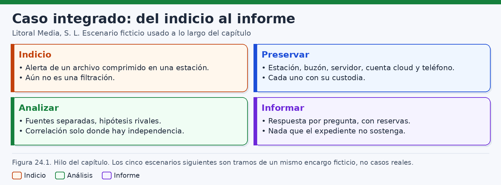
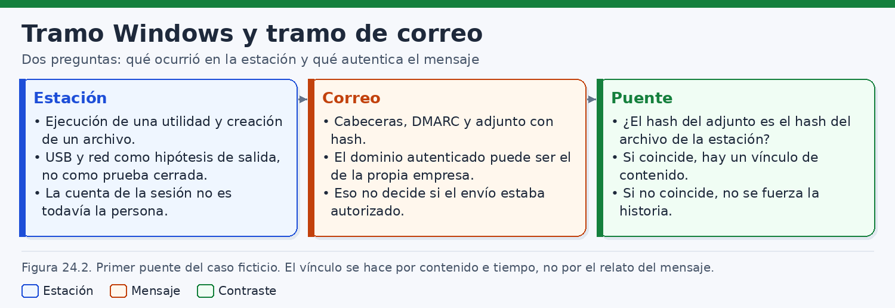
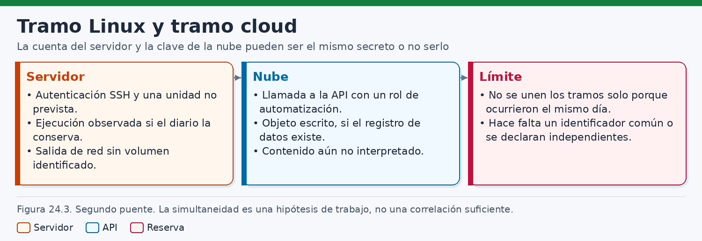
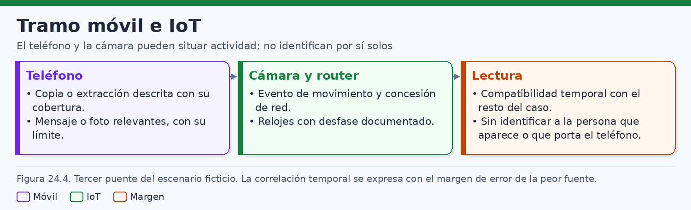
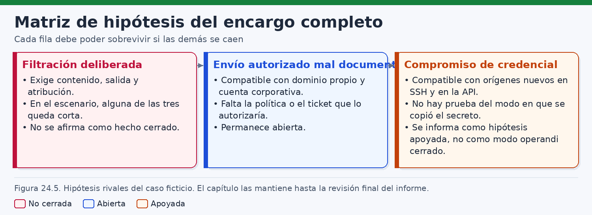
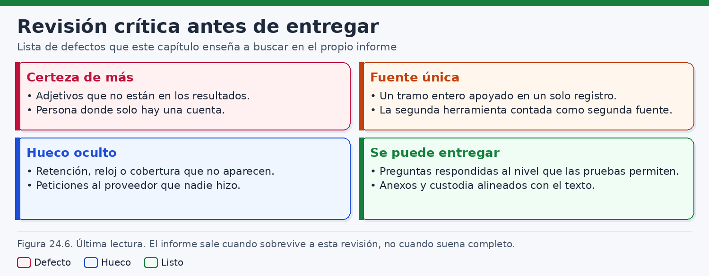

# Investigaciones completas: del indicio al informe

> *Cada fuente responde a la pregunta que su mecanismo pudo registrar. Unir tramos exige una relación demostrada; la vecindad en el calendario no la sustituye.*

## Introducción

Una investigación completa no se reconoce por el número de herramientas ejecutadas ni por el grosor del anexo. Se reconoce porque recorre, sin saltos de lógica, el camino que va de un indicio a un informe: conserva lo que todavía puede conservarse, examina cada fuente según su semántica, contrasta hipótesis rivales y escribe solo aquello que el expediente sostiene. El método es el de los capítulos anteriores. Cambia el escenario. Los encargos que el libro ha usado para Windows, Linux u otros entornos llevan otros nombres y no continúan aquí. Lo que continúa es la disciplina: separar la **observación**, la **inferencia técnica** y la **hipótesis**, y no tratar una cuenta, un reloj o una fecha compartida como si ya fueran una persona y una causa.

Este capítulo sigue un solo encargo ficticio de **Litoral Media, S. L.**, un medio de comunicación inventado. Los nombres, los buzones, el dominio `litoral.example`, los identificadores de equipo y las direcciones son de laboratorio documental. No corresponden a personas, empresas ni redes reales. Las horas se normalizan a `Europe/Madrid`. El 4 de marzo de 2026 esa zona iba una hora por delante de UTC; la conversión es aritmética de calendario y no corrige por sí sola un reloj desviado. Cualquier cifra horaria de las páginas siguientes es ilustrativa y debe leerse con el margen que cada fuente arrastra.

El indicio de partida es estrecho. A las 18:55 de esa tarde, la monitorización de la redacción genera una alerta: en la estación `LM-RED-07` aparece un archivo comprimido. La figura 24.1 recoge el hilo que el capítulo no debe romper. La alerta es un motivo para preservar y para preguntar. Todavía no es una filtración, ni un fraude, ni la identificación de quien estaba sentado ante el teclado. Confundir el texto de la alerta con el hecho que habrá que probar es el primer atajo que el informe tiene prohibido.



El encargo `ENC-LM-2026-014`, firmado por la dirección de cumplimiento, pide examinar los sistemas que el turno de redacción pudo usar esa tarde, sin anticipar que todos formen un solo hecho. La preservación cubre cinco núcleos, cada uno con su propia custodia: la estación, el buzón corporativo, el servidor de archivo, la cuenta de automatización en la nube y el teléfono del turno. En el tramo móvil se añaden, con actas separadas, la cámara de la sala y el router que concede la red local. Ninguno de esos objetos hereda el hash ni la cadena de otro. Una bolsa única de «evidencia del incidente» borraría precisamente la independencia que luego hará falta para correlacionar.

El análisis mantiene las fuentes separadas y las hipótesis rivales vivas hasta que una relación se demuestre. La correlación se admite donde hay independencia de verdad: dos componentes distintos que registran el mismo acto, o un resumen criptográfico calculado sobre dos objetos comparables. No se admite donde solo hay proximidad en el reloj, ni donde una segunda herramienta vuelve a leer el mismo fichero y se presenta como una segunda fuente. El informe responde por pregunta, con reservas, y calla lo que el expediente no sostiene. Esa es la diferencia entre un relato coherente y un dictamen entregable.

Conviene fijar el vocabulario antes de entrar en los tramos. Una **observación** es lo que una fuente registra dentro de su cobertura: un evento, un metadato, un resultado de autenticación, un resumen calculado en el laboratorio. Una **inferencia técnica** une observaciones mediante la semántica conocida del mecanismo, y arrastra las condiciones de esa semántica. Una **hipótesis** es una explicación que todavía puede caer. Puede estar apoyada, abierta o no cerrada. Ninguno de esos tres estados equivale a un hecho probado. El capítulo los usa en la matriz final y no los adelanta como conclusión del primer tramo.

Las compilaciones de Windows, las políticas de auditoría, el nivel de registro de SSH, la retención del diario, el desfase de una cámara y el alcance de un registro de auditoría en la nube cambian. Cada ejemplo dice qué había que comprobar en este expediente ficticio. Las órdenes se ejecutan sobre copias de laboratorio o sobre exportaciones ya obtenidas. No autorizan a intervenir sistemas ajenos. El capítulo no describe procedimientos de intrusión, de elaboración de un mensaje engañoso ni de ocultación. Describe cómo leer lo conservado y cómo impedir que el informe diga más de lo que las fuentes dan.

Los cinco tramos siguientes son escenarios de un mismo encargo, no cinco casos reales. El primero se queda en la estación. El segundo cruza esa estación con el correo y enseña qué une un hash. El tercero lee el servidor. El cuarto lee la cuenta de la nube y no la pega al servidor por la fecha. El quinto sitúa un teléfono y una cámara dentro de un margen, sin ponerles un nombre. El sexto escribe el informe breve y lo hace pasar por la revisión que elimina los adjetivos de más.

## 1. Investigación de un equipo Windows

### 1.1. La alerta, el alcance y la custodia de la estación

La alerta de las 18:55 nombra un archivo comprimido en `LM-RED-07`. El analista la archiva como indicio de apertura y reconstruye las preguntas sin heredar sus adjetivos. «Archivo comprimido» puede comprobarse en la imagen. «Filtración» no puede comprobarse en la alerta. Entre la creación del archivo y el inicio de la preservación, a las 19:20, transcurre un intervalo que el informe declara: la imagen refleja el estado adquirido a partir de esa hora, y los registros conservados hablan de momentos anteriores. Esa diferencia de relojes de trabajo —el reloj de los hechos y el reloj de la respuesta— se mantiene visible para no mezclar una adquisición con el acto investigado.

La estación es un puesto de redacción unido al dominio de la empresa. La imagen de bloques se identifica como `ADQ-LM-WIN-01`, distinta del objeto `OBJ-LM-WIN-01`. El acta de custodia de este núcleo no sirve para el buzón, ni para el servidor, ni para el teléfono. Se anotan la hora de inicio y de fin de la adquisición, la cuenta técnica usada, el hash de la imagen y las incidencias. Un hash de la imagen no es el hash del archivo comprimido. Son objetos distintos, y el informe los citará con identificadores que no se prestan.

El alcance de este tramo incluye el sistema de archivos, los registros de seguridad y de sistema necesarios para la sesión y la ejecución, los artefactos de dispositivos de almacenamiento conectados y el rastro de red que la propia estación o el perímetro hayan conservado sobre ella. No incluye el correo privado de los trabajadores, ni sus teléfonos particulares, ni una exploración abierta de toda la red. Si un hallazgo exigiera ese material, se pediría una ampliación. Hallar una credencial en un perfil y probarla contra un servicio no es una ampliación: queda fuera del encargo.

Antes de interpretar, se documenta la versión. En la copia figuran la edición y la compilación de Windows, el nombre del equipo, la zona horaria configurada y la condición de equipo unido al dominio. Esos datos sitúan los artefactos; no convierten una guía de laboratorio en una descripción válida para cualquier compilación. Prefetch, la auditoría de creación de procesos y el registro de la línea de órdenes dependen de políticas. En este expediente esas fuentes están presentes para los hechos que se citan, y el informe lo dice así, no como si toda estación del mundo las tuviera.

La estación sincronizaba la hora con el controlador de dominio. La comparación posterior, hecha sobre los eventos de tiempo disponibles en la copia, deja un desfase residual de pocos segundos frente a la referencia del dominio. Ese residual no se arrastra, sin más, al teléfono ni a la cámara. Cada fuente tendrá su propia cuenta. Aquí basta para tratar las horas de la estación como horas de dominio, con una incertidumbre de segundos, no de minutos.

### 1.2. La sesión pertenece a una cuenta corporativa

El canal de seguridad conservado registra un inicio de sesión correcto de la cuenta `LM\sala.edicion` a las 16:41:08, de tipo interactivo local, y un cierre a las 17:28:40. Esos eventos son una observación sobre la cuenta, el equipo y el tipo de inicio. `sala.edicion` es una cuenta corporativa del turno de redacción. El directorio la asocia a un grupo de uso compartido, no a la ficha de una sola persona. Varias personas del turno conocen su uso. El puesto permanece en la sala, y la práctica de la redacción —documentada por la propia empresa como hábito, no como prueba de un acto— admite que la sesión siga abierta durante el relevo.

La persona que escribió, que insertó un dispositivo o que miraba la pantalla no está nombrada en el evento. La cuenta es la prevista para ese puesto, de modo que el silencio del evento tampoco señala a un extraño. El informe dirá «la cuenta» cada vez que el expediente no dé otra cosa. El perfil `C:\Users\sala.edicion\` contiene el rastro de esa cuenta en ese equipo; no reparte los actos entre quienes pudieron sentarse. En esta imagen la ruta es la indicada y se comprueba en la copia.

El ejemplo siguiente se ejecuta sobre una copia del registro exportado, en un puesto de laboratorio. Lee el identificador del evento y el nombre de cuenta desde el XML, no desde el texto localizado del mensaje, porque ese texto cambia con el idioma y con la plantilla.

```powershell
# Copia de trabajo. No se abre el canal en vivo del equipo original.
# El Id 4624 y los nombres de campo se comprueban en la compilación adquirida.
Get-WinEvent -Path 'D:\caso-lm\copias\Security.evtx' -FilterXPath '*[System[(EventID=4624)]]' |
  ForEach-Object {
    $xml = [xml]$_.ToXml()
    [pscustomobject]@{
      HoraUtc = $_.TimeCreated.ToUniversalTime().ToString('o')
      Cuenta  = ($xml.Event.EventData.Data | Where-Object Name -eq 'TargetUserName').'#text'
    }
  }
```

Una segunda herramienta que vuelva a parsear el mismo `Security.evtx` puede validar el parser. La fuente sigue siendo el canal de seguridad de aquella estación. El criterio importará en la revisión final, cuando un anexo liste dos programas y alguien llame a eso corroboración independiente.

### 1.3. Ejecución de la utilidad y creación del archivo

Dentro de la sesión, el canal de seguridad conserva un evento de creación de proceso, disponible porque la auditoría correspondiente estaba activa en la imagen examinada. A las 16:52:17 la cuenta `sala.edicion` aparece asociada a la ejecución de la utilidad de compresión incluida en la imagen corporativa, con ruta de programa bajo el directorio de utilidades del puesto. La línea de órdenes, registrada en esta política y no en todas, incluye la ruta de salida `C:\Users\sala.edicion\Documents\notas-consejo-marzo.zip`.

El archivo está en la imagen adquirida. Su tamaño es de 1.843.221 bytes. El laboratorio calcula SHA-256 sobre esos bytes y conserva el resumen en el anexo con el identificador `H-LM-01`. Los metadatos de archivo consultados sitúan la creación a las 16:53:02 y una última escritura muy próxima, sin otra escritura posterior dentro de la ventana examinada. El analista anota qué atributo temporal usó el programa de lectura y no trata una sola marca como historia completa del objeto. El resumen describe el archivo en el momento de la adquisición. La cercanía entre creación y última escritura, sumada a la ausencia de escrituras ulteriores en lo consultado, permite inferir que el contenido adquirido es compatible con el contenido creado en esa ventana. La inferencia caería si apareciera una escritura intermedia no vista.

Prefetch conserva, en esta estación, una entrada de la misma utilidad cuya última ejecución es compatible con las 16:52:17, dentro de la resolución propia de ese artefacto. Prefetch y el evento de proceso son mecanismos distintos: uno nace del sistema de arranque de programas y otro de la auditoría. Su acuerdo refuerza la observación de que la utilidad se ejecutó en esa franja. No amplía la observación hasta decir quién de entre el turno la lanzó, ni hasta decir que el archivo salió del equipo. La versión de Prefetch y el significado de cada marca temporal se comprueban en la compilación; una columna llamada «última ejecución» no es la fecha del fichero `.pf`.

La utilidad figura en el inventario de software de la imagen corporativa. Su ejecución, por sí sola, entra en el trabajo ordinario del turno, que comprime materiales. El laboratorio enumera en anexo los miembros del archivo y no los reproduce en el informe: el texto interno no hace falta para las preguntas del encargo. En el vocabulario de ATT&CK, comprimir con una utilidad se discute en la familia del archivado. La etiqueta ordena la conversación con el equipo de seguridad. No sustituye al evento, al Prefetch ni al hash. La inferencia se detiene en la ejecución y en la creación del archivo dentro de la sesión de `sala.edicion`. El operador humano, la autorización de un envío y la salida del archivo siguen abiertos.

### 1.4. El USB y la conexión, como hipótesis de salida

Hay rastro de un dispositivo de almacenamiento USB. Los registros de instalación de dispositivos de la estación muestran una conexión a las 16:58:41 y una retirada a las 17:06:11, dentro de la sesión. El identificador de ejemplo del dispositivo es `4A91-LM-USB-07`. La observación es de conexión: el equipo vio un almacenamiento extraíble en ese intervalo. El dispositivo no está entre los objetos adquiridos. No existe, por tanto, un hash de destino con el que comparar `H-LM-01`.

Tampoco la estación conserva una referencia fiable que sitúe el archivo completo en el volumen de ese USB. Una hipótesis de copia es compatible con la secuencia —archivo creado, después dispositivo conectado, después dispositivo retirado— y la compatibilidad no es la copia. Un bloqueo, una exploración del dispositivo, una copia parcial o una conexión sin escritura producirían un rastro de conexión parecido. El informe puede decir que el USB es una hipótesis de salida. No puede decir que el archivo salió completo por ese canal.

Hay, además, una conexión de red. El registro de perímetro consultado muestra, a las 17:01:19, un flujo desde la dirección de la estación hacia `203.0.113.50` por el puerto 443. La dirección pertenece al rango de documentación usado en el ejemplo; no identifica un operador real. El flujo aporta tiempo, direcciones y puerto. La exportación consultada no incluye el nombre de un fichero, ni un resumen del contenido, ni un volumen que permita reconocer el archivo de 1.843.221 bytes. Una conexión cifrada de un puesto de redacción puede ser una actualización, una consulta o un envío. Con los campos disponibles, la hipótesis de que por ahí salió el archivo completo permanece sin cerrar, en el mismo grado que la hipótesis de que el flujo no tiene relación con el archivo.

| Fuente de la estación | Observación en este expediente | Inferencia que sí se sostiene | Pregunta que sigue abierta |
|---|---|---|---|
| Inicio y cierre de sesión | `sala.edicion` en `LM-RED-07`, 16:41–17:28 | La sesión es de esa cuenta corporativa | Qué persona del turno la usó |
| Creación de proceso y Prefetch | Utilidad de compresión a las 16:52 | La utilidad se ejecutó en la sesión | Quién la lanzó y con qué permiso interno |
| Metadatos y hash del archivo | `notas-consejo-marzo.zip`, `H-LM-01`, 1.843.221 bytes | Existió ese contenido en la estación al adquirir | Si ese contenido salió completo |
| Registro USB | Conexión y retirada dentro de la sesión | Hubo un almacenamiento extraíble conectado | Si el archivo se copió entero en él |
| Flujo de perímetro | Conexión hacia `203.0.113.50:443` | Hubo una conexión desde la estación | Si transportó el archivo completo |

La tabla cierra el tramo. El USB y la conexión siguen como hipótesis de salida porque hay rastro y porque el rastro no llega al archivo. El puente con el correo, si existe, tendrá que construirse con otro material.

### 1.5. Búsquedas negativas y lo que el tramo no hereda

El cuaderno anota lo que se buscó y no se usó. El puesto no aportó un agente de prevención de fugas, y esa ausencia no equivale a una copia realizada. No se usó el historial de un navegador para nombrar a una persona, ni se abrió una sesión con credenciales del perfil. Hacia el tramo siguiente solo sale, como candidato a comparación, `notas-consejo-marzo.zip` con `H-LM-01`, su tamaño, su ruta, su hora de creación y la cuenta de la sesión. El USB, la conexión y la identidad humana salen como pregunta. Un mensaje, un SSH o un objeto en la nube que aparezcan después no convierten esta sesión en su origen.

## 2. Análisis de un correo fraudulento y posible filtración de datos

### 2.1. Cómo entra el mensaje en el encargo

El segundo núcleo de custodia es el buzón y el flujo de correo del dominio, objeto `OBJ-LM-MAIL-01`, exportación `ADQ-LM-MAIL-01`. Se obtiene del sistema de correo de la empresa, con su propia acta, su hash de contenedor y su ventana: la tarde del 4 de marzo, con holgura respecto de la sesión de la estación. El analista no descarga el buzón con una contraseña hallada en `LM-RED-07`. Pide la exportación por el cauce del encargo.

El índice del capítulo habla de un correo fraudulento y de una posible filtración porque así se formuló la preocupación inicial: un mensaje con un adjunto, relacionado con la alerta del archivo, que alguien teme falso o indebido. Esas dos palabras son la pregunta, no el hallazgo. El trabajo consiste en decir qué se observa en el mensaje, qué autentican los mecanismos de correo y qué relación hay, si la hay, con `H-LM-01`. El relato que el propio mensaje haga de sí mismo —asunto, cuerpo, nombre visible del remitente— no es el puente.

En la exportación aparece un mensaje tratado por la pasarela `correo.litoral.example` a las 17:04:36, aceptado y retransmitido dentro del flujo del dominio. No hay acuse del proveedor del destinatario visible. El correo sale o llega a ese flujo; un tercero que lo hubiera recibido, abierto o conservado no consta. El asunto y el cuerpo quedan en el anexo y no se adoptan como narración de los hechos.

### 2.2. Cabeceras que afirman y resultado que autentica

Un mensaje de correo, en el formato habitual, acumula cabeceras de naturaleza distinta. `From`, `Date` y `Message-ID` son afirmaciones de quien compone o retransmite el mensaje. Cada salto suele anteponer un `Received`, de modo que el de más arriba suele ser el más reciente. Las líneas `Received` escritas antes del primer sistema de confianza de la investigación pueden ser falsas. En este expediente, el primer sistema de confianza es la pasarela de Litoral Media, porque la exportación sale de ella y el encargo alcanza su registro. Lo anterior a esa pasarela se lee como dicho, no como visto.

El fragmento siguiente es ilustrativo. Resume campos hallados en `ADQ-LM-MAIL-01`; no es un volcado íntegro ni un modelo para fabricar mensajes.

```text
Received: from correo.litoral.example
    by correo.litoral.example with ESMTPS
    id LM20260304-170436; Wed, 4 Mar 2026 17:04:36 +0100
From: sala.edicion@litoral.example
To: buzon@archivo-norte.example
Date: Wed, 4 Mar 2026 17:04:30 +0100
Message-ID: <lm-20260304-170430@litoral.example>
Authentication-Results: correo.litoral.example;
    dkim=pass header.d=litoral.example header.s=sel2026;
    spf=pass smtp.mailfrom=litoral.example;
    dmarc=pass header.from=litoral.example
```

`From` muestra `sala.edicion@litoral.example`. El parecido con la cuenta de la estación es una coincidencia de nombre que hay que anotar y no convertir en identidad de persona. `To` muestra `buzon@archivo-norte.example`, otro identificador ficticio. `Date` es una afirmación del emisor, aquí a pocos segundos de la hora de la pasarela; el acuerdo no otorga verdad al cuerpo. `Message-ID` sirve para citar el objeto, no para creer su historia.

La autenticación se lee en `Authentication-Results`, añadido por la propia pasarela. Conviene separar los mecanismos, porque un resultado global arrastra matices que el adjetivo «válido» borra. SPF autentica el servidor del sobre —el `MAIL FROM` o el `HELO`—, no el `From` visible por sí solo. Sus resultados posibles incluyen `none`, `neutral`, `pass`, `fail`, `softfail`, `temperror` y `permerror`. DKIM firma un conjunto de cabeceras y el cuerpo; el resultado se mira con el dominio de `d=` y el selector. DMARC comprueba si SPF o DKIM alinean con el dominio del `From`, y la política publicada puede ser `p=none`, `quarantine` o `reject`. Un `pass` no prueba que el contenido sea verdadero ni que lo escribiera una persona concreta.

En el fragmento, SPF pasa para el sobre de `litoral.example`, DKIM pasa con `d=litoral.example` y selector `sel2026`, y DMARC pasa alineado con `header.from=litoral.example`. El dominio autenticado puede ser, y en esta observación es, el de la propia empresa. Eso debilita la hipótesis de una suplantación externa sencilla del dominio, con los límites de siempre: el modo de alineación, el mecanismo que sostuvo el `pass`, los intermediarios y la posibilidad de que una cuenta o una aplicación de la casa enviara el mensaje. No decide si el envío estaba autorizado. Una cuenta compartida, una aplicación legítima, un buzón usado por quien no debía y un envío previsto y mal apuntado pueden producir el mismo `dmarc=pass`.

ARC, cuando existe, encadena resultados a través de intermediarios. En la exportación consultada no hace falta invocarlo para leer el resultado de la pasarela propia. Si más adelante apareciera un reenvío externo, habría que mirarlo antes de fiarse de un `pass` antiguo. No es el caso del material actual.

### 2.3. El adjunto y la comparación de bytes

El mensaje lleva un adjunto. El nombre mostrado, tomado de la disposición del contenido, es `notas-consejo-marzo.zip`. El tipo declarado y el nombre pueden no coincidir; aquí el laboratorio no se fía del nombre. Decodifica el cuerpo según la transferencia MIME anotada en el mensaje y calcula SHA-256 sobre los bytes decodificados, no sobre el texto en base64. El tamaño decodificado es 1.843.221 bytes. El resumen coincide con `H-LM-01`.

Esa coincidencia es la observación central del puente. Los dos objetos —el archivo de la estación y el adjunto decodificado— tienen el mismo tamaño y el mismo resumen. El tamaño solo no habría bastado: dos archivos distintos pueden medir igual. El resumen SHA-256, calculado de forma documentada, vincula el contenido. Una segunda utilidad de hash que reproduzca `H-LM-01` valida el cálculo. Sigue siendo la misma comparación de los mismos bytes, no una fuente nueva sobre el mundo.

```bash
# Objetos ya extraídos a copias de trabajo. No se altera el mensaje original.
# Se resume el archivo de la estación y el adjunto ya decodificado.
sha256sum \
  /caso/lm/copias/notas-consejo-marzo.zip \
  /caso/lm/copias/adjunto-decodificado.bin
```

La salida de laboratorio, ilustrativa y sin corresponder a un fichero público, sería la igualdad de los dos resúmenes. El anexo guarda el valor completo. En el informe basta decir que ambos producen `H-LM-01` mediante SHA-256 sobre los bytes indicados, con la herramienta y la versión anotadas. Quien repita el cálculo ha de partir de los mismos objetos: el archivo adquirido y el adjunto decodificado, no el mensaje entero ni el adjunto todavía codificado.

La hora del archivo en la estación (16:53:02) es anterior a la de la pasarela (17:04:36). El orden es compatible con que el contenido existiera en el puesto y después apareciera en el mensaje. Ese orden y el hash forman el puente, como resume la figura 24.2. No identifican a quien envió el mensaje. Un rastro de cliente en el perfil de `sala.edicion`, de existir, seguiría siendo de la cuenta compartida.



Si los resúmenes no hubieran coincidido, el analista no habría forzado la historia: ni el asunto, ni el nombre del adjunto, ni la cercanía horaria bastan para declarar el mismo archivo. Habría quedado un mensaje del dominio y un archivo en la estación, sin vínculo de contenido. En este expediente la coincidencia sí se da. El vínculo se afirma. Lo que no se afirma es todo lo demás.

### 2.4. Qué queda fuera del hash

El hash no autoriza. No hay en el repositorio de cambios consultado, ni en la política de envío aportada al encargo, un ticket o una cláusula que autorice este mensaje hacia `buzon@archivo-norte.example`. La ausencia se predica de lo consultado. Puede existir un permiso oral, una práctica del turno o un documento que no se pidió. Por eso la hipótesis de un envío autorizado mal documentado sigue abierta: es compatible con un dominio propio alineado y con una cuenta corporativa, y le falta la política o el ticket que la cerrarían a favor.

El hash no identifica. `From` y la cuenta de Windows comparten un nombre funcional. DMARC alinea el dominio de la empresa. Nada de eso elige a una persona dentro del turno ni excluye a quien pudiera usar la cuenta o el buzón. La identidad queda fuera de lo que el resumen puede establecer.

El hash tampoco cierra la salida hacia un tercero. Establece que el contenido del archivo estaba en un mensaje del flujo de Litoral Media. No establece el acuse externo, ni la lectura, ni que el USB o la conexión de las 17:01 transportaran el mismo archivo. Esas hipótesis de canal siguen como estaban en el apartado 1. Sería un error, ahora que hay un puente sólido con el correo, reescribir el USB como «la copia que faltaba» o la conexión como «el envío paralelo». No hay bytes en esos canales que comparar con `H-LM-01`.

El tramo no elige entre un envío deliberado no autorizado, un envío autorizado mal apuntado y un uso del buzón por quien no correspondía. Aporta el contenido y la autenticación del dominio. Los tramos siguientes no heredan este puente por compartir la tarde: hará falta un identificador propio o se contarán como hechos distintos.

## 3. Investigación de un servidor Linux comprometido

### 3.1. Otro objeto, aunque el encargo sea el mismo

El servidor `lm-archivo-03.litoral.example` entra en el alcance porque el turno de redacción lo usa para el archivo de medios, no porque el hash del correo lo señale. La preservación es un núcleo distinto: imagen y exportaciones de registro bajo `OBJ-LM-LIN-01` y `ADQ-LM-LIN-01`, con acta propia. Examinar este sistema «ya que estamos» y luego contarlo como continuación automática del ZIP sería romper la separación que la figura 24.1 pide.

Se documentan distribución, versión, zona horaria y servicio de hora. El sistema estaba en `Europe/Madrid` y usaba un cliente de sincronización frente a la referencia interna. Una comprobación posterior dejó un desfase residual inferior al segundo en el momento de la comprobación; la comprobación no es simultánea a los hechos de las 18:12, de modo que el informe usa las horas del servidor como horas locales fiables en la escala de segundos y no pretende una precisión de milisegundos. Las líneas de syslog que se citen están en hora local. Cuando se consulte el diario con hora UTC, la conversión se escribe: las 18:12 en Madrid son las 17:12 UTC aquel día.

La cuenta relevante es `svc-publicacion`, cuenta de servicio del proceso de publicación, no una ficha personal. Su UID en esta máquina es 998. Ese número no viaja a otros equipos ni se parece a un SID de Windows. Quien lea los dos tramos no debe «traducir» identidades entre sistemas. La clave pública que el servidor acepta tampoco se ha identificado todavía con ningún objeto de la nube; ese cuidado pertenece al apartado siguiente y se anticipa aquí para no cerrarlo de paso.

### 3.2. Autenticación SSH desde una dirección no inventariada

El registro de autenticación conservado muestra una aceptación de clave pública para `svc-publicacion` desde `203.0.113.18`, puerto de origen 49122, a las 18:12:44, y el cierre de la sesión PAM a las 18:31:02. La dirección es de documentación. El inventario de direcciones de administración y de automatización consultado no la contiene. La observación queda formulada así: el servidor aceptó una autenticación de clave pública para esa cuenta de servicio desde una dirección que no figura en el inventario consultado, y registró una sesión entre esas horas.

```text
Mar  4 18:12:44 lm-archivo-03 sshd[2219]: Accepted publickey for svc-publicacion from 203.0.113.18 port 49122 ssh2
Mar  4 18:12:44 lm-archivo-03 sshd[2219]: pam_unix(sshd:session): session opened for user svc-publicacion(uid=998) by (uid=0)
Mar  4 18:31:02 lm-archivo-03 sshd[2219]: pam_unix(sshd:session): session closed for user svc-publicacion
```

Estas líneas no listan los programas de la sesión, no nombran un archivo transferido y no identifican a la persona que custodiaba la clave. Una clave de servicio puede estar en un gestor, en un puesto de automatización, en la memoria de quien la instaló o en un lugar donde no debía. El nivel de registro conservado no incluye una huella de la clave que pueda compararse con otro material. Esa ausencia se declara. No se rellena suponiendo que la huella «sería» la del objeto de la nube.

El inventario negativo —la dirección no está en la lista consultada— debilita la hipótesis de un origen habitual y no la elimina. Un salto nuevo, una red de un proveedor aún no inventariada o una anotación pendiente producirían el mismo hueco. El dato se guarda como origen nuevo respecto del inventario, que es lo que más adelante podrá apoyar una hipótesis de compromiso de credencial, sin cerrar el modo en que la credencial se obtuvo o se usó.

No se intenta usar la clave hallada, si es que alguna copia de material de clave apareciera en la imagen, para entrar en otro sistema. El encargo lee lo conservado. No prolonga el acceso.

### 3.3. La unidad que el inventario de configuración no tiene

En la copia del sistema de archivos aparece `/etc/systemd/system/cola-medios.service`. El inventario de configuración con el que Litoral Media despliega unidades en este servidor no la contiene. La marca de modificación del fichero de unidad cae, en los metadatos conservados, minutos después de la autenticación, en torno a las 18:16. Una marca de modificación es compatible con un cambio en esa franja; no firma un autor.

El fragmento, leído de la copia y no activado en ningún equipo, muestra una unidad mínima:

```ini
# Fragmento ficticio de la copia. No se habilita ni se ejecuta.
[Unit]
Description=Cola de medios

[Service]
ExecStart=/usr/local/libexec/cola-medios

[Install]
WantedBy=multi-user.target
```

El laboratorio conserva el binario indicado como objeto aparte, calcula su resumen y no lo ejecuta. Ejecutarlo crearía efectos nuevos y podría abrir comunicaciones que no pertenecen al análisis. La lectura estática establece que la unidad existe, que no está en el inventario de despliegue consultado y que apunta a esa ruta. No establece que todas las ramas del programa se ejecutaran, ni qué bytes pudo mover.

En el vocabulario de ATT&CK, la unidad no prevista se discute junto a la persistencia por servicio, y `svc-publicacion` junto a las cuentas válidas. Esas familias ordenan una detección. No sustituyen el fichero, el inventario ni el diario, y este capítulo no describe cómo se construye una unidad para que persista.

Un cambio autorizado fuera del inventario sigue abierto. Uno no autorizado queda apoyado por la ausencia en el inventario y por la vecindad con la sesión, en el mismo host, y no queda cerrado: la marca de modificación no identifica el proceso que escribió el fichero. La auditoría de escrituras es parcial y el informe no inventa el evento que faltaría.

### 3.4. Ejecución que el diario conserva, salida que el perímetro no nombra

El diario de `systemd`, copiado y consultado en laboratorio, conserva el arranque de `cola-medios.service` a las 18:18:05 hora local y una terminación posterior informada por el gestor. Esa es la ejecución registrada. Existe porque el diario la retuvo. Si la retención hubiera sido volátil o el plazo hubiera vencido, esta observación no estaría, y su ausencia no habría podido leerse, sin más contexto, como «no se ejecutó». Aquí el contexto es el contrario: el diario persistente contiene el arranque.

```bash
# Diario copiado. --utc cambia la presentación, no corrige un reloj desviado.
# 18:18 en Europe/Madrid (UTC+1 aquel día) cae dentro de esta ventana UTC.
journalctl --directory=/caso/lm/journal-archivo --utc \
  --since='2026-03-04 17:00:00' --until='2026-03-04 17:40:00' \
  -u cola-medios.service --no-pager
```

La orden selecciona. No interpreta. El analista comprueba la versión de `journalctl`, el hash del directorio de diarios y que la unidad seleccionada es la misma cuyo fichero se leyó en la copia. Un error de lectura se conserva; no se sustituye el diario por una captura de pantalla.

El perímetro muestra un flujo de salida desde el servidor hacia `198.51.100.40` por el puerto 443, a las 18:19:40, dentro de la ventana de la sesión y poco después del arranque. La dirección es de documentación y no coincide con la conexión de la estación (`203.0.113.50`) ni con el origen SSH (`203.0.113.18`). La exportación aporta direcciones, puerto y tiempo. No aporta un volumen identificado ni un nombre de fichero. No hay resumen del contenido cifrado. Relacionar el arranque del servicio con ese flujo como causa exigiría una telemetría de proceso y conexión que esta adquisición no contiene. El informe puede situar las dos observaciones en la misma ventana del mismo host. No puede afirmar que el flujo transportara `notas-consejo-marzo.zip`, ni ningún otro fichero nombrado, ni un volumen concreto.

| Pieza en `lm-archivo-03` | Qué se observa | Qué no se observa |
|---|---|---|
| `sshd` y PAM | Aceptación de clave pública de `svc-publicacion` desde `203.0.113.18`; sesión hasta las 18:31 | Huella de la clave; órdenes ejecutadas; persona |
| Inventario de direcciones | La dirección de origen no figura en lo consultado | Que sea imposible un origen legítimo aún no inventariado |
| Fichero de unidad | `cola-medios.service` presente y ausente del inventario de despliegue | Autor de la escritura; ramas del programa |
| Diario | Arranque de la unidad a las 18:18:05 | Efecto completo de cada ejecución |
| Perímetro | Flujo de salida a `198.51.100.40:443` a las 18:19:40 | Volumen identificado; nombre de fichero; contenido |

La fila del perímetro es el límite que más suele ceder en la redacción. «Hubo tráfico de salida» es cierto en los términos de la tabla. «Se exfiltró el archivo» no lo es. Entre ambas frases se pierden el volumen, el nombre y el hash. El capítulo los mantiene perdidos a propósito: no estaban en la fuente.

### 3.5. Estado del tramo Linux al salir de él

El tramo sostiene la autenticación SSH desde un origen no inventariado, la unidad ausente del inventario de despliegue, la ejecución que el diario conserva y el flujo de salida sin volumen ni nombre. En un mismo host y en una ventana corta, esas piezas son compatibles con un uso no habitual de la cuenta de servicio. No sostienen el modo en que se obtuvo la credencial, ni un operador, ni la igualdad con el ZIP, ni la igualdad de la clave SSH con un secreto de la nube. El compromiso de credencial recibe aquí apoyo y no un modus operandi. Un cambio mal documentado sigue en pie. `H-LM-01` no aparece en las rutas del servidor que se examinaron; anotarlo no prueba que el archivo nunca pasara por la máquina. El servidor y el correo siguen sin puente demostrado.

## 4. Investigación de una cuenta cloud

### 4.1. La nube no hereda la custodia del servidor

La cuenta de automatización en la nube es el cuarto núcleo. Su exportación de auditoría se identifica como `OBJ-LM-CLD-01` y `ADQ-LM-CLD-01`, con acta distinta de la imagen de `lm-archivo-03`. La tentación de unirlos nace de la hora: el objeto de la nube se escribe a las 18:21:12, minutos después del arranque de `cola-medios.service` y del flujo de salida. La figura 24.3 pide el cuidado contrario. La simultaneidad es una hipótesis de trabajo, no una correlación suficiente. Hace falta un identificador común, o se declaran independientes.



NIST publicó en julio de 2024 la arquitectura de referencia para la preparación forense en la nube, SP 800-201, apoyada en los retos que el trabajo previo había agrupado en nueve familias: arquitectura, recogida, análisis, antiforense, primera respuesta, gestión de roles, aspectos legales, normas y formación. No hace falta enumerar cada reto para usar la lección que este tramo ilustra. La recogida depende de lo que el proveedor y el cliente hayan habilitado antes del hecho. La gestión de roles decide si una llamada de API puede atribuirse a una función o solo a un nombre de rol. El analista que llega el 4 de marzo no crea esa preparación: la encuentra hecha o no la encuentra.

En varios proveedores grandes, la actividad de administración y el acceso a datos son fuentes distintas, y las operaciones sobre objetos no siempre se conservan por defecto. El informe no cita una cifra de días de retención que la documentación concreta del contrato no haya confirmado. En este encargo, la exportación pedida sí contiene la escritura del objeto por el rol. Eso es una suerte de la configuración existente, no una propiedad universal de «la nube». El contenido del objeto, en cambio, no vino en la exportación. El hueco se declara aquí, no en un anexo que nadie enlaza.

La hora del proveedor llega en UTC. Las 17:21:12Z se convierten a las 18:21:12 en `Europe/Madrid` por el desfase de aquel día. El reloj es el del proveedor, no el NTP de la redacción. La conversión permite comparar calendarios. No demuestra que los relojes estuvieran alineados al segundo ni que la llamada y el flujo SSH compartan causa.

### 4.2. Qué registra la llamada del rol

El principal que la exportación atribuye a la llamada es el rol `rol-automatizacion-archivo`. La acción es una escritura de objeto. El nombre del objeto es `material/rotacion-20260304.bin`. El origen de la llamada que el registro conserva es `192.0.2.40`, dirección de documentación que no figura en el inventario de ejecutores de automatización consultado para ese día. Hay, por tanto, un origen nuevo en la API, en el mismo sentido en que `203.0.113.18` era un origen nuevo en SSH: nuevo respecto del inventario consultado, no «imposible».

El nombre del objeto sugiere rotación y cae en la fecha del encargo. La sugerencia es lingüística. No es una huella de clave, ni un resumen, ni una prueba de que el fichero contenga material de `svc-publicacion`. El contenido sigue sin interpretar porque los bytes no están en `ADQ-LM-CLD-01`. Interpretar un nombre es un modo rápido de cerrar de más. El capítulo no lo usa.

```bash
# La exportación ya fue obtenida por el cauce autorizado.
# El hash fija la copia de trabajo; no explica los campos del proveedor.
sha256sum /caso/lm/copias/auditoria-rol.json
# Los nombres de campo se contrastan con la documentación de esa versión
# antes de citarlos en el informe. No se inventan al redactar.
```

Una segunda herramienta que cuente las líneas del mismo JSON valida el fichero recibido. No crea un segundo testimonio de la API. La fuente única es el registro de auditoría exportado, con la cobertura que ese registro tenga. Si el informe dijera «la nube y el análisis confirman», estaría contando el laboratorio como testigo del hecho. El laboratorio es el lugar donde se lee el testigo.

La cuenta de la nube no es una persona, igual que `sala.edicion` no lo era. Es un rol de automatización. Varias canalizaciones, y quizá varias personas del equipo de sistemas, pueden estar en condiciones de asumirlo, según la política de identidad que no se ha agotado en este encargo. El evento muestra el rol y el origen de la llamada. No muestra la mano.

### 4.3. El mismo secreto, o no

La clave que el servidor aceptó y el secreto que permite usar el rol pueden ser el mismo secreto o no serlo. Para demostrar que lo son haría falta un identificador común: una huella de clave en el registro SSH comparable con bytes interpretados del objeto, un identificador de credencial repetido en las dos fuentes, un registro del gestor de secretos que documente la copia. Ninguno de esos identificadores está en el material adquirido. La huella SSH no quedó en el nivel de registro conservado. Los bytes del objeto no están en la exportación. La comparación no se ha podido hacer. Por eso no se demuestra que el objeto sea el mismo secreto que la clave SSH, y tampoco se demuestra lo contrario. El contenido permanece sin interpretar.

Este cierre declara los tramos independientes: comparten tarde, empresa y encargo, y no comparten identificador. Unirlos porque encajan en el tiempo convertiría la hipótesis de trabajo en hallazgo. Cada origen nuevo puede, aun así, apoyar por su lado la hipótesis de compromiso de credencial, sin fundir los secretos y sin prueba del modo en que se copió ninguno. El estado que corresponde es el de hipótesis apoyada, no el de un modus operandi cerrado.

### 4.4. Qué pedirle al proveedor y qué no se pidió

SP 800-201 sirve aquí como arquitectura de preguntas, no como formulario que el caso ya haya rellenado. Preguntas útiles eran: qué registro de datos estaba habilitado, qué retención cubría el 4 de marzo, si el rol puede separarse de las personas que lo asumen, si el objeto puede preservarse sin alterar su marca y bajo qué jurisdicción está el proveedor. De ellas, la exportación responde a la escritura y al principal. No responde al contenido ni a la persona.

Quedó sin hacer, y el informe lo dirá en voz alta, la petición de preservación de los bytes del objeto y la petición de un registro de asunción del rol que nombre a una identidad humana o a una canalización concreta, si el proveedor lo tuviera. También quedó sin hacer cualquier acceso al objeto con credenciales encontradas en el servidor. Esas peticiones no hechas son un hueco. Ocultarlas detrás de una frase como «la nube quedó revisada» sería el defecto que la revisión final busca.

El tramo cierra con una escritura del rol, un origen nuevo respecto del inventario y un objeto de nombre conocido y contenido no interpretado. No hay hash que lo una al ZIP ni identificador que lo una a la clave SSH. Una rotación automática legítima y mal inventariada sigue abierta: el nombre habla de rotación y el inventario de ejecutores no agota todas las canalizaciones.

## 5. Correlación de evidencias móviles e IoT

### 5.1. El teléfono como copia parcial, con cobertura escrita

El quinto núcleo es el teléfono `LM-MOV-12`, aparato corporativo del turno, no un terminal asignado en el inventario consultado a una sola persona. Se entrega al laboratorio el 5 de marzo por la mañana. La adquisición es una copia parcial, `ADQ-LM-MOV-01`, con acta propia. La cobertura se escribe antes de interpretar nada: la copia incluye un almacén parcial de notificaciones y un conjunto de miniaturas de la cámara del teléfono; no incluye el sistema de archivos completo, no incluye los datos íntegros de las aplicaciones de mensajería y no incluye `notas-consejo-marzo.zip`. La ausencia del ZIP en esta copia no demuestra su ausencia en el aparato. Ese límite viaja con cada frase que se apoye en el teléfono.

En el almacén parcial hay un fragmento de notificación de las 17:08, hora del teléfono, cuyo texto visible contiene el nombre `notas-consejo-marzo.zip`. El fragmento no es el archivo. Su resumen no es `H-LM-01` y no tiene por qué serlo: es texto de una notificación, no el ZIP. Una notificación es lo que una aplicación decidió mostrar y lo que la copia alcanzó a conservar. Puede corresponder a un mensaje, a un aviso local o a un resto incompleto. Su relevancia es el nombre y la hora, con ese límite. No es un segundo hash del adjunto y no se presentará como corroboración del puente del apartado 2.

El reloj del teléfono, comparado el 5 de marzo a las 09:40 con la referencia del laboratorio, iba unos 45 segundos atrasado. La comparación es posterior al hecho. Para un aparato que sincroniza con la red, el residual suele ser pequeño, y «suele» no es una medición del día 4. El informe adopta, para las horas del teléfono solas, una incertidumbre de un par de minutos en torno a la corrección de 45 segundos, y lo hace constar. Cuando esa hora tenga que convivir con la cámara, mandará el margen de la peor fuente, no este.

Una miniatura de la copia muestra un interior compatible con la sala y no ofrece un rostro utilizable. El encargo no emprende una identificación sobre esa imagen. La foto no dice quién portaba el teléfono.

### 5.2. La cámara, el router y el desfase documentado

La cámara `CAM-SALA-02` y el router `rt-sala-01` son fuentes del tramo de internet de las cosas, distintas del teléfono, distintas entre sí y distintas de la nube del fabricante. Se preservan el 5 de marzo desde el grabador local y desde el propio router. No se preserva la nube del fabricante de la cámara. No se abre el aparato por depuración ni se extrae firmware. El encargo lee exportaciones ya obtenidas por el cauce de administración de Litoral Media.

La cámara conserva un evento de movimiento en la zona del puesto `LM-RED-07` y un fotograma asociado. En el fotograma aparece una persona. La resolución, el ángulo y la distancia no permiten identificarla. Hay elementos compatibles con más de un ocupante de la sala; el informe no necesita resolver cuántos para cumplir su límite: no identifica a la persona que aparece. El reloj de la cámara, medido también el 5 de marzo a las 09:40, iba 8 minutos y 20 segundos adelantado respecto de la referencia. La medición no es simultánea al fotograma del día 4 y no se conoce la deriva. Por eso el analista no corrige «8 minutos 20 segundos» como si fuera una constante exacta. Documenta el desfase y adopta, para cualquier afirmación que use esta cámara, un margen de ±10 minutos alrededor de la hora corregida. Ese margen es una decisión del expediente, escrita en el cuaderno, no una ley general de las cámaras.

El router conserva una concesión de red —una asociación del interfaz inalámbrico del teléfono, en los términos del registro de este equipo— para el identificador de interfaz que la copia parcial de `LM-MOV-12` también muestra. La hora bruta del router, corregida por un atraso medido de 40 segundos en la misma comparación del día 5, cae dentro de la sesión de la estación, con una incertidumbre de aproximadamente un minuto. La concesión sitúa ese interfaz en la red de la sala. No sitúa a la persona que porta el teléfono. Un aparato del turno puede estar asociado mientras lo deja alguien sobre la mesa.

La figura 24.4 reúne las tres piezas y el modo de leerlas. La copia se describe con su cobertura. El evento de movimiento y la concesión de red se leen con sus relojes. La correlación temporal usa el margen de la peor fuente.



### 5.3. Una compatibilidad que cabe en el margen, y solo eso

Conviene hacer la aritmética a la vista. El fotograma lleva en el reloj de la cámara las 17:12:00 del 4 de marzo. El reloj va adelantado 8 minutos y 20 segundos, de modo que la hora corregida de partida es las 17:03:40. El margen de ±10 minutos, exigido por la medición tardía y por la deriva desconocida, produce un intervalo aproximado de 16:53 a 17:14. Ese intervalo solapa la sesión de `sala.edicion`, la creación del archivo, la conexión USB, la conexión de red de la estación y el paso del mensaje por la pasarela. La solapación es real dentro del margen. Es también ancha: diez minutos a cada lado caben muchos actos de un turno de redacción que no son el acto investigado.

La notificación del teléfono, corregida por su atraso de 45 segundos y con su incertidumbre de un par de minutos, cae hacia las 17:09 y es compatible con el mismo intervalo. La concesión del router también. Cuando el informe afirma compatibilidad conjunta del teléfono, de la cámara y del router con la sesión, expresa esa compatibilidad con el margen de la peor fuente, que es la cámara. Cuando afirma solo que el interfaz del teléfono recibió una concesión, puede usar el margen del router, y lo dice. Mezclar los dos márgenes para que todo parezca preciso al segundo sería esconder el hueco.

La compatibilidad dentro del margen no identifica a quien aparece ni a quien porta el teléfono. La cuenta es compartida y el aparato es de turno. El nombre repetido en la notificación no es `H-LM-01` ni demuestra una salida por el teléfono.

### 5.4. Fuentes que serían distintas si se hubieran pedido

El dispositivo, el grabador, el router y la nube del fabricante pueden registrar aspectos distintos de un mismo aparato. En esta fase se tienen la copia parcial, el grabador y el router. La nube del fabricante y el registro completo de la aplicación que originó la notificación no se pidieron. Podrían afinar la hora o vaciar de relevancia el fragmento, y el informe no simula ese resultado. Lo que sí queda dicho es la compatibilidad dentro del margen de la peor fuente, sin identidad de persona, sin hash nuevo y sin autorización del mensaje.

## 6. Elaboración y revisión crítica de los informes finales

### 6.1. Qué significa cerrar el encargo

El 11 de marzo de 2026 el laboratorio cierra la fase con el material recibido. «Informe final» significa, en este capítulo, informe entregable de la fase: responde a las preguntas del encargo al nivel que las pruebas permiten, declara reservas y no espera a una perfección que las fuentes no van a dar. No significa que las hipótesis abiertas se hayan convertido en hechos. La guía de integración de técnicas forenses en la respuesta a incidentes y la guía de gestión de incidentes recuerdan, en planos distintos, que el análisis alimenta la decisión y no la sustituye. Contener una cuenta, pedir un ticket o avisar a un proveedor son decisiones de la empresa. El dictamen no las disfraza de conclusiones retrospectivas sobre el 4 de marzo.

El destinatario es la dirección de cumplimiento de Litoral Media, con copia técnica para quien custodie los objetos. El lenguaje evita el nombre de pila, el adjetivo de intención y el verbo de salida cuando la salida no está en una fuente. Cada afirmación lleva, en el cuerpo o en el anexo citado, el identificador del objeto. Un párrafo que no pueda señalar `ADQ-LM-WIN-01`, `ADQ-LM-MAIL-01`, `ADQ-LM-LIN-01`, `ADQ-LM-CLD-01` o `ADQ-LM-MOV-01` no entra en el informe, salvo que sea método o reserva.

La cronología única que a continuación se resume no es una cadena causal. Es un índice de observaciones ya justificadas en los apartados anteriores, con la relación que el encargo se niega a afirmar. Las horas de la estación, de la pasarela, del servidor y de la API caben en una incertidumbre de segundos o de la conversión UTC declarada. Las horas de cámara que se usen en el texto, no en esta tabla de hechos de sistema, llevan el margen de ±10 minutos.

| Hora (Madrid) | Observación | Objeto | Relación que no se afirma |
|---|---|---|---|
| 16:41–17:28 | Sesión de `sala.edicion` | `ADQ-LM-WIN-01` | Identidad de una persona |
| 16:52–16:53 | Ejecución de la utilidad y creación del ZIP `H-LM-01` | `ADQ-LM-WIN-01` | Salida del archivo |
| 16:58–17:06 | Conexión USB | `ADQ-LM-WIN-01` | Copia completa |
| 17:01 | Flujo hacia `203.0.113.50:443` | Perímetro de la estación | Transporte del ZIP |
| 17:04 | Mensaje en el flujo del dominio, DMARC alineado, adjunto `H-LM-01` | `ADQ-LM-MAIL-01` | Autorización; acuse externo; persona |
| 18:12–18:31 | SSH de `svc-publicacion` desde `203.0.113.18` | `ADQ-LM-LIN-01` | Quién custodiaba la clave |
| 18:16–18:18 | Unidad no inventariada y arranque en el diario | `ADQ-LM-LIN-01` | Efecto completo; autor de la unidad |
| 18:19 | Salida hacia `198.51.100.40:443` | Perímetro del servidor | Volumen; nombre de fichero |
| 18:21 | Escritura del objeto por el rol, origen `192.0.2.40` | `ADQ-LM-CLD-01` | Que el objeto sea la clave SSH |
| Margen ±10 min en torno a las 17:04 corregidas | Movimiento de cámara, notificación parcial, concesión de red | Móvil e IoT | Identidad de quien aparece o porta el teléfono |

La fila del correo es el único puente de contenido con la fila del ZIP. El resto de las filas comparten encargo y tarde. La tabla las deja vecinas y no las casa.

### 6.2. La matriz que debe sobrevivir entera

Tres hipótesis tienen que poder sostenerse cada una aunque las otras caigan. No se ordenan por la preferencia de quien encargó el trabajo. Se ordenan por lo que exigen y por lo que el expediente tiene. La figura 24.5 las deja en el estado que este cierre respeta.

La **filtración deliberada** exige contenido, salida y atribución. El contenido del ZIP y el del adjunto están vinculados por `H-LM-01`: esa parte no queda corta. La salida, en el sentido que la hipótesis necesita —el archivo completo por un canal demostrado, con llegada a un tercero—, queda corta: el mensaje está en el flujo de la empresa y falta el acuse externo; el USB y las conexiones no tienen el archivo. La atribución a una persona queda corta en todos los tramos. Como la hipótesis exige las tres y alguna —en realidad, la salida cerrada y la atribución— no está, no se afirma como hecho cerrado. Su estado es **no cerrada**.

El **envío autorizado mal documentado** es compatible con el dominio propio alineado y con la cuenta corporativa del turno. Falta la política o el ticket que lo autorizaría, en lo consultado. Nadie ha presentado tampoco una prohibición escrita que convierta la ausencia de ticket en infracción demostrada. Su estado es **abierta**.

El **compromiso de credencial** es compatible con orígenes nuevos en SSH y en la API, con la unidad no prevista y con la ejecución registrada. No hay prueba del modo en que se copió el secreto, ni un identificador que obligue a considerar la clave del servidor y el objeto de la nube como el mismo secreto. Su estado es **apoyada**, no el de un modus operandi cerrado.



| Hipótesis | Estado | Lo que el expediente le da | Lo que le falta para otro estado |
|---|---|---|---|
| Filtración deliberada | No cerrada | Vínculo de contenido `H-LM-01` entre estación y adjunto | Salida completa demostrada y atribución |
| Envío autorizado mal documentado | Abierta | Dominio propio con DMARC alineado; cuenta corporativa | Política o ticket que lo autorice |
| Compromiso de credencial | Apoyada | Orígenes nuevos en SSH y en la API; unidad no prevista; ejecución en el diario | Modo en que se copió el secreto; identificador común de los secretos |

La matriz se contrasta intentando tumbar la fila preferida. Quien espere una filtración tiene que mirar el acuse y la persona, que no están. Quien espere el compromiso ya resuelto tiene que mirar el modo de copia, que no está. Quien espere un envío autorizado tiene que mirar el ticket, que no apareció. Las tres filas permanecen, cada una con su estado. El USB y la conexión de la estación no entran en la matriz principal: hay rastro de canal y no hay bytes del archivo. La suplantación externa sencilla del dominio queda debilitada por el DMARC alineado, sin agotar los abusos de una cuenta de la casa.

### 6.3. El borrador que todavía no se puede entregar

El primer texto que el analista escribe, a solas y deprisa, suele sonar a expediente completo. Conviene conservarlo en el cuaderno, no para pulirlo con sinónimos, sino para ver qué adjetivos se han colado. El borrador de Litoral Media, antes de la revisión, decía esto:

> El empleado infiel de la redacción comprimió de forma maliciosa el archivo secreto, lo exfiltró con éxito mediante un correo fraudulento y, con la misma clave robada, comprometió el servidor Linux y la cuenta cloud. El USB y la conexión confirman la salida. La cámara lo identificaba sin lugar a dudas en el momento del envío. La filtración deliberada ha quedado demostrada.

Cada cláusula tiene un defecto localizable. «Empleado infiel» pone una persona y una intención donde solo hay una cuenta de turno. «Maliciosa» y «secreto» son adjetivos que el hash no mide. «Exfiltró con éxito» cierra una salida que el acuse no cierra. «Fraudulento» hereda el título de la preocupación y contradice, además, un DMARC alineado con el dominio propio, sin llegar tampoco a demostrar autorización. «La misma clave robada» une los secretos que el apartado 4 declaró independientes y da por hecho un robo cuyo modo no está. «Confirman la salida» convierte un rastro USB y una conexión en un archivo transportado. «Lo identificaba sin lugar a dudas» ignora el margen de ±10 minutos y la calidad del fotograma. La última frase convierte en hecho cerrado la hipótesis que la matriz mantiene no cerrada.

Hay defectos que no son adjetivos y que el mismo borrador arrastra. Apoya todo el tramo Linux en la línea de `Accepted publickey` y deduce de ella la unidad, la ejecución y el fichero saliente: una sola fuente vestida de relato completo. Cuenta el segundo programa de hash como «segunda fuente» del envío. No menciona la retención del diario, ni el desfase de la cámara, ni la cobertura parcial del teléfono. No dice que nadie pidió los bytes del objeto ni el acuse del proveedor de `archivo-norte.example`. El texto ocupa un párrafo y parece terminado. Por eso es peligroso.

### 6.4. La revisión crítica

La figura 24.6 fija la lista que este encargo aplica antes de entregar. No es una corrección de estilo. Es una lectura hostil del propio informe, hecha por quien no redactó el párrafo o, si lo redactó la misma persona, hecha al día siguiente y con la matriz al lado.



El primer defecto es la **certeza de más**. Se buscan adjetivos que no están en los resultados: fraudulento, malicioso, infiel, deliberada como hecho, robada, exitosa, indudable. Se busca una persona donde la fuente nombra una cuenta, un rol o una interfaz. La corrección no consiste en sustituir el adjetivo por un adverbio más suave. Consiste en devolver la frase a la observación. «Correo fraudulento» sale. Entra «mensaje del flujo de `litoral.example` con DMARC alineado». «Empleado» sale. Entra `sala.edicion`. «Sin lugar a dudas» sale. Entra el margen.

El segundo defecto es la **fuente única**. Un tramo entero no puede apoyarse en un solo registro. La línea SSH no prueba la unidad; el fichero de unidad no prueba el arranque; el arranque no prueba el volumen del flujo. Cada pieza cita su fuente, y la inferencia que las sitúa en la misma ventana se etiqueta como inferencia. Tampoco la segunda herramienta cuenta como segunda fuente. Dos calculadoras que obtienen `H-LM-01` validan el cálculo del mismo par de objetos. El puente sigue siendo uno. En el borrador, la frase «hash y herramienta de verificación confirman la exfiltración» cometía ese error y, de paso, cambiaba el objeto confirmado: el hash confirma contenido coincidente, no exfiltración.

El tercer defecto es el **hueco oculto**. Retención, reloj y cobertura tienen que verse. El diario del servidor se cita con su condición de persistente en esta máquina. La cámara se cita con el desfase de 8 minutos y 20 segundos y con el margen de ±10 minutos. El teléfono se cita como copia parcial, con lo que incluye y con lo que no incluye. Las peticiones que nadie hizo se listan: bytes del objeto `material/rotacion-20260304.bin`, acuse del proveedor del destinatario visible, registro de asunción humana del rol si existiera, nube del fabricante de la cámara, adquisición del USB `4A91-LM-USB-07`. Un informe que calla esas peticiones invita al lector a creer que el silencio es un resultado negativo.

El cuarto cuadro de la figura no es un defecto. Es la condición de entrega. Las preguntas quedan respondidas al nivel que las pruebas permiten. Los anexos y la custodia coinciden con el texto: cada identificador del cuerpo existe en un acta, cada hash del cuerpo se puede repetir sobre el objeto nombrado, y ningún anexo contiene un nombre de persona que el cuerpo haya prometido no usar. Cuando esas cuatro lecturas se superan, el texto puede salir. No sale cuando «ya suena completo».

La revisión de Litoral Media tachó el borrador entero y lo reescribió. No conservó una versión intermedia con los mismos verbos y menos adjetivos. Los verbos eran el problema. «Exfiltró», «robó», «identificaba» y «demostró» no se moderan: se retiran hasta que una fuente los pida. Ninguna lo hizo.

### 6.5. Informe final breve del encargo ENC-LM-2026-014

El texto siguiente es el que la revisión deja en pie. Es ficticio, como el encargo, y se ofrece como modelo de cierre, no como formulario para copiar en un caso real. Las reservas forman parte del cuerpo; no van en una nota al pie que el lector pueda saltarse.

**Encargo.** Análisis de fase cerrada el 11 de marzo de 2026 sobre la alerta de un archivo comprimido en la estación `LM-RED-07` de Litoral Media, S. L., y sobre los demás núcleos preservados con custodia separada. El método separa observación, inferencia e hipótesis. Los identificadores de ejemplo no designan personas ni redes reales.

**Estación.** Entre las 16:41 y las 17:28 del 4 de marzo hubo una sesión de la cuenta corporativa `LM\sala.edicion`. A las 16:52 se ejecutó la utilidad de compresión de la imagen corporativa y a las 16:53 se creó `notas-consejo-marzo.zip` (1.843.221 bytes, resumen SHA-256 `H-LM-01` en el anexo). La sesión es de la cuenta del turno. El expediente no identifica a una persona.

**Canales de la estación.** Hay rastro de un USB conectado entre las 16:58 y las 17:06, y de una conexión a las 17:01 hacia `203.0.113.50` por el puerto 443. Esas fuentes no demuestran que el archivo saliera completo por esos canales: el dispositivo no se adquirió y el flujo conservado no trae nombre de fichero, ni resumen, ni volumen identificable con el archivo.

**Correo.** A las 17:04 la pasarela de `litoral.example` trató un mensaje del flujo del dominio. SPF, DKIM y DMARC constan como `pass`, con DMARC alineado al dominio del `From`. El dominio autenticado es el de la propia empresa. Eso no decide la autorización ni la persona. El adjunto, una vez decodificado, produce el mismo resumen `H-LM-01`. Hay vínculo de contenido y un orden temporal compatible. No hay acuse del proveedor del destinatario visible. El relato del asunto y del cuerpo no se usa como prueba.

**Servidor.** `lm-archivo-03` aceptó una autenticación SSH de clave pública de la cuenta de servicio `svc-publicacion` desde `203.0.113.18`, dirección ausente del inventario consultado, con sesión entre las 18:12 y las 18:31. La unidad `cola-medios.service` no está en el inventario de despliegue consultado. El diario conserva un arranque a las 18:18. El perímetro conserva un flujo de salida a las 18:19 hacia `198.51.100.40:443`, sin volumen identificado y sin nombre de fichero. No se afirma que ese flujo transportara el ZIP.

**Nube.** El rol `rol-automatizacion-archivo` escribió el objeto `material/rotacion-20260304.bin` a las 18:21, desde el origen `192.0.2.40`, no incluido en el inventario de ejecutores consultado. El contenido del objeto no está en la exportación y permanece sin interpretar. No se demuestra que sea el mismo secreto que la clave SSH. La coincidencia de fecha no une este tramo con el servidor ni con el ZIP.

**Móvil e IoT.** La copia del teléfono `LM-MOV-12` es parcial y no contiene el ZIP; un fragmento de notificación menciona el nombre del archivo, con la cobertura y el límite descritos en el anexo. La cámara registró movimiento y un fotograma en el que aparece una persona no identificada; su reloj iba 8 minutos y 20 segundos adelantado, y la correlación usa un margen de ±10 minutos. El router registró una concesión de red del interfaz del teléfono. Dentro de ese margen, los tres son compatibles con la ventana de la sesión. No identifican a quien aparece ni a quien porta el teléfono.

**Hipótesis.** La filtración deliberada permanece **no cerrada**: hay vínculo de contenido y faltan la salida completa y la atribución. El envío autorizado mal documentado permanece **abierto**: es compatible con el dominio propio y la cuenta corporativa, y no consta en lo consultado la política o el ticket que lo autorizaría. El compromiso de credencial permanece **apoyado** por los orígenes nuevos en SSH y en la API, sin prueba del modo en que se copió un secreto y sin identificador común entre la clave del servidor y el objeto de la nube.

**Huecos explícitos.** No se pidieron, en esta fase, los bytes del objeto, el acuse externo, la asunción nominal del rol, la nube del fabricante de la cámara ni el USB. La ausencia de esas piezas está dicha para que no se lea como resultado negativo. Una ampliación podría cambiar el estado de una hipótesis; no autoriza a reescribir en silencio lo que esta fase observó.

### 6.6. Después del texto: anexos, segunda lectura y entrega

El informe breve no viaja solo. El anexo de objetos lista cada identificador, el hash del contenedor, el acta de custodia y la cobertura. El anexo de tiempo muestra la conversión UTC, el residual de la estación, el de la pasarela, el del servidor, los 45 segundos del teléfono, los 40 segundos del router y el margen de la cámara, con la hora en que se midió cada desfase. El anexo de hashes precisa que `H-LM-01` se calculó sobre el archivo de la estación y sobre el adjunto decodificado, con algoritmo, herramienta y versión. El anexo de búsquedas negativas incluye el ZIP no hallado en las rutas examinadas del servidor, el acuse no presente y los bytes del objeto no recibidos.

La segunda lectura, hecha con la figura 24.6 como lista, comprueba que el texto del apartado 6.5 ya no contiene los adjetivos del borrador, que ningún tramo cita un solo registro para hechos que exigían otro, que el segundo `sha256sum` no se cuenta como fuente independiente y que los huecos del último párrafo del informe coinciden con peticiones que el cuaderno marca como no realizadas. Comprueba también que la matriz del apartado 6.2 y el bloque de hipótesis del informe usan los mismos tres estados. Una divergencia entre la matriz y el sumario sería un defecto de entrega, aunque cada pieza por separado pareciera prudente.

SWGDE publica prácticas de informe y de validación que el laboratorio consulta en su versión vigente. El portal de ISO permite localizar la norma actual sin memorizar una ficha. Esas lecturas orientan el método; el expediente se sostiene sobre sus objetos. Si el anexo y el texto se separan, manda el objeto.

La entrega del 11 de marzo incluye el informe, los anexos, la matriz y la nota de revisión. El borrador tachado queda en el cuaderno de calidad y no viaja a la dirección: confundiría el hallazgo con el error de redacción. La dirección recibe el texto que sobrevive, los tres estados de la matriz y la lista de lo que esta fase no pidió.

## Conclusiones

El encargo ficticio de Litoral Media muestra el camino del indicio al informe. La alerta de un archivo comprimido justifica preservar la estación, el buzón, el servidor, la cuenta de la nube y el teléfono, cada uno con su custodia, y leer la cámara y el router como fuentes propias. No justifica un relato único. El método de los capítulos anteriores alcanza aquí su sentido de conjunto: cada tramo responde a su pregunta y solo el resumen `H-LM-01` une la estación con el adjunto.

En la estación hubo ejecución de la utilidad y creación del archivo en una sesión de `sala.edicion`, cuenta corporativa y no persona identificada. El USB y la conexión dejan rastro y no prueban una salida completa. El correo lleva DMARC alineado con el dominio de la empresa y el mismo contenido; faltan la autorización, la identidad y el acuse externo. El servidor muestra el SSH desde una dirección no inventariada, la unidad no prevista, la ejecución registrada y una salida sin volumen ni nombre. El rol de la nube escribió un objeto de contenido no interpretado, que no se demuestra idéntico a la clave SSH ni se une a los otros tramos por la fecha. El teléfono, la cámara desfasada y el router caben en el margen de la peor fuente y no identifican a quien aparece ni a quien porta el aparato.

La matriz se entrega con esos tres estados. La filtración deliberada no está cerrada: coincide el contenido y faltan la salida completa y la atribución. El envío autorizado mal documentado sigue abierto, sin la política o el ticket en lo consultado. El compromiso de credencial está apoyado por orígenes nuevos en el SSH y en la API, y el modo en que se copió un secreto no consta. Nombrar los tres estados, en lugar de elegir el que la alerta sugería, es el acto central del capítulo.

La revisión crítica no adorna ese resultado. Le quita los adjetivos, impide que una herramienta repetida finja ser una segunda fuente, obliga a escribir el reloj, la retención y la cobertura, y exige que las peticiones no hechas se vean. El informe sale cuando sobrevive a esa lectura. La calidad de una investigación completa se mide por la precisión de los puentes que sí existen y por la nitidez con la que se dicen los que no se han demostrado.

## Referencias técnicas y lecturas recomendadas

Las referencias siguientes permiten comprobar el marco de investigación, la arquitectura de preparación forense en la nube, la lectura del mensaje y el carácter meramente verbal de un catálogo de técnicas. La documentación y las normas se consultan en su versión vigente. Un capítulo no sustituye la validación de herramientas ni la autorización de un encargo concreto. ATT&CK se cita como vocabulario para nombrar familias de conducta, no como fuente del expediente ni como descripción de procedimientos.

1. **NIST.** *Guide to Integrating Forensic Techniques into Incident Response*, Special Publication 800-86: <https://csrc.nist.gov/pubs/sp/800/86/final>.
2. **NIST.** *NIST Cloud Computing Forensic Reference Architecture*, Special Publication 800-201, julio de 2024: <https://csrc.nist.gov/pubs/sp/800/201/final> y <https://doi.org/10.6028/NIST.SP.800-201>.
3. **NIST.** *Computer Security Incident Handling Guide*, Special Publication 800-61 Revisión 2: <https://csrc.nist.gov/pubs/sp/800/61/r2/final>.
4. **SWGDE.** Documentos de buenas prácticas sobre evidencia digital, adquisición, análisis, validación e informes: <https://www.swgde.org/documents/>.
5. **ISO.** Portal del catálogo de normas. La ficha vigente de cada documento se consulta ahí; este capítulo no la sustituye: <https://www.iso.org>.
6. **MITRE.** ATT&CK, vocabulario de tácticas y técnicas para formular hipótesis. No reemplaza los registros del encargo ni aporta un procedimiento: <https://attack.mitre.org/>.
7. **IETF.** RFC 5322, *Internet Message Format*. Cabeceras del mensaje, incluidas las que son afirmación de origen: <https://www.rfc-editor.org/rfc/rfc5322>.
8. **IETF.** RFC 7489, *Domain-based Message Authentication, Reporting, and Conformance (DMARC)*. Alineación con el dominio del `From` y políticas: <https://www.rfc-editor.org/rfc/rfc7489>.
9. **IETF.** RFC 6376, *DomainKeys Identified Mail (DKIM) Signatures*. Firma de cabeceras seleccionadas y del cuerpo, dominio `d=` y selector: <https://www.rfc-editor.org/rfc/rfc6376>.
10. **IETF.** RFC 2045, *Multipurpose Internet Mail Extensions (MIME) Part One: Format of Internet Message Bodies*. Tratamiento del cuerpo y de la transferencia antes de resumir un adjunto: <https://www.rfc-editor.org/rfc/rfc2045>.

### Nota sobre la reproducibilidad de los ejemplos

Los nombres del caso son ficticios. Las rutas son habituales y deben comprobarse. Los comandos se prueban en laboratorio.
